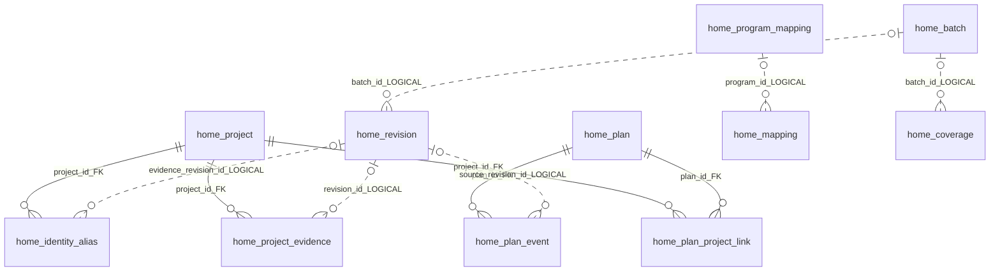

# HOME · 주택공급 정책의 실행·모니터링 마스터 안내서

**Housing Operations Monitoring & Execution · PoC 10**

문서 기준일: **2026-10-14 · Asia/Seoul**

HOME은 정책 목표를 실제 사업과 연결하고, 사업화부터 입주까지 **계획 대비 어디에서 지연되는지, 누가 어떤 조치를 해야 하는지** 판단하도록 돕는 주택공급 관리 서비스입니다. 이 README를 서비스 설명, 사용자 교육, 개편 사업의 요구사항 협의, 유지관리 인수인계의 공통 기준 문서로 사용합니다.

| 읽는 사람 | 먼저 볼 내용 |
| --- | --- |
| 정책 책임자·서비스 소개 대상 | 1. 개요, 2. 구축 목표, 4.1~4.4 조회·판단 방법 |
| 업무 담당자·데이터 검토자 | 3. 설계·오류 조정 기준, 4.5~4.6 검토·입력 방법 |
| 향후 개편 사업자·원천 제공기관 | 3.2~3.3 현행 구조, 5. 공통 키·인터페이스·책임 분담 |
| 유지관리 사업자 | 3.4~3.7 수집·품질·성능, 4.7~4.9 실행·검증·백업, 5.4 검수 기준 |

## 목차

1. [개요](#1-개요)
2. [구축 목표: 총리 요구사항](#2-구축-목표-총리-요구사항)
3. [설계 방향과 실제 구현: 매칭 오류 사례 및 조정](#3-설계-방향과-실제-구현-매칭-오류-사례-및-조정)
4. [이용 방법](#4-이용-방법)
5. [향후 개선 방향과 사업자 협의 기준](#5-향후-개선-방향과-사업자-협의-기준)

## 1. 개요

### 1.1 서비스가 해결하는 문제

주택공급 자료는 정책 보도자료, 기관 공급계획, 인허가 API, 공사 현황, 모집공고, 입주계획 등에 나뉘어 있습니다. 같은 사업도 지구·블록명, 단지명, 공구명, 임대 유형에 따라 다르게 표기됩니다. 이 자료를 그대로 합치면 중복 물량, 잘못된 단계, 누락된 일정이 발생합니다.

HOME은 원천을 판본별로 보존하고, 자료 사이의 연결 근거와 검토 상태를 DB에 저장합니다. 사용자는 정책 → 프로그램 → 사업으로 범위를 좁혀 목표·계획·현황을 보고, 사업 × 단계 수집 현황에서 그 수치의 원천과 누락 원인을 확인할 수 있습니다.

**현재 제공 범위는 수도권과 등록된 사업 기록 중심입니다.** 전국 및 모든 기관의 실사업 모집단을 확보한 서비스로 해석하지 않습니다. 인구·가구·고용·미분양 같은 지역 통계와 개별 사업의 정책 이행 실적도 별도로 관리합니다.

### 1.2 접속·관리 범위

| 항목 | 현재 구성 |
| --- | --- |
| 운영 서비스 | [HOME](https://www.minslab.kr/poc/home/) · 단축주소 `/home` |
| 정책·프로그램 추진현황 | 9·7 주택공급 확대방안 중심. 프로그램은 저장된 9·7 연결 범위에 따라 표시 |
| 지역 | 서울특별시·경기도·인천광역시. 원천마다 확보된 지역·연도·세부 범위가 다름 |
| 단계 | 정책 → 사업화 → 인허가 → 건설 → 공급 → 입주. 준공은 건설 내부 사건으로 관리 |
| 조회와 편집 | 공개 조회 / MinsLab 관리자 로그인 후 목표·연결·일정·조치 입력 |
| DB | PostgreSQL 16 + PostGIS 3.5, DB `home`, 컨테이너 `poc10-home-db` |
| 기술 구성 | 독립 FastAPI·SQLAlchemy API, HTML/CSS/JavaScript, MapLibre·Three.js, 부모 ASGI reverse proxy |
| 별도 서비스 | [주택파동 PoC 12](../12-housing-board/README.md), `/home2`. 독립 앱이며 HOME의 대체 DB나 별도 공식 실적 원장이 아님 |

9·7의 수도권 **2026~2030년 신규 착공 목표 135만 호**와 현재 연결된 사업의 계획 소계는 모집단이 다릅니다. 기존 착공 사업이나 전국 참고 통계의 큰 수치를 이 목표의 달성 실적으로 자동 전환하지 않습니다. 발표 총량 1,350,000호와 원문 연도별 목표표 합계 1,349,000호의 차이 1,000호도 임의로 배분하지 않습니다.

### 1.3 현재 상태를 읽는 기준

기능이 있어도 원천과 담당자 입력이 부족하면 정책 판단에 필요한 데이터는 미완성일 수 있습니다. 화면의 **기능 충족률**, **데이터 확보율**, **정책 목표 달성률**은 각각 다른 지표입니다.

아래는 `GET /poc/home/api/requirements-status`의 **2026-10-14 조회 스냅샷**입니다. 분모는 등록된 9·7 원천 사업 기록 194개이며, 단계 셀은 사업화~입주 5단계 × 194 = 970개입니다. 중복 가능 원천 기록을 포함하므로 고유 실사업 수나 전국 확보율로 쓰지 않습니다.

| 데이터 지표 | 당시 확인값 | 해석 |
| --- | ---: | --- |
| 지도 위치 근거가 있는 사업 | 80 / 194 · 41.2% | 대표·근사 위치 포함. 정확한 필지 확보율 아님 |
| 목표 일정과 실적 근거가 함께 있는 단계 셀 | 181 / 970 · 18.7% | 일정·물량 범위 검토를 거쳐야 지연 판단 가능 |
| 실적·진척 근거가 있는 단계 셀 | 312 / 970 · 32.2% | 실제 입주 세대수 확보율과 다름 |
| 사업명·지역·계획량이 있는 기록 | 188 / 194 · 96.9% | 상세정보 전체 항목의 완성률 아님 |
| 한 단계 이상 날짜가 있는 계획을 가진 사업 | 187 / 194 · 96.4% | 모든 단계의 계획이 완비됐다는 뜻 아님 |
| 승인된 최초 일정 기준선 | 0 / 970 | 등록 기능은 있으나 담당자 승인 자료 입력 필요 |
| 승인된 기관 배정 목표를 가진 사업 | 0 / 194 | 기관 역할·목표 등록 기능과 실제 배정자료 확보를 구분 |
| 공급 또는 입주 예정일이 있는 사업 | 134 / 194 · 69.1% | 예정일이며 실제 입주 확인과 구분 |
| 원천 링크·기준일이 있는 사업 | 194 / 194 · 100.0% | 메타데이터 존재율. 내용 정확도·최신성·전수 확보를 보증하지 않음 |

현재 건수는 홈페이지와 API에서 다시 확인합니다. 날짜가 붙은 과거 보고서는 해당 시점의 점검 기록으로 보존합니다.

## 2. 구축 목표: 총리 요구사항

총리 요구사항은 사용자가 제공한 「주택파동 핵심 기능 요구사항 및 기존 시스템 점검 명세서」의 F-01~F-12를 기준으로 관리합니다. 핵심은 **목표 대비 이행을 판단하고, 지연 원인·담당기관·조치기한까지 연결하는 분석 도구**를 제공하는 것입니다.

| ID | 요구사항 | 현재 구현·이용 화면 | 추가로 필요한 자료·업무 |
| --- | --- | --- | --- |
| F-01 | 주택공급 현황 통합 조회 | 공급 지도, 정책·프로그램·사업 조회, 범위 연동 | 전국 실사업 명단, 기관별 사업 ID, 정책 귀속 명부 |
| F-02 | 목표 대비 이행실적 관리 | 단계별 목표·현황 면적 그래프, 목표 편집, 지역·기관 비교 | 동일 범위의 연월 목표·실제 사건·인정 물량, 지역별 목표 배정 |
| F-03 | 공급 단계별 진행상황 관리 | 6단계 그래프, 단계 도달률, 사업 × 단계 근거 표 | 최초·변경승인, 실제 착공·준공·입주 근거와 전체/부분 범위 |
| F-04 | 사업별 상세정보 조회 | 사업 개요, 일정·공정·근거·입지·변경 이력 | 누락된 시행·시공기관, 정확 위치, 총세대수, 명칭 변경 대응 |
| F-05 | 연도별 공급계획·시계열 분석 | 자료연도 조회, 월별 계획·현황, 지도·그래프 기간 연동 | 과거 변경판과 단계별 연월 계획, 실제 입주 집계 시계열 |
| F-06 | 일정 및 지연 관리 | 최초 기준선·현재 예정·실제 사건, 종합 일정 점검·CSV | 담당자 승인 최초 약속, 변경사유·승인일, 실제 완료일 |
| F-07 | 지연 원인·병목 관리 | 원인 분류, 영향 물량, 책임·협력기관, 조치기한·장기 미해결 필터 | 실제 병목 사건과 발생·해결일, 조치계획, 책임기관 확인 |
| F-08 | 기관별·정책별 추진현황 | 정책–프로그램–사업 DB 연결, 기관 역할·배정 목표·실적 비교 | 공통 기관코드와 공식 목표 배정·성과 인정 자료 |
| F-09 | 국민의 공급 예측가능성 | 지역·사업별 모집·준공·입주 예정과 확정 여부 | 본 모집공고, 최신 변경 일정, 실제 입주 시작·입주량 |
| F-10 | 정보 신뢰성·갱신 관리 | 연계 다이어그램, 판본·해시, 품질 점검, 오류조치·감사 이력 | 원천 정정·취소 계보, 제공 범위, 지속적인 담당자 검증 |
| F-11 | 정책 이행상황 종합 판단 | 개요·지역·진행 한 화면, 우선 점검 사업, 공급 후 입주 시작 미확인 추세 | 같은 모집단의 실입주·미분양 자료, 위험·기관 조치 기록 |
| F-12 | 공급 전망·시나리오 분석 | 일정 6·12·24개월 이동, 기준·대안 비교, 가정 저장 | 승인 기준선, 지연 영향 범위, 장기 수요·시장 분석 자료 |

`매뉴얼 → 총리님 요구사항`에서 항목별 기능, 근거, 이용 경로, 잔여 과제와 데이터 확보율을 확인하고 CSV로 내려받을 수 있습니다. 기능 충족률은 세부 항목의 구현 평가 점수로 계산하며 통계적 매칭 정확도나 실제 정책 달성률을 뜻하지 않습니다.

입주 전망치는 원래 자료의 전망 성격과 모집단을 보존한 채 **입주 관리목표**로 채택합니다. 같은 지역·기간·정의의 실제 입주 자료가 있어야 갭을 계산합니다. 수도권 아파트 전체 입주 전망과 135만 신규 착공 원장을 섞거나, 일부 사업의 입주 시작 기록을 전체 시장 입주량으로 대신하지 않습니다.

## 3. 설계 방향과 실제 구현: 매칭 오류 사례 및 조정

### 3.1 설계 방향

원천마다 공통 사업 키가 없어 현재는 기관·지역·지구·블록·주소·호수·일정·공식 문서를 조사해 연결합니다. 조사에 따른 오차와 반복 작업을 줄이기 위해 연결 결과와 판단 근거를 DB에 저장하고 재사용하도록 구현했습니다. 장기적으로는 이 조사 기반 연결을 **기관과 공유하는 공통 기준정보**로 전환해야 합니다.


| 원칙 | 구현 기준 |
| --- | --- |
| 연결을 조회마다 다시 계산하지 않음 | 수집 후·명시적 갱신 시 후보를 저장하고 조회는 DB 연결을 사용 |
| 가능성이 높은 자료를 먼저 연결 | `REVIEW` 후보로 보존·표시하고 담당자가 최종 결정. 매칭 점수는 규칙 우선순위이며 확률 아님 |
| 검토 결과 보존 | 담당자가 확정·수정·해제한 연결을 자동 갱신으로 덮어쓰지 않음 |
| 계획·현황·목표·추정을 구분 | 원천 예정, 담당자 목표, 실제 사건, 추정 계획·시나리오를 별도 관리 |
| 근거 없는 빈칸을 채우지 않음 | 미확보를 0·미진척으로 전환하지 않음. 근거 없는 목표면·지연 확정을 만들지 않음 |
| 전체·부분 물량을 구분 | 단지·블록·유형·공고차수·공구의 포함 관계와 적용 물량을 보존 |
| 판본과 판단을 함께 추적 | 원천 ID·판본·원문·SHA-256, 판단사유·전후 값·수정 시각을 저장 |
| 단건 오류를 공통 규칙으로 개선 | 유형 분류 → 전체 유사 사례 조회 → 보완 → 재점검 → 잔여 과제 기록 |

### 3.2 현행 DB와 매칭 키

**정책·프로그램·사업의 내부 ID는 이미 존재합니다.** 부족한 것은 모든 원천 제공기관이 공유하는 동일한 사업·범위·사건 식별체계입니다. 현재 내부 ID가 있다는 사실과 기관 간 사업 동일성이 확정됐다는 사실을 구분해야 합니다.

| 키 | 현재 용도·주의점 |
| --- | --- |
| `policy_id` · 예: `POL_2025_0907` | 정책 귀속과 목표 조회. 정책 식별정보는 원천 판본·정책 설정과 함께 관리 |
| `PRG_…` | `home_program_mapping`의 프로그램 ID. 현재 프로그램 행은 한 정책을 선택하는 구조 |
| `PRO_…` | 원천 사업 레코드의 `entity_id`. 원천·자연키로 생성되므로 서로 다른 원천의 같은 사업도 별도 ID일 수 있음 |
| `HPR_…` | `home_project`의 실사업 후보 ID. 원천별 시작점과 별칭을 관리하지만 모든 중복 사업의 통합·확정이 끝난 상태는 아님 |
| `source_id + source_object_id` | 원천 시스템과 원천 고유키. 허가 관리번호·공고번호·지구/블록 등 원래 식별정보 보존 |
| `source_entity_id + source_revision_no` | 단계 근거·연결이 참조하는 특정 원천 판본. 선택한 판본을 조회 중 최신판으로 바꾸지 않음 |
| `revision_no`, `previous_id`, `payload_hash` | 변경 판본·이전 판본·내용 해시. 동시 편집 충돌 확인에도 사용 |
| 법정동 코드·PNU·주소·좌표 | 지역·필지·공간 연결 보조키. 근사 좌표나 단일 대표 필지가 사업 전체를 증명하지 않음 |

주요 화면의 기존 사업 연결은 `PRO_…`를 사용하는 경로가 남아 있습니다. `HPR_…`를 발급했다고 모든 화면·원천을 고유 실사업 기준으로 이관한 것으로 설명하지 않습니다.

현행 업무 테이블은 다음 **12개**입니다. 그 외에 Alembic 버전표와 PostGIS 관련 확장 테이블이 있습니다.

| 테이블 | 핵심 저장 내용 | 주요 연결 키 |
| --- | --- | --- |
| `home_revision` | 원천·설정·일정·근거·조치의 `kind`별 JSON과 판본 | `id`, `entity_id`, `revision_no`, `previous_id`, `batch_id` |
| `home_batch` | 수집 시도·성공/실패, 오류, 원문 manifest | `id`, `source_id` |
| `home_coverage` | 조회 지역·기간·페이지·건수·완료 범위 | `batch_id`, `source_id`, `area_code` |
| `home_project` | 안정적인 실사업 후보 | `id(HPR)`, `identity_status` |
| `home_identity_alias` | 원천 레코드와 실사업 후보의 대응·검토 | `project_id(HPR)`, 고유 `source_entity_id`, `evidence_revision_id` |
| `home_project_evidence` | 실사업 후보에 붙는 원천 판본·근거 역할 | `project_id(HPR)`, `revision_id` |
| `home_plan` | 법적 계획 후보와 상태 | `id`, `plan_type`, `legal_status` |
| `home_plan_event` | 계획 고시·변경 사건과 문서 | `plan_id`, `notice_no`, `notice_date`, `source_revision_id` |
| `home_plan_project_link` | 계획과 실사업 후보의 검토 관계 | `plan_id`, `project_id(HPR)` |
| `home_mapping` | 기존 사업→프로그램 연결, 검토·변경 이력 번호 | 고유 `project_id(PRO)`, `program_id`, `policy_id` |
| `home_program_mapping` | 프로그램→정책 연결 | `id(PRG)`, `policy_id`, `revision_no` |
| `home_audit` | 검토·목표·조치 변경의 전후 값 | `entity_id`, `action`, `recorded_at` |

아래는 현재 주요 관계입니다. **실선은 선언된 FK, 점선은 저장된 키로 해석하는 논리 참조**입니다. 논리 참조에는 기존·수동 기록이 섞일 수 있어 데이터 정비와 대응표 검증이 필요합니다.



별도 물리 테이블 없이 `home_revision.kind`로 저장하는 주요 항목:

| kind | 용도 |
| --- | --- |
| `stage_evidence`, `evidence_bridge`, `collection_link` | 단계 근거 선택·원천 간 연결·공고/입주계획 연결 |
| `delivery_setting`, `goal` | 정책·지역·사업의 단계 목표·실제 사건·입주 관측·사업 연도 목표 |
| `execution_schedule`, `execution_case`, `execution_agency`, `execution_scenario` | 일정 기준선·병목·기관 역할/목표·시나리오 |
| `collection_assessment`, `collection_repair` | 미확보 원인 판정·오류 조치·품질 상세 |
| `project_parcel`, `project_location` | 필지 후보와 대표·근사 위치 |
| `area_stat`, `unsold`, `api_request` | 지역 통계·미분양·API 연계 신청 관리 |

전체 ER·필드·원천별 키·현행/보완 비교는 [HOME 데이터 정비 방안](https://www.minslab.kr/poc/home/assets/reports/HOME_DATA_REMEDIATION_20261013.html)의 세 탭을 참조합니다. 실제 모델은 [backend/db.py](backend/db.py), 논리 연결과 단계 계산은 해당 기능의 `backend/` 모듈이 기준입니다.

### 3.3 단계·목표·집계·시각화 기준

| 단계 | 현재 의미와 원천 |
| --- | --- |
| 정책 | 정책 발표와 목표 원장. 사업 미특정 목표 잔여·단계 미확인을 정책 수립 실적으로 단정하지 않음 |
| 사업화 | 공식 사업계획·사업 추진·공모 등의 근거. 사업 유형만 같은 것은 귀속 확정 근거가 아님 |
| 인허가 | 건축HUB 허가·사업계획 승인 등. 최초 승인·변경승인·사용승인을 구분 |
| 건설 | 착공·공사 진행·실제 공정률. 예상 준공과 확인된 준공/사용승인을 내부 사건으로 관리 |
| 공급 | 분양·입주자 모집과 해당 공급 물량. 단지 총량과 금회 모집량을 구분 |
| 입주 | 입주 예정, 입주 시작 확인, 실제 입주 호수를 구분. 입주 시작 확인 사업물량은 거주 세대수 아님 |

진행 그래프는 실색 면(확인 현황), 사선 면(목표·예정), 회색 점(단계 미확인), 빨간 격차(목표 부족·지연 검토), 빨간 면(지연 확인)을 범례로 구분합니다. 범례를 선택하면 해당 의미를 강조합니다. 목표값이 없으면 목표면을 그리지 않으며 편집 기능에서는 나중에 입력할 수 있습니다.

지연은 같은 단계·모집단·물량 기준·기준일의 목표와 실제 근거로 판단합니다. 기한이 지났는데 실제 근거가 없으면 이행 확인 대상으로 남깁니다. **자료가 없다는 사실만으로 사업 지연을 확정하지 않습니다.** 최초 승인 기준선은 현재 예정과 별도로 보존합니다.

공급 지도 원형 표시의 기본값은 **전체 단계**입니다. 전체 비율은 사업화·인허가·건설·공급·입주의 서로 중복되지 않는 구성 물량 합계 / 확인 가능한 계획 물량입니다. 개별 단계 선택 시 해당 단계와 이후 단계의 물량 / 계획 물량으로 계산합니다. 따라서 공급·입주 단계로 넘어간 물량은 건설 도달률에 포함됩니다. 단계별 누적 도달량끼리는 더하지 않습니다.

건설 계획은 착공 0%~예상 준공 100%의 기간 비례 월별 추정입니다. 공식 중간 공정표가 확보된 것으로 표시하지 않으며, 날짜가 있는 실제 원천 공정률과 따로 비교합니다. 준공 예정일을 공급일이나 입주일로 대체하지 않습니다.

범위 일정은 원문·정밀도를 보존하면서 그래프·집계에는 마지막 달을 사용합니다. 예: `2027년 3분기 → 2027-09`, `2027년 하반기 → 2027-12`. `미정`, `2027년 이후`, 잘못된 날짜는 확정 월로 만들지 않습니다. 그래프 시작점은 표시 가능한 데이터가 있는 기간에 맞추며 월/연도 조회를 지원합니다.

### 3.4 원천 수집과 지역 입지 분석

| 자료군 | 주요 확보 경로 | 활용·한계 |
| --- | --- | --- |
| 정책·목표 | 정부 보도자료와 공식 PDF·후속 발표 | 발표 목표·기간·지역·명시 사업. 정책 전체 목록은 별도 확인 |
| 사업·공급계획 | LH 분양/임대계획·건설현황, SH 공개자료, GH 계획·공고, iH 관련 공개자료 | 계획과 실제 공급 구분. 기관별 전수 목록 확보는 미완료 |
| 인허가·필지 | 건축HUB 허가·동별개요·대지위치, 법정동 마스터, 공식 고시 | 허가 PK로 상세 연결. 블록 주소·불완전 지번은 확정 PNU 생성 불가 |
| 건설·준공 | LH 공정 이력·준공예정 파일, 대장, GH 사용검사/승인 문서, 서울 공개 공사·정비사업 정보 | 공구·블록·주택유형 대조. 임시 사용허가와 최종 준공 구분 |
| 공급·입주 | 청약홈, LH·SH·GH 모집공고, LH 상세 HTML·입주계획, 공식 첨부 | 목록에서 빠진 상세를 추가 수집. 입주 예정과 실제 거주량 구분 |
| 인구·가구·고용 | SGIS·KOSIS, 시도 장래가구추계 | 일반가구·주민등록 인구·사업체 종사자·거주지 취업자의 기준과 분모 구분 |
| 미분양 | 국토부 통계누리 전체/공사완료후 미분양 API | 월별 지역 지표. 개별 단지의 미입주·빈집·임대 공가로 전환하지 않음 |
| 지도·인프라 | 공식 행정경계·공동주택 용지, VWorld 및 확보된 시설 자료 | 대표 위치·근사 모델·실제 형상을 구분. 접근거리로 학교 배정·수용능력을 단정하지 않음 |

2026-10-13 적용 시 미분양은 수도권 시도·시군구 2025-08~2026-08의 13개월·1,798개 지표 기록을 확보했습니다. 전체 미분양과 준공 후 미분양의 포함 관계, 총계와 소계, 기간을 검증했습니다. 연령은 KOSIS 2026-09 수도권 70개 지역 범위의 총인구·21개 연령구간을 수집했습니다. 이는 당시 수집 스냅샷이며 최신 공개월은 수집현황에서 확인합니다.

공급 지도는 왼쪽에 정책·프로그램·사업 진행, 오른쪽에 고용·1/2/3/4/5인 이상 가구·연령·미분양·핵심 인프라를 배치합니다. 시군구 자료가 없어서 시도 자료를 참고하는 경우 그 범위를 표시합니다. 입지 지표는 사업 우선 점검의 근거이며 자동적인 정책 성과·가격 예측 점수가 아닙니다.

### 3.5 매칭 오류 사례와 전체 적용 조정

인터넷에 정보가 있다는 것과 수집·추출·동일 사업 연결·단계 분류가 완료됐다는 것은 다릅니다. 아래 사례에서 원인을 유형으로 분류하고 공통 수집기·매칭 규칙·저장·화면을 보완했습니다. **조정 적용과 담당자 최종 확인을 별도 상태로 유지합니다.**

| 오류 유형·대표 사례 | 원인 | 적용한 조정 | 남은 검증·주의 |
| --- | --- | --- | --- |
| 명칭·블록 불일치: 평택고덕 A31 | 공급/건설 원천의 `A31 / Ab31` 표기와 별칭 차이 | 지역·지구·명시 블록·690호 근거를 대조해 `evidence_bridge` 후보 저장, 공식 문서의 역할 분리 | 전체 `Ab31` 일괄 치환 금지. 초안의 빈 승인일·임시 고시번호를 실제 사건으로 사용하지 않음 |
| 전체/부분 범위: 성남금토 A-2 | 건설 633호·국민임대 438호·금회 모집 219호 차이로 일정 연결 제외 | 공식 438+195=633 구성 대조, 유형별 상세·정정공고와 2027-01 입주 예정 연결 | 219·438·633 중복 합산 금지. 일부 유형의 예정월을 단지 전체 실입주로 확대하지 않음 |
| 확보된 인허가 미연결: 과천주암 C2 | 원천 승인 1,030호와 행복주택 344호, 괄호 명칭·범위 차이 | 단일 블록 정규화·포함 관계 저장, 원천 1,030호/적용 344호 구분 | 최초/변경승인 고시·승인권자와 동일성 확인. 모집공고를 승인 고시로 대체하지 않음 |
| 공고 목록만 수집 | 상세 HTML에 있는 입주 예정·유형별 물량이 목록에 없음 | LH 상세 수집기와 목록→상세 자동 연결, 원문 해시·판본 저장 | PDF/HWP의 미추출 항목, 복수 단지, 취소·정정 계보 추가 확인 |
| 유형·지역 조회 누락 | LH 신혼희망타운 유형 39·인천 지역 28이 기존 조회에서 누락 | 유형·지역 확대, 총건수·페이지·중복 검증, 목록 자동 갱신 | 페이지 완결성과 전체 사업 모집단 확보를 구분. 공고 건수는 주택 호수가 아님 |
| 준공 예정의 단계 오분류 | 예상 준공일을 공급 계획에도 표시 | 건설 단계로 일원화, 월별 0~100% 추정 공정계획과 실제 공정 분리 | 준공 예정으로 분양일·입주일을 생성하지 않음 |
| 원문 미정과 미수집 혼동: 고양창릉 S-02 | 날짜 공란을 모두 같은 미확보 상태로 취급 | 원문에 미정 명시 / 공란 / 항목 미제공 / 원문 미확인을 구분 | `미정` 자체는 확보된 일정 상태. 실제 입주 현황은 별도 |
| 후행 정보만 있는 사업: 인천계양 A17 등 | 입주 예정 근거와 이전 단계 원천이 분리 | 선행 단계 조사 과제 생성, 더 강한 공식 날짜 근거로 미검토 추정 보강 | 예정 입주만으로 실제 승인·착공·완료일이나 호수를 만들지 않음 |
| PNU 0/178 등 초기 공백 | 사업–허가 미연결, 필지 상세·토지구분·지번 누락, 블록 주소 | 허가 PK→대지위치→사업 연결 경로 보강, 법정동·지번·대지구분 검증·필지 후보 저장 | 초기 수치는 당시 범위. PNU 구성 성공과 공식 필지·사업 동일성 확정은 별개 |
| 서울 단계 자료 미연결·대표 위치 중첩 | 공사·정비사업 공개 페이지와 공고·단지명이 분리, 일대 주소와 대표 좌표 중첩 | 공개 추진경과·문서 대조, 근사 위치 저장과 대표 위치 표시·선택 보완 | 모든 서울 사업의 단계 확보 완료를 의미하지 않음. 근사 모델은 실제 건물·경계가 아님 |

PNU는 법정동 10자리 + 일반/산 1자리 + 본번 4자리 + 부번 4자리의 **19자리 문자열**로 관리합니다. 건축HUB 대지구분 `0/1`을 PNU `1/2`로 변환하며, HUB의 블록 구분 `2`는 필지 PNU로 조합하지 않습니다. 본번 `0000`, 미제공 부번, 미검증 법정동 코드로 값을 만들지 않습니다. 여러 필지·합필·분필은 복수 후보와 기준일로 보존합니다.

`사업별 수집·연계`의 다이어그램·상세는 저장된 연결 변경을 반영합니다. 오류 조치 이력은 블록을 끝없이 나열하는 대신 명칭/동일성, 물량 범위, 수집 누락, 단계/일정, 상태 분류 등 **유형별 건수 → 펼침 → 사례 상세**로 제공합니다. 원인, 조치, 영향 범위, 남은 확인, 품질 기준·근거·완료 조건을 기록합니다.

단계 자료 보완은 `미확보 조회 → 공식 원천 검색 → 오류 유형 분류 → 전체 유사 기록에 규칙 적용 → 재조회`로 반복합니다. 담당자 확정·해제를 보존하고 재실행 시 같은 연결을 중복 생성하지 않는지 확인합니다. 웹에서 찾은 정보도 정책 귀속·물량·사건 의미를 검토한 뒤 사용합니다.

### 3.6 미확보 상태와 품질 판정

| 표시·상태 | 의미 | 다음 행동 |
| --- | --- | --- |
| 원천 확보 `ACQUIRED` | 연결된 자료가 존재 | 날짜·물량·예정/실제·검토 상태 확인. 확보가 최종 확정과 같은 뜻은 아님 |
| 미정 | 원문이 일정 미정·추후 확정을 명시 | 원문 상태 보존, 이후 변경판 재수집 |
| 아직 계획 미수립 `NOT_PLANNED` | 원문 또는 담당자 근거로 미수립 확인 | 판정 근거·기준일을 저장하고 다음 계획 발표 점검 |
| 수집 필요 `COLLECTION_REQUIRED` | 필요한 원천 자료를 아직 확보하지 못함 | 목록·상세·첨부·기간·유형·페이지의 수집 범위 조사 |
| 연결 필요 `LINK_REQUIRED` | 원천 후보가 있으나 동일 사업 연결 미완료 | 지역·블록·범위·원천 키 대조, 담당자 검토 |
| 수집 방안 미확인 `METHOD_UNKNOWN` | 보유기관·제공경로·확보 방법이 미확인 | 공통 과제로 묶어 기관 문의·공식 공개 경로·API 신청 검토 |
| 원문 공란·항목 미제공·미확인 | 원문 상태·스키마·열람 여부가 다름 | 상태별로 보존. 임의로 미정·0·미진척 판정하지 않음 |

품질 상세는 **유효성·정합성·수집 범위·시스템 처리**와 문제 층위(원천값/제공 한계/수집/연결/화면)를 분리합니다. 기준·근거·검사일·검사 범위·정비 방법·완료 조건을 남겨 향후 원천 정비 가이드의 입력으로 사용합니다.

중복 의심 자료는 `중복의심` 표시와 범위 검토 대상으로 관리합니다. 무조건 삭제하거나 같은 사업으로 합치지 않습니다. 동일 공고의 반복 면적 행, 전체/부분 유형, 계획/실적, 서로 다른 정정판은 각각 다른 처리 규칙을 적용합니다.

### 3.7 성능 개선과 유지관리 지점

조회 중 재매칭을 없애는 것 외에 메뉴별 필요한 API만 호출하고, 중복 요청·동일 계산을 공유하며, 원천 상세는 필요 시 조회하도록 개선했습니다. 파생 집계는 DB 변경 판본을 확인하는 캐시를 사용하고 gzip·조건부 캐시 헤더를 부모 프록시까지 전달합니다.

DB에는 최신 판본·지역·이름·원천일·사건일·변경시각·감사·배치 조회용 인덱스를 추가했습니다. `VACUUM/ANALYZE`, 실행 계획, 인덱스 전용 조회와 visibility map을 점검했습니다. 수집 중복은 프로세스·DB 잠금으로 막고 원천별 자동 수집 간격과 마지막 성공을 관리합니다.

정책·프로그램 지도는 카드 높이에 맞춰 캔버스를 늘리고 실제 경계·돌출 높이로 자동 배율을 계산합니다. 지역 그래프의 작은 도서는 표시를 단순화하되 지역 집계는 보존합니다. 화면 변경 시 GPU 자원을 해제하고 WebGL 미지원 시 2D로 전환합니다. 공급 지도의 배경 타일 실패와 사업 레이어 표시도 분리합니다.

성능 재발 시 [메뉴 성능 측정](docs/HOME_MENU_PERFORMANCE_20261013.json), [운영 절차](docs/OPERATIONS.md)와 캐시·쿼리·지도 모듈을 함께 확인합니다. 자료 추가·판정 변경이 조회에 반영되는지 검사하고, 속도를 위해 검토 상태나 집계 범위를 숨기지 않습니다.

## 4. 이용 방법

초보자는 [매뉴얼 → 사용 안내](https://www.minslab.kr/poc/home/#manual)의 **3분 따라하기**부터 시작합니다. 작업별 화면 바로가기, 안내 검색, 지도·그래프 예시, 수집 상태별 다음 행동, 담당자 입력 절차와 FAQ를 제공하며 전체 안내를 인쇄/PDF로 저장할 수 있습니다.

### 4.1 메뉴별 목적

| 메뉴 | 이용 목적 |
| --- | --- |
| 공급현황 → 공급 지도 | 지역 선택, 정책·프로그램·사업 진행과 입지 비교 |
| 공급현황 → 연도별 공급 비교 | 지역 전체 공식 분양승인·인허가·착공·준공·멸실 통계, CSV |
| 공급현황 → 인구·가구·고용 분석 | 인구·가구 구성·재고·고용·시장 배경의 시계열 |
| 정책현황 → 정책별 추진현황 | 9·7 개요·목표, 지역 지도, 단계별 진행·지연 판단 |
| 정책현황 → 프로그램별 추진현황 | 선택 프로그램의 구성 사업·지역·목표·계획·현황 |
| 정책현황 → 사업별 추진현황 | 개별 사업의 단계·일정·공정·원천·입지 상세 |
| 데이터현황 → 출처와 수집현황 | 수집원·상태, 데이터 검증, 원천 검증, API 연결 안내 |
| 데이터현황 → 정책-프로그램-사업연결 | 귀속·단계 근거·목표·일정·병목·기관 역할·시나리오 검토 |
| 데이터현황 → 사업별 수집·연계 | 연계 다이어그램, 사업 × 단계 표, 공통 수집 과제·조치 이력 |
| 매뉴얼 → 총리님 요구사항 | 요구 ID별 구현·이용 경로·기능 평가·데이터 확보율·추가 자료 |

자료 연도는 사건·계획·당시 보고 자료의 시점을 뜻합니다. 수집 조회일은 그 날짜까지 확보한 판본을 뜻하므로 최초 수집 전의 과거를 완전 재현한 것으로 읽지 않습니다. CSV는 화면과 같은 정책·지역·상태·기간 조건을 확인한 뒤 사용합니다.

### 4.2 정책·프로그램의 이행 판단

1. 정책별 추진현황에서 9·7 개요와 목표·기간·자료 정의를 확인합니다. 목표 옆 연필 버튼은 관련 목표 편집으로 연결됩니다.
2. 전체/서울/경기/인천 탭과 시군구를 선택합니다. 전체 지도는 세 시도를 한 지도에 표시하고 세 시도 합계로 읽습니다.
3. 지도와 진행 그래프의 조회 범위·Y축이 함께 변경되는지 확인합니다. 정책 전체 목표와 지역·프로그램의 확인 물량 축은 구분합니다.
4. 단계·연도/월과 범례를 선택해 목표면·현황면·빨간 격차를 비교합니다. `올해 사업 기준`은 기본 체크 해제이며, 체크하면 올해 누적 목표 범위에 맞춰 Y축을 조정합니다.
5. 우선 점검 사업의 목표 기한, 실제 근거 기준일, 지연 확인/이행 확인 필요를 확인하고 사업 상세로 이동합니다.
6. 프로그램을 선택하면 프로그램별 추진현황에서 해당 구성 사업·지역·목표·계획·현황을 봅니다. 목표수량(총량·연도별·지역별)과 유효한 연결 사업이 모두 없는 프로그램은 목록에 비활성 사유를 표시하고 선택을 막습니다. 둘 중 하나라도 보완되면 다시 활성화되며, 정책 연결과 이력은 보존합니다. 9·7에 연결되지 않은 프로그램은 이 화면의 선택 목록에서 제외됩니다. 공식 독립 목표가 없으면 연결 사업계획임을 표시합니다.

### 4.3 공급 지도와 입지 확인

1. 왼쪽에서 정책·프로그램·사업과 자료 연도·예정량 기준을 선택합니다. 단계 기준 기본값은 전체 단계입니다.
2. 시도·시군구·사업을 선택해 원형 구성, 누적 단계 도달률, 계획·확인량과 근거를 확인합니다.
3. 오른쪽에서 고용·가구·연령·미분양/준공 후 미분양·인프라를 봅니다. 기준연도·지역 수준·분모를 함께 확인합니다.
4. 대표 위치·근사 모델은 위치 참고로 사용합니다. 확대 위치, 겹친 사업 선택, 시설 거리만으로 정확한 필지·학교 배정·실제 건물 높이를 확정하지 않습니다.
5. 좌우 패널은 독립적으로 접고, 모바일에서는 정책/입지 패널을 전환합니다.

### 4.4 누락 자료·오류 원인 확인

1. 사업별 수집·연계에서 정책·지역·사업·수집 상태로 범위를 좁힙니다.
2. 단계별 다이어그램의 상자·화살표를 선택해 실제 키, 원천 판본, 단절 사유, 추가 연결 방안을 봅니다.
3. 사업 × 단계 셀을 선택합니다. 목표·예정과 확보 정보가 둘 다 있으면 위·아래로, 하나만 있으면 해당 정보만 표시합니다.
4. 공통 수집 과제에서 기관·단계·원인별 묶음을 펼칩니다. 사업 버튼은 해당 사업·단계 셀로 이동합니다.
5. 실제 연결 변경 기록과 유형별 오류 조치 건수를 펼쳐 원인·조치·남은 확인·품질 상세를 조회합니다.
6. `HOME 데이터 정비 방안`의 비전문가/유지관리/기관 연계 개선 탭을 보고, CSV 또는 품질 가이드 JSON을 전달 자료로 사용합니다.

### 4.5 업무 담당자의 연결·목표·조치 입력

관리자 로그인 후 데이터현황의 정책-프로그램-사업연결에서 작업합니다.

| 작업 | 저장할 내용·검토 기준 |
| --- | --- |
| 정책→프로그램 / 프로그램→사업 | 대상 ID·연결 근거·원문·검토 상태. 후보를 확인·수정·확정·해제 |
| 사업 단계·목표 근거 | `③ 사업 단계·목표 근거`에서 원천 후보·판본·날짜·적용 물량을 선택. 중복 의심·전체/부분 검토 |
| 정책·지역·사업 목표 | 단계·누적 목표·기한·기간·지역/사업 범위·근거. 미등록을 0으로 저장하지 않음 |
| 일정 기준선 | 최초 승인 약속, 현재 예정, 실제 사건, 변경사유와 증빙. 최초 기준선 보존 |
| 기관 역할·배정 목표 | 주관·협력·승인기관, 단계·누적 목표·기한·근거·승인 상태 |
| 병목·조치 | 원인, 영향 물량, 책임·협력기관, 발생일, 다음 조치, 기한, 해결 상태·근거 |
| 미확보 판정 | 원천 미정/미수립/수집 필요/연결 필요/방법 미확인의 근거와 기준일 |
| 시나리오 | 기준 원장·가정·일정 이동·비교 범위. 공식 계획·실적과 분리 |

저장 시 `revision_no`로 동시 수정을 확인합니다. 다른 담당자가 먼저 수정해 409 충돌이 나면 다시 조회한 뒤 조정합니다. 검토·목표 변경은 감사 이력으로 남습니다. `REVIEW`가 포함된 검토 집계를 공식 확정 달성률로 그대로 제출하지 않습니다.

### 4.6 추가 API·자료 요청

출처와 수집현황 → API 연결 안내에서 연계 과제의 공식 신청 경로·필요 항목·키·제한을 확인하고 신청 초안을 내려받습니다. 접수번호·담당자·기한·상태는 시스템에 기록할 수 있습니다. 외부 기관에 자동 제출하는 기능은 아니며 신청 완료와 수집 성공도 구분합니다.

요청할 공통 항목은 기관 사업 ID, 공통 사업 대응키, 범위/유형, 단계 사건일, 목표·예정·실제 구분, 물량 정의, 기준일, 정정/취소, 근거입니다. 개인정보 대신 사업·유형·월 단위 집계로 실제 입주량을 요청합니다. 세부 확보 순서는 [자료 확보 과제](docs/DATA_ACQUISITION_PRIORITIES.md), 설정은 [API_KEYS.md](docs/API_KEYS.md)를 참조합니다.

### 4.7 실행·배포·수집

새 환경에서만 예제 설정을 복사합니다. 운영 `.env`와 DB 볼륨을 보존하며, 실제 키·비밀번호는 저장소에 넣지 않습니다.

```bash
cd PoC/10-home
cp .env.example .env
# POC10_DB_PASSWORD, POC10_INTERNAL_SECRET 및 사용할 API 키 설정
chmod 600 .env
docker compose up -d --build
```

현재 서버의 Docker CLI 배포는 **저장소 루트**에서 실행합니다.

```bash
sudo python3 PoC/10-home/scripts/deploy.py
```

API는 `127.0.0.1:18100`, 내부 health는 `/health`입니다. 부모 서비스가 `/poc/home/*`를 프록시합니다. 이미지 시작 시 Alembic migration을 적용합니다.

```bash
# 특정 원천만 수집. 다른 원천도 --source의 등록 ID로 지정
sudo docker exec poc10-home-api python -m scripts.collect --source kosis_age

# 관리자 API 표본·법정동 상세 확대는 범위를 확인한 후 실행
sudo docker exec poc10-home-api python -m scripts.collect --samples
sudo docker exec poc10-home-api python -m scripts.collect --expand-building-details --rounds 1
```

자동 수집은 원천별 설정·최근 성공·체크포인트를 따릅니다. `manual_only` 원천은 자동 대상에서 제외되며, 실패한 원천의 마지막 정상 자료를 보존합니다. 수집 성공은 설정된 조회 범위의 성공이지 기관 전체 자료 확보의 보증이 아닙니다.

### 4.8 개발 검증과 주요 API

2026-10-13 회귀 검사: HOME 457개, 부모 HOME 프록시 3개 통과. 별도 주택파동 앱 555개도 통과했으며 이 수를 HOME 단독 기능 충족률로 계산하지 않습니다. 운영 브라우저에서 정책·프로그램 지역 선택·Y축·2D/3D·모바일과 공급 지도 좌우 패널·전체 단계 기본값을 확인했습니다.

HOME 전체 검사에는 pytest 테스트가 포함됩니다. 개발 환경에서 실행하며 운영 DB를 대상으로 테스트하지 않습니다.

```bash
cd PoC/10-home
python3 -m venv .venv
.venv/bin/python -m pip install -r requirements.txt pytest
.venv/bin/python -m pytest tests -q
```

브라우저 검증은 `scripts/check-*.cjs`를 참조합니다. 예전 날짜의 일부 스크립트에는 과거 레이아웃·건수 가정이 있으므로 현재 수용 조건을 확인하고 사용합니다. 저장 검증은 격리 환경이나 요청 가로채기로 수행해 운영 DB에 시험 입력을 남기지 않습니다.

아래 API는 모두 `/poc/home` 아래입니다. 관리자 POST에는 부모 로그인·동일 출처·내부 서명 검증이 적용됩니다.

| API | 용도 |
| --- | --- |
| `GET /api/policy-delivery` | 정책 원장·연결 사업·단계 비교·입주 관리목표 |
| `GET /api/stage-evidence` | 저장된 단계 후보·선택·검토 상태 |
| `GET /api/project-collection` | 사업 × 단계 표·다이어그램·조치·품질 정보 |
| `GET /api/project-collection/export.csv` | 조회 범위의 수집현황 전달 |
| `GET /api/project-collection/quality-guide.json` | 원천 정비 가이드용 품질 상세 |
| `GET /api/requirements-status` | 등록된 9·7 범위의 데이터 확보 지표 |
| `GET /api/execution/insights` | 종합 일정·기관 목표·미래 일정 점검 |
| `GET /api/area-context`, `GET /api/unsold` | 입지·지역 지표 및 미분양 |
| `GET /api/api-requests` | API 연계 과제·접수 관리 |
| `POST /api/admin/stage-evidence`, `/api/admin/evidence-bridge` | 단계·원천 연결 검토 |
| `POST /api/admin/policy-delivery`, `/api/admin/execution/{kind}` | 목표·사건·일정·기관·병목·시나리오 입력 |

### 4.9 백업·이관·유지관리 자료

DB는 `poc10-home-pgdata` Docker 볼륨에, 수집 원문은 `data/raw/`에 보관합니다. DB 덤프만으로 PDF/HTML 원문 파일까지 복원되지는 않습니다. 앱 소스·DB·원문 파일·설정 전달 경계를 함께 확인합니다.

```bash
# 저장소 루트에서 실행
umask 077
mkdir -p PoC/10-home/backups
sudo docker exec poc10-home-db pg_dump -U home -d home \
  --format=custom --no-owner --no-privileges > PoC/10-home/backups/home.dump
tar -czf PoC/10-home/backups/raw.tar.gz -C PoC/10-home/data raw
```

복원은 PostgreSQL/PostGIS가 준비된 **별도 빈 DB**에 `pg_restore --no-owner --no-privileges --exit-on-error`로 수행한 뒤 판본·매핑·목표·감사·원문 경로·health를 확인합니다. 비밀번호·API 키는 받는 환경에서 별도로 설정합니다. DB/raw 백업은 Git이나 정적 웹 경로에 공개하지 않습니다.

최신 공유용 DB 덤프: **2026-10-14T19:25:06.241178+09:00 기준**.

- ZIP: [backups/HOME_DB_20261014_192505.zip](backups/HOME_DB_20261014_192505.zip) · DB 덤프 298.5 MiB
- SHA-256: [backups/HOME_DB_20261014_192505.zip.sha256](backups/HOME_DB_20261014_192505.zip.sha256)
- 복원 안내: [backups/HOME_DB_20261014_192505/README.md](backups/HOME_DB_20261014_192505/README.md)
- 검증 명세: [backups/HOME_DB_20261014_192505/manifest.json](backups/HOME_DB_20261014_192505/manifest.json)
- 동일 시점 스냅샷을 별도 임시 DB에 복원하고 사용자·확장 테이블 50개의 행 수, 확장 버전, 현재 원천 종류별 건수를 대조했습니다. 이는 업무 테이블만 50개라는 뜻이 아닙니다.
- 담당자 입력·승인·추정 상태와 변경 이력, 단계 목표·측정값 및 최신 입지 통계·PIR 판본을 포함합니다. DB 외부 원문 파일·앱 소스·환경변수 인증키는 포함하지 않습니다. 패키지에 이 README의 사본과 복원 안내·체크섬을 동봉합니다.
- 원본 DB를 변경하지 않았으며 검증용 임시 DB는 제거했습니다. 이전 공유본은 그대로 보존합니다. 덤프는 Git/정적 웹 공개 대상이 아닙니다.

같은 형식으로 다시 생성하고 복원 검증하려면 앱 디렉터리에서 `python3 scripts/backup_database.py`를 실행합니다. Docker 접근 권한이 필요하며 운영 API/DB 컨테이너가 실행 중이어야 합니다.

| 자료·코드 | 유지관리 용도 |
| --- | --- |
| [backend/db.py](backend/db.py), [migrations](db/migrations/versions) | 실제 물리 구조·인덱스·변경 이력 |
| [sources.py](backend/sources.py), [service.py](backend/service.py) | 등록 원천·자동 수집·수집 후 연결 갱신 |
| [project_collection.py](backend/project_collection.py), [collection_lineage.py](backend/collection_lineage.py) | 사업×단계·키·판본·다이어그램 |
| [stage_evidence.py](backend/stage_evidence.py), [evidence_bridge.py](backend/evidence_bridge.py) | 후보·동일성·적용 물량·검토 보존 |
| [collection_repairs.py](backend/collection_repairs.py), [record_quality_details.py](scripts/record_quality_details.py) | 오류 유형·품질 기준·완료 조건 |
| [requirements_status.py](backend/requirements_status.py), [requirements-manual.js](web/assets/requirements-manual.js) | 데이터 분모·확보율과 기능 평가 |
| [OPERATIONS.md](docs/OPERATIONS.md) | 배포·권한·수집·성능·백업 절차와 적용 기록 |
| [COLLECTION_COVERAGE.md](docs/COLLECTION_COVERAGE.md), [DATA_AVAILABILITY.md](docs/DATA_AVAILABILITY.md) | 원천별 범위·미확보·검증 |
| [DATA_ACQUISITION_PRIORITIES.md](docs/DATA_ACQUISITION_PRIORITIES.md), [API_KEYS.md](docs/API_KEYS.md) | 기관 협의·API 설정·추가 확보 필드 |
| [PROGRAM_HIERARCHY.md](docs/PROGRAM_HIERARCHY.md), [단계 근거 정비](docs/DELIVERY_EVIDENCE_REVIEW_20261012.md) | 기존 구조·단계 의미·날짜별 조정 기록 |
| [정비 보고서 생성기](scripts/build_data_remediation_report.py), [사용자 제공 참조](refs/README.md) | 실제 ER·현행/보완 비교·기관 인터페이스 초안 |

폴더 기준: `backend/` 수집·API·계산, `web/` 조회·관리 화면, `db/` migration, `scripts/` 배포·정비·내보내기, `tests/` 회귀 검증, `docs/` 상세 운영 기록, `refs/` 사용자·외부 참조, `data/` 비공개 운영자료. 날짜별 상세 문서와 현재 코드가 다르면 이 README의 기준일과 최신 코드·화면을 먼저 확인하고 상세 문서의 과거 기록을 임의로 삭제하지 않습니다.

### 정책정보 입력과 정책–프로그램 매핑 (관리자)

관리자로 로그인한 뒤 **정책별 추진현황 → 정책 개요 오른쪽 `정책정보`**를 엽니다. 현재 입력 대상은 기존 9·7 정책이며 시스템 식별자 `POL_2025_0907`은 수정하지 않습니다. 프로그램·사업 자체의 신규 등록 화면은 이번 범위에 포함하지 않습니다.

1. 한 화면의 입력칸에서 정책명·개요·추진기간·전체/지역별/연도별 착공 목표·정책조언을 바로 입력합니다. 연필은 입력칸으로 이동하며 `↺`는 원천값을 복원합니다. 연간 목표는 누적이 아닌 그해 증가 물량입니다.
2. 지역명을 선택해 연도별 목표와 **연결 사업의 착공 확인량**을 비교합니다. 지역 전체 착공통계와 정책 연결 사업의 실적은 구분하며, 미확보는 0으로 바꾸지 않습니다.
3. 진행현황 위 **정책에 포함할 프로그램**에서 체크를 직접 수정합니다. 체크 해제는 정책 미연결로, 체크는 현재 정책 연결 확정으로 저장됩니다. 다른 정책 소속 프로그램은 이동 확인을 거칩니다. 현재 DB는 프로그램당 하나의 정책을 지원합니다.
4. 변경자(담당자 입력 이름)와 사유를 적고 **변경 내용 저장**을 누릅니다. 정책정보와 프로그램 연결을 한 트랜잭션으로 저장하며, 버전 충돌·목표 합계 초과는 거부합니다. 사업–프로그램 연결은 보존합니다.
5. 서류철 아이콘에 마우스를 올리면 실제 원문 문구·값과 문서명·쪽수를 최대 200자로 봅니다. 클릭하면 전체 근거와 원문 링크를 엽니다. PDF 파일의 페이지와 문서 인쇄 쪽수를 구분합니다. 사용자 입력값·변경자·변경일이 먼저 나오고 수집값/기존 매칭 근거가 이어집니다. `원천값 사용`은 해당 정책정보 항목의 입력 우선값만 해제합니다.

정책정보는 `home_revision(kind=policy_profile, source_id=manual_policy)`에 버전으로 보관하고 `home_audit(POLICY_PROFILE_UPDATED)`에 기록합니다. 프로그램 선택은 기존 `home_program_mapping`을 갱신하고 `PROGRAM_POLICY_REVIEW` 이력을 남깁니다. 원문 `policy_delivery_plan`은 보존합니다. 입력 목표는 정책 원장·지역 목표·연도별 그래프에 우선 반영됩니다. ‘정책’ 단계는 목표에서 사업화·인허가·건설·공급·입주의 **서로 중복되지 않는 물량**을 뺀 잔여이며 단계 미확인도 포함합니다. 입주 단계는 입주 시작 확인 사업의 물량으로 실제 전입 세대수와 다릅니다.

`GET /poc/home/api/policy-information`, `POST /poc/home/api/admin/policy-information` 모두 관리자 인증이 필요합니다. POST는 `revision_no`, `changes`, `program_changes`, `actor`, `reason`을 받습니다. 프로그램 변경값은 `{프로그램ID: {selected: true/false, revision_no: 기존버전}}`이며, 정책정보 항목의 `null`은 원천값 복원을 뜻합니다. 비로그인 상태에는 관리 버튼을 표시하지 않습니다.

## 5. 향후 개선 방향과 사업자 협의 기준

### 5.1 정책 ID만 추가하면 충분한가

**정책 ID만으로 모든 원천의 동일 사업을 매핑할 수는 없습니다.** 한 정책 안에 많은 사업이 있고, 한 사업에는 여러 블록·유형·공구·허가·공고·변경판이 있습니다. 같은 사업이 여러 정책에 포함될 수도 있습니다.

필요한 구조는 공통 정책 ID·프로그램 ID·사업 ID와 함께 **사업의 세부 범위, 원천 고유키 대응표, 단계 사건, 목표 기준선, 정책별 인정 물량**을 관리하는 것입니다. 업무 담당자의 임의 매핑 기능은 유지하되 이유·근거·검토 상태·유효기간을 남기고, 기관이 제공하는 대응표와 충돌하면 조정 대상으로 처리합니다.

현행 구조를 곧바로 모두 교체하기보다 현재 `PRO/HPR`, 판본, 연결·감사 이력을 보존한 채 공통 ID 대응표를 확정하고 화면·집계를 단계적으로 이관합니다. 다중 정책 귀속은 현재 단일 선택 구조에 억지로 중복 행을 넣지 않고 별도 관계·인정 기준으로 설계해야 합니다.

### 5.2 현행과 보완할 항목의 1:1 비교

다음 필드는 **향후 인터페이스 합의안**이며 모두 현재 구현된 API 필드라고 설명하지 않습니다. 상세 초안은 데이터 정비 보고서 3번 탭을 참조합니다.

| 관리 항목 | 현재 방식 | 추가·표준화할 기준정보 | 생성·확정 책임 |
| --- | --- | --- | --- |
| 정책 | 내부 `policy_id`, 발표·목표 원장 | 변경에도 유지되는 공통 정책 ID, 대상 기간·지역·지표·목표 세트 | 정책 총괄 담당자 |
| 프로그램 | `PRG`, 행별 단일 선택 정책 | 공통 프로그램 ID, 정책 소속 관계 `membership_id`, 유효기간·인정 기준 | 정책·프로그램 관리자 |
| 사업 | 원천 `PRO`, 실사업 후보 `HPR`, 조사 기반 별칭 | `common_project_id`, `agency_code + agency_project_id` 대응표, 통합/분할/명칭 변경 계보 | 사업 관리기관 확인 후 기준정보 관리자 발급 |
| 전체/부분 범위 | 호수·지구/블록 비교, 포함 관계 후보 | `scope_id`, `parent_scope_id`, 범위 유형·주택유형·공고차수·적용 물량 | 시행·사업 관리기관 |
| 원천 연결 | `source_id`, 원천 키·판본, 저장된 근거 | `source_system_id + source_record_key`와 사업/범위 대응 `links[]` | 원천 제공기관·사업 담당자 |
| 정책 성과 인정 | 연결 상태와 원장 범위로 해석 | `metric_code`, `recognized_quantity`, 대상기간·`counting_group_id` | 정책 총괄 담당자 승인 |
| 단계 사건 | 날짜·상태·수량을 원천별 추출 | `event_id`, 단계·사건유형, 목표/예정/실제 `value_kind`, 사건일/관측일 | 자료 생산기관 |
| 날짜 | 원문·정밀도, 분기/반기 마지막 달 집계 | `date_status`, `date_precision`, `period_start/end`, 원문 일정·기준일 | 원천기관 표준 제공, 시스템 정규화 |
| 좌표·주소 | 원천 주소·지구/블록·대표/근사 위치 | 정형 주소, 원천/표준 좌표계·변환 이력, 경위도·도형·위치 정확도·근거 | 원천기관·공간정보 검증 담당 |
| 필지 | PNU 구성·법정동 검증·복수 후보 | 공식 PNU·필지 관계·대표 여부·합필/분필·유효기간 | 지적/사업 원천기관과 담당자 |
| 목표·최초 약속 | `delivery_setting`, `goal`, 일정·기관 설정 | `target_id`, `baseline_id`, 월/지역/기관/단계·누적/기간량·승인 판본 | 정책·프로그램·사업 담당자 |
| 정정·취소 | 원천 revision·hash와 감사 이력 | `source_version`, `operation`, `replaces_event_id`, 변경일·효력기간 | 원천 제공기관 |
| 미확인·검토 | 미확보 상태와 `REVIEW/CONFIRMED/RELEASED` | 원천 `data_status/missing_reason`와 연결 `review_status` 분리, 기관·확인일·근거 | 원천기관 + 업무 검토자 |

좌표는 원천 좌표계를 명시하고 지도용 경위도(EPSG:4326)로 변환한 값과 변환 근거를 보존합니다. 일대 주소에는 대표 필지·도형 기반 대표점·행정구역 참고점 등 방법과 정확도를 표시합니다. 근사 좌표로 PNU를 역생성하거나 가상 모델의 위치를 공식 사업 경계로 확정하지 않습니다.

### 5.3 원천기관에 요청할 API 보완

| 제공처·자료 | 현재 사용할 수 있는 키 | 추가 요청할 공유 필드·제공 방식 |
| --- | --- | --- |
| 정책 총괄·프로그램 담당 | 내부 정책·프로그램 ID, 발표 문서 | 공통 ID와 대상 명부, 단계별 목표·최초 기준선, 정책별 인정 물량·기간 |
| LH·SH·GH·iH의 계획·공사·입주 자료 | 기관 사업·공사번호, 지구/블록·단지명, 원천 공고번호 | 기관 사업 ID→공통 사업/범위 대응표, 변경 일정·실제 공정·실제 입주 집계, 원문 문서키 |
| 건축HUB 허가·동·필지 상세 | `mgmHsrgstPk`, 동별 고유키, 법정동·토지구분·지번 | 허가→사업/범위 대응, 최초/변경승인 관계, 정확 사건일·물량 정의·취소 상태 |
| 건축물대장·준공 관련 자료 | 대장 관리번호, 주소·사용승인일 | 허가·사업·범위 연결키, 동/단지 포함 관계, 승인 유형·변경 계보 |
| 청약홈·기관 모집공고 | 주택관리번호·공고번호·상세 ID | 복수 사업/유형의 상세 행, 공통 사업/범위 ID, 총량/금회량·입주 예정·정정/취소 |
| 지적·공간정보 | 법정동 코드·PNU·지구/블록 코드 | 기준일별 코드 대응, 복수 필지·도형, 좌표계·정확도, 사업 경계·분할/합필 관계 |
| 미분양·지역 통계 | 행정구역 코드·기간·지표/통계표 코드 | 공식 사업장 식별키와 공통 사업 대응(제공 가능한 경우), 집계 단위·부분 관계·기준일 |

모든 통계에 정책 ID를 억지로 붙이지 않습니다. 지역 통계는 지역·기간·정의로 연결하고, 사업장별 자료가 공개될 때만 사업 대응을 검토합니다. 원천기관이 정책 귀속을 판단하기 어렵다면 사업 ID·범위·사건을 제공하고 정책 관리자가 별도 소속 관계를 승인하는 방식으로 역할을 나눕니다.

인터페이스 검수에서는 키 누락·중복, 같은 사업의 부분 범위, 정정·취소, null/0, 날짜 정밀도, 공통 코드의 유효기간을 확인합니다. 공고 하나에 사업 여러 개가 있으면 한 ID로 뭉개지 않고 `links[]` 또는 상세 행으로 제공합니다. 신규 필드 추가 전에 기존 API의 판본·조회 범위·페이지·갱신 방식도 함께 합의합니다.

### 5.4 추진 우선순위·역할·수용 조건

| 순서 | 추진 내용 | 완료를 판단할 증거 |
| --- | --- | --- |
| 1 | 현재 결측·후보 연결 검토, 최초 기준선·기관 목표 등록 | 원천과 담당자 근거, 전체/부분 확인, 승인 이력, 실제 목표·현황 비교 |
| 2 | 정책·프로그램·실사업·범위 등록부와 기관 대응표 확정 | 동일 사업의 별칭·분할·통합 사례, 기존 PRO/HPR 추적, 중복 합산 방지 |
| 3 | 원천 API/파일의 공통 키·사건·정정·좌표 항목 확대 | 계약된 필드·코드·예제·오류 규칙, 반복 수집의 일관성·변경 반영 |
| 4 | 공통 ID로 화면·집계 이관, 정책 다중 귀속과 성과 인정 | 대상기간·인정물량 보존, 정책 간 중복 방지, 기존 이력 호환 |
| 5 | 전국 단위·사업장 시장 지표·심화 시나리오 확장 | 전국 모집단과 기관 범위 확인, 지도 수준별 집계/도형·화면 범위 로딩·성능 측정, 전망 가정 검증 |

정책·업무 담당자는 목표·귀속·최초 약속·책임기관·최종 검토를 결정합니다. 원천 제공기관은 고유키·범위·사건·판본·공간 정보를 제공합니다. 유지관리 사업자는 수집·대응·품질·성능·권한·백업과 재발 방지 기록을 운영합니다. 개편 사업자는 현행 구조와 이력을 보존하면서 기준정보·인터페이스·이관·검수 체계를 설계합니다.

사업자 공통 수용 조건은 다음과 같습니다.

1. 정책·지역·프로그램·사업 선택에 따라 지도·그래프·CSV의 범위와 분모가 일치한다.
2. 동일 단계·범위의 목표·계획·실적을 구분하며, 원천 미확보를 0이나 확정 지연으로 바꾸지 않는다.
3. A31 별칭, 금토 전체/부분, 주암 승인/임대, 공고 상세·유형 누락 사례가 전체 규칙으로 재현·검증된다.
4. 원천 키·판본·근거를 따라 수치와 오류 조치를 추적하고 담당자 확정·해제를 자동 갱신이 보존한다.
5. 수집·매칭·정비를 재실행해도 같은 연결·물량·조치 기록을 불필요하게 중복 생성하지 않는다.
6. 최초 기준선과 현재 예정·실제 사건, 기관 배정 목표와 실제 인정 실적을 각각 보존한다.
7. 좌표 정밀도·PNU 후보/확정·다중 필지·범위 일정의 정규화 근거를 조회할 수 있다.
8. 권한 없는 쓰기·동시 편집 충돌을 처리하고 운영 DB를 별도 환경에 복원해 건수·확장·주요 조회를 검증한다.
9. 현재 규모와 전국 확장 규모의 메뉴/API/지도 부하를 측정하고 변경 반영·범위·품질을 유지한 채 성능을 개선한다.
10. 기능 충족률, 자료 확보율, 매칭 검토율, 정책 달성률의 분모·기준일·근거를 각각 제시한다.

이 문서의 후속 개정은 화면 추가 목록뿐 아니라 **어떤 판단이 가능해졌는지, 무엇이 아직 자료·승인 부족인지, 어떤 오류 유형을 어떻게 해결했는지**를 함께 갱신합니다. 원천과 공통 기준정보가 갖춰질수록 조사 기반 추정 연결의 비중을 줄이고 담당자가 승인한 목표·성과 관리로 전환합니다.

### 프로그램정보와 9·7 원문 보완 (2026-10-14)

관리자 로그인 후 **정책현황 → 프로그램별 추진현황 → 프로그램정보**에서 명칭·개요·담당기관·기간·목표 기준과 단위, 지역/연간 목표, 조언을 직접 입력한다. 포함 사업 체크박스를 저장하면 실제 DB 연결이 변경된다. 다른 프로그램의 사업 선택은 이동 확인을 거치며, 다른 정책의 사업은 기존 정책 귀속부터 검토한다. 상위 정책 연결은 정책정보의 프로그램 체크박스로 관리한다.

원천은 `home_revision(kind=program_source)`, 사용자 입력은 `program_profile`에 분리한다. 사용자 입력 우선, 공란/↺는 원천값 복원이다. `home_audit`에 변경자·사유·필드 변경과 사업 연결을 저장하며 버전 충돌 시 전체 저장을 거절한다. 입력값은 프로그램 개요·목표 그래프에 반영하고, 미확보 실적은 0으로 만들지 않는다. 개소·명은 주택 호수 그래프에서 제외한다.

외부 CSV17개 프로그램을 공식 PDF와 대조해 범위가 동일한 기존3개를 재사용하고14개는 독립 프로그램으로 등록한다. 과천과천·번동2·원종역3개 명시 사업을 보완하고20개 지구 분양계획은 `program_district_plan`에 별도 보관한다. 블록 미특정 계획을 물리 사업에 추가 합산하지 않는다. 기존 강서구558호 하위3부지는 구성값을 유지한다. 수서·가양은 후속 공식 추정 계획호수를 유지하고 노후임대5개 사업의 입주예정연도를 보강한다.

- 원문 보강 명령: 컨테이너에서 `python scripts/supplement-policy-programs.py` (검토), `--apply` (반영). 재실행은 중복 등록하지 않으며 기존 확정 사업 연결은 보존한다.
- API: 관리자 `GET /api/program-information/{id}`, `POST /api/admin/program-information/{id}`. 정책과 같은 부모 앱 인증·동일 출처 검증을 사용한다.
- 단계별 누적 목표는 기존 목표 편집에서도 사업0개 프로그램을 선택할 수 있다. 연도별 목표와 기한 총목표를 구분하고 미배분 연도는 임의 균등 배분하지 않는다.

프로그램정보의 포함 사업은 지역별·사업명 오름차순으로 표시한다. 검색 결과 전체 또는 지역별 체크박스로 일괄 선택하고, 변경자·사유를 입력한 뒤 **선택 사업 적용**으로 저장한다. 다른 프로그램 소속 사업은 이동 확인 후 처리하며, 동시 수정 충돌 시 일괄 변경 전체를 취소한다.

정책정보·프로그램정보의 진행현황은 단계 누적 도달량이다. 정책은 전체 목표, 사업화는 사업화부터 입주까지, 인허가는 인허가부터 입주까지, 건설은 건설·공급·입주, 공급은 공급·입주를 포함한다. 누적값은 단계 간 합산하지 않으며 원천 단계·근거와 면 그래프의 중복 없는 현재 단계 물량은 보존한다. 연도별 목표의 **연도 추가**는 추진기간을 확장하고 목표 입력칸을 추가한다. 신규 연도 미입력값은 0으로 간주하지 않으며 저장 시 기간·목표·근거 이력에 함께 반영된다.

### 프로그램 관리목표와 연결 사업 계획 대조 (2026-10-14)

공식 PDF로 검증한17개 프로그램은 **별도 관리목표**를 기본값으로 사용한다. `program_source.management`에 목표 성격(공식/약량/최소+α/촉진효과), 판단 사례, 추가 필요 자료, API·기관 제공 요청 과제를 저장한다. 사용자 입력과 기존 변경 이력은 보존한다.

프로그램정보와 프로그램별 추진현황에는 관리목표·중복 제외한 사업 전체 계획·같은 단계/프로그램 기간 계획·계획 차이를 표시한다. 사업 목록, 물량, 일정, 귀속 검토 상태를 별도로 조회하며 미확보를0으로 만들지 않는다. 분양 프로그램은 정책의2026년 신규착공 원장에서 제외된 기존 착공 사업도 프로그램 자체2025~2026년 분양기간에 따라 조회한다. 정책 착공 원장의 범위와135만 목표는 유지한다.

자료가 충분한 사업 묶음은 **사업 합계를 목표로 채택**할 수 있다. 담당자·사유와 집계 사업 ID·단계·기간을 저장한 채택값은 이후 사업 변경으로 자동 축소되지 않는다. 변경된 사업 합계는 참고값으로 표시하고 다시 채택하면 새 변경 이력을 남긴다. 일정/물량 미확보, 미해결 집계 범위, 효과 목표, 호수 외 단위는 합산 목표 채택을 제한한다.

**판단 근거·추가 수집**에서 원문 근거와 사업별 계산, 필요 자료, 기존 API 연결 상태·신청 절차·초안 다운로드를 제공한다. 청약홈·LH공고·건축HUB는 기존 키와 수집 상태를 확인한 뒤 신규 신청 여부를 판단한다. 프로그램 대상 사업 목록·공식 배정표·최초/변경 계획 원장은 `program_inventory` 제공 요청 과제로 관리하며 공개 API가 있다고 간주하지 않는다.

프로그램정보 상단의 정책 ID·정책명·프로그램 ID·프로그램명은 한 행으로 표시한다. 정책명·프로그램명 콤보상자는 조회 대상 선택이며 정책 귀속을 변경하지 않는다. 프로그램 목록은 선택 정책에 저장된 연결만 표시하고 연결 해제·거절된 항목은 제외한다. 정책 또는 프로그램 전환 시 저장하지 않은 변경의 취소 여부를 확인한다. 프로그램명 자체의 수정은 옆 연필에서 입력하고 변경자·사유와 함께 저장한다. `GET /api/programs?policy_id=...`도 같은 범위를 적용한다.

당분간 프로그램정보 정책 선택은9.7만 활성화한다.1.29·8.13은 목록에서 비활성 상태로 표시하며 자료·연결은 보존한다.3기 신도시·공공주택 건설의 최초 정책 구분별 중복 ID는 `program_alias`에 대표 ID 대응을 저장해 정비한다. 원천 사업·검토상태·과거 이력은 유지하고, 추가 수집 시에도 별칭 대응을 사용한다.

### 사업정보 관리 (2026-10-14)

사업별 추진현황은 정책 → 프로그램 → 포함 사업 콤보로 조회한다. 9·7만 활성화한다. 사업 개요 옆 위치 지도는 가로 폭 1/3 미만의 2D 지도이며, 이 메뉴에서는 전체 3D 지도를 로딩하지 않는다. 단계별 수집 근거는 기존 사업 × 단계 수집 현황과 동일한 저장 근거를 사용하고, 입지 통계·주변 시설은 화면 접근 시 지연 조회한다.

관리자는 사업명 옆 **사업정보수정**에서 개요·시행사·시공사·주소·총 목표량·공정률과 기준일, 단계별 목표일·호수, 프로그램 귀속과 직접 확인한 단계별 진행값을 저장한다. `project_profile / manual_project`의 원천 보존형 오버레이가 우선 적용되고, 단계 목표는 기존 `execution_schedule / officer`를 사용하여 그래프와 수집 현황에 연결된다. 사용자 일정 해제는 원천 일정 복원이다. 과거 담당자 검토 기록은 보존하지만 입력 화면에서 별도 확인 체크를 요구하지 않는다. 문서 확보와 실제 단계 진척은 구분한다. 프로그램–정책 승인과 사업–프로그램 승인은 별도이며, 기존 매핑 리비전·상위 프로그램 리비전·목표 리비전 충돌 시 저장하지 않는다. 변경자·사유·시점과 원문은 근거 창과 변경 이력에서 확인한다.

API: `GET /project-workspace`, 경량 위치 목록 `GET /project-locations`, `GET /project-information/{id}`, 관리자 `POST /admin/project-information/{id}`. 원천 Revision은 수정하지 않으며 별도 마이그레이션 없이 기존 Revision/Audit 테이블을 사용한다.

입지 조회의 시군구명은 원천 약칭(예: 성남)을 직접 사용하지 않고 저장된 지도 행정구역 연결(성남시)로 정규화한다. 시군구 연결이 없으면 시도 범위임을 명시한다. 주소 텍스트 수정은 기존 검증 좌표를 자동 변경하지 않는다.

### 사업정보의 수집값 표시 보완 (2026-10-14)

관리 항목 중심의 한 화면으로 구성한다. 상단에는 정책·프로그램 귀속과 사업 기본정보, 하단에는 6개 단계의 **목표·예정일 / 목표량 / 진행·확인일 / 진행량**을 나란히 표시한다. 긴 원문은 서류철 안에서 확인하고, 수집된 값은 입력칸의 기본값으로 사용한다. 빈 항목은 직접 입력하고 수집값 수정도 가능하다. 수치에는 천 단위 쉼표를 사용한다. 일반 데스크톱과 1366×768 노트북에서 주요 입력 항목과 저장 버튼을 한 화면에 배치한다. 모바일은 내용의 가독성을 위해 세로·표 내부 가로 스크롤을 허용한다.

서류철에는 원천명, 원문 문구·값, URL, 수집 방법, 사업 연결 검토 여부를 표시한다. 사용자 입력은 변경자·시각·사유와 함께 우선 표시하며 원천값은 유지한다. 월·연도 목표일은 월말·연말로 입력칸에 표시하고 원래 정밀도를 보존한다. 상충 일정·일부 범위·문서상의 날짜는 전체 사업 실적이나 목표로 추정하지 않는다. 과거 ‘확인 승인’은 단순 담당자 검토 이력이므로 입력 화면에서 제거했고, 사업–프로그램 귀속 상태 변경은 별도로 유지한다.

단계 진행값은 `project_profile.progress`에 보존하고 수집 현황에 함께 연결한다. 실제 일자와 물량이 모두 확보된 값은 정책 진행 이벤트에 반영하며 같은 단계의 원천값에 우선한다. 진행일은 미래를 허용하지 않고 물량은 총 목표량 이내로 검증한다. 공급 외 단계의 부분 물량은 사업 범위를 먼저 나누어야 하며 건설의 부분 진척은 공정률로 관리한다. 미정·미확보는 0으로 바꾸지 않는다. 입력값 해제 시 수집 근거로 돌아간다.

### 사업 입지 분석 차트 (2026-10-14)

넓은 화면은 3열, 중간 화면은 2열, 모바일은 1열로 배치한다. KOSIS `DT_1B04005N`의 총인구 T2에 남자인구 T3·여자인구 T4를 추가 수집하여 5세 간격 남녀 인구 피라미드로 표시한다. 2026-09 수도권 시도·시군구 70곳에 대해 남녀 합계, 연령 합계, 시군구 합계를 검증했다. 기존 KOSIS 키를 사용하므로 신규 API 신청은 필요 없다.

가구원수는 일반가구 기준, 종사자는 SGIS의 **산업별 사업체 종사자** 기준 원그래프로 표시한다(직업별 종사자 통계와 구분). 인구·가구·주택 재고와 준공 후 미분양은 복합 선·막대 그래프로 비교한다. 준공 후 미분양은 오른쪽 보조축과 연도별 마지막 확보 월을 사용하며 월별 재고를 합산하지 않는다. 통계 지역이 시도 참고로 대체되면 명시하고 미확보 값을 보간하지 않는다. 수치·비율을 차트와 범례에 표시하며 자세한 원천·연도별 수치는 펼쳐 확인한다. 주변 시설은 별도 2~3열로 배치하고 미분양 중복 카드는 제거했다.

### 입지 지표의 전국 평균 비교 (2026-10-14)

`area_national_benchmarks` 수집기가 현재 지역 차트와 동일한 시점의 전국 원천을 `area_benchmark` Revision에 보관한다. 기존 KOSIS·SGIS 인증을 사용하며 조회 화면에서는 외부 API를 호출하지 않는다. 주간 갱신 및 기존 변경 감지 캐시를 따른다.

- 인구: KOSIS `DT_1B04005N`, 전국 코드 `00`, T2/T3/T4. 남녀·5세 연령구간 합계를 검증한다. 점선은 `(전국 해당 성별·연령 인구 / 전국 총인구) × 지역 총인구`로 환산하여 지역 막대와 겹친다. 숫자는 실제 지역 인구이며 전국 인구수를 지역과 같은 크기로 그린 것이 아니다.
- 가구: KOSIS `DT_1JC1516` 전국 일반가구의 1·2·3·4·5인 이상 비율을 각 지역 항목 옆에 표시한다. 2025년 전국 1인 가구 비율은 36.6%이며 강서구는 `108,459가구 · 42.4% (전국 평균 36.6%)`이다.
- 종사자: SGIS 동일 연도·산업 대분류의 17개 시도 합계를 응답의 전국 총계와 대조한다. 분모는 지역·전국 각각의 전체 사업체 종사자 수다. 지역 상위 5개 산업과 나머지 산업을 전국에도 동일하게 적용한다. 지역 분류 미확인 인원은 별도로 밝히고 기타에 포함한다. 전국 상위 5개를 따로 선정하거나 시군구 비율을 단순 평균하지 않는다.

2026-09 인구 / 2025년 가구 / 2024년 산업 자료를 비교 기준으로 확보했다. 기준시점 또는 산업 명칭·코드가 불일치하면 다른 연도로 대체하지 않고 전국 비교 미확보로 표시한다. 수집 원문은 기존 배치 manifest에 남고 API 응답의 `national_benchmarks`에 분모·항목 수·기준시점·원천 URL을 제공한다.

### 수집표와 사업 입력창의 정합성 및 3열 요약 (2026-10-14)

사업별 추진현황 상단은 **사업 개요 → 위치 지도 → 사업 입지·생활 기반시설**의 1행 3열이다. 지도는 전체 행 폭의 1/3 이내이며 기존 시설 상대 위치도(레이더)와 가까운 시설을 입지 요약에 유지한다. 긴 시설 목록·출처는 펼쳐서 조회한다. 개별 위치를 확인하지 못한 사업은 거리 대신 보완 항목을 표시한다. 모바일에서는 세로 배치하며, 지역 통계와 시설 자료를 병렬 조회한다.

수집 근거 확보와 실적값 확보는 구분한다. 사업화 상태만 확보했거나 공급 예정만 확인된 경우 이를 실제 진행일·진행량으로 바꾸지 않는다. 원천에 입주 일정 항목이 없으면 `원천 항목 미제공 · 추가 수집 필요`로 설명한다.

- 착공 사건일과 공정률 관측일은 다른 항목이다. 관측일을 착공일 상충 검사에서 제외한다.
- 대표 사업 레코드가 비어 있어도 연결된 전체 범위 원천에서 공정률을 확인할 수 있으면 입력 기본값으로 표시한다. 0%도 표시하며, 동일 최신일의 수치 상충·부분 범위는 자동 적용하지 않는다. 사용자 입력값이 우선하고, 서류철에서 원천 URL·수집 방법·연결 검토 상태를 확인한다.
- 면적별 공급 예정 물량은 면적별 `units`를 합산한다. 각 행에 반복된 단지 전체 세대수를 합산하지 않는다. 예정 물량을 수집표·입력 목표량에 함께 전달한다.
- 기존 연결 자료의 누락 물량 복원은 `scripts/restore-bridge-plan-units.py`로 수행한다. 기본 실행은 미리보기, `--apply`는 적용이다. 저장된 원천 판본 및 동일 범위·동일 단계·종류·날짜가 확인된 예정값만 복원하고, 연결 판정과 실제 물량은 변경하지 않는다. Audit와 오류 조치 이력에 기록한다.

197개 정책 사업 점검 결과 착공·관측일 혼동 137개, 연결 공정률 기본 표시 대상 32개를 확인했다. 기존 동일 범위 연결 46건의 예정 물량 47건을 복원했다. 예를 들어 부천대장 A2의 착공일 2026-02-01, 공정률 0%(2026-07-01 기준), 공급 예정 548호(2026-09), 준공 예정 548호(2028-05-31)가 각각 대응 항목에 표시된다. 월 단위 목표의 입력 기준은 월말이며 원래 월 단위 근거도 보존한다.

시설 요약은 `지하철(GTX 포함) / 버스 정류장 / 학교 / 병원`으로 구분한다. GTX 노선명과 운영·위치 근거는 유지하면서 같은 역의 중복 표시는 통합한다. 버스 정류장은 기존 VWorld 장소 검색 API에서 반경 3.5km 내 위치를 수집해 가까운 순 최대 20개를 표시한다. 같은 이름의 반대 방향 정류장은 별도로 유지하고, 원천에 미정차·폐쇄·폐지가 표시된 지점은 제외한다. 정류장 위치와 직선거리만 제공하며 노선·배차·실시간 도착은 별도 정보다. 시설 요약의 종류·이름·거리를 한 행에 배치하고 레이더 크기를 줄여 세로 공간을 절약한다.

사업 관리 입력창은 총 목표 공급량·공급량·입주량을 상단의 기본 수량으로 관리한다. 사업화·인허가·착공·준공 등은 예정일·실제 확인일·근거를 기본 표시하고, `분할 추진 · 단계별 물량`을 펼치면 기존 단계별 목표량·진행량을 확인·수정할 수 있다. 접는 동작으로 값을 삭제하거나 전체 목표량을 단계마다 자동 입력하지 않는다. 명시적으로 입력한 일부 입주량은 전체 입주량으로 확대 집계하지 않는다. 공급량의 모집공고·계약 등 의미는 원천 근거를 확인한다.

대표 위치는 `resolve_anchor`에서 검증된 블록점 → 저장된 사업 좌표 → 지구 대표점 → 시군구 대표점 순으로 선택한다. 지도·시설 조회·입력창에 같은 좌표와 근거를 표시한다. 블록점 외 좌표로 조회한 시설은 **대표점 기준 참고 거리**라고 표시하며 사업지의 정확한 거리로 간주하지 않는다. 원문 주소가 확보된 경우 입력 기본값에 연결하고, 좌표만 있으면 주소를 생성하지 않고 대표 위치 설명·좌표를 별도 표시한다. 원천 주소와 사용자 주소는 우선순위와 변경 이력을 유지하며, 주소 수정만으로 좌표를 자동 변경하지 않는다.


### 담당자 판단 입력과 시뮬레이션 기준선 (2026-10-14)

9.7 정책의 기존 연결을 담당자 `김민`, 사유 `자동매칭 확인 완료`로 검토·채택하는 배치는 `scripts/complete-officer-inputs.py`에서 관리합니다. 기본 실행은 변경안을 작성하며 `--apply`만 DB에 반영합니다. 배치 ID 중복 실행을 막고, 준비 이후 DB 변경을 감지하면 중단하며, 일괄 변경은 하나의 트랜잭션으로 저장합니다.

- 원천 판본은 보존하고 정책·프로그램·사업의 사용자 입력 오버레이, 단계 목표 기준선, 연결 검토 이력을 별도로 추가합니다. 모든 수정에는 이전/이후 값과 입력자·사유·시각을 보존합니다.
- 판단 순서는 동일 사업 범위의 수집값, 확정 연결·최신 판본, 후속 단계의 확인값, 비교 사업 공사기간 중앙값과 프로그램 기간입니다. 지역/연간 목표는 기존 수치를 보존하고 정수 배분합니다. 유형·단위가 다른 프로그램 목표를 정책 총목표로 합산하지 않습니다.
- 담당자가 선택한 추정값에는 `inferred`, `input_rule`, `input_basis`, `field_provenance`를 저장합니다. 원천 충돌과 채택 근거는 `completion_decisions` 및 Audit에서 확인합니다. 담당자 확정은 원천기관의 공식 검증과 구분합니다.
- 미도래·미진행 사건은 실적일·측정량을 생성하지 않습니다. 화면에는 미도래·해당 없음으로 표시하고, 단계가 진척되면 담당자가 실제 측정값을 입력합니다.
- 사업 × 단계 추진현황은 **목표 / 측정값**을 나누고 **확인 완료 / 수집완료 / 추정 입력(미수집) / 추정 입력(수집 불가)**을 표시합니다. 날짜·수량을 우선 보여주고 원문·판단 근거는 펼쳐 봅니다.
- 현재값을 목표로 채택한 항목은 새 관리 기준선입니다. 최초 원천 계획 대비 지연과 구분해 일정관리·시뮬레이션에 사용합니다. 부분 입주량은 전체 사업량으로 확대하지 않습니다.

배치 실행 전 DB 덤프는 `data/runtime/backups/before-officer-20261014.dump`에 접근 제한 상태로 보관합니다. 이 파일은 웹 배포나 Git 커밋 대상이 아닙니다. `scripts/check-officer-batch.py`는 실제 DB 트랜잭션을 반드시 롤백하여 저장·집계·중복 실행 차단을 점검하는 사전 검사입니다.


목표 일정의 2차 산정은 `scripts/refine-officer-targets.py`로 관리합니다. `--check`는 변경과 진척 집계를 검증한 뒤 반드시 롤백하고, `--apply`가 이력과 함께 적용합니다. 원천 일정의 간격을 표본으로 사용하며 실제 준공 실적만의 통계는 아닙니다. 2026-10-14 표본 기준 사업화→인허가 1건/1,048일, 인허가→착공 47건/735일, 착공→준공 69건/평균 1,137일, 준공→입주 32건/184일, 착공→공급 61건/320일입니다. 사업화 구간은 표본 1건임을 산정 근거에 표시합니다.

건설 목표는 `목표 호수 × 1.561440일/호 ÷ 병행 공구 수`로 산정합니다. 3,000호 초과 사업 또는 블록 미특정·평균 단지 규모 2배 초과 사업에는 `ceil(사업 호수 / 표본 평균 단지 규모 728.17호)`개 공구의 병행을 가정합니다. 공구 수는 현장 조사값이 아닌 사용자 승인 모델입니다. 확보 일정과 충돌하면 확보 일정을 우선하고 실제 적용 간격을 별도 기록합니다. 새 목표상 미도래가 된 과거 추정 측정값은 판본·변경 이력을 보존하여 해제합니다. 미래 날짜·가상 0호 실적을 생성하지 않습니다.


수집 기본값을 담당자가 확인·채택한 값은 `확인 완료`로 표시합니다. 추정값은 승인된 경우에도 추정 성격을 유지합니다. 수집되지 않은 값의 산정은 `추정 입력(미수집)`, 담당자의 명시적 수집 불가 판정이나 해당 산정 근거가 있는 경우에만 `추정 입력(수집 불가)`로 표시합니다. `수집완료`는 아직 담당자 채택 이력이 없는 원천값입니다. 날짜는 수집값이고 수량만 산정한 경우에도 추정 표시를 유지하며, 필드별 근거는 상세에서 확인할 수 있습니다. 미래 실적의 공란은 추정 입력이나 확인 완료로 표시하지 않습니다.

정책·프로그램 진척 그래프의 Y축은 **기준일 전후 3개월**의 목표·진행 물량에 맞춰 기본 자동 확대합니다. 단계 미확인·정책 잔여 물량은 자동 상한 산정에서 제외하고, 단계별 누적 목표는 중복 합산하지 않습니다. 인근 물량이 없으면 전체 범위로 돌아갑니다. `전체 목표 범위`를 선택하면 전체 규모를 확인할 수 있습니다. 확대 범위를 넘는 면은 잘려 보이며, 원래 값·마우스 상세·지연 판단은 바뀌지 않습니다. 기준일 또는 정책·프로그램·지역·사업 범위를 바꾸면 상한을 다시 계산합니다.


진척 화면은 **정책·프로그램의 입력 목표를 회색 배경**으로 두고 사업화→인허가→착공→공급→입주 물량을 시간축에 쌓습니다. 각 단계의 **실선은 누적 측정값, 점선은 누적 목표**이며 목표·측정·갭 수치는 저장된 목표일·측정일로 계산하며, 날짜 사이 선과 면은 곡선으로 연결합니다. 곡선 중간값은 시각적 보간입니다. 실제 면적은 해당 단계에 머문 물량으로 분해하므로 후속 단계를 중복 합산하지 않습니다. 기준일 이후에는 목표만 표시합니다.

상단의 단계별 표는 기존 강조 버튼을 대체합니다. 단계별 도래 목표(없으면 다음 목표), 누적 측정값, 날짜, 갭을 함께 표시하고 각 칸을 누르면 해당 단계가 강조됩니다. `전체 강조`는 모든 단계를 복원합니다. 별도의 지연 점검 카드 영역은 제거했습니다. 측정값에는 담당자 입력·추정값이 포함되며 미측정은 0으로 표시하지 않습니다. 갭은 같은 단계 목표에서 최근 측정값을 뺀 값이고, 측정일이 오래되면 갱신 필요를 명시합니다.

등록 사업 비교용 `tracking` 집계는 정책기간 전 사업도 포함해 저장된 목표·측정값을 보여줍니다. 입주 측정값을 비우지 않으며, 착공 입력값을 지역 통계로 대체하지 않습니다. 정책·프로그램 자체 목표 또는 기간 내 사업 목표가 등록 사업 전체 목표와 다르면 해당 기준명을 붙여 상단 표에 별도 표시합니다. 누적 측정은 현재 단계와 후속 단계에 도달한 물량이며 같은 사업의 반복 원천은 중복 합산하지 않습니다. 공식 지역 통계와 연간 정책 목표는 펼침 항목에 원래 비교 기준으로 보존합니다. 이 두 집계를 합산하지 않습니다.

단계별 데이터 연계 도식은 원천 ID 목록이 없는 사업 단위 정비 이력도 처리합니다. 원천을 지정하지 않은 이력은 사업 전체 이력에서 확인하며, 특정 원천의 조치 건수에 임의로 포함하지 않습니다.


2026-10-14 화면·확보율 보완:

- 총리님 요구사항의 데이터 확보 지표는 동일 분모의 **추정 제외 / 추정 포함**으로 나누며 각각 확보 건수·분모·백분율을 DB에서 계산합니다. 비추정 확인 입력은 제외 지표에도 포함합니다. 추정이 섞인 기록은 제외하되 별도로 보존된 수집 근거가 있으면 확보로 집계합니다. 자료 미완비 필터와 CSV에도 이 구분을 적용합니다. 기능 충족률은 별도의 자체 점검입니다.
- 추진 그래프는 기준일을 가운데 두고 캔버스만 1.5배로 확장하여 기존 글자 크기를 유지합니다. 모든 단계의 부족·지연 주석을 서로 겹치지 않게 배치하고, 오래된 측정값은 갱신 필요로 구분합니다. 범례·집계 기준·읽는 방법은 그래프 아래에 둡니다.
- 공급현황 왼쪽 패널은 정책 화면과 동일한 단계별 목표·측정·갭 표 및 누적 그래프를 사용합니다. `GET /api/map/progress`는 지도에서 선택한 원천 사업 ID를 동일한 중복 제거 원장에 연결하여 집계합니다. 오른쪽 패널은 사업 화면의 남녀 연령 피라미드(전국 점선), 가구·산업 원그래프(전국 비율), 인구·가구·재고·준공 후 미분양 복합 그래프를 재사용합니다.

### 사업·지도 요약 화면과 운영 제한 정리 (2026-10-14)

- 사업 추진현황은 기준일까지 기록된 측정값 중 가장 앞선 단계에 테두리와 현재 단계 배지를 표시합니다. 담당자 추정 측정값도 포함하지만 미래 목표·0호만으로 단계를 진행시키지 않습니다.
- 건설 공정계획(1/3)과 지역 인구·가구·주택·준공 후 미분양(2/3)을 같은 행에 배치합니다. 시장·고용 카드는 제거하고 고용률·사업체 수를 산업별 종사자 설명에 통합했습니다.
- 시설 표시 기본 반경은 500m입니다. 지하철·GTX 최근접 역은 표시 반경과 독립적으로 선택하고, 역이 없으면 3.5→12→50km로 검색을 확대합니다. 레이더는 선택 반경 내 시설만 표시하며 원천 검색 범위·대표점 한계는 상세에 유지합니다.
- 지역 3D 지도는 Three.js 호환 HSL 색상으로 매번 재설정하고 옆면 색을 윗면에서 복사해 누적 명암 변화를 제거했습니다. 경계선은 깊이 검사로 앞 지역에 가려집니다.
- 공급현황 사이드바는 정책·프로그램 전체/시군구/블록 수준의 단계별 누적 요약과 폭에 맞는 막대 그래프를 표시합니다. 정책 수준에는 기존 공급 계획·공고 막대도 유지합니다. 블록 선택 시 사업 개요·물량·단계별 일정과 상세 이동을 제공합니다. 오른쪽 재고 그래프는 최근 4개 연도와 전체 기간 상세를 제공합니다.
- 총리님 요구사항 12개 항목에 문제점·현재 기능·개선 방향·공유 키 제안을 추가하고 검색·CSV에 포함했습니다. 공통 사업 ID와 원천 복합키 대응표, 물량 범위·목표·사건·근거 판본 키는 기관 간 협의 제안이며 외부 공통키가 발급되었다는 의미가 아닙니다.
- 검증: `node --test tests/js/project-stage-location.test.cjs tests/js/requirements-audit.test.cjs`, `pytest tests/test_infrastructure.py tests/test_project_information.py tests/test_map_progress.py`, `node scripts/check-compact-context.cjs` (브라우저 읽기 전용 검증).

### 입지 분석 2행 3열·PIR 및 단계 근거 팝업 (2026-10-14)

- 사업 입지 분석의 기존 3개 카드 아래에 가구소득·PIR, 인구 전입·전출·거주기간, 점유형태·주택/거처 유형을 추가했습니다. 좁은 화면에서는 2열/1열로 배치합니다.
- `kosis_living` 수집기는 KOSIS 6개 통계표와 국가지표체계 PIR 원문을 수집하고 원본·수집 배치·판본 이력을 보존합니다. `scripts/collect-living-context.py`로 수집합니다. 이번 수집은 기존 955건과 PIR 10개 연도 10건을 저장했습니다.
- 소득은 전국 가구의 2024년 소득(2025년 조사) 구간 비중·평균·중앙값이며 월 환산은 연소득/12입니다. 곡선은 구간별 비중 연결선으로 확률밀도 추정이 아닙니다. PIR은 별도 주거실태조사로, 국가지표체계 F018801의 2024년 수도권 8.7배·전국 6.3배를 표시합니다. 두 조사의 소득을 혼합해 PIR을 계산하지 않습니다.
- 인구이동은 최근 12개월, 시군구 내 이동 제외(시도 집계는 시도 내 이동 제외)입니다. 현 주택 거주기간은 2024년 시도 참고, 점유형태는 2020년 인구총조사 표본, 주택·거처 유형은 2025년 일반가구 기준입니다. 월세는 보증금 유무 합산, 오피스텔은 별도 분류, 비공개 수치는 미확보로 보존합니다.
- 사업 × 단계 추진현황의 ‘근거·수집 원문·남은 항목 자세히 보기’는 화면 내 펼침 대신 대화상자로 표시합니다. 원문·담당자·사유·이력·산정 근거를 유지하며 닫기/ESC/바깥 클릭과 버튼으로의 초점 복귀를 지원합니다.
- 검증: `pytest tests/test_area_living.py`, `node scripts/check-compact-context.cjs`에서 실제 수치, 2행 3열, 팝업 개폐·높이 유지·초점 복귀를 확인합니다.

- 데이터 현황의 사업 × 단계 수집현황에서도 각 셀을 누르면 동일한 근거 팝업을 바로 엽니다. 사업명·단계를 제목에 표시하고, 기존 담당자 판정·연결 검토는 팝업의 ‘수집 상태·연결 관리’에서 이어갑니다.
- 사업 × 단계 수집현황의 블록 이름 아래 ‘수정’ 버튼(관리자 권한)을 추가했습니다. 현재 화면에서 기존 사업정보수정 팝업을 열며, 저장 시 변경자·사유·버전 충돌 검사를 유지하고 표의 검색·페이지 선택을 보존한 채 새 값을 조회합니다.

### 공급 지도 반경·중첩 사업·교육 및 보육 시설 (2026-10-14)

- 사업 선택 시 대표 좌표를 기준으로 지면에 **500m·1km·3km 측지 반경**을 표시합니다. `반경 전체`는 세 원이 들어오도록 화면을 맞춥니다. 표시용 사업 막대를 옮겨도 중심 좌표와 원천 물량은 바뀌지 않습니다.
- 같은 블록의 분양·임대·건설 원천은 **블록별 막대 하나**로 표시하며 기존 중복 제거 집계의 목표·현재값을 사용합니다. 위치만 겹치는 서로 다른 블록은 별도 막대로 배치합니다. 건물 클릭의 연결 원천 목록과 사업 상세 선택에서 각각의 원문 자료를 확인할 수 있습니다. 같은 블록의 부분 공급량과 전체 공사 물량도 별도 사업으로 합산하지 않습니다.
- 지도 재진입·크기 변경을 감지해 캔버스를 다시 맞추고, 이전 초기화의 비동기 완료가 새 지도에 영향을 주지 않도록 처리합니다.
- VWorld 장소 검색에 어린이집을 추가했습니다. 신설 학교·어린이집은 `backend/facility_plans.json`의 공식 계획 확인분을 별도로 표시하며 예정 월, 출처·자료일, 위치 근거를 제공합니다. 현재 확인 범위는 성남·평택 학교 3곳과 계양 어린이집 2곳입니다. 전국 전수 자료가 아닙니다.
- 계획 주소 4곳은 VWorld 지번 조회의 정제 주소가 원문과 일치함을 확인했습니다. 계양 A3 어린이집은 지번 좌표가 조회되지 않아 같은 지구의 예정 시설 목록에 **위치 미연계**로 표시합니다. 근처 시설 좌표를 대신 넣지 않습니다. 날짜가 월 단위이면 임의의 개원 일자를 만들지 않습니다.

지도 주변 건물은 검증된 블록 좌표뿐 아니라 저장된 사업 대표 위치·근사 위치에서도 조회합니다. 주변 시설 마커와 목록은 응답의 건물 조회 반경(기본 1km, 밀집 지역은 750/500/300m)에 맞추며, 건물 조회 전이나 실패 시 500m로 표시합니다. 지하철의 최근접 역 안내는 반경과 무관하게 유지합니다. 가까운 블록을 상자로 묶지 않으며, 막대의 실제 화면 영역이 겹칠 때만 최소 간격을 확보하고 원래 좌표까지 연결선을 표시합니다. 공급현황 왼쪽의 단계별 가로 막대 그래프는 제거했습니다.

3D 공급 규모 표현은 모든 사업에 동일한 기준을 적용합니다. 총 공급계획을 200호로 나눠 올림한 수만큼 가상 동을 배치하고 물량을 균등 배분해 8호당 높이 3m로 그립니다. 동일한 바닥 면적을 사용하므로 가상 동 전체 부피는 공급 호수에 정확히 비례합니다(381호 2동, 558호 3동, 3,235호 17동, 20,000호 100동). 종전의 최대 8동 제한과 사업명에 따른 높이 변화는 제거했습니다. 0호·물량 미확보에는 임의의 가상 건물을 생성하지 않습니다. 이는 총 공급계획 비교용 시각화이며 실제 건축계획·현재 공급 실적·주변 회색 건물 높이와 구분합니다.

공급지도 사업 카드에는 수집된 분양·임대 유형별 목표와 면적별 원천 공급계획, 시행기관·사업부서·시공업체, 공식 공고의 주택형별 평균분양가격을 표시합니다. 총 목표와 면적별 공급계획 합계가 다르면 범위 차이를 명시합니다. 가격을 추정 생성하지 않으며 보관 HTML의 SHA-256 검증 후 `scripts/extract_supply_conditions.py --apply`로 추출한 가격은 별도 판본과 `SUPPLY_CONDITIONS_EXTRACTED` 이력(담당자 김민)에 저장합니다. 기존 단계 확정 이력은 유지합니다.

2026-10-14 지도 점검: 사업 목표 원장에는 0·빈값이 없으나 지도 중복 제외가 개별 블록까지 전파되는 사례가 있었습니다. 서로 다른 국민·영구임대 유형은 한 블록의 구성으로 합산하고 건설 원천은 중복 합산하지 않습니다. AA19는 991+332=1,323호입니다. 단일 복합공사 등 전체 합계 산입이 보류된 사업도 개별 목표 막대는 표시하며 `PROJECT_REFERENCE`로 전체 합계와 구분합니다. 대표 좌표가 같은 블록 원천은 하나로 모으며, 가상 동을 원래 좌표 밖으로 분산하던 처리를 제거했습니다. 막대의 화면 위치만 충돌 시 이동하고 원래 좌표의 점과 연결선으로 대응합니다. 원천의 대표·근사 좌표를 실제 경계로 확정하지 않습니다.

시도·시군구·블록 전환과 이동 시 확대 수준은 기존 값에서 `log2(1.5)`를 빼 같은 화면에서 가로·세로 약 1.5배 넓게 조망합니다. 건물 레이어와 시설 표시 기준도 함께 조정했습니다. 예정 학교·어린이집은 왼쪽 목록에서 수집 범위 3.5km 내 계획 및 같은 지구의 좌표 미연계 계획을 날짜·출처와 함께 안내하고, 지도 마커는 계속 3D 건물 조회 반경을 따릅니다. 현재 학교 계획 3곳·어린이집 2곳 확인분만 있으며 전수 확보를 뜻하지 않습니다.

정책–프로그램–사업 연결의 편집은 별도 입력 폼 대신 정책정보·프로그램정보·사업정보수정 팝업을 공통으로 사용합니다. 이름 옆 수정 버튼은 정책 파랑·프로그램 보라·사업 초록으로 구분합니다. 9·7 외 정책, 목표·사업이 없는 프로그램, 목표 미확보·0호 또는 해제된 사업은 선택·편집 대상에서 비활성화됩니다.

### 정책·프로그램 추진현황 통계 (2026-10-14)

- ‘정책 판단과 우선 조치’를 월별 실적 흐름, 지연·주의 추이, 향후 12개월 공급 예정, 기관별 진행현황으로 교체했습니다. 기존 가구 규모 변화와 인구·가구·주택 재고 통계를 합쳐 데스크톱에서는 3열 × 2행, 좁은 화면에서는 2열/1열로 표시합니다. 정책·프로그램·지역 선택 범위를 따릅니다.
- 월별 실적은 최근 24개월 단계별 누적 측정값의 증가분이며 담당자 입력·추정을 포함합니다. 공급 예정은 기준일 이후부터 12번째 표시월 말까지 누적 목표의 증가분으로 계산하고, 이미 측정한 물량과 중복 일정은 반복 합산하지 않습니다. 기한이 지난 미달량을 미래 일정에 임의 배분하지 않습니다.
- 지연 추이는 상단 누적 그래프와 동일한 `tracking` 목표·측정 시계열로 월말을 재구성합니다. 도래 목표 대비 부족률 2% 이상 지연과 0% 초과~2% 미만 주의를 구분합니다. 추이선과 요약값은 상태별 단계 최대 부족량이며, 단계 갭을 합산한 고유 사업 물량이 아닙니다. 단계별 부족량도 함께 표시하며 비교 자료가 없으면 0 대신 미확보로 표시합니다. 기관별 막대는 시행기관별 전체 사업 계획량을 지연, 주의, 도래 목표 도달, 판정 미확보로 분류합니다. 단계 갭 물량과 기관별 지연 사업 전체 물량은 서로 다른 지표입니다.
- 4인 이상 가구는 4인 및 5인 이상 합산입니다. 지역 통계는 사업 입주자 통계가 아니며, 미수집 지역을 0으로 대체하지 않습니다.
- 검증: `node tests/js/policy-statistics.test.cjs`, `node tests/js/policy-decision.test.cjs`, `pytest tests/test_policy_delivery.py tests/test_policy_delivery_comparison.py`, `node scripts/check-policy-statistics.cjs`.

### 목표 부족률에 따른 지연·주의 관리 (2026-10-14)

- `PolicyStageFlow.assessGap()`을 공통 판정으로 사용합니다. 기한이 도래한 같은 단계의 목표 대비 부족률 `(목표−최근 측정값)/목표`가 **2% 이상이면 지연(빨강)**, **0% 초과~2% 미만이면 주의(노랑)**, 목표 도달·초과는 정상입니다. 반올림 전 수치로 판정합니다.
- 정책·프로그램의 단계 요약, 시계열 격자·연결선·주석, 지연·주의 추이, 기관별 현황, 공급 지도 사업 요약·블록 막대, 사업 상세 및 수집현황의 단계 카드에 같은 기준을 적용합니다. 지연·주의 추이의 ‘확인 필요’ 계열은 제거했습니다.
- 목표 미확보·0호, 미측정, 미래 목표는 부족률 판정에 넣지 않습니다. 측정일이 과거이면 최근 측정값으로 판정하면서 갱신 필요를 별도로 표시합니다. 이 관리 등급은 원천의 일정 지연 증빙·담당자 확정 이력을 변경하지 않습니다.

3D 지도 팝업은 시설 마커·사업 막대·좌표 연결선보다 앞에 표시합니다. `scripts/check-map-popup-stacking.cjs`에서 실제 팝업의 표시 순서와 닫기 버튼을 확인합니다. 공유용 내보내기에는 `kosis_living` 수집 모듈·수집 방식·검증 기준도 포함합니다.


### 수집 표본과 지역 지연 표시 (2026-10-14)

- 출처와 수집현황은 수집 원천별 한 행으로 표시합니다. 펼치기 버튼에서 표본에 포함된 필드와 최신 리비전의 실제 저장 레코드 최대 50행을 조회하며, 표 높이는 10행으로 제한합니다. 긴 셀은 선택하여 전체 값을 볼 수 있습니다. 원문 snapshot·SHA-256도 펼친 영역에 유지합니다.
- `GET /api/sources/{source_id}/samples`는 현재 레코드만 원천별로 조회하고 최대 50건으로 제한합니다. 현재 저장 건수와 마지막 성공 배치의 건수는 구분합니다. 환경 인증값과 인증 필드는 기존 내보내기와 같은 규칙으로 제거합니다. 미수집 원천의 샘플을 생성하지 않습니다.
- 정책·프로그램 지역 지도는 해당 범위의 누적 비교에서 지연 단계가 있는 지역에 빨간 느낌표를 표시합니다. 마커 설명에 부족 단계·호수·부족률을 제공합니다. 2D와 3D에 동일하게 적용하고 미래 연도에서는 현재 기준일까지만 지연을 판정합니다.
- 사업별 추진현황 메뉴의 건수 배지는 제거했습니다.
- 검증: `pytest tests/test_source_preview.py`, `node --test tests/js/policy-statistics.test.cjs tests/js/policy-stage-flow.test.cjs`; 실제 화면에서 50행 조회, 10행 스크롤, 모바일 폭, 2D/3D 지연 마커 및 표시값을 확인했습니다.
