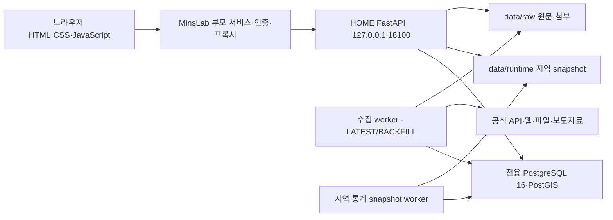

# the주택 · HOME — 주택공급 정책 추진현황 시스템 원천 설명서

> 일반 사용자·업무담당자·유지관리사업자·동료 개발자용 공통 기준 문서입니다. 이 문서를 토대로 대상별 사용·업무·운영·개발 매뉴얼을 제작합니다.

| 문서 관리 | 내용 |
| --- | --- |
| 기준일 | 2026-10-29 · Asia/Seoul |
| 대상 | the주택 / HOME / PoC 10 · 저장소 `PoC/10-home` |
| 서비스 | [운영 화면](https://www.minslab.kr/poc/home/) |
| 문서 성격 | 실제 구현, 업무 판단 기준, 운영 방법, 개발 구조, 한계를 설명하는 공통 원본 |
| 확인 기준 | 현재 소스와 화면, 10월 28~29일 수집·검토·브라우저 검증 기록 |
| 숫자 인용 | 본문의 날짜별 건수는 해당 점검 시점의 스냅샷. 실시간 총량으로 재사용하지 않음 |
| 최신성 | 코드·운영 설정·원천 판본 변경 시 관련 절과 검증 근거를 함께 갱신 |
| 이전 문서 | [재구성 전 README 보존본](docs/archive/README_BEFORE_20261029.md). 과거 작업 이력이며 현행 사용법보다 우선하지 않음 |

운영 데이터와 미커밋 코드가 함께 존재할 수 있습니다. 배포·인수인계 때는 문서 날짜만으로 버전을 특정하지 말고 **소스 커밋, 작업 트리 변경 여부, 실행 이미지, DB migration, 데이터 기준시각**을 함께 기록합니다. 문서에 설명된 사용자 유형은 이용 목적의 구분이며, 제품에 각각 독립된 역할 기반 권한이 모두 구현됐다는 뜻은 아닙니다.

<a id="contents"></a>
## 목차와 독자별 읽기 경로

| 대상 | 먼저 읽을 절 | 제작할 파생 문서 |
| --- | --- | --- |
| 일반 사용자 | [1. 서비스](#overview), [2. 화면 사용](#user-guide), [3. 지표·그래프](#data-rules), [5. 보고서](#reports) | 사용자 매뉴얼·교육자료 |
| 업무담당자 | [3. 판단 기준](#data-rules), [4. 검토 업무](#review-workflow), [6. 정합성 검증](#verification), [11. 한계·FAQ](#limitations) | 담당자 업무 처리 지침 |
| 유지관리사업자 | [7. 구성](#architecture), [8. 운영](#operations), [9. 백업·복구](#backup), [10. 개발·검증](#development) | 운영·장애·복구·인수인계 매뉴얼 |
| 동료 개발자 | [3. 계산 계약](#data-rules), [4. 저장 경계](#review-workflow), [7. 데이터 구조](#architecture), [10. 개발](#development) | 개발환경·인터페이스·변경 검증 매뉴얼 |
| 동료 검증자 | [6. 독립된 외부 검증](#verification), [11. 미해결 범위](#limitations), [13. 근거](#references) | 데이터셋 검증·피드백 안내 |
| 문서 제작·배포 담당자 | [12. 문서 재사용 규칙](#document-use) | 유형별 문서 구성·배포 명세 |

<a id="overview"></a>
## 1. 서비스 목적과 사용 범위

HOME은 **정책 → 프로그램 → 사업**을 연결하고, 주택공급의 사업화·인허가·착공·공급·입주 진행을 목표와 비교하는 시스템입니다. 정책 전체 목표, 연결된 사업의 진행, 지역의 생활·수요 여건, 원천자료의 확보·검토 상태를 함께 확인합니다.

주요 질문은 다음과 같습니다.

- 정책 목표를 어떤 프로그램과 사업이 수행하는가?
- 기준일에 어느 단계까지 진행했고, 목표 대비 부족하거나 확인이 필요한 부분은 무엇인가?
- 공급 예정 사업은 언제 후속 단계로 넘어가며 지역 여건은 어떠한가?
- 숫자의 근거는 어느 원문·판본·담당자 판단인가?
- 새로 발견된 공고는 기존 사업의 후속 자료인가, 다른 사업인가, 검토 대상에서 제외할 자료인가?

**자료를 수집했다는 사실은 사업 실적이 아닙니다.** 수집·추출·연결·업무 판단·집계는 서로 다른 처리 단계입니다. 사업화·인허가·착공·공급·입주의 사건 및 물량이 확인되어야 해당 단계의 실적으로 해석할 수 있습니다. 일부 화면은 조건부 추정을 포함하므로 원천 측정·담당자 입력·추정을 구분해 읽습니다.

관리 정책에는 9·7 주택공급 확대방안, 1·29 도심 주택공급 확대 및 신속화 방안, 8·13 주택 신속공급 방안이 있습니다. 정책에 연결된 사업 원장은 지역 전체 주택시장 통계와 모집단이 다릅니다. 공식 발표와 비교하려면 지역·기간·단계·공급유형·계획/실적·포함 사업을 먼저 맞춥니다.

### 1.1 이용자와 권한

| 이용자 | 할 수 있는 일과 책임 |
| --- | --- |
| 일반 사용자 | 공개 화면 조회, 지도·지역여건 확인, 보고서 및 허용된 CSV 다운로드 |
| 업무담당자 | 관리자 인증 후 검토 판단·연결·관리정보 저장. 원문과 적용 범위, 사유, 후속 과제 확인 |
| 유지관리사업자 | 승인된 서버 접근으로 수집·배포·백업·복구·장애 처리. 업무 승인값을 성능 개선이나 재수집 과정에서 임의 변경하지 않음 |
| 동료 개발자 | 격리 개발환경에서 코드·스키마·테스트 변경. 권한·판본·집계 계약 보존 |
| 동료 검증자 | 전달받은 데이터셋·근거를 검토하고 재현 가능한 피드백 제공. 의견 제출이 운영 DB 승인과 같지는 않음 |

관리자 인증은 MinsLab 부모 서비스의 세션과 내부 API 서명을 사용합니다. 화면에 입력하는 담당자명은 **업무 이력의 표기값**이며 별도의 본인인증·전자서명을 의미하지 않습니다. 유지관리사업자·개발자 전용 RBAC, 기관별 결재선, 자동 외부 모델 심사 서비스가 모두 구현된 상태는 아닙니다.

<a id="user-guide"></a>
## 2. 일반 사용자 화면 안내

### 2.1 처음 사용하는 순서

1. [HOME](https://www.minslab.kr/poc/home/)에서 정책 또는 관심 지역을 선택합니다.
2. **추진현황 → 정책 / 프로그램 / 사업**에서 대상과 기준일을 확인합니다.
3. 상단 누적값과 그래프를 함께 봅니다. 색·사선·예상값의 의미는 [3절](#data-rules)을 따릅니다.
4. 해당 사업의 원문, 공급유형, 목표·측정일, 근거·추정 여부를 확인합니다.
5. 지역 비교는 **공급현황 → 지역여건**, 숫자 출처 확인은 **데이터 관리** 메뉴로 이동합니다.
6. 공유할 때 보고서 또는 CSV를 내려받고 기준일·대상 범위를 함께 전달합니다.

### 2.2 메뉴별 목적

| 메뉴 그룹 / 화면 | 주요 기능 | 확인할 기준 |
| --- | --- | --- |
| 공급현황 / 공급현황 지도 | 지역·사업 선택, 2D/3D 지도, 단계와 주변 인프라, 향후 목표 표 | 대표좌표 정밀도, 선택 단계, 포함 사업, 예정/실제 |
| 공급현황 / 지역여건 | 인구·가구·고용, 연령, 미분양, 주택시장·생활 지표 등 | 통계의 지역·기간·단위·최신 제공월 |
| 추진현황 / 정책 | 정책 목표, 프로그램·사업의 진행, 누적 그래프, 정책 보고서 | 정책 자체 목표와 연결 사업 소계의 차이 |
| 추진현황 / 프로그램 | 프로그램 목표·구성 사업·진행 비교 | 프로그램 귀속 및 관리 범위 |
| 추진현황 / 사업 | 개별 사업, 목표·측정값, 단계 일정, 공정률, 입지, 사업 보고서 | 원천별 범위, 관리 우선값, 단지/블록/유형 |
| 데이터 관리 / 출처와 수집현황 | 수집 방식·주기·성공/실패·조회 범위·실제 표본 | 마지막 시도와 마지막 성공을 구분 |
| 데이터 관리 / 신규 자료 검토 | 새 공고·보도자료의 검토, 보류, 등록 대기, 연결 승인, 제외 | 검토 사유·원문·후속 확인 사항 |
| 데이터 관리 / 정책-프로그램-사업 연결 | 계층·동일 사업·귀속 관계의 검토 및 관리 | 자료 연결 승인과 정책 귀속의 차이 |
| 데이터 관리 / 사업별 수집연계 | 사업별 단계·자료 항목의 확보와 미확보 원인 | 수집 완료와 의미 추출·연결 완료의 차이 |
| 데이터 관리 / 데이터 정합성 확인 | 진단·보완 회차와 데이터셋 개선 과정 | 당시 검증 범위와 현재 상태를 구분 |
| 문서 / 사용법·요구사항정의 | 화면 안내, 요구사항과 구현·확보 근거 | 요구사항 충족과 실제 데이터 정확도의 차이 |

직접 진입 예: `#policy-progress`, `#program-progress`, `#projects`, `#sources`, `#publication-reviews`, `#tree`, `#project-collection`, `#data-integrity`. 내부 라우트의 `manual`은 ‘사용법’ 화면 식별자로 남아 있지만 좌측 그룹 이름은 **문서**입니다.

### 2.3 지도와 지역여건 읽기

지도상의 대표점은 사업 경계·블록 정밀좌표·주소검색 좌표·지역 근사점 등 근거가 다를 수 있습니다. 마커가 있다는 이유만으로 필지 경계를 확보했다고 판단하지 않습니다. 근사 위치는 표시된 위치 근거와 함께 사용합니다.

주변 교통·학교·생활시설은 조회 반경과 기관별 자료 범위의 영향을 받습니다. 운영 중 시설과 계획 시설, 최근접 시설 예외 등을 구분합니다. 데이터 미확보는 주변에 시설이 없다는 뜻이 아닙니다.

1~4인 가구 변화 등 지역 통계는 해당 행정구역의 지표입니다. 개별 사업 입주자 구성이나 실제 수요를 직접 측정한 값으로 확대하지 않습니다. 가구·인구·세대·호·실의 단위와 조사연도, 공표일, 수집일을 확인합니다. 입지 통계 연결 실패나 `null`은 0으로 표시·판정하지 않습니다.

<a id="data-rules"></a>
## 3. 데이터 판단·계산·표시 기준

### 3.1 계층과 동일성

| 구분 | 의미 |
| --- | --- |
| 정책 | 정부 정책 목표와 관리 기간 |
| 프로그램 | 정책을 수행하는 사업방식·유형·수단 |
| 사업 | 관리 대상 지구·구역·블록·건물 등의 원장. 원천에 따라 관리 단위가 다름 |
| 원천 레코드 | 기관 API·파일·공고에서 수집한 행 또는 문서 |
| 관리 대표사업 | 동일 사업의 여러 원천을 대조하여 집계에 사용하는 관리 범위 |
| 자료참조 연결 | 문서를 사업에 귀속시킨 근거 관계. 그 자체가 수량·단계 사건은 아님 |

이름 유사도는 검토 후보를 찾는 수단입니다. 동일성은 **지번·구역/블록·시행자·사업방식·공급유형·전체/부분 물량·원모공고**로 확인합니다. 지구 총량, 건설공사 총량, 분양분, 임대분, 금회 잔여 모집량을 모두 더하지 않습니다. 예를 들어 같은 A-1블록의 건설 1,791호와 행복주택 609호는 전체와 부분의 관계를 먼저 대조해야 합니다.

### 3.2 단계·날짜·결측

| 단계 / 사건 | 해석 |
| --- | --- |
| 사업화 | 해당 유형의 사업 추진·계획·공모 등 근거. 기획 확정과 정비구역 지정은 별도 사건 |
| 인허가 | 허가·사업계획 승인 등. 신청, 최초 승인, 변경 승인, 사용승인을 구분 |
| 착공(건설) | 실제 착공과 공사 진행·공정률. 보상·철거·부지조성 착공을 주택 본공사로 자동 변환하지 않음 |
| 준공 | 준공·사용승인 관련 별도 사건. 건설 단계 내부에서 관리되며 공급과 선후가 항상 고정되지는 않음 |
| 공급 | 분양·임대 모집 및 해당 대상 물량. 잔여 재모집과 신축을 구분 |
| 입주 | 입주계획·입주안내·입주 시작·실제 입주호수를 구분. 당첨자·예비자 발표는 입주 완료가 아님 |

- **원천 기준일:** 자료가 설명하는 상태의 기준시점.
- **사건일:** 승인·착공·공고 등 실제 사건 날짜.
- **목표/예정일:** 계획상 날짜. 경과만으로 실적이 되지 않음.
- **수집일:** 시스템이 자료를 가져온 시각.
- **등록/검토일:** 판본과 업무 판단을 저장한 시각.
- **보고 기준일:** 선택된 보고서의 조회 기준. 그날 모든 자료를 확보했다는 뜻은 아님.

월·분기·반기·연도 정밀도와 원문을 보존합니다. 기간 말 정규화가 필요한 집계에서는 원래 정밀도를 함께 표시합니다. `미정`, 잘못된 날짜, `2027년 이후` 등을 임의의 확정일로 만들지 않습니다. **미측정·미확보·상충·확인된 0**은 다른 상태입니다.

### 3.3 측정값 보완과 추정

같은 사업·단계의 수집 측정값을 우선 보존합니다. **측정값이 없다는 이유만으로 목표를 실적으로 채우지 않습니다.** 같은 단계의 확인 사건 또는 그 단계가 선행했어야 하는 후행 사건이 있고, 물량 범위와 날짜 순서가 맞는 경우에만 해당 목표값을 추정에 사용할 수 있습니다.

| 상황 | 처리 |
| --- | --- |
| 수집 측정값 존재, 0 또는 부분 물량 포함 | 수집값 보존 |
| 도달 근거 존재 + 목표일이 확인된 사건 순서 안에 있음 | 미확보 날짜만 조건부 목표 대체 추정 가능 |
| 도달·물량 근거 존재 + 동일 범위 목표량 확보 | 미확보 물량만 조건부 추정 가능 |
| 목표일 경과만 확인 / 추정값만 존재 / 선행 사건만 존재 | 실적 채우지 않음 |
| 일부 후행 물량 확인 | 사업 전체 목표량으로 확대하지 않음 |
| 일정 역전·범위 초과·원천 충돌 | 빈 값 또는 확인 대상으로 유지 |

공급만 확인된 사업을 일괄 착공 실적으로 포함하지 않습니다. 추정에는 `inferred`, `input_rule`, `input_basis`, `field_provenance` 등 근거·판본 정보를 남깁니다. 추정 포함 누적량은 독립적으로 측정한 실제 이행량과 같지 않습니다. 기존 승인·추정을 재검토할 때는 **당시 변경 사유를 먼저 확인**하고 새 근거와 차이를 이력으로 남깁니다.

### 3.4 정책·프로그램 누적 그래프

상단 카드에는 단계별 **누적 도달량**을 표시합니다. 그래프의 각 색 면적은 중복 합산을 피하려고 ‘해당 단계 누적 − 다음 단계 누적’으로 표현합니다. 마지막 입주는 자체 누적량입니다. 아래에서 위로 **사업화 → 인허가 → 착공(건설) → 공급 → 입주** 순서입니다.

설명용 기호: `Aᵢ(t)`는 단계 i의 누적 측정량, `Tᵢ(t)`는 목표 누적량이며, 다음 단계는 `i+1`입니다.

```text
단계의 실색 물량 aᵢ = Aᵢ − Aᵢ₊₁
단계의 목표 물량 qᵢ = Tᵢ − Tᵢ₊₁
붉은 사선 부족분 gᵢ = max(qᵢ − aᵢ, 0)
```

예시: 사업화 누적 90,746 − 인허가 누적 87,098 = 실색 3,648호. 목표 단계 물량 52,947호라면 사선은 52,947 − 3,648 = **49,299호**입니다. 목표 52,947호 전부를 실색 위에 더하지 않습니다. 실적이 목표보다 크면 사선 없이 실색을 유지하므로 전체 높이가 목표 사업화 누적보다 커질 수 있습니다.

| 표시 | 뜻 |
| --- | --- |
| 진한 면 | 현재까지의 단계별 물량. 입력·추정 구성은 근거에서 확인 |
| 붉은 사선 | 해당 단계 목표 대비 양수 부족분. 라벨 예: **미달성(공급)** |
| 오늘 이후 연한 면 | 현재 실적·목표 중 큰 단계 물량에 향후 목표 증감을 반영한 예상 |
| 곡선 | 날짜 사이 시각적 연결. 중간 좌표가 별도 관측값이라는 뜻은 아님 |
| 기준일·보조 기준일 막대 | 카드 조회값과 비교 위치. 움직여도 현재/미래 경계 자체는 이동하지 않음 |
| 회색 목표 배경 | 정책·프로그램의 전체 목표. 개별 연결 사업 소계와 다를 수 있음 |

미래 계산의 시작값은 **단계별 차이 물량의 실적과 목표 중 큰 값**입니다. `t₀`가 자료의 현재 경계라면:

```text
시작값 bᵢ = max(aᵢ(t₀), qᵢ(t₀))
목표 증가 ΔTᵢ(t) = max(Tᵢ(t) − Tᵢ(t₀), 0)
예상 단계 물량 = bᵢ + ΔTᵢ − ΔTᵢ₊₁
```

예를 들어 공급 예정 10호가 도래하면 건설에서 10호가 빠지고 공급에 10호가 더해집니다. 같은 물량의 단계 이동으로 전체량이 늘지 않습니다. 신규 사업화 계획 증가가 있을 때 전체량이 증가합니다. 부족분은 시작값에 포함되므로 미래에 다시 더하지 않습니다. 결측·음수 차이는 코드의 별도 처리와 툴팁을 확인하고 원천값을 변경하지 않습니다.

Y축은 **현재 표시 구간의 누적 최대 높이(실적·갭·예상 포함)의 약 1.3배**를 기준으로 눈금을 조정합니다. `전체 목표 범위`를 선택하면 정책 전체 규모를 확인합니다. `처음`은 포함 사업의 가장 이른 시작점, `현재`는 현재 위치, `마지막`은 마지막 구간으로 이동합니다. 단계 버튼과 상단 카드는 같은 선택을 공유하며 다시 누르면 전체 강조로 돌아갑니다.

### 3.5 부족률과 공정률

그래프 부족 안내 비율은 **부족분 ÷ (부족분 + 해당 단계 누적 달성분)**입니다. 단계 상태 판정의 누적 비교는 `max(도래 목표−최근 측정값, 0) ÷ 도래 목표`를 사용합니다. 서로 다른 분자·분모를 가진 지표이므로 같은 비율이라고 혼용하지 않습니다.

현재 관리 기준은 부족률 2% 이상 ‘지연’, 0% 초과~2% 미만 ‘주의’, 목표 도달·초과 ‘정상’입니다. 목표 미확보·미측정·미도래는 판정 보류입니다. 시각적 사선·경고표시와 실제 일정 지연에 대한 공식 판단은 구분합니다.

건설 공정계획의 0~100% 곡선은 착공~예정 준공 기간에 비례한 월별 추정일 수 있습니다. 공식 중간 공정목표가 아니며, 실제 공정률은 관측일과 함께 비교합니다.

<a id="review-workflow"></a>
## 4. 업무담당자의 신규 자료 검토

### 4.1 ‘외부 모델 도움’의 위치 — 업무 수행 지원

현재 사용자는 실제 업무담당자 역할을 가정해 업무를 수행하고 있습니다. 주택공급 업무지식이 충분하지 않은 부분에서 **외부 모델의 분석을 도움받아 자료를 이해하고 판단 후보를 마련한 것**입니다. 외부 모델은 담당자 업무를 보조하는 도구이며, 이 활동을 독립된 외부 검증·전문기관 인증·별도 승인으로 세지 않습니다.


모델 의견은 오인·누락·과거 자료 인용 가능성이 있는 **검토 입력**입니다. 사용자 위임에 따른 시스템 처리는 기관 담당자에게 실제로 질의해 답변받은 것과 구분합니다. 과거 파일명이나 저장 사유의 ‘외부 검토’ 문구가 이 업무 보조를 가리키는 경우, 파생 문서에서는 ‘업무담당자의 외부 모델 활용’으로 설명합니다. 기존 감사 이력의 원문은 이 용어 정리 때문에 소급 변경하지 않습니다.

동료 피드백으로 데이터셋의 정확성을 개선한 **별도 외부 검증 과정**은 [6절](#verification)에서 다룹니다.

### 4.2 상태의 의미

| 화면 상태 | 코드 | 처리 의미 / 다음 행동 |
| --- | --- | --- |
| 검토 대기 | `REVIEW` | 아직 판단하지 않았거나 원문·연결 변경으로 재검토 필요. 자료별 질문과 근거부터 확인 |
| 보류 | `HOLD` | 검토했으나 동일성·범위·원문 등 필요한 근거가 부족. 보류 사유의 해소 자료를 확보 |
| 사업 등록 대기 | `REGISTRATION_REQUIRED` | 후보 사업/자산을 식별하고 등록 검토 승인. **실제 사업 생성·정책 귀속·물량 반영 완료가 아님** |
| 자료 연결 승인 | `APPROVED` | 기존 사업에 자료참조 연결 확정. 정책 매핑·호수·목표·실적은 자동 변경하지 않음 |
| 제외 | `EXCLUDED` | 해당 개별사업 연결 업무에서 제외. 원문과 판단 이력은 보존. 정책·교통·복지 참고자료도 이 범주일 수 있음 |

원문 판본이 달라지거나 승인 연결의 상태가 바뀌면 화면은 다시 `REVIEW`가 될 수 있습니다. 이전 승인이 사라진 것이 아니라 새 판본에 대한 재확인이 필요한지 이력을 봅니다. 좌측 메뉴 배지의 미완료 수에는 검토 대기뿐 아니라 보류·등록 대기가 포함됩니다.

### 4.3 실제 처리 순서

1. **데이터 관리 → 신규 자료 검토**에서 상태·우선순위·자료명으로 대상을 좁힙니다.
2. 목록 숫자만 보지 말고 자료를 선택해 검토 질문, 원문 URL, 게시일·판본, 이전 판단을 읽습니다.
3. 수동 수집 이력이 있으면 **수동 수집 원문·첨부 확인**을 펼칩니다. 이전 판본 표시가 있으면 현재 원문과 다시 대조합니다.
4. 기존 사업 대장과 지번·블록·시행자·유형을 비교합니다. 이름이 비슷하다는 이유로 연결하지 않습니다.
5. 기존 사업이 맞으면 자료 연결 승인, 다른 식별 가능한 대상이면 후보명을 구분해 등록 대기, 핵심 자료가 부족하면 보류, 관련 없는 사건이면 제외를 선택합니다.
6. 담당자명, 판단 사유, 확인한 원문, 적용 범위와 후속 과제를 기록합니다. 승인에는 원문 확인과 정책 선택이 필요합니다. 정책 귀속 근거가 없으면 `UNASSIGNED`를 사용하며 이름만으로 귀속시키지 않습니다.
7. 저장 후 상태와 **이 자료의 이전 검토 이력 보기**를 확인합니다. 충돌(409)이면 최신 판본을 재조회하고 조정합니다.

등록 대기는 자동 등록 큐가 아닙니다. 실제 사업 생성, 대표 단위·프로그램·정책 귀속, 목표/일정·실적 반영은 각각 후속 업무입니다. 현재 화면의 저장 결과를 ‘신규 사업 및 실적 반영 완료’라고 보고하지 않습니다.

### 4.4 사유 기록의 최소 내용

- 무엇을 확인했는가: 공고번호·지번·블록·기관·공급유형·판본·URL.
- 왜 같은/다른 사업인가: 대조한 기존 사업 ID와 일치·불일치 항목.
- 어떤 사건인가: 최초 모집, 정정, 잔여 모집, 계약안내, 착공 등.
- 무엇을 반영하는가: 자료참조, 등록 후보, 보류 또는 제외. 실제 물량·일정 변경 여부.
- 무엇이 남았는가: 필요한 원모공고·관리번호·공식 승인서·정정 확인.
- 이전 사유와 무엇이 달라졌는가: 유지·보완·정정의 이유. 당시 승인 근거 보존.

`261029 업무담당자 확인(김민)`은 10월29일 사용자 위임 업무에서 사용한 이력 표기 예입니다. 다른 담당자는 본인의 실제 업무 표기를 사용합니다. 외부 모델의 추론만으로 기관 확인 완료라고 기록하지 않습니다.

### 4.5 CSV로 업무 지원받기

**현재 목록 CSV**는 상태·검색어·우선순위 조건을 적용하고, **전체 상태 CSV**는 모든 상태를 받습니다. 다운로드 버튼을 누를 때 생성되며 목록 진입 때 자동 다운로드하지 않습니다.

2026-10-29 기준 46열에는 자료ID·제목·상태·출처·원문URL·판본/해시·우선순위·질문·근거·연결 사업·등록 후보·담당자·사유·검토 이력 등이 포함됩니다. 다음 4열은 최근 수동 수집 보완 항목입니다.

| 열 | 뜻 |
| --- | --- |
| 수동수집상태 | 미수집 / 현재 판본 원문·첨부 수집 / 이전 판본 수집·재확인 필요 |
| 수동수집본문 | 별도 보관한 수동 수집 텍스트 |
| 수동수집확인내용 | 수집자가 확인한 내용과 불일치·추가 확인 사항 |
| 수동수집첨부_JSON | 첨부 이름·URL·해시 등 저장 정보 |

기존 `본문보유여부`·`수집본문`은 원래 탐색 문서 기준이고 수동 보완은 별도 열입니다. 기존 열에 ‘미보유’라고 표시되어도 수동 보완 열이 채워져 있을 수 있습니다. 외부 분석 시 둘을 함께 제공합니다. `외부검증결과` 등 CSV 열 이름은 분석 의견을 적는 서식이며 독립 검증이 자동 수행됐다는 뜻이 아닙니다.

여러 상태 CSV를 합칠 때 `자료ID`로 중복을 제거합니다. `OPEN`은 검토 대기·보류·등록 대기를 포함하므로 등록 대기 파일을 다시 더하면 중복됩니다. 모델의 응답은 자동 재수입·승인되지 않습니다. 원문 대조 후 화면 또는 승인된 관리 절차로 저장합니다. CSV의 스프레드시트 수식 방어용 접두 문자를 근거값으로 오인하지 않습니다.

### 4.6 수동 원문·첨부 보완의 경계

수동 보완은 `publication_supplement` 판본과 `PUBLICATION_MANUAL_COLLECTION` 감사 이력으로 저장됩니다. 원문 탐색 판본에 연결되어 자동 목록 재수집으로 본문이 덮어써지지 않습니다. 목록에는 요약·첨부 메타데이터만 제공하고 전체 본문은 CSV 생성 시 포함해 조회 부하를 줄입니다.

**일반 사용자용 파일 업로드·자동 승인 기능은 아닙니다.** 현재 수동 보완 저장은 유지관리자의 검증된 서버 작업 경로입니다. 사용자는 화면의 요약·첨부와 CSV를 이용합니다. 당첨자·서류심사 대상자 등 개인 명단은 모집·사업 근거와 분리하며 수집 필요성이 없는 개인 정보 목록은 가져오지 않습니다.

<a id="reports"></a>
## 5. 보고서 생성·붙임·공유

### 5.1 보고서별 범위

| 보고서 | 주요 내용 | 저장·출력 |
| --- | --- | --- |
| 정책 추진현황 보고서 | 정책 목표·현재 도달량·전망, 유형·지역·사업별 분석 및 근거 | 본문과 붙임 3종 분리 |
| 프로그램 보고서 | 프로그램 범위의 진행·구성 사업·근거 | 해당 화면의 기존 보고서 경로. 정책/개별사업 전용 형식을 일괄 적용한 것으로 설명하지 않음 |
| 개별 사업 추진현황 분석보고서 | 기본정보, 단계 진행, 물량·변경, 행정절차, 건설·공급·입지·검토 내용 등 9개 장 | 두 진행 그래프 유지, 붙임 4종 분리 |

사업 보고서의 두 그래프는 **사업화~입주 단계별 진행 카드**와 **최초 데이터 시점부터 120개월의 목표·측정 시계열**입니다. 시계열은 아래부터 사업화·인허가·착공·공급·입주를 일정 간격으로 표시합니다. 목표는 옅은 파랑, 측정은 분홍, 수집 측정과 추정 표식을 구분합니다. 준공 사건은 별도 단계 카드·건설 내용에서 확인합니다.

### 5.2 생성 절차

1. 정책 또는 사업 화면에서 **추진현황 보고서 만들기**를 누릅니다.
2. 기준일·기간·지역·대상 사업, 보고서 유형 등 해당 창이 제공하는 조건을 확인합니다.
3. 보고서를 생성하고 대상 범위·입력 판본·최종 수집일·생성일을 확인합니다.
4. 본문은 HTML·CSV·산출근거 JSON 또는 브라우저 인쇄/PDF로 저장합니다.
5. 상세 명세가 필요하면 **붙임 자료 생성·다운로드** 또는 **붙임 생성·다운로드**를 별도로 누릅니다.
6. 공유할 본문·붙임·JSON의 기준일과 입력 SHA-256이 같은지 확인합니다.

붙임은 버튼을 누를 때 생성하며 **본문과 동일한 입력 기준본**을 사용합니다. 붙임을 받는 시점의 최신값을 다시 섞지 않습니다. 본문 다운로드만으로 붙임까지 전달됐다고 판단하지 않습니다. PDF는 브라우저 인쇄 기능으로 만들며 중앙 PDF 발급 서비스가 아닙니다.

달성률을 산정할 수 없는 열은 숨기도록 처리합니다. 열이 없다고 0% 달성이라고 해석하지 않습니다. 빈 표·미확보는 0호와 구별하며 긴 사유·URL은 표 안에서 줄바꿈합니다.

### 5.3 재현과 보관

개별 사업 보고서 생성이력은 **현재 브라우저의 IndexedDB**에 저장됩니다. 서버 공용 문서함이나 다른 사용자에게 공유되는 이력이 아닙니다. 브라우저 데이터 삭제·다른 기기 사용 시 그대로 보장되지 않으므로 장기 보관에는 JSON과 출력물을 내려받습니다. 계산 버전이 다른 저장본을 현재 산식으로 조용히 재해석하지 않습니다.

보고서의 기준일 조회와 엄밀한 ‘그날 시스템이 알고 있던 내용’은 다른 개념입니다. 원천 기준일·사건일·수집시각·판본·입력 해시를 함께 확인하고, 필요하면 당시 DB 스냅샷과 비교합니다. 생성자 표기가 브라우저 사용자 수준이면 인증된 담당자 서명으로 사용하지 않습니다.

<a id="verification"></a>
## 6. 데이터 정합성 개선 — 동료 외부 검증과 내부 재검증

이 절은 [4.1절](#review-workflow)의 **업무담당자가 외부 모델의 도움을 받아 개별 공고를 처리한 활동과 별개**입니다. 여기서 외부 검증은 데이터셋을 동료에게 제공하고, 동료가 검토한 피드백을 받아 데이터·규칙의 정합성을 개선한 과정입니다.

| 구분 | 담당자 업무의 모델 활용 | 데이터셋에 대한 동료 외부 검증 |
| --- | --- | --- |
| 목적 | 부족한 업무지식 보완, 자료 이해와 판단 후보 마련 | 데이터셋 오류·누락·중복·규칙의 문제 발견 |
| 주체 | 업무담당자 역할의 사용자와 보조 도구 | 데이터셋을 검토하는 동료, 반영·재검증하는 내부 개발·데이터 담당자 |
| 입력 | 미연결 공고·검토 CSV·원문·기존 판단 사유 | 버전이 특정된 데이터셋·산정 기준·근거·검토 과제 |
| 결과 | 승인·등록 대기·보류·제외의 업무 판단 | 수정 제안, 패턴 규칙 개선, 데이터 보강 및 다음 데이터셋 버전 |
| 검증 지위 | 독립된 검증 1회로 별도 집계하지 않음 | 동료 피드백에 의한 별도 외부 검증 활동 |
| 최종 반영 | 담당자 권한으로 사유·이력 저장 | 내부에서 원문·대장·테스트로 재검증한 뒤 반영 |

동료가 어떤 도구를 사용했는지는 확인된 이력만 기록합니다. 모델 산출물만 있고 독립된 동료 검토 기록이 없으면 이를 ‘동료 검증 완료’로 바꾸어 표현하지 않습니다. 외부 검증은 공인 인증이나 전수 정확도 보증과도 다릅니다.


**데이터 정합성 확인**의 데이터셋 개선 과정은 위 반복을 요약하고, 노드를 선택하면 발견 사항·수정 내용·근거를 자세히 확인하는 용도로 사용합니다. 최초 공유 시점 이후 노드에는 날짜를 반복 표기하지 않는 화면 원칙을 적용하되, 실제 판본·시각·파일 해시는 내부 근거에서 보존합니다.

회차 기록에는 입력 데이터셋 버전·해시, 검토자/검토 범위, 발견 문제, 관련 자료ID, 내부 재검증 결과, 채택/보류/기각 사유, 변경 전후 값, 수정 규칙·코드·테스트, 남은 과제를 남깁니다. 제출된 의견 수를 그대로 오류 수정 수로 세거나 일부 검증 점수를 전체 정확도로 소개하지 않습니다.

현재 화면·과거 보고서의 ‘외부 검증’, ‘조원 피드백’, ‘외부 모델’ 표기는 생성 당시 이력의 맥락을 확인해야 합니다. 매뉴얼·발표자료에서는 이 절의 두 활동 구분을 적용하고, 실제 기록이 없는 독립 검증을 새로 주장하지 않습니다.

<a id="architecture"></a>
## 7. 시스템과 데이터 구조

### 7.1 구성



| 구성 | 현행 역할 |
| --- | --- |
| Python 3.12 / FastAPI / SQLAlchemy / Alembic | API, 업무 로직, 판본·DB 관리 |
| PostgreSQL 16 / PostGIS | 전용 DB와 공간 데이터 |
| HTML·CSS·JavaScript | 화면·지도·보고서. 전체 SPA 프레임워크 빌드가 필수인 구성은 아님 |
| `poc10-home-api` | 공개/관리 API 및 정적 자원. 운영 자동 수집은 별도 worker로 분리 |
| `poc10-home-worker` | 최신 자료와 과거 확대 수집, 후속 연결·스냅샷 작업 |
| `poc10-home-area-worker` | 지역 통계 사전 계산·갱신 |
| `poc10-home-db` | 전용 DB. 다른 PoC의 DB와 별도 |
| `data/raw` | 원문·PDF/HWPX·추출 결과 등의 파일. DB 덤프에 자동 포함되지 않음 |
| `data/runtime` | 환경 전달 파일, worker health, 캐시·snapshot. 외부 배포 제외 |

### 7.2 디렉터리 안내

```text
PoC/10-home/
├── README.md                  # 이 공통 설명서
├── backend/                   # API·수집·판단·집계·검증
├── web/                       # 화면과 보고서 JS/CSS
├── db/                        # Alembic migration
├── scripts/                   # 배포·수집·백업·검증·날짜별 정비 도구
├── tests/                     # Python 및 tests/js 회귀 검사
├── docs/                      # 상세 설명·분석·검증 근거
│   ├── evidence/              # 날짜별 적용·검증 결과
│   └── archive/               # 과거 설명서 보존본
├── data/                      # 서버 실행 데이터·원문·runtime
├── backups/                   # 생성된 공유/복구 패키지, Git·정적 공개 제외
├── refs/                      # 참조자료 설명
├── Dockerfile
├── docker-compose.yml         # 신규 환경 대안; 운영 CLI와 혼용 금지
├── requirements.txt
└── alembic.ini
```

### 7.3 판본과 이력

| 저장 개념 | 의미·보존 규칙 |
| --- | --- |
| `Revision` / `home_revision` | `entity_id`, `kind`, `source_id`, `revision_no`, `payload_hash`, 이전 판본과 현재 여부를 관리 |
| `Batch` / `home_batch` | 수집 실행 상태·시각·통계·원문 manifest. 성공과 전체 모집단 완전성은 별개 |
| `Coverage` | 조회 지역·기간·예상/확보 건수·완료 범위 |
| `CollectionJob` | 대기·실행·재시도·완료/실패, 처리 단계와 lease |
| `Mapping` 및 관계 테이블 | 정책·프로그램·사업 귀속과 동일성 판단 |
| `project_profile`, `policy_profile`, `program_profile` | 원문과 분리한 관리 정보·우선값 |
| `goal`, `execution_schedule`, 단계 근거 | 목표·일정·사건·추정의 근거 판본 |
| `document_evidence` | 수집한 공고·보도자료 등. 탐색 자료는 제목·URL 중심일 수 있음 |
| `publication_review` | 자료별 판단, 대상 사업/후보, 정책, 사유, 담당자, 확인 판본 |
| `publication_supplement` | 수동 보완 본문·첨부와 원문 판본 연결 |
| `evidence_bridge` | 자료와 사업의 관계. 검토 승인으로 생성하는 자료참조는 `facts=[]`, `units=null` |
| `Audit` | 변경 전후와 행위. 단순 최종값 덮어쓰기 대신 판단 경위를 보존 |

원천 재수집은 동일 키·해시를 비교하고 변경 판본을 남깁니다. 담당자 우선값과 원문은 구분하며, 새 자료가 왔다고 기존 승인·정책 귀속을 일괄 해제하지 않습니다. 구형 정규화 테이블과 판본 모델이 함께 있으므로 임의 SQL로 한쪽만 수정하지 말고 현재 서비스·migration 경로를 확인합니다.

<a id="operations"></a>
## 8. 유지관리 운영

### 8.1 수집 흐름·주기

원천 등록부는 [sources.py](backend/sources.py), 예약 주기는 [collection_jobs.py](backend/collection_jobs.py)가 기준입니다. 일반 원천은 수집 → 연결 → 스냅샷 후속 단계로 처리하며, `discovery_only` 공고·보도 탐색은 수집 후보만 저장하고 자동 실적 연결 단계로 넘기지 않습니다.

| 분류 | 설정 예 |
| --- | --- |
| 최신 탐색 | 국토부·국무조정실·SH·LH·iH·서울시·뉴시스 탐색 경로 등 1시간 |
| 모집공고 | LH 공고 15분, LH 상세·GH 공고 30분, iH 공고 1시간 |
| 기타 원천 | 원천별 `refresh_days`, 확대 수집 `backfill_seconds` |
| 수동 전용 | `manual_only=True`: 자동 예약 제외, 필요한 범위만 명시적으로 실행 |

시간은 성공 후 재실행 기준입니다. 대기열·호출 제한·실패 재시도 때문에 정확한 시각을 보장하지 않습니다. worker는 `LATEST`와 `BACKFILL`을 나누고 leader lock·lease·heartbeat로 중복 실행과 중단 복구를 관리합니다. 수집 실패 시 재시도 간격이 늘어나며, 성공 자료가 있다는 이유로 최근 실패를 숨기지 않습니다.

국토부·국무조정실 신규 탐색은 각 최신 3페이지에서 최근 30일 주택 관련 제목·게시일·원문 링크를 검사합니다. 모든 기관·언론사·과거 공고 전수를 검색하는 기능은 아닙니다. 공개 RSS 탐색도 공식 사업단계 증명과 구분합니다.

### 8.2 일상 점검

1. API·DB·수집 worker·지역 worker의 실행/health를 확인합니다.
2. **출처와 수집현황**에서 마지막 시도·마지막 성공·설정 주기·실패 사유를 봅니다.
3. `/api/collection-jobs`에서 `QUEUED/RUNNING/RETRY/FAILED`와 처리 단계를 확인합니다.
4. 수집 범위와 원문·첨부·본문 추출 잔여를 확인합니다. 성공 배치만으로 전수 확보를 선언하지 않습니다.
5. 신규 자료 검토의 미완료 수, 원문 변경 재검토, 보류 해소 자료를 확인합니다.
6. 정책·사업 화면, 보고서 본문·붙임, CSV를 필요한 범위에서 점검합니다.
7. 작업일지에 대상·범위·원인·조치·검증·남은 과제를 남깁니다.

저장소 루트에서 실행하는 읽기 전용 점검 예:

```bash
curl --fail http://127.0.0.1:18100/health
sudo docker ps --filter name=poc10-home
sudo docker stats --no-stream poc10-home-api poc10-home-worker poc10-home-area-worker poc10-home-db
sudo docker logs --tail 100 poc10-home-worker
curl --fail 'http://127.0.0.1:18100/poc/home/api/sources?compact=true'
curl --fail 'http://127.0.0.1:18100/poc/home/api/collection-jobs'
```

### 8.3 수동 수집·재수집

수집은 외부 API 호출과 DB 기록을 발생시킵니다. 원천 ID·조회 범위·호출 제한·기존 실행 여부를 확인한 뒤 실행합니다. 화면의 관리자 수집 요청 또는 대상 원천을 지정한 CLI를 사용합니다.

```bash
# 저장소 루트/운영 호스트: 지정한 원천 수집 및 도구가 수행하는 후속 처리
sudo docker exec poc10-home-api python -m scripts.collect --source molit_press_watch

# 개발·운영자가 동작을 확인한 뒤 필요한 원천으로 source ID를 변경
sudo docker exec poc10-home-api python -m scripts.collect --source opm_press_watch
```

인자 없는 전체 재수집이나 날짜별 `apply_*`, `restore_*`, `repair_*` 스크립트를 일상 점검 명령처럼 실행하지 않습니다. 일부 도구는 특정 당시 데이터·사업ID를 전제로 승인값을 변경합니다. 실행 전 코드의 대상·dry-run 여부·판본 검사·적용 효과를 확인합니다.

주소 좌표 수집은 후보 전체 payload를 메모리에 적재하지 않고 주소 필드만 스트리밍합니다. `POC10_GEOCODE_PER_KIND_REGION`으로 유형·시도별 조회 상한을 조정하며 최대25, 기본25입니다. `NOT_FOUND`에 임의 좌표를 넣지 않습니다. 대용량 수동 작업은 운영 API와 자원을 분리하고 동일 원천 lock을 준수합니다.

### 8.4 설정과 인증

| 설정 | 목적 |
| --- | --- |
| `POC10_DATABASE_URL` | 전용 DB 연결. 개발·복구에서는 반드시 격리 DB |
| `POC10_DB_PASSWORD` | 배포 도구가 사용하는 전용 DB 비밀번호 |
| `POC10_INTERNAL_SECRET` | 부모→HOME 관리자 요청의 HMAC 서명 비밀값 |
| `POC10_UPSTREAM` | 부모 서비스의 HOME upstream |
| `POC10_DATA_DIR` | 실행 데이터·원문 경로 |
| `POC10_AUTO_COLLECT` | 해당 프로세스의 자동 예약 활성 여부. worker의 이미 대기 중 작업 처리까지 정지하는 스위치는 아님 |
| `POC10_API_MEMORY_MB` | Docker CLI 배포의 API 메모리 한도 |
| 원천별 API 키 | [API_KEYS.md](docs/API_KEYS.md)와 `.env.example`의 변수명 참고 |

운영 API는 자동 수집을 끄고 별도 worker가 예약합니다. **수집을 완전히 멈추려면 worker 실행/대기 작업까지 관리**해야 합니다. API 프로세스의 환경변수 하나만 바꾸고 전체 수집이 중지됐다고 판단하지 않습니다.

관리자 요청은 부모 세션·허용 경로·동일 출처 검사를 거쳐 내부 `x-home-admin` 서명을 전달합니다. 내부 검증은 시간·메서드·경로를 포함하며 짧은 유효시간을 사용합니다. 브라우저에서 내부 비밀값을 사용하거나 인증을 우회하지 않습니다. 내부 API에 존재하는 관리 경로가 부모 프록시에서 모두 공개되는 것은 아닙니다.

`.env`, `data/runtime/*.env`, 비밀번호·API 키는 저장소·스크린샷·공유 문서에 넣지 않습니다. 신규 환경에서만 예제 설정을 복사하고 환경별 값으로 채웁니다. API는 loopback에 바인딩하며 부모 프록시를 통해 공개합니다.

<a id="deployment"></a>
### 8.5 배포와 되돌리기

현행 운영은 [deploy.py](scripts/deploy.py)의 **Docker CLI 방식**입니다. 원문·DB를 유지하고 API·worker 이미지를 교체합니다. 컨테이너 시작 시 Alembic migration이 실행됩니다.

```bash
# 저장소 루트. 검증·백업 범위 확인 후 운영 배포
sudo python3 PoC/10-home/scripts/deploy.py
curl --fail http://127.0.0.1:18100/health
sudo docker logs --tail 50 poc10-home-api
sudo docker ps --filter name=poc10-home
```

현재 CLI 네트워크는 `poc10-home`, DB 볼륨은 `poc10-home-pgdata`, API 포트는 `127.0.0.1:18100 → 8000`입니다. `data/`는 `/app/data`에 연결됩니다. Compose는 신규 환경 대안이며 CLI의 컨테이너·볼륨과 혼용하지 않습니다. Compose의 `home_pgdata`는 CLI 볼륨과 이름·실체가 다를 수 있습니다. DB 자원 한도도 CLI 초기 생성과 Compose 설정이 다르므로 실제 컨테이너 설정을 확인합니다.

배포 도구는 이전 API·수집 worker를 중지·이름 변경해 보존합니다. 지역 worker는 교체하므로 동일한 자동 보존을 가정하지 않습니다. 이전 컨테이너 존재는 DB 복구를 대체하지 않습니다. 되돌릴 때는 이미지와 스키마 호환성을 확인하고 새 worker를 중지해 중복 수집을 막은 뒤 계획한 버전으로 복귀합니다. DB down migration·볼륨 삭제를 단순 앱 롤백과 함께 자동 실행하지 않습니다.

부모 `main.py`·`poc10_proxy.py`를 변경한 경우에만 부모 서비스의 검사·재시작이 추가로 필요합니다. HOME 내부 문서만 바꾸는 작업에는 운영 재배포가 필요하지 않습니다.

<a id="troubleshooting"></a>
### 8.6 장애와 성능 대응

| 증상 | 확인과 조치 |
| --- | --- |
| 전체 화면 오류 | 내부 health → DB → HOME API → 부모 프록시 순서로 실패 층위를 구분 |
| 관리자 저장 401/403 | 세션·Origin·프록시 허용 경로·서명 설정 확인. 공개 쓰기로 우회하지 않음 |
| 저장 409 | 원문·검토 판본 충돌. 최신값 재조회 후 재판단 |
| 원천 429 | 호출 한도·반복 재시도 확인. 원천별 범위를 줄이고 대기·재개 |
| 원천 503/504 | 기관 장애/접속 실패. 마지막 정상 자료 보존, 미확보를0으로 만들지 않음 |
| 수집 성공인데 본문 없음 | 목록 탐색, 다운로드, 텍스트 추출, 의미 연결 상태를 각각 확인 |
| 지표 `null`·입지 오류 | 통계 연결·지역 코드·원천 범위 확인. 미확보 안내를 유지 |
| 검토 승인이 다시 대기 | 원문 판본 변경 또는 연결 상태 변경과 기존 이력을 확인 |
| 로딩 느림 | 최초/재조회, API/DB/외부지도, 화면별 범위를 나눠 측정 |
| 메모리 초과 | 후보 전체 payload 적재·큰 JSON·동시 수집 점검. 스트리밍·필드 제한·분리 worker 활용 |
| 화면 수치 불일치 | 기준일·기간·대표사업·정책 귀속·부분 물량·추정 포함 조건을 동일하게 맞춰 비교 |
| 보고서 붙임 없음 | 본문과 별도 생성 버튼 확인. 같은 입력 해시인지 대조 |

최근 성능 보완은 수집/지역 worker 분리, 범위별 조회·캐시·사전 계산, 신규 자료 배지의 경량 조회, CSV의 요청 시 생성, 수동 본문과 목록 메타데이터 분리, 좌표 후보 스트리밍입니다. 빠르게 보이도록 승인 데이터나 검토 이력을 삭제하지 않습니다. 단일 브라우저 측정 시간을 전체 환경의 SLA로 사용하지 않습니다.

<a id="backup"></a>
## 9. 백업·공유·복구

### 9.1 DB와 파일은 별도 구성요소

[backup_database.py](scripts/backup_database.py)는 운영 DB의 동일 시점 스냅샷으로 custom-format `home.dump`를 만들고, 임시 DB에 복원해 행 수·확장·현재 판본 건수를 대조합니다. `manifest.json`, `SHA256SUMS.txt`, 복원 안내, 앱 README 사본 등을 함께 만듭니다.

```bash
# 저장소 루트. DB 덤프·검증용 임시 DB 생성·파일 기록을 수행하는 작업
sudo python3 PoC/10-home/scripts/backup_database.py
```

DB 덤프에는 원천 판본·검토 사유·감사 이력이 포함되지만 **앱 소스, DB 외부 원문·첨부 실물, 환경 비밀값은 포함되지 않습니다.** 자료 재현에는 필요한 `data/raw`와 코드 버전을 별도로 준비합니다. 패키지 생성은 기존 파일 삭제 정책과 별개입니다. 보관기간·RPO·RTO는 운영 주체가 정하고 현재 도구가 자동 충족한다고 가정하지 않습니다.

### 9.2 복구 절차

1. 패키지 manifest의 생성시각·스키마·코드·체크섬·포함/제외 범위를 읽습니다.
2. 체크섬을 검증합니다.
3. PostgreSQL16과 해당 PostGIS 확장이 있는 **별도 빈 DB**를 준비합니다.
4. `pg_restore --no-owner --no-privileges --exit-on-error`로 복원합니다.
5. 테이블별 행 수·확장·현재 kind별 건수를 manifest와 대조합니다.
6. 격리 앱을 연결하고 자동 예약 및 수집 worker를 실행하지 않은 상태로 검증합니다.
7. 정책·사업·승인·목표/실적·신규 자료 검토·보고서·원문 파일을 확인합니다.
8. 복구 책임자가 검증 결과와 전환 범위를 확인한 뒤 운영 연결을 전환합니다.

패키지 폴더에서 사용하는 예시입니다. `home-import-db`와 빈 `home_import`가 준비된 환경에만 적용합니다.

```bash
sha256sum -c SHA256SUMS.txt
docker exec -i home-import-db pg_restore -U home -d home_import \
  --no-owner --no-privileges --exit-on-error < home.dump
```

### 9.3 현재 보관 중인 패키지

**아래 패키지는 10월22일 데이터입니다. 10월28~29일 신규 자료 검토·수동 수집·승인 이력을 포함한 최신 운영 백업이 아닙니다.** 이번 README 갱신은 새 덤프 생성이나 기존 패키지 재작성 작업을 포함하지 않습니다. 배포용 매뉴얼 사본과 실제 제공 DB의 기준일을 따로 표기합니다.

<!-- 백업 도구가 아래 패키지 설명부터 다음 자료 표 직전까지 갱신하므로 경계 문자열을 유지하세요. -->
최신 공유용 DB 덤프: **2026-10-22T22:35:44.723200+09:00 기준**.

- ZIP: [backups/HOME_DB_20261022_223542.zip](backups/HOME_DB_20261022_223542.zip)
- SHA-256: [backups/HOME_DB_20261022_223542.zip.sha256](backups/HOME_DB_20261022_223542.zip.sha256)
- 복원 안내: [backups/HOME_DB_20261022_223542/README.md](backups/HOME_DB_20261022_223542/README.md)
- 변경사항: [backups/HOME_DB_20261022_223542/SCHEMA_AND_DATA_CHANGES.md](backups/HOME_DB_20261022_223542/SCHEMA_AND_DATA_CHANGES.md)
- 조원 전달문: [backups/HOME_DB_20261022_223542/SHARE_MESSAGE.txt](backups/HOME_DB_20261022_223542/SHARE_MESSAGE.txt)
- 별도 격리 컨테이너 전체 복원 후 사용자·확장 테이블53개의 행 수·현재kind별 건수·확장·DDL·인덱스를 대조했습니다. 운영 DB 내용·자원 한도는 변경하지 않았습니다.
- 이전 테스트본 대비 실제 건수 차이와 복구·일정 보완·앱 변경을 동봉했습니다. 보류3개 단계 항목과2027년 계획 미연결29개가 남아 있는 현재 상태의 공유본입니다.
- 앱 소스·DB 외부 원문·환경 인증값은 포함하지 않습니다. 주요 코드 해시, README 사본·복원 안내·체크섬을 포함합니다. 덤프는 Git/정적 웹 공개 대상이 아닙니다.

같은 형식의 기본 덤프 도구는 `scripts/backup_database.py`, 이번 격리 복원·패키지 작업은 `scripts/package_database_share_20261022.py`와 `scripts/finalize_database_share_20261022.py`를 사용합니다.

| 자료·코드 | 함께 전달·확인할 범위 |
| --- | --- |
| DB 패키지·manifest | 생성 시각·스키마·데이터·복원 검증 |
| 앱 소스·README | 해당 커밋·미커밋 변경·이미지·현재 설명 |
| raw 원문·첨부 | DB 경로·해시와 일치하는 파일 실물 |
| 인증·환경설정 | 받는 환경에서 별도 설정·보안 경로 전달 |

<a id="development"></a>
## 10. 동료 개발자 안내

### 10.1 개발환경

운영 DB·환경파일을 개발 테스트에 연결하지 않습니다. Python3.12와 Node.js를 준비하고 앱 디렉터리에서 다음을 실행합니다. Python 의존성 버전은 [requirements.txt](requirements.txt)가 기준입니다.

```bash
cd PoC/10-home
python3 -m venv .venv
.venv/bin/python -m pip install -r requirements.txt pytest
.venv/bin/python -m pytest tests -q
node --test tests/js/*.test.cjs
```

실제 수집·PDF/HWP/OCR을 재현하려면 Dockerfile의 Poppler·한국어 Tesseract·HWP 도구를 함께 준비합니다. API 실행은 격리 PostgreSQL/PostGIS와 환경설정이 필요합니다. 단위 테스트에서 사용하는 SQLite가 공간 기능·운영 쿼리까지 대체하는 것은 아닙니다.

```bash
# 앱 디렉터리, 격리 DB URL·내부 서명 등은 개발 환경에서 사전 설정
export POC10_AUTO_COLLECT=false
export POC10_DATA_DIR=/tmp/home-development-data
.venv/bin/python -m alembic upgrade head
.venv/bin/python -m uvicorn backend.app:app --host 127.0.0.1 --port 18101
```

`POC10_DATABASE_URL`을 먼저 설정해야 합니다. 개발 서버만 직접 실행하면 부모의 로그인·프록시 경로는 함께 제공되지 않습니다. 공개 읽기 검사와 인증된 관리 작업 검사는 구분합니다. 프런트엔드의 `/poc/home` 기준 경로를 유지합니다.

### 10.2 변경 위치

| 작업 | 시작할 코드 |
| --- | --- |
| API·요청 모델·인증 | [app.py](backend/app.py), 저장소 루트 `poc10_proxy.py` |
| DB·이력·수집 서비스 | [db.py](backend/db.py), [service.py](backend/service.py), `db/` migration |
| 수집 등록·허용 호스트 | [sources.py](backend/sources.py), [collectors.py](backend/collectors.py) |
| 공고/보도 신규 탐색 | [publication_watch.py](backend/publication_watch.py), `tests/fixtures/publication_watch/` |
| 예약·lease·worker | [collection_jobs.py](backend/collection_jobs.py), [collection_worker.py](backend/collection_worker.py) |
| 검토 상태·사유·연결 | [publication_reviews.py](backend/publication_reviews.py), [publication-reviews.js](web/assets/publication-reviews.js) |
| 수동 본문 보완·검토 CSV | [publication_supplements.py](backend/publication_supplements.py), [publication_review_export.py](backend/publication_review_export.py) |
| 목표·누적 집계 | [policy_delivery.py](backend/policy_delivery.py), [policy-stage-flow.js](web/assets/policy-stage-flow.js) |
| 정책·사업 보고서 | [policy-brief-report.js](web/assets/policy-brief-report.js), [project-brief-report.js](web/assets/project-brief-report.js) |
| 주소 좌표 수집 | [api_samples.py](backend/api_samples.py), `test_location_collection_streaming.py` |
| 운영 배포·백업 | [deploy.py](scripts/deploy.py), [backup_database.py](scripts/backup_database.py) |

원천을 추가할 때는 ID·기관·URL·자료 유형·수집 범위·주기·수동 여부·인증 방식·허용 호스트·파서·표본 fixture·coverage 설명을 함께 정의합니다. 날짜나 공식 키를 읽지 못했을 때 조용히 성공0건으로 처리하지 않습니다. 보도자료 탐색을 추가하면서 호수·실적 자동 추출까지 묵시적으로 허용하지 않습니다.

### 10.3 주요 API 계약

기본 경로는 `/poc/home/api`입니다. 아래는 자주 쓰는 경로의 지도이며 전체 스키마는 `app.py`의 요청 모델·라우트를 확인합니다.

| GET 경로 | 용도 |
| --- | --- |
| `/overview`, `/projects`, `/project-workspace` | 개요·사업 목록·대표사업 작업 범위 |
| `/policy-delivery/view`, `/policy-monitor` | 정책·프로그램 누적 조회 |
| `/project-brief/{project_id}` | 사업 보고서 입력 원장 |
| `/sources?compact=true`, `/source-summary`, `/collection-jobs`, `/coverage` | 수집 상태·범위·작업 |
| `/project-collection`, `/project-collection/dataset.csv` | 사업별 자료 확보·검증 데이터 |
| `/publication-reviews` | 검토 목록·관련 사업·정책 선택지·수동 보완 요약 |
| `/publication-reviews/summary` | 배지용 경량 상태 수 |
| `/publication-reviews/export.csv` | `status`, `priority`, `search`에 따른 CSV |
| `/publication-reviews/{document_id}/history` | 해당 자료의 이전 검토 판본 |
| `/data-integrity`, `/data-integrity/rounds/{identity}` | 정합성 진단·보완 회차 |
| `/area-dashboard`, `/area-context`, `/map/infrastructure` | 지역·시설 조회 |

관리 저장 예: `POST /admin/publication-reviews/{document_id}`.

| 필드 | 계약 |
| --- | --- |
| `source_revision_no`, `review_revision_no` | 읽은 원문·검토 판본. 오래된 값이면409 충돌 |
| `status` | 지원된 검토 상태 코드 |
| `policy_id` | 승인 시 등록 정책 또는 `UNASSIGNED` |
| `project_ids` | 자료 연결 승인 대상 기존 사업. 중복 불가 |
| `new_project_names` | 등록 대기 후보명. 기존사업 연결 승인과 혼용하지 않음 |
| `actor`, `reason` | 담당자 표기와 구체적 판단 사유 |
| `source_checked` | 원문·적용 범위를 확인했는지. 승인 시 필수 |

유효성 오류422, 원문/검토 변경409, 인증실패401/403을 구분합니다. 승인 저장은 `publication_review`와 감사 이력을 만들고 필요한 자료참조 bridge를 생성합니다. 실적을 만들지 않는 `facts=[]`·`units=null` 계약을 보존합니다. CSV의 열 이름은 외부 분석과 연결될 수 있으므로 변경 시 문서·검사·기존 소비자를 함께 확인합니다.

### 10.4 변경 검증

| 변경 유형 | 필요한 검증 |
| --- | --- |
| 파서·수집 | 정상/빈 결과/차단 페이지/필드 누락/중복/날짜 변경 fixture, 재수집 멱등성, 범위 설명 |
| 검토·승인 | 상태 조건, 원문·판본 충돌, 이전 이력, 기존 승인 보존, 실적 자동 생성 없음 |
| 누적·추정 | 중복 제거, 부분 물량, 선후관계, 0/null, 단계 이동의 물량 보존, 미래 시작값 |
| 보고서 | 본문과 붙임의 입력 동일성, 달성률 결측, 표 줄바꿈, 인쇄 범례·두 사업 그래프 |
| UI·성능 | 메뉴 재진입, 취소된 요청, 상태/카드/그래프 일치, 첫 조회·재조회, 실제 브라우저 |
| DB·배포 | migration·롤백 호환성, 기존 데이터 보존, health·worker·원문 mount |
| 문서 | 파일·앵커 링크, 화면 용어, 명령 실행 위치, 데이터 기준일, 구현/미구현 구분 |

최근 기능 관련 검사 예:

```bash
# 앱 디렉터리
.venv/bin/python -m pytest -q tests/test_publication_watch.py tests/test_publication_reviews.py tests/test_location_collection_streaming.py
node --test tests/js/policy-brief-report.test.cjs tests/js/project-brief-report.test.cjs tests/js/policy-stage-flow.test.cjs
node --check web/assets/publication-reviews.js
```

`scripts/check-*.cjs` 등의 브라우저 도구는 일부에 실행경로·예전 수치·화면 가정이 있습니다. 현재 환경을 확인하고 읽기/쓰기 범위를 구분해 사용합니다. 테스트 개수나 단일 성능 결과를 기능 충족률·데이터 정확도·SLA로 환산하지 않습니다.

<a id="limitations"></a>
## 11. 현재 상태·한계·자주 묻는 질문

### 11.1 2026-10-29 점검 기준

| 항목 | 점검 당시 결과 | 의미의 한계 |
| --- | --- | --- |
| 등록 수집 경로 | 83개: 자동75·수동8 | 개별 API 엔드포인트 수나 과거 조사 경로130개와 같은 단위가 아님 |
| 자동 수집 주기 초과 | 0개 | 모든 공고·첨부를 빠짐없이 확보했다는 뜻 아님 |
| 수동 경로 실행 | 7개 성공·iH 재고 API1개 HTTP504 실패 | 성공 경로에도 표본·고정 고시·보관 원본 재처리가 포함 |
| 신규 공식 탐색 | 국토부·국무조정실 경로 추가, 후보9건 확보 | 신규사업9개·추가 공급9건이 아님 |
| 수동 원문 보완 | 자료6건·첨부8개 | 원문 충돌 및 모공고별 자산 대조는 별도 |
| 모델 도움을 받은 담당자 검토 | 63건 처리; 새 판단32·기존 판단 보완31 | 독립 동료 외부 검증63건으로 집계하지 않음 |
| 검토 화면 전체 | 대기0·보류13·등록 대기33·승인11·제외49, 총106 | 당시 스냅샷. 등록 대기·보류 업무는 남아 있음 |
| 기존 사업 보존 | 사업452·프로필323·정책 연결452, 기존 승인10 보존 | 검토 처리로 사업 실적·목표 물량 증가 없음 |

[수집 점검 결과](docs/evidence/COLLECTION_AUDIT_20261029/report.html)와 [담당자 업무 처리 결과](docs/evidence/OFFICER_REVIEW_20261029/report.html)를 참조합니다. 후자의 역사적 제목 ‘외부 검토 교차검증’은 **외부 모델을 활용한 담당자 업무**의 기록이며, 이 문서의 독립된 동료 검증 범주와 혼동하지 않습니다.

### 11.2 남은 데이터·기능 범위

- 토지이음 상세660건·본문 복구493건·첨부 텍스트63개·OCR 확인4건이 점검 당시 남았습니다. 서로 겹칠 수 있으므로 합산하지 않습니다.
- 주소 좌표 미조회 부모 자료257,527행이 남았습니다. 고유 사업 수가 아니며 좌표 전수 확보 상태가 아닙니다.
- iH 재고 API504, GH 보도자료 직접 수집 접근 오류, 일부 과거 입주 이력·정비사업 상세 탐색이 남아 있습니다. 기존 GH 모집공고 경로와 구분합니다.
- 기존주택 잔여모집·다단지 모공고·임시 주거지원은 자산별 식별과 중복 검토가 필요합니다.
- 외부 모델과의 자동 API 검증·CSV 자동 승인 재수입, 별도 기관 결재·정책참고 전용 연결 구조를 구현 완료로 소개하지 않습니다.
- 보고서 입력에 포함되지 않은 전체 후보군·미확보 목록은 ‘없음’이 아니라 미연결 범위입니다.
- 운영 상태는 새 게시물·수집·검토에 따라 변합니다. 수치 갱신 시 기준시각·동일 분모를 함께 갱신합니다.

### 11.3 FAQ

| 질문 | 답 |
| --- | --- |
| 수집이 성공했는데 검토할 것이 왜 남나요? | 목록 확보·본문 추출·동일성 판단·정책 귀속은 별개입니다. |
| 검토 대기와 보류는 무엇이 다른가요? | 대기는 판단 전/재검토, 보류는 검토 후 필요한 근거를 구체적으로 기다리는 상태입니다. |
| 등록 대기는 사업이 등록됐다는 뜻인가요? | 아닙니다. 후보명과 검토 승인을 저장한 단계입니다. |
| 자료 연결 승인이면 그래프가 증가하나요? | 자동 증가하지 않습니다. 사실 없는 자료참조 연결과 단계 실적은 별도입니다. |
| 모델이 연결 가능하다고 하면 승인하나요? | 원문·기존 사업·판본·범위를 담당자 업무로 대조한 후 판단합니다. |
| 외부 모델 활용과 동료 외부 검증은 같은가요? | 아닙니다. 전자는 업무지식 보완 도구 사용, 후자는 별도 동료가 데이터셋을 검토한 피드백 과정입니다. |
| 목표일이 지났는데 실적이 비어 있나요? | 일정 경과만으로 실제 이행을 추정하지 않기 때문입니다. |
| 카드 누적값과 색 면 두께가 다른가요? | 카드는 후속 단계 포함 누적, 면 두께는 다음 단계 누적을 뺀 물량입니다. |
| 기준일을 바꾸면 미래 색 경계도 바뀌나요? | 비교 카드·기준선이 이동하며 현재/미래 경계와 별개입니다. |
| 공급/입주 모집 숫자를 모두 더해도 되나요? | 동일 자산·차수·분양/임대·잔여분 중복을 확인해야 합니다. |
| 보고서 붙임은 왜 따로 받나요? | 본문 길이·생성 부하를 줄이고 같은 입력 기준으로 필요할 때 상세 명세를 생성합니다. |
| README가 최신이면 DB 덤프도 최신인가요? | 아닙니다. 덤프 생성시각·manifest를 별도로 확인합니다. |

<a id="document-use"></a>
## 12. 사용자 유형별 매뉴얼 제작·배포 규칙

### 12.1 파생 문서 구성

| 문서 | 원천 절 | 필수 구성 |
| --- | --- | --- |
| 일반 사용자 매뉴얼 | 1·2·3·5·11 | 접속, 메뉴별 따라하기, 그래프/결측 해석, 보고서·붙임 다운로드, 문의 방법 |
| 업무담당자 매뉴얼 | 3·4·5·11 | 원문 대조, 상태별 판단, 모델 활용의 보조적 위치, 입력·이력·충돌, 후속 확인 |
| 유지관리 매뉴얼 | 7·8·9·10·11 | 환경·배포, 수집·실패·자원 점검, 인증, 백업·격리 복구, 장애 기록 |
| 동료 개발자 매뉴얼 | 3·4·7·10 | 개발환경, 모듈·API·스키마, 불변 조건, fixture·회귀검사, 변경·배포 범위 |
| 데이터셋 외부 검증 안내 | 6·11·13 | 버전·검토 범위·피드백 형식, 내부 재검증, 수용/보류 사유, 다음 버전 추적 |

### 12.2 공통 편집 기준

1. 문서에 원천 README 기준일·소스 버전·작성자·대상 독자·대상 환경·검증일을 표기합니다.
2. 현재 기능, 과거 적용 사례, 미구현/후속 업무를 분리합니다. 과거 숫자를 최신값으로 인용하지 않습니다.
3. 실제 버튼·상태명과 화면 경로를 사용합니다. 일반 사용자 안내에 내부 구현을 불필요하게 노출하지 않습니다.
4. 모델을 활용한 담당자 업무를 동료 외부 검증으로, 검토 승인을 사업등록/실적으로 바꾸어 서술하지 않습니다.
5. 데이터셋 검증에는 입력 버전·분모·검토 범위·미확인 항목을 남깁니다. 확인되지 않은 ‘전수 검증·공식 인증·100% 정확’ 표현을 사용하지 않습니다.
6. 명령마다 실행 위치와 읽기/쓰기 효과를 밝히고 비밀값은 넣지 않습니다. 개발·복구는 격리 환경을 전제로 합니다.
7. README의 상대 링크는 저장소 구조를 기준으로 합니다. 독립 배포 때 필요한 문서·이미지를 함께 묶거나 배포 가능한 URL로 바꿉니다. 비공개 백업 경로를 공개 다운로드 링크처럼 배포하지 않습니다.
8. 스크린샷·CSV·보고서 예시에 개인정보·인증값이 없는지 확인하고 업무 이력이 포함된 파일의 공유 대상을 정합니다.
9. 문서 변경과 기능 배포는 구분합니다. 매뉴얼 갱신만으로 코드·DB·과거 패키지를 갱신했다고 기록하지 않습니다.

### 12.3 갱신 체크리스트

- 메뉴·버튼·권한 변경 → 1·2·4·5절과 실제 화면 확인.
- 수집·파서·주기 변경 → 8·11절, source 등록부·coverage·fixture 확인.
- 검토 상태·CSV 변경 → 4·7·10절, 충돌·이력·수량 불변 검사.
- 산식·추정·차트 변경 → 3·5절, 보고서·지도·카드의 동일 기준 검사.
- 동료 피드백 반영 → 6절과 해당 데이터셋 버전·근거·보류 사항 갱신.
- 배포·스키마·백업 변경 → 7~10절과 복원 검증·패키지 manifest 갱신.

<a id="references"></a>
## 13. 근거 문서와 최근 변경 기록

세부 문서는 작성시점의 설명입니다. 내용이 충돌하면 현재 코드·실행 설정·판본과 이 README의 적용 범위를 대조합니다. 예전 운영 문서의 수집 경로 수·주기·사용하지 않는 화면 설명을 그대로 인수인계하지 않습니다.

| 자료 | 용도 |
| --- | --- |
| [운영 상세](docs/OPERATIONS.md) | 배포·수집·운영의 과거 상세 설명. 최신 worker·주기는 본문8절과 코드 우선 |
| [수집 범위](docs/COLLECTION_COVERAGE.md), [데이터 가용성](docs/DATA_AVAILABILITY.md) | 원천 범위·미확보 해석 |
| [API 설정](docs/API_KEYS.md), [추가 확보 우선순위](docs/DATA_ACQUISITION_PRIORITIES.md) | 기관 API·설정·협의 항목 |
| [공급유형별 추진절차](docs/공급유형별_추진절차.html), [데이터 신뢰도 확인](<docs/데이터 신뢰도 확인.html>) | 사용자용 절차·신뢰도 설명 |
| [10월23일 보고서 마무리 검증](docs/evidence/POLICY_REPORT_WRAP_20261023/), [사업 보고서 근거](docs/evidence/PROJECT_BRIEF_20261023/) | 보고서 형식·붙임·표·그래프 검증 자료 |
| [10월28일 CSV 기능 근거](docs/evidence/PUBLICATION_REVIEW_CSV_20261028/) | 상태·검색·우선순위·전체 CSV 동작 |
| [10월29일 수집 점검](docs/evidence/COLLECTION_AUDIT_20261029/report.html) | 새 경로2개, 공식 후보9건, 원문6건·첨부8개, 미확보·성능 수정 |
| [10월29일 담당자 업무 처리](docs/evidence/OFFICER_REVIEW_20261029/report.html) | 모델 지원 의견63건의 원문 대조·판단·이력·기존 승인 보존 |
| [이전 README 보존본](docs/archive/README_BEFORE_20261029.md) | 이전 날짜별 작업기록과 참조 경로 추적. 현행 원천 설명서 대체용 아님 |

| 반영 시기 | 최근 기능·문서 변화 |
| --- | --- |
| 10월23일 | 정책·사업 보고서 본문/붙임 분리, 사업 두 진행 그래프 유지, 표 넘침·산정불가 달성률 보완, 데이터셋 개선 과정 시각화 |
| 10월26~28일 | 신규 자료 검토 안내·상태·배지·업무 이력, 상태별/전체 CSV, 조회 성능 보완 |
| 10월29일 수집 | 국토부·국무조정실 탐색 경로, 수동 본문·첨부 요약/CSV, 원문 판본 연동, 좌표 후보 스트리밍 |
| 10월29일 업무 | 담당자 역할의 사용자가 모델 도움을 받아63건 처리. 승인·후속 등록·보류·제외와 기존 이력을 분리 |
| 10월29일 문서 | README를 독자별 매뉴얼의 공통 원본으로 재구성. 담당자 업무의 모델 활용과 동료 데이터셋 외부 검증을 분리 |
