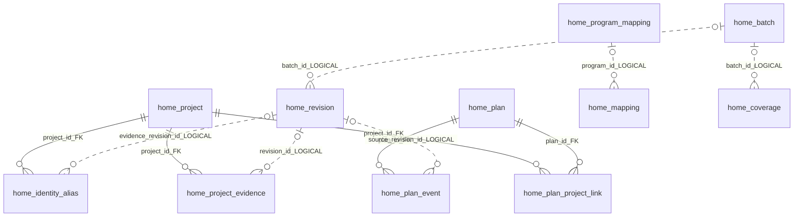
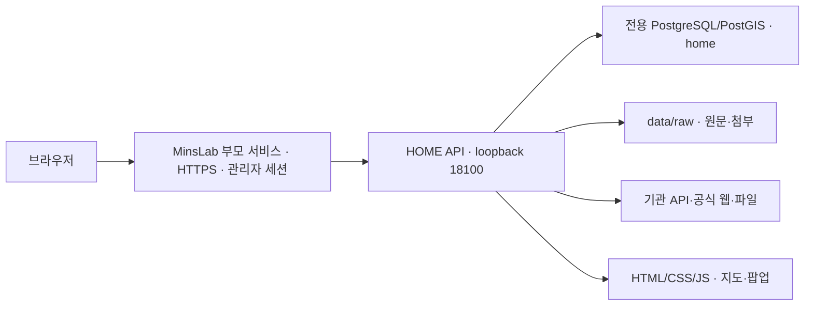

# HOME · 주택공급 정책의 실행·모니터링 마스터 안내서

**2026-10-22 화면 개선:** 공급현황 지도의 전국·시도·사업 선택과 블록 이동에 1.2초 가속·감속 전환을 적용했습니다. 연결 화면의 ‘사업 단계 근거·일정 관리’ 영역과 전용 화면 코드를 제거했습니다. 정책 조회·단계 계산에 쓰는 공용 근거·일정 데이터는 유지하며, 사업 목표·진행값은 기존 사업정보 수정 화면에서 관리합니다. 자료연도별 수집현황은 연도 열의 너비와 헤더 위치를 통일했습니다.

**2026-10-22 로딩 개선:** 문서 원문 반복 복사와 집계·성적표 기록에 따른 불필요한 사업 캐시 폐기를 줄였습니다. 운영 API의 정책·사업·수집연계 데이터가 동일함을 확인했습니다. 재방문 표본은 사업 0.69초·수집연계 1.15초이며, 첫 정책·사업 조회는 약 6~8초가 남아 있습니다. [측정·검증 보고서](docs/analysis/THE_JUTAEK_LOADING_REVIEW_20261022.md).

**2026-10-22 최신 발표·2차 성적표:** 공식32개 계획 항목을31개 관리 묶음에 대응했고, 원수량 동등26개·차이5개를 구분했습니다. 주택 기준14,753호와 발표14,731호의 차이는+22호이며 병점 오피스텔54실을 별도 관리합니다. 현재 정책 누적 착공82,968호·연말 예상99,885호입니다. 기존 구축 준비도63.2/100점과 신규 공식자료 비교12.95/20점을 분리해 공개합니다. [발표 마스터](docs/analysis/THE_JUTAEK_RELIABILITY_PRESENTATION_20261022.md) · [2페이지 발표 원고](docs/analysis/THE_JUTAEK_RELIABILITY_SLIDES_20261022.md) · [2차 성적표](docs/analysis/THE_JUTAEK_INTEGRITY_R02_20261022.md). 아래 기록은 각 작성시점의 역사적 결과입니다.

**2026-10-21 21:39 외부16항목 검토·담당자 연결 반영:** 부천역곡A1 통합공공임대1,160호를 조달청 공식규모와 ‘담당자 확인 - 비공식 자료: 동원건설산업’ 공사상태에 근거해 정책 누적 관리에 추가했습니다. 원천231건·관리176개·계획152,431호·착공도달81,044호·공급58,125호입니다. 정확한 착공일과 정부10월둘째주 산입 여부는 유보합니다. 32항목·31관리단위의 같은snapshot/revision 대조표, 네 비교군+76호 원인유보,185항목의발표일67/118구분을 함께 제공합니다. [최신검토보고서](docs/analysis/HOME_EXTERNAL_DIAGNOSTIC_REVIEW_20261021.md) · [16항목CSV](docs/analysis/external_diagnostic_review_20261021/diagnostic_V01_V16.csv) · [32항목통합CSV](docs/analysis/external_diagnostic_review_20261021/comparison_32.csv) · [갱신전체ZIP](docs/analysis/HOME_POLICY907_FULL_DATASET_20261021.zip). 아래는 각 시점의 기록입니다.

**2026-10-21 21:15 추가 수집·매핑 점검:** 마곡 도전숙 최초 모집201호와 계양 A17전체463=분양309+행복154호 구성을 공식 자료로 추가 확인했습니다. 임대 모집 부분합은4,461호로 보완했고 과천 S12 1,424호는4분기 계획1,400호와 반올림 부합으로 정리했습니다. 신규 정책 귀속은0건이며 착공 도달누적79,884호·공급58,125호는 동일합니다. 일반 인허가 미조회1,808개 동·토지이음 상세대기748건·검단 분할블록 공고3건 추출실패가 남아 있으므로 전체 차이를 비공개자료로 설명하지 않습니다. [점검 결과와 원문](docs/analysis/HOME_ADDITIONAL_MAPPING_REVIEW_20261021.md) · [추가5항목 대조](docs/analysis/additional_mapping_review_20261021/additional_official_comparison.csv) · [갱신 전체CSV ZIP](docs/analysis/HOME_POLICY907_FULL_DATASET_20261021.zip). 아래 내용은 각 작성시점 기록입니다.

**2026-10-21 정책 연결 전체 CSV·공식 185항목 대조:** 공급 형태·공급유형과 정책→프로그램→사업화→인허가→착공·준공→공급→입주를 담은 원천 사업 **230건**, 관리사업 **175개**, 단계 근거 **4,350행**을 내보냈습니다. 성남금토의 전체 임대규모를 금회 모집으로 사용한 공급 추정 **416호**를 공식 PDF로 보정해 공급 누적은 **58,125호**, 착공 누적은 **79,884호**입니다. 185항목은 부합41·공표판본 차이10·범위 다름102 등을 구분했으며 전체 정확도 비율로 계산하지 않습니다. [최종 보고서](docs/analysis/HOME_POLICY907_FULL_DATASET_COMPARISON_20261021.md) · [CSV 묶음](docs/analysis/HOME_POLICY907_FULL_DATASET_20261021.zip) · [공식 대조 CSV](docs/analysis/policy907-full-verification-20261021/official_185_comparison.csv). 아래 공급58,541호는 보정 전 기록입니다.

**2026-10-21 추가 공식 수집 후속 결과:** 서울 일반주택 착공은 공식 유형별 API의 2025년 3~8월 **2,229호 → 2026년 4,165호**, **+86.855% → 반올림 +87%**로 발표 증가율을 재현했습니다. 일반주택=비아파트 대응은 출처를 남겨 담당자 확인했습니다. 임대 모집 원문 6건 454호를 상세 추출해 부분합을 **3,806→4,260호**로 보완하고 기존 정책 사업 4곳 245호의 공급 추정을 공식 확인으로 전환했습니다. SH 209호는 개별 정책 귀속 유보이며 전체 14,700호와 동일 모집단의 확정 총계가 아닙니다. 착공 누적 **79,884호**, 공급 누적 **58,541호**는 유지합니다. [최종 후속 보고서](docs/analysis/HOME_OFFICIAL_FOLLOWUP_COLLECTION_20261021.md) · [갱신 8항목 CSV](docs/analysis/official_followup_sources_20261021/followup_results.csv) · [유보 후보 14건](docs/analysis/official_followup_sources_20261021/held_connection_candidates.csv). 아래 신규 8항목 1차 대조 기록보다 이 후속 결과를 우선합니다.

**2026-10-21 공식 발표 신규 8항목 대조:** 입주계획 2항목 부합·범위 차이 1항목·동일 조건 재현 유보 5항목입니다. 공식 서면의 공공임대 실적 14,700호를 확인했고, 기존 사업 5건에 공식 근거를 연결해 부천대장 A5·A6 입주계획을 2027년 11월로 보완했습니다. 실제 착공·공급량과 정책 귀속은 유지했습니다. [최종 보고서·공고별 근거](docs/analysis/HOME_OFFICIAL_ADDITIONAL_CHECKS_20261021.md) · [필수 컬럼 CSV](docs/analysis/official_additional_checks_20261021/additional_check_results.csv). 공공분양 14,451호·임대 3,806호는 전체 공식 실적과 같은 모집단이 확정되지 않은 부분합이며 일치율로 쓰지 않습니다.

**2026-10-21 공급유형 분류·사업정보 관리:** 유효 원천 443건 중 단일 유형 분류 가능 309건·미확인/혼합 134건, 9·7 관리사업 175개 중 분류 가능 166개·유형 미확인 8개·혼합 1개입니다. 사업정보수정에 공급유형·판단 근거·출처 URL을 추가하고 공식 공공주택 4곳과 검단 AA10-1 혼합 유형을 저장했습니다. [공식 5개 부문 대조·사업별 목록](docs/analysis/HOME_SUPPLY_TYPE_VERIFICATION_20261021.md). 분류 수는 올해 착공 사업 수가 아니며 기존 수량·날짜·정책 연결은 보존합니다.

**2026-10-21 추가 수집 범위 점검:** 등록 76개 중 75개에 성공 이력이 있지만 일반 인허가 미조회 2,178개 동, 토지이음 상세 대기 516건·첨부 다운로드 실패 30항목이 남아 있습니다. 인천검단 AA13-1·AA13-2를 같은 AA13으로 읽어 공고 상세 3건이 실패하는 원인도 공식 원문으로 재현했습니다. 자동 대기·파서 보완·경로 미연결·현재 목록에 없는 과거 자료를 [추가 수집 점검 보고서](docs/analysis/HOME_ADDITIONAL_COLLECTION_AUDIT_20261021.md)에 구분했습니다. 이번 점검은 운영 값·파서를 변경하지 않았습니다.

**2026-10-21 API 호출 제한 점검:** 일반 건축인허가의 10월 20일 HTTP429 실패 68회를 확인했습니다. 날짜 변경 후 자동 수집·연결·스냅샷이 성공했고, 조회 완료 법정동은 724→729개/2,907개, 보유 원천은 706,917→716,247건으로 늘었습니다. 일일·초당 제한의 소급 구분 한계와 아직 미적용인 재발 방지 개선안은 [점검 보고서](docs/analysis/HOME_API_LIMIT_AUDIT_20261021.md)에 정리했습니다.

**2026-10-20~21 로딩 심층 점검:** 정례 수집을 별도 작업자로 분리하고, 화면 범위별 비교표·반복 연산·지도 중복 요청 및 정책→프로그램 전환의 응답 누락을 보완했습니다. 사업·수집연계 재방문에 남은 재계산 지연도 구분해 기록했습니다. [원인·검증·현재 한계](docs/HOME_LOADING_DEEP_REPAIR_20261020.md).

**2026-10-20 사업 추진현황 조회 개선:** 선택 사업만 연결 근거를 계산하고 반복 조회를 재사용합니다. 로컬 브라우저 주요 정보 표시 **8.047초 → 5.033초**, 변경 없는 재조회 **0.452초**. 상세 응답 전체 일치 및 담당자 수정 후 갱신을 검증했습니다. [검증 기록](docs/analysis/HOME_PROJECT_LOADING_20261020.md).

**Housing Operations Monitoring & Execution · PoC 10**

**2026-10-20 로딩·통계 표시 및 2차 성적표 반영:** 출처 통계의 원문 제어문자 오류를 수정하고, 완료 집계값·집계 시각을 표시하며 백그라운드에서 갱신합니다. 검증 시점 **75개 출처·100,507,131개 추출 셀·2,693개 연결 원천**입니다. 사업별 수집연계 API 첫 조회 **9.9→4.9초**, 지역 여건 **7.6→4.3초**, 재조회 각각 **0.17초·0.01초**를 확인했습니다(당시 로컬 서버 측정). 메뉴 전환 중 이전 요청이 취소되면 자체 로딩 화면이 숨겨진 채 남던 문제도 수정했습니다. 실제 브라우저에서 통계·수집연계·지역여건·2차 성적표 및 MD 다운로드를 검증했습니다. 메모리 한도는 API 1,536MiB·DB 2GiB로 조정했습니다. [2차 보완 성적표](docs/analysis/HOME_SECOND_REMEDIATION_SCORECARD_20261020.md)는 기존 40개 항목 기준 **62.9점**이며, 관리 대상 증가에 따른 확보율 분모 변화로 1차 63.1점보다 소폭 낮아졌습니다. 전체 데이터 정확도 점수가 아닙니다. 데이터 정합성 화면에서 2차 성적표와 보고서 MD 다운로드를 제공합니다.


**2026-10-20 최신 검증 기준본:** [잔여 수집·정책 연결·공식 발표 차이 보고서](docs/analysis/HOME_REMAINING_WORK_REVIEW_20261020.md) · [원문·대조표 ZIP](docs/analysis/HOME_REMAINING_WORK_REVIEW_20261020.zip). 4개 사업 **3,158호**를 추가 연결했고 기존 C5 **490호**의 착공 계획을 보완했습니다. 현재 착공 누적 **76,936호**, 연말 계획 누계 **92,479호**, 인허가 누적 **87,953호**, 사업화 누적 **94,115호**입니다. 정책 확정 연결 **227건**, 관리 묶음 **172개**이며 기존 보호 기록 **3,033건**과 승인 일정은 보존했습니다. 보완 API 4개 중 3개는 2,907개 법정동 조회 완료, 일반 건축인허가는 **724/2,907개**에서 HTTP 429 반복으로 중단됐습니다. 정책 세부 귀속 근거가 부족한 **9개·6,296호**는 유보합니다. 아래 과거 보고서보다 이 기준본을 우선하며, 전수 수집 완료나 정부 총계와의 일치를 주장하지 않습니다.

**2026-10-20 추가 수집·공식 변경승인 반영:** [후속 정비·재진단 보고서](docs/analysis/HOME_COLLECTION_CONTINUATION_20261020.md) · [공식 원문·검증 자료 ZIP](docs/analysis/HOME_COLLECTION_CONTINUATION_20261020.zip). 신규 원천 레코드 **121,185건**, 공식 이미지 표 **45개 블록 26,695호**를 보완했습니다. 수원당수 C5 **490호**의 정책 연결을 추가했고, 부천대장 A9 **568→574호**는 공식 변경승인으로 원인을 확인했습니다. 인허가 누적은 **87,953호**, 사업화 누적은 **90,467호**이며 착공 **76,936호**, 연말 착공 계획 **88,831호**는 유지합니다. 기존 보호 기록 3,031건과 승인 일정은 보존했습니다. 현재 정책 확정 연결 **223건**, 관리사업 묶음 **168개**입니다. 아래 날짜별 수치는 각 검증 시점의 기록이며, 이번에 해결된 항목은 이 후속 보고서를 우선합니다. 미조회 API 구간은 자동 수집 중이므로 공식 전체와의 차이를 모두 시차·비공개로 설명하지 않습니다.


**2026-10-20 잔여 검증 결과(비교 기준10월19일):** [수집 현황·공식 발표 차이·검증 종결 보고서](docs/analysis/HOME_COLLECTION_OFFICIAL_GAP_CLOSURE_20261019.md) · [근거·대조표 ZIP](docs/analysis/HOME_COLLECTION_OFFICIAL_GAP_CLOSURE_20261019.zip). 병점은 원천2026년 공급계획과 승인 관리일정의 차이, 고덕강일3은 전체1,305호와 사전예약 제외215호의 차이로 원인을 확인했습니다. 실패했던 수집5개 경로를 재시도해 모두 성공했고, 인천 지도 좌표15개를 보강했습니다. 승인 사업량은 유지합니다. 일반허가 등의 미조회 범위가 있어 **공개자료 전수 수집 완료·정부 전체 실적 완전 재현으로 설명하지 않습니다.**

**2026-10-19 최종 대조 완료:** [최종 검증·결론 보고서](docs/analysis/HOME_FINAL_RECONCILIATION_20261019.md) · [원문·대조표 ZIP](docs/analysis/HOME_FINAL_RECONCILIATION_20261019.zip). 추가 공식 공모 6개 블록 **2,869호**를 9·7 직접시행 전환 프로그램에 연결했습니다. 앞선 8개를 포함하면 **14개 블록 8,031호** 보강이며, 현재 9·7 확인 연결222건·관리사업묶음167개입니다. 착공 현재누적 **76,936호**는 유지되고 연말 계획누적은 **88,831호**입니다. 공식 서면의 혼합 기준시점, 공공지원민간임대5,600호, 흑석11 약1,500호를 비교 기준에 반영했습니다. 공개 공급계획32개도 대조해 병점 등의 일정·부분물량 차이를 기록했습니다. **공식 전체와 사실상 일치하거나 남은 차이가 모두 비공개 때문이라고 결론 내리지 않습니다.** 기존 승인값은 유지하며, 사업관리 원장으로 확정하고 부문별 명세·변경승인·계획 판본 연결을 다음 우선순위로 삼습니다.

| 문서 관리 항목 | 기준 |
| --- | --- |
| 문서 기준일 | **2026-10-20 · Asia/Seoul** |
| 대상 서비스 | [HOME](https://www.minslab.kr/poc/home/) · 저장소 `PoC/10-home` |
| 확인한 소스 기준 | `main` 작업 트리 · `31b4806` 이후 README 정비·시설 상세·기준 접기·단계 실적·지역여건 주제별 배치·추진현황 관리 통계·메뉴 재편·사용법 갱신·요구사항 재검증 `HOME-REQ-20261015` 포함. 실제 공유본은 manifest의 커밋·미커밋 여부 확인 |
| 문서 용도 | 서비스 설명자료, 사용자 매뉴얼, 유지관리 매뉴얼, 데이터·기관 연계 협의, 인수인계·검수 자료의 공통 원본 |
| 현재 설명 / 적용 기록 | 본문은 현재 사용·관리 기준, 날짜가 있는 수치와 부록은 해당 시점의 점검 기록 |
| 내용 확인 순서 | 현재 코드·화면·API → 이 README → 상세 운영 문서·날짜별 보고서. 차이가 있으면 근거와 확인일을 기록하여 본문을 갱신 |

HOME은 정책 목표를 실제 사업과 연결하고 사업화부터 입주까지 계획 대비 부족·지연, 연결 근거, 책임기관과 다음 조치를 확인하는 주택공급 관리 서비스입니다. 이 문서는 독자별 설명의 공통 기준입니다. 화면 설명, 계산 정의, 운영 절차, 남은 제약을 한 문서에서 찾을 수 있도록 구성했습니다.

| 읽는 사람 / 만들 자료 | 먼저 읽을 곳 | 가져갈 내용 |
| --- | --- | --- |
| 정책 책임자·서비스 소개 대상 / 설명자료 | 1~2장, 3.3, 5장, 7.1 | 목적·범위·판단 기준·기대효과·현재 제한 |
| 일반 사용자 / 사용자 매뉴얼 | 4장, 7.2~7.3 | 메뉴별 사용 절차·그래프 읽기·수집 상태·FAQ |
| 업무 담당자·데이터 검토자 / 업무 매뉴얼 | 3장, 4.4~4.6, 5장 | 근거 확인·수정·귀속·승인·오류 조치·공유 키 |
| 유지관리 사업자 / 운영 매뉴얼 | 3.2·3.7, 4.8~4.9, 6장, 8장 | 구성·설정·배포·수집·복구·장애 대응·검증·담당 코드 |
| 개편 사업자·원천 제공기관 / 협의·검수 자료 | 2장, 3.2·3.5, 5장, 7.4 | 요구사항·현행 구조·오류 유형·인터페이스·역할·수용 조건 |

## 2026-10-19 미연결 사업·AI 조사자료 후속 재심사

LH 9·7 후속 개별 공모의 **8개 블록 5,162호**를 ‘LH 직접시행 전환·토지이용 효율화’ 프로그램에 추가했습니다. 착공 현재 누적 측정량은 **76,936호**를 유지하며, 12월 말 계획 누계는 **85,962호**로 늘었습니다. 인천계양 A16 인허가 434호를 확인 연결했고, 수원당수2 A3의 허가 717호와 계획 911호의 관계는 유보했습니다. 용도전환 3곳은 프로그램 근거로 보존하고 사업 합계에는 더하지 않았습니다. 아래 같은 날짜의 앞선 점검 수치와 구분합니다.

[공식 근거·AI 교차검증·404개 후보 재분류·잔여 격차 보고서](docs/analysis/HOME_POLICY_READMISSION_AI_REVIEW_20261019.md) · [공유용 근거 묶음 ZIP](docs/analysis/HOME_POLICY_READMISSION_AI_REVIEW_20261019.zip)

## 2026-10-19 계획 데이터·팀 조사자료 재검토

계획 파일 5개 경로(605행)와 SH 공사계약(792행)을 정례 수집에 추가했습니다. LH 입주계획·과거 공급·단지정보의 인천 제외를 수정해 각각 35·11·249행을 보완하고, GH 범위 일정 해석을 수정했습니다. 동일 지구·블록·호수가 확인되는 계획 근거 31건을 담당자 대행 확인했으며, 기존 검토 후보 9건을 확인 연결로 통합했습니다. 승인 관리값은 유지했습니다.

- [계획 수집 점검·수정·운영 검증 결과](docs/HOME_PLAN_COLLECTION_REVIEW_20261019.md)
- [팀 ZIP·담당기관 문서 재검토 및 남은 수집 경로](docs/analysis/HOME_TEAM_ROUTE_REVIEW_20261019.md)
- [152행 경로 대조](docs/analysis/HOME_TEAM_ROUTE_AUDIT_20261019_sources.csv) · [1,087행 요구 항목 대응](docs/analysis/HOME_TEAM_ROUTE_AUDIT_20261019_fields.csv)

## 2026-10-19 후속 착공 확인·로딩 개선

사용자 지시에 따라 국토부 10월 공식 발표를 검토해 흑석11 1,515호·신림2 1,430호의 착공 근거를 연결했습니다. 현재 착공은 **76,936호**, 연말 계획은 **80,800호**입니다. 10월 16일은 착공 확인일이며 정확한 착공일과 구분합니다. LH 원천 후보 7건은 기존 사업에 중복 없이 연결했고, 나머지 7건은 보류했습니다. [판정 결과와 성능 점검](docs/HOME_SOURCE_ROUTE_REMEDIATION_20261019.md) · [사업별 판정 CSV](docs/HOME_START_REVIEW_20261019.csv).

정책 조회의 1900년 이후 빈 연도와 불필요한 과거 판본·후보 본문 조회를 줄였습니다. 응답은 약 51.5MB→20.0MB, 압축 전송 약 0.98MB이며 반복 API 조회 약 0.14초를 확인했습니다. 최초 계산에는 시간이 남아 있습니다. 기존 승인 물량·계획은 보존했습니다.

## 2026-10-19 수집 경로 보완·전체 API 범위 점검

[수집 경로 보완 결과](docs/HOME_SOURCE_ROUTE_REMEDIATION_20261019.md)와 [API 27개 전수 범위 점검표](docs/HOME_API_SCOPE_REVIEW_20261019.md)에 실제 재수집 결과, 지역·기간·페이지·재방문 조건, 남은 경로를 정리했습니다. 인천 누락, 일반 인허가 1만 건 상한, 토지이음 전체 시군구 코드, 자동 실행·재방문 공백을 수정했습니다. LH 연간 업무계획과 토지이음 고시 원문 경로를 추가했습니다.

인천 주택 인허가 278개 법정동의 최초 조회를 완료했으며, 일반 인허가·대장·고시 상세는 미조회 범위를 이어 수집합니다. 담당자 승인 연결 261건·사업 설정 300건·프로그램 연결 45건은 내용까지 보존했습니다. 새 원천 후보를 정책 호수에 자동 가산하지 않으며, 공식 발표와의 차이는 시차·수집 범위·사업 연결·집계 정의로 나누어 설명합니다.

## 2026-10-19 10월 공식 발표 기준 정비 방향 재정렬

**공식 발표에 명시된 사업을 착공연도만으로 제외하지 않습니다.** 정책·프로그램 추진현황은 승인 연결 사업 전체를 같은 범위로 지도·카드에 표시합니다. 앞서 적용했던 기본 화면의 ‘2026년 이전 착공 제외’는 철회했습니다. 현재 착공 누계는 **76,936호**, 연말 계획 누계는 **80,800호**이며 공급은 각각 **58,195호 / 69,902호**입니다. 이 값은 관리 원장의 전체 연결 사업 누계입니다.

10월 공식 발표의 ‘올해 수도권 착공 99,000호 이상’과는 사업·블록·기간을 대조해 차이를 정리합니다. 공식 사업이 원장에 과거 착공일로 등록돼 있으면 포함을 유지하고 날짜 충돌을 추적합니다. 발표 수치를 원장에 임의 배분하거나 승인값을 덮어써 합계를 맞추지 않습니다.

그래프 아래 **10월 공식 발표 사업·물량 대조**에 발표의 16개 사업·단계 항목, 원장 연결 사업, 규모·착공연도·현재 단계 차이를 모았습니다. 같은 내용은 API `official_alignment` 및 보고서용 MD의 M14로 제공됩니다. 현재값/연말계획 카드와 M13은 유지합니다. 기존 39개 신규 유형 기반 정책 확정 철회와 AA19 임대유형 분리는 그대로 유지합니다.

[정비 기준 정정 보고서](docs/HOME_OCTOBER_ALIGNMENT_CORRECTION_20261019.md) · [이전 집계 감사 보고서(당시 기준본)](docs/HOME_POLICY_SCOPE_AND_OFFICIAL_GAP_20261019.md). 이전 보고서의 13,680호·8,742호는 축소 범위의 과거 표시값으로 현재 기본 화면값이 아닙니다.

## 신뢰성 있는 실시간 데이터 플랫폼 구축 계획

[HOME 실시간 주택공급 데이터 플랫폼 개선 계획](docs/HOME_TRUSTED_REALTIME_PLATFORM_PLAN_20261016.md): 원천 사건을 먼저 포착하고 검증된 자체 원장으로 실적과 발표 자료를 산출하기 위한 계획입니다. 사업 모집단·식별·공통 집계, 변경 추적, 기관 연계와 단계별 검수 기준을 정리했습니다. 이번 공식 발표 대조는 중간 검증 사례로 사용합니다.

[데이터 수집 중간성적표 HTML](docs/HOME_DATA_COLLECTION_MIDTERM_20261016.html): 10개 영역·40개 세부 항목의 점수·근거·개선 과제와 전체 확인 일치율·비교 가능 항목 일치도를 분리해 표시합니다. [평가 JSON](docs/HOME_DATA_COLLECTION_MIDTERM_20261016.json)에서 배점·관측 분자와 분모·근거 판본을 확인할 수 있습니다.

### 보완회차별 데이터 정합성 확인

**데이터관리 → 네 번째 소메뉴 ‘데이터 정합성 확인’**에서 최초 평가와 통합 보완 1차를 선택합니다. 사용자 지시에 따라 기존 보완1·2는 목록에서 삭제하고 해시 보관본·교체 감사로 남겼습니다. [관리 화면](https://www.minslab.kr/poc/home/#data-integrity) · [통합 보완 1차 HTML](docs/HOME_DATA_INTEGRITY_R01_CONSOLIDATED_20261017.html).

동일한 40개 항목·100점 배점으로 **최초 51.6 → 통합 보완1 63.0점**입니다. 항목별 이전 점수와 증감은 모두 최초 평가를 기준으로 합니다. 담당자 **김민**, 사유 **공식 발표 후 도출된 보완 사항 적용**을 기록했습니다. 별도로 확인된 전체 승인 물량 전용 12건·마곡17 전체/부분 관계 3건은 **담당자 매칭 확인 오류 수정** 사유로 이전/정정 판본과 함께 기록했습니다. 기존 정책 귀속 확정·해제 매핑 197건은 상태·판본·귀속이 그대로입니다.

4대 지표는 실제 원문 20쌍의 **자동 근거 연결 이진 판정**에 한해 측정합니다. 최초 정확도 90.0%, 정밀도 100.0%, 재현율 77.78%, F1 87.5%에서 보완 후 표본 내 100.0%로 변했습니다. 무작위·독립 평가가 아니며 전체 플랫폼·iH 원천·과거 담당자 확인 전체의 정확도를 뜻하지 않습니다. 전체 모집단의 4대 지표는 미산정입니다. 53행을 최신 자료로 재대조한 확인율은 **2/47=4.26%**입니다. 최초 3/47에 포함했던 창릉의 추정 관리 입력 1행을 직접 사건 확인에서 제외했으며, 목표·공식 통계 참조 확인과 독립 실적을 구분합니다.

통합 보완은 [iH 공식 홈페이지](https://www.ih.co.kr/main/business/house.jsp)의 주택 사업 후보 **7건**, 모집 문서 **281건**을 확보했습니다. 2018년 이후 조회 범위의 과거 공고 이어받기를 마쳤고, 최신 2페이지와 과거 2페이지 순환 재확인·실패 상세 재시도·본문/첨부 식별 해시·HWPX 추출을 적용했습니다. 이진 HWP는 추가 정형화 대상입니다. 새 경로인 [iH 임대단지 명부·상세](https://www.ih.co.kr/main/lease/leaseAptList.do) **19항목(17단지·2프로그램)**, [서울 정비사업 명부](https://cleanup.seoul.go.kr/cleanup/bsnssttus/lscrMainIndx.do) **1,180건**과 기존 관리사업의 개요·추진경과 **21건**도 수집합니다. 운영 재고·계획·조회일은 실제 신규 공급·계약·실입주로 변환하지 않습니다.

기존 iH 재고 API 주소는 [공식 명세](https://www.data.go.kr/data/15168460/openapi.do)의 host/path와 일치합니다. 실호출 HTTP 504의 상세 원인은 미확정이며, 홈페이지 성공과 별도 원천으로 유지합니다. 홈페이지 자료를 API 재고·계약·공가 데이터의 대체 실적으로 사용하지 않습니다.

새 저장 구조는 `home_metric_snapshot`(정확한 인지시각·입력 판본·계산 코드 해시·구성 사건·제외·충돌), `home_integrity_round`(부모 회차·점수·HTML/JSON·검증 해시), `home_collection_job`(원천별 영속 작업·단계 재시도·임대 식별자)입니다. 최신 탐지와 과거 수집 작업자를 분리하고 `COLLECT → LINK → SNAPSHOT`을 처리합니다. 허가·대장 완료 법정동의 7일 재방문도 추가했습니다. 장기 지연 P95·수도권 전수 분모·실제 계약·실입주 원천 확보는 후속 과제입니다.

성적표는 발행 후 덮어쓰지 않습니다. 준비된 후속 HTML/JSON은 `scripts/register_integrity_rounds.py --id ... --sequence ... --parent ... --json ... --html ... --actor ... --reason ...`으로 등록하며, 이전 회차의 40개 ID·배점·점수와 코멘트를 검증합니다. 조회 API는 `/api/data-integrity`, `/api/data-integrity/rounds/{id}`, `/api/data-integrity/rounds/{id}/report.html`입니다. 집계 원장 JSON과 같은 기준본의 사건 CSV는 `/api/independent-snapshots/{id}` 및 `/api/independent-snapshots/{id}/events.csv`에서 확인합니다. 모든 API 경로에는 `/poc/home` 접두사가 붙습니다.

**2026-10-17 착공 추가 점검:** LH 원문의 같은 행에 있는 착공일·주택 공사규모가 사건 물량으로 전달되지 않는 오류를 수정하고 재수집했습니다. 직접 확인 착공은 **309 → 8,755호(9개 사건)**이며 창릉 S3·S4의 **2,306호**도 포함됩니다. 앞선 창릉 제외 판정에는 이 구현 누락의 영향이 있었습니다. 계양 A17 전체463/부분309는 전체463호를 한 번 집계합니다. 운영 화면 상단의 착공 점검과 `/api/data-integrity/construction-audit`에서 수정 전후·사건별 근거·남은 수집 공백을 확인합니다. 공식99,000호와 표시상90,245호 차이가 남지만, 전체 범위와 마감시점이 검증되지 않아 일치율·정확도는 계산하지 않았습니다. 인허가 착공일 보유2,152행의 원천 세대수는 모두0이고, LH 자료는7월1일 기준입니다. 인천 인허가·LH 착공을 정기 수집에 편입했으며 전체 모집단·최근 착공 수집을 우선 과제로 유지합니다. 김민 담당·지정 사유로 수정 이력을 남기고 정책 매칭323건 및 기존 성적표 해시를 보존했습니다.

일반 건축인허가 `building_general_permit`는 [해당 서비스 활용신청](https://www.data.go.kr/data/15136267/openapi.do) 후 실제 응답 코드00과 운영 원장 적재를 확인했습니다. 같은 공공데이터포털 인증키를 서비스마다 중복 입력할 필요가 없도록 기존 `POC10_BUILDING_HUB_SERVICE_KEY`를 재사용합니다. `POC10_GENERAL_BUILDING_SERVICE_KEY`는 다른 키를 사용할 때의 선택적 우선 설정입니다. 키 설정 여부와 서비스 활용승인 여부를 구분하며, 과거 HTTP403/코드30 실패 이력은 보존합니다. 세대수 `hhldCnt`, 호수 `hoCnt`, 가구수 `fmlyCnt`와 실제착공일·착공예정일을 구분하여 `general_permit` 원장에 저장합니다. 실제 수집 결과·남은 법정동 범위는 [연계 확인 기록](docs/evidence/HOME_ZERO_HOUSEHOLDS_20261017/general-api-activation.json)에 보존하며, 첫 수집 성공을 전 지역 수집·사업 연결 완료로 해석하지 않습니다. 일반 수집은 기본 데이터 적재로 분류하며 연결 확인만 **김민 / 담당자 확인(자동연결)**로 기록합니다. 사용자 요청에 따라 새 회차 없이 기존 보완1을 **63.0 → 63.1점**으로 갱신하고 A1·A2 상승 원인을 코멘트에 구분했습니다. 최초 평가 대비 기준과 4대 지표·공식 발표 확인율은 유지하며 수정 전 보완1은 해시 보관합니다.

요청한 [0세대 인허가 목록](docs/evidence/HOME_ZERO_HOUSEHOLDS_20261017/인허가_0세대_목록.html)은 허가일 확인 전체226,147행, 2026허가22,221행, 2026착공일2,152행을 구분합니다. 원장 행 수는 고유 사업 수가 아닙니다. 사업별 수집·연계의 기본 9·7정책197개와 정책 전체323개는 다른 범위입니다. 9·7사업 중 선택 연결된 허가75건에는0세대가 없으며, 나머지122개는 이 선택 허가 연결이 없는 상태로 실제 허가 부재를 뜻하지 않습니다.

**2026-10-17 평가 방향 재검증:** 기존 보완1의 최상단에 “우리 데이터만으로 이번 보고서를 작성할 수 있는가”를 평가하는 53개 주장별 데이터 계약·산식·보유 근거·공백 진단을 추가했습니다. 판정은 **전체 보고서 작성은 아직 불가, 직접 근거와 범위를 명시한 부분 보고서는 작성 가능**입니다. 기술 준비도63.1점과 기존 수치 대조4.26%를 보고서 작성률·전체 정확도로 사용하지 않습니다. 3기 신도시는 화면 프로그램명 대신 지구·블록으로 분류해 직접 착공5개 사건4,112호를 확인했으며 전체 실적은 미확정입니다. 화면7,527호는 당시 필터·판본을 재현하지 못해 오류로 단정하지 않았습니다. 최신판 수신만으로 해결되는지와 연결·분류·업무 원장·전망 산식의 구조적 공백을 구분합니다. 새 회차 없이 기존 보완1을 갱신하고 수정 전 해시 판본을 보존했습니다. [작성 가능성 평가](docs/evidence/HOME_REPORT_REPRODUCIBILITY_20261017/assessment.json) · [보유 원장만으로 작성한 제한 범위 초안](docs/evidence/HOME_REPORT_REPRODUCIBILITY_20261017/own-data-report.html).

**2026-10-17 왕숙2 공고 누락 점검:** A-1 812호·A-3 686호는 이미 수집·사업 연결·정책/3기 신도시 매핑이 되어 있었습니다. 독립 사건 중복 제거에서 공사 원장의 미확정 공급유형이 살아남아 공공분양 집계에서 빠진 오류를 수정했습니다. 모집공고 원문 판본으로 공급유형을 결정하고 분양전환 임대·추가/잔여/예비입주자 공고를 구분합니다. 동일 인지시각 재계산 결과 공공분양(2026년 1~3분기) 부분 합계는 **1,257 → 9,534호**, 공공임대 부분 합계는 **2,270호**입니다. 왕숙2 두 블록의 보유 LH 원장 착공일은 모두2025-12-31이므로2026년 신규 착공4,112호에는 더하지 않습니다. 보완1의 코멘트·HTML/JSON을 갱신하고 기술 점수63.1점·최초 기준을 유지합니다. [수정 평가와 공백](docs/evidence/HOME_NOTICE_CLASSIFICATION_20261017/assessment.json) · [사건별 분류 수정 근거](docs/evidence/HOME_NOTICE_CLASSIFICATION_20261017/classification-changes.json). 수집이나 사업 연결을 새로 수행한 변경이 아니므로 매칭 확인 이력을 추가하지 않았으며, 김민 담당의 보완1 변경 감사에 기록합니다.

**왕숙2 공식 성과 포함 재검증:** 공식 발표는 왕숙2를2026년 착공1,100호로 명시합니다. A-1·A-3의 본청약1,498호 및 보유 공사 원장의2025-12-31 착공일과는 대상·단계·기간 대조가 남아 있습니다. 두 블록을2026년 신규 착공에서 제외하는 것만으로 공식 왕숙2 성과가 설명됐다고 결론 내리지 않습니다. 보완1의S04·M08에 **공식 성과 포함 / 구성 블록·실적 인정일 미확인 / 자체 원장 재현 미완료**를 기록했습니다. 공식1,100호를 자체 사건으로 복사하거나 본청약1,498호로 대체하지 않으며, 0실적·1,100호 누락 확정으로 표현하지 않습니다. [공식 포함 및 미재현 대조 기록](docs/evidence/HOME_WANGSUK2_OFFICIAL_REVIEW_20261017/review.json).

**2026-10-18 담당자 연결 검토:** 사용자 위임에 따라 9·7 정책의 신규 프로그램6개와 활성 사업11개(iH7·정비3·광교1)의 관리 연결을 **김민 / 공식 자료 확인 및 IH 추가 연결**로 확정했습니다. 정책–프로그램·프로그램–사업 각각 변경 전후 판본과 원문 근거를 감사 이력17건에 기록했습니다. 9·7 사업별 수집·연계 조회는 **197 → 208개 사업 기록**이며, 광교 중복 의심 해제1건은 제외합니다. 개별 사업의 실적 인정·정책 기여 물량과 관리 연결을 구분하며 직접 사건·평가 점수는 이번 연결만으로 변경하지 않았습니다. iH 정상 수집에서는 면적별 세대수 합산 오류를 수정해 검암S3 계획614호를749호로 보정했습니다. 기존 보완1에 이번 연결 결과와 항목별 코멘트를 추가했습니다. [연결 검토안·근거](docs/evidence/HOME_POLICY_CONNECTIONS_20261018/plan.json) · [담당자 변경 이력](docs/evidence/HOME_POLICY_CONNECTIONS_20261018/history.json).

## 2026-10-16 공식 발표 대조

[2026-10-19 수집 갭 재검토: 날짜 차이와 인허가·착공 누락](docs/HOME_COLLECTION_GAP_REVIEW_20261019.md): 같은 기간 시도 통계 9개 셀 일치, 월별 인허가 대체 경로 누락, 실제착공일을 가진 주거용 신축 44행의 사업 연결 미완료, 원천별 미조회 지역과 개선 우선순위를 현재 운영 원장·공식 PDF로 확인했습니다. [착공 검토 후보 CSV](docs/HOME_COLLECTION_GAP_REVIEW_20261019_construction_candidates.csv), [집계 JSON](docs/HOME_COLLECTION_GAP_REVIEW_20261019.json). 후보 행의 세대수 합은 확정 누락 공급량이 아닙니다.

[공식 발표와 HOME 데이터가 상이한 이유에 대한 결과 보고서](docs/OFFICIAL_DIFFERENCE_CAUSE_REPORT_20261016.md): 목표·기간·범위·관리 연결 등 11개 유형으로 53개 발표 항목을 정리하고, 확인된 원인과 원인 미확정 항목·우선 조치를 구분했습니다.

[공식 발표 대비 정확도·최신성·연계 범위 점검](docs/OFFICIAL_ACCURACY_REVIEW_20261016.md): 성과지표 37개·사업 발표 16개와 실제 운영 데이터를 비교했습니다. 담당자 승인값은 확정 기준으로 유지하며, 직접 비교 수치·목표 버전·관측 기간·관리 연결 범위를 구분합니다. [성과지표 CSV](docs/OFFICIAL_ACCURACY_REVIEW_20261016_metrics.csv) · [사업별 CSV](docs/OFFICIAL_ACCURACY_REVIEW_20261016_sites.csv).

## 데이터 구축 과정 상세 마스터

[HOME 데이터 수집·정형화·연계 구축 마스터](docs/HOME_COLLECTION_PIPELINE_MASTER_20261016.md) · [MD 다운로드](https://www.minslab.kr/poc/home/assets/reports/HOME_COLLECTION_PIPELINE_MASTER_20261016.html)

2026-10-16 관측 기준으로 출처 선정, 비정형 자료 표준화, 사업·단계 매칭, 자동 수집·변경·중복·오류 처리, 데이터 한계와 실제 보정 방법, 출처 URL·외부 및 내부 API 참조를 정리했습니다. 담당자 승인값·연결은 정확한 확정값으로 전제하며, 본문 18개 장과 출처 63개·조치 기록 64건의 부록, 설명자료 구성안을 포함합니다.

## 목차

2026-10-20 이관 후 중복 점검: 인천부평의 숫자 없는 `A` 블록을 공사·임대계획·공정률 자료 사이에서 동일 현장으로 연결하여 전체 공급지도 목표량의 중복 350호를 제외했습니다. 9·7 정책 비교 지표와 승인 원장은 유지됩니다. 공공 여부 미분류는 전체 집계에서 자동 제외되는 조건이 아니며, 좌표 공란도 원천 자료 부재와 위치 자료 미연계를 구분해야 합니다. [수정 결과·이관 집계 기준](docs/HOME_BUPYEONG_DEDUP_20261020.md).

1. [개요](#overview)
2. [구축 목표: 총리 요구사항](#requirements)
3. [설계 방향과 실제 구현: 매칭 오류 사례 및 조정](#design)
4. [이용 방법](#usage)
5. [향후 개선 방향과 사업자 협의 기준](#improvement)
6. [유지관리 매뉴얼](#operations)
7. [파생 문서 제작·용어·FAQ](#document-use)
8. [근거 자료·검증·적용 기록](#references)

빠른 이동: [최신 요구사항·확보 지표](#requirements-current) · [3분 따라하기](#quick-start) · [지역여건 조회](#regional-conditions) · [보고서용 MD](#report-markdown) · [수치·지연 판정](#measurements) · [담당자 수정](#editing) · [출처·샘플 조회](#source-samples) · [배포](#deployment) · [백업·복구](#backup-restore) · [장애 대응](#troubleshooting)

<a id="overview"></a>

## 1. 개요

### 1.1 서비스가 해결하는 문제

주택공급 자료는 정책 보도자료, 기관 공급계획, 인허가 API, 공사 현황, 모집공고, 입주계획 등에 나뉘어 있습니다. 같은 사업도 지구·블록명, 단지명, 공구명, 임대 유형에 따라 다르게 표기됩니다. 이 자료를 그대로 합치면 중복 물량, 잘못된 단계, 누락된 일정이 발생합니다.

HOME은 원천을 판본별로 보존하고, 자료 사이의 연결 근거와 검토 상태를 DB에 저장합니다. 사용자는 정책 → 프로그램 → 사업으로 범위를 좁혀 목표·계획·현황을 보고, 사업 × 단계 수집 현황에서 그 수치의 원천과 누락 원인을 확인할 수 있습니다.

**현재 제공 범위는 수도권과 등록된 사업 기록 중심입니다.** 전국 및 모든 기관의 실사업 모집단을 확보한 서비스로 해석하지 않습니다. 인구·가구·고용·미분양 같은 지역 통계와 개별 사업의 정책 이행 실적도 별도로 관리합니다.

### 1.2 접속·관리 범위

| 항목 | 현재 구성 |
| --- | --- |
| 운영 서비스 | [HOME](https://www.minslab.kr/poc/home/) · 단축주소 `/home` |
| 정책·프로그램 추진현황 | 9·7 주택공급 확대방안 중심. 프로그램은 저장된 9·7 연결 범위에 따라 표시 |
| 지역 | 서울특별시·경기도·인천광역시. 원천마다 확보된 지역·연도·세부 범위가 다름 |
| 단계 | 정책 → 사업화 → 인허가 → 건설 → 공급 → 입주. 준공은 건설 내부 사건으로 관리 |
| 조회와 편집 | 공개 조회 / MinsLab 관리자 로그인 후 목표·연결·일정·조치 입력 |
| DB | PostgreSQL 16 + PostGIS 3.5, DB `home`, 컨테이너 `poc10-home-db` |
| 기술 구성 | 독립 FastAPI·SQLAlchemy API, HTML/CSS/JavaScript, MapLibre·Three.js, 부모 ASGI reverse proxy |
| 별도 서비스 | [주택파동 PoC 12](../12-housing-board/README.md), `/home2`. 독립 앱이며 HOME의 대체 DB나 별도 공식 실적 원장이 아님 |

9·7의 수도권 **2026~2030년 신규 착공 목표 135만 호**와 현재 연결된 사업의 계획 소계는 모집단이 다릅니다. 기존 착공 사업이나 전국 참고 통계의 큰 수치를 이 목표의 달성 실적으로 자동 전환하지 않습니다. 발표 총량 1,350,000호와 원문 연도별 목표표 합계 1,349,000호의 차이 1,000호도 임의로 배분하지 않습니다.

### 1.3 현재 상태를 읽는 기준

화면을 제공하는 것, 자료를 확보하는 것, 정책 목표를 달성하는 것은 서로 다른 상태입니다. 자료를 재사용할 때는 다음 지표의 분모·기준일·대상 범위를 함께 옮깁니다.

| 지표 | 확인할 기준 | 사용할 때 주의할 점 |
| --- | --- | --- |
| 기능 충족률 | F-01~F-12 세부 기능에 대한 자체 평가 | 정책 달성률·매칭 정확도와 구분 |
| 데이터 확보율 · 추정 제외 | 등록 사업·단계 셀 중 비추정 근거 확보 건수 | 비추정 확인 입력도 포함 가능. 항목별 확보 정의를 함께 제시 |
| 데이터 확보율 · 추정 포함 | 같은 분모에 담당자 산정·추정 자료까지 포함 | 확정·승인해도 추정 성격은 유지. 두 확보율의 분모를 바꾸지 않음 |
| 연결 검토 상태 | 정책–프로그램, 프로그램–사업, 단계 원천 연결의 각각의 상태 | 한 관계를 승인해도 다른 관계가 자동 승인된 것으로 해석하지 않음 |
| 정책 목표 달성률 | 동일한 기간·지역·단계·물량 정의의 인정 실적 / 목표 | 등록 사업 전체·정책기간 내 사업·지역 전체 통계를 섞지 않음 |
| 지연·주의 추이 | 같은 범위의 도래 목표와 누적 측정값 | 상태별 단계 최대 부족량이며 고유 지연 사업량의 합계와 구분 |
| 기관별 진행현황 | 기관별 사업 계획량의 위험 상태 분류 | 기관 배정 목표의 달성률과 구분 |
| 수집 상태·건수 | 마지막 시도, 마지막 성공, 성공 배치 범위, 현재 저장 건수 | 공고·원천 레코드 건수는 주택 호수나 고유 실사업 수가 아님 |

현재 확보율은 `GET /poc/home/api/requirements-status`, 원천 운영 상태는 `GET /poc/home/api/sources`, 목표·누적 비교는 `GET /poc/home/api/policy-delivery`와 해당 화면에서 확인합니다. 사업 추진현황 메뉴의 건수 배지는 제거했으며, 숫자의 의미는 조회 화면의 범위 설명으로 확인합니다.

날짜가 붙은 점검 숫자는 과거 스냅샷입니다. 초기 점검의 194개 원천 사업 기록이나 이후 점검의 197개 사업 기록을 고정된 고유 사업 모집단으로 인용하지 않습니다. 이전 확보 지표는 [8.4](#historical-records)에 보존합니다.

<a id="requirements"></a>

## 2. 구축 목표: 총리 요구사항

총리 요구사항은 사용자가 제공한 「주택파동 핵심 기능 요구사항 및 기존 시스템 점검 명세서」의 F-01~F-12를 기준으로 관리합니다. 핵심은 **목표 대비 이행을 판단하고, 지연 원인·담당기관·조치기한까지 연결하는 분석 도구**를 제공하는 것입니다.

| ID | 요구사항 | 현재 구현·이용 화면 | 추가로 필요한 자료·업무 |
| --- | --- | --- | --- |
| F-01 | 주택공급 현황 통합 조회 | 공급 지도, 정책·프로그램·사업 조회, 범위 연동 | 전국 실사업 명단, 기관별 사업 ID, 정책 귀속 명부 |
| F-02 | 목표 대비 이행실적 관리 | 단계별 목표·현황 면적 그래프, 목표 편집, 지역·기관 비교 | 동일 범위의 연월 목표·실제 사건·인정 물량, 지역별 목표 배정 |
| F-03 | 공급 단계별 진행상황 관리 | 6단계 그래프, 단계 도달률, 사업 × 단계 근거 표 | 최초·변경승인, 실제 착공·준공·입주 근거와 전체/부분 범위 |
| F-04 | 사업별 상세정보 조회 | 사업 개요, 일정·공정·근거·입지·변경 이력 | 누락된 시행·시공기관, 정확 위치, 총세대수, 명칭 변경 대응 |
| F-05 | 연도별 공급계획·시계열 분석 | 자료연도·월별 계획/측정, 미래 단계 예정량·목표 시점, 지도·그래프·MD 기간 연동 | 과거 변경판과 단계별 연월 계획, 실제 입주 집계 시계열 |
| F-06 | 일정 및 지연 관리 | 최초 기준선·현재 예정·실제 사건, 종합 일정 점검·CSV | 담당자 승인 최초 약속, 변경사유·승인일, 실제 완료일 |
| F-07 | 지연 원인·병목 관리 | 원인 분류, 영향 물량, 책임·협력기관, 조치기한·장기 미해결 필터 | 실제 병목 사건과 발생·해결일, 조치계획, 책임기관 확인 |
| F-08 | 기관별·정책 추진현황 | 정책–프로그램–사업 DB 연결, 기관 역할·배정 목표·실적 비교 | 공통 기관코드와 공식 목표 배정·성과 인정 자료 |
| F-09 | 국민의 공급 예측가능성 | 지역·사업별 모집·준공·입주 예정과 확정 여부 | 본 모집공고, 최신 변경 일정, 실제 입주 시작·입주량 |
| F-10 | 정보 신뢰성·갱신 관리 | 연계 다이어그램, 판본·해시, 품질 점검, 오류조치·감사 이력 | 원천 정정·취소 계보, 제공 범위, 지속적인 담당자 검증 |
| F-11 | 정책 이행상황 종합 판단 | 정책 개요·지역·단계 흐름, 월별 실적·지연 추이·기관 진행 통계, 사업 근거 | 같은 모집단의 실입주·미분양 자료, 위험·기관 조치 기록 |
| F-12 | 공급 전망·시나리오 분석 | 평균기간·병행공구 기반 목표 추정, 6·12·24개월 일정 이동, 기준·대안 비교·가정 저장 | 승인 기준선, 지연 영향 범위, 장기 수요·시장 분석 자료 |

`매뉴얼 → 요구사항정의`에서 항목별 기능, 근거, 이용 경로, 잔여 과제와 데이터 확보율을 확인하고 CSV로 내려받을 수 있습니다. 기능 충족률은 세부 항목의 구현 평가 점수로 계산하며 통계적 매칭 정확도나 실제 정책 달성률을 뜻하지 않습니다.

<a id="requirements-current"></a>

### 2.1 최신 요구사항 재검증 · 2026-10-15

**기능 자체 점검은 95.9%(58.5/61점)**입니다. 사용자 제공 원문 F-01~F-12의 61개 세부항목을 유지하고, 충족 56개·부분 충족 5개·미구현 0개로 평가했습니다. 1점·0.5점·0점을 동일 가중치로 합산한 뒤 소수 첫째 자리로 반올림합니다. 평가 버전은 `HOME-REQ-20261015`이며, 화면과 CSV에 기능 평가일·항목별 점수·판정 이유·구현/검증 근거를 표시합니다.

| ID | 점수 / 세부항목 | 기능 충족률 | 확인한 기능·남은 제한 |
| --- | ---: | ---: | --- |
| F-01 | 4.5 / 5 | 90% | 수도권 지도·기관/정책/사업 조회. 전국 개별 사업 통합은 부분 충족 |
| F-02 | 5 / 5 | 100% | 기관·단계·연도별 배정 목표/확인 실적 비교, 목표 판본과 기준일 |
| F-03 | 4.5 / 5 | 90% | 단계별 계획·측정·지도 카드. 복합·부분 사업 동일성 검증은 부분 충족 |
| F-04 | 5 / 5 | 100% | 사업 일정·원천·입지·분양/임대 조건·시설 상세 |
| F-05 | 6 / 6 | 100% | 월/연도별 단계 예정량, 미래 목표 시점, 원천/추정/시나리오 구분 |
| F-06 | 5 / 5 | 100% | 최초 기준선·현재 예정·실제 사건·지연·변경사유·그룹 집계 |
| F-07 | 5 / 5 | 100% | 병목 원인·기관·조치·기한·영향 물량·장기 미해결 필터 |
| F-08 | 4 / 4 | 100% | 주관/협력/승인 역할·기관 목표 비교·정책/프로그램 범위·협의 과제 |
| F-09 | 5 / 5 | 100% | 향후 공급/준공/입주 예정량·날짜·확정 여부와 원문 연결 |
| F-10 | 5.5 / 6 | 91.7% | 판본·갱신·오류·추정·MD 근거. 전체 원천의 의미적 정합성은 부분 충족 |
| F-11 | 4 / 5 | 80% | 종합 갭·상태·지역여건. 전국 통합과 사업별 위험 판정은 부분 충족 |
| F-12 | 5 / 5 | 100% | 원천 일정·평균기간·병행공구 기반 목표 추정과 기준/대안 시나리오 |

직전 자체 점검 56/61점(91.8%)에서 변경된 항목은 F-02.3, F-05.3·F-05.4, F-09.2, F-12.1입니다. 이미 구현된 기관별 비교·단계 예정물량·일정 기반 전망을 재확인했고, 실제 자료 미등록이나 원 요구사항에 없는 학습형 예측 조건을 기능 미구현으로 보던 판정을 바로잡았습니다. 이는 신규 자료 확보량이나 예측 정확도가 개선됐다는 뜻이 아닙니다.

**남은 기능 5항목:** F-01.1·F-11.1의 전국 개별 사업 통합, F-03.5의 복합/부분 사업 동일성·중복 검증, F-10.3의 전체 원천 의미적 집계 정합성, F-11.4의 사업별 위험 판정입니다. 공식 기관 목표 배정·병목 사건·실입주·사업별 미분양 자료는 아래 확보 지표와 업무 과제로 계속 관리합니다.

검토 근거와 항목별 전후 판정은 [2026-10-15 요구사항 재검증](docs/HOME_REQUIREMENTS_REVIEW_20261015.md), 원시 스냅샷은 [JSON](docs/HOME_REQUIREMENTS_REVIEW_20261015.json)에 보존합니다. 이전 날짜의 감사 보고서는 당시 판정으로 유지합니다.

### 2.2 최신 데이터 확보 지표 · 2026-10-15

`GET /poc/home/api/requirements-status`의 읽기 전용 점검값입니다. 분모는 등록된 9·7 원천 사업 기록 **197건**, 단계 셀은 **985개(197×5단계)**입니다. 같은 사업의 복수 원천 기록이 있을 수 있어 고유 실사업 수·전국 확보율로 해석하지 않습니다. 두 모드의 분모는 같으며, 추정 포함 수치를 공식 확인 자료로 바꾸지 않습니다.

| ID · 데이터 지표 | 추정 제외 | 추정 포함 |
| --- | ---: | ---: |
| F-01 · 지도 위치 근거가 있는 사업 기록 | 96 / 197 · 48.7% | 185 / 197 · 93.9% |
| F-02 · 일정 목표와 실적 근거를 함께 확보한 셀 | 241 / 985 · 24.5% | 655 / 985 · 66.5% |
| F-03 · 실적·진척 근거를 확보한 셀 | 312 / 985 · 31.7% | 655 / 985 · 66.5% |
| F-04 · 사업명·지역·계획량을 확보한 기록 | 190 / 197 · 96.4% | 197 / 197 · 100.0% |
| F-05 · 날짜가 있는 단계 계획을 확보한 사업 | 189 / 197 · 95.9% | 197 / 197 · 100.0% |
| F-06 · 담당자 승인 최초 기준선 등록 셀 | 276 / 985 · 28.0% | 985 / 985 · 100.0% |
| F-07 · 원인·기관·조치·기한이 채워진 병목 기록 | 0 / 0 · 산정 불가 | 0 / 0 · 산정 불가 |
| F-08 · 승인 기관 배정 목표를 등록한 사업 | 0 / 197 · 0.0% | 0 / 197 · 0.0% |
| F-09 · 공급 또는 입주 예정일이 있는 사업 | 135 / 197 · 68.5% | 197 / 197 · 100.0% |
| F-10 · 원천 링크와 기준일이 있는 사업 | 197 / 197 · 100.0% | 197 / 197 · 100.0% |
| F-11 · 목표·실적 동시 확보 셀 | 241 / 985 · 24.5% | 655 / 985 · 66.5% |
| F-12 · 가정·기준 원장을 저장한 시나리오 | 0 / 0 · 산정 불가 | 0 / 0 · 산정 불가 |

병목 기록과 저장 시나리오는 아직 등록 분모가 0이므로 산정 불가입니다. 기관 배정 목표도 0/197건으로, 해당 기능의 구현과 공식 자료 입력을 구분합니다. 단계 목표·실적 동시 확보 셀(F-02/F-11)은 같은 지표이며 합산하지 않습니다. 건설 셀은 착공·준공을 통합한 데이터 확보 기준이고 실제 입주 가구수 확보율은 아닙니다. 실시간 값은 화면의 **데이터 지표 새로고침**으로 다시 확인합니다.


입주 전망치는 원래 자료의 전망 성격과 모집단을 보존한 채 **입주 관리목표**로 채택합니다. 같은 지역·기간·정의의 실제 입주 자료가 있어야 갭을 계산합니다. 수도권 아파트 전체 입주 전망과 135만 신규 착공 원장을 섞거나, 일부 사업의 입주 시작 기록을 전체 시장 입주량으로 대신하지 않습니다.

<a id="design"></a>

## 3. 설계 방향과 실제 구현: 매칭 오류 사례 및 조정

### 3.1 설계 방향

원천마다 공통 사업 키가 없어 현재는 기관·지역·지구·블록·주소·호수·일정·공식 문서를 조사해 연결합니다. 조사에 따른 오차와 반복 작업을 줄이기 위해 연결 결과와 판단 근거를 DB에 저장하고 재사용하도록 구현했습니다. 장기적으로는 이 조사 기반 연결을 **기관과 공유하는 공통 기준정보**로 전환해야 합니다.


| 원칙 | 구현 기준 |
| --- | --- |
| 연결을 조회마다 다시 계산하지 않음 | 수집 후·명시적 갱신 시 후보를 저장하고 조회는 DB 연결을 사용 |
| 가능성이 높은 자료를 먼저 연결 | `REVIEW` 후보로 보존·표시하고 담당자가 최종 결정. 매칭 점수는 규칙 우선순위이며 확률 아님 |
| 검토 결과 보존 | 담당자가 확정·수정·해제한 연결을 자동 갱신으로 덮어쓰지 않음 |
| 계획·현황·목표·추정을 구분 | 원천 예정, 담당자 목표, 실제 사건, 추정 계획·시나리오를 별도 관리 |
| 근거 없는 빈칸을 채우지 않음 | 미확보를 0·미진척으로 전환하지 않음. 근거 없는 목표면·지연 확정을 만들지 않음 |
| 전체·부분 물량을 구분 | 단지·블록·유형·공고차수·공구의 포함 관계와 적용 물량을 보존 |
| 판본과 판단을 함께 추적 | 원천 ID·판본·원문·SHA-256, 판단사유·전후 값·수정 시각을 저장 |
| 단건 오류를 공통 규칙으로 개선 | 유형 분류 → 전체 유사 사례 조회 → 보완 → 재점검 → 잔여 과제 기록 |

### 3.2 현행 DB와 매칭 키

**정책·프로그램·사업의 내부 ID는 이미 존재합니다.** 부족한 것은 모든 원천 제공기관이 공유하는 동일한 사업·범위·사건 식별체계입니다. 현재 내부 ID가 있다는 사실과 기관 간 사업 동일성이 확정됐다는 사실을 구분해야 합니다.

| 키 | 현재 용도·주의점 |
| --- | --- |
| `policy_id` · 예: `POL_2025_0907` | 정책 귀속과 목표 조회. 정책 식별정보는 원천 판본·정책 설정과 함께 관리 |
| `PRG_…` | `home_program_mapping`의 프로그램 ID. 현재 프로그램 행은 한 정책을 선택하는 구조 |
| `PRO_…` | 원천 사업 레코드의 `entity_id`. 원천·자연키로 생성되므로 서로 다른 원천의 같은 사업도 별도 ID일 수 있음 |
| `HPR_…` | `home_project`의 실사업 후보 ID. 원천별 시작점과 별칭을 관리하지만 모든 중복 사업의 통합·확정이 끝난 상태는 아님 |
| `source_id + source_object_id` | 원천 시스템과 원천 고유키. 허가 관리번호·공고번호·지구/블록 등 원래 식별정보 보존 |
| `source_entity_id + source_revision_no` | 단계 근거·연결이 참조하는 특정 원천 판본. 선택한 판본을 조회 중 최신판으로 바꾸지 않음 |
| `revision_no`, `previous_id`, `payload_hash` | 변경 판본·이전 판본·내용 해시. 동시 편집 충돌 확인에도 사용 |
| 법정동 코드·PNU·주소·좌표 | 지역·필지·공간 연결 보조키. 근사 좌표나 단일 대표 필지가 사업 전체를 증명하지 않음 |

주요 화면의 기존 사업 연결은 `PRO_…`를 사용하는 경로가 남아 있습니다. `HPR_…`를 발급했다고 모든 화면·원천을 고유 실사업 기준으로 이관한 것으로 설명하지 않습니다.

현행 업무 테이블은 다음 **12개**입니다. 그 외에 Alembic 버전표와 PostGIS 관련 확장 테이블이 있습니다.

| 테이블 | 핵심 저장 내용 | 주요 연결 키 |
| --- | --- | --- |
| `home_revision` | 원천·설정·일정·근거·조치의 `kind`별 JSON과 판본 | `id`, `entity_id`, `revision_no`, `previous_id`, `batch_id` |
| `home_batch` | 수집 시도·성공/실패, 오류, 원문 manifest | `id`, `source_id` |
| `home_coverage` | 조회 지역·기간·페이지·건수·완료 범위 | `batch_id`, `source_id`, `area_code` |
| `home_project` | 안정적인 실사업 후보 | `id(HPR)`, `identity_status` |
| `home_identity_alias` | 원천 레코드와 실사업 후보의 대응·검토 | `project_id(HPR)`, 고유 `source_entity_id`, `evidence_revision_id` |
| `home_project_evidence` | 실사업 후보에 붙는 원천 판본·근거 역할 | `project_id(HPR)`, `revision_id` |
| `home_plan` | 법적 계획 후보와 상태 | `id`, `plan_type`, `legal_status` |
| `home_plan_event` | 계획 고시·변경 사건과 문서 | `plan_id`, `notice_no`, `notice_date`, `source_revision_id` |
| `home_plan_project_link` | 계획과 실사업 후보의 검토 관계 | `plan_id`, `project_id(HPR)` |
| `home_mapping` | 기존 사업→프로그램 연결, 검토·변경 이력 번호 | 고유 `project_id(PRO)`, `program_id`, `policy_id` |
| `home_program_mapping` | 프로그램→정책 연결 | `id(PRG)`, `policy_id`, `revision_no` |
| `home_audit` | 검토·목표·조치 변경의 전후 값 | `entity_id`, `action`, `recorded_at` |

아래는 현재 주요 관계입니다. **실선은 선언된 FK, 점선은 저장된 키로 해석하는 논리 참조**입니다. 논리 참조에는 기존·수동 기록이 섞일 수 있어 데이터 정비와 대응표 검증이 필요합니다.



별도 물리 테이블 없이 `home_revision.kind`로 저장하는 주요 항목:

| kind | 용도 |
| --- | --- |
| `stage_evidence`, `evidence_bridge`, `collection_link` | 단계 근거 선택·원천 간 연결·공고/입주계획 연결 |
| `delivery_setting`, `goal` | 정책·지역·사업의 단계 목표·실제 사건·입주 관측·사업 연도 목표 |
| `execution_schedule`, `execution_case`, `execution_agency`, `execution_scenario` | 일정 기준선·병목·기관 역할/목표·시나리오 |
| `collection_assessment`, `collection_repair` | 미확보 원인 판정·오류 조치·품질 상세 |
| `project_parcel`, `project_location` | 필지 후보와 대표·근사 위치 |
| `area_stat`, `area_benchmark`, `unsold`, `api_request` | 지역 통계·전국 비교·미분양·API 연계 신청 관리 |
| `policy_profile`, `program_profile`, `project_profile` | 담당자 입력 우선값·추정 표시·원천 복원·변경 근거 |
| `program_source`, `program_district_plan`, `program_alias` | 프로그램 원문·블록 미특정 지구계획·대표 프로그램 대응 |
| `supply_conditions` | 보관 모집공고 HTML에서 추출한 면적별 공급조건·가격·근거 |

전체 ER·필드·원천별 키·현행/보완 비교는 [HOME 데이터 정비 방안](https://www.minslab.kr/poc/home/assets/reports/HOME_DATA_REMEDIATION_20261013.html)의 세 탭을 참조합니다. 실제 모델은 [backend/db.py](backend/db.py), 논리 연결과 단계 계산은 해당 기능의 `backend/` 모듈이 기준입니다.

<a id="measurements"></a>
### 3.3 단계·목표·집계·시각화 기준

#### 단계와 날짜의 의미

| 단계 | 현재 의미와 원천 |
| --- | --- |
| 정책 | 정책 발표와 목표 원장. 사업 미특정 목표 잔여·단계 미확인을 정책 수립 실적으로 단정하지 않음 |
| 사업화 | 공식 사업계획·사업 추진·공모 근거. 사업 유형이 같다는 이유만으로 귀속을 확정하지 않음 |
| 인허가 | 허가·사업계획 승인 등. 최초 승인·변경승인·사용승인을 구분 |
| 건설 | 착공·공사 진행·공정률. 준공은 건설 내부 사건이며 별도 통계에서도 조회 |
| 공급 | 분양·입주자 모집과 해당 물량. 단지 총량과 금회 모집량을 구분 |
| 입주 | 입주 예정·입주 시작 확인·실제 입주 호수를 구분. 입주 시작 사업량은 거주 세대수와 다름 |

원천 기준일, 사건일, 예정일, 공정률 관측일, 수집일, 수정일은 서로 다른 날짜입니다. 화면의 수집 조회일은 해당 날짜까지 확보된 판본을 뜻하고, 자료 연도는 원천 사건·계획·보고의 연도를 뜻합니다. 오늘 수집한 과거 보고서의 수집일을 과거로 소급하지 않습니다.

분기·반기·연도 일정은 원문과 정밀도를 보존하고 집계 시 기간 말로 정규화합니다. 예: `2027년 3분기 → 2027-09`, `2027년 하반기 → 2027-12`, 월 단위 입력일은 월말입니다. `미정`, `2027년 이후`, 잘못된 날짜는 확정 월·일로 만들지 않습니다.

#### 비교 범위와 물량 보존

| 비교 | 목적 | 섞으면 안 되는 자료 |
| --- | --- | --- |
| 정책·프로그램 자체 목표 | 정책이나 프로그램이 약속한 전체·연간·지역 목표 | 연결 사업의 계획 소계만으로 목표를 자동 축소하지 않음 |
| 정책기간 내 사업 목표·실적 | 해당 기간·단계의 정책 귀속 판단 | 정책기간 전에 착공한 사업을 신규 착공 달성량으로 자동 인정하지 않음 |
| 등록 사업 전체 누적 `tracking` | 기존 착공 사업을 포함한 현재·후속 단계 도달량과 저장 목표 비교 | 지역 전체 공식 착공통계와 합산하지 않음 |
| 공식 지역 통계·입주 관리목표 | 시장 전체의 공급·재고·입주 배경 비교 | 개별 사업 입주 시작 기록을 수도권 전체 실입주량으로 확대하지 않음 |

같은 블록의 분양·임대·건설 원천과 반복 판본은 포함 관계·물량 정의를 대조하여 중복 합산을 막습니다. 일부 유형의 공급량, 전체 건설량, 공고차수별 모집량은 원문대로 보존합니다. `PROJECT_REFERENCE` 사업은 개별 목표를 표시하되 전체 합계 산입 여부를 별도로 설명합니다.

단계별 누적 도달량은 현재 단계와 후속 단계까지 포함합니다. 정책·프로그램 그래프는 아래부터 사업화→인허가→착공→공급→입주 순서로 쌓고 곡선으로 연결합니다. 현재·미래 경계는 동일한 전체 시계열 곡선을 사용하고 색만 나누므로 경계 기울기도 연속됩니다. 오른쪽 목표 비교 버튼은 입주→준공→착공→인허가→사업화 순서입니다. 상단 단계 카드와 오른쪽 목표 비교 버튼은 같은 단계 선택 상태를 사용하며, 같은 단계를 다시 누르면 전체 강조로 돌아갑니다. 실색 면 두께는 해당 단계 누적량 − 다음 단계 누적량이며, 그 위에는 max(목표 체류량 − 실적 체류량, 0)을 붉은색 사선으로 쌓습니다. 입주는 자체 누적량입니다. 그래프 단계명은 사업화·인허가·착공·공급·입주로 표시하며 ‘체류량’ 문구를 붙이지 않습니다. 부족 안내는 ‘공급 목표대비 23,358호 부족 (39.7%)’ 형식이며 비율은 부족분 ÷ (부족분 + 해당 단계 누적 달성분)입니다. 예: 사업화 실색 90,746 − 87,098 = 3,648호, 목표 체류량 151,044 − 98,097 = 52,947호, 빗금 49,299호. 목표보다 많은 단계 체류량은 그대로 유지하므로 전체 높이가 목표 사업화 누적량보다 클 수 있습니다. 현재 시점 이후는 각 단계의 현재 실적 물량과 목표 물량 중 큰 값을 시작값으로 사용합니다. 미래 면의 색 농도는 30%이며 현재 실적 면 75%와 구분합니다. 단계별 예상 물량 = 시작값 + 해당 단계 목표 누적 증가분 − 다음 단계 목표 누적 증가분입니다. 목표 증가분은 max(예상일 목표 누적값 − 현재 목표 누적값, 0)입니다. 예를 들어 건설 실적 잔여 43,947호와 목표 잔여 21,061호 중 43,947호에서 출발합니다. 공급 예정 10호가 반영되면 건설 −10호·공급 +10호로 이동하며 전체 물량은 유지됩니다. 현재 부족분은 시작값에 이미 포함되므로 미래에 다시 더하지 않습니다. 미래 예상 누적값은 예상 단계 물량의 후속 단계 포함 합계이며, 카드·그래프·보고서 요약값에 같은 기준을 적용합니다. 기준일·보조 기준일 입력은 카드 조회값과 기준선 위치만 바꾸며, 실적·예상 경계와 월별 곡선·Y축은 자료의 현재 시점에 고정됩니다. 후속 값 미확보는 확인된 잔여량을 배정하되 미측정 안내를 유지하고, 음수 차이는 면적 0으로 표시하며 원래 차이를 툴팁에 남깁니다. 원천 수치나 매핑을 변경하지 않습니다. 자동 Y축은 현재 시점 목표 사업화 누적값 ÷ 0.7을 기본 상한으로 하되 표시 물량이 넘치면 넓힙니다. 공급 지도 원형의 기본값은 전체 단계이며, 개별 단계의 비율에는 후속 단계 물량을 포함합니다.

#### 목표 부족률과 관리 등급

`부족량 = max(0, 도래 목표 − 최근 측정값)`이며 `부족률 = 부족량 / 도래 목표 × 100`입니다. 저장된 일자와 반올림 전 수치로 판정합니다.

| 조건 | 관리 등급·표시 | 예시 · 설명용 가상 수치 |
| --- | --- | --- |
| 부족률 2% 이상 | 지연 · 빨강 | 목표 1,000호, 측정 980호 → 20호 부족·2% |
| 부족률 0% 초과~2% 미만 | 주의 · 노랑 | 목표 1,000호, 측정 990호 → 10호 부족·1% |
| 목표 도달·초과 | 정상 / 목표 도달 | 목표 1,000호, 측정 1,000호 |
| 목표 미확보·0호, 미측정, 미도래 목표 | 판정 보류·미확보·미도래 | 빈칸을 0호로 채워 지연을 만들지 않음 |

이 기준은 정책·프로그램 단계표·그래프, 공급지도 사업 요약·막대, 사업 상세와 수집현황 단계 카드에 적용합니다. 측정일이 오래되어도 최근 저장 측정값으로 수량을 비교하면서 갱신 필요를 별도로 표시합니다. 관리 등급은 원천의 일정 지연 증빙이나 담당자 승인 이력을 변경하지 않습니다.

지연·주의 추이는 상단 그래프와 동일한 `tracking` 목표·측정 시계열로 최근 24개월 월말을 재구성합니다. 두 선과 요약값은 **각 상태에 속한 단계의 최대 부족량**이며 단계 갭을 더한 고유 사업 물량이 아닙니다. 단계별 부족량도 표시하고 비교 자료가 없으면 미확보로 표시합니다. 확인 필요는 이 추이의 별도 선으로 표시하지 않습니다.

기관별 진행현황은 사업마다 가장 높은 위험 상태를 한 번 선택하여 사업 계획량을 분류합니다. 따라서 추이의 단계 갭, 기관 막대의 사업 계획량, 별도 승인 기관 배정 목표의 달성률은 값의 정의가 다릅니다.

정책·프로그램 지역 지도는 해당 범위의 누적 비교에 지연 단계가 있는 지역에 빨간 느낌표를 표시합니다. 마커 설명에서 단계·부족호수·부족률을 확인합니다. 2D·3D에 같은 기준을 사용하고 미래 연도에서는 현재 기준일까지의 지연만 판정합니다.

#### 그래프·입력값을 읽는 방법

| 표현 | 의미 |
| --- | --- |
| 회색 배경 | 정책·프로그램 자체 목표 |
| 실선 / 실색 면 | 단계별 체류량 = 해당 단계 누적 측정량 − 다음 단계 누적 측정량. 카드에는 누적량을 유지하며 담당자 입력·조건부 추정을 포함 |
| 점선 | 실적 체류량 위에 부족분을 더한 단계 경계 |
| 붉은색 사선 | max(목표 체류량 − 실적 체류량, 0). 단계별 부족 표지도 붉은색으로 표시 |
| 현재 시점 이후 연한 면 | 단계별 max(현재 실적, 목표) + 해당 단계 목표 증가분 − 다음 단계 목표 증가분 |
| 곡선 중간값 | 날짜 사이 시각적 보간. 새로운 관측이나 목표 입력이 아님 |
| 현재 단계 테두리 | 기준일까지 측정된 가장 앞선 단계. 미래 목표·0호만으로 진척시키지 않음 |

기준일은 가운데 두고 캔버스 높이를 늘려 표시합니다. 글자 크기를 확대하는 동작과 구분합니다. 기본 Y축 상한은 현재 화면에 보이는 기간의 누적 최대값(실적·갭·예상 누적 높이 포함)에 약 1.3을 곱해 정하고 가로 스크롤·창 크기 변경에 따라 조정하며, `전체 목표 범위`로 전체 규모를 볼 수 있습니다. 자동 축에서 벗어난 면이 잘려도 저장값과 지연 판정은 바뀌지 않습니다. 단계표를 누르면 해당 단계를 강조하고 `전체 강조`로 복원합니다. 범례와 읽는 방법은 그래프 아래에 있습니다.

건설 공정계획은 착공 0%~예상 준공 100% 기간에 비례한 월별 추정입니다. 공식 중간 공정목표와 구분하고, 실제 공정률은 원천 관측일과 함께 비교합니다. 준공 예정일을 공급일이나 입주일로 대체하지 않습니다.

### 3.4 원천 수집과 지역 입지 분석

| 자료군 | 주요 확보 경로 | 활용·한계 |
| --- | --- | --- |
| 정책·목표 | 정부 보도자료·공식 PDF·후속 발표 | 목표·기간·지역·명시 사업. 정책 전체 명부는 추가 확인 |
| 사업·공급계획 | LH 분양/임대계획·건설현황, SH 공개자료, GH 계획·공고, iH 자료 | 기관별 전수 명부는 미완료. 계획과 실제 공급을 구분 |
| 인허가·필지 | 건축HUB 허가·동별개요·대지위치, 법정동 마스터, 고시 | 허가 PK와 필지 후보 연결. 불완전 지번·블록 주소로 확정 PNU 생성 불가 |
| 건설·준공 | LH 공정·준공예정, 대장, GH 사용검사/승인, 서울 공개 공사·정비사업 | 공구·블록·주택유형과 임시/최종 승인 범위 대조 |
| 공급·입주·조건 | 청약홈·LH·SH·GH 공고, 상세 HTML·첨부·입주계획 | 유형·면적·가격·예정월. 계약·실입주와 구분 |
| 인구·가구·고용 | SGIS·KOSIS, 시도 장래가구추계 | 일반가구·주민등록 인구·사업체 종사자·거주지 취업자의 분모 구분 |
| 소득·이동·주거 | KOSIS 생활 통계·국가지표체계 PIR | 지역 수준·조사연도·조사 모집단이 지표별로 다름 |
| 미분양 | 국토부 통계누리 전체 / 공사완료후 미분양 | 준공 후는 전체의 부분. 지역 재고를 단지 미입주·임대 공가로 전환하지 않음 |
| 지도·인프라 | 공식 경계·공동주택 용지·VWorld·확인된 시설 계획 | 실제 형상·대표점·가상 동 구분. 거리로 학교 배정·수용능력 단정 불가 |

사업 입지 분석은 데스크톱에서 2행 × 3열입니다. 모바일에서는 2열/1열로 바뀝니다.

| 행·열 | 표시 | 정의·비교 기준 |
| --- | --- | --- |
| 1행 1열 | 남녀 연령 피라미드 | KOSIS 주민등록 인구·5세 구간. 전국 비율을 지역 총인구에 환산한 점선 |
| 1행 2열 | 가구원수 구성 | 일반가구 1·2·3·4·5인 이상과 같은 시점 전국 비율 |
| 1행 3열 | 산업별 사업체 종사자 | SGIS 산업 대분류·지역 상위 산업. 설명란에 고용률·사업체 수 |
| 2행 1열 | 가구소득·PIR | 소득 구간 비중·평균·중앙값, 별도 조사 PIR |
| 2행 2열 | 인구 유입·유출·거주기간 | 최근 12개월 이동·해당 주택 거주기간. 통계 범위와 기준연도 표시 |
| 2행 3열 | 점유형태·주택/거처 유형 | 자가·전세·월세, 아파트·단독·오피스텔·다세대/연립 등 |

건설 공정계획은 폭 1/3, 인구·가구·주택 재고·준공 후 미분양은 2/3로 같은 행에 둡니다. 시장·고용 독립 카드는 제거했습니다. 주변 시설과 긴 출처는 입지 요약·상세에서 확인합니다.

전국 비교는 `area_national_benchmarks` 원천의 `area_benchmark` 판본을 사용합니다. 인구는 성별·연령별 전국 비율을 지역 총인구에 환산하고, 산업은 지역에서 선택한 분류를 전국에도 동일하게 적용합니다. 다른 기준연도를 임의로 대신하거나 시군구 비율을 단순 평균하지 않습니다. 시군구 자료가 없어 시도 통계를 참고하면 그 범위를 표시합니다.

가구소득 X축은 원천의 6개 연소득 구간(1천만원 미만~1억원 이상)입니다. 막대 높이는 구간별 전국 가구 비중을 그대로 표시합니다. 구간 폭과 조사 모집단을 기준·원천에서 확인합니다. 월 소득 환산은 연소득/12입니다. PIR은 별도 주거실태조사의 소득 대비 주택가격 비율을 사용하며 가구소득 그래프의 평균으로 다시 계산하지 않습니다. 공개되지 않은 세부 수치는 미확보로 보존합니다. 당시 확보 연도·수치는 [8.4](#historical-records)에 정리했습니다.

현재 원천 등록·수집 간격·수동 여부는 [backend/sources.py](backend/sources.py), 생활 지표는 [backend/area_living.py](backend/area_living.py), 전국 비교는 [backend/area_benchmarks.py](backend/area_benchmarks.py)를 기준으로 확인합니다. 조회 화면에서 수집 대상 전부를 외부 API로 다시 요청하지 않습니다.

### 3.5 매칭 오류 사례와 전체 적용 조정

인터넷에 정보가 있다는 것과 수집·추출·동일 사업 연결·단계 분류가 완료됐다는 것은 다릅니다. 아래 사례에서 원인을 유형으로 분류하고 공통 수집기·매칭 규칙·저장·화면을 보완했습니다. **조정 적용과 담당자 최종 확인을 별도 상태로 유지합니다.**

| 오류 유형·대표 사례 | 원인 | 적용한 조정 | 남은 검증·주의 |
| --- | --- | --- | --- |
| 명칭·블록 불일치: 평택고덕 A31 | 공급/건설 원천의 `A31 / Ab31` 표기와 별칭 차이 | 지역·지구·명시 블록·690호 근거를 대조해 `evidence_bridge` 후보 저장, 공식 문서의 역할 분리 | 전체 `Ab31` 일괄 치환 금지. 초안의 빈 승인일·임시 고시번호를 실제 사건으로 사용하지 않음 |
| 전체/부분 범위: 성남금토 A-2 | 건설 633호·국민임대 438호·금회 모집 219호 차이로 일정 연결 제외 | 공식 438+195=633 구성 대조, 유형별 상세·정정공고와 2027-01 입주 예정 연결 | 219·438·633 중복 합산 금지. 일부 유형의 예정월을 단지 전체 실입주로 확대하지 않음 |
| 확보된 인허가 미연결: 과천주암 C2 | 원천 승인 1,030호와 행복주택 344호, 괄호 명칭·범위 차이 | 단일 블록 정규화·포함 관계 저장, 원천 1,030호/적용 344호 구분 | 최초/변경승인 고시·승인권자와 동일성 확인. 모집공고를 승인 고시로 대체하지 않음 |
| 공고 목록만 수집 | 상세 HTML에 있는 입주 예정·유형별 물량이 목록에 없음 | LH 상세 수집기와 목록→상세 자동 연결, 원문 해시·판본 저장 | PDF/HWP의 미추출 항목, 복수 단지, 취소·정정 계보 추가 확인 |
| 유형·지역 조회 누락 | LH 신혼희망타운 유형 39·인천 지역 28이 기존 조회에서 누락 | 유형·지역 확대, 총건수·페이지·중복 검증, 목록 자동 갱신 | 페이지 완결성과 전체 사업 모집단 확보를 구분. 공고 건수는 주택 호수가 아님 |
| 준공 예정의 단계 오분류 | 예상 준공일을 공급 계획에도 표시 | 건설 단계로 일원화, 월별 0~100% 추정 공정계획과 실제 공정 분리 | 준공 예정으로 분양일·입주일을 생성하지 않음 |
| 원문 미정과 미수집 혼동: 고양창릉 S-02 | 날짜 공란을 모두 같은 미확보 상태로 취급 | 원문에 미정 명시 / 공란 / 항목 미제공 / 원문 미확인을 구분 | `미정` 자체는 확보된 일정 상태. 실제 입주 현황은 별도 |
| 후행 정보만 있는 사업: 인천계양 A17 등 | 입주 예정 근거와 이전 단계 원천이 분리 | 선행 단계 조사 과제 생성, 더 강한 공식 날짜 근거로 미검토 추정 보강 | 예정 입주만으로 실제 승인·착공·완료일이나 호수를 만들지 않음 |
| PNU 0/178 등 초기 공백 | 사업–허가 미연결, 필지 상세·토지구분·지번 누락, 블록 주소 | 허가 PK→대지위치→사업 연결 경로 보강, 법정동·지번·대지구분 검증·필지 후보 저장 | 초기 수치는 당시 범위. PNU 구성 성공과 공식 필지·사업 동일성 확정은 별개 |
| 서울 단계 자료 미연결·대표 위치 중첩 | 공사·정비사업 공개 페이지와 공고·단지명이 분리, 일대 주소와 대표 좌표 중첩 | 공개 추진경과·문서 대조, 근사 위치 저장과 대표 위치 표시·선택 보완 | 모든 서울 사업의 단계 확보 완료를 의미하지 않음. 근사 모델은 실제 건물·경계가 아님 |

PNU는 법정동 10자리 + 일반/산 1자리 + 본번 4자리 + 부번 4자리의 **19자리 문자열**로 관리합니다. 건축HUB 대지구분 `0/1`을 PNU `1/2`로 변환하며, HUB의 블록 구분 `2`는 필지 PNU로 조합하지 않습니다. 본번 `0000`, 미제공 부번, 미검증 법정동 코드로 값을 만들지 않습니다. 여러 필지·합필·분필은 복수 후보와 기준일로 보존합니다.

`사업별 수집·연계`의 다이어그램·상세는 저장된 연결 변경을 반영합니다. 오류 조치 이력은 블록을 끝없이 나열하는 대신 명칭/동일성, 물량 범위, 수집 누락, 단계/일정, 상태 분류 등 **유형별 건수 → 펼침 → 사례 상세**로 제공합니다. 원인, 조치, 영향 범위, 남은 확인, 품질 기준·근거·완료 조건을 기록합니다.

단계 자료 보완은 `미확보 조회 → 공식 원천 검색 → 오류 유형 분류 → 전체 유사 기록에 규칙 적용 → 재조회`로 반복합니다. 담당자 확정·해제를 보존하고 재실행 시 같은 연결을 중복 생성하지 않는지 확인합니다. 웹에서 찾은 정보도 정책 귀속·물량·사건 의미를 검토한 뒤 사용합니다.

추가로 정비한 화면·집계 사례:

| 사례 | 원인·조정 | 확인 기준 |
| --- | --- | --- |
| 같은 S3·S4 블록이 두 막대로 표시 | 분양·임대·건설 원천의 같은 블록을 통합 | 같은 블록은 한 막대, 부분 공급·전체 건설 중복 합산 금지 |
| AA19 목표 막대 미표시 | 전체 합계 중복 제외가 개별 블록 목표까지 전파 | 유형 구성 991+332=1,323호, 건설 원천은 중복 합산 제외 |
| 막대와 위치 불일치 | 가상 동·라벨을 실제 좌표 밖으로 분산 | 가상 동은 원래 대표 좌표, 겹치는 라벨만 최소 이동·좌표 점과 연결선 |
| 컨트롤 반복 시 지역 옆면 색 짙어짐 | 기존 옆면 색에 명암을 반복 적용 | 매번 윗면 색 복사 후 명암 적용, 경계는 깊이 검사로 앞 지역에 가림 |
| 지연·주의가 모두 0으로 표시 | 상단 누적 비교와 통계가 다른 범위·계산 경로 사용 | 같은 tracking 목표·측정 시계열, 최대 갭 정의·미확보 처리·2% 경계 검증 |
| 팝업이 시설 마커 뒤에 표시 | 지도 레이어의 표시 순서 | 팝업을 마커·막대·연결선 앞에 표시, 닫기 동작 확인 |

### 3.6 미확보 상태와 품질 판정

| 표시·상태 | 의미 | 다음 행동 |
| --- | --- | --- |
| 원천 확보 `ACQUIRED` | 연결된 자료가 존재 | 날짜·물량·예정/실제·검토 상태 확인. 확보가 최종 확정과 같은 뜻은 아님 |
| 미정 | 원문이 일정 미정·추후 확정을 명시 | 원문 상태 보존, 이후 변경판 재수집 |
| 아직 계획 미수립 `NOT_PLANNED` | 원문 또는 담당자 근거로 미수립 확인 | 판정 근거·기준일을 저장하고 다음 계획 발표 점검 |
| 수집 필요 `COLLECTION_REQUIRED` | 필요한 원천 자료를 아직 확보하지 못함 | 목록·상세·첨부·기간·유형·페이지의 수집 범위 조사 |
| 연결 필요 `LINK_REQUIRED` | 원천 후보가 있으나 동일 사업 연결 미완료 | 지역·블록·범위·원천 키 대조, 담당자 검토 |
| 수집 방안 미확인 `METHOD_UNKNOWN` | 보유기관·제공경로·확보 방법이 미확인 | 공통 과제로 묶어 기관 문의·공식 공개 경로·API 신청 검토 |
| 원문 공란·항목 미제공·미확인 | 원문 상태·스키마·열람 여부가 다름 | 상태별로 보존. 임의로 미정·0·미진척 판정하지 않음 |

품질 상세는 **유효성·정합성·수집 범위·시스템 처리**와 문제 층위(원천값/제공 한계/수집/연결/화면)를 분리합니다. 기준·근거·검사일·검사 범위·정비 방법·완료 조건을 남겨 향후 원천 정비 가이드의 입력으로 사용합니다.

중복 의심 자료는 `중복의심` 표시와 범위 검토 대상으로 관리합니다. 무조건 삭제하거나 같은 사업으로 합치지 않습니다. 동일 공고의 반복 면적 행, 전체/부분 유형, 계획/실적, 서로 다른 정정판은 각각 다른 처리 규칙을 적용합니다.

수집·담당자 입력의 화면 표시는 다음과 같이 구분합니다.

| 표시 | 의미 |
| --- | --- |
| 수집완료 | 원천 자료가 있으며 아직 담당자 채택 이력이 없는 값 |
| 확인 완료 | 담당자가 확인·채택한 값. 원천기관의 공식 검증과 동일하지 않음 |
| 추정 입력(미수집) | 수집되지 않은 날짜·물량을 담당자가 산정한 값 |
| 추정 입력(수집 불가) | 수집 불가 판정 또는 해당 산정 근거가 있는 추정값 |
| 미도래·해당 없음 / 미측정 | 미래 목표나 아직 진척되지 않은 항목. 가상 실적 생성 금지 |

날짜는 수집값이고 수량만 산정했더라도 추정 표시를 유지합니다. 추정값을 승인해도 `inferred`와 필드별 근거를 제거하지 않습니다. 원천 연결이 없는 사업 단위 정비 이력은 사업 전체 이력에 남기고 특정 원천의 조치 건수에 임의 산입하지 않습니다.

품질 기록에는 `kind`, `layer`, `result`, `rule`, `evidence`, `repair`, `completion_criteria`, `checked_at`, `checked_scope`를 남깁니다. 수치에는 단위·분모를, 보관 스냅샷에는 해시를 붙입니다. 오류 유형은 식별·연결, 물량 범위, 수집 누락, 단계·일정, 미확보 상태, 수집 실패·복구로 구분합니다.

### 3.7 성능 개선과 유지관리 지점

조회 중 재매칭을 없애는 것 외에 메뉴별 필요한 API만 호출하고, 중복 요청·동일 계산을 공유하며, 원천 상세는 필요 시 조회하도록 개선했습니다. 파생 집계는 DB 변경 판본을 확인하는 캐시를 사용하고 gzip·조건부 캐시 헤더를 부모 프록시까지 전달합니다.

DB에는 최신 판본·지역·이름·원천일·사건일·변경시각·감사·배치 조회용 인덱스를 추가했습니다. `VACUUM/ANALYZE`, 실행 계획, 인덱스 전용 조회와 visibility map을 점검했습니다. 수집 중복은 프로세스·DB 잠금으로 막고 원천별 자동 수집 간격과 마지막 성공을 관리합니다.

공급현황 지도 컨트롤은 전국·시도·사업, 범주, 블록 이동, 기존 건물 투명도를 한 줄로 표시합니다. 전국은 서울·인천·경기 시도 카드가 보이는 수도권 시야, 시도는 시군구 원그래프가 보이는 확대 시야, 사업은 개별 사업 위치로 전환합니다. 휠 확대·축소 시에도 지도 집계 수준과 선택 메뉴가 함께 바뀝니다. 범주에서는 정책·프로그램·지역을 선택합니다. 기존 현황지도/연도별 목표 모드, 기간, 모든 사업 조건, 수도권 전체 버튼, 자료연도, 단계 기준 컨트롤은 제거했습니다. 지도는 현재 자료와 전체 단계 구성을 사용하며, 연도별 분석은 추진현황에서 조회합니다. 좁은 화면은 컨트롤을 줄바꿈하지 않고 가로 스크롤합니다.

정책·프로그램의 2D 지도는 밝은 행정경계와 연결선 끝의 좁은 지역 카드로 구성합니다. 카드의 큰 숫자는 선택 단계의 누적 주택 물량(호)이며, 색상 바와 범례는 현재 단계별 **주택 물량(호)**입니다. 각 사업의 전체 물량에서 입주→공급→건설→인허가→사업화 순으로 후속 단계 물량을 먼저 배정하고, 앞 단계에서는 이미 배정한 물량을 제외합니다. 남은 물량은 정책 단계에 둡니다. 예를 들어 전체 1,000호 중 착공 600호·공급 200호·입주 50호라면 정책 400호·건설 400호·공급 150호·입주 50호입니다. 색상 바의 너비는 각 단계 물량 ÷ 해당 지역 전체 물량이며 모든 단계의 합은 전체 호수와 같습니다. 같은 단계의 반복 기록은 최대 도달 물량으로 집계하며, 준공은 건설에 포함합니다. 기준일 이후 일정·지연 표시·0호 기록은 단계 도달로 인정하지 않습니다. 과거 연도는 해당 연도 말까지, 현재·미래 연도는 현재 기준일까지의 기록을 사용합니다. 지역이 많으면 네 개씩 넘겨 조회하며 모바일에서는 지도 아래로 카드를 배치합니다. 사업 상단의 정보·지도·기반시설 카드는 같은 행에서 높이를 맞추고 모바일에서는 세로로 배치합니다.

정책·프로그램 지도는 카드 높이에 맞춰 캔버스를 늘리고 실제 경계·돌출 높이로 자동 배율을 계산합니다. 지역 그래프의 작은 도서는 표시를 단순화하되 지역 집계는 보존합니다. 화면 변경 시 GPU 자원을 해제하고 WebGL 미지원 시 2D로 전환합니다. 공급 지도의 배경 타일 실패와 사업 레이어 표시도 분리합니다.

성능 재발 시 [메뉴 성능 측정](docs/HOME_MENU_PERFORMANCE_20261013.json), [운영 절차](docs/OPERATIONS.md)와 캐시·쿼리·지도 모듈을 함께 확인합니다. 자료 추가·판정 변경이 조회에 반영되는지 검사하고, 속도를 위해 검토 상태나 집계 범위를 숨기지 않습니다.

<a id="baselines"></a>
### 3.8 담당자 입력·추정 모델·시뮬레이션 기준선

담당자 입력은 원문을 수정하는 방식이 아니라 `policy_profile / program_profile / project_profile` 등 별도 판본의 우선값으로 저장합니다. 목표 일정은 기존 `execution_schedule`을 사용합니다. 원천 복원은 해당 우선값을 해제하며 원문·이전 입력·감사 이력은 남습니다.

원천값을 목표로 채택한 시점의 관리 기준선과 최초 원천 계획은 다른 기준선입니다. 프로그램의 사업 합계를 관리목표로 채택하면 대상 ID·단계·기간·담당자·사유·계산 근거를 저장합니다. 이후 사업 변경으로 승인 목표를 자동 축소하지 않고 차이를 보여 주며 재채택 시 새 판본을 남깁니다. 단위·효과 목표·일정·물량·집계 범위가 불완전하면 합산 목표 채택을 제한합니다.

**2026-10-22 측정값 보완 기준 정정(선후관계 검증):** 목표일이 지났다는 이유만으로 측정값을 채우지 않습니다. 날짜와 물량은 각각 판정하며 같은 사업·단계의 수집 측정값(0호·부분 물량 포함)을 우선 보존합니다. 미확보 항목은 **같은 단계의 확인 사건 또는 그 단계가 선행했어야 하는 후행 사건**이 있을 때만 목표값과 같은 추정값을 검토합니다. 목표·추정값을 또 다른 추정의 사건 근거로 사용하지 않습니다.

검증 순서는 `사업화 → 인허가 → 착공 → 준공 → 입주`, `인허가 → 공급 → 입주`입니다. 공급은 착공 전에도 가능하므로 **인허가·공급만으로 착공을 추정하지 않습니다.** 실제 준공·입주는 이전 착공의 근거가 될 수 있고, 수집 공정률이 0보다 큰 경우에는 그 관측일까지 착공이 있었다는 근거로만 사용합니다. 100% 공정률만으로 준공 사건을 확정하지 않습니다.

| 상황 | 적용 값 | 표시·근거 |
| --- | --- | --- |
| 같은 단계 수집 측정값 확보 | 수집값 유지 | `SOURCE_ACCEPTED` |
| 측정일 미확보·도달 근거 확보·사건 순서에 부합 | 같은 단계 목표일로 추정 | `SEQUENCE_VALIDATED_TARGET_ESTIMATE` |
| 측정량 미확보·도달 및 물량 근거 확보 | 같은 단계 목표량으로 추정 | 같은 규칙, 필드별 목표 판본·사건 근거 보존 |
| 목표일만 경과·선행 사건만 존재·추정값만 존재 | 빈 값 유지 | 도달 근거 부족, 실적을 자동 생성하지 않음 |
| 목표일이 기준일 이후 또는 미진행 확인 | 현재 추정값 생성 안 함 | 미도래·미진행 |
| 목표일이 확인된 선행 사건보다 빠르거나 후행 사건·관측일보다 늦음 | 추정일 생성 안 함 | 목표일을 다른 사건일로 강제 이동하지 않음 |
| 후행 단계의 부분 물량만 확인 | 전체 목표량으로 확대하지 않음 | 확인 범위 이상의 물량은 별도 근거 필요 |
| 목표 미확보·수집값 상충·사업 범위 초과 | 빈 값 또는 확인 대기 | 0이나 목표값으로 충돌을 숨기지 않음 |

예를 들어 착공 목표일이 2026-06-30이고 실제 착공·공정률·준공·입주 근거가 없다면 목표일이 지났어도 착공 측정값은 비워 둡니다. 반면 실제 착공일이 확인된 사업의 사업화·인허가일이 미확보이고 각 목표일이 확인 사건의 순서와 맞으면 해당 목표일로 추정할 수 있습니다. 관측일은 사건일로 복사하지 않고 추정 가능한 가장 늦은 날짜의 경계로만 사용합니다. 원천 날짜와 물량은 이동·확대하지 않습니다. 누적 도달량 집계와 보고서의 착공 집계에서도 공급만 있는 사업을 착공으로 포함하지 않으며, 미확보 물량을 사업 총량으로 암묵 대체하지 않습니다. 추정일끼리도 선후 순서가 역전되면 해당 추정일을 채택하지 않습니다.

추정값에는 `inferred`, `input_rule`, `input_basis`, `field_provenance`를 보존합니다. 각 필드의 목표 단계·값·목표 판본과 독립된 확인 사건·날짜 경계를 기록합니다. 근거 없는 기존 추정값은 새 판본에서 철회하고 원천·목표·이전 판본과 감사 이력은 유지합니다. 목표 산정에 쓰는 평균기간·공구 모형은 별도이며 측정 보완의 사건 증거가 되지 않습니다. 추정값을 포함한 달성률은 독립된 실제 이행 확인율이 아닙니다.

사업 보고서의 분홍색 표식은 수집 측정일(●)과 목표 대체 추정일(○)을 구분합니다. 정책·프로그램 보고서는 이전 형식을 유지하며, 범례는 PDF에서도 색이 유지되는 SVG 선·표식을 사용합니다.

| 도구·모델 | 현재 용도 | 적용 조건 |
| --- | --- | --- |
| [complete-officer-inputs.py](scripts/complete-officer-inputs.py) | 9·7 기존 연결의 담당자 검토·원천 채택·산정 배치 | 기본 변경안 검토, `--apply`만 저장. 배치 ID·DB 변경 감지·트랜잭션 |
| [refine-officer-targets.py](scripts/refine-officer-targets.py) | 표본 일정에 따른 목표 간격·병행 공구 가정 | `--check` 검증 후 롤백, `--apply` 이력 저장. 확보 일정 우선 |
| 건설 기간 산정 | 목표 호수 × 1.561440일/호 ÷ 병행 공구 수 | 공구 수는 현장 조사값이 아닌 승인 모델. 표본·근거를 함께 표시 |
| 병행 공구 산정 | 대규모·블록 미특정 사업에 표본 평균 규모 대비 공구 가정 | `ceil(사업 호수 / 728.17호)` 적용 대상은 스크립트 조건 확인 |
| 일정 이동 시나리오 | 6·12·24개월 등 기준·대안 비교와 가정 저장 | 공식 계획·실적과 별도. 예측 정확도를 검증한 모형으로 설명하지 않음 |

2026-10-14 목표 산정의 사업화→인허가 간격은 표본 1건이며, 착공→준공 등 다른 구간도 원천 예정 간격을 포함합니다. 실제 완료 사업만의 통계로 인용하지 않습니다. 모델 계수·표본 수·변경일은 스크립트와 저장 근거를 함께 확인합니다. 새 목표가 미래로 바뀐 경우 과거 추정 측정값은 변경 이력을 보존하여 해제하고 미래 실적·가상 0호를 생성하지 않습니다.

사전 배치 덤프 `data/runtime/backups/before-officer-20261014.dump`와 [check-officer-batch.py](scripts/check-officer-batch.py)의 롤백 검사는 당시 적용 기록입니다. 운영 배치를 재실행할 때는 담당자·기준일·대상·원천 충돌·백업·중복 실행 조건을 다시 검토합니다.

<a id="usage"></a>
## 4. 이용 방법

일반 조회는 공개이며, 수집 실행·정책/프로그램/사업 수정·연결 승인·목표·조치 저장은 MinsLab 관리자 로그인이 필요합니다. 일부 관리용 GET도 인증을 요구합니다. 입력한 담당자 이름과 실제 로그인 권한은 별개로 기록합니다.

<a id="quick-start"></a>
### 4.0 처음 사용하는 사람의 3분 따라하기

지역의 가격·가구·공급을 비교하려면 먼저 [공급현황 → 지역여건](https://www.minslab.kr/poc/home/#supply-conditions)을 봅니다. 사업의 목표·일정을 관리하려면 아래 정책→프로그램→사업 흐름으로 확인합니다.

1. [정책 추진현황](https://www.minslab.kr/poc/home/#policy-progress)에서 정책명·기간·지역·목표 정의를 확인합니다.
2. 경기 등 지역을 선택하고 단계별 목표·측정·갭 표를 확인합니다. 빨강은 2% 이상 지연, 노랑은 2% 미만 주의입니다.
3. [사업 추진현황](https://www.minslab.kr/poc/home/#projects)에서 사업을 고르고 현재 단계 테두리와 날짜·물량을 확인합니다.
4. `근거·수집 원문·남은 항목 자세히 보기`를 열어 수치의 원문·담당자 근거·남은 수집 항목을 확인합니다.
5. [출처와 수집현황](https://www.minslab.kr/poc/home/#sources)에서 마지막 성공과 실제 수집 샘플을 봅니다. 미확보와 0을 구분합니다.

[매뉴얼 → 사용법](https://www.minslab.kr/poc/home/#manual)은 메뉴와 화면, 3분 따라하기, 지역여건, 정책·프로그램·사업, 지도와 입지, 그래프·수치 읽기, 자료·오류 확인, 담당자 입력, FAQ의 9개 안내를 제공합니다. 검색·목차·화면 바로가기·인쇄/PDF 저장을 사용할 수 있습니다. [매뉴얼 → 요구사항정의](https://www.minslab.kr/poc/home/#requirements)에서는 기능 평가와 추정 제외/포함 데이터 확보 지표를 따로 확인합니다.

### 4.1 메뉴별 목적

| 메뉴 | 목적·바로가기 | 핵심 확인값 |
| --- | --- | --- |
| 공급현황 → 공급현황 지도 | [공급 지도](https://www.minslab.kr/poc/home/#overview) | 정책·프로그램·사업, 위치 근거, 좌우 진행·입지 패널 |
| 공급현황 → 지역여건 | [지역 여건 조회](https://www.minslab.kr/poc/home/#supply-conditions) | 정책 연계 지역·시군구 선택, 9개 시장·수급 지표와 가구 규모별 변화 |
| 공급현황 지도 안 → 연도별 공급 비교 | [연도별 비교](https://www.minslab.kr/poc/home/#annual-supply) | 지역 전체 분양승인·인허가·착공·준공·멸실 통계·CSV |
| 공급현황 지도 안 → 인구·가구·고용 분석 | [지역 분석](https://www.minslab.kr/poc/home/#area) | 인구·가구·재고·고용의 기간·지역·분모 |
| 추진현황 → 정책 | [정책 조회](https://www.minslab.kr/poc/home/#policy-progress) | 정책 개요·지역 지도·단계표·누적 그래프·6개 관리 통계·접힌 프로그램 목록 |
| 추진현황 → 프로그램 | [프로그램 조회](https://www.minslab.kr/poc/home/#program-progress) | 관리목표·연결 사업계획·같은 단계/기간 계획·차이 |
| 추진현황 → 사업 | [사업 조회](https://www.minslab.kr/poc/home/#projects) | 사업 개요·현재 단계·근거 팝업·공정계획·입지 |
| 데이터관리 → 출처와 수집현황 | [원천 조회](https://www.minslab.kr/poc/home/#sources) | 원천별 한 행·상태·건수·50행 표본·원문 해시 |
| 데이터관리 → 정책–프로그램–사업 연결 | [연결 검토](https://www.minslab.kr/poc/home/#tree) | 정책–프로그램·프로그램–사업 연결 근거 검토와 사업정보 수정 |
| 데이터관리 → 사업별 수집연계 | [수집 매트릭스](https://www.minslab.kr/poc/home/#project-collection) | 사업×단계·연계 도식·공통 과제·오류 이력 |
| 매뉴얼 → 요구사항정의 | [요구사항](https://www.minslab.kr/poc/home/#requirements) | 문제점·현재 기능·개선 방향·공유 키·확보율·CSV |
| 매뉴얼 → 사용법 | [사용법](https://www.minslab.kr/poc/home/#manual) | 최신 메뉴·지역여건·관리 통계 등 9개 안내·검색·목차·FAQ·인쇄 |

출처 영역의 상단 보조 메뉴에는 데이터 검증·원천 검증·API 연결 안내만 둡니다. 출처와 수집현황·사업별 수집연계는 왼쪽 메뉴에서 이동하며 중복 탭은 표시하지 않습니다. 자료연도·수집 조회일·정책·지역 등 조회 조건은 화면 제목·설명과 CSV에 적용되는 범위를 확인한 뒤 재사용합니다.

<a id="regional-conditions"></a>

### 4.1.1 지역여건 조회

1. **공급현황 → 지역여건**을 엽니다. 비교 지역 앞의 정책을 선택합니다. 현재 연결 원장이 있는 9·7만 활성화하고 다른 정책은 선택할 수 없게 표시합니다.
2. 비교 지역 → 시군구 순으로 고릅니다. 지도에서 지역을 선택해도 시도·시군구 조건이 연계됩니다. 정책을 다시 설정하면 지역·시군구가 전체 범위로 초기화됩니다.
3. 예정·목표 연도와 평균 비교 기간(최근 3·5·10년)을 맞춥니다. 가격·재고 등 지표별 최근 확보 기준월은 카드에서 별도로 확인합니다.
4. **가구 구성과 주택 기반 → 주택시장과 수급 → 공급 실적과 구성 → 향후 공급과 목표**의 네 주제를 비교합니다. 관련 지표는 두 개 또는 세 개씩 나란히 표시하고 모바일은 한 열입니다.
5. 주택보급률의 `공식 공표값 / 최신 동일 정의 산출`, 착공실적의 `월별 / 연초 누계`를 전환합니다. 정의·산식·전체 수치 표·원문은 `수치·기준·원천`을 펼쳐 확인합니다.

가격 지도는 빨강 상승·파랑 하락이며 진함은 공급계획의 상대 규모입니다. 주택보급률은 100% 이상 초록·미만 빨강이고 기준에서 멀수록 진합니다. 옹진군 도서는 왼쪽 아래 별도 축척으로 표시하며 집계와 지역 선택은 유지합니다. 전체 지표·정의는 [지역여건 상세](#regional-indicators)를 봅니다.

### 4.2 정책·프로그램의 이행 판단

1. 정책명·기간·전체 목표와 지역 배정 기준을 확인합니다. 활성 조회·편집은 9·7 중심이며 다른 정책의 비활성 사유를 확인합니다.
2. 전체/서울/경기/인천과 시군구를 선택하고 조회 범위·누적 물량·지역 지연 느낌표를 봅니다. 지도 표현은 2D/3D를 전환할 수 있습니다.
3. 단계표에서 도래 목표(없으면 다음 목표), 목표일, 최근 측정값·측정일, 부족량과 등급을 확인합니다. 단계 선택으로 그래프를 강조합니다.
4. 월/연도 축과 `전체 목표 범위`를 사용합니다. 자동 축은 기준일 부근 물량을 확대하므로 전체 정책 규모를 읽을 때는 전체 범위로 전환합니다.
5. 아래 6개 통계를 함께 봅니다. 수치의 정의는 카드 설명과 [3.3](#measurements)을 확인합니다.
6. 정책의 `선택 범위의 프로그램 펼쳐보기`는 `지역·블록 상세 시계열과 원본 자료 펼쳐보기` 바로 위에 접어 표시합니다. 프로그램을 열고 `소속 사업`에서 사업 상세로 이어갑니다.
7. 프로그램 조회에서는 관리목표와 중복 제외 사업계획, 프로그램 기간·단계의 계획을 따로 비교합니다. 명·개소·촉진효과 목표를 주택 호수로 환산하지 않습니다.

| 데스크톱 위치 | 통계 | 읽는 기준 |
| --- | --- | --- |
| 1행 1열 | 월별 실적 흐름 | 최근 24개월 누적 측정값의 월 증가분. 입력·추정 포함 |
| 1행 2열 | 지연·주의 추이 | 같은 tracking 비교의 상태별 단계 최대 부족량 |
| 1행 3열 | 향후 12개월 공급 예정 | 현재 표시월의 기준일 이후부터 12번째 월말까지 남은 누적 목표 증가분 |
| 2행 1열 | 기관별 진행현황 | 기관별 사업 계획량을 위험 상태로 한 번 분류 |
| 2행 2열 | 가구 증가와 공급 일정 비교 | 시도 가구 추계·재고와 선택 원장 준공 예정 비교. 시군구 미래 추계 미확보는 별도 표시 |
| 2행 3열 | 인구·가구 변화와 주택 재고 | 확보된 지역 통계의 시점·분모·범위 |

공급 예정은 이미 측정된 물량과 이전 누적 목표를 다시 더하지 않고, 지난 기한의 미달량을 미래 예정에 재배분하지 않습니다. 통계는 넓은 화면에서 3열 × 2행, 좁은 화면에서 2열/1열입니다.

### 4.3 공급 지도와 입지 확인

1. 왼쪽에서 정책·프로그램·지역·사업과 자료 연도를 선택합니다. 기본 단계 기준은 전체 단계입니다.
2. 시도→시군구→블록으로 범위를 좁힙니다. 전환 시 넓게 조망하며 선택 수준에 맞는 누적 그래프·목표/측정 표를 봅니다. 같은 블록의 반복 원천은 한 막대로 표시합니다.
3. 블록을 선택하면 사업별 정보·목표·실적·일정과 상세 이동을 확인합니다. 분양/임대 유형·면적별 계획, 시행기관·사업부서·시공업체·분양가격은 수집된 값이 있는 경우에 표시합니다. 총량과 유형 합계의 범위 차이도 확인합니다.
4. 선택 위치를 중심으로 500m·1km·3km 원을 봅니다. `반경 전체`로 세 원을 함께 볼 수 있습니다. 대표점·근사점의 거리임을 확인합니다.
5. 기존 주변 건물 투명도 슬라이더는 기본 50%입니다. 브라우저에 저장한 값이 있으면 그 값을 사용합니다. 정책 사업의 가상 동 물량은 바뀌지 않습니다.
6. 오른쪽에서 인구·가구·산업·재고·준공 후 미분양·시설을 확인합니다. 좁은 패널 그래프는 요약 기간을 쓰고 전체 수치는 상세로 봅니다.
7. 좌우 패널은 각각 접을 수 있고 모바일에서는 정책/입지 패널을 전환합니다. 시설·사업 팝업은 마커보다 앞에 표시합니다.

| 지도 요소 | 실제 의미·주의 |
| --- | --- |
| 정책 사업의 가상 동 | 공급계획 비교용. 200호당 한 동, 8호당 높이 3m·동일 바닥 면적으로 전체 부피가 계획 호수에 비례. 실제 동수·높이·배치가 아님 |
| 주변 회색 건물 | VWorld 형상·공식 높이 우선, 층수·표현용 높이 보완 가능. 정책 사업과 자동 연결되지 않음 |
| 겹친 막대·라벨 | 실제 화면 영역이 겹칠 때만 최소 이동, 원래 좌표 점과 연결선 제공. 가까워도 겹치지 않으면 별도 표시 |
| 물량 미확보·0호 | 임의의 가상 동 생성 없음. 원천 목표와 개별 블록 목표·전체 합계 산입을 점검 |
| 위치 근거 | 검증 블록점 → 저장 사업 좌표 → 지구 대표점 → 시군구 대표점. 주소 수정만으로 좌표 변경 없음 |

시설 목록의 기본 선택 반경은 500m입니다. 지하철·GTX는 설정 반경과 관계없이 가장 가까운 역을 안내하고 필요 시 검색 범위를 확대합니다. 지도 시설 마커는 주변 3D 건물 조회 반경과 맞춥니다. 기본 최대 1km이며 밀집 지역은 750/500/300m로 줄어들 수 있습니다. 건물 응답 전·실패 시 500m를 사용합니다.

핵심 인프라에는 병원과 대형마트를 각각 표시하며 별도의 **병원, 마트** 묶음 제목은 표시하지 않습니다. 대형마트는 VWorld 장소 검색의 매장명·분류를 함께 확인하고 이마트24·에브리데이·홈플러스 익스프레스 등 편의점/기업형 슈퍼와 입점 매장·주차장·버스정류장은 제외합니다. 지도에는 🛒 마커로 표시하고 병원과 같은 3D 건물 조회 반경을 적용합니다. 원천에 저장된 장소 정보이며 당일 영업 여부·시간은 별도 확인합니다.

어린이집 위치와 공식 확인된 신설 학교·어린이집은 구분 표시합니다. 예정 시설 안내 목록·빈 자료 문구는 기본 화면에서 제거했습니다. 좌표가 확인되고 현재 3D 표시 반경에 들어오는 예정 시설만 🏫/🧸 아이콘과 ‘예정’ 배지로 표시하며, 클릭하면 확인된 개교/개원 예정월을 봅니다. 좌표 미연계 계획에는 임의의 위치를 부여하지 않습니다. 2026-10-14 확인분은 학교 3곳·어린이집 2곳이며 전국 전수 자료가 아닙니다.

입지 그래프의 비교·환산 설명, 원천 링크, 시설 표시 반경·거리 기준·수집일·확인 범위는 기본적으로 접힌 **입지 지표의 기준·원천** 안에서 확인합니다. 사업 입지 분석 카드도 **기준·원천** 확장을 사용합니다. **고용률과 사업체 수는 펼치지 않아도 바로 표시**하며 미확보 값을 0으로 바꾸지 않습니다.

시설을 클릭하면 반복 거리 문구 대신 해당 시설의 실질 정보를 조회합니다. 학교는 전교생·교원, 서울 어린이집은 정원·현원, 서울 버스는 방향별 노선·등록 배차간격, 지하철은 연결 노선·확보된 평일 시간표 간격, 일부 공식 점포는 휴점일·영업시간, 연결된 병원은 진료과목을 표시합니다. 연결되지 않은 상세는 **미확보**로 남습니다. 지원 지역·기관 및 추가 원천 연결 사항은 [시설 상세 원천 검토](docs/FACILITY_DETAILS_REVIEW_20261015.md)에 정리했습니다.

지도 왼쪽의 단계 카드는 **해당 단계의 실적값**을 표시하며 후속 단계 실적을 앞 단계 카드로 복제하지 않습니다. 전체 목표 카드는 비교 범위로 유지합니다. 목표 일정·추정 관측일을 확인 기간으로 사용하지 않고 해당 단계에서 확인한 사건일만 표시합니다. 한 시점이면 `2026.4.`, 서로 다른 달의 두 시점이면 `2026.4.~2026.7.` 형식입니다. 이는 확보된 확인 시점의 범위이며 전체 행정 절차의 법정 시작·종료를 확정한 기간이 아닙니다. 추정 포함 실적은 별도로 표시하며 원천 미확보는 ‘미측정’입니다. 추진 그래프의 기존 후속 단계 포함 누적 계산은 유지합니다.

<a id="source-samples"></a>
### 4.4 누락 자료·오류 원인과 실제 표본 확인

**사업의 수집 근거 확인**

1. 사업별 수집·연계에서 정책·지역·사업·수집 상태를 선택합니다.
2. 연계 도식의 상자·화살표에서 원천 ID·판본·키·단절 사유·보완 방법을 확인합니다.
3. 사업 × 단계 수집현황의 개별 셀을 누릅니다. 사업 추진현황과 같은 `근거·수집 원문·남은 항목 자세히 보기` 팝업이 열립니다.
4. 팝업에서 목표/측정값, 담당자·사유·이력·산정 근거·원문·남은 항목을 봅니다. 기존 연결 검토는 `수집 상태·연결 관리`로 이어갑니다. 닫기/ESC/바깥 클릭 후 원래 버튼으로 초점이 돌아갑니다.
5. 공통 수집 과제는 기관·단계·원인으로 묶어 검토하고, 오류 조치 이력은 유형별 건수에서 사례 상세로 펼칩니다.
6. CSV와 품질 가이드 JSON으로 현재 조회 범위의 내용을 전달합니다. 사업명 아래 수정 버튼은 관리자에게 보이며 같은 사업정보수정 팝업을 엽니다.

**출처와 수집 샘플 확인**

상단에는 **수집 출처·추출 데이터·연결 데이터**의 현재량을 큰 글씨로, 오늘 수집량을 아래 작은 회색 글씨로 표시합니다. 추출량은 출처·자료 구조별 최신 **행 × 컬럼 수**의 합계(빈칸 포함), 연결량은 사업에 연결된 고유 원천 레코드 수입니다. 오늘은 한국시간의 성공 수집 기록을 사용하며 재수집을 포함하되 같은 날 반복 레코드는 중복 제외합니다. 오늘 연결량은 오늘 수집된 데이터 중 현재 연결된 레코드입니다. **소스 유형별 자세히 보기**에서 API 연계·보도자료·뉴스·모집공고 등 유형별 행·컬럼·추출량·오늘 수집량을 비교합니다. 분류와 수집 방식은 따로 표시하여 API 모집공고 등을 중복 집계하지 않습니다. [상세 집계 정의](docs/SOURCE_SUMMARY.md)를 참고합니다.

1. 출처와 수집현황에서 **수집 원천 하나당 한 행**으로 원천명·기관·상태·마지막 정상 수집·건수를 확인합니다.
2. `수집항목·샘플 펼치기`를 누르면 해당 원천만 조회합니다. 처음부터 모든 원천의 샘플을 내려받지 않습니다.
3. 표본에서 확인된 필드와 현재 저장 레코드 중 최근 **최대 50행**을 확인합니다. 10행 높이를 넘으면 표 안에서 스크롤합니다. 필드가 많으면 표 내부를 좌우로 이동합니다.
4. 긴 셀을 선택하면 전체 값을 봅니다. 빠진 필드는 `—`, 저장된 null은 `null`, 명시적 0은 `0`으로 구분합니다.
5. 원문 snapshot·SHA-256과 공식 링크를 확인합니다. 인증 필드·환경 인증값은 제거됩니다. 미수집 원천은 샘플을 생성하지 않습니다.
6. `접기`로 목록을 다시 간단히 봅니다. 실패하면 `다시 불러오기`로 해당 샘플 조회만 재시도합니다.

샘플은 **최신 리비전의 실제 저장 데이터**이며 원본 전체 응답·모든 과거 판본이나 원천의 전체 스키마를 보장하지 않습니다. `표본에서 확인한 필드`와 마지막 성공 배치 건수, 현재 저장 레코드 건수, 기관 전체 모집단을 구분합니다.

<a id="editing"></a>
단계별 데이터 연계의 **전체 흐름**은 **정책 → 사업화 → 인허가 → 건설 → 공급 → 입주** 순서로 표시합니다. **1~6 단계 탭**은 기존의 수집 원천·실제 확보 필드·추가 확보 및 연결 보완 경로 도식을 유지합니다. 전체 흐름의 **네모**를 누르면 **왜 연결했는지 → 근거 자료명·기준일·원문 링크 → 자료에서 확인한 내용** 순서의 카드를 **팝업**에서 확인합니다. 팝업 안의 사업 선택으로 개별 사업만 좁혀 볼 수 있고, 전체 대조값·내부 번호는 접어 표시합니다. **화살표**는 두 단계의 수집 자료·대조값·저장 근거를 나란히 보여줍니다. 정책·프로그램·사업 ID는 HOME 내부 관리번호이며 원천의 공통 식별자로 취급하지 않습니다. 사업 ID는 수집 출처와 출처별 식별값으로 생성하고, 원천 연결은 지구·블록·주소·사업명·지역·물량 범위 등의 규칙 또는 담당자 지정을 사용합니다. 정책 팝업은 사업→프로그램의 **수집 분류값과 배정 프로그램명**, 프로그램→정책의 **최초 정책 후보와 배정 정책**을 항목별로 나란히 표시하고 일치 여부를 보여줍니다. LH 건설현황은 원문 지구명과 수집기의 왕숙·창릉·교산·대장 포함 분류 기준을 함께 보여주고 저장 분류값과 대조합니다. LH 분양·임대 공급계획은 **원문 유형·면적·공급호수 → 출처 및 매입·전세 제외 조건 → 시스템 분류 → 배정 프로그램** 순서로 설명합니다. 예를 들어 과천주암 C2는 원문 유형이 `행복주택`이고, LH 임대계획의 매입·전세 제외 규칙을 통과하여 `건설형 공공임대`로 분류됩니다. 이 시스템 분류명을 원문 추출값으로 표시하지 않습니다. 수집기에 설정한 정책 후보는 정책 원문의 문구 대조와 구분하며, 기준일 이전 감사 이력의 **변경 전 배정 사유·자동 배정·담당자 확인 과정**을 함께 표시합니다. 현재 값의 일치만으로 과거의 매칭 규칙이나 원문 문구 일치를 만들어내지 않습니다. 수집·정리된 자료값을 보여주는 것과 당시 실제 사용한 규칙을 구분하며, 조회 시 재매칭하지 않습니다. 화살표 건수는 양쪽 단계에 연결 기록이 있는 사업 수입니다. 1~6 탭의 상세·필지(PNU) 설명도 팝업으로 열리며, 긴 표는 내부 스크롤, 닫기 버튼·Esc로 닫습니다.

### 4.5 업무 담당자의 정보·연결·목표·조치 입력

정책·프로그램·사업의 입력은 공통 정보 팝업을 사용합니다. 연결 목록의 반복 수정 버튼은 제거했으며, 선택한 상세 영역의 이름 옆 버튼에서 편집합니다. 정책은 파랑, 프로그램은 보라, 사업은 초록입니다.

#### 4.5.1 공통 저장 원칙

1. 관리자 로그인 후 현재 정책·프로그램·사업과 기준일을 확인합니다.
2. 수집 기본값과 서류철의 원문·판본·날짜·전체/부분 범위를 확인합니다.
3. 직접 확인한 값 또는 담당자 판단값을 입력하고, 추정이면 산정 규칙·근거를 확인합니다. 빈칸을 임의의 0이나 실적으로 채우지 않습니다.
4. 변경자와 사유를 입력하고 저장합니다. 항목별 원천값 복원은 입력 우선값만 해제합니다.
5. 저장 후 개요·단계표·그래프·수집현황에서 대상·값·이력을 확인합니다. 409 충돌이면 입력 초안을 보존하고 다시 조회해 조정합니다.

9·7 외 정책은 현재 선택·편집을 비활성화합니다. 프로그램은 유효한 목표나 연결 사업이 없는 등 화면의 비활성 사유를 확인합니다. 목표 미확보·0호, 해제·거절된 사업은 연결 선택을 막습니다. 이는 기록 삭제가 아니며 보완 후 활성 여부를 다시 평가합니다.

#### 4.5.2 정책정보수정

- 경로: 정책 추진현황의 정책정보수정 또는 연결 화면의 정책 상세 버튼.
- 항목: 정책명·개요·기간·총량·지역/연간 착공 목표·조언, 포함 프로그램.
- 연간 목표는 그해 증가량입니다. `연도 추가`는 기간을 확장하며 미입력 연도를 자동 0으로 만들지 않습니다.
- 프로그램 체크는 실제 귀속 변경입니다. 해제는 정책 미연결, 선택은 현재 정책 연결 확정으로 저장합니다. 다른 정책 소속은 이동 확인을 거칩니다.
- 현재 프로그램당 한 정책 구조입니다. 사업–프로그램 연결은 별도로 보존합니다.
- 정책정보와 프로그램 연결은 버전·합계 검증 후 한 트랜잭션으로 저장합니다. 정책 내부 ID는 변경하지 않습니다.

서류철은 원문 문구·값·문서명·쪽수를 제공합니다. 짧은 미리보기는 최대 200자이며 전체 근거는 클릭하여 확인합니다. PDF 페이지와 인쇄 쪽수를 구분합니다. 확인되지 않은 문서의 쪽수를 생성하지 않습니다.

#### 4.5.3 프로그램정보수정

- 경로: 프로그램 추진현황 또는 연결 화면의 선택 프로그램 상세 버튼.
- 항목: 명칭·개요·담당기관·기간·목표 성격/단위·전체·지역·연간 목표·조언, 포함 사업.
- 정책명·프로그램명 선택은 조회 대상 전환입니다. 정책 귀속 변경은 정책정보의 프로그램 선택으로 처리합니다.
- 포함 사업은 검색·지역별 선택과 일괄 적용을 지원합니다. 다른 프로그램의 사업 이동은 확인 후 저장하고 충돌이면 일괄 변경을 취소합니다.
- 공식/약량/최소+α/촉진효과 등 관리목표의 성격을 유지합니다. 독립 공식 목표가 없으면 연결 사업계획임을 표시합니다.
- 사업 합계 목표 채택은 대상·기간·단위·자료가 충분할 때 가능하며 [3.8](#baselines)에 따른 기준선을 저장합니다.

프로그램 원문은 `program_source`, 사용자 입력은 `program_profile`에 분리합니다. 명·개소는 주택 호수 그래프에서 제외하고 블록 미특정 지구계획은 개별 사업에 추가 합산하지 않습니다.

#### 4.5.4 사업정보수정

- 경로: 사업 추진현황의 사업명 옆 버튼, 수집현황의 사업명 아래 수정, 연결 화면의 사업 상세 버튼.
- 항목: 사업 개요·시행사·시공사·주소·총 목표량·공정률/관측일·프로그램 귀속·단계별 목표와 직접 확인한 진행값.
- 수량은 총 목표·공급·입주를 기본 표시하고 `분할 추진 · 단계별 물량`에서 세부 물량을 확인합니다. 접어도 값을 삭제하지 않습니다.
- 착공 사건일과 공정률 관측일은 다른 항목입니다. 0%는 명시적 관측값이면 표시합니다.
- 진행일·진행량의 검증, 전체/부분 범위, 총 목표량 상한, 미래 진행일 제한을 확인합니다. 문서 확보만으로 진척량을 만들지 않습니다.
- 부분 입주량을 전체 사업 입주량으로 확대하지 않습니다. 주소 수정은 검증 좌표를 자동 갱신하지 않습니다.

사업 기본정보는 `project_profile / manual_project`, 목표 일정은 `execution_schedule / officer`에 저장합니다. 사업·프로그램·목표의 버전과 귀속을 검증하고 관련 입력·이력을 함께 저장합니다. 별도 원천 project Revision은 보존합니다.

#### 4.5.5 단계·일정·병목·기관·시나리오

| 작업 화면 | 입력·확인 항목 |
| --- | --- |
| ③ 사업 단계·목표 근거 | 후보 원천·판본·단계·날짜·적용 물량, 전체/부분·중복 검토 |
| ④ 일정·병목·시나리오 / 일정 | 최초 승인 약속·현재 예정·실제 사건·변경사유·근거 |
| 기관 역할·배정 목표 | 주관/협력/승인기관·단계·누적 배정량·기한·근거·승인 |
| 병목·조치 | 원인·영향량·책임/협력기관·발생일·다음 조치·기한·해결 근거 |
| 미확보 판정 | 원문 미정·미수립·수집/연결 필요·방법 미확인의 근거·기준일 |
| 시나리오 | 기준 원장·가정·일정 이동·범위·기준/대안 비교 |

두 연결 관계의 승인과 단계 근거 채택은 독립입니다. `REVIEW`가 포함된 집계를 공식 확정 성과로 제출하기 전에 귀속·물량·기간을 검토합니다.

### 4.6 추가 API·자료 요청

출처와 수집현황 → API 연결 안내에서 연계 과제의 공식 신청 경로·필요 항목·키·제한을 확인하고 신청 초안을 내려받습니다. 접수번호·담당자·기한·상태는 시스템에 기록할 수 있습니다. 외부 기관에 자동 제출하는 기능은 아니며 신청 완료와 수집 성공도 구분합니다.

요청할 공통 항목은 기관 사업 ID, 공통 사업 대응키, 범위/유형, 단계 사건일, 목표·예정·실제 구분, 물량 정의, 기준일, 정정/취소, 근거입니다. 개인정보 대신 사업·유형·월 단위 집계로 실제 입주량을 요청합니다. 세부 확보 순서는 [자료 확보 과제](docs/DATA_ACQUISITION_PRIORITIES.md), 설정은 [API_KEYS.md](docs/API_KEYS.md)를 참조합니다.

### 4.7 실행·배포·수집 안내

운영 담당자는 [6장](#operations)의 환경·권한·배포·수집·복구 순서를 사용합니다. 일반 사용자는 수집 상태와 마지막 성공을 조회하며 관리자만 수동 실행합니다. 원천별 자동 간격·수동 대상은 등록 설정을 확인합니다.

### 4.8 개발 검증과 주요 API

API 기준 접두사는 **`/poc/home`**입니다. 아래 표의 경로 앞에 이 접두사를 붙입니다. `/health`는 별도 내부 점검 경로입니다. 공개 조회·관리 조회·쓰기 권한을 구분하며 내부 서명값을 브라우저나 문서 예제에 넣지 않습니다.

| API | 권한·용도 |
| --- | --- |
| `GET /api/policy-delivery` | 공개 · 정책 원장·연결 사업·단계 비교·관리목표 |
| `GET /api/map/dashboard`, `/api/map/progress` | 공개 · 지도와 누적 진행 요약 |
| `GET /api/project-workspace`, `/api/project-locations` | 공개 · 사업 목록·경량 위치 목록 |
| `GET /api/project-information/{project_id}` | 공개 · 사업정보·수집값·입력값·근거 |
| `GET /api/policy-information` | 관리자 · 정책 편집 정보 |
| `GET /api/program-information/{program_id}` | 관리자 · 프로그램 편집 정보 |
| `GET /api/stage-evidence` | 공개 · 저장 후보·선택·검토 상태 |
| `GET /api/project-collection` | 공개 · 사업×단계·도식·조치·품질 |
| `GET /api/project-collection/export.csv`, `/api/project-collection/quality-guide.json` | 공개 · 조회 범위 전달 자료 |
| `GET /api/sources`, `/api/source-summary`, `/api/sources/{source_id}/samples`, `/api/coverage` | 공개 · 원천 운영·수집/추출/연결 통계·유형별 집계·최대 50행 표본·조회 범위 |
| `GET /api/requirements-status` | 공개 · 추정 제외/포함 데이터 확보 지표 |
| `GET /api/execution/insights` | 공개 · 일정·기관 목표·미래 일정 점검 |
| `GET /api/area-context`, `/api/unsold`, `/api/annual-supply` | 공개 · 입지·미분양·공식 지역 공급 통계 |
| `GET /api/api-requests` | 공개 · 제공 신청 과제·상태 |
| `POST /api/admin/policy-information` | 관리자 · 정책정보·프로그램 귀속 저장 |
| `POST /api/admin/program-information/{program_id}` | 관리자 · 프로그램정보·사업 귀속 저장 |
| `POST /api/admin/project-information/{project_id}` | 관리자 · 사업정보·진행·목표 저장 |
| `POST /api/admin/stage-evidence`, `/api/admin/evidence-bridge` | 관리자 · 단계·원천 연결 검토 |
| `POST /api/admin/policy-delivery`, `/api/admin/execution/{kind}` | 관리자 · 목표·사건·일정·기관·병목·시나리오 |

정확한 요청 필드·필터·검증 규칙은 [backend/app.py](backend/app.py)의 요청 모델과 라우트를 확인합니다. 정책/프로그램 정보의 `null` 복원, 현재 revision, 관계별 revision, actor/reason 등은 기능마다 요청 형식이 다릅니다. 표본 조회는 선택 원천의 최신 레코드를 최대 50건 반환하며 미등록 원천은 404입니다.

### 4.9 백업·이관·유지관리 자료

앱 소스, DB, 원문 파일, 환경설정은 서로 다른 전달 단위입니다. DB만 복원하면 PDF/HTML/첨부 실물과 API 인증 설정까지 복원되는 것은 아닙니다. [6.5](#backup-restore)의 순서로 백업·검증·복구합니다.

| 공유 자료 | 포함 범위 | 별도 준비 |
| --- | --- | --- |
| DB 덤프·manifest·복원 안내 | 스키마·데이터·판본·매핑·입력/추정·감사·지표 | DB 역할·비밀번호·API 키 |
| 원문 파일 묶음 | data/raw 및 실제 참조 첨부·해시 대응 | 접근 권한·기준시점·경로 대조 |
| 앱 소스·커밋 정보 | 화면·API·계산·migration·문서·검증 | 대상 런타임·이미지·설정 |
| README·상세 안내 | 기능·절차·집계 정의·제약 | 제공용 문서의 기준일·대상 독자·버전 |

기존 공유 패키지는 [8.3](#backup-records)에 기준시점과 링크를 보존합니다. 새 README는 이전 ZIP 안의 `APPLICATION_README.md`를 자동 변경하지 않습니다. 다음 공유본을 만들 때 해당 시점의 문서 사본과 source commit을 새 패키지에 포함합니다.

<a id="regional-indicators"></a>

### 4.10 지역여건의 주택시장·수급 지표

**공급현황 → 지역여건**에서 다음 9개 지표와 1·2·3·4인 이상 가구 변화를 모아 봅니다. 정책을 먼저 고른 뒤 비교 지역·시군구·예정/목표 연도·평균 기간을 선택합니다. 정책을 다시 설정하면 지역·시군구를 초기화하고 해당 정책에 연결된 자료를 조회합니다. 원장이 연결된 9·7 정책만 활성화하며 비활성 정책은 선택되지 않습니다. 주제별로 관련 지표를 묶습니다. 두 지표 주제는 데스크톱 2열, 세 지표 주제는 3열이며, 중간 폭에서는 최대 2열, 모바일에서는 1열입니다.

| 내부 주제 | 그래프·차트 배치 순서 |
| --- | --- |
| 가구 구성과 주택 기반 | 1·2·3·4인 이상 가구 변화 → 주택보급률과 공급 배치 |
| 주택시장과 수급 | 아파트 매매가격 변동률 → 전체·준공 후 미분양 |
| 공급 실적과 구성 | 인허가·착공·준공과 장기 평균 → 월별·누계 착공실적 → 공공주택·비아파트 공급 구성 |
| 향후 공급과 목표 | 향후 입주예정물량과 공급 공백 → 장기 수요·적정 공급·부족분 → 과거 실적 대비 목표 규모 |

정책·지역·시군구·연도·평균 기간 선택은 네 주제에 공통으로 적용합니다. 개별 카드 번호는 없애고 주제별 번호·제목으로 구분하며, 수치·원천 확장은 유지합니다.

| 지표 | 표시 방식 | 구분할 기준 |
|---|---|---|
| 아파트 매매가격 변동률 | 시군구 가격 상승/하락 색·공급계획 규모의 진함·지연 느낌표 + 월별 선 | 한국부동산원 월간 지수 변동, 원장 공급과 지연의 서로 다른 기준일 |
| 주택보급률 | 공식/최신 동일 정의 산출 지도·100% 이상 초록/미만 빨강의 진함·기준 막대 | 공식 공표와 주택수/일반가구 계산값 구분 |
| 인허가·착공·준공 | 연도별 묶음 막대·장기 평균 점선 | 지역 전체 실적, 부분 연도 제외 평균 |
| 공공주택·비아파트 | 유형별 과거 추이·10년 평균·원장 구성 | 원문 수도권 전체 착공과 선택 원장 사업계획 구분, 미분류 유지 |
| 월별·누계 착공 | 월별/연초 누계·전년 동기·목표선 | 지역 통계와 정책 귀속·근거 확정 착공은 별도 계열 |
| 향후 입주예정 | 연도별 착공·준공·입주 막대·점검 사업 | 확보 일정만 집계, 입주와 준공 합산 금지 |
| 미분양 | 전체 선·준공 후 막대·비중·증감 | 준공 후는 전체의 일부, 지역 월말 재고 |
| 장기 수요·적정 공급·부족분 | 원문 연간 기준 막대·장래가구 선 | 장기 주택수요와 가구 추계·재고 차이 구분 |
| 과거 실적 대비 목표 | 완결 기준기간 평균·같은 범위 연간 목표·증가량·배율 | 프로그램/사업과 지역 전체 모집단이 다르면 배율 보류 |

정책·프로그램 관리 통계는 3×2 배열입니다. 두 번째 행 가운데는 `가구 증가와 공급 일정 비교`로 표시하고, `인구·가구 변화와 주택 재고`는 유지합니다. 정책의 프로그램 목록은 지역·블록 상세 시계열 바로 위에서 접어 조회하며, 프로그램의 소속 사업 목록은 유지합니다. 사업 입지의 소득 분포는 구간별 비중 막대로 표시하고 평균·중위소득과 PIR 수치는 남깁니다.

두 지표 지도의 옹진군 도서는 왼쪽 아래 별도 축척 지도에 표시하여 본토가 축소되지 않게 합니다. 도서의 지역 선택·색 기준·통계 집계는 유지합니다.

출처·산식·전체 수치 표는 **수치·기준·원천**으로 접어 둡니다. 원문 2025-09-07 장기 평균·수요·입주 전망과 현재 수집 통계를 섞어 최신 수치로 설명하지 않습니다. 정의와 계산·연결 범위는 [지역여건 지표·화면 구성 명세](docs/HOUSING_INDICATORS.md)에 정리했습니다.

인천 인구·가구·주택 재고는 기존 수집 자료가 있었는데 화면에 과거 미확보 처리와 제외 조건이 남아 있었습니다. 이를 제거해 인천 시도 통계와 실제 연결 가능한 시군구 통계를 표시합니다. 2026년 행정구역 개편 이후의 경계에 과거 수치를 임의 재배분하지 않습니다. 지도 왼쪽 블록 목록은 아이콘·사업명·호수의 세 칸을 분리하여 호수가 카드 밖으로 밀리지 않게 했습니다.

<a id="report-markdown"></a>

2026-10-22 **사업별** 추진현황 보고서는 **1부 사업 진행 현황 / 2부 지역 입지 분석**으로 구성합니다. 정책·프로그램 보고서는 기존 실적 요약·상위 분류별 실적/전망·지연/주의 점검 형식으로 복구했습니다. 1부는 추진 현황 요약·사업 개요 → 사업화~입주 단계 카드 → 10년 목표·실적 일정 그래프 순서의 세 블록으로 구성합니다. 일정 그래프의 Y축은 아래부터 사업화·인허가·착공·공급·입주를 등간격 배치하고 X축은 최초 일정의 달부터 120개월을 연도.월로 표시합니다. 목표는 옅은 파랑, 실적은 분홍 꺾은선으로 겹쳐 표시합니다. 준공은 단계 카드에만 표시합니다. 이전의 물량 비교표·월별 실적 그래프·위험표·일정표는 1부에서 제외합니다. 수집·연결 건수는 사업 실적에 포함하지 않으며, 도래 목표 대상 중 실적이 누락되면 달성률을 보류합니다. 2부는 주변 시설의 직선거리·계획 시설, 1~4인 가구의 연도별 변화·증감률·전체 일반가구 대비 비중, 지역 주택 재고를 제공합니다. 사업 보고서는 해당 사업의 시설 자료를 추가 조회하며, 시도 참고 통계·대표점 거리·조회 실패를 구분합니다. 미리보기·HTML·인쇄/PDF·완성본 MD와 외부 AI용 MD 작성 지침에 같은 구성을 적용합니다.


### 4.11 외부 AI 분석을 위한 보고서용 MD 파일

**지역여건과 추진현황의 정책·프로그램·사업** 화면에서 기존 상단 오른쪽의 **보고서용 MD파일 만들기**를 누릅니다. 새 도구 행을 만들지 않고 같은 상단 행에 배치합니다. 다른 화면에서는 버튼을 숨깁니다. 조회에는 관리자 로그인이 필요하지 않습니다.

1. 정책·프로그램·사업, 지역·시군구, 연도·평균 기간, 단계·시간 단위 등 현재 화면의 조건을 먼저 고릅니다.
2. 그래프 조회가 끝나면 버튼을 누릅니다. 아직 펼쳐 보지 않은 사업 입지 통계도 기존 조회 경로로 확보하여 포함합니다.
3. 현재 선택 범위의 수치 표·정밀도 보존 JSON, 기준일·단위·원천, 매뉴얼 F-01~F-12에 대응하는 점검 항목·판단 질문, 분석 프롬프트와 보고서 출력 양식을 UTF-8 `.md`로 내려받습니다. 파일명에는 화면·선택명·지역·연도·기준일·생성시각을 넣습니다.
4. 외부 AI 모델에 파일을 첨부하고 **“첨부 MD의 분석 프롬프트와 출력 양식에 따라 선택 범위의 의사결정용 보고서를 작성해 주세요”**라고 요청합니다.
5. 생성된 보고서의 핵심 수치·판단을 파일의 표 ID·D99 JSON 경로·원문 링크와 대조합니다. 모델이 제시한 조치·기관·기한·관리 기준이 제안인지 등록된 사실인지 확인합니다.

| 파일 내용 | 포함 범위 |
| --- | --- |
| 선택 조건·시점 | 선택 화면·정책·프로그램·사업·지역·시군구·연도, 실제 원천 기준일, 생성시각(Asia/Seoul) |
| 지역여건 | 네 주제의 9개 지표·가구 구성, 가격/주택/미분양·단계별 공급·미래 일정·수요·목표, 지도 지역별 수치 |
| 정책·프로그램 | 단계별 목표/측정 원시 시계열, 실제 tracking 면·선 수치, 지도 수치, 월별 실적·지연/주의·향후 12개월·기관별 통계, 가구·재고 비교 |
| 사업 | 사업·단계·일정·공정계획, 지역 재고·성/연령·가구·산업·고용, 소득 6개 구간·PIR·인구이동·거주기간·주거 유형의 원천값 |
| 등록 조치 | 식별자로 선택 범위에 연결된 병목·기관 조치와 이행 근거. 기술적 확보율·수치 생성 방식·매칭 검토 분류는 보고서에서 제외 |
| 보고서 지침 | 추진현황 점검 결론과 지금 취할 최우선 조치 → 장기 중점 관리 방향 → 수치·비교·도표로 사유 설명. 요약 1쪽·즉시 조치 3~5개와 자료에 맞는 시각화 최소 5개 |
| 실행·관리 양식 | 지금 취할 조치는 대상·담당·기한·기대 효과·이행 지표로 구체화. 장기 관리는 기준값·관리 지표·목표/경보 기준·주기·책임 주체·기준 이탈 시 조치로 구체화 |
| 인쇄·배포 양식 | A4 책자: 표지·목차·요약·본문·부록, 페이지·표/그림 번호, 흑백 가독성·표 잘림 방지. 외부 AI에서 인쇄용 PDF 또는 인쇄 CSS·차트가 포함된 독립형 HTML 제작 |
| 요구사항 대응 | F-01~F-12의 모든 세부 항목에 점검 결론·지금 취할 조치·장기 관리 과제·근거·적용 범위·추가 자료를 답변. 미확보/비적용도 확인할 자료와 함께 명시 |

보고서의 핵심 질문은 **추진현황이 목표·일정에 맞는가 / 지금 우리가 무엇을 해야 하는가 / 장기적으로 무엇을 중점 관리해야 하는가**입니다. 목표 대비 진도·일정 이탈·단계 정체·기존 조치 이행을 점검하고, 첫 문장부터 조치와 관리 방향을 제시한 뒤 수치로 이유를 설명합니다. 즉시 조치는 기준일부터 향후 3개월, 장기 관리는 향후 1~5년 또는 확보된 사업 기간을 기본 제안 범위로 삼습니다. 미등록 담당·기한·경보 기준은 제안으로 표시하고, 전망 자료를 넘는 정량 예측은 만들지 않게 합니다.

최종 출력물은 **인쇄 후 바로 배포할 수 있는 책자**로 작성하도록 지시합니다. A4 판형·양면 여백·글꼴 크기·장별 페이지 구분·목차·쪽번호·도표 캡션·출처를 지정하고 실제 차트 렌더링과 표 잘림 방지를 요구합니다. 외부 AI가 PDF 파일을 만들 수 있으면 PDF를, 그렇지 않으면 전체 내용과 인쇄 CSS를 담은 독립형 HTML을 제공하도록 합니다. HOME의 버튼은 이 제작 지침과 자료를 MD로 내려받습니다.

다운로드 파일을 만드는 동작은 브라우저에서 이루어지고 외부 AI로 자동 전송하지 않습니다. 화면 반올림 대신 채택된 숫자를 보존하며 `null`과 `0`, 실적·목표·예정·전망을 구분합니다. HOME 채택값과 담당자 확인·매칭값은 확정 분석 기준으로 사용하며, 수치 생성·검토 메타데이터는 MD에 담지 않습니다. 수치의 생성 방식이나 매칭 경로를 이유로 신뢰도를 논평하거나 재검증을 과제로 삼지 않도록 설정했습니다. F-10은 보고서에서 갱신·변경 관리에 집중하도록 구성하고 매뉴얼 원본은 유지합니다. 시도 전망의 시군구 임의 배분, 단계 간 누적량 합산, 준공 후 미분양의 이중 합산, 근거 없는 지연 원인 단정을 피하도록 프롬프트에 명시했습니다. Mermaid와 Markdown 표의 병행을 지시하여 차트를 지원하지 않는 환경에서도 수치를 확인할 수 있게 합니다.

생성 중 선택 조건이 바뀌면 혼합된 범위의 파일을 만들지 않고 재실행을 안내합니다. 추가 원천 조회가 실패하면 `QUERY_FAILED`와 사유를 기록하며 빈 조치 목록을 병목 없음으로 확정하지 않습니다. API 키·토큰 등 인증 필드와 URL 인증정보는 내보내기에서 제외합니다. 코드·파일 구조·검증 기준은 [보고서 MD 명세](docs/REPORT_MARKDOWN.md)를 봅니다.

<a id="improvement"></a>

## 5. 향후 개선 방향과 사업자 협의 기준

### 5.1 정책 ID만 추가하면 충분한가

**정책 ID만으로 모든 원천의 동일 사업을 매핑할 수는 없습니다.** 한 정책 안에 많은 사업이 있고, 한 사업에는 여러 블록·유형·공구·허가·공고·변경판이 있습니다. 같은 사업이 여러 정책에 포함될 수도 있습니다.

필요한 구조는 공통 정책 ID·프로그램 ID·사업 ID와 함께 **사업의 세부 범위, 원천 고유키 대응표, 단계 사건, 목표 기준선, 정책별 인정 물량**을 관리하는 것입니다. 업무 담당자의 임의 매핑 기능은 유지하되 이유·근거·검토 상태·유효기간을 남기고, 기관이 제공하는 대응표와 충돌하면 조정 대상으로 처리합니다.

현행 구조를 곧바로 모두 교체하기보다 현재 `PRO/HPR`, 판본, 연결·감사 이력을 보존한 채 공통 ID 대응표를 확정하고 화면·집계를 단계적으로 이관합니다. 다중 정책 귀속은 현재 단일 선택 구조에 억지로 중복 행을 넣지 않고 별도 관계·인정 기준으로 설계해야 합니다.

### 5.2 현행과 보완할 항목의 1:1 비교

다음 필드는 **향후 인터페이스 합의안**이며 모두 현재 구현된 API 필드라고 설명하지 않습니다. 상세 초안은 데이터 정비 보고서 3번 탭을 참조합니다.

| 관리 항목 | 현재 방식 | 추가·표준화할 기준정보 | 생성·확정 책임 |
| --- | --- | --- | --- |
| 정책 | 내부 `policy_id`, 발표·목표 원장 | 변경에도 유지되는 공통 정책 ID, 대상 기간·지역·지표·목표 세트 | 정책 총괄 담당자 |
| 프로그램 | `PRG`, 행별 단일 선택 정책 | 공통 프로그램 ID, 정책 소속 관계 `membership_id`, 유효기간·인정 기준 | 정책·프로그램 관리자 |
| 사업 | 원천 `PRO`, 실사업 후보 `HPR`, 조사 기반 별칭 | `common_project_id`, `agency_code + agency_project_id` 대응표, 통합/분할/명칭 변경 계보 | 사업 관리기관 확인 후 기준정보 관리자 발급 |
| 전체/부분 범위 | 호수·지구/블록 비교, 포함 관계 후보 | `scope_id`, `parent_scope_id`, 범위 유형·주택유형·공고차수·적용 물량 | 시행·사업 관리기관 |
| 원천 연결 | `source_id`, 원천 키·판본, 저장된 근거 | `source_system_id + source_record_key`와 사업/범위 대응 `links[]` | 원천 제공기관·사업 담당자 |
| 정책 성과 인정 | 연결 상태와 원장 범위로 해석 | `metric_code`, `recognized_quantity`, 대상기간·`counting_group_id` | 정책 총괄 담당자 승인 |
| 단계 사건 | 날짜·상태·수량을 원천별 추출 | `event_id`, 단계·사건유형, 목표/예정/실제 `value_kind`, 사건일/관측일 | 자료 생산기관 |
| 날짜 | 원문·정밀도, 분기/반기 마지막 달 집계 | `date_status`, `date_precision`, `period_start/end`, 원문 일정·기준일 | 원천기관 표준 제공, 시스템 정규화 |
| 좌표·주소 | 원천 주소·지구/블록·대표/근사 위치 | 정형 주소, 원천/표준 좌표계·변환 이력, 경위도·도형·위치 정확도·근거 | 원천기관·공간정보 검증 담당 |
| 필지 | PNU 구성·법정동 검증·복수 후보 | 공식 PNU·필지 관계·대표 여부·합필/분필·유효기간 | 지적/사업 원천기관과 담당자 |
| 목표·최초 약속 | `delivery_setting`, `goal`, 일정·기관 설정 | `target_id`, `baseline_id`, 월/지역/기관/단계·누적/기간량·승인 판본 | 정책·프로그램·사업 담당자 |
| 정정·취소 | 원천 revision·hash와 감사 이력 | `source_version`, `operation`, `replaces_event_id`, 변경일·효력기간 | 원천 제공기관 |
| 미확인·검토 | 미확보 상태와 `REVIEW/CONFIRMED/RELEASED` | 원천 `data_status/missing_reason`와 연결 `review_status` 분리, 기관·확인일·근거 | 원천기관 + 업무 검토자 |

좌표는 원천 좌표계를 명시하고 지도용 경위도(EPSG:4326)로 변환한 값과 변환 근거를 보존합니다. 일대 주소에는 대표 필지·도형 기반 대표점·행정구역 참고점 등 방법과 정확도를 표시합니다. 근사 좌표로 PNU를 역생성하거나 가상 모델의 위치를 공식 사업 경계로 확정하지 않습니다.

### 5.3 원천기관에 요청할 API 보완

| 제공처·자료 | 현재 사용할 수 있는 키 | 추가 요청할 공유 필드·제공 방식 |
| --- | --- | --- |
| 정책 총괄·프로그램 담당 | 내부 정책·프로그램 ID, 발표 문서 | 공통 ID와 대상 명부, 단계별 목표·최초 기준선, 정책별 인정 물량·기간 |
| LH·SH·GH·iH의 계획·공사·입주 자료 | 기관 사업·공사번호, 지구/블록·단지명, 원천 공고번호 | 기관 사업 ID→공통 사업/범위 대응표, 변경 일정·실제 공정·실제 입주 집계, 원문 문서키 |
| 건축HUB 허가·동·필지 상세 | `mgmHsrgstPk`, 동별 고유키, 법정동·토지구분·지번 | 허가→사업/범위 대응, 최초/변경승인 관계, 정확 사건일·물량 정의·취소 상태 |
| 건축물대장·준공 관련 자료 | 대장 관리번호, 주소·사용승인일 | 허가·사업·범위 연결키, 동/단지 포함 관계, 승인 유형·변경 계보 |
| 청약홈·기관 모집공고 | 주택관리번호·공고번호·상세 ID | 복수 사업/유형의 상세 행, 공통 사업/범위 ID, 총량/금회량·입주 예정·정정/취소 |
| 지적·공간정보 | 법정동 코드·PNU·지구/블록 코드 | 기준일별 코드 대응, 복수 필지·도형, 좌표계·정확도, 사업 경계·분할/합필 관계 |
| 미분양·지역 통계 | 행정구역 코드·기간·지표/통계표 코드 | 공식 사업장 식별키와 공통 사업 대응(제공 가능한 경우), 집계 단위·부분 관계·기준일 |

모든 통계에 정책 ID를 억지로 붙이지 않습니다. 지역 통계는 지역·기간·정의로 연결하고, 사업장별 자료가 공개될 때만 사업 대응을 검토합니다. 원천기관이 정책 귀속을 판단하기 어렵다면 사업 ID·범위·사건을 제공하고 정책 관리자가 별도 소속 관계를 승인하는 방식으로 역할을 나눕니다.

인터페이스 검수에서는 키 누락·중복, 같은 사업의 부분 범위, 정정·취소, null/0, 날짜 정밀도, 공통 코드의 유효기간을 확인합니다. 공고 하나에 사업 여러 개가 있으면 한 ID로 뭉개지 않고 `links[]` 또는 상세 행으로 제공합니다. 신규 필드 추가 전에 기존 API의 판본·조회 범위·페이지·갱신 방식도 함께 합의합니다.

### 5.4 추진 우선순위·역할·수용 조건

| 순서 | 추진 내용 | 완료를 판단할 증거 |
| --- | --- | --- |
| 1 | 현재 결측·후보 연결 검토, 최초 기준선·기관 목표 등록 | 원천과 담당자 근거, 전체/부분 확인, 승인 이력, 실제 목표·현황 비교 |
| 2 | 정책·프로그램·실사업·범위 등록부와 기관 대응표 확정 | 동일 사업의 별칭·분할·통합 사례, 기존 PRO/HPR 추적, 중복 합산 방지 |
| 3 | 원천 API/파일의 공통 키·사건·정정·좌표 항목 확대 | 계약된 필드·코드·예제·오류 규칙, 반복 수집의 일관성·변경 반영 |
| 4 | 공통 ID로 화면·집계 이관, 정책 다중 귀속과 성과 인정 | 대상기간·인정물량 보존, 정책 간 중복 방지, 기존 이력 호환 |
| 5 | 전국 단위·사업장 시장 지표·심화 시나리오 확장 | 전국 모집단과 기관 범위 확인, 지도 수준별 집계/도형·화면 범위 로딩·성능 측정, 전망 가정 검증 |

정책·업무 담당자는 목표·귀속·최초 약속·책임기관·최종 검토를 결정합니다. 원천 제공기관은 고유키·범위·사건·판본·공간 정보를 제공합니다. 유지관리 사업자는 수집·대응·품질·성능·권한·백업과 재발 방지 기록을 운영합니다. 개편 사업자는 현행 구조와 이력을 보존하면서 기준정보·인터페이스·이관·검수 체계를 설계합니다.

사업자 공통 수용 조건은 다음과 같습니다.

1. 정책·지역·프로그램·사업 선택에 따라 지도·그래프·CSV의 범위와 분모가 일치한다.
2. 동일 단계·범위의 목표·계획·실적을 구분하며, 원천 미확보를 0이나 확정 지연으로 바꾸지 않는다.
3. A31 별칭, 금토 전체/부분, 주암 승인/임대, 공고 상세·유형 누락 사례가 전체 규칙으로 재현·검증된다.
4. 원천 키·판본·근거를 따라 수치와 오류 조치를 추적하고 담당자 확정·해제를 자동 갱신이 보존한다.
5. 수집·매칭·정비를 재실행해도 같은 연결·물량·조치 기록을 불필요하게 중복 생성하지 않는다.
6. 최초 기준선과 현재 예정·실제 사건, 기관 배정 목표와 실제 인정 실적을 각각 보존한다.
7. 좌표 정밀도·PNU 후보/확정·다중 필지·범위 일정의 정규화 근거를 조회할 수 있다.
8. 권한 없는 쓰기·동시 편집 충돌을 처리하고 운영 DB를 별도 환경에 복원해 건수·확장·주요 조회를 검증한다.
9. 현재 규모와 전국 확장 규모의 메뉴/API/지도 부하를 측정하고 변경 반영·범위·품질을 유지한 채 성능을 개선한다.
10. 기능 충족률, 자료 확보율, 매칭 검토율, 정책 달성률의 분모·기준일·근거를 각각 제시한다.

후속 기능 개정은 화면 추가 목록뿐 아니라 **어떤 판단이 가능해졌는지, 무엇이 아직 자료·승인 부족인지, 어떤 오류 유형을 어떻게 해결했는지**를 함께 갱신합니다. 원천과 공통 기준정보가 갖춰질수록 조사 기반 추정 연결의 비중을 줄이고 담당자가 승인한 목표·성과 관리로 전환합니다.

### 5.5 남은 기능·운영 제한: 문제점·현재 기능·개선 방향

| 문제점 | 현재 기능·관리 방식 | 개선 방향·공유할 정보 |
| --- | --- | --- |
| 기관 간 공통 사업 키 부재 | PRO/HPR·원천키·별칭·근거 판본과 검토 상태 저장 | 기관 확인 사업 ID 대응표·공통 사업/범위 ID·분할/통합 계보 |
| 전국·기관 전수 모집단 미확보 | 조회 범위·페이지·기준일·미확보 과제 표시 | 기관별 대상 명부·고유키·전수 범위·변경/취소 제공 |
| 최초 약속·공식 기관 목표 부족 | 기준선·현재 예정·기관 배정 등록·감사 지원 | 승인 baseline_id·target_id·기관코드·유효기간·성과 인정 기준 |
| 입력·추정과 실제 원천이 혼재 | 필드별 추정 표시·원천 보존·추정 제외/포함 확보율 | 담당자 산정 근거 검토·추정 대체 원천·인정 범위 승인 |
| 실제 입주·단지 시장지표 부족 | 예정·입주 시작·지역 미분양을 구분 | 개인자료 대신 사업/유형/월별 실입주·사업장 ID 대응 집계 |
| 정확 위치·시설 계획 불완전 | 대표점·PNU 후보·위치 미연계 계획·출처 표시 | 공식 경계·PNU·시설 좌표·개교/개원일·자료 갱신 책임 |
| 여러 정책의 성과 중복 가능 | 현재 단일 정책 연결과 중복 제외 규칙 | membership_id·recognized_quantity·counting_group_id 설계 |
| 대량 지도·수집 성능·외부 제한 | 캐시·인덱스·이어받기·동적 건물 반경 | 화면 범위별 로딩·호출 계약·전국 부하 측정·오류 재시도 규칙 |
| 공용 관리자와 입력자 이름 차이 | 로그인 권한 검사·actor/reason·감사 | 개인별 권한·기관별 역할·승인 분리 정책은 별도 협의 |
| 운영 수준·자동 백업 정책 미합의 | 배포·덤프·격리 복원 도구·절차 | 백업 보관기간·복구시점/시간 목표·정기 훈련·운영 책임 합의 |

공통 ID를 바로 공유할 수 없다면 우선 **`기관코드 + 기관 사업 ID`**, **`source_system_id + source_record_key + source_version`**, **블록/유형/공구/공고차수의 scope 대응표**를 공유합니다. 사업명이 같다는 이유만으로 같은 키를 부여하지 않습니다. 정책 귀속·인정량은 정책 담당자가, 사업 동일성·범위는 사업 관리기관이 확인합니다. 세부 제안 필드는 5.2~5.3의 현행/보완 표를 사용합니다.

<a id="operations"></a>
## 6. 유지관리 매뉴얼

이 장의 명령은 명시된 실행 위치에서 사용합니다. 문서 정비 과정에서는 운영 데이터 변경·재수집·배포·새 덤프 생성을 실행하지 않았습니다. 운영 실행 여부와 결과는 별도 작업 기록에 남깁니다.

### 6.1 구성·설정·관리 경계



| 항목 | 현행 Docker CLI 환경 |
| --- | --- |
| API 컨테이너·이미지 | `poc10-home-api` / `poc10-home:local` |
| DB 컨테이너·이미지 | `poc10-home-db` / `postgis/postgis:16-3.5` |
| 네트워크·DB 볼륨 | `poc10-home` / `poc10-home-pgdata` |
| 호스트 API | `127.0.0.1:18100` → 컨테이너 `8000` |
| DB 이름·역할 | `home` / `home` |
| 원문·운영 데이터 | 앱 `data/` → 컨테이너 `/app/data` |
| migration | 컨테이너 시작 시 `alembic upgrade head` |
| 부모 서비스 변경 | 저장소 루트 `main.py`, `poc10_proxy.py` 등 변경 후 별도 부모 검사·재시작 |

Compose는 신규 환경의 대안이며 현재 CLI와 관리자를 혼용하지 않습니다. Compose의 볼륨 선언 `home_pgdata`와 실제 CLI 볼륨 `poc10-home-pgdata`를 같은 볼륨이라고 가정하면 안 됩니다. 복구·이관 전에 실제 mount와 DB를 확인합니다.

| 설정 | 목적 | 관리 기준 |
| --- | --- | --- |
| `POC10_DB_PASSWORD` | 전용 DB 비밀번호 | 환경별 설정·접근 제한 |
| `POC10_INTERNAL_SECRET` | 부모→HOME 관리자 요청 서명 | 부모와 내부 API 설정 일치. 브라우저·Git에 노출 금지 |
| `POC10_DATABASE_URL` | HOME DB 연결 | CLI/Compose 주입. 격리 복구 환경은 별도 DB URL |
| `POC10_AUTO_COLLECT` | 자동 수집 여부 | 기본 동작과 운영 정책 확인 |
| `POC10_COLLECTION_INTERVAL_SECONDS` | 기본 수집 간격 | 원천 refresh_days·수동 설정이 함께 적용됨 |
| `POC10_DATA_DIR` | 원문·운영 파일 경로 | 기본 data, 실제 mount와 파일 권한 확인 |
| `POC10_UPSTREAM` | 부모의 HOME upstream | 부모 설정. 내부 loopback 주소 확인 |
| 원천별 API 키·SGIS key/secret | 수집·지도·통계 호출 | [API_KEYS.md](docs/API_KEYS.md), .env.example의 변수명 확인 |

새 환경에서만 `.env.example`을 복사하고 실제 비밀값은 서버의 `.env` 또는 승인된 비밀 보관소에 설정합니다. 런타임 `data/runtime/*.env`는 배포 도구가 권한 600으로 생성합니다. `.env`, DB 덤프, raw, 로그는 Git·정적 웹 배포 대상에서 제외합니다.

공개 조회와 관리자 수집·수정은 부모 세션·동일 출처·짧은 내부 서명으로 구분합니다. 정책/프로그램 관리 GET도 인증이 필요합니다. 운영 쓰기 테스트는 격리 환경에서 수행하고 브라우저 확인은 읽기 전용 또는 요청 가로채기로 수행합니다.

<a id="deployment"></a>
### 6.2 배포·점검·원복

2026-10-18 로딩 점검에서는 원장 약196만 판본의 정리 지연으로 건수 조회가 많은 heap page를 읽는 문제와, 관련 없는 수집에도 수집·연계 캐시가 무효화되는 문제를 확인했습니다. 온라인 `VACUUM (ANALYZE, PARALLEL 0)` 후 heap fetch189,082→0회, 자동 정리·분석 기준 조정, 유형/수집시각 복합 인덱스와 관련 원장 기준 캐시 검증을 적용했습니다(`0013_loading_performance`). 첫 조회는 공급현황 요약16.898→2.796초, 수집·연계4.671→2.996초였고 캐시 적중은 각각0.021·0.348초였습니다. 단일 운영 측정이며 지속 부하P95는 아닙니다. 담당자 매핑·감사 변경은 다음 조회에 계속 반영합니다. DB 컨테이너의 작은 공유 메모리에서 병렬 정리가 실패할 수 있어 수동 정리는 단일 작업과32MB maintenance memory를 사용합니다. [점검 결과·측정 한계](docs/evidence/HOME_LOADING_PERFORMANCE_20261018/report.html).

**기존 CLI 운영 환경 배포 순서**

1. 배포할 커밋·변경 파일·DB migration·의존성을 확인합니다. README만 변경하면 실행 앱 재배포는 필요하지 않습니다.
2. 해당 기능 검사와 Git diff 검사를 수행합니다. DB 구조나 입력을 바꾸는 배포는 직전 백업·복원 가능성을 확인합니다.
3. 저장소 루트에서 HOME 배포를 실행합니다.

```bash
sudo python3 PoC/10-home/scripts/deploy.py
curl --fail http://127.0.0.1:18100/health
sudo docker logs --tail 50 poc10-home-api
```

4. health, 정책·프로그램·사업 조회, 출처, 관리자 권한, 변경 기능을 실제 HTTPS에서 확인합니다. health의 DB 연결 성공만으로 모든 원천·시설·집계가 정상이라고 판단하지 않습니다.
5. 커밋·이미지·migration·수집 중단/복구 여부·검사·시작/종료 시각을 작업 기록에 남깁니다.

배포 도구는 새 이미지를 빌드하고 기존 API를 중지 후 `poc10-home-api-backup-<timestamp>`로 보존합니다. DB 볼륨과 raw는 유지합니다. 앱 내부 변경은 HOME API만 재배포하며 부모 프록시 변경은 별도 검증 후 부모 서비스를 재시작합니다.

```bash
# 부모 코드가 변경된 경우에만, 저장소 루트
sudo systemctl restart myservice
```

**신규 환경 Compose 예시**

```bash
cd PoC/10-home
cp .env.example .env
# 새 환경의 비밀번호·내부 서명·필요한 API 키 설정
chmod 600 .env
docker compose up -d --build
```

**원복 판단**: 이전 API 컨테이너·이미지·커밋을 확인하고 현재 실패 API를 보존한 뒤 이전 API로 전환합니다. DB migration이 적용되었으면 이전 코드의 스키마 호환성을 먼저 확인합니다. 컨테이너만 되돌리면 DB까지 되돌아가는 것은 아닙니다. 데이터 복구가 필요하면 6.5의 별도 DB 복원·검증·전환 절차를 사용합니다. 운영 볼륨을 삭제하거나 `down -v`로 원복하지 않습니다.

### 6.3 수집·재수집·정비 실행

1. 출처에서 마지막 시도·성공·오류와 샘플을 확인합니다. API 요청 실패와 수집 미시작·연결 미완료를 구분합니다.
2. `sources.py`의 원천 ID·implemented·manual_only·refresh_days와 호출 제한·기간·법정동·페이지 범위를 확인합니다.
3. 필요한 원천만 실행하고 성공 배치·원문 해시·범위 기록·최신 판본·후속 연결 결과를 확인합니다.
4. 같은 명령을 재실행해도 물량·연결·감사 기록을 불필요하게 중복 생성하지 않는지 점검합니다.

```bash
# 컨테이너가 실행 중인 기존 서버. 예: 연령 원천 하나 수집
sudo docker exec poc10-home-api python -m scripts.collect --source kosis_age

# 관리자 API 표본. 호출·조회 범위를 먼저 확인
sudo docker exec poc10-home-api python -m scripts.collect --samples

# 법정동 상세 이어받기 한 배치
sudo docker exec poc10-home-api python -m scripts.collect --expand-building-details --rounds 1
```

자동 수집은 원천별 간격·최근 성공·체크포인트를 적용하고 수동 전용·미구현 원천은 제외합니다. 프로세스·DB 잠금으로 중복 실행을 막고 중단 배치는 상태로 남깁니다. 실패 시 마지막 정상 자료를 유지하며 전체 초기화를 통해 복구하지 않습니다. 자동 간격의 기본값과 원천별 예외가 있으므로 모든 원천이 24시간마다 성공한다고 안내하지 않습니다.

| 정비 도구 | 검토·실행 방식 | 변경 경계 |
| --- | --- | --- |
| [supplement-policy-programs.py](scripts/supplement-policy-programs.py) | 기본 원문 보강안, `--apply` 반영 | 프로그램 원문·명시 사업·지구 계획. 사용자 입력 보존 |
| [reconcile-program-identities.py](scripts/reconcile-program-identities.py) | 기본 후보 검토, `--apply` | 확인된 프로그램 별칭·대표 ID. 상충 사용자 입력 보류 |
| [restore-bridge-plan-units.py](scripts/restore-bridge-plan-units.py) | 기본 미리보기, `--apply` | 저장된 동일 범위·단계·날짜 예정량 복원. 실제량·판정 보존 |
| [extract_supply_conditions.py](scripts/extract_supply_conditions.py) | 기본 추출안, `--apply` | 해시 검증 보관 HTML의 조건·가격. 추정 가격 생성 없음 |
| [collect-living-context.py](scripts/collect-living-context.py) | 생활 통계·PIR 수집 | 수집 자체가 저장 작업. 기준연도·범위·인증 확인 |
| [reconcile_parcels.py](scripts/reconcile_parcels.py) | 기본 진단, `--apply` 후보 저장 | 허가 판본·원문 해시·복수 필지 후보. 공식 확정과 구분 |
| [record_collection_repairs.py](scripts/record_collection_repairs.py) | 기존 이력 분류·정비 기록 | 과거 담당자 내용·상태·판본 보존 |

일회성 보강 도구를 자동 수집이나 모든 사업에 적용되는 일반 규칙으로 취급하지 않습니다. 실행 전 해당 스크립트의 대상·옵션·담당자·근거·백업을 확인하고 영향량을 기록합니다.

### 6.4 정기 운영 점검안

아래 주기는 **운영 협의용 제안**입니다. 현재 자동 실행·SLA로 약속된 주기가 아닙니다. 책임자·보관기간·알림·복구 목표를 정한 뒤 운영 계획에 반영합니다.

| 주기·계기 | 점검 | 완료 증거 |
| --- | --- | --- |
| 업무일 시작 | API·DB health, 최근 실패/중단, 주요 조회·기준일 | 점검시각·상태·조치 대상 |
| 새 수집 성공 후 | 건수·기간·페이지·필드 변경·null/0·중복·해시·담당자 확정 보존 | 배치·범위·검증·전후 집계 |
| 주간 | 미확보 과제·오래된 측정·병목 기한·시설 계획·용량 | 기관/유형별 과제와 담당자·다음 기한 |
| 배포 전후 | 영향 기능·권한·충돌·캐시 변경 반영·모바일·지도 | 커밋·검사·브라우저 결과·원복 가능성 |
| 합의한 백업 주기 | DB·raw·설정 별도 보관·체크섬·보관기간 | manifest·해시·격리 복원 결과 |
| 정기 복구 훈련·인수인계 | 별도 DB 복원·주요 조회·원문 접근·계정 분리 | 실제 복구시간·건수·확장·판본 대조 |

<a id="backup-restore"></a>
### 6.5 백업·공유·복구

**검증된 DB 공유본 생성**: 앱 디렉터리에서 다음 도구를 실행합니다. Docker 접근 권한, API/DB 실행 상태, 디스크 공간을 먼저 확인합니다.

```bash
cd PoC/10-home
python3 scripts/backup_database.py
```

도구는 같은 읽기 전용 트랜잭션 스냅샷으로 DB를 덤프하고 임시 DB에 복원하여 테이블별 행 수·확장 버전·현재 kind별 건수를 비교합니다. 검증 성공 시 ZIP·SHA-256·manifest·복원 안내·README 사본을 생성하고 임시 검증 DB를 제거합니다. 실패 시 검증 성공으로 표시하지 않고 생성물·로그·남은 임시 자원을 확인합니다.

**별도 raw 백업 예시**: DB 공유본은 raw 실물을 포함하지 않습니다. 새 작업별 파일명을 사용해 이전 백업을 보존합니다.

```bash
# 저장소 루트. 날짜 문자열은 실제 작업시각에 맞게 변경
umask 077
mkdir -p PoC/10-home/backups
tar -czf PoC/10-home/backups/raw-YYYYMMDD-HHMMSS.tar.gz -C PoC/10-home/data raw
```

data 아래 다른 첨부 경로를 참조하면 그 실물도 대상에 포함합니다. DB 스냅샷과 raw 복사 시점이 다르면 기록하고 manifest의 참조 파일·해시를 대조합니다. 로그인 비밀번호·환경 API 키는 DB 덤프에서 별도이며 승인된 보관소로 전달합니다. 입력자 이름·사유·업무 이력이 있으므로 수신 범위도 정합니다.

**복구 순서**

1. 패키지 기준시점·source commit·dirty 여부·이미지·PostgreSQL/PostGIS·제외 항목을 확인합니다.
2. 패키지 디렉터리에서 `sha256sum -c SHA256SUMS.txt`를 실행하고 ZIP 체크섬도 전달 명세와 대조합니다.
3. PostgreSQL 16 / 해당 PostGIS가 준비된 별도 빈 DB에 복원합니다. 기존 운영 DB를 덮어쓰지 않습니다.

```bash
# 해당 패키지 디렉터리. home-import-db/home_import는 별도 복구 환경
# 컨테이너와 DB 역할이 준비된 뒤 실행
sudo docker exec home-import-db createdb -U home -T template0 home_import
sudo docker exec -i home-import-db pg_restore -U home -d home_import   --no-owner --no-privileges --exit-on-error < home.dump
```

4. manifest의 테이블 행 수·확장 버전·현재 kind별 건수와 실제 복원값을 비교합니다.
5. 앱을 복구 DB·raw 경로에 연결하고 정책·프로그램·사업·목표/측정·귀속·감사·근거 팝업·원문 링크를 확인합니다. 격리 앱의 자동 수집은 검증 중 중지하여 외부 신규 데이터와 섞지 않습니다.
6. 담당자가 복구 범위·누락·복구시간을 확인한 뒤 연결을 전환합니다. 기존 DB·백업은 합의한 보관기간 동안 보존합니다.

자세한 신규 DB 컨테이너 설정은 패키지 [복원 안내](backups/HOME_DB_20261014_192505/README.md)를 사용합니다. 그 안내의 기준시점은 현재 README 기준과 다를 수 있습니다. 실제 운영의 복구시점 목표(RPO)·복구시간 목표(RTO)·보관기간은 별도 합의가 필요합니다.

<a id="troubleshooting"></a>
### 6.6 장애·문의 대응

| 증상 | 먼저 확인 | 조치·종료 기준 |
| --- | --- | --- |
| 전체 화면/API 오류 | 내부 health·컨테이너 로그·DB 준비·부모 proxy | 실패 층위 구분, API/부모 각각 복구 후 HTTPS 주요 조회 |
| 원천 수집 실패·대기 | 마지막 시도/성공·manual_only·implemented·키 승인·페이지/기간 | 대상 원천만 재시도, 마지막 정상 자료·coverage 보존 |
| 지연·주의가 0 또는 상단과 다름 | 기준일·scope·tracking target/actual·null/0·2% 판정 | 동일 경로 비교, 미래/미측정 제외, 상태별 최대 갭 정의 검증 |
| 특정 사업 목표/막대가 없음 | 원천 목표·블록 구성·대표 ID·합계 산입·0/null | 부분 유형/건설 중복 대조, 개별 목표와 전체 합계 분리 |
| 막대 위치가 실제와 다름 | resolve_anchor 근거·좌표계·대표점·연결선 | 정확 좌표가 없으면 참고 위치 표시. 주소 수정만으로 좌표 교체 금지 |
| 3D 재진입 시 빈 화면 | DOM 크기·초기화 세대·ResizeObserver·WebGL·시설/건물 API | 지도 재진입/지역 이동/2D·3D 전환 확인. 모듈·타일·데이터 실패 구분 |
| 시설이 멀리 표시·예정 학교 없음 | 건물 조회 반경·최근접 역 예외·facility_plans·좌표 미연계 | 마커 반경 일치, 예정 아이콘·팝업 일정 확인, 위치를 임의 보정하지 않음 |
| 팝업이 뒤에 가림 | CSS stacking·map popup z-index | 시설/막대/연결선보다 앞, 닫기·클릭·키보드 확인 |
| 관리자 버튼 없음·401/403 | 로그인·동일 Origin·부모 허용 경로·내부 서명 설정 | 권한 흐름 복구. 공개 쓰기나 인증 우회로 해결하지 않음 |
| 저장 409 충돌 | 현재 revision·관계 revision·원천 변경 | 입력 초안 보존, 재조회·조정·재저장·감사 확인 |
| 표본 조회 실패·빈 표 | 등록 source_id·현재 Revision·HTTP 상태 | 404/실제 0건/조회 실패 구분, 해당 원천만 재조회 |
| 조회·지도 느림 | 최초/재조회·API 시간·캐시 변경·쿼리 계획·외부 타일/시설 | 동일 조건 재측정, 변경 반영·분모 보존, 필요한 인덱스/범위 개선 |

읽기 전용 확인 예시:

```bash
curl --fail http://127.0.0.1:18100/health
sudo docker ps --filter name=poc10-home
sudo docker logs --tail 100 poc10-home-api
curl --fail 'http://127.0.0.1:18100/poc/home/api/sources?compact=true'
```

장애 기록은 증상·발생시각·영향 메뉴/사업/기관·기준일·커밋/배치·원인 층위·조치·재현/검증·미해결 과제·담당자·다음 기한으로 남깁니다. 공유 로그에서는 인증·개인정보·내부 접속값을 제거합니다.

### 6.7 성능·검증·인수인계

테스트는 개발용·격리 DB에서 수행합니다. 문서 링크·명령·기준 정의 변경과 코드 기능 변경의 검증을 구분합니다. 테스트 통과 수는 실행시점의 기록이며 기능 충족률로 환산하지 않습니다.

```bash
# 앱 디렉터리에서 개발 환경 생성
python3 -m venv .venv
.venv/bin/python -m pip install -r requirements.txt pytest
.venv/bin/python -m pytest tests -q
node --test tests/js/*.test.cjs
```

부모 인증·proxy 변경이면 저장소 루트의 관련 검사도 수행합니다. `scripts/check-*.cjs`는 브라우저 확인 도구이며 일부에 실행기 경로·과거 수치·레이아웃 가정이 있습니다. 현재 수용 조건·런타임 경로를 검토한 뒤 사용합니다. 현재 관련 검사 목록은 8.2를 참조합니다.

성능 점검은 메뉴·조회 범위·건수·화면 크기·최초/재조회·API/브라우저/외부 호출 시간을 분리합니다. 인덱스·DB 변경 캐시·gzip/ETag·GPU 자원 해제·지도 가시 범위를 확인하고 데이터 변경이 조회에 반영되는지 검사합니다. DB VACUUM/ANALYZE는 운영 용량·잠금·공유 메모리·작업창을 확인한 뒤 수행합니다.

인수인계 시 다음 자료와 실제 확인 결과를 함께 전달합니다.

- 소스 커밋·이미지·migration·구성·설정 항목·계정/권한 전달 방법.
- 원천 등록부·범위·주기·마지막 성공·키 승인·호출 제한·미확보 과제.
- PRO/HPR·프로그램 별칭·원천 키·범위·기준선·감사 보존 원칙.
- 검증된 DB 패키지·raw·manifest·체크섬·복구 실행 결과·RPO/RTO 합의.
- 주요 화면·관리자 저장·충돌·모바일·지도·수집 샘플의 검수 결과.
- 미해결 장애·데이터/기능 제약·책임자·협의 대상·다음 기한.

<a id="document-use"></a>
## 7. 파생 문서 제작·용어·FAQ

### 7.1 서비스 설명자료로 재사용

| 설명 순서 | 원본 장 | 슬라이드·보고서에 담을 내용 |
| --- | --- | --- |
| 1. 왜 필요한가 | 1.1, 2장 | 흩어진 원천·중복/누락·정책 이행 판단 문제 |
| 2. 무엇을 제공하는가 | 1.2, 4.1~4.4 | 정책→프로그램→사업, 목표/측정/근거·지도·입지·수집 |
| 3. 어떻게 신뢰를 확보하는가 | 3.1~3.6 | 원문·판본·키·범위·검토·입력/추정·감사 |
| 4. 무엇을 판단할 수 있는가 | 3.3, 4.2 | 부족률 등급·현재 단계·향후 예정·원인·책임·조치 |
| 5. 어디까지 제공하는가 | 1.3, 5.5 | 수도권 등록 자료·전국 전수 미완료·공식 목표/실입주 등 제약 |
| 6. 다음 단계는 무엇인가 | 5장 | 공통 ID·기관 대응표·원천 확대·기준선·검수 |

소개용 문장 예시: “HOME은 정책 목표와 등록 사업의 단계별 목표·측정값을 연결해 지역·사업별 부족과 지연을 확인하고, 원문 근거와 담당자 조치까지 추적하는 주택공급 관리 서비스입니다. 현재는 수도권과 확보된 원천 범위를 중심으로 제공하며 자료 미확보와 추정을 별도로 표시합니다.”

### 7.2 사용자·유지관리 매뉴얼로 재사용

| 만들 문서 | 권장 구성 | 상세 원본 |
| --- | --- | --- |
| 사용자 매뉴얼 | 접속·권한 → 3분 실습 → 메뉴별 조회 → 수치 읽기 → 근거·샘플 → FAQ | 1.2, 3.3·3.6, 4장, 7.3 |
| 업무 담당자 매뉴얼 | 대상 선택 → 원문 확인 → 입력·추정 → 귀속/승인 → 충돌 → 이력·조치 | 3.2·3.5·3.8, 4.4~4.6 |
| 유지관리 매뉴얼 | 구성·설정 → 배포 → 수집 → 점검 → 백업·복구 → 장애 → 검증·인수인계 | 3.7, 4.8~4.9, 6장, 8장 |
| 기관 연계 명세 | 목적·현행 키 → 공통 ID/범위 → 사건·판본 → 정정·취소 → 책임·검수 | 3.2·3.5, 5.1~5.4 |
| 요구사항·검수 계획 | F-ID → 현재 화면 → 데이터 조건 → 수용 기준 → 검사·남은 제약 | 2장, 5.4~5.5, 8.2 |

파생 문서의 각 기능 설명은 **목적 → 대상/권한 → 사전 조건 → 사용자 행동 → 표시/저장 결과 → 예외 → 근거 → 남은 제약** 순서로 작성합니다. 화면 캡처에는 메뉴·선택 범위·기준일·자료연도·익명화 여부를 붙입니다. 운영 설명에는 실행 위치·권한·DB 변경 여부·검증·원복 방법을 붙입니다.

### 7.3 용어·자주 묻는 질문

| 용어 | 정의 |
| --- | --- |
| 정책 / 프로그램 / 사업 | 정책 목표, 세부 실행 묶음, 실제 사업·원천 기록. 현재 내부 ID와 외부 공통 ID는 다름 |
| 원천 판본 / 최신 리비전 | 수집·수정 이력이 있는 저장본 / superseded되지 않은 현재본 |
| 목표 / 예정 / 측정 / 추정 | 승인·관리 기준 / 원천 미래 일정 / 저장된 진행 관측 / 산정·가정값 |
| 누적 도달량 / 단계 체류량 | 해당 단계와 후속 단계 포함량 / 해당 단계에 머문 중복 없는 물량 |
| 총량 / 금회량 / 부분량 | 사업 전체 / 공고차수 해당 공급 / 유형·공구 등 일부 범위 |
| 원천 기준일 / 수집 조회일 | 원문이 설명하는 날짜 / 그 날짜까지 확보된 판본 조회 기준 |
| REVIEW / CONFIRMED / RELEASED | 검토 후보 / 담당자 확정 / 연결 해제. 관계마다 별도 관리 |
| 대표점 / 근사 위치 / PNU 후보 | 표시·거리 참고 좌표 / 정확 형상 미확보의 위치 / 필지 연결 후보 |
| PIR | 조사 기준 소득 대비 주택가격 비율. 소득 차트 평균으로 임의 산출하지 않음 |
| 지연 최대 / 주의 최대 | 해당 상태로 판정된 단계 중 가장 큰 부족량. 고유 사업량 합계가 아님 |

| 질문 | 답변 |
| --- | --- |
| 데이터 확보율이 높으면 정책 목표 달성인가? | 확보율은 근거 존재율이고 달성률은 동일 범위 인정 실적/목표입니다. 분모가 다릅니다. |
| 담당자가 확인하면 추정이 실제값이 되나? | 확인·채택 이력을 추가하되 추정 표시와 산정 근거는 유지합니다. |
| 값이 없으면 0으로 읽어도 되나? | 명시적 0과 미확보는 다릅니다. 미측정만으로 지연을 만들지 않습니다. |
| 정확히 2% 부족이면 주의인가? | 2%는 지연이며 반올림 전 값으로 판정합니다. |
| 지연 추이와 기관 지연 물량이 왜 다른가? | 추이는 단계 최대 부족량, 기관 막대는 위험 상태별 사업 계획량입니다. |
| 사업 목표가 합계에 빠져도 개별 막대는 있나? | 개별 목표와 전체 합계 산입을 구분합니다. PROJECT_REFERENCE 등 근거를 확인합니다. |
| 예정 입주·입주 시작은 실제 거주 호수인가? | 서로 다른 사건·물량입니다. 실제 입주 집계가 별도로 필요합니다. |
| 가상 동 높이가 실제 건물 높이인가? | 공급계획 비교용이며 실제 건축계획이 아닙니다. |
| 지하철이 500m 밖인데 보이는 이유는? | 가장 가까운 역 안내는 설정 반경과 독립적인 예외입니다. |
| 예정 학교가 안 보이는 이유는? | 확인 범위가 제한되거나 좌표 미연계일 수 있습니다. 계획 목록·출처·날짜를 확인합니다. |
| 샘플 50행이 원천 전체 데이터인가? | 현재 저장 최신본의 최대 50행 표본입니다. 적게 저장되면 실제 건수만 표시합니다. |
| 목록에서 수정 버튼이 안 보이는 이유는? | 목록의 반복 버튼을 제거했습니다. 관리자 로그인 후 선택 상세의 공통 수정 버튼을 사용합니다. |
| API 신청 상태가 완료면 수집도 완료인가? | 신청·접수·승인·연결·실제 수집 성공을 별도로 확인합니다. |
| DB 덤프만 있으면 같은 화면을 복원할 수 있나? | 앱 소스·raw·환경 설정·API 키와 해당 버전도 필요합니다. |

### 7.4 문서 갱신·재사용 규칙

1. 기준일·확인한 코드/화면·대상 독자·자료 범위를 표지에 씁니다. 문서 작성일과 데이터 기준일을 같은 날짜로 가정하지 않습니다.
2. 현재 기능 변경은 해당 본문을 고칩니다. 과거 설명과 충돌하는 새 문장을 뒤에 추가하는 방식으로 관리하지 않습니다.
3. 수치는 값·단위·분모·기간·지역·추정 포함 여부·근거 API/파일을 함께 기록합니다. 과거 숫자는 날짜별 적용 기록으로 남깁니다.
4. 구현된 기능, 원천 미확보, 업무 승인 대기, 향후 설계안을 구분합니다. 제안 필드를 현재 API라고 설명하지 않습니다.
5. 화면·계산·입력/권한·원천·운영 명령·migration·백업 절차가 바뀌면 관련 README 항목과 상세 문서를 함께 검토합니다.
6. 설명용 가상 예시는 예시임을 표시합니다. 캡처·본문에서 키·비밀번호·개인정보·내부 접속 정보를 제거합니다.
7. 파생 문서에 원본 경로·기준일·커밋·가져온 절을 기록하고 배포 전 링크·목차·명령·현재 화면을 검토합니다.
8. 백업 도구는 8.3의 최신 덤프 기준 문장부터 다음 `자료·코드` 표 직전까지 자동 갱신합니다. 이 경계를 옮기거나 바꾸면 `backup_database.py`의 문서 갱신 처리를 함께 확인합니다.

공통 작성 틀:

```text
자료명 / 대상 독자 / 문서 기준일 / 데이터 기준일
원본: PoC/10-home/README.md · 소스 커밋 · 참고 절
목적 · 대상 범위 · 권한 · 사전 조건
사용/운영 순서 · 결과 · 판정 기준
근거 원문/API/판본 · 예외/미확보 · 남은 과제
검증 내용 · 담당자 · 다음 갱신 계기
```

<a id="references"></a>
사업 추진현황의 위치 지도에는 선택 반경 내 생활시설과 좌표가 확인된 개교·개원 예정 시설을 마커로 표시합니다. 지도 아래에는 시설 색상·사업 위치·조회 반경·개교 및 개원 예정 시설의 범례를 표시합니다. 오른쪽 상단 카드에 반경 선택과 최근접 시설 목록을 배치하며, 목록을 누르면 해당 마커로 이동합니다. 지하철은 기존 최근접 역 예외를 유지하며 반경 밖 역도 목록에서 이동할 수 있습니다. 마커는 기존 시설 상세 API와 연결됩니다. 건설 공정계획 그래프는 단계별 추진현황 아래의 지역 재고 통계 왼쪽에 표시합니다.

사업 추진현황의 상단 사업 카드는 상태 배지, 진행 단계 표시선(사업화·인허가·착공·준공·입주), 현재 진행 설명, 공공 시행 여부, 계획 세대 및 구성으로 표시합니다. 진행 요약은 2열로, 공공 여부와 세대 정보도 2열로 나란히 배치해 카드 높이를 줄이고 연결 기록은 하단 한 줄에 배치합니다. 표시선은 기준일 이내의 등록된 진행일만 사용하며, 후속 단계가 있다고 선행 단계 날짜를 만들거나 준공 목표일·공정률 100%를 준공 실적으로 바꾸지 않습니다. 공급·모집은 병행 진행 정보로 설명란에 표시합니다. **연결된 기록**은 기본적으로 내용이 숨겨진 버튼이며, 클릭하면 정책·사업화·인허가·건설·공급·입주별 자료명, 자료 역할, 일자·호수, 연결 근거와 원문 링크를 팝업에서 확인합니다. 팝업에서 변경 이력과 사업 원천 상세도 열 수 있으며 닫기·Esc·배경 클릭으로 닫습니다.

## 8. 근거 자료·검증·적용 기록

### 8.1 유지관리 코드·자료 찾아보기

| 경로·자료 | 확인할 내용 |
| --- | --- |
| [backend/app.py](backend/app.py), [backend/db.py](backend/db.py), [migrations](db/migrations/versions) | API·요청 검증·실제 물리 구조·인덱스 |
| [backend/sources.py](backend/sources.py), [backend/service.py](backend/service.py) | 원천 등록·주기·수동 대상·수집·현재 판본 |
| [policy_delivery.py](backend/policy_delivery.py), [policy_delivery_comparison.py](backend/policy_delivery_comparison.py) | 정책기간/등록사업 누적 원장·중복 제외·tracking |
| [policy-stage-flow.js](web/assets/policy-stage-flow.js), [policy-decision.js](web/assets/policy-decision.js) | 공통 부족률 판정·그래프·추이·기관 통계 |
| [report-md.js](web/assets/report-md.js), [report-md.css](web/assets/report-md.css) | 네 화면 공통 MD 버튼·원시 수치 표·요구사항 프롬프트·범위 일치·다운로드 |
| [policy-region-map.js](web/assets/policy-region-map.js), [map-3d.js](web/assets/map-3d.js) | 지역 돌출 지도·지연 마커·공급 지도·시설/기존 건물 |
| [project_profile.py](backend/project_profile.py), [program_profile.py](backend/program_profile.py), [policy_profile.py](backend/policy_profile.py) | 정보 수정·원천 복원·버전·귀속·감사 |
| [project_collection.py](backend/project_collection.py), [collection_lineage.py](backend/collection_lineage.py) | 사업×단계·키·판본·연계 도식 |
| [stage_evidence.py](backend/stage_evidence.py), [evidence_bridge.py](backend/evidence_bridge.py) | 원천 후보·동일성·범위·담당자 검토 |
| [source_preview.py](backend/source_preview.py), [source-preview.js](web/assets/source-preview.js), [export_json.py](scripts/export_json.py) | 최대 50행·최신본·인증정보 제거·샘플 UI |
| [requirements_status.py](backend/requirements_status.py), [requirements-manual.js](web/assets/requirements-manual.js) | F-ID·확보 지표·추정 제외/포함·분모 |
| [area_living.py](backend/area_living.py), [area_benchmarks.py](backend/area_benchmarks.py), [facility_plans.json](backend/facility_plans.json) | 생활 지표·전국 비교·공식 확인 시설 계획 |
| [collection_repairs.py](backend/collection_repairs.py), [record_quality_details.py](scripts/record_quality_details.py) | 오류 유형·품질 기록·완료 조건 |
| [deploy.py](scripts/deploy.py), [backup_database.py](scripts/backup_database.py) | 배포·동일 스냅샷 덤프·격리 복원·패키지 |
| [OPERATIONS.md](docs/OPERATIONS.md), [COLLECTION_COVERAGE.md](docs/COLLECTION_COVERAGE.md), [DATA_AVAILABILITY.md](docs/DATA_AVAILABILITY.md) | 상세 운영·수집 범위·날짜별 적용 기록 |
| [2026-10-19 수집 누락 정비·재진단](docs/HOME_COLLECTION_REMEDIATION_20261019.md) | 공식 인허가 PDF 보완, 착공 검토 후보·정비사업 상세 발견, 자동 확장 수집, 승인 보존과 남은 범위 |
| [DATA_ACQUISITION_PRIORITIES.md](docs/DATA_ACQUISITION_PRIORITIES.md), [API_KEYS.md](docs/API_KEYS.md) | 추가 확보 과제·기관 신청·설정 항목 |
| [PROGRAM_HIERARCHY.md](docs/PROGRAM_HIERARCHY.md), [단계 근거 정비](docs/DELIVERY_EVIDENCE_REVIEW_20261012.md) | 계층·단계 의미·과거 정비 근거 |
| [정비 보고서 생성기](scripts/build_data_remediation_report.py), [사용자 제공 참조](refs/README.md) | ER·현행/보완·기관 인터페이스 초안 |
| [HOME 데이터 정비 방안](https://www.minslab.kr/poc/home/assets/reports/HOME_DATA_REMEDIATION_20261013.html) | 비전문가 / 유지관리 / 기관 연계 개선 3개 탭 |
| [전국 시연·데이터·지도 확장 검토](https://www.minslab.kr/poc/home/assets/reports/HOUSING_NATIONAL_DEMO_REVIEW_20261012.html) | 전국 확대의 자료·지도·성능·시연 범위 |

폴더 기준: `backend/` 수집·API·계산, `web/` 조회·관리 화면, `db/` migration, `scripts/` 배포·정비·내보내기, `tests/` 회귀 검증, `docs/` 상세 운영 기록, `refs/` 사용자·외부 참조, `data/` 비공개 운영자료. 상세 문서가 과거 화면을 설명하면 기준일을 확인하고 현재 코드·본문에 맞춰 파생 문서를 제작합니다.

### 8.2 검증 항목과 관련 검사

| 검증 영역 | 필요한 증거 | 관련 검사·도구 |
| --- | --- | --- |
| 요구사항 지표 | 원문 61항목·동일 가중치·평가일/버전·전후 근거·추정 제외/포함·CSV | `tests/js/requirements-audit.test.cjs`, `tests/test_requirements_status.py`, `scripts/check-requirements-manual.cjs` |
| 부족률·지연 추이 | 2% 포함 경계·미측정/미도래·최신 점·scope·단계 최대 갭 | `tests/js/policy-stage-flow.test.cjs`, `tests/js/policy-statistics.test.cjs` |
| 정책·프로그램·사업 입력 | 원천 보존·버전 충돌·귀속·합계·추정·감사 | `tests/test_policy_information.py`, `tests/test_project_information.py`, 프로그램 정보 관련 검사 |
| 수집·근거 | 전체/부분·원천 판본·담당자 확정·다시 실행 중복 방지 | `tests/test_policy_delivery_comparison.py`, 단계 근거·수집현황 관련 검사 |
| 출처 통계 | 행×컬럼·오늘 재수집·KST 경계·연결 중복/후보 제외·유형·API 캐시 갱신 | `tests/test_source_summary.py` |
| 표본 데이터 | 50건 제한·최신본·원천 분리·빈값·인증정보 제거 | `tests/test_source_preview.py` |
| 보고서 MD | 원래 정밀도·0/미확보·요구사항 전 항목·원천/조건 추적·범위 필터·Markdown 경계·파일명 | `tests/js/report-md.test.cjs` |
| 관리 가구·공급 비교 | 준공 일정 중복·사업 총량 한도·시군구 추계 보류·비동기 화면 갱신 | `tests/js/policy-report-projection.test.cjs` |
| 지역여건 지표 | 연속 판본·완결 기간·정책 인정/추정·범위/단위·일정 한도·미분양 포함관계 | `tests/test_housing_indicators.py` |
| 시설 상세 | 이름+주소/정류소 방향 연결, 정원·현원 분리, 공식 휴점일·시간표 | `tests/test_facility_details.py` |
| 단계 실적 카드 | 해당 단계 실적·확인 기간, 목표/후속단계 대입 방지 | `tests/test_map_progress.py`, `tests/js/map-progress-summary.test.cjs` |
| 지도·시설 | 공급량 비례·좌표·실제 겹침·반경·nearest 역 예외·지연 마커 | `tests/js/map-model-scale.test.cjs`, `tests/js/map-marker-layout.test.cjs`, `tests/test_infrastructure.py` |
| 화면 | 3×2·모바일·입지·팝업·수정 버튼·내부 스크롤·오류 없음 | `scripts/check-policy-statistics.cjs`, `scripts/check-compact-context.cjs`, `scripts/check-map-popup-stacking.cjs` |
| 권한·proxy | 공개/관리 분리·Origin·내부 서명·gzip/cache | 부모 HOME proxy 관련 검사 |
| 백업 | 동일 스냅샷·확장·테이블/kind 건수·raw 해시·조회 | `scripts/backup_database.py`, 패키지 manifest·복원 로그 |

2026-10-15 요구사항 재검증은 관련 Python unittest 57건, 추가 기능 pytest 37건(별도 subtest 24건), Node 18건과 읽기 전용 운영 API·브라우저의 12개 요구사항/61개 원문·필터·CSV·390px 화면을 확인했습니다. 새 점수는 코드와 정의의 대응 평가이며, 테스트 건수를 충족률로 환산하지 않았습니다. 자세한 범위는 [재검증 기록](docs/HOME_REQUIREMENTS_REVIEW_20261015.md)을 참조합니다.

2026-10-15 사용법 갱신은 최신 네 대주제 메뉴, 지역여건의 네 주제·10개 카드, 정책·프로그램 3×2 관리 통계, 접힌 프로그램 목록, 사업 소득 막대·PIR, 시설 상세와 수집 샘플 안내를 반영합니다. 사용법 검색·목차·화면 이동·인쇄 상태 복원은 문서 표시 기능으로 점검합니다.

2026-10-14 최근 적용 검증은 표본 조회 Python 2개, 단계/통계 관련 Node 16개 검사와 운영 HTTPS의 정책·프로그램 3×2·모바일·2D/3D 마커·50행/10행 스크롤을 포함합니다. 과거 전체 테스트의 개수와 그 이후의 부분 검사는 실행 범위가 다르므로 합산해 최신 전체 회귀 통과 수로 쓰지 않습니다. README 정비 검증은 링크·목차·명령 경로·설명 정합성 점검이며 앱 회귀 검사 재실행과 구분합니다.

<a id="backup-records"></a>
### 8.3 공유용 DB 패키지와 검증 기록

최신 공유용 DB 덤프: **2026-10-22T22:35:44.723200+09:00 기준**.

- ZIP: [backups/HOME_DB_20261022_223542.zip](backups/HOME_DB_20261022_223542.zip)
- SHA-256: [backups/HOME_DB_20261022_223542.zip.sha256](backups/HOME_DB_20261022_223542.zip.sha256)
- 복원 안내: [backups/HOME_DB_20261022_223542/README.md](backups/HOME_DB_20261022_223542/README.md)
- 변경사항: [backups/HOME_DB_20261022_223542/SCHEMA_AND_DATA_CHANGES.md](backups/HOME_DB_20261022_223542/SCHEMA_AND_DATA_CHANGES.md)
- 조원 전달문: [backups/HOME_DB_20261022_223542/SHARE_MESSAGE.txt](backups/HOME_DB_20261022_223542/SHARE_MESSAGE.txt)
- 별도 격리 컨테이너 전체 복원 후 사용자·확장 테이블53개의 행 수·현재kind별 건수·확장·DDL·인덱스를 대조했습니다. 운영 DB 내용·자원 한도는 변경하지 않았습니다.
- 이전 테스트본 대비 실제 건수 차이와 복구·일정 보완·앱 변경을 동봉했습니다. 보류3개 단계 항목과2027년 계획 미연결29개가 남아 있는 현재 상태의 공유본입니다.
- 앱 소스·DB 외부 원문·환경 인증값은 포함하지 않습니다. 주요 코드 해시, README 사본·복원 안내·체크섬을 포함합니다. 덤프는 Git/정적 웹 공개 대상이 아닙니다.

같은 형식의 기본 덤프 도구는 `scripts/backup_database.py`, 이번 격리 복원·패키지 작업은 `scripts/package_database_share_20261022.py`와 `scripts/finalize_database_share_20261022.py`를 사용합니다.

| 자료·코드 | 패키지와 함께 확인할 경계 |
| --- | --- |
| DB 패키지·manifest | 생성 시점·검증 상태·스키마·데이터·판본 |
| 앱 소스·README | 별도 커밋·현재 기능·패키지 안의 당시 사본 |
| raw·환경설정 | 원문 파일·해시·비밀번호/API 키의 별도 전달 |

<a id="historical-records"></a>
### 8.4 날짜별 자료 확보·정비 기록

이 절의 숫자는 재현·협의 근거로 남긴 과거 점검 기록입니다. 현재 총량·전수 확보율·최신 공개월로 재인용하지 않습니다.

아래는 기존 README에 보존된 `GET /poc/home/api/requirements-status`의 **2026-10-14 초기 점검 스냅샷**입니다. 이후 담당자 입력·화면 정비 전의 기록이며 현재 확보 지표와 다를 수 있습니다. 분모는 등록된 9·7 원천 사업 기록 194개이며, 단계 셀은 사업화~입주 5단계 × 194 = 970개입니다. 중복 가능 원천 기록을 포함하므로 고유 실사업 수나 전국 확보율로 쓰지 않습니다.

| 데이터 지표 | 당시 확인값 | 해석 |
| --- | ---: | --- |
| 지도 위치 근거가 있는 사업 | 80 / 194 · 41.2% | 대표·근사 위치 포함. 정확한 필지 확보율 아님 |
| 목표 일정과 실적 근거가 함께 있는 단계 셀 | 181 / 970 · 18.7% | 일정·물량 범위 검토를 거쳐야 지연 판단 가능 |
| 실적·진척 근거가 있는 단계 셀 | 312 / 970 · 32.2% | 실제 입주 세대수 확보율과 다름 |
| 사업명·지역·계획량이 있는 기록 | 188 / 194 · 96.9% | 상세정보 전체 항목의 완성률 아님 |
| 한 단계 이상 날짜가 있는 계획을 가진 사업 | 187 / 194 · 96.4% | 모든 단계의 계획이 완비됐다는 뜻 아님 |
| 승인된 최초 일정 기준선 | 0 / 970 | 등록 기능은 있으나 담당자 승인 자료 입력 필요 |
| 승인된 기관 배정 목표를 가진 사업 | 0 / 194 | 기관 역할·목표 등록 기능과 실제 배정자료 확보를 구분 |
| 공급 또는 입주 예정일이 있는 사업 | 134 / 194 · 69.1% | 예정일이며 실제 입주 확인과 구분 |
| 원천 링크·기준일이 있는 사업 | 194 / 194 · 100.0% | 메타데이터 존재율. 내용 정확도·최신성·전수 확보를 보증하지 않음 |

현재 건수는 홈페이지와 API에서 다시 확인합니다. 날짜가 붙은 과거 보고서는 해당 시점의 점검 기록으로 보존합니다.

| 당시 적용·확보 | 기록·한계 |
| --- | --- |
| 2026-10-13 미분양 | 2025-08~2026-08 13개월·1,798개 수도권 지표. 준공 후≤전체·지역 합계 검증 |
| 2026-10-14 연령·전국 비교 | 2026-09 인구, 2025 일반가구, 2024 산업. 남녀·연령·지역 합계와 동일 시점 검증 |
| 2026-10-14 생활·소득·PIR | 생활 955건과 PIR 10개 연도. 전국 2024 소득(2025 조사), PIR 2024 수도권 8.7배·전국 6.3배 |
| 이동·거주·점유·거처 | 이동 최근 12개월, 거주기간 2024 시도, 점유형태 2020 표본, 거처 2025 일반가구. 조사 간 혼합 금지 |
| 프로그램 공식 PDF 보강 | 17개 범위를 대조해 기존 3개 재사용·14개 독립 등록, 명시 사업 3개·지구 분양계획 20개·임대재건축 5개 일정 보강 |
| 사업 입력·수집표 정비 | 197개 당시 기록에서 착공/관측 혼동 137개·공정 기본값 32개 점검, 동일 범위 연결 46건의 예정량 47건 복원 |
| 담당자 산정 표본 | 사업화→인허가 1건/1,048일, 인허가→착공 47건/735일, 착공→준공 69건/평균 1,137일, 준공→입주 32건/184일, 착공→공급 61건/320일. 예정 간격 포함 |
| 지도 목표 점검 | AA19 국민·영구임대 991+332=1,323호. 일부 전체 합계 보류와 개별 목표를 분리 |
| 신설 시설 확인 | 성남·평택 학교 3곳·계양 어린이집 2곳. 계양 A3 어린이집은 좌표 미연계 목록, 전국 전수 아님 |
| 지연 추이 정합성 확인 | 수도권 tracking 사업화 49,857호(39.6%) 지연, 인허가 558호(0.7%)·공급 573호(1.0%) 주의. 상태별 최대는 지연 49,857호·주의 573호 |

대표 범위 오류·수정 근거는 3.5의 사례 표와 오류 조치 원문에 남습니다. 전국 확대·성능 상세는 날짜별 보고서와 [메뉴 성능 측정](docs/HOME_MENU_PERFORMANCE_20261013.json)을 참조합니다. 운영 점검의 단위·모집단이 바뀌면 기존 값을 삭제하지 말고 새 기준·차이를 별도 기록합니다.


### 2026-10-20 수집 방식 태그 및 공식 비교 발표자료

출처 카드에 작업 큐 기준 주기·자동/수동·문서 탐색 범위 태그와 수집·전처리 설명 팝업을 추가했다. 정책·프로그램·사업 연결 검토는 수집 메타데이터에 포함하지 않는다. PDF는 pypdf 텍스트 추출과 규칙 파서이며 정례 LLM/OCR 처리로 표시하지 않는다. [구현·검증 안내](docs/HOME_SOURCE_OPERATIONS_20261020.md).

[공식자료 전건 비교·발표 근거 마스터](docs/HOME_907_PRESENTATION_MASTER_20261020.md)는 32개 명세의 사업 대응 범위와 수량·일정 일치를 구분한다. 평택고덕 3개 원천 대조 누락을 교정하고, 명시적 정책 근거 19개 사업을 재확인했으며 수량은 중복 가산하지 않았다.

### 2026-10-20 기존 보완2 현재 기준 갱신

데이터 정합성 확인의 기존 보완2를 62.9 → 63.0점으로 갱신했다. 동일한 40개 항목·배점을 유지하고 최신 수집 상태 및 추정 제외 자료 확보 비율을 재산정했다. 준공 근거의 단계 키 때문에 평가 API가 실패하던 오류를 수정해 건설 셀에 준공 이력을 보존한다. 공식 첨부 32개 항목의 사업 대응과 수량 일치를 구분해 추가했으며, UI 설명 정비에는 가점이 없다. 수정 전 판본·해시를 보관하고 최초·보완1과 업무 원장은 유지했다. [갱신 성적표](docs/HOME_INTEGRITY_R02_UPDATE_20261020.md).

### 2026-10-20 추가 담당자 매핑 및 착공 발표 대조

이번 공식 착공 검증을 근거로 인천계양 A17 유형별 원천 연결과 흑석11·신림2 정비사업 원천 연결 3건을 담당자 확인으로 확정하고, 8개 사업·지구의 공식 언급 관계와 미확정 범위를 기록했다. 연남동 8호는 건설형 공공임대의 공식 4분기 공급계획으로 신규 등록했으며 합본 96호 공사에 착공을 배분하지 않았다. 누적 착공 77,031호·연말 착공계획 92,574호는 유지되고 연말 공급계획만 69,997→70,005호로 증가한다. 같은 적용을 반복해 중복이 생기지 않는지 확인했다. [반영 결과와 공식/HOME 비교표](docs/HOME_OFFICER_MAPPING_COMPARISON_20261020.md).

### 2026-10-20 연남동8호 독립 사업 공식근거 보완

SH2025년11월 업무보고79쪽 원본을 직접 수집·검증해 연남동 공공임대8호와 연희96호가 별도 사업임을 확인했다. 기존8호 사업ID에 증빙·대지277㎡·1동5층과 당시 월 단위 계획을 보완하고96호 일부 가설을 철회했다. 실제 착공·준공 사건은 추가하지 않았다. 현재 착공79,884호·공급58,541호와 연말계획은 유지되며 다른31개 공식 비교행은 무변경이다. 과거계획의 참고 표시 보존과 명시적 다른 사업 배제,예전 승인 스크립트의 재실행 보호를 검증했다. [분석·DB반영 결과](docs/HOME_YEONNAM_8_IDENTITY_REVIEW_20261020.md), [최신GPT마스터](docs/HOME_GPT_REPORT_MASTER_20261020.md), [원문·검증 포함 패키지](docs/analysis/HOME_GPT_REPORT_PACKAGE_20261020.zip).


### 2026-10-20 로딩 지연·재갱신 점검

API 메모리 압박과 큰 응답 캐시,일반 인허가 후보 수집에 의한 무관한 화면 무효화·전체 재로딩을 보완했다. 캐시는 압축 보관하고 큰 동시 계산을 제한하며 담당자 변경은 화면 지문으로 감지한다. 부분범위 설명 누락에 따른 사업별 수집연계500도 수정했다. 반복 브라우저 조회는 사업0.53초·수집연계1.08초·지역 분석0.45초였고67개 테스트 및 서브테스트5개를 통과했다. 재시작 직후 정책 첫 계산23.7초의 한계도 구분해 기록했다. [원인·측정·배포 결과](docs/HOME_LOADING_REPAIR_20261020.md).

### 2026-10-22 보고서·수집 항목·지역 자료 사전 계산

기본 화면을 정책 추진현황으로 바꾸고 정책·프로그램·사업별 보고서 미리보기/PDF·MD 저장, 공식·비공식 출처 구분, 단계별 수집 항목 다이어그램과 CSV, 사업별 전체 데이터셋 CSV를 추가했다. [기능·검증 기록](docs/analysis/THE_JUTAEK_REPORT_COLLECTION_UI_20261022.md).

지역 여건은 별도 작업자가 서울·경기·인천 및 시군구의 연도별 표시 자료를 내부에 미리 저장한다. 5분마다 변경을 확인하고 화면은 마지막 완료본을 조회하므로 API 재시작이나 갱신 작업을 기다리지 않는다. [운영 방식·실측·복원 안내](docs/analysis/THE_JUTAEK_AREA_SNAPSHOTS_20261022.md).

2026-10-22 채택·변경 사유 재검토 결과는 [검토 보고서](docs/analysis/reason_restore_and_future_20261022/review.html), [67건 사유 대조표](docs/analysis/reason_restore_and_future_20261022/restoration_cases.csv), [2027년 공급계획 연결 점검표](docs/analysis/reason_restore_and_future_20261022/future_plan_coverage.csv)에 보존했습니다. 기존 승인 관리 추정 64건은 원 작성 사유와 복구 사유를 함께 보존하며, 수집 실적과 구분합니다. 공식 반증·부분 실적·확인된 0값이 우선합니다. 공식 2027년 공급계획은 신규 사업화·착공으로 간주하지 않습니다.
