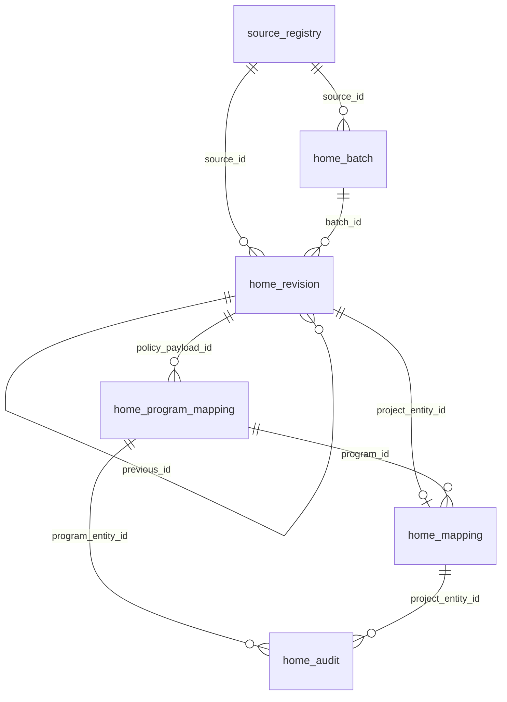

# HOME 데이터 공유·수집 재현 가이드

스냅샷 시각: **2026-10-07 21:52 KST**. 서울·경기 주택공급 모니터링을 위해 저장한 공개 원천자료와 HOME의 검토 연결을 조원들이 비교·재사용할 수 있도록 정리했다. 이 파일은 해당 스냅샷과 함께 배포한다. 23개 자료 유형, 현재 판본 **859,215건**, 과거 판본 포함 **892,343건**, 수집 원천 36개가 들어 있다. 정책 사업 후보는 266건이다.

## 구성과 파일 형식

| 경로 | 내용 | 형식 |
|---|---|---|
| `manifest.json` | 추출 시각, 자료 유형·원천별 건수, 파일 크기·SHA-256 | JSON |
| `source_registry.json` | 원천 이름·기관·공식 진입 URL·수집 모드·키 환경변수 이름·현재 범위·최근 배치 상태 | JSON 배열 |
| `revisions/{kind}.json.gz` | 원천별 원본 필드를 보존한 전체 레코드 판본. 총 23개 파일 | gzip 압축 JSON 배열 |
| `current_projects.json` | 현재 사업과 유효 정책→프로그램→사업 연결의 편의 뷰 | JSON 배열 |
| `collection_batches.json.gz` | 수집 시도/결과, 원본 URL·SHA-256·크기·파서 버전의 manifest | gzip 압축 JSON 배열 |
| `project_program_links.json.gz` | 개별 사업→프로그램 임시/확정 연결 | gzip 압축 JSON 배열 |
| `program_policy_links.json.gz` | 프로그램→정책 임시/확정 연결 | gzip 압축 JSON 배열 |
| `review_audit.json.gz` | 자동 제안·담당자 조정 이력 | gzip 압축 JSON 배열 |
| `schema/*.schema.json` | 공통 테이블·편의 뷰의 JSON Schema Draft 2020-12 | JSON Schema |
| `schema/payloads/{kind}.schema.json` | 실제 추출본에서 관측한 자료 유형별 payload 스키마 | JSON Schema |
| `schema/payload-field-catalog.json` | 필드별 존재·결측·null·값 유형 건수 | JSON |
| `schema/relationships.json` | 테이블 키·논리 FK·현재 판본 규칙 | JSON |
| `schema/collection_methods.json` | 원천별 수집 구현 파일·실행 주기·검증 규칙 | JSON |
| `schema/metric-definitions.json` | 핵심 공급·인구·가구·고용 지표의 단위와 해석 제한 | JSON |
| `references/` | 이전 수집 범위 점검·API 검증·정책 연결 운영 기록 | Markdown |
| `reference_code/` | 이 스냅샷에서 사용한 HOME 수집·정규화 코드, DB 마이그레이션, 내보내기 도구 | Python |
| `verify_export.py` | 파일 해시·레코드 수·연결 무결성 검사 | Python 표준 라이브러리 |

각 `.json.gz`를 풀면 **완전한 JSON 배열**이다. 큰 `register`·`permit` 파일도 파일당 한 레코드를 한 줄로 기록하여 스트리밍할 수 있다. `schema/payloads`는 **이 추출본에서 관측한 구조**이며 외부 기관이 앞으로도 같은 컬럼을 제공한다는 계약은 아니다. 새 필드는 허용한다.

## 테이블 관계와 연결 규칙



`home_revision.id`는 물리 판본 ID, `entity_id`는 같은 원천 객체의 논리 ID다. 현재 판본은 **`superseded_at == null`**로 고른다. `previous_id`는 바로 앞 판본의 `id`를 가리키고, `revision_no`는 객체별 증가 번호다. `entity_id`는 `kind`의 앞 세 글자와 `SHA-256(source_id + ':' + 원천 객체 키)` 앞 24자로 생성한다. `batch_id`는 적재한 `home_batch.id`다. DB 시각 필드(`recorded_at`, `started_at` 등)는 UTC ISO 8601이며, `recorded_at`은 **HOME 적재 시각**이다. `payload` 안의 날짜·월은 원천 정밀도 그대로 보존한다. `payload.source_date`, `payload.base_date`, 예정일은 각각 원천 날짜·자료 기준일·계획 일정이므로 혼용하지 않는다.

`home_mapping.project_id`는 `kind=project`인 `home_revision.entity_id`를 가리킨다. `home_mapping.program_id`는 `home_program_mapping.id`를 가리킨다. **현재 유효 정책은 `home_program_mapping.policy_id`를 따라야 한다.** `home_mapping.policy_id`는 초기 직접 제안과 과거 호환용 필드라 현재 정책 FK로 사용하지 않는다. 프로그램 상태가 `RELEASED`라면 유효 정책은 `UNASSIGNED`다. 사업 연결 상태가 `RELEASED`면 검토 통계에서 제외한다. `REVIEW`는 **담당자 확인 필요**, `CONFIRMED`는 담당자 확정이다. 자동 제안도 `REVIEW`로 통계에 포함되며 공식적인 개별 사업 정책 귀속을 입증하지 않는다. 이 스냅샷의 정책–프로그램 16건과 프로그램–사업 266건은 모두 확인 필요 상태다.

`home_audit.entity_id`는 조치 종류에 따라 프로그램 ID 또는 사업 `entity_id`를 참조한다. `PROGRAM_POLICY_AUTO`는 유형 기반 임시 제안, `PROGRAM_POLICY_REVIEW`와 `PROGRAM_PROJECT_REVIEW`는 담당자 조정이다. `schema/relationships.json`에 각 관계와 조건을 기계 판독 형태로도 담았다. DB에 물리 FK가 없는 논리 관계는 조인 시 대상 자료 유형과 sentinel을 함께 확인해야 한다.

## 자료 범주와 지표 해석

| 목적 | 주요 `kind` | 해석 |
|---|---|---|
| 정책·사업 흐름 | `policy`, `policy_event`, `project`, `document`, `project_report` | 정책 발표·사업 후보·일자별 공정 관측을 분리. 사업 후보 수는 공급 호수나 준공 실적이 아님 |
| 공급계획·공고·과거 | `sh_plan`, `sh_project`, `lh_supply`, `lh_movein_plan`, `lh_notice`, `notice`, `gh_notice` | 계획/공고/입주 예정의 지표·단위를 확인한 뒤 비교. 합산하면 중복 가능 |
| 인허가·기존 주택 | `permit`, `register`, `lh_stock`, `agency_stock` | 관측된 인허가/대장/기존 재고. 신규 정책 공급·실입주량과 동일하지 않음 |
| 인구·가구·고용·주택 통계 | `area_stat`, `statistic` | 조사 기준연도, 지역 단위, 거주지/사업장 기준, 실제/전망 여부를 payload에서 확인 |
| 지도·주소 | `location`, `district`, `municipality`, `block_location`, `legal_dong` | 좌표·경계·법정동·블록 라벨을 구분. 위치나 블록 관계가 미확보면 임의 보간하지 않음 |

`payload`마다 `planned_units`, `supply_units`, `progress_pct`, `households` 등의 의미가 다르다. 계획 물량, 모집공고 확인 물량, 준공·입주 실적을 한 열에 더하지 않는다. 정책의 9·7 수도권 목표는 **인천을 포함**하지만 이 사업 목록은 서울·경기 범위다. 3기 신도시 같은 프로그램 관점은 정책 관점과 중첩된다. `building_register`의 현재 보유량이 큰 것은 건축물대장 수집 범위이며 주택공급 달성량을 뜻하지 않는다. 인구·가구·고용 및 공급 주요 필드의 단위와 비교 제한은 `schema/metric-definitions.json`에 구조화했다.

## 원천별 수집 방법과 이 추출본의 범위

표의 기간은 저장 레코드의 `sample_source_date` 또는 `sample_base_date` 최솟값·최댓값이다. **연속된 모든 연도 확보를 뜻하지 않으며**, 입주·준공 예정일이 미래이면 미래 연도가 포함될 수 있다. 현재 건수는 DB의 유효 판본 수이고 공급 호수 합계가 아니다. `FAILED (이전 성공본 유지)`는 최근 재시도가 실패했지만 마지막 정상 자료를 보존했다는 뜻이다.

| 원천 ID | 기관·공식 자료 | 수집 방식 | 현재 행 | 자료 날짜 범위 | 최근 시도 | 재수집 키 이름 |
|---|---|---|---:|---|---|---|
| `kosis_housing` | [KOSIS 서울·경기 일반가구·다가구 반영 주택 재고](https://kosis.kr/openapi/devGuide/devGuide_0201List.do) | 공식 API · 페이지/응답 검증 | 464 | 2019-08-23 ~ 2026-07-24 | SUCCESS | `POC10_KOSIS_API_KEY` |
| `kosis_household_size` | [KOSIS 서울·경기 가구원수별 일반가구](https://kosis.kr/statisticsList/mass/mass_list.jsp?org_id=101&process=statHtml&tbl_id=DT_1JC1516&vw_cd=MT_ZTITLE) | 공식 API · 페이지/응답 검증 | 464 | 2018-12-31 ~ 2025-12-31 | SUCCESS | `POC10_KOSIS_API_KEY` |
| `sgis_area` | [SGIS 서울·경기 인구·가구·사업체·산업 종사자](https://sgis.mods.go.kr/developer/html/newOpenApi/api/dataApi/census.html) | 공식 API · 페이지/응답 검증 | 483 | 2018-12-31 ~ 2024-12-31 | SUCCESS | `POC10_SGIS_CONSUMER_KEY` |
| `kosis_employment` | [KOSIS 시군구별 반기 고용·취업자](https://kosis.kr/openapi/devGuide/devGuide_0201List.do) | 공식 API · 페이지/응답 검증 | 802 | 2018-06-30 ~ 2026-06-30 | SUCCESS | `POC10_KOSIS_API_KEY` |
| `kosis_household_forecast` | [KOSIS 시도별 장래가구추계](https://kosis.kr/openapi/devGuide/devGuide_0201List.do) | 공식 API · 페이지/응답 검증 | 22 | 2024-12-02 ~ 2024-12-02 | SUCCESS | `POC10_KOSIS_API_KEY` |
| `lh_block_location` | [LH 공개 지도 블록 라벨 위치](https://bizmap.lh.or.kr/lhmap.do) | 공식 웹페이지·상세 응답 수집 | 273 | 2026-10-07 ~ 2026-10-07 | SUCCESS | `불필요` |
| `lh_reit_progress` | [LH 공공임대리츠 실제 공정률 · 2018 투자보고서](https://www.lh.or.kr/boardDownload.es?bid=0028&list_no=651950&seq=1) | 공식 웹문서·첨부 PDF/DOCX 파싱 | 1 | 2018-12-31 ~ 2018-12-31 | SUCCESS | `불필요` |
| `lh_progress` | [LH 블록별 실제 공정률 · 공개 상세 이력](https://apply.lh.or.kr/lhapply/land/cwsttList.do) | 공식 웹페이지·상세 응답 수집 | 565 | 2020-01-06 ~ 2026-10-07 | SUCCESS | `불필요` |
| `lh_supply_history` | [LH 공공분양 공급현황 2020~2025](https://www.lh.or.kr/board.es?act=view&bid=0007&list_no=727605&mid=a10103040000&nPage=1) | 공개 파일 다운로드·파싱 | 76 | 2020-05-29 ~ 2025-09-26 | SUCCESS | `불필요` |
| `lh_movein_history` | [LH 연도별 입주계획 공개본](https://www.lh.or.kr/board.es?act=view&bid=0007&list_no=654827&mid=a10103010000&nPage=1) | 공개 파일 다운로드·파싱 | 217 | 2022-01 ~ 2026-12 | SUCCESS | `불필요` |
| `lh_stock` | [LH 단지정보 · 과거 준공·입주지정 일정](https://www.data.go.kr/data/15080989/fileData.do) | 공개 파일 다운로드·파싱 | 1,815 | 1979-12-20 ~ 2028-09-30 | SUCCESS | `불필요` |
| `legal_dongs` | [서울·경기 전체 법정동 코드](https://www.code.go.kr/stdcode/regCodeL.do) | 공개 파일 다운로드·파싱 | 2,629 | 2026-10-07 ~ 2026-10-07 | SUCCESS | `불필요` |
| `sh_files` | [SH 주택관리현황 2024~2026 공개본](https://data.seoul.go.kr/dataList/OA-12027/S/1/datasetView.do) | 공개 파일 다운로드·파싱 | 2,364 | 2024-10-23 ~ 2026-02-20 | SUCCESS | `불필요` |
| `gh_files` | [GH 재건축 매입임대 현황](https://www.data.go.kr/data/15112600/fileData.do) | 공개 파일 다운로드·파싱 | 21 | 2026-08-21 ~ 2026-08-21 | SUCCESS | `불필요` |
| `gh_supply_plan` | [GH 주택 분양·임대 공급계획](https://www.gh.or.kr/gh/housing-stability-in-gyeonggi-do001.do) | 공식 웹페이지·상세 응답 수집 | 2 | 2026-04-01 ~ 2026-04-01 | SUCCESS | `불필요` |
| `gh_notice` | [GH 주택 공고·과거 목록](https://www.gh.or.kr/gh/housing.do) | 공식 웹페이지·상세 응답 수집 | 442 | 2018-02-21 ~ 2026-08-28 | SUCCESS | `불필요` |
| `policy_907` | [9·7 주택공급 확대방안](https://d.nts.go.kr/cheonan/na/ntt/selectNttInfo.do?mi=4611&nttSn=1353601) | 공식 웹문서·첨부 PDF/DOCX 파싱 | 1 | 2025-09-07 ~ 2025-09-07 | SUCCESS | `불필요` |
| `policy_129` | [1·29 도심 주택공급 확대 및 신속화](https://www.korea.kr/briefing/policyBriefingView.do?newsId=156742030) | 공식 웹문서·첨부 PDF/DOCX 파싱 | 48 | 2026-01-29 ~ 2026-01-29 | SUCCESS | `불필요` |
| `policy_813` | [8·13 주택 신속공급 방안](https://www.korea.kr/briefing/policyBriefingView.do?newsId=156774369) | 공식 웹문서·첨부 PDF/DOCX 파싱 | 1 | 2026-08-13 ~ 2026-08-13 | SUCCESS | `불필요` |
| `urban_930` | [서울 도심복합사업 9·30 후속조치](https://www.korea.kr/news/policyNewsView.do?newsId=148972807) | 공식 웹문서·첨부 PDF/DOCX 파싱 | 52 | 2026-09-30 ~ 2026-09-30 | SUCCESS | `불필요` |
| `lh_sale` | [LH 연간 분양주택 공급계획](https://apply.lh.or.kr/lhapply/apply/noti/sp/list.do?sUppAisTpCd=05) | 공식 웹페이지·상세 응답 수집 | 34 | 2026-01-01 ~ 2026-01-01 | SUCCESS | `불필요` |
| `lh_rent` | [LH 연간 임대주택 공급계획](https://apply.lh.or.kr/lhapply/apply/noti/sp/list.do?sUppAisTpCd=06) | 공식 웹페이지·상세 응답 수집 | 18 | 2026-01-01 ~ 2026-01-01 | SUCCESS | `불필요` |
| `lh_construction` | [LH 건설공사 현황](https://www.lh.or.kr/board.es?mid=a10607030000&bid=0007&act=view&list_no=654682) | 공식 웹문서·첨부 PDF/DOCX 파싱 | 87 | 2026-07-01 ~ 2026-07-01 | SUCCESS | `불필요` |
| `cheongyak` | [청약홈 분양정보](https://www.data.go.kr/data/15098547/openapi.do) | 공식 API · 페이지/응답 검증 | 1,110 | 2020-02-05 ~ 2026-09-18 | SUCCESS | `POC10_CHEONGYAK_SERVICE_KEY` |
| `building_hub` | [건축HUB 주택인허가](https://www.data.go.kr/data/15136560/openapi.do) | 공식 API · 페이지/응답 검증 | 176,749 | 2022-08-13 ~ 2026-08-31 | SUCCESS | `POC10_BUILDING_HUB_SERVICE_KEY` |
| `building_register` | [건축HUB 주거용 건축물대장](https://www.data.go.kr/data/15134735/openapi.do) | 공식 API · 페이지/응답 검증 | 665,842 | 2022-08-13 ~ 2026-08-31 | FAILED (이전 성공본 유지) | `POC10_BUILDING_REGISTER_SERVICE_KEY` |
| `lh_notice` | [LH 분양·임대 공고](https://www.data.go.kr/data/15058530/openapi.do) | 공식 API · 페이지/응답 검증 | 3,050 | 2018-01-04 ~ 2026-09-22 | SUCCESS | `POC10_LH_NOTICE_SERVICE_KEY` |
| `molit_statistics` | [서울·경기 주택건설 공식 통계](https://stat.molit.go.kr/portal/api/info.do) | 공식 API · 페이지/응답 검증 | 640 | 2018-01-31 ~ 2026-08-31 | SUCCESS | `POC10_MOLIT_STAT_API_KEY` |
| `sh_supply_plan` | [SH 주택분양 공급계획·과거 공개본](https://www.data.go.kr/data/15008820/fileData.do) | 공식 API · 페이지/응답 검증 | 20 | 2019-08-26 ~ 2026-06-22 | SUCCESS | `POC10_SH_SERVICE_KEY` |
| `sh_redevelopment` | [SH 공공재개발·재건축 사업현황](https://www.data.go.kr/data/15124798/fileData.do) | 공식 API · 페이지/응답 검증 | 16 | 2023-11-02 ~ 2023-11-02 | SUCCESS | `POC10_SH_SERVICE_KEY` |
| `vworld` | [행정구역 경계·주소 좌표](https://www.vworld.kr/v4po_openapi_s001.do) | 공식 API · 페이지/응답 검증 | 152 | 2026-10-02 ~ 2026-10-03 | SUCCESS | `POC10_VWORLD_API_KEY` |
| `vworld_district` | [VWorld 공공주택지구 공동주택용지](https://www.vworld.kr/v4po_openapi_s001.do) | 공식 API · 페이지/응답 검증 | 35 | 2026-10-02 ~ 2026-10-02 | SUCCESS | `POC10_VWORLD_API_KEY` |
| `vworld_municipality` | [VWorld 서울·경기 시군구 경계](https://www.vworld.kr/v4po_openapi_s001.do) | 공식 API · 페이지/응답 검증 | 56 | 2026-10-03 ~ 2026-10-03 | SUCCESS | `POC10_VWORLD_API_KEY` |
| `policy_history` | [정책 기원·후속조치 이력](https://www.korea.kr/news/policyNewsView.do?newsId=148856563) | 공식 웹문서·첨부 PDF/DOCX 파싱 | 5 | 2018-12-19 ~ 2025-10-21 | SUCCESS | `불필요` |
| `lh_history` | [LH 과거 건설공사 현황](https://www.lh.or.kr/board.es?mid=a10607030000&bid=0007&act=view&list_no=654682) | 공식 웹문서·첨부 PDF/DOCX 파싱 | 641 | 2025-01-01 ~ 2026-07-01 | SUCCESS | `불필요` |
| `sh_inventory` | [SH 최신 공개본 사업 연결](https://www.data.go.kr/data/15124798/fileData.do) | SH 공개 자료에서 사업 후보 파생 | 18 | 2023-11-02 ~ 2026-06-22 | SUCCESS | `불필요` |

## 수집·검증 절차와 코드 위치

1. `backend/sources.py`가 원천 ID, 공식 진입 URL, 기관, 자료 유형, 수집 모드, 필요한 **환경변수 이름**을 정의한다. 실제 키 값은 이 패키지에 넣지 않았다. 공개 HTML/첨부/파일, 인증 API, 기관 공개 지도 응답을 `backend/service.py::collect_one`에서 원천별 수집기로 처리한다. 원천별 정확한 구현 파일·실행 주기·검증 메모는 `schema/collection_methods.json`에 있다. 구현 파일은 패키지의 `reference_code/` 아래에도 복사했다. 주요 구현은 `backend/collectors.py`, `backend/api_samples.py`, `backend/lh_public_history.py`, `backend/lh_progress.py`, `backend/public_files.py`, `backend/area_stats.py`, `backend/map_data.py`, `backend/municipality_geo.py`, `backend/agency_data.py`다.
2. `Fetcher`는 허용된 공식 호스트에서만 가져오고, 페이지·건수·중복·필수 컬럼 등 원천별 규칙을 검사한다. 본문에 반사된 키와 URL의 인증 query를 제거한 뒤 원본 응답의 SHA-256을 계산한다. `collection_batches[].manifest[]`에는 실제 요청 URL, SHA-256, 바이트 수, `parser_version`, HOME의 raw 파일 상대 경로를 기록한다. `source_registry.url`은 서비스 소개 페이지이고, 실제 수집 URL은 배치 manifest를 본다.
3. 한 수집 배치의 정규화 레코드를 트랜잭션으로 적재한다. 동일 payload 해시는 새 판본을 만들지 않고, 변경되면 이전 판본을 보존한다. 실패 배치는 마지막 정상 판본을 지우지 않는다. 정기 수집은 웹·파일 원천을 자동 갱신하고, 인증 API 표본은 `manual_only`이므로 별도 실행한다. `source_registry`의 `collection_mode`·`manual_only`와 배치 시각으로 범위를 확인한다.
4. 원천 프로젝트의 `program` 값으로 사업→프로그램 후보를 만들고, 원천 정책 제안·프로그램 유형으로 프로그램→정책 후보를 만든다. 둘 다 담당자 확인 전 `REVIEW`다. 추출본에는 링크의 `basis`, `evidence_url`, `revision_no`와 감사 이력을 함께 실었다. 향후 담당자가 변경한 결과는 자동 규칙이 덮어쓰지 않는다.

이 패키지에는 **원본 응답 파일의 본문 자체는 포함하지 않는다.** `collection_batches.json.gz`의 `manifest[].file`은 HOME 서버의 `data/raw` 상대 경로이고, `sha256`과 공식 URL로 출처를 확인할 수 있다. 다른 시스템이 원본 바이트까지 동일성 검증하려면 해당 `data/raw` 파일을 별도로 받아 해시를 비교해야 한다. 일부 API 재호출에는 기관별 키가 필요하다. 지도 화면에서 즉시 조회하는 VWorld 건물 배경과 임의 3D 공급 모델은 이 DB 스냅샷의 영속 레코드가 아니며 건물별 실제 완공 형상으로 사용해서는 안 된다.

## 다른 시스템에서 읽고 검증하기

`manifest.json`의 `files[].sha256`은 **압축 파일 자체의 SHA-256**이다. 패키지의 `verify_export.py`를 실행하면 모든 파일 크기·SHA-256과 JSON 레코드 수를 대조한다. 검증 시 원천의 `payload_hash`는 키를 제거하기 전 DB 적재 당시 payload에 대해 계산된 값이다. 이 공유본에서 문자열을 마스킹한 경우 해시를 다시 계산해 일치시켜서는 안 된다.

```bash
python verify_export.py .
```

작은 편의 뷰는 바로 읽을 수 있다.

```python
import json
from pathlib import Path
root = Path('.')
projects = json.loads((root / 'current_projects.json').read_text())
for row in projects:
    print(row['id'], row['data']['name'], row['link']['policy_id'], row['link']['program_project_status'])
```

큰 자료는 전체를 메모리에 올리지 말고 gzip JSON 배열을 한 행씩 읽는다. 추출 스크립트가 한 행에 한 객체를 기록한다.

```python
import gzip, json
with gzip.open('revisions/area_stat.json.gz', 'rt', encoding='utf-8') as stream:
    next(stream)  # [
    for line in stream:
        value = line.strip().rstrip(',')
        if value == ']':
            break
        record = json.loads(value)
        if record['superseded_at'] is None:
            print(record['source_id'], record['payload'])
```

재추출 순서: HOME 프로젝트 루트에서 `python -m scripts.export_json <새 출력 폴더>` → `python -m scripts.export_schema <출력 폴더>` → `python -m scripts.export_collection_methods <출력 폴더>` → `python -m scripts.write_data_sharing_guide <출력 폴더>` → `python -m scripts.finalize_export <출력 폴더>`이다. 첫 명령에는 HOME 운영 DB의 읽기 접근 환경변수 `POC10_DATABASE_URL`이 필요하다. 기존 스냅샷 폴더는 덮어쓰지 않는다. 상세 수집 범위와 예외는 패키지의 `references/SOURCE_REGISTRY.md`, `references/COLLECTION_COVERAGE.md`, `references/PROGRAM_HIERARCHY.md`를 참조한다. 이 참고문서는 작성 당시의 운영 기록이므로 **현재 건수·상태는 이 스냅샷의 manifest와 source_registry를 우선**한다.
