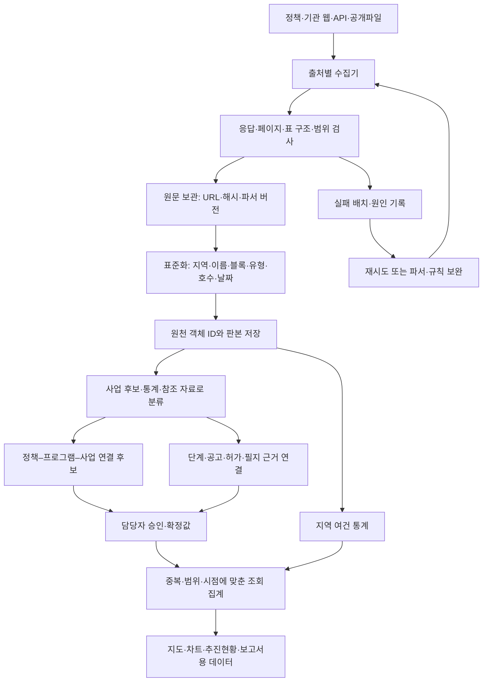
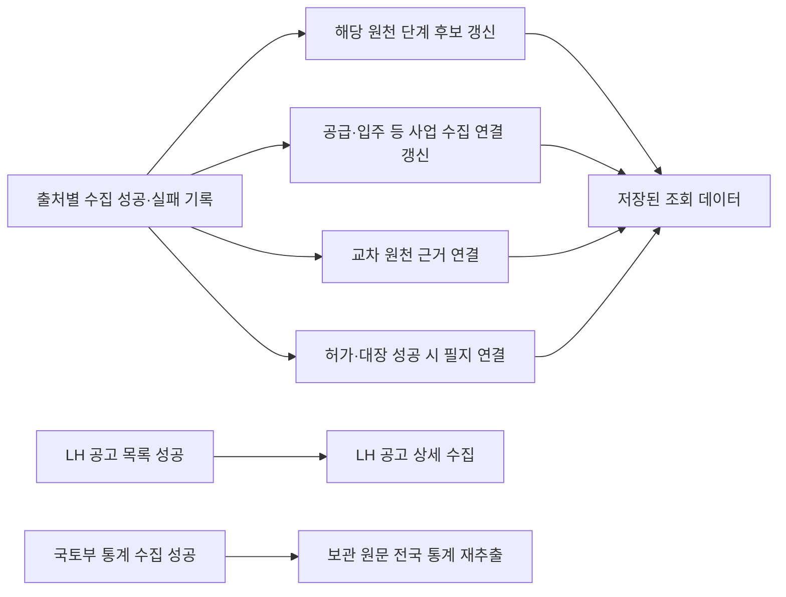

# HOME 데이터 수집·정형화·연계 구축 마스터

**비정형 공공자료에서 정책–프로그램–사업–단계 데이터셋을 만드는 과정**  
작성일: 2026-10-16 · 기준 시간대: Asia/Seoul  
용도: 프로젝트 공유, 구축 성과 설명, 설명자료의 ‘데이터 구성’ 원본, 운영 인수인계

> **이 문서의 판단 전제**  
> 담당자가 승인한 값과 사업·프로그램·정책 연결은 **정확한 확정값**으로 취급한다. 승인된 값에 대해 원천의 형식이나 최초 산출 방식만을 이유로 신뢰 문제를 다시 제기하지 않는다. 이하의 ‘한계’는 승인값의 정확성 문제가 아니라 **아직 확보하지 못한 범위, 제공 단위, 공개 시점, 조회 한도, 자동 처리 가능 범위**에 대한 설명이다. 각 한계에는 실제 보정 방법과 보정 후 이용 범위를 함께 적었다. 과거 조치 기록의 ‘검토 필요’는 그 기록 당시의 상태이며, 이후 승인된 항목을 다시 미확정으로 돌리는 뜻이 아니다.

## 문서 읽는 방법

| 독자·사용 목적 | 먼저 읽을 부분 | 활용 방법 |
| --- | --- | --- |
| 사업 책임자·공유 대상 | 1~3장, 8~10장, 16장 | 무엇을 만들었고 왜 어려웠는지, 어떤 조치를 했는지 설명 |
| 데이터 구축 담당자 | 4~9장, 11~14장 | 수집·정형화·매칭·중복 처리 규칙과 실제 사례 파악 |
| 운영 담당자 | 11~15장, 부록 D | 자동 실행·실패·변경·재처리·복구 절차 확인 |
| 발표자료 작성자 | 16장 | 핵심 문장·슬라이드 구성·발표 대본을 추려 사용 |
| 원천·조치 근거를 확인할 사람 | 부록 A~F | 전체 출처 목록, 64개 조치 기록, 코드·문서·스냅샷 확인 |

### 목차

1. [구축 성과와 핵심 메시지](#section-1)
2. [현재 데이터 규모와 숫자의 의미](#section-2)
3. [출처를 선택한 이유와 자료별 역할](#section-3)
4. [전체 수집·정형화·연계 흐름](#section-4)
5. [비정형 자료를 표준 레코드로 만드는 방법](#section-5)
6. [원천에 없는 ID를 부여하고 사업을 연결하는 방법](#section-6)
7. [정책부터 입주까지 단계와 시간을 정렬하는 방법](#section-7)
8. [대표 사례로 보는 실제 해결 과정](#section-8)
9. [데이터 한계와 보정 방법 총괄표](#section-9)
10. [확인했으나 채택·실적 반영을 유보한 자료](#section-10)
11. [자동 파이프라인의 실제 동작 범위](#section-11)
12. [자료 수정·재수집·새 판본 반영](#section-12)
13. [중복 자료의 보존·제거·집계 방법](#section-13)
14. [오류 대응과 운영 절차](#section-14)
15. [데이터셋 구성·보안·추적·성능](#section-15)
16. [설명자료로 추상화할 핵심 내용](#section-16)
17. [향후 중점 관리와 완료 판정](#section-17)
18. [문서 사용 기준](#section-18)
- [부록 A. 현재 수집 통계](#appendix-a)
- [부록 B. 등록 출처 전체 목록](#appendix-b)
- [부록 C. 실제 오류·보완·연계 조치 기록 64건](#appendix-c)
- [부록 D. 구현 근거와 검증 항목](#appendix-d)
- [부록 E. 관측 자료와 문서 재작성 기준](#appendix-e)
- [부록 F. 수집 출처 URL·외부 API·HOME 내부 API 참조](#appendix-f)

<a id="section-1"></a>

## 1. 구축 성과와 핵심 메시지

**이 프로젝트의 주요 성과는 서로 다른 기관의 자료를 모아, 하나의 사업을 중심으로 정책·일정·물량·위치·단계 근거를 연결해 사용할 수 있게 만든 것이다.** 수집한 페이지 수만으로는 이 작업을 설명할 수 없다. 원천마다 다른 단위와 이름을 해석하고, 합산할 수 있는 값과 함께 보되 합산하면 안 되는 값을 구분하는 데 실질적인 난도가 있었다.

기관의 자료는 각 기관의 업무 목적에 맞게 공개된다. 정책 발표문은 목표와 사업군을, 공급계획은 주택형별 예정 물량을, 모집공고는 이번에 모집하는 물량을, 건설현황은 공사계약이나 블록의 공정률을, 건축HUB는 인허가 및 건축물 기록을 제공한다. 하나의 사업에 관한 자료여도 식별번호·명칭·호수·날짜가 모두 같지는 않다.

따라서 HOME에서는 다음 세 가지 결과물을 함께 만들었다.

| 결과물 | 만들어야 했던 내용 | 실제 업무 가치 |
| --- | --- | --- |
| 재현 가능한 원천 자료층 | 공식 URL, 원문 응답, 해시, 수집 시각, 판본, 수집 범위 | 수치가 어디서 왔는지 설명하고 같은 자료로 재처리 가능 |
| 비교 가능한 표준 자료층 | 지역·지구·블록·유형·물량·날짜·단계의 의미 정리 | 다른 형식의 자료를 같은 기준으로 검색·비교 가능 |
| 업무에 쓸 수 있는 관계 자료층 | 정책–프로그램–사업, 사업–단계 원천, 전체–일부, 허가–필지 연결 | 추진현황 점검, 일정 관리, 지역별 공급 판단에 사용 |

**수집량이 늘어나는 일과 사용할 수 있는 사업 근거가 늘어나는 일은 다르다.** 예를 들어 대장 기록이 백만 행 이상 있어도 그 모든 행이 신규 공급 사업은 아니다. 반대로 기존에 받은 허가 한 건을 정확히 연결하면, 없던 자료를 새로 수집하지 않고도 특정 사업의 인허가 시점을 보완할 수 있다.

승인된 사업과 값은 확정된 업무 기준으로 사용한다. 자동화는 그 확정값을 임의로 덮어쓰기보다 새로운 자료를 확보하고 관계 후보·변경 근거를 추가하여 관리자가 다음 조치를 판단할 수 있도록 지원한다.

<a id="section-2"></a>

## 2. 현재 데이터 규모와 숫자의 의미

**규모는 출처·원천 행·추출 셀·사업 연결을 나눠 설명해야 한다.** 부록 A의 숫자는 2026-10-16 20:54~20:55 KST에 운영 조회 API에서 확보한 관측값이다. 자동 수집이 계속되므로 이후 화면의 수치는 달라질 수 있다.

| 구분 | 관측값 | 이 숫자가 뜻하는 것 |
| --- | ---: | --- |
| 등록 수집원 | 63개 | 시스템에 등록된 수집 경로. 기관 수와 다름 |
| 데이터가 저장된 수집원 | 62개 | 최신 저장 데이터가 존재하는 고유 출처 |
| 최신 원천 행 | 1,674,418행 | 출처·레코드 유형별 최신 자료 행의 합계 |
| 추출 데이터 | 55,437,397개 | 출처·유형별 최신 행 수 × 고유 컬럼 수의 합계 |
| 사업에 사용되는 연결 원천 | 884건 | 사업 자체이거나 사업 근거로 저장 연결된 고유 원천 레코드 |
| 사업 수집·연계 조회 원장 | 311개 사업 기록 | 품질·수집연계 조회 범위의 사업 레코드 수 |
| 요구사항 점검의 9·7 조회 범위 | 197개 사업 기록 | 해당 API에서 선택한 정책 범위. 전체 원장 수와 다름 |
| 저장된 오류·보완 조치 기록 | 64건 | 수집·연결·범위·화면 등을 개선한 기록. 전부 같은 종류의 오류는 아님 |

### 2.1 추출량 계산

```text
현재 추출량 = Σ(출처 s, 레코드 유형 k의 최신 행 수 × 그 표의 고유 최상위 컬럼 수)
```

컬럼은 저장 payload의 최상위 필드이다. 빈칸도 포함하며 중첩 객체·배열은 각각 한 컬럼으로 센다. 이전 판본을 다시 더하지 않는다. 구조가 다른 표들을 한꺼번에 ‘전체 행 × 전체 컬럼’으로 곱하지 않는다.

따라서 5,544만 개는 **채워진 값의 수, API 호출 수, 독립 사업 수, 공급 호수**가 아니다. 데이터 구축·관리량을 설명하는 ‘행×컬럼’ 집계다.

### 2.2 오늘 수집량 계산

한국시간 당일 00:00 이후 성공 완료한 배치의 고유 원천 레코드를 센다. 내용이 같아 새 판본을 만들지 않은 재수집도 포함한다. 같은 레코드를 당일 여러 번 수집하면 한 번만 센다. 실패 배치는 제외한다.

‘오늘 연결량’은 오늘 수집한 자료 중 현재 사업에 연결된 원천 수이다. **오늘 새로 승인한 연결 수나 연결 순증가량이 아니다.**

### 2.3 비교하면 안 되는 분모

| 잘못 연결하기 쉬운 숫자 | 올바른 구분 |
| --- | --- |
| 공고 4,018건 → 사업 4,018개 | 한 사업에 최초·정정·추가·유형별 공고가 여러 개 존재 |
| 대장 행 수 → 신규 공급량 | 기존 건물 재고·동별 기록 포함 |
| 884개 연결 원천 → 884개 고유 사업 | 하나의 사업에 여러 원천이 연결됨 |
| 311개 사업 기록 → 311개 중복 없는 물리적 단지 | 원천별 사업 레코드·전체/부분 관계가 존재 |
| API 페이지 완결 → 해당 지역 모든 주택사업 확보 | API 대상과 지역 전체 사업 모집단은 다름 |
| 수집 성공 → 모든 단계 연결 성공 | 원천 적재와 후속 연결은 별도 작업 |

<a id="section-3"></a>

## 3. 출처를 선택한 이유와 자료별 역할

**출처는 ‘접근하기 쉬운 곳’만으로 정하지 않았다. 정책 목표, 개별 사업, 실제 단계, 지역 전체 여건 중 어떤 질문에 답하는 자료인지에 따라 선택했다.** API·웹·문서는 전달 형식이고, 자료가 담당하는 업무 역할은 별도로 구분했다.

| 자료군 | 선택 이유 | 가져오는 정보 | 다른 자료로 보완하는 부분 |
| --- | --- | --- | --- |
| 정책 발표문·정부 보도자료 | 정책 목표·대상·실행 수단의 근거 | 발표일, 연도별 목표, 사업군, 명시 사업, 추진 일정 | 개별 사업의 허가·착공·입주는 기관 원장과 연결 |
| LH 분양·임대 공급계획 | 블록·주택형·예정 물량을 사업 후보로 구성 | 지구, 블록, 유형, 면적, 공급호수, 예정 시기 | 실제 공고·계약·입주 여부는 후속 원천 사용 |
| LH 현재·과거 건설현황 | 사업별 착공·공정의 시간축 확보 | 공사명, 지구, 주택호수, 착공일, 준공 예정일, 공정률 | 계약 범위·주택형·모집공고와 대조 |
| LH·GH·청약홈 모집공고 | 공급이 실제 모집 단계에 도달한 근거 | 공고번호, 공고일, 전체·금회 물량, 유형, 일정 | 정정·추가 공고의 계보와 실제 입주 별도 관리 |
| 건축HUB 인허가·상세 | 사업의 승인과 필지·동 구조를 연결 | 원천 허가 PK, 주소, 허가일, 본번·부번, 대지구분, 동별 정보 | 사업명·블록 별칭 및 전체/유형별 물량 보완 |
| 건축물대장·사용승인 참조 | 준공·사용승인 및 기존 건물과의 대조 | 대장 관리번호, 사용승인, 용도, 세대·호수, 지번 | 기존 재고를 신규 정책 실적으로 오인하지 않도록 범위 제한 |
| SH·GH 파일·공식 사업현황 | 기관별로 다른 사업 공급 체계 보완 | 계획, 정비사업, 관리 단지, 일정, 시행자 | 웹 공고·공정·고시 원문과 결합 |
| 서울 정보몽땅·추진현황·고시 | 정비사업의 구역·절차·명칭 변화 추적 | 구역명, 자치구, 현재 단계, 추진경과, 고시 | 과거 해제 구역과 현재 사업을 관계로 구분 |
| 국토부·KOSIS·SGIS·한국부동산원 통계 | 개별 사업 바깥의 지역 여건 파악 | 인허가·착공·준공, 가구, 주택재고, 연령, 고용, 가격, 미분양 | 기준연도·지역 수준·분모가 맞는 값끼리 비교 |
| 법정동 코드·VWorld·LH 지도 | 이름을 지역·위치와 연결 | 지역 코드, 경계, 블록 라벨점, 주소 좌표 | 대표점·필지·사업경계의 역할을 구분 |
| 과거 정책·공정·공급 파일 | 최신 한 장으로 보이지 않는 이력 보완 | 과거 관측값, 사업 기원, 당시 예정 일정 | 당시 원문과 현재 원문을 판본으로 함께 보관 |

### 3.1 공식 원천을 우선한 이유

발표·허가·모집·공정은 해당 업무를 수행한 기관의 기록으로 추적할 수 있어야 한다. 원문 표의 제목, 기준일, 고시번호, 주택형과 같은 세부 항목이 실제 연결의 판단 근거가 된다. 정부 자료의 공식 재게시 경로도 원문 접근을 보완하는 통로로 사용했다. 단, 재게시된 문서의 작성 기관과 실제 다운로드 경로를 구별해 보관한다.

승인된 값은 그 자체로 확정된 관리 기준이다. 공식 원천 우선 원칙은 **새로운 미승인 자료를 수집·연결할 때** 적용하며, 이미 승인한 값을 불확실한 값으로 되돌리는 근거로 사용하지 않는다.

### 3.2 하나의 출처만으로 해결할 수 없는 이유

공급계획에는 허가 관리번호가 없고, 인허가 API에는 정책 ID가 없다. 모집공고의 물량은 전체 건설물량과 다를 수 있으며, 공정자료에는 임대유형별 구성이 없을 수 있다. 이 때문에 누락된 컬럼을 다른 기관 자료로 채우는 단순 조인을 넘어, **같은 대상의 어떤 범위를 말하는지 판단하는 관계 모델**이 필요했다.

### 3.3 지역 확대 과정에서 얻은 교훈

초기 서울·경기 허용 목록은 인천 관련 자료를 걸러낼 수 있었다. 인천을 메뉴에 추가하는 것만으로 수집·파싱·매칭·집계 범위가 모두 확대되지는 않는다. LH 인천 공급·건설 원천, 법정동 코드, 통계와 경계를 별도로 보강했고, 다른 기존 수집기에서 남아 있던 지역 필터도 조치 기록으로 추적했다.

어느 경로가 보완됐는지 원천별로 판단해야 한다. ‘인천 공고 수집 보완’이 모든 인천 고시·허가·공사 자료의 전수 확보를 뜻하지는 않는다.

<a id="section-4"></a>

## 4. 전체 수집·정형화·연계 흐름

**원문을 보존한 뒤 표준화하고, 연결 관계와 승인값을 별도로 관리한다.** 그래프를 그릴 때 원문을 즉석에서 다시 매칭하는 구조가 아니다.



도식이 표시되지 않는 Markdown 뷰어에서는 다음 순서로 읽으면 된다.

```text
수집원 등록 → 원문 수집 → 구조·범위 검사 → 원문 보관 → 필드 표준화
→ 원천 판본 저장 → 사업/통계/근거 분류 → 관계 후보 생성
→ 담당자 승인값 적용 → 중복·시점·범위 집계 → 화면·보고서
```

### 4.1 자료층마다 해결하는 문제가 다르다

| 층 | 핵심 질문 | 저장·처리 내용 |
| --- | --- | --- |
| 원문 | 무엇을 실제로 받았는가? | HTML, JSON/XML, 파일, 안전한 URL, SHA-256 |
| 파싱 | 원문에서 무엇을 읽었는가? | 원래 행·문구와 정규화 필드 |
| 판본 | 같은 자료가 무엇이 달라졌는가? | 논리 ID, payload hash, 판본 번호, 이전 판본 |
| 범위 | 어디까지 조회했는가? | 지역·기간·엔드포인트·페이지 완료 상태 |
| 관계 | 어느 사업의 어떤 부분인가? | 블록·유형·물량·허가 PK·필지·근거 판본 |
| 승인 | 무엇을 확정 기준으로 쓰는가? | 담당자 확정값·연결·변경 사유·수정 이력 |
| 집계 | 어떤 수치를 더하거나 비교하는가? | 고유 물량, 단계, 날짜, 지역, 비교 분모 |
| 표현 | 사용자가 어떤 조치를 판단하는가? | 일정·진행·차이·지역 여건·연결 근거 |

<a id="section-5"></a>

## 5. 비정형 자료를 표준 레코드로 만드는 방법

### 5.1 HTML 표: 같은 표 모양에도 컬럼 의미가 다르다

LH 공급계획은 표 구조와 ‘공급호수’ 헤더, 기준연도를 확인한다. 현재 파서는 분양·임대의 서로 다른 9개 컬럼 순서를 각각 해석한다. 행의 컬럼 수나 필수 헤더가 바뀌면 조용히 옆 칸을 읽는 대신 수집을 실패 처리한다.

공통 요청기는 페이지 번호를 넣으면서 기존 URL의 공급 유형 매개변수를 지우지 않도록 병합한다. 이 처리가 없으면 분양·임대 등 다른 유형을 요청한 것처럼 보이면서 실제로 같은 자료를 반복 수집할 수 있다.

| 원문 요소 | 정형화 | 보정·검사 |
| --- | --- | --- |
| `1,030` | 정수 1030 | 쉼표 제거 후 숫자 형식 확인 |
| `미정`, `-`, 공란 | 값 없음과 원문 상태 보존 | 0호로 치환하지 않음 |
| 연간 공급계획 제목 | 기준연도 및 정밀도 | 저장용 1월 1일을 실제 사건일로 사용하지 않음 |
| 면적별 여러 행 | 원래 주택형 행 유지 + 적절한 사업 묶음 | 총계 반복값과 유형별 부분값 구분 |
| 공급·입주 시기 원문 | 정규화 일정 + 원문 문자열 | 예정·실제와 연/반기/분기/월/일 정밀도 유지 |

### 5.2 페이지 누락을 방지하는 방식

LH 공급계획은 게시된 총건수와 읽은 행 수를 대조한다. 페이지 이동 중 기준연도나 총건수가 바뀌면 일관된 한 판본으로 보기 어려우므로 실패 처리한다. 현재 이 수집기의 반복 상한은 30페이지이고 페이지당 요청 크기는 100이다. 총량이 상한을 넘으면 임의로 앞부분만 정상 자료로 채택하는 방식으로 설명해서는 안 된다.

이 상한은 **LH 공급계획 수집기 설정**이다. 모든 API·기관의 공통 호출 한도가 아니며, 기관별 할당량은 각각 다르다.

### 5.3 DOCX·PDF·공개파일: 문장과 표의 업무 의미를 읽는다

공사현황 DOCX는 공사명·관할 조직·위치·물량이 함께 있으므로 지역본부 이름을 사업 소재지로 사용하면 안 된다. 주택 ‘호’와 비주택 ‘동’ 같은 단위를 구별하고, 여러 지구가 한 계약명에 묶이면 물량을 개별 블록에 임의 배분하지 않는다.

PDF·HTML 모집공고에서는 단지 총세대수, 유형별 물량, 금회 모집량, 최초 모집일, 입주 예정월이 서로 다른 위치에 있다. 따라서 단순히 첫 번째 숫자나 날짜를 추출하는 방식으로는 쓸 수 없다. 문서·단지·주택형 범위를 함께 보존해야 한다.

공개 파일도 파일명이 같다고 같은 판본이 아니다. 다운로드한 내용의 해시와 자료 기준일을 함께 보관한다. 보관 원문이 있으면 파서를 고친 뒤 같은 원문을 다시 읽어 누락 필드를 복원할 수 있다.

현재 모든 PDF·HWP를 범용적으로 해석하는 자동 엔진이 완성된 것은 아니다. 실제 구현된 기관·문서 경로와 검증된 파서를 사용하며, HTML에 없는 첨부 일정이나 새로운 문서 양식은 추가 수집·파서 보완 대상으로 남는다. **문서 형식의 한계는 원문 보관, 특정 경로의 상세 파서, 다른 공식 자료 대조, 담당자 확정으로 보정한다.**

### 5.4 구조화 API도 바로 업무 데이터가 되지는 않는다

API가 JSON이나 XML을 반환해도 다음 문제는 남는다.

| API 원천의 문제 | 보정 방법 | 이용 가능해진 내용 |
| --- | --- | --- |
| 관리번호가 정책 사업 ID가 아님 | 원천 PK 보존 + 사업 관계 저장 | 같은 허가의 상세·필지·동 자료 연결 |
| 주소가 지번 대신 블록 | 블록 명칭과 법정동·허가 PK 활용 | 사업 단계 연결; 지번 미확보와 분리 |
| 지역별 요청 제한·많은 페이지 | 법정동별 분할·완료 상태 저장 | 중단 후 미수집 범위부터 재개 |
| 대장에는 기존 건물 포함 | 원천 역할 분리·신규 사업 근거 대조 | 재고를 신규 공급으로 중복 산입하지 않음 |
| 응답 0건·실패·미조회 혼동 | 조회·실패·완료·미확보 상태 구분 | 0건의 의미를 설명할 수 있음 |

### 5.5 표준화에서 반드시 보존하는 의미

‘공급’이라는 말도 계획, 모집, 계약, 입주를 모두 뜻하지 않는다. ‘준공’과 ‘입주’, ‘허가’와 ‘사용승인’도 각각 다르다. 표준화는 원문 표현을 삭제하는 작업이 아니라 **원래 값과 업무상 해석을 함께 저장하는 작업**이다.

<a id="section-6"></a>

## 6. 원천에 없는 ID를 부여하고 사업을 연결하는 방법

**HOME의 project ID·program ID·policy ID는 시스템이 안정적으로 관계를 관리하기 위해 사용하는 식별자다. 모든 원천 문서에 공통으로 존재했던 번호가 아니다.**

### 6.1 원천 객체 ID와 실제 사업 관계

`backend/db.py`는 자료 유형과 출처, 원천 객체 키를 이용해 결정적인 논리 ID를 만든다. 같은 출처의 같은 자연키는 재수집해도 같은 객체로 식별한다. 이것만으로 서로 다른 기관의 두 기록이 같은 물리적 사업이 되는 것은 아니다.

예를 들어 LH 분양계획 행과 건축HUB 허가 행은 서로 다른 원천 ID를 유지한다. 그 위에 어느 사업의 근거인지, 같은 전체 범위인지, 전체의 일부인지, 어느 판본인지 관계를 저장한다. 원문을 덮어써 하나의 행으로 만드는 방식보다 나중에 연결 이유를 설명하기 쉽다.

### 6.2 매칭에 사용한 정보

| 비교 항목 | 사용 이유 | 보정·경계 처리 |
| --- | --- | --- |
| 시도·시군구 | 동명 사업의 다른 지역 혼동 방지 | 지역 코드·행정구역 이름 표준화 |
| 지구명·구역명 | 같은 개발·정비 범위 후보 탐색 | 숫자 경계 보존: 왕숙과 왕숙2, 1구역과 15구역 구분 |
| 블록 | 같은 지구 안 다른 사업 구분 | A-31BL, A31 표기 정리; 복수 블록은 별도 처리 |
| 사업명·별칭 | 기관마다 다른 공사명·단지명 대응 | 허용 가능한 별칭과 근거 저장 |
| 주택 유형 | 분양·행복·국민·영구임대 범위 구별 | 같은 단지의 다른 유형을 한 물량으로 처리하지 않음 |
| 호수·구성표 | 전체·부분 관계 검증 | 구성 합계와 대상 유형 호수 일치 확인 |
| 원천 허가 PK | 같은 허가의 상세 자료 결합 | 주택인허가 기본–동별–대지위치 연결 |
| PNU·지번 | 명칭이 달라도 공간 대조 가능 | 법정동·산 여부·본번·부번 검사 |
| 문서번호·판본·회차 | 동일 일정의 다른 근거 구별 | 정정·추가 공고와 고정 판본 보존 |

매칭 점수는 규칙상 우선순위이다. 통계적으로 검증한 ‘정확할 확률’로 해석하지 않는다. 담당자가 승인한 관계는 점수의 높고 낮음과 관계없이 확정 관계로 사용한다.

### 6.3 프로그램 분류와 정책 배정은 별개다

현재 LH 건설 분류 규칙에는 지구명에 왕숙·창릉·교산·대장 중 하나가 있으면 ‘3기 신도시’, 그 외는 ‘공공주택 건설’이라는 기본 분류가 있다. 이는 해당 LH 건설 수집 경로 안의 관리 분류 규칙이다. **‘네 지명이 없으므로 공공주택이라는 사실이 증명됐다’는 논리가 아니다.** 미승인 후보의 설명에서는 실제 출처·필드·분류 규칙을 보여 주고, 담당자가 승인한 프로그램 배정은 확정 배정으로 사용한다.

LH 임대 공급계획은 매입·전세 유형을 제외한 임대 공급 경로를 ‘건설형 공공임대’로 분류한다. 원문에 그 프로그램 ID가 적혀 있어 가져온 것과는 다르다. 정책 제안도 원천에 저장된 제안과 프로그램의 상위 정책 규칙을 거쳐 생성한다. 최초 후보 생성의 이유와 최종 승인된 배정의 효력을 구별해야 한다.

### 6.4 과천주암(뉴스테이) C2 분류 설명 예시

| 설명 단계 | 실제로 보여줄 내용 |
| --- | --- |
| 원천 | LH 임대 공급계획의 과천주암(뉴스테이) C2 |
| 추출값 | 임대유형 ‘행복주택’, 46㎡ 30호 + 55㎡ 314호 = 344호 |
| 프로그램 후보 규칙 | 임대 공급계획 경로이며 매입·전세 제외 대상이 아님 → 건설형 공공임대 |
| 정책 후보 규칙 | 수집 경로의 9·7 정책 제안 및 상위 프로그램 연결 적용 |
| 허가 연결 | 건축HUB의 C2 전체 1,030호 승인 기록과 임대 344호의 포함 관계 |
| 승인 후 사용 | 담당자가 승인한 프로그램·정책·적용 호수는 정확한 확정값으로 사용 |

이 설명은 ‘같은 이름이라 연결했다’보다 한 단계 깊다. **어떤 원천값을 읽고, 어떤 규칙을 적용했으며, 어떤 범위로 연결했는지**를 분리해서 보여준다.

### 6.5 승인값 보호

재수집은 원천의 새 판본을 추가할 수 있으나 담당자 확정·해제·직접 수정 결정을 자동으로 덮어쓰지 않도록 설계되어 있다. 연결 변경은 수정 번호를 대조하고 이력을 남긴다. 원천이 바뀌었다면 기존 승인값을 유지하면서 새 근거를 별도로 검토·채택하는 절차를 사용한다.

<a id="section-7"></a>

## 7. 정책부터 입주까지 단계와 시간을 정렬하는 방법

**단계는 이름만 이어 붙이는 것이 아니라, 각 단계의 사건과 적용 물량을 같은 사업 기준으로 정렬하는 작업이다.**

| 관리 단계 | 주로 연결하는 정보 | 혼동을 보정한 방법 |
| --- | --- | --- |
| 정책 | 발표문, 사업군, 목표, 프로그램 배정 | 정책 목표와 개별 사업 물량·기원 이력을 분리 |
| 사업화 | 사업계획, 구역·공모·협약 등 해당 사건 | 어떤 사건인지 보존; 공고일을 무조건 최초 사업화일로 사용하지 않음 |
| 인허가 | 주택사업 승인·허가 원천, 공식 문서 | 사용승인·지구 지정과 개별 주택사업 허가를 구분 |
| 건설 | 실제 착공, 공정률, 준공 계획·실제 준공 | 착공·준공 이정표를 별도로 보존 |
| 공급 | 최초 본 모집공고 등 적용 범위가 확인된 공급 사건 | 추가·잔여 물량, 사전예약, 유형별 공급 구분 |
| 입주 | 입주 예정, 입주 시작 등 해당 원천 | 예정과 실제 사건 구분; 일부 입주를 전체로 확대하지 않음 |

### 7.1 날짜는 최소 네 종류를 나눠야 한다

| 날짜 | 의미 | 사례 |
| --- | --- | --- |
| 사건일 | 허가·착공·공고 등이 발생한 때 | 허가일 2020-12-29 |
| 계획일·기간 | 앞으로 진행하기로 한 시점 | 입주 예정 2027-11 |
| 원천 기준일 | 공정·통계가 설명하는 관측 시점 | 공정률 자료 기준일 |
| 수집일 | HOME이 그 자료를 확보한 시점 | 2026-10-16 수집 |

수집한 날을 과거 사건일로 쓰거나, 월만 있는 자료에 임의의 날짜를 넣지 않는다. 반기·분기·월 범위는 원문 정밀도로 관리한다. 과거 시점 조회도 그때까지 확보한 판본을 기준으로 하여 나중에 알게 된 사실을 소급해 보유했던 것처럼 만들지 않는다.

### 7.2 선행 단계의 보완

착공 자료가 있지만 인허가 원문을 못 찾았던 경우, 선행 단계에 도달했을 가능성을 나타내는 후보를 별도로 관리했다. 이후 정확한 허가 근거가 확보되면 미검토 후보를 더 직접적인 근거로 보강할 수 있다. 이 과정에서 없던 허가일을 만들어 넣지 않는다.

담당자가 확인·승인한 단계와 값은 확정된 관리값으로 사용한다. 이 문서의 선행 단계 설명은 **그 값을 확보하고 승인하기 전의 보완 과정**을 설명하기 위한 것이다.

### 7.3 누적 도달과 현재 단계 구성

정책→사업화→인허가→건설→공급→입주의 누적 도달량은 같은 주택이 여러 단계에 포함될 수 있다. 반면 현재 단계별 색 막대는 호수 기준으로 서로 중복되지 않도록 배분해야 한다. 두 지표를 혼용하면 실제 물량보다 크게 보인다.

현재 지역 카드의 단계별 구성은 호수 기준이다. 전체 사업 수나 고정 길이 색상 블록으로 대체하지 않는다. 승인된 총량·단계값을 기반으로 표시하되 전체·부분·중복 관계를 먼저 정리한다.

<a id="section-8"></a>

## 8. 대표 사례로 보는 실제 해결 과정

다음 수치는 각 조치가 기록된 당시의 대상과 결과이다. 서로 다른 차수의 건수나 영향 사업 수를 더해 현재 고유 사업 수로 제시하지 않는다. 전체 조치 원장은 부록 C에 담았다.

### 8.1 과천주암 C2: 같은 사업인데 1,030호와 344호가 다른 이유

**전체 단지의 허가를 임대 부분에 한정해 연결하여 누락된 선행 단계를 보완했다.**

- 문제: 건축HUB에는 2020-12-29 허가와 전체 1,030호가 있었지만 임대 원장은 행복주택 344호였다. 괄호의 ‘뉴스테이’와 전체/부분 물량 차이 때문에 연결되지 않았다.
- 보정: 지역·지구·단일 블록을 정규화하고, 전체 승인에 포함되는 임대 부분의 관계를 저장했다. 전체 1,030호와 적용 344호를 모두 남겼다.
- 결과: 임대 사업에 필요한 인허가 근거를 보완하면서 전체 호수를 임대 물량으로 잘못 확대하지 않았다.
- 사용 범위: 승인된 적용 호수와 관계는 확정값이다. 전체 1,030호와 부분 344호를 별도의 신규 공급으로 더하지 않는다.

### 8.2 평택고덕 A31/Ab31: 전역 문자 치환으로는 풀 수 없는 별칭

**사업명에 명시된 블록과 690호를 함께 대조해 연결했다.**

A31과 Ab31을 모든 자료에서 무조건 같은 값으로 바꾸면 다른 블록까지 합쳐질 수 있다. 원천 표기는 유지하고, 사업명에 명시된 A-31BL·지역·지구·총호수 등 복수 근거로 후보를 연결했다. 공식 공모·고시·예정 자료도 각각 해당 단계 근거로 구분했다.

함께 확보한 인허가 문서는 `제2025-000호`와 일자 공란을 포함한 초안 성격이어서 확정 허가 실적에 반영하지 않았다. 이것은 ‘비공식 사이트’ 문제와 다르며 10장에서 별도로 설명한다.

### 8.3 인천검단 AA19: 혼합 임대의 전체와 부분

**공식 구성표의 합계가 맞을 때 유형별 호수에 한정해 선행 근거를 전달했다.**

| 범위 | 호수 | 처리 |
| --- | ---: | --- |
| 단지 전체 | 1,323 | 건설·허가의 전체 범위 |
| 국민임대 | 991 | 해당 유형의 적용 범위 |
| 영구임대 | 332 | 해당 유형의 적용 범위 |
| 검사 | 991 + 332 = 1,323 | 구성표와 동일 블록이 확인된 경우 포함 관계 연결 |

호수 차이를 오류로 보고 한쪽 값을 고치는 대신 관계를 보정했다. 입주 예정 2027-11은 예정 일정으로 보존했고 전체와 유형별 물량을 중복 합산하지 않았다.

### 8.4 왕숙과 왕숙2: 이름의 일부가 같아도 다른 지구

**숫자 지구 경계를 보존하여 다른 사업의 상세 공고가 섞이는 문제를 해결했다.** 왕숙2 A3 공고가 왕숙 A3에도 부분 일치해 상세 수집에서 제외되는 문제가 있었다. 숫자 경계를 구분하고 공식 단지 탭을 따라 686호·입주 예정 2030-05를 별도 연결 후보로 저장했다. 왕숙 A3의 428호와는 다른 범위다.

### 8.5 월암 A1/A3: 통합 문서를 단지·주택형으로 분해

**문서 한 건을 사업 한 건으로 보지 않고 단지 탭과 주택형으로 나눴다.** 단일 블록만 허용하던 상세 수집기는 복수 단지 공고를 놓쳤다. 이를 보완해 A1 공공분양 446호·2027-11, A3 공공분양 424호·2028-04를 구분했다. 행복주택 A1 228호·A3 218호에 분양 입주일을 일괄 적용하지 않았다.

추가 모집 111호·77호는 전체 674호·642호와 구별했다. 보존 원문 54개 판본을 다시 읽어 부분 범위를 보정했고, 해당 작업의 재실행에서 변경 0건을 확인했다. 이는 해당 보정 작업의 반복 안정성 기록이지 모든 수집기의 무오류 보증은 아니다.

### 8.6 고덕강일: 같은 예정월이라고 같은 문서가 아니다

**중복 제거 키에 문서 ID·판본·주택형 범위를 추가했다.** 원천명·일정·설명만 비교하면 같은 예정월의 1·2차 공고가 합쳐졌다. 59㎡ 715호와 49㎡ 590호는 서로 다른 근거로 유지해야 했다. 문서·범위를 보존한 뒤 각각 표시하도록 고쳤으며, 근거를 나열하는 것과 물량 합산은 분리했다.

### 8.7 LH 공고 목록은 있었지만 입주 일정이 없었던 문제

**목록 다음에 상세 문서를 수집하는 연결을 추가했다.** 목록 API만으로는 HTML 상세의 입주 예정월·단지 총량·금회 모집량을 확보할 수 없었다. 상세 파서를 추가하고 목록 성공 후 상세 수집을 이어 실행하도록 했다.

첫 차수 53개 상세에서 33개 사업 기록에 63개 연결을 추가했고, 후속 확대에서는 상세 115개 및 27개 기록에 67개 연결을 기록했다. 영향 범위는 중첩될 수 있으므로 두 차수를 더해 고유 사업 수로 표현하지 않는다.

### 8.8 LH 신혼희망타운·인천 누락: API가 정상이어도 범위는 빠질 수 있다

**유형·지역 필터와 자동 실행 설정을 함께 보완했다.** 분양 05·임대 06, 서울·경기 중심 조회에서 빠졌던 신혼희망타운 유형 39와 인천 지역 28을 추가했다. 당시 공고 원장은 3,050건에서 4,018건으로 증가했고 신규 968건 중 신혼희망타운 374건이 포함됐다.

어린이집 239건과 지역 혼합 2건은 원문을 보존하되 주택사업 자동 배분에서는 제외했다. 자료가 많아졌다는 이유만으로 모두 주택 공급 후보로 편입하지 않았다.

### 8.9 GH: 수동 시험 경로와 실제 공고 경로의 차이

**실제 임대주택 게시판과 상세·첨부를 연결하고 반복 수집 경로로 편입했다.** 당시 공식 게시판 252건·26페이지를 대조하고 대상 상세 4건과 첨부를 저장했다. 다산지금A3 최초 518호, 광주역세권 최초 316호와 추가 142/105호를 구분했다. 추가 모집은 기존 316호에 더하지 않는다.

현재 등록 원천의 건수와 과거 게시판 점검 건수가 다를 수 있다. 당시 점검한 페이지 수를 현재 전체 수집 범위로 고정해 설명하지 않는다.

### 8.10 필지 PNU: 재수집 없이 원문에서 누락 필드 복원

**저장 원문과 허가 관리번호를 이용해 필지 구성에 필요한 정보를 복원했다.** 초기에는 본번·부번을 저장해도 대지구분이 없고 완성된 PNU만 찾는 문제가 있었다. 원문 SHA-256을 따라 53건의 필드를 복원했고, 그 점검에서 9건이 PNU 구성 가능 원천이었다.

법정동 10자리 + 일반/산 구분 + 본번 4자리 + 부번 4자리로 구성하되, 원천의 블록 구분·본번 0000·공란 부번은 가짜 지번으로 만들지 않았다. 당시 정책 사업 178개 중 PNU 후보 5개라는 결과는 해당 날짜·범위의 관측값이다.

이후 정책 연결 허가의 법정동 26/26개, 전체 연결 허가 법정동 31/31개 상세 조회를 완료하고 4개 배치 13,277행을 추가한 기록이 있다. **조회 완료와 유효 지번 제공은 서로 다르므로**, 사업 단계 연결은 기존 지역·지구·블록·허가 관계로 계속 사용하고 필지 경계 검증 범위를 별도로 관리했다.

### 8.11 서울 정비사업: 아직 진행하지 않은 단계와 수집 누락 구분

**공식 현재 단계로 설명할 수 있는 빈칸은 실제 수집 과제와 분리했다.** 공식 목록 1,177개를 대조하여 19개 사업의 추진단계·추진경과를 다시 보존했다. 조합설립 단계 사업의 착공·입주 값이 없다는 사실을 곧바로 수집 실패로 표시하지 않도록 했다. 같은 자치구 안에서도 1구역과 15구역을 숫자 경계로 구별했다.

### 8.12 같은 프로그램이 두 번 보인 문제

**원천을 삭제하지 않고 대표 프로그램 ID와 별칭을 정비했다.** 최초 정책 제안이 ID 생성에 포함되어 ‘3기 신도시’·‘공공주택 건설’이 각각 중복 표시됐다. 검증한 두 묶음을 대표 ID로 연결하고 사업 9건의 연결만 이관했다. 원천·사업·검토상태·변경 이력을 보존했고, 재수집 때 별칭을 사용하여 다시 생기지 않도록 했다.

이는 이름이 같은 모든 프로그램을 자동 통합한 작업이 아니다. 다른 정책 범위·담당자 목표·승인 결정을 가진 묶음은 별도 판단 대상이다.

<a id="section-9"></a>

## 9. 데이터 한계와 보정 방법 총괄표

**한계는 무엇을 못 했는지 나열하는 데서 끝내지 않고, 어떤 보정으로 업무 사용이 가능해졌는지까지 설명해야 한다.** 아래 ‘남는 범위’는 승인값의 정확성을 의심하는 항목이 아니라 적용 경계를 뜻한다.

| 한계·원인 | 실제 보정 방법 | 보정 후 사용 범위·효과 | 남는 범위 또는 추가 조치 |
| --- | --- | --- | --- |
| 원천에 공통 사업·정책 ID 없음 | 원천 자연키 ID + 정책·프로그램·사업 관계 + 승인 | 안정적인 관리·조회·변경 이력 | 새로운 미승인 원천은 관계 후보 생성 필요 |
| 이름·괄호·블록 표기 차이 | 정규화, 명시 블록, 지역·호수 대조, 별칭 | 같은 사업의 근거 연결 | 복수 블록·동명 다른 지역은 자동 합치지 않음 |
| 왕숙/왕숙2 등 부분 문자열 오인 | 숫자·지구 경계 규칙 | 다른 사업을 분리하며 누락 상세 수집 | 새 명칭 패턴은 회귀 사례 추가 |
| 전체/분양/임대 호수 차이 | 공식 구성표와 포함 관계 저장 | 부분 사업에 해당 호수만 적용 | 구성표 없는 비례 배분은 하지 않음 |
| 최초·추가·잔여 모집 반복 | 회차·금회 물량·부분 범위 표시 | 공고는 보존하고 중복 공급 합산 차단 | 취소·정정 계보의 범용 자동 처리는 계속 보완 |
| 목록에 상세 일정 없음 | 상세 페이지·첨부 수집기 | 입주 예정·전체/금회 물량 보완 | 신규 PDF/HWP 양식은 파서 확장 필요 |
| 원천 URL 내용이 수정됨 | 원문 해시·payload hash·판본 | 변경을 재수집 시 식별하고 이력 보존 | 원천 수정 즉시 알림을 받는 구조는 아님 |
| HTML 구조·컬럼이 바뀜 | 헤더·컬럼 검사, 실패 보존, 파서 수정·재처리 | 잘못된 열을 정상 값으로 저장하지 않음 | 파서 코드 수정은 개발자 작업 |
| 페이지 일부만 확보 | 총건수·페이지 완결·중복 검사 | 해당 조회 범위 완료 여부 설명 | 기관 자체 누락까지 전수 보증하지 않음 |
| 지역·유형 필터 누락 | 인천·신혼희망타운 등 명시 확장 | 빠졌던 원천·후속 연결 보강 | 다른 수집기의 별도 필터도 점검 필요 |
| 대용량 API·호출 부담 | 법정동 분할, 기본·대장 최대 20동/상세 최대 8동, 완료 상태 저장 | 중단 후 이어받기·대상 지역 우선 수집 | 완료 동의 주기적 전면 재방문 정책은 별도 보완 필요 |
| 수집 실패·HTTP 504 | 제한 재시도, 실패 배치, 마지막 정상값 유지 | 일시 장애가 정상 원장을 지우지 않음 | 최초 수집 실패 출처는 대체 근거·접근 복구 필요 |
| 허가 필지에 완성 PNU 없음 | 대지구분·본부번·법정동 코드 조합, 원문 복원 | 필지 후보 생성 및 허가 PK 연결 | 블록 주소·합필·분필은 별도 근거 필요 |
| 위치가 실제 사업경계가 아님 | 확인 블록점·주소 대표점 등 위치 역할 구분 | 입지 참고와 시설 분포 표시 | 출입구 이동거리·확정 경계로 확대하지 않음 |
| 공정률을 호수로 오해 | 공정률과 단계 호수 분리 | 공정 확인과 공급량을 각각 비교 | 공정률×호수로 실제 입주량 생성하지 않음 |
| 예정과 실제가 섞임 | 사건 종류·계획 여부·날짜 정밀도 저장 | 일정 비교와 실제 추진현황 구별 | 예정일 도래만으로 실제 완료 처리하지 않음 |
| 통계 기준연도·지역 수준 차이 | 동일 시점 비교, 시도 수준 명시, 원천 단위 유지 | 지역 여건을 같은 분모로 설명 | 시군구에 없는 미래 통계를 임의 세분하지 않음 |
| 소득 분포 구간이 적음 | 공식 원천 구간·값 유지 | 실제 확보된 분포 설명 | 1억원 이상을 15구간으로 임의 분해하지 않음 |
| 멸실·준공 연도 범위 불일치 | 완결된 같은 연도만 산술 대조 | 준공−멸실 비교 | 이를 공식 재고 순증·실제 입주량으로 바꾸지 않음 |
| 일부 지역·일부 기간 원천 | 수집 범위·기준일·엔드포인트 저장 | 확보 범위 안에서 판단 가능 | 전국 전수·연간 완결로 확대 해석하지 않음 |
| 새로운 자료와 승인값 충돌 | 기존 승인값 유지, 새 판본·근거 분리 | 확정 업무 기준의 안정성 | 담당자 채택 시 수정번호·이력으로 갱신 |
| 같은 프로그램 중복 ID | 검증된 대표 ID·별칭 이관 | 중복 표시 해소 및 재발 방지 | 다른 정책·목표 범위의 동일 명칭은 자동 병합 제외 |
| 원천은 있으나 화면에 안 보임 | 연결·집계·필드 전달 경로 보완 | 기존 자료를 업무 화면에서 사용 | 적재 성공만 보지 않고 화면까지 확인 |
| 비공식 비교자료에만 관계가 있음 | 공식 원천 PK 교집합·문서 독립 대조 | 수집 방법과 규칙 개선에 활용 | 외부 ID·판정을 그대로 승인값으로 가져오지 않음 |

### 9.1 보정의 다섯 가지 유형

1. **원문 복원:** 이미 받은 원문을 다시 읽어 빠진 필드·범위를 복원한다. PNU 필드·추가공고 부분 범위 사례가 해당한다.
2. **교차 원천 보완:** 공급계획에 없는 허가일을 허가 원천으로, 공정자료에 없는 유형 구성을 모집공고로 보완한다.
3. **관계 보정:** 틀린 숫자로 단정하지 않고 전체–부분, 별칭, 원공고–추가공고의 관계를 저장한다.
4. **수집 범위 보정:** 지역·유형·페이지·상세 경로를 확대한다. 인천·신혼희망타운·GH 공고 사례가 해당한다.
5. **담당자 확정:** 수집·대조로 준비한 값과 관계를 담당자가 승인한다. 승인 후에는 정확한 관리 기준으로 사용한다.

보정이라는 말은 없는 값을 무조건 계산해 채우는 뜻이 아니다. 실제 구현은 **원문 재처리, 직접 근거 연결, 범위의 올바른 분리, 승인값 적용**이 중심이다. 아직 보완하지 못한 범위를 이미 보정된 것으로 쓰지 않는다.

<a id="section-10"></a>

## 10. 확인했으나 채택·실적 반영을 유보한 자료

**확인한 자료를 모두 시스템의 확정 수치로 쓰지는 않았다.** 다만 ‘공식이 아니라서 유보’와 ‘공식 자료지만 아직 사건·범위가 확정되지 않아 반영 유보’는 구분해야 한다. 아래는 저장된 검토 문서와 조치 기록에서 확인되는 사례다.

### 10.1 비공식·외부 가공 자료: 확인했으나 그대로 편입하지 않은 사례

| 확인한 자료 | 확인 내용 | HOME에서 채택을 제한한 내용 | 보정·활용 방법 |
| --- | --- | --- | --- |
| 조원 제공 성북구 JSON·스키마·구조 설명 | 계획 150행, 고시 391행, 연결 122행, 사업 2,957행을 포함한 공유본의 구조와 키를 검토 | 외부의 P-/SB- ID, 공공 분류, 사업 수를 HOME 확정 원장에 그대로 병합하지 않음 | HOME 자체 원문·허가 PK·대장 PK와 독립 대조하고 관계 모델 개선에 사용 |
| 같은 공유본의 공공 분류 272건·확인 필요 31건 | 2026-10-10 검토 문서에 집계가 존재 | 그 합계 303에서 HOME 후보 3건을 빼 ‘300개 누락’으로 계산하지 않음 | 서로 다른 모집단임을 확인; 원천 확보와 사업 식별의 차이를 설명 |
| 공유본의 장위12 관계 | 해제된 계획 P-0511과 별도 도심복합 후보 SB-2985의 관계를 검토 | 이름이 같다는 이유로 과거 해제 계획을 현재 사업의 유효 계획으로 확정하지 않음 | 원고시·새 사업 근거로 관계 유형을 구별하도록 설계에 반영 |
| 공유본의 P-2691 중복 코드 | 지정·종료 두 행에 같은 코드가 사용되는 점을 확인 | 스키마 통과만으로 안정 키·현재 상태를 그대로 채택하지 않음 | 고유성·상태 충돌·사건 이력 검사를 추가해야 한다는 근거로 사용 |

외부 가공 자료는 수집 방법을 비교하는 유용한 참고자료였다. 여기서 ‘직접 편입하지 않았다’는 것은 해당 조원의 자료가 틀렸다는 뜻이 아니라 **HOME의 원천·판본·승인 관계를 재현할 수 있도록 독립적으로 구성했다**는 뜻이다. 승인된 HOME 값에 대한 정확성 전제는 유지한다.

### 10.2 뉴스·블로그 등을 실제로 확인하고 유보한 개별 사례의 기록 여부

현재 확인한 HOME 수집 통계에서 ‘언론사 뉴스 기사’는 0개 출처·0행이다. 비교용 `refs/resource.md`에는 다른 자료 구성에서 사용한 뉴스 매체 목록과 ‘URL 미기록’ 항목이 있으나, **HOME이 각 기사를 직접 열어 특정 수치를 검토한 뒤 비공식이라 유보했다는 개별 처리 기록은 이번 확인 범위에서 찾지 못했다.** 따라서 기사 제목·사업 수치·유보 결정을 만들어 실제 사례처럼 기재하지 않는다.

확인 가능한 사실은 ‘외부 비교자료를 검토했고 HOME 확정 데이터로 직접 편입하지 않았다’는 범위까지다. 향후 기사 단위 유보 사례를 남길 때는 URL·확인일·주장 수치·대조할 공식 자료·유보 사유·최종 채택 여부를 함께 기록하면 설명자료의 근거로 사용할 수 있다. 이는 **향후 기록 보완 제안**이며 이미 구축된 자동 기능이라고 주장하지 않는다.

### 10.3 공식 출처라도 확정 실적으로 쓰지 않은 실제 사례

| 사례 | 확인된 정보 | 반영을 유보하거나 제한한 이유 | 보정·후속 처리 |
| --- | --- | --- | --- |
| 평택고덕 A31 국토부 첨부문서 | 인허가 문서, 제2025-000호, 날짜 공란 | 최종 승인 고시·승인일로 확정할 수 없는 초안 | 원문 근거는 보관; 확정 허가 실적 생성 보류; 최종 원문 대조 |
| 고양창릉 지구지정 변경·공덕1 정비구역 변경 고시 | 공식 계획 변경 사건 | 개별 주택사업 허가·착공·공급 실적과 다른 사건 | 계획/구역 사건 근거로 사용, 단계 실적 혼용 방지 |
| GH 광주역세권 추가 모집 142/105호 | 공식 추가 공고 | 최초 316호에 별도 신규 공급처럼 더하면 중복 | 회차와 부분 범위로 연결 |
| 월암 A1/A3 공공분양 입주 예정 | 공식 분양 일정 | 같은 블록 행복주택의 일정까지 증명하지 않음 | 해당 유형에 한정해 사용 |
| 복수 지구·복합시설 공사계약 | 공식 공사명·계약 물량 | 단일 블록 또는 주택만의 물량이 아님 | 단일 블록 후보 보류; 별도 공식 주택 구성표 확보 시 범위 연결 |
| LH 공고 내 어린이집·지역 혼합 자료 | 실제 수집된 공고 | 주택 공급사업 자동 배분 대상과 다름 | 원문 보존, 자동 배분 제외 |
| 원천의 본번 0000·블록 주소 | 공식 API 응답 | 확정 지번을 구성할 수 없는 표현 | 가짜 PNU 생성 보류, 허가·블록 관계로 대체 연결 |
| 시군구에 없는 장래가구·미래 공급 범위 | 시도 통계 또는 일부 사업 계획 | 없는 지역·기간을 0이나 비례 배분으로 채울 수 없음 | 확보된 지역 수준과 일정 범위 안에서 비교 |

### 10.4 유보는 실패만을 뜻하지 않는다

초안·부분 범위를 확정 실적과 구분하는 일은 잘못된 집계를 막는 구축 결과다. 유보된 원문도 검색·원문 대조·후속 보완에 사용한다. 이후 담당자가 확인하고 승인한 값·관계가 있으면 그 승인 결과를 정확한 확정 기준으로 적용한다.

<a id="section-11"></a>

## 11. 자동 파이프라인의 실제 동작 범위

**반복 수집·판본 보존·규칙 기반 후보 생성은 자동으로 동작한다. 새로운 양식을 이해하거나 미구현 규칙을 코드로 고치는 작업까지 자동으로 수행하는 시스템은 아니다.**

### 11.1 실행 구조와 주기

운영 설정에서 `POC10_AUTO_COLLECT=true`, 기본 간격 `86400초`를 확인했다. 서비스가 시작되면 중단 배치를 정리하고, 프로그램 연결·정책 제안·식별 연결을 정리한 뒤 백그라운드 수집 스레드를 시작한다.

| 항목 | 현재 동작 |
| --- | --- |
| 실행 방식 | API 서비스 내부의 백그라운드 스레드 |
| 기본 수집 간격 | 출처별 기본 1일 |
| 개별 주기 | 출처에 `refresh_days`가 있으면 1일·7일 등의 설정 사용 |
| 실행 대상 확인 | 수집 주기가 지난 출처를 약 5분 간격으로 확인 |
| 5분의 의미 | 모든 원천을 5분마다 다시 받는 뜻이 아님 |
| 중복 실행 차단 | 프로세스 잠금 + PostgreSQL advisory lock |
| 최근 실패 재시도 간격 | 최근 FAILED/RUNNING 시도는 1시간 안에 다시 시도하지 않도록 제한 |
| 수동 전용 원천 | 일반 자동 순회에서 제외 |
| 외부 장애 | 출처별 실패 기록 및 마지막 정상 자료 유지 |

등록 63개 중 `manual_only` 설정상 일반 자동 순회 대상은 49개, 수동 전용은 14개다. 대상이라는 것은 매회 49개를 모두 호출한다는 뜻이 아니다. 주기·선행 코드·최근 실패·기존 완료 범위에 따라 실제 실행 대상이 달라진다.

`TEST_SAMPLE`이라는 이름이 남은 원천도 자동 대상일 수 있다. 자동 여부는 이름이나 옛 화면 안내보다 현재 `manual_only`와 수집 루프 조건으로 판정한다.

### 11.2 수집 후 이어지는 작업



후속 작업은 출처와 성공 결과에 따라 조건부로 실행한다. 외곽 결과가 `FINISHED`여도 개별 원천이나 연결 단계가 실패했을 수 있다. 운영 점검은 원천 결과와 후속 작업 결과를 각각 확인해야 한다.

### 11.3 무인으로 가능한 일과 개입이 필요한 일

| 작업 | 현재 자동화 수준 | 사람의 역할 |
| --- | --- | --- |
| 등록된 일반 출처 주기 수집 | 자동 | 신규 경로·주기·범위 설정 |
| 일시 통신 실패 재시도 | 자동 | 지속 장애·인증·권한·경로 변경 해결 |
| 원문 해시·동일 내용 재저장 방지 | 자동 | 보관 정책·장애 복구 관리 |
| 같은 자연키의 판본 추가 | 자동 | 자연키 변경·식별 충돌 규칙 보완 |
| 기존 규칙으로 연결 후보 생성 | 자동 | 새 유형·별칭·범위 규칙 검토 |
| 승인값·검토 이력 보존 | 자동 보호 | 승인·변경·해제 결정 |
| 신규 문서 양식 파서 수정 | 자동 아님 | 코드 수정·재처리·회귀 검증 |
| API 이용승인·키 갱신 | 자동 아님 | 기관 신청·키 설정 |
| 수동 전용 출처 실행 | 일반 순회 제외 | 필요 시 명시 실행; 일부는 선행 수집 후 자동 후처리 |
| 지번 없는 블록의 확정 필지 판단 | 자동 확정 아님 | 공식 필지·합필·분필 근거 확인 |
| 서비스 재시작 후 RUNNING 정리 | 자동 | 지속 중단의 원인 분석 |
| 완전한 무인 운영 보증 | 별도 검증 필요 | 장기간 운영 지표·복구 훈련·경보 운영 |

### 11.4 대용량 법정동 이어받기의 범위

건축 관련 수집은 공식 법정동 코드 목록과 이전 완료 상태를 비교해 미완료 동부터 처리한다. 기본개요·대장 확대 수집은 한 배치 기본 20동이며 코드에서 1~20 범위로 제한한다. 동별·대지위치 상세 수집은 별도 설정으로 기본 8동, 1~8 범위다. 사업 주소와 관련된 동을 우선하고 나머지는 안정적인 코드 순서로 처리한다.

이 방식은 중단·대용량·호출 부담을 보정한다. 그러나 **이미 완료된 동을 일정이 지났다는 이유만으로 다시 미완료로 바꾸는 전면 재방문 정책은 해당 코드에서 확인되지 않았다.** 따라서 ‘매일 모든 완료 지역의 허가 변경까지 재확인한다’고 설명하지 않는다. 다음 운영 과제로 완료 동의 갱신 기한·변경 조회·재수집 큐를 설계해야 한다.

<a id="section-12"></a>

## 12. 자료 수정·재수집·새 판본 반영

**변경은 다시 가져온 원문과 구조화 값의 해시로 인지한다. 원천 기관에서 변경 알림을 직접 보내 주는 구조는 아니다.**

### 12.1 변경 판단의 두 층

| 층 | 비교 대상 | 처리 |
| --- | --- | --- |
| 원문 해시 | 인증값을 제거한 응답 바이트의 SHA-256 | 같은 바이트 파일이면 중복 저장하지 않음 |
| 구조화 값 해시 | 정렬된 JSON payload | 같은 값이면 판본 유지, 달라지면 새 revision 저장 |

원문의 디자인·광고·공백이 달라졌더라도 파싱한 업무 값이 같을 수 있다. 이때 원문 판본은 달라지고 구조화 레코드 판본은 그대로일 수 있다. 반대로 파서를 개선하면 같은 원문에서 빠졌던 필드가 추출되어 새로운 구조화 판본이 생길 수 있다.

### 12.2 변경 상황별 처리

| 상황 | 인지·처리 | 승인값·화면 적용 |
| --- | --- | --- |
| 같은 URL·같은 내용 | 동일 원문 해시·동일 payload | 중복 판본 없이 수집 완료 기록 |
| 같은 URL·표 값 수정 | 새 원문 해시·동일 자연키의 payload 변경 | 원천 새 판본; 승인 관계는 보존 |
| 페이지 모양만 수정 | 원문 해시는 변경, payload는 같을 수 있음 | 업무 값 변화가 없으면 기존 판본 유지 |
| 문서 추가·새 자연키 | 새 원천 객체 생성 | 규칙에 맞는 새 후보·연결 추가 |
| 기관이 자연키를 바꿈 | 새 객체로 인식될 수 있음 | 별칭·동일 사업 관계로 보정 필요 |
| 파서 누락 필드 복원 | 보관 원문 재처리 | 바뀐 구조화 값만 새 판본 |
| 기존 근거의 새 판본 발생 | 연결 원천 판본 차이를 탐지 | 교차 근거는 기존 고정 판본·담당자 판정 보존; 새 판본 검토 대상으로 구분 |
| 원천에서 행이 사라짐 | 해당 스냅샷 지원 원천의 최신 포함 여부 표시 | 과거 근거 보존; 사라짐을 취소·준공으로 자동 해석하지 않음 |
| 수집 중 표 구조 변경 | 검사 실패·배치 실패 | 마지막 정상 원장 유지 |
| 실제 일정이 변경됨 | 새 근거 날짜·판본 보관 | 승인 기준을 임의 변경하지 않고 채택 절차로 반영 |

최신 파일에서 누락된 행을 표시하는 로직은 현재 정비사업 통합 파일과 LH 준공예정 등 지정 원천에 구현되어 있다. 모든 원천에 삭제·취소 전파가 일반화됐다고 표현하지 않는다.

### 12.3 승인된 근거의 새 판본

새 판본이 생겼다는 사실만으로 기존 승인값이 틀린 것이 아니다. 승인값은 확정 기준으로 유지한다. 원천 수정이 관리 목표·진행값에 영향을 주는 경우 담당자가 새 판본을 채택하며, 이때 이전 값·이유·수정 번호를 보관한다.

교차 원천 연결은 원천 ID뿐 아니라 판본 번호를 고정한다. 원천이 바뀌어도 과거 판정이 무엇을 보고 이루어졌는지 재현할 수 있다. 일부 미검토 선행 단계 후보만 더 직접적인 날짜 근거로 자동 보강하는 조건이 있으며, 이를 전체 승인값 자동 변경으로 확대 설명하지 않는다.

<a id="section-13"></a>

## 13. 중복 자료의 보존·제거·집계 방법

**중복 자료를 파일에서 지우는 것과 중복 물량을 집계에서 빼는 것은 다른 작업이다.** 원문과 이력을 보존하면서 현재 집계에 한 번만 반영되도록 처리한다.

| 중복 수준 | 예 | 처리 방식 |
| --- | --- | --- |
| 원문 바이트 | 같은 응답 재수집 | 해시 파일 재사용 |
| 같은 원천 객체·같은 값 | 동일 자연키 재수집 | 불필요한 revision 추가 안 함 |
| 페이지 중복 | 같은 행이 페이지 사이 반복 | 수집기별 자연키·총건수 검사; 문제 시 실패·보정 |
| 한 사업의 주택형 행 | 46㎡·55㎡ | 원래 행 보존, 합산 가능한 부분만 합산 |
| 반복된 전체 총량 | 각 주택형마다 총세대수 표기 | 전체를 행 수만큼 더하지 않음 |
| 전체 단지와 임대 부분 | 1,030호와 344호 | 포함 관계; 별개 신규 공급으로 합산 안 함 |
| 최초·정정·추가 공고 | 본모집 316 + 추가 142 + 추가 105 | 문서·회차 보존, 동일 물량 반복 산입 방지 |
| 같은 날짜의 다른 문서 | 서로 다른 주택형 공고 | 날짜만으로 병합하지 않음 |
| 과거·현재 관측값 | 같은 사업의 월별 공정률 | 시계열 보존, 물량 반복 합산 안 함 |
| 프로그램 중복 ID | 같은 이름·동일 범위의 두 ID | 검증된 별칭·대표 ID로 관계 이관 |
| 같은 주택의 여러 도달 단계 | 허가·착공·공급 | 누적 지표와 배타적 현재 단계 구성 분리 |
| 같은 원천의 여러 사업 연결 | 하나의 문서가 여러 사업에 사용 | 연결 원천 통계에서는 고유 원천 1건 |

### 13.1 호수 합산의 원칙

- 합산 대상의 단위, 범위, 시점, 중복 관계가 같아야 한다.
- 전체와 부분은 더하지 않는다.
- 추가 공고와 기존 본모집 물량은 새 공급처럼 누적하지 않는다.
- 사업 수·문서 수·호수·공정률은 서로 대체하지 않는다.
- 승인된 총량과 관계를 기준으로 집계하되 원천 근거는 각각 찾아볼 수 있게 둔다.

### 13.2 동일 이름을 무조건 합치지 않는 이유

단지명은 바뀔 수 있고, 같은 지구에 A1/A2가 있으며, 같은 구역명도 다른 자치구에 존재한다. 또한 과거 해제 계획과 현재 새 사업이 같은 명칭을 사용할 수 있다. 단순 문자열 유사도만으로 합치면 사업 생애주기 자체가 잘못 이어진다. 이름은 후보 탐색의 출발점이며 실제 연결은 지역·블록·물량·사건·승인 관계를 함께 사용한다.

<a id="section-14"></a>

## 14. 오류 대응과 운영 절차

### 14.1 통신·파서·업무 연결 오류를 구별한다

| 오류 상황 | 현재 자동 대응 | 사람이 수행하는 보정 | 보존되는 내용 |
| --- | --- | --- | --- |
| 네트워크 단절·HTTP 실패 | 공통 요청기 최대 3회 시도, 재시도 전 1초·2초 대기 | 지속 장애·접근 경로·기관 상태 점검 | 마지막 정상 원장·실패 배치 |
| 빈 응답·차단·필수 표 없음 | 검증 실패 | 실제 응답 확인, 파서·접근 방식 보완 | 오류 기록, 이미 받은 원문 범위 |
| 컬럼·헤더 변경 | 잘못 읽기 전에 실패 | 새 구조 파서 수정, 보존 원문 회귀 검사 | 기존 정상 판본 |
| 총건수·페이지 불일치 | 수집기 검증 실패 | 페이지·필터·원천 갱신 중 여부 조사 | 마지막 정상 자료 |
| 키·권한 문제 | 실패 기록 | 이용승인·키 갱신·HTTPS 지원 확인 | 비밀값은 공개 오류·원문에 노출하지 않음 |
| 자연키 중복 | 수집기별 중복 검사 | 동일 원문 반복인지 별개 객체인지 판정 | 원문·키·범위 증거 |
| 호수 불일치 | 관계 후보 보류 또는 부분 범위 처리 | 공식 구성표 확보, 전체/부분 관계 보정 | 양쪽 원천의 실제 호수 |
| 단계 일자 충돌 | 종류·판본·원문 근거 유지 | 계획/실제·최초/변경 사건 확인 | 과거와 새 일정 |
| 연결 후 화면 누락 | 단계별 결과 점검 | API 집계·필드 전달·표시 경로 수정 | 수집 원장은 유지 |
| 서비스 수집 중 재시작 | RUNNING을 INTERRUPTED로 변경 | 반복 중단·자원 부족 점검 | 마지막 정상 데이터 |
| 후속 연결 실패 | 후속 결과 FAILED 반환 | 연결 규칙·DB·대상 자료 조사 후 재실행 | 성공한 원천 적재 |
| 원천 수정 뒤 기존 승인 연결 | 기존 승인·고정 판본 보존 | 새 판본 채택 여부 결정 | 승인값과 이전 판단 근거 |

공통 요청기는 35초 타임아웃을 사용한다. 실제 수집기마다 추가적인 범위·페이지 처리가 있으므로 이 값이 모든 작업의 최대 실행 시간을 뜻하지 않는다. 재시도는 알려진 통신 실패의 회복 수단이며, 잘못된 파서를 자동으로 고쳐 주는 기능은 아니다.

### 14.2 실제 관측한 실패 출처

이번 스냅샷에서 등록 63개 중 최근 상태는 성공 62개, 실패 1개였다. 실패 출처는 iH 임대주택 재고·계약·공가 참조이며 메시지는 기관 API HTTP 504 연결 실패였다. 저장 레코드 0은 해당 원천이 아직 확보되지 않았다는 뜻이지 인천 재고·공가가 실제 0이라는 뜻이 아니다.

이 출처는 수동 전용이므로 일반 자동 순회가 알아서 복구한다고 설명하지 않는다. 재실행·기관 경로 점검이 필요하다. 다른 LH 인천·통계·사업 자료를 통해 확보된 관리값은 계속 사용한다. 대체 출처가 같은 지표를 제공하는지 확인하기 전에는 이를 iH 지표 전체의 대체 완료로 표시하지 않는다.

### 14.3 조치 기록이 남는 방식

조치 기록에는 원인, 실제 조치, 영향 범위, 남은 작업, 관련 출처·사업·단계, 점검일을 저장한다. 수정하면 같은 기록의 새 판본을 남긴다. 수집 실패 뒤 후속 수집이 성공하면 복구 기록을 남기는 경로도 있다.

‘해결됨’, ‘적용 후 검토 대기’, ‘일부 보완’, ‘열림’, ‘복구됨’은 각 기록의 처리 상태다. 승인된 사업값의 정확성과 다른 차원의 운영 상태이며, 예를 들어 파서 수정이 완료되어도 대상 지역 확대 작업은 남아 있을 수 있다.

### 14.4 운영자가 따라갈 처리 순서

1. 원천 수집 실패인지, 자료 범위 누락인지, 연결 누락인지, 화면 집계 문제인지 구분한다.
2. 마지막 정상 배치와 문제 배치의 원문·해시·건수·기준일을 확인한다.
3. 승인값과 기존 연결을 보존한 채 재현 가능한 최소 사례를 정한다.
4. 해당 파서·필터·매칭·집계 규칙을 보정한다.
5. 가능하면 보관 원문을 재처리하여 외부 호출과 판본 변화의 영향을 줄인다.
6. 신규/변경/동일 판본 수, 연결 변화, 중복 물량, 승인값 보존 여부를 확인한다.
7. 실제 화면·표·팝업·다운로드에서도 필요한 근거가 나타나는지 확인한다.
8. 원인·조치·영향·남은 범위를 기록한다.

<a id="section-15"></a>

## 15. 데이터셋 구성·보안·추적·성능

### 15.1 관리 단위

| 구성 | 역할 | 대표 구현 |
| --- | --- | --- |
| 원문 파일 | 받은 응답과 문서를 재처리 가능하게 보관 | `data/raw/<source_id>/<sha256>.<suffix>` |
| 수집 배치 | 실행 시각·성공/실패·건수·manifest | `home_batch` |
| 원천 판본 | 동일 객체의 값 변경 이력 | `home_revision` |
| 수집 범위 | 지역·기간·엔드포인트의 확보 범위 | `home_coverage` |
| 정책·프로그램·사업 관계 | 관리 계층과 승인 상태 | `home_mapping`, `home_program_mapping` |
| 원천 간 사업·계획 관계 | 사업 식별·별칭·계획 사건 | identity·plan 관련 테이블과 모듈 |
| 단계·문서·필지 관계 | 고정 판본과 적용 범위를 저장 | revision의 `stage_evidence`, `evidence_bridge`, `project_parcel` 등 |
| 사용자 목표·확정값 | 원천과 별도의 관리 기준 | profile·goal·delivery 관련 저장 구조 |
| 변경 감사 | 누가 어떤 판단·값을 바꿨는지 추적 | `home_audit` |
| 오류·보완 이력 | 수집과 연결 규칙 개선 과정 | `collection_repair` 판본 |

### 15.2 원문 보관과 비밀값 제거

공통 수집기는 허용된 원천 호스트만 요청하고, 인증값이 있는 요청은 HTTPS를 요구한다. 인증 요청의 리다이렉트도 같은 HTTPS 호스트로 제한한다. 응답에 인증값이 되비치는 경우를 고려하여 제거한 뒤 해시·파일을 저장하고, manifest URL에서도 인증 매개변수를 제거한다.

따라서 여기서 원문 해시는 필요한 경우 **비밀값 제거 후 보관한 응답**의 해시다. API 키·환경파일·접속 비밀번호는 공유 문서에 넣지 않는다.

### 15.3 새 판본 저장

같은 논리 객체의 payload가 바뀌면 이전 판본에 종료 시각을 남기고 새 판본 번호·이전 판본 ID를 저장한다. 한 출처의 수집 결과 저장은 트랜잭션 안에서 처리한다. 실패 시 기존 정상 원장을 지우지 않는다. 원천 적재 성공과 이후 교차 연결은 별도 단계이므로 후속 실패가 이미 성공한 모든 출처를 되돌리는 전역 트랜잭션 구조는 아니다.

### 15.4 조회가 매칭을 다시 실행하지 않는 이유

사용자가 화면을 여는 행위로 연결 결과가 바뀌면 같은 수치를 재현하기 어렵다. 단계·교차 근거 조회는 저장된 관계를 읽고, 자동 후보 갱신은 수집 후 또는 명시한 갱신 작업에서 수행한다. 이 방식은 승인값 유지와 조회 성능을 함께 지원한다.

### 15.5 큰 원장의 통계 계산

출처 요약은 최신 행과 컬럼 구조를 DB에서 집계하고 출처별 스키마 캐시를 사용한다. DB 판본 변화와 날짜를 캐시 기준에 포함해 변경된 원천을 다시 계산한다. 백업 복원이나 원장 직접 수정 뒤에는 해당 캐시를 재생성해야 한다.

원천 통계가 느리다고 모든 JSON 원문을 매 화면에서 다시 파싱하는 방식으로 해결하지 않는다. 원천 목록과 요약 통계는 분리 조회하고, 요약 실패를 ‘0개’로 표시하지 않는다.

### 15.6 백업과 복구의 단위

DB만 백업하면 원문 해시를 가리키는 실제 파일이 없을 수 있다. DB와 raw를 함께 백업해야 한다. 복구 후 판본·원문 해시·연결·승인값·감사이력을 함께 검사한다. 격리 환경 복구 훈련을 수행했다는 근거가 없는 경우 ‘복구 훈련 완료’라고 쓰지 않는다.

<a id="section-16"></a>

## 16. 설명자료로 추상화할 핵심 내용

### 16.1 발표용 한 문장

> HOME은 기관별로 흩어진 정책 문서·사업계획·공고·허가·공정·지역 통계를 수집하고, 사업명·블록·주택형·물량·날짜의 차이를 보정해, 담당자가 승인한 기준으로 정책부터 입주까지 점검할 수 있는 데이터셋으로 구성했다.

### 16.2 설명자료의 ‘데이터 구성’ 6장 안

| 장 | 두괄식 제목 | 넣을 핵심 내용 | 권장 도표 |
| --- | --- | --- | --- |
| 1 | 흩어진 자료를 사업 중심으로 연결했다 | 출처 62개, 최신 원천 167만 행, 행×컬럼 5,544만 개; 숫자 정의 병기 | 자료군→사업 중심 개념도 |
| 2 | 수집보다 어려운 일은 자료의 의미를 맞추는 것이었다 | 이름·전체/부분·예정/실제·공고 회차 차이 | 원문 필드 대조 표 |
| 3 | 전체와 부분을 구분해 누락과 중복을 함께 해결했다 | 과천주암 1,030/344, 검단 1,323=991+332 | 포함 관계 도표 |
| 4 | 원문·판본·연결·승인을 함께 관리한다 | 변경해도 이전 근거와 승인값 보존 | 데이터 처리 흐름도 |
| 5 | 반복 수집은 자동화하고 변경·오류를 추적한다 | 일/주 단위 수집, 해시, 실패 보존, 법정동 이어받기 | 자동/담당자 역할 표 |
| 6 | 수집량을 추진현황 판단에 사용할 수 있게 만들었다 | 단계·일정·지역 여건·근거 조회 | 정책–프로그램–사업–단계 연결도 |

표의 수치는 이 문서의 고정 관측 시점 기준으로 사용한다. 발표 당일 최신값으로 바꿀 경우 출처 수·행·셀·연결량을 같은 시점에 다시 확보해야 한다.

### 16.3 난도를 설명하는 구체적 표현

| 단순하게 보일 수 있는 작업 | 실제 수행한 일 | 설명할 수 있는 기여 |
| --- | --- | --- |
| 웹에서 표 가져오기 | 필터·페이지·총건수·컬럼·기준연도 검사 | 빠진 지역·유형과 잘못된 열 해석 방지 |
| 이름으로 자료 붙이기 | 숫자 경계·별칭·지구·블록·물량·유형 비교 | 다른 사업 오연결과 같은 사업 미연결을 함께 줄임 |
| 호수 더하기 | 전체/부분·회차·재고/신규·단계 중복 구분 | 정책 물량과 단계 분포를 일관되게 계산 |
| 날짜 정리 | 계획/실제·관측/수집·연월일 정밀도 분리 | 일정 변경·진행 상태를 설명 가능하게 구성 |
| 자동 수집 실행 | 잠금·재시도·실패 보존·이어받기·후처리 | 반복 운영과 장애 회복의 기반 마련 |
| 데이터 수정 | 원문 재처리·판본·승인 보호·회귀 검사 | 이전 판단을 잃지 않으면서 보완 가능 |
| 차트 출력 | 저장 관계·필터·범위·호수 기준을 통일 | 관리자가 조치 대상을 비교할 수 있는 조회 제공 |

‘모든 것을 AI가 알아서 정리했다’보다 **원천 분석, 도메인 규칙 설계, 자동화 구현, 실제 사례 보정, 승인 체계 연결**을 함께 설명하는 것이 작업의 난도를 정확하게 전달한다. 투입 인원·기간·공수·정확도는 이 문서에서 별도로 측정하지 않았으므로 임의 숫자로 만들지 않는다.

### 16.4 약 1분 설명 대본

“이 프로젝트는 여러 기관의 데이터를 한곳에 모은 것에서 한 단계 더 나아갔습니다. 정책 발표, 공급계획, 모집공고, 인허가, 공정현황은 같은 사업을 서로 다른 이름과 물량으로 표현합니다. 그래서 지구·블록·주택형·호수·날짜를 대조하고 전체 단지와 일부 임대 물량, 최초 공고와 추가 공고를 구별했습니다. 과천주암 C2는 전체 1,030호의 허가와 행복주택 344호를 포함 관계로 연결해 누락된 단계를 보완했습니다. 원문과 판본, 연결 근거를 보존하고 담당자 승인값을 확정 기준으로 사용합니다. 반복 수집과 알려진 규칙의 연결은 자동화하여, 자료를 모으는 단계를 넘어 실제 추진현황을 점검할 수 있는 데이터셋을 만들었습니다.”

### 16.5 약 3분 설명 구성

1. **문제:** 기관마다 정책·허가·공고·공정 자료가 분리되어 같은 사업의 전체 흐름을 보기 어려웠다.
2. **구성:** 공식 원문, 표준 레코드, 관계·승인, 조회·집계의 네 층으로 정리했다.
3. **대표 난도:** 사업명 차이, 전체/부분 물량, 예정/실제, 중복 공고, 지역 필터 누락을 설명한다.
4. **실제 보정:** C2 포함 관계, 왕숙/왕숙2 구분, 월암 복수 단지 분해, PNU 원문 복원 중 두 사례를 제시한다.
5. **운영:** 주기 수집·해시·판본·재시도·이어받기와 승인값 보호를 설명한다.
6. **효과:** 확정된 관리 기준을 바탕으로 단계·일정·지역 여건을 함께 보고 지금의 조치와 장기 관리 과제를 찾을 수 있게 되었다.

<a id="section-17"></a>

## 17. 향후 중점 관리와 완료 판정

**우선순위는 수집 행 수를 계속 늘리는 것보다, 현재 관리 사업에 필요한 근거·갱신·범위를 완결하는 데 둔다.** 승인값은 정확한 기준으로 유지한다.

| 우선 | 다음 관리 과제 | 이유 | 완료를 판단할 증거 |
| --- | --- | --- | --- |
| 1 | 완료 법정동의 재방문·갱신 정책 | 미완료 지역 확대와 기존 지역 최신화는 다른 작업 | 지역별 마지막 확인일·재방문 기한·변경 수집 결과 |
| 2 | 수동 전용 출처 운영 계획 | 자동 설정만으로 모든 출처가 갱신되지 않음 | 원천별 담당·실행 주기·최근 성공 기록 |
| 3 | iH 실패 경로 복구 또는 동등 지표 확보 | 미수집 상태를 실제 0으로 해석하지 않기 위해 | 성공 원문·필드·범위 검증 |
| 4 | 고시·첨부 문서의 미지원 형식 보완 | 일부 단계의 직접 근거가 상세 첨부에만 존재 | 문서·페이지·추출필드·사업 연결 결과 |
| 5 | 새 판본과 승인 기준의 변경 검토 | 승인값을 보호하면서 최신 자료 반영 | 영향 항목·채택 사유·새 판본·변경 이력 |
| 6 | 취소·정정·추가 공고 계보 확장 | 반복 공고가 물량 중복으로 연결되지 않도록 | 원공고 관계·범위·회차·합산 검사 |
| 7 | 대상 사업 중심 필지·사업경계 보완 | 대표 위치와 실제 필지 경계의 용도가 다름 | 유효 PNU·사업 관계·합필/분필 근거 |
| 8 | 자료 유보 대장 구체화 | 외부 참고와 확정값 채택 과정을 공유 가능하게 기록 | URL·확인일·보류 사유·대체 공식 근거·승인 결과 |
| 9 | 자동 수집 장기 운영 점검 | 코드 존재와 장기간 무인 안정성은 별개 | 성공률·자료 나이·오류 지속시간·복구 기록 |
| 10 | DB·원문 동시 복구 훈련 | 원문부터 화면까지 재현 가능한지 확인 | 격리 복원·해시·판본·승인·조회 검증 기록 |

위 과제는 현재 기능의 정확성을 부정하는 목록이 아니라, 적용 지역·기간·자료 종류를 넓히고 반복 운영을 안정화하기 위한 관리 항목이다.

<a id="section-18"></a>

## 18. 문서 사용 기준

- 담당자가 승인한 값과 연결은 정확한 확정값이라는 전제를 유지한다.
- 수집·보정 과정 설명과 최종 관리 보고서의 문구를 구별한다. 최종 보고서에서 승인값의 불확실성을 반복하지 않는다.
- 현재 구현 설명은 코드·운영 설정을 우선하고, 날짜가 있는 과거 문서는 당시 사례·결과로 사용한다.
- 과거 조치의 수치는 시점과 대상 범위를 함께 인용한다. 여러 차수의 영향 건수를 단순 합산하지 않는다.
- 비공식 자료를 실제로 확인·유보했다는 개별 기록이 없으면 사례를 만들어 넣지 않는다.
- 한계에는 보정 방법과 적용 가능한 범위를 함께 적는다. 아직 계획인 조치를 완료된 기능으로 표현하지 않는다.
- 설명자료에서는 출처 수·행 수·셀 수·연결 수·사업 수·호수를 구분한다.

---

<a id="appendix-a"></a>

## 부록 A. 현재 수집 통계

관측 생성시각: `2026-10-16T20:54:56.890091+09:00`. 원천 목록·조치 이력은 이와 인접한 시점에 별도 읽기 요청으로 확보했으므로 서로 다른 API가 하나의 DB 트랜잭션 스냅샷인 것은 아니다. 출처 요약의 유형별 합계는 해당 응답 안에서 검산했다.

### A.1 현재량과 오늘 수집량

| 지표 | 현재 | 오늘 |
| --- | ---: | ---: |
| 데이터 보유 출처 | 62 | 36 |
| 추출 데이터(행×컬럼) | 55,437,397 | 405,125 |
| 사업에 사용되는 고유 연결 원천 | 884 | 432 |
| 최신 원천 행 / 오늘 수집 고유 행 | 1,674,418 | 15,945 |

### A.2 자료 성격별 규모

한 출처는 하나의 유형에만 포함된다. API로 받은 모집공고도 업무 성격이 모집공고이면 해당 유형으로 분류한다. 유형별 컬럼 수를 전부 합쳐 전체 행 수에 곱하지 않는다.

| 자료 유형 | 출처 | 최신 행 | 추출 셀 | 연결 원천 | 오늘 추출 셀 |
| --- | ---: | ---: | ---: | ---: | ---: |
| 기관 시스템 직접 연계 (API) | 23 | 1,628,134 | 54,215,972 | 265 | 138,954 |
| 정부·공공기관 보도자료 | 6 | 164 | 4,683 | 117 | 3,762 |
| 언론사 뉴스 기사 | 0 | 0 | 0 | 0 | 0 |
| 분양·임대 입주자 모집공고 | 4 | 5,956 | 138,118 | 168 | 0 |
| 주택·인구·가격 공식 통계 | 3 | 5,169 | 148,364 | 0 | 9,002 |
| 기관 공개 데이터 파일 | 11 | 31,602 | 860,086 | 130 | 189,541 |
| 지도 경계·위치·행정구역 자료 | 3 | 3,180 | 64,596 | 0 | 58,758 |
| 사업계획·고시·추진현황 문서 | 7 | 54 | 1,341 | 45 | 871 |
| 기관 홈페이지 게시자료 | 5 | 159 | 4,237 | 159 | 4,237 |

### A.3 원천·레코드 유형별 행과 컬럼

연결 원천이 0인 통계·코드·경계도 지역 여건·조회·매칭에 사용될 수 있다. 연결량 지표는 저장된 사업 원천 연결을 세므로 화면의 지역 코드 조인까지 모두 세는 사용량 지표는 아니다.

| 출처 ID | 레코드 유형 | 최신 행 | 고유 컬럼 | 행×컬럼 | 연결 원천 |
| --- | --- | ---: | ---: | ---: | ---: |
| `area_national_benchmarks` | `area_benchmark` | 3 | 15 | 45 | 0 |
| `building_hub` | `permit` | 237,433 | 30 | 7,122,990 | 56 |
| `building_hub_details` | `permit_dong` | 84,291 | 26 | 2,191,566 | 0 |
| `building_hub_details` | `permit_parcel` | 250,777 | 28 | 7,021,756 | 0 |
| `building_hub_incheon` | `permit` | 441 | 26 | 11,466 | 0 |
| `building_register` | `register` | 1,046,841 | 36 | 37,686,276 | 0 |
| `building_register_recap` | `register_recap` | 1,539 | 32 | 49,248 | 0 |
| `cheongyak` | `notice` | 1,113 | 24 | 26,712 | 42 |
| `complex_approval_reference` | `complex_approval_reference` | 24,835 | 27 | 670,545 | 0 |
| `gh_completion_evidence` | `gh_completion_evidence` | 7 | 27 | 189 | 0 |
| `gh_files` | `agency_stock` | 21 | 28 | 588 | 0 |
| `gh_notice` | `document_evidence` | 4 | 25 | 100 | 4 |
| `gh_notice` | `gh_notice` | 694 | 21 | 14,574 | 0 |
| `gh_supply_plan` | `project` | 2 | 24 | 48 | 2 |
| `gyeonggi_plan_notice_pilot` | `plan_notice` | 1 | 26 | 26 | 0 |
| `incheon_legal_dongs` | `policy_legal_dong` | 278 | 21 | 5,838 | 0 |
| `incheon_statistics` | `statistic` | 320 | 27 | 8,640 | 0 |
| `kosis_age` | `area_stat` | 70 | 17 | 1,190 | 0 |
| `kosis_employment` | `area_stat` | 912 | 17 | 15,504 | 0 |
| `kosis_household_forecast` | `area_stat` | 33 | 12 | 396 | 0 |
| `kosis_household_size` | `area_stat` | 552 | 12 | 6,624 | 0 |
| `kosis_housing` | `area_stat` | 552 | 21 | 11,592 | 0 |
| `kosis_living` | `living_stat` | 965 | 24 | 23,160 | 0 |
| `legal_dongs` | `legal_dong` | 2,629 | 21 | 55,209 | 0 |
| `lh_block_location` | `block_location` | 273 | 13 | 3,549 | 0 |
| `lh_completion_plan` | `lh_completion_plan` | 181 | 27 | 4,887 | 117 |
| `lh_construction` | `project` | 87 | 27 | 2,349 | 87 |
| `lh_history` | `project_report` | 641 | 32 | 20,512 | 0 |
| `lh_incheon_construction` | `project` | 16 | 27 | 432 | 16 |
| `lh_incheon_rent` | `project` | 5 | 25 | 125 | 5 |
| `lh_incheon_sale` | `project` | 5 | 25 | 125 | 5 |
| `lh_movein_history` | `lh_movein_plan` | 217 | 31 | 6,727 | 0 |
| `lh_notice` | `lh_notice` | 4,018 | 23 | 92,414 | 0 |
| `lh_notice_detail` | `document_evidence` | 127 | 34 | 4,318 | 122 |
| `lh_progress` | `project` | 9 | 29 | 261 | 9 |
| `lh_progress` | `project_report` | 557 | 28 | 15,596 | 0 |
| `lh_reit_progress` | `project_report` | 1 | 26 | 26 | 0 |
| `lh_rent` | `project` | 18 | 25 | 450 | 18 |
| `lh_sale` | `project` | 34 | 25 | 850 | 34 |
| `lh_stock` | `lh_stock` | 1,815 | 29 | 52,635 | 0 |
| `lh_supply_history` | `lh_supply` | 76 | 31 | 2,356 | 0 |
| `molit_demolition` | `statistic` | 14 | 17 | 238 | 0 |
| `molit_renewal_inventory` | `renewal_inventory` | 885 | 25 | 22,125 | 4 |
| `molit_statistics` | `statistic` | 640 | 27 | 17,280 | 0 |
| `national_statistics` | `statistic` | 4,468 | 31 | 138,508 | 0 |
| `policy_129` | `policy` | 1 | 12 | 12 | 0 |
| `policy_129` | `project` | 50 | 32 | 1,600 | 50 |
| `policy_813` | `policy` | 1 | 12 | 12 | 0 |
| `policy_907` | `policy` | 1 | 12 | 12 | 0 |
| `policy_907` | `project` | 16 | 37 | 592 | 16 |
| `policy_907_incheon_geometry` | `policy_municipality` | 11 | 11 | 121 | 0 |
| `policy_907_plan` | `policy_delivery_plan` | 1 | 21 | 21 | 0 |
| `policy_907_plan` | `program_district_plan` | 20 | 28 | 560 | 0 |
| `policy_907_plan` | `program_source` | 17 | 20 | 340 | 0 |
| `policy_history` | `policy_event` | 5 | 10 | 50 | 0 |
| `project_locations` | `project_location` | 194 | 15 | 2,910 | 194 |
| `reb_apartment_price` | `market_price` | 687 | 14 | 9,618 | 0 |
| `seoul_cleanup` | `document_evidence` | 19 | 22 | 418 | 19 |
| `seoul_plan_notice_pilot` | `plan_notice` | 1 | 26 | 26 | 0 |
| `sgis_area` | `area_stat` | 483 | 18 | 8,694 | 0 |
| `sh_files` | `agency_stock` | 2,364 | 27 | 63,828 | 0 |
| `sh_inventory` | `project` | 18 | 30 | 540 | 18 |
| `sh_redevelopment` | `sh_project` | 16 | 26 | 416 | 15 |
| `sh_supply_plan` | `sh_plan` | 20 | 27 | 540 | 0 |
| `unsold_statistics` | `unsold` | 1,798 | 17 | 30,566 | 0 |
| `urban_930` | `document` | 1 | 5 | 5 | 0 |
| `urban_930` | `project` | 51 | 29 | 1,479 | 51 |
| `vworld` | `location` | 152 | 24 | 3,648 | 0 |
| `vworld_district` | `district` | 35 | 16 | 560 | 0 |
| `vworld_municipality` | `municipality` | 56 | 14 | 784 | 0 |

<a id="appendix-b"></a>

## 부록 B. 등록 출처 전체 목록

**자동 여부는 현재 설정 기준이다.** ‘자동·기본 1일’은 주기 도래 시 실행 대상이라는 뜻이다. 고정된 과거 파일은 자동으로 다시 읽더라도 원천 자체에 새 자료가 생기는 것이 아니며, 분할 확대형은 이미 완료한 지역을 매일 전부 재방문하는 구조와 다르다. 수동 전용 중 `national_statistics`는 국토부 통계 성공 후 보관 원문 재추출로 이어질 수 있다.

이 목록의 ‘최근 배치 건수’는 출처 API가 반환한 `record_count`이며, 부록 A의 최신 원장 행 수와 계산 범위가 다를 수 있다. 일부는 한 번의 배치 건수, 일부는 누적 확장 상태를 나타낸다.

### B01. 한국부동산원 수도권 아파트 매매가격지수

| 항목 | 내용 |
| --- | --- |
| 원천 ID | `reb_apartment_price` |
| 기관 | 한국부동산원 R-ONE |
| 자료 성격 | 주택·인구·가격 공식 통계 |
| 접근 방식 | 웹 |
| 수집 모드 | MARKET_INDICATORS |
| 실행 설정 | 자동 · 1일 |
| 최근 상태 | SUCCESS |
| 최근 배치 건수 | 626 |
| 마지막 정상 수집(원 응답 시각) | 2026-10-15T23:02:11.038317+00:00 |
| 공식 진입점 | [원천 열기](https://www.reb.or.kr/r-one/portal/stat/easyStatPage/A_2024_00045.do) |
### B02. KOSIS 수도권 시군구 연령별 주민등록인구

| 항목 | 내용 |
| --- | --- |
| 원천 ID | `kosis_age` |
| 기관 | 국가데이터처 KOSIS |
| 자료 성격 | 기관 시스템 직접 연계 (API) |
| 접근 방식 | API |
| 수집 모드 | AREA_AGE |
| 실행 설정 | 자동 · 7일 |
| 최근 상태 | SUCCESS |
| 최근 배치 건수 | 70 |
| 마지막 정상 수집(원 응답 시각) | 2026-10-14T05:07:13.411600+00:00 |
| 공식 진입점 | [원천 열기](https://kosis.kr/statHtml/statHtml.do?orgId=101&tblId=DT_1B04005N) |
### B03. 수도권 미분양·준공 후 미분양 월별 재고

| 항목 | 내용 |
| --- | --- |
| 원천 ID | `unsold_statistics` |
| 기관 | 국토교통 통계누리 |
| 자료 성격 | 기관 시스템 직접 연계 (API) |
| 접근 방식 | API |
| 수집 모드 | UNSOLD_REFERENCE |
| 실행 설정 | 자동 · 1일 |
| 최근 상태 | SUCCESS |
| 최근 배치 건수 | 418 |
| 마지막 정상 수집(원 응답 시각) | 2026-10-15T12:04:54.856838+00:00 |
| 공식 진입점 | [원천 열기](https://stat.molit.go.kr/portal/api/info.do) |
### B04. 사업 대표 주소·지역 근사 좌표

| 항목 | 내용 |
| --- | --- |
| 원천 ID | `project_locations` |
| 기관 | VWorld·공식 행정구역 |
| 자료 성격 | 기관 시스템 직접 연계 (API) |
| 접근 방식 | API |
| 수집 모드 | PROJECT_LOCATION |
| 실행 설정 | 자동 · 7일 |
| 최근 상태 | SUCCESS |
| 최근 배치 건수 | 194 |
| 마지막 정상 수집(원 응답 시각) | 2026-10-12T23:04:25.413708+00:00 |
| 공식 진입점 | [원천 열기](https://www.vworld.kr/v4po_openapi_s001.do) |
### B05. 서울 정비사업 정보몽땅·추진경과

| 항목 | 내용 |
| --- | --- |
| 원천 ID | `seoul_cleanup` |
| 기관 | 서울특별시 |
| 자료 성격 | 사업계획·고시·추진현황 문서 |
| 접근 방식 | 웹 |
| 수집 모드 | PUBLIC_DOCUMENT |
| 실행 설정 | 자동 · 7일 |
| 최근 상태 | SUCCESS |
| 최근 배치 건수 | 19 |
| 마지막 정상 수집(원 응답 시각) | 2026-10-13T08:54:46.225941+00:00 |
| 공식 진입점 | [원천 열기](https://cleanup.seoul.go.kr/cleanup/bsnssttus/lscrMainIndx.do) |
### B06. 전국 주택 공급단계 통계 · 보관 원본 확대 추출

| 항목 | 내용 |
| --- | --- |
| 원천 ID | `national_statistics` |
| 기관 | 국토교통부 |
| 자료 성격 | 주택·인구·가격 공식 통계 |
| 접근 방식 | 파일 |
| 수집 모드 | RAW_REPLAY |
| 실행 설정 | 수동 전용 |
| 최근 상태 | SUCCESS |
| 최근 배치 건수 | 4,468 |
| 마지막 정상 수집(원 응답 시각) | 2026-10-12T04:37:32.192376+00:00 |
| 공식 진입점 | [원천 열기](https://stat.molit.go.kr/portal/api/info.do) |
### B07. iH 인천도시공사 임대주택 재고·계약·공가 참조

| 항목 | 내용 |
| --- | --- |
| 원천 ID | `ih_supply` |
| 기관 | 인천도시공사 |
| 자료 성격 | 기관 시스템 직접 연계 (API) |
| 접근 방식 | API |
| 수집 모드 | IH_STOCK |
| 실행 설정 | 수동 전용 |
| 최근 상태 | FAILED |
| 최근 배치 건수 | 0 |
| 마지막 정상 수집(원 응답 시각) | 기록 없음 |
| 공식 진입점 | [원천 열기](https://www.data.go.kr/data/15168460/openapi.do) |

관측한 오류: iH 기관 API 연결 실패(HTTP 504). 재시도 필요 · 데이터 존재 여부 미판정 · 0호 아님
### B08. 9·7 인천 전체 법정동 코드

| 항목 | 내용 |
| --- | --- |
| 원천 ID | `incheon_legal_dongs` |
| 기관 | 행정안전부 |
| 자료 성격 | 지도 경계·위치·행정구역 자료 |
| 접근 방식 | 파일 |
| 수집 모드 | PUBLIC_FILE |
| 실행 설정 | 수동 전용 |
| 최근 상태 | SUCCESS |
| 최근 배치 건수 | 278 |
| 마지막 정상 수집(원 응답 시각) | 2026-10-12T00:03:38.331915+00:00 |
| 공식 진입점 | [원천 열기](https://www.code.go.kr/stdcode/regCodeL.do) |
### B09. 9·7 인천 주택인허가 원천

| 항목 | 내용 |
| --- | --- |
| 원천 ID | `building_hub_incheon` |
| 기관 | 국토교통부 |
| 자료 성격 | 기관 시스템 직접 연계 (API) |
| 접근 방식 | API |
| 수집 모드 | INCREMENTAL_INCHEON |
| 실행 설정 | 수동 전용 |
| 최근 상태 | SUCCESS |
| 최근 배치 건수 | 441 |
| 마지막 정상 수집(원 응답 시각) | 2026-10-12T00:03:43.715004+00:00 |
| 공식 진입점 | [원천 열기](https://www.data.go.kr/data/15136560/openapi.do) |
### B10. 건축HUB 주거용 총괄표제부 · 사용승인·합필 참조

| 항목 | 내용 |
| --- | --- |
| 원천 ID | `building_register_recap` |
| 기관 | 국토교통부 |
| 자료 성격 | 기관 시스템 직접 연계 (API) |
| 접근 방식 | API |
| 수집 모드 | REGISTER_RECAP |
| 실행 설정 | 수동 전용 |
| 최근 상태 | SUCCESS |
| 최근 배치 건수 | 1,539 |
| 마지막 정상 수집(원 응답 시각) | 2026-10-11T23:50:54.326005+00:00 |
| 공식 진입점 | [원천 열기](https://www.data.go.kr/data/15134735/openapi.do) |
### B11. 9·7 전체 연도·유형별 착공 목표 원문

| 항목 | 내용 |
| --- | --- |
| 원천 ID | `policy_907_plan` |
| 기관 | 국토교통부 / KDI 원문 |
| 자료 성격 | 정부·공공기관 보도자료 |
| 접근 방식 | 웹 |
| 수집 모드 | POLICY_DELIVERY |
| 실행 설정 | 자동 · 7일 |
| 최근 상태 | SUCCESS |
| 최근 배치 건수 | 1 |
| 마지막 정상 수집(원 응답 시각) | 2026-10-12T03:44:15.691456+00:00 |
| 공식 진입점 | [원천 열기](https://eiec.kdi.re.kr/policy/materialView.do?num=270716) |
### B12. 9·7 인천 시군구 경계

| 항목 | 내용 |
| --- | --- |
| 원천 ID | `policy_907_incheon_geometry` |
| 기관 | 국토교통부 VWorld |
| 자료 성격 | 기관 시스템 직접 연계 (API) |
| 접근 방식 | API |
| 수집 모드 | POLICY_DELIVERY |
| 실행 설정 | 자동 · 7일 |
| 최근 상태 | SUCCESS |
| 최근 배치 건수 | 11 |
| 마지막 정상 수집(원 응답 시각) | 2026-10-11T23:50:21.329470+00:00 |
| 공식 진입점 | [원천 열기](https://www.vworld.kr/v4po_openapi_s001.do) |
### B13. 인천 주택 인허가·착공·준공·분양승인 통계

| 항목 | 내용 |
| --- | --- |
| 원천 ID | `incheon_statistics` |
| 기관 | 국토교통 통계누리 |
| 자료 성격 | 기관 시스템 직접 연계 (API) |
| 접근 방식 | API |
| 수집 모드 | POLICY_DELIVERY |
| 실행 설정 | 자동 · 7일 |
| 최근 상태 | SUCCESS |
| 최근 배치 건수 | 320 |
| 마지막 정상 수집(원 응답 시각) | 2026-10-11T23:50:36.837726+00:00 |
| 공식 진입점 | [원천 열기](https://stat.molit.go.kr/portal/api/info.do) |
### B14. LH 인천 분양 공급계획

| 항목 | 내용 |
| --- | --- |
| 원천 ID | `lh_incheon_sale` |
| 기관 | LH청약플러스 |
| 자료 성격 | 사업계획·고시·추진현황 문서 |
| 접근 방식 | 웹 |
| 수집 모드 | POLICY_DELIVERY |
| 실행 설정 | 자동 · 1일 |
| 최근 상태 | SUCCESS |
| 최근 배치 건수 | 5 |
| 마지막 정상 수집(원 응답 시각) | 2026-10-16T08:51:32.137715+00:00 |
| 공식 진입점 | [원천 열기](https://apply.lh.or.kr/lhapply/apply/noti/sp/list.do?sUppAisTpCd=05) |
### B15. LH 인천 임대 공급계획

| 항목 | 내용 |
| --- | --- |
| 원천 ID | `lh_incheon_rent` |
| 기관 | LH청약플러스 |
| 자료 성격 | 사업계획·고시·추진현황 문서 |
| 접근 방식 | 웹 |
| 수집 모드 | POLICY_DELIVERY |
| 실행 설정 | 자동 · 1일 |
| 최근 상태 | SUCCESS |
| 최근 배치 건수 | 5 |
| 마지막 정상 수집(원 응답 시각) | 2026-10-16T08:51:33.011315+00:00 |
| 공식 진입점 | [원천 열기](https://apply.lh.or.kr/lhapply/apply/noti/sp/list.do?sUppAisTpCd=06) |
### B16. LH 인천 실제 착공·공정 현황

| 항목 | 내용 |
| --- | --- |
| 원천 ID | `lh_incheon_construction` |
| 기관 | 한국토지주택공사 |
| 자료 성격 | 사업계획·고시·추진현황 문서 |
| 접근 방식 | 웹 |
| 수집 모드 | POLICY_DELIVERY |
| 실행 설정 | 자동 · 1일 |
| 최근 상태 | SUCCESS |
| 최근 배치 건수 | 16 |
| 마지막 정상 수집(원 응답 시각) | 2026-10-16T08:51:35.545807+00:00 |
| 공식 진입점 | [원천 열기](https://www.lh.or.kr/board.es?mid=a10607030000&bid=0007&act=view&list_no=654682) |
### B17. 국토부 연도별 주택멸실현황 · 서울·경기

| 항목 | 내용 |
| --- | --- |
| 원천 ID | `molit_demolition` |
| 기관 | 국토교통부 / e-나라지표 |
| 자료 성격 | 주택·인구·가격 공식 통계 |
| 접근 방식 | 파일 |
| 수집 모드 | PUBLIC_FILE |
| 실행 설정 | 자동 · 기본 1일 |
| 최근 상태 | SUCCESS |
| 최근 배치 건수 | 14 |
| 마지막 정상 수집(원 응답 시각) | 2026-10-16T11:08:01.940018+00:00 |
| 공식 진입점 | [원천 열기](https://www.index.go.kr/unity/potal/main/EachDtlPageDetail.do?idx_cd=2839) |
### B18. 서울 공덕1 정비구역 변경 고시 원문

| 항목 | 내용 |
| --- | --- |
| 원천 ID | `seoul_plan_notice_pilot` |
| 기관 | 서울특별시 |
| 자료 성격 | 사업계획·고시·추진현황 문서 |
| 접근 방식 | 파일 |
| 수집 모드 | LEGAL_PLAN_PILOT |
| 실행 설정 | 수동 전용 |
| 최근 상태 | SUCCESS |
| 최근 배치 건수 | 1 |
| 마지막 정상 수집(원 응답 시각) | 2026-10-10T04:15:47.721985+00:00 |
| 공식 진입점 | [원천 열기](https://event.seoul.go.kr/seoulsibo/detailview.do?cn_seq=MTc1Mjc%3D&tr_code=snews) |
### B19. 경기 고양창릉 지구지정 변경 고시 원문

| 항목 | 내용 |
| --- | --- |
| 원천 ID | `gyeonggi_plan_notice_pilot` |
| 기관 | 국토교통부 |
| 자료 성격 | 사업계획·고시·추진현황 문서 |
| 접근 방식 | 파일 |
| 수집 모드 | LEGAL_PLAN_PILOT |
| 실행 설정 | 수동 전용 |
| 최근 상태 | SUCCESS |
| 최근 배치 건수 | 1 |
| 마지막 정상 수집(원 응답 시각) | 2026-10-10T04:15:53.327417+00:00 |
| 공식 진입점 | [원천 열기](https://www.molit.go.kr/USR/I0204/m_45/dtl.jsp?idx=18272) |
### B20. 건축HUB 동별·대지위치 파일럿

| 항목 | 내용 |
| --- | --- |
| 원천 ID | `building_hub_details` |
| 기관 | 국토교통부 |
| 자료 성격 | 기관 시스템 직접 연계 (API) |
| 접근 방식 | API |
| 수집 모드 | PILOT_DETAIL |
| 실행 설정 | 자동 · 기본 1일 |
| 최근 상태 | SUCCESS |
| 최근 배치 건수 | 335,068 |
| 마지막 정상 수집(원 응답 시각) | 2026-10-16T11:08:54.740621+00:00 |
| 공식 진입점 | [원천 열기](https://www.data.go.kr/data/15136560/openapi.do) |
### B21. 국토부 전국 정비사업 통합 현황 · 서울·경기 후보

| 항목 | 내용 |
| --- | --- |
| 원천 ID | `molit_renewal_inventory` |
| 기관 | 국토교통부 |
| 자료 성격 | 기관 공개 데이터 파일 |
| 접근 방식 | 파일 |
| 수집 모드 | PUBLIC_FILE |
| 실행 설정 | 자동 · 기본 1일 |
| 최근 상태 | SUCCESS |
| 최근 배치 건수 | 885 |
| 마지막 정상 수집(원 응답 시각) | 2026-10-16T11:08:55.562303+00:00 |
| 공식 진입점 | [원천 열기](https://www.data.go.kr/data/15160169/fileData.do) |
### B22. LH 공공주택 블록별 준공예정

| 항목 | 내용 |
| --- | --- |
| 원천 ID | `lh_completion_plan` |
| 기관 | 한국토지주택공사 |
| 자료 성격 | 기관 공개 데이터 파일 |
| 접근 방식 | 파일 |
| 수집 모드 | PUBLIC_FILE |
| 실행 설정 | 자동 · 기본 1일 |
| 최근 상태 | SUCCESS |
| 최근 배치 건수 | 181 |
| 마지막 정상 수집(원 응답 시각) | 2026-10-16T11:08:56.375291+00:00 |
| 공식 진입점 | [원천 열기](https://www.data.go.kr/data/15141761/fileData.do) |
### B23. KOSIS 서울·경기 일반가구·다가구 반영 주택 재고

| 항목 | 내용 |
| --- | --- |
| 원천 ID | `kosis_housing` |
| 기관 | 국가데이터처 / 국토교통부 |
| 자료 성격 | 기관 시스템 직접 연계 (API) |
| 접근 방식 | API |
| 수집 모드 | AREA_SERIES |
| 실행 설정 | 자동 · 기본 1일 |
| 최근 상태 | SUCCESS |
| 최근 배치 건수 | 552 |
| 마지막 정상 수집(원 응답 시각) | 2026-10-16T11:09:19.217446+00:00 |
| 공식 진입점 | [원천 열기](https://kosis.kr/openapi/devGuide/devGuide_0201List.do) |
### B24. KOSIS 소득·인구이동·거주기간·주거형태

| 항목 | 내용 |
| --- | --- |
| 원천 ID | `kosis_living` |
| 기관 | 국가데이터처 / 국토교통부 |
| 자료 성격 | 기관 시스템 직접 연계 (API) |
| 접근 방식 | API |
| 수집 모드 | AREA_SERIES |
| 실행 설정 | 자동 · 기본 1일 |
| 최근 상태 | SUCCESS |
| 최근 배치 건수 | 965 |
| 마지막 정상 수집(원 응답 시각) | 2026-10-16T10:22:23.701874+00:00 |
| 공식 진입점 | [원천 열기](https://kosis.kr/openapi/devGuide/devGuide_0201List.do) |
### B25. KOSIS 서울·경기 가구원수별 일반가구

| 항목 | 내용 |
| --- | --- |
| 원천 ID | `kosis_household_size` |
| 기관 | 국가데이터처 KOSIS |
| 자료 성격 | 기관 시스템 직접 연계 (API) |
| 접근 방식 | API |
| 수집 모드 | AREA_SERIES |
| 실행 설정 | 자동 · 기본 1일 |
| 최근 상태 | SUCCESS |
| 최근 배치 건수 | 552 |
| 마지막 정상 수집(원 응답 시각) | 2026-10-16T11:09:26.111249+00:00 |
| 공식 진입점 | [원천 열기](https://kosis.kr/statisticsList/mass/mass_list.jsp?org_id=101&process=statHtml&tbl_id=DT_1JC1516&vw_cd=MT_ZTITLE) |
### B26. SGIS 서울·경기 인구·가구·사업체·산업 종사자

| 항목 | 내용 |
| --- | --- |
| 원천 ID | `sgis_area` |
| 기관 | 국가데이터처 SGIS |
| 자료 성격 | 기관 시스템 직접 연계 (API) |
| 접근 방식 | API |
| 수집 모드 | AREA_SERIES |
| 실행 설정 | 자동 · 기본 1일 |
| 최근 상태 | SUCCESS |
| 최근 배치 건수 | 483 |
| 마지막 정상 수집(원 응답 시각) | 2026-10-16T11:09:27.541044+00:00 |
| 공식 진입점 | [원천 열기](https://sgis.mods.go.kr/developer/html/newOpenApi/api/dataApi/census.html) |
### B27. KOSIS 시군구별 반기 고용·취업자

| 항목 | 내용 |
| --- | --- |
| 원천 ID | `kosis_employment` |
| 기관 | 국가데이터처 KOSIS |
| 자료 성격 | 기관 시스템 직접 연계 (API) |
| 접근 방식 | API |
| 수집 모드 | AREA_SERIES |
| 실행 설정 | 자동 · 기본 1일 |
| 최근 상태 | SUCCESS |
| 최근 배치 건수 | 912 |
| 마지막 정상 수집(원 응답 시각) | 2026-10-16T11:09:30.778956+00:00 |
| 공식 진입점 | [원천 열기](https://kosis.kr/openapi/devGuide/devGuide_0201List.do) |
### B28. KOSIS 시도별 장래가구추계

| 항목 | 내용 |
| --- | --- |
| 원천 ID | `kosis_household_forecast` |
| 기관 | 국가데이터처 KOSIS |
| 자료 성격 | 기관 시스템 직접 연계 (API) |
| 접근 방식 | API |
| 수집 모드 | AREA_FORECAST |
| 실행 설정 | 자동 · 기본 1일 |
| 최근 상태 | SUCCESS |
| 최근 배치 건수 | 33 |
| 마지막 정상 수집(원 응답 시각) | 2026-10-16T11:09:31.197158+00:00 |
| 공식 진입점 | [원천 열기](https://kosis.kr/openapi/devGuide/devGuide_0201List.do) |
### B29. LH 공개 지도 블록 라벨 위치

| 항목 | 내용 |
| --- | --- |
| 원천 ID | `lh_block_location` |
| 기관 | 한국토지주택공사 |
| 자료 성격 | 지도 경계·위치·행정구역 자료 |
| 접근 방식 | 웹 |
| 수집 모드 | BLOCK_LABEL |
| 실행 설정 | 자동 · 기본 1일 |
| 최근 상태 | SUCCESS |
| 최근 배치 건수 | 273 |
| 마지막 정상 수집(원 응답 시각) | 2026-10-16T11:09:34.376051+00:00 |
| 공식 진입점 | [원천 열기](https://bizmap.lh.or.kr/lhmap.do) |
### B30. LH 공공임대리츠 실제 공정률 · 2018 투자보고서

| 항목 | 내용 |
| --- | --- |
| 원천 ID | `lh_reit_progress` |
| 기관 | 한국토지주택공사 / NHF 제6호 |
| 자료 성격 | 기관 공개 데이터 파일 |
| 접근 방식 | 파일 |
| 수집 모드 | HISTORY |
| 실행 설정 | 자동 · 기본 1일 |
| 최근 상태 | SUCCESS |
| 최근 배치 건수 | 1 |
| 마지막 정상 수집(원 응답 시각) | 2026-10-16T11:09:37.903412+00:00 |
| 공식 진입점 | [원천 열기](https://www.lh.or.kr/boardDownload.es?bid=0028&list_no=651950&seq=1) |
### B31. LH 블록별 실제 공정률 · 공개 상세 이력

| 항목 | 내용 |
| --- | --- |
| 원천 ID | `lh_progress` |
| 기관 | LH청약플러스 |
| 자료 성격 | 기관 공개 데이터 파일 |
| 접근 방식 | 파일 |
| 수집 모드 | HISTORY |
| 실행 설정 | 자동 · 기본 1일 |
| 최근 상태 | SUCCESS |
| 최근 배치 건수 | 566 |
| 마지막 정상 수집(원 응답 시각) | 2026-10-16T11:09:59.805586+00:00 |
| 공식 진입점 | [원천 열기](https://apply.lh.or.kr/lhapply/land/cwsttList.do) |
### B32. LH 공공분양 공급현황 2020~2025

| 항목 | 내용 |
| --- | --- |
| 원천 ID | `lh_supply_history` |
| 기관 | 한국토지주택공사 |
| 자료 성격 | 기관 공개 데이터 파일 |
| 접근 방식 | 파일 |
| 수집 모드 | PUBLIC_FILE |
| 실행 설정 | 자동 · 기본 1일 |
| 최근 상태 | SUCCESS |
| 최근 배치 건수 | 76 |
| 마지막 정상 수집(원 응답 시각) | 2026-10-16T11:10:01.390164+00:00 |
| 공식 진입점 | [원천 열기](https://www.lh.or.kr/board.es?act=view&bid=0007&list_no=727605&mid=a10103040000&nPage=1) |
### B33. LH 연도별 입주계획 공개본

| 항목 | 내용 |
| --- | --- |
| 원천 ID | `lh_movein_history` |
| 기관 | 한국토지주택공사 |
| 자료 성격 | 기관 공개 데이터 파일 |
| 접근 방식 | 파일 |
| 수집 모드 | PUBLIC_FILE |
| 실행 설정 | 자동 · 기본 1일 |
| 최근 상태 | SUCCESS |
| 최근 배치 건수 | 217 |
| 마지막 정상 수집(원 응답 시각) | 2026-10-16T11:10:04.731202+00:00 |
| 공식 진입점 | [원천 열기](https://www.lh.or.kr/board.es?act=view&bid=0007&list_no=654827&mid=a10103010000&nPage=1) |
### B34. LH 단지정보 · 과거 준공·입주지정 일정

| 항목 | 내용 |
| --- | --- |
| 원천 ID | `lh_stock` |
| 기관 | 한국토지주택공사 / 공공데이터포털 |
| 자료 성격 | 기관 공개 데이터 파일 |
| 접근 방식 | 파일 |
| 수집 모드 | PUBLIC_FILE |
| 실행 설정 | 자동 · 기본 1일 |
| 최근 상태 | SUCCESS |
| 최근 배치 건수 | 1,815 |
| 마지막 정상 수집(원 응답 시각) | 2026-10-16T11:10:18.754516+00:00 |
| 공식 진입점 | [원천 열기](https://www.data.go.kr/data/15080989/fileData.do) |
### B35. 서울·경기 전체 법정동 코드

| 항목 | 내용 |
| --- | --- |
| 원천 ID | `legal_dongs` |
| 기관 | 행정안전부 행정표준코드관리시스템 |
| 자료 성격 | 지도 경계·위치·행정구역 자료 |
| 접근 방식 | 파일 |
| 수집 모드 | PUBLIC_FILE |
| 실행 설정 | 자동 · 기본 1일 |
| 최근 상태 | SUCCESS |
| 최근 배치 건수 | 2,629 |
| 마지막 정상 수집(원 응답 시각) | 2026-10-16T11:10:36.853135+00:00 |
| 공식 진입점 | [원천 열기](https://www.code.go.kr/stdcode/regCodeL.do) |
### B36. SH 주택관리현황 2024~2026 공개본

| 항목 | 내용 |
| --- | --- |
| 원천 ID | `sh_files` |
| 기관 | 서울 열린데이터광장 / SH |
| 자료 성격 | 기관 공개 데이터 파일 |
| 접근 방식 | 파일 |
| 수집 모드 | PUBLIC_FILE |
| 실행 설정 | 자동 · 기본 1일 |
| 최근 상태 | SUCCESS |
| 최근 배치 건수 | 2,364 |
| 마지막 정상 수집(원 응답 시각) | 2026-10-16T11:10:48.681672+00:00 |
| 공식 진입점 | [원천 열기](https://data.seoul.go.kr/dataList/OA-12027/S/1/datasetView.do) |
### B37. GH 재건축 매입임대 현황

| 항목 | 내용 |
| --- | --- |
| 원천 ID | `gh_files` |
| 기관 | 경기주택도시공사 / 공공데이터포털 |
| 자료 성격 | 기관 공개 데이터 파일 |
| 접근 방식 | 파일 |
| 수집 모드 | PUBLIC_FILE |
| 실행 설정 | 자동 · 기본 1일 |
| 최근 상태 | SUCCESS |
| 최근 배치 건수 | 21 |
| 마지막 정상 수집(원 응답 시각) | 2026-10-16T11:10:49.201260+00:00 |
| 공식 진입점 | [원천 열기](https://www.data.go.kr/data/15112600/fileData.do) |
### B38. GH 주택 분양·임대 공급계획

| 항목 | 내용 |
| --- | --- |
| 원천 ID | `gh_supply_plan` |
| 기관 | 경기주택도시공사 |
| 자료 성격 | 기관 홈페이지 게시자료 |
| 접근 방식 | 웹 |
| 수집 모드 | 전용 수집기 |
| 실행 설정 | 자동 · 기본 1일 |
| 최근 상태 | SUCCESS |
| 최근 배치 건수 | 2 |
| 마지막 정상 수집(원 응답 시각) | 2026-10-16T11:10:49.411473+00:00 |
| 공식 진입점 | [원천 열기](https://www.gh.or.kr/gh/housing-stability-in-gyeonggi-do001.do) |
### B39. 한국부동산원 공동주택 단지·필지 사용승인 참조

| 항목 | 내용 |
| --- | --- |
| 원천 ID | `complex_approval_reference` |
| 기관 | 한국부동산원 / 공공데이터포털 |
| 자료 성격 | 기관 공개 데이터 파일 |
| 접근 방식 | 파일 |
| 수집 모드 | PUBLIC_FILE |
| 실행 설정 | 자동 · 7일 |
| 최근 상태 | SUCCESS |
| 최근 배치 건수 | 24,835 |
| 마지막 정상 수집(원 응답 시각) | 2026-10-10T06:04:23.655527+00:00 |
| 공식 진입점 | [원천 열기](https://www.data.go.kr/data/15106861/fileData.do) |
### B40. GH 사용검사·사용승인 원문 증빙

| 항목 | 내용 |
| --- | --- |
| 원천 ID | `gh_completion_evidence` |
| 기관 | 경기주택도시공사 |
| 자료 성격 | 사업계획·고시·추진현황 문서 |
| 접근 방식 | 웹 |
| 수집 모드 | PUBLIC_DOCUMENT |
| 실행 설정 | 자동 · 기본 1일 |
| 최근 상태 | SUCCESS |
| 최근 배치 건수 | 7 |
| 마지막 정상 수집(원 응답 시각) | 2026-10-16T11:10:57.154451+00:00 |
| 공식 진입점 | [원천 열기](https://apply.gh.or.kr/cs/sr/sr7900/selectNoticeList.do) |
### B41. GH 주택 공고·과거 목록

| 항목 | 내용 |
| --- | --- |
| 원천 ID | `gh_notice` |
| 기관 | 경기주택도시공사 |
| 자료 성격 | 분양·임대 입주자 모집공고 |
| 접근 방식 | 웹 |
| 수집 모드 | PUBLIC_DOCUMENT |
| 실행 설정 | 자동 · 7일 |
| 최근 상태 | SUCCESS |
| 최근 배치 건수 | 256 |
| 마지막 정상 수집(원 응답 시각) | 2026-10-13T08:54:46.206158+00:00 |
| 공식 진입점 | [원천 열기](https://apply.gh.or.kr/sb/sr/sr7150/selectPbancRentHouseList.do) |
### B42. 9·7 주택공급 확대방안

| 항목 | 내용 |
| --- | --- |
| 원천 ID | `policy_907` |
| 기관 | 관계부처 합동 / 국세청 전재 |
| 자료 성격 | 정부·공공기관 보도자료 |
| 접근 방식 | 웹 |
| 수집 모드 | 전용 수집기 |
| 실행 설정 | 자동 · 기본 1일 |
| 최근 상태 | SUCCESS |
| 최근 배치 건수 | 17 |
| 마지막 정상 수집(원 응답 시각) | 2026-10-16T11:10:58.233033+00:00 |
| 공식 진입점 | [원천 열기](https://d.nts.go.kr/cheonan/na/ntt/selectNttInfo.do?mi=4611&nttSn=1353601) |
### B43. 1·29 도심 주택공급 확대 및 신속화

| 항목 | 내용 |
| --- | --- |
| 원천 ID | `policy_129` |
| 기관 | 국토교통부 / 정책브리핑 |
| 자료 성격 | 정부·공공기관 보도자료 |
| 접근 방식 | 웹 |
| 수집 모드 | 전용 수집기 |
| 실행 설정 | 자동 · 기본 1일 |
| 최근 상태 | SUCCESS |
| 최근 배치 건수 | 51 |
| 마지막 정상 수집(원 응답 시각) | 2026-10-16T11:11:02.766348+00:00 |
| 공식 진입점 | [원천 열기](https://www.korea.kr/briefing/policyBriefingView.do?newsId=156742030) |
### B44. 8·13 주택 신속공급 방안

| 항목 | 내용 |
| --- | --- |
| 원천 ID | `policy_813` |
| 기관 | 관계부처 합동 / 정책브리핑 |
| 자료 성격 | 정부·공공기관 보도자료 |
| 접근 방식 | 웹 |
| 수집 모드 | 전용 수집기 |
| 실행 설정 | 자동 · 기본 1일 |
| 최근 상태 | SUCCESS |
| 최근 배치 건수 | 1 |
| 마지막 정상 수집(원 응답 시각) | 2026-10-16T11:11:03.788527+00:00 |
| 공식 진입점 | [원천 열기](https://www.korea.kr/briefing/policyBriefingView.do?newsId=156774369) |
### B45. 서울 도심복합사업 9·30 후속조치

| 항목 | 내용 |
| --- | --- |
| 원천 ID | `urban_930` |
| 기관 | 국토교통부 / 정책브리핑 |
| 자료 성격 | 정부·공공기관 보도자료 |
| 접근 방식 | 웹 |
| 수집 모드 | 전용 수집기 |
| 실행 설정 | 자동 · 기본 1일 |
| 최근 상태 | SUCCESS |
| 최근 배치 건수 | 52 |
| 마지막 정상 수집(원 응답 시각) | 2026-10-16T11:11:07.206299+00:00 |
| 공식 진입점 | [원천 열기](https://www.korea.kr/news/policyNewsView.do?newsId=148972807) |
### B46. LH 연간 분양주택 공급계획

| 항목 | 내용 |
| --- | --- |
| 원천 ID | `lh_sale` |
| 기관 | LH청약플러스 |
| 자료 성격 | 기관 홈페이지 게시자료 |
| 접근 방식 | 웹 |
| 수집 모드 | 전용 수집기 |
| 실행 설정 | 자동 · 기본 1일 |
| 최근 상태 | SUCCESS |
| 최근 배치 건수 | 34 |
| 마지막 정상 수집(원 응답 시각) | 2026-10-16T11:11:07.839492+00:00 |
| 공식 진입점 | [원천 열기](https://apply.lh.or.kr/lhapply/apply/noti/sp/list.do?sUppAisTpCd=05) |
### B47. LH 연간 임대주택 공급계획

| 항목 | 내용 |
| --- | --- |
| 원천 ID | `lh_rent` |
| 기관 | LH청약플러스 |
| 자료 성격 | 기관 홈페이지 게시자료 |
| 접근 방식 | 웹 |
| 수집 모드 | 전용 수집기 |
| 실행 설정 | 자동 · 기본 1일 |
| 최근 상태 | SUCCESS |
| 최근 배치 건수 | 18 |
| 마지막 정상 수집(원 응답 시각) | 2026-10-16T11:11:08.512627+00:00 |
| 공식 진입점 | [원천 열기](https://apply.lh.or.kr/lhapply/apply/noti/sp/list.do?sUppAisTpCd=06) |
### B48. LH 건설공사 현황

| 항목 | 내용 |
| --- | --- |
| 원천 ID | `lh_construction` |
| 기관 | LH 주택품질안전처 |
| 자료 성격 | 기관 홈페이지 게시자료 |
| 접근 방식 | 웹 |
| 수집 모드 | 전용 수집기 |
| 실행 설정 | 자동 · 기본 1일 |
| 최근 상태 | SUCCESS |
| 최근 배치 건수 | 87 |
| 마지막 정상 수집(원 응답 시각) | 2026-10-16T11:11:10.850087+00:00 |
| 공식 진입점 | [원천 열기](https://www.lh.or.kr/board.es?mid=a10607030000&bid=0007&act=view&list_no=654682) |
### B49. 청약홈 분양정보

| 항목 | 내용 |
| --- | --- |
| 원천 ID | `cheongyak` |
| 기관 | 한국부동산원 |
| 자료 성격 | 분양·임대 입주자 모집공고 |
| 접근 방식 | API |
| 수집 모드 | TEST_SAMPLE |
| 실행 설정 | 수동 전용 |
| 최근 상태 | SUCCESS |
| 최근 배치 건수 | 1,113 |
| 마지막 정상 수집(원 응답 시각) | 2026-10-14T02:20:44.684918+00:00 |
| 공식 진입점 | [원천 열기](https://www.data.go.kr/data/15098547/openapi.do) |
### B50. 건축HUB 주택인허가

| 항목 | 내용 |
| --- | --- |
| 원천 ID | `building_hub` |
| 기관 | 국토교통부 |
| 자료 성격 | 기관 시스템 직접 연계 (API) |
| 접근 방식 | API |
| 수집 모드 | TEST_SAMPLE |
| 실행 설정 | 자동 · 기본 1일 |
| 최근 상태 | SUCCESS |
| 최근 배치 건수 | 237,433 |
| 마지막 정상 수집(원 응답 시각) | 2026-10-16T11:11:35.947810+00:00 |
| 공식 진입점 | [원천 열기](https://www.data.go.kr/data/15136560/openapi.do) |
### B51. 건축HUB 주거용 건축물대장

| 항목 | 내용 |
| --- | --- |
| 원천 ID | `building_register` |
| 기관 | 국토교통부 |
| 자료 성격 | 기관 시스템 직접 연계 (API) |
| 접근 방식 | API |
| 수집 모드 | TEST_SAMPLE |
| 실행 설정 | 자동 · 기본 1일 |
| 최근 상태 | SUCCESS |
| 최근 배치 건수 | 1,046,841 |
| 마지막 정상 수집(원 응답 시각) | 2026-10-16T11:18:51.493186+00:00 |
| 공식 진입점 | [원천 열기](https://www.data.go.kr/data/15134735/openapi.do) |
### B52. LH 분양·임대 공고

| 항목 | 내용 |
| --- | --- |
| 원천 ID | `lh_notice` |
| 기관 | 한국토지주택공사 |
| 자료 성격 | 분양·임대 입주자 모집공고 |
| 접근 방식 | API |
| 수집 모드 | TEST_SAMPLE |
| 실행 설정 | 자동 · 1일 |
| 최근 상태 | SUCCESS |
| 최근 배치 건수 | 4,018 |
| 마지막 정상 수집(원 응답 시각) | 2026-10-15T13:40:54.475344+00:00 |
| 공식 진입점 | [원천 열기](https://www.data.go.kr/data/15058530/openapi.do) |
### B53. LH 모집공고 상세 · 입주 예정월

| 항목 | 내용 |
| --- | --- |
| 원천 ID | `lh_notice_detail` |
| 기관 | 한국토지주택공사 |
| 자료 성격 | 분양·임대 입주자 모집공고 |
| 접근 방식 | 웹 |
| 수집 모드 | 전용 수집기 |
| 실행 설정 | 자동 · 7일 |
| 최근 상태 | SUCCESS |
| 최근 배치 건수 | 127 |
| 마지막 정상 수집(원 응답 시각) | 2026-10-15T13:41:22.137604+00:00 |
| 공식 진입점 | [원천 열기](https://apply.lh.or.kr/lhapply/apply/wt/wrtanc/selectWrtancInfo.do) |
### B54. 서울·경기 주택건설 공식 통계

| 항목 | 내용 |
| --- | --- |
| 원천 ID | `molit_statistics` |
| 기관 | 국토교통 통계누리 |
| 자료 성격 | 기관 시스템 직접 연계 (API) |
| 접근 방식 | API |
| 수집 모드 | TEST_SAMPLE |
| 실행 설정 | 수동 전용 |
| 최근 상태 | SUCCESS |
| 최근 배치 건수 | 640 |
| 마지막 정상 수집(원 응답 시각) | 2026-10-05T08:31:26.213692+00:00 |
| 공식 진입점 | [원천 열기](https://stat.molit.go.kr/portal/api/info.do) |
### B55. SH 주택분양 공급계획·과거 공개본

| 항목 | 내용 |
| --- | --- |
| 원천 ID | `sh_supply_plan` |
| 기관 | 서울주택도시공사 |
| 자료 성격 | 기관 시스템 직접 연계 (API) |
| 접근 방식 | API |
| 수집 모드 | TEST_SAMPLE |
| 실행 설정 | 수동 전용 |
| 최근 상태 | SUCCESS |
| 최근 배치 건수 | 20 |
| 마지막 정상 수집(원 응답 시각) | 2026-10-03T02:00:56.267749+00:00 |
| 공식 진입점 | [원천 열기](https://www.data.go.kr/data/15008820/fileData.do) |
### B56. SH 공공재개발·재건축 사업현황

| 항목 | 내용 |
| --- | --- |
| 원천 ID | `sh_redevelopment` |
| 기관 | 서울주택도시공사 |
| 자료 성격 | 기관 시스템 직접 연계 (API) |
| 접근 방식 | API |
| 수집 모드 | TEST_SAMPLE |
| 실행 설정 | 수동 전용 |
| 최근 상태 | SUCCESS |
| 최근 배치 건수 | 16 |
| 마지막 정상 수집(원 응답 시각) | 2026-10-03T02:00:56.420461+00:00 |
| 공식 진입점 | [원천 열기](https://www.data.go.kr/data/15124798/fileData.do) |
### B57. 행정구역 경계·주소 좌표

| 항목 | 내용 |
| --- | --- |
| 원천 ID | `vworld` |
| 기관 | 국토교통부 VWorld |
| 자료 성격 | 기관 시스템 직접 연계 (API) |
| 접근 방식 | API |
| 수집 모드 | TEST_SAMPLE |
| 실행 설정 | 수동 전용 |
| 최근 상태 | SUCCESS |
| 최근 배치 건수 | 100 |
| 마지막 정상 수집(원 응답 시각) | 2026-10-03T07:30:24.390608+00:00 |
| 공식 진입점 | [원천 열기](https://www.vworld.kr/v4po_openapi_s001.do) |
### B58. VWorld 공공주택지구 공동주택용지

| 항목 | 내용 |
| --- | --- |
| 원천 ID | `vworld_district` |
| 기관 | 국토교통부 VWorld |
| 자료 성격 | 기관 시스템 직접 연계 (API) |
| 접근 방식 | API |
| 수집 모드 | MAP_LAYER |
| 실행 설정 | 수동 전용 |
| 최근 상태 | SUCCESS |
| 최근 배치 건수 | 35 |
| 마지막 정상 수집(원 응답 시각) | 2026-10-02T14:58:19.584893+00:00 |
| 공식 진입점 | [원천 열기](https://www.vworld.kr/v4po_openapi_s001.do) |
### B59. VWorld 서울·경기 시군구 경계

| 항목 | 내용 |
| --- | --- |
| 원천 ID | `vworld_municipality` |
| 기관 | 국토교통부 VWorld |
| 자료 성격 | 기관 시스템 직접 연계 (API) |
| 접근 방식 | API |
| 수집 모드 | MUNICIPALITY_LAYER |
| 실행 설정 | 수동 전용 |
| 최근 상태 | SUCCESS |
| 최근 배치 건수 | 56 |
| 마지막 정상 수집(원 응답 시각) | 2026-10-02T23:36:25.221720+00:00 |
| 공식 진입점 | [원천 열기](https://www.vworld.kr/v4po_openapi_s001.do) |
### B60. 정책 기원·후속조치 이력

| 항목 | 내용 |
| --- | --- |
| 원천 ID | `policy_history` |
| 기관 | 국토교통부 / 정책브리핑 |
| 자료 성격 | 정부·공공기관 보도자료 |
| 접근 방식 | 파일 |
| 수집 모드 | HISTORY |
| 실행 설정 | 자동 · 기본 1일 |
| 최근 상태 | SUCCESS |
| 최근 배치 건수 | 5 |
| 마지막 정상 수집(원 응답 시각) | 2026-10-16T11:18:54.401057+00:00 |
| 공식 진입점 | [원천 열기](https://www.korea.kr/news/policyNewsView.do?newsId=148856563) |
### B61. LH 과거 건설공사 현황

| 항목 | 내용 |
| --- | --- |
| 원천 ID | `lh_history` |
| 기관 | LH 주택품질안전처 |
| 자료 성격 | 기관 공개 데이터 파일 |
| 접근 방식 | 파일 |
| 수집 모드 | HISTORY |
| 실행 설정 | 자동 · 기본 1일 |
| 최근 상태 | SUCCESS |
| 최근 배치 건수 | 641 |
| 마지막 정상 수집(원 응답 시각) | 2026-10-16T11:19:02.097270+00:00 |
| 공식 진입점 | [원천 열기](https://www.lh.or.kr/board.es?mid=a10607030000&bid=0007&act=view&list_no=654682) |
### B62. SH 최신 공개본 사업 연결

| 항목 | 내용 |
| --- | --- |
| 원천 ID | `sh_inventory` |
| 기관 | 서울주택도시공사 |
| 자료 성격 | 기관 홈페이지 게시자료 |
| 접근 방식 | 웹 |
| 수집 모드 | DERIVED_INVENTORY |
| 실행 설정 | 자동 · 기본 1일 |
| 최근 상태 | SUCCESS |
| 최근 배치 건수 | 18 |
| 마지막 정상 수집(원 응답 시각) | 2026-10-16T11:19:02.151568+00:00 |
| 공식 진입점 | [원천 열기](https://www.data.go.kr/data/15124798/fileData.do) |
### B63. 전국 연령·가구원수·산업 종사자 비교 기준

| 항목 | 내용 |
| --- | --- |
| 원천 ID | `area_national_benchmarks` |
| 기관 | KOSIS·SGIS |
| 자료 성격 | 기관 시스템 직접 연계 (API) |
| 접근 방식 | API |
| 수집 모드 | NATIONAL_BENCHMARK |
| 실행 설정 | 자동 · 7일 |
| 최근 상태 | SUCCESS |
| 최근 배치 건수 | 3 |
| 마지막 정상 수집(원 응답 시각) | 2026-10-14T05:31:50.552661+00:00 |
| 공식 진입점 | [원천 열기](https://kosis.kr/openapi/index/index.do) |

<a id="appendix-c"></a>

## 부록 C. 실제 오류·보완·연계 조치 기록 64건

**읽기 기준:** 아래는 운영 원장에 저장된 조치 설명을 날짜·상태와 함께 보존한 상세 기록이다. 서술은 각 기록 당시의 관점이다. 후속 적용이 있었더라도 예전 점검표의 FAIL·PENDING이나 초기 원인이 남아 있을 수 있으므로 이를 현재 승인값의 오류로 해석하지 않는다. 담당자 승인값·관계는 정확한 확정 기준이며, 아래 미완료 항목은 해당 시점의 수집·연결 범위 또는 추가 작업을 뜻한다.

같은 현상을 여러 시점·범위에서 다룬 기록이 있으므로 64건을 독립적인 원천 오류 64개 또는 해결 완료 64개로 소개하지 않는다. 특히 일부 ‘impact’는 최초 진단 시점, ‘action’은 후속 적용까지 포함할 수 있다. 현재 구현은 본문과 코드 확인 결과를 우선한다.

| 저장 상태 | 기록 수 |
| --- | ---: |
| 해결 기록 (`RESOLVED`) | 7 |
| 일부 보완 (`PARTIAL`) | 2 |
| 조치 적용·관련 검토 잔여 (`APPLIED_REVIEW_PENDING`) | 46 |
| 조치 적용·검증 기록 (`APPLIED_VERIFIED`) | 1 |
| 후속 수집 복구 (`RECOVERED`) | 2 |
| 열림 (`OPEN`) | 6 |

### C.0 사례 색인

| 번호 | 기준일 | 조치 제목 | 상태 |
| --- | --- | --- | --- |
| [C01](#case-01) | 2026-10-14 | 단계 수집표–입력창 수집값 누락 정비 및 사업 개요·지도·입지 3열 요약 | 해결 기록 |
| [C02](#case-02) | 2026-10-14 | 담당자 채택·추정 목표 기준선과 상태 구분, 기준일 중심 진척 확대 | 해결 기록 |
| [C03](#case-03) | 2026-10-14 | 입지 연령·가구·산업 지표에 동일 시점 전국 구성비 비교 추가 | 해결 기록 |
| [C04](#case-04) | 2026-10-14 | 프로그램 관리목표·사업계획 대조 및 분양기간 범위 정비 | 일부 보완 |
| [C05](#case-05) | 2026-10-14 | 동일 이름 프로그램의 최초 정책 구분별 중복 ID 정비 | 해결 기록 |
| [C06](#case-06) | 2026-10-14 | 대표 위치 시설 조회·입력창 연결, 교통 분류 및 기본 물량 관리 정비 | 해결 기록 |
| [C07](#case-07) | 2026-10-14 | 사업 목표·진행값 입력 구조 개편 및 남녀 연령·입지 차트 보완 | 해결 기록 |
| [C08](#case-08) | 2026-10-14 | 사업정보 편집 화면의 수집 근거 누락 표시·월 단위 목표 공란 개선 | 해결 기록 |
| [C09](#case-09) | 2026-10-14 | 9·7 세부 프로그램·명시 사업 및 입주예정 누락 보완 | 일부 보완 |
| [C10](#case-10) | 2026-10-13 | 숫자 지구명·복수단지 모집공고 상세 수집 누락 | 조치 적용·관련 검토 잔여 |
| [C11](#case-11) | 2026-10-13 | 필지 PNU · 연결 사업 대상 대지위치 상세 수집 부족 | 조치 적용·관련 검토 잔여 |
| [C12](#case-12) | 2026-10-13 | 서울 LH 숫자 블록·복합공사명과 기존 모집공고 미연결 | 조치 적용·관련 검토 잔여 |
| [C13](#case-13) | 2026-10-13 | 후속 실적 대비 선행 단계 근거 누락 | 조치 적용·관련 검토 잔여 |
| [C14](#case-14) | 2026-10-13 | SH 단지명 변경·모집공고 및 사용검사 수집 누락 | 조치 적용·관련 검토 잔여 |
| [C15](#case-15) | 2026-10-13 | 승인 사건과 공사·분양 일정의 기준 충돌 | 조치 적용·관련 검토 잔여 |
| [C16](#case-16) | 2026-10-13 | 착공 계획일과 실제일이 같을 때 목표 누락 정비 | 조치 적용·검증 기록 |
| [C17](#case-17) | 2026-10-13 | LH 건설공사 현황 수집 복구 | 후속 수집 복구 |
| [C18](#case-18) | 2026-10-13 | 노후 공공임대 후속계획 누락 및 기존 재고·계획호수 혼동 | 조치 적용·관련 검토 잔여 |
| [C19](#case-19) | 2026-10-13 | 추가·잔여 공고 부분 공급 범위 표시 보완 | 조치 적용·관련 검토 잔여 |
| [C20](#case-20) | 2026-10-13 | 대표 위치 중첩 · 사업을 클릭할 수 없는 지도 표식 | 조치 적용·관련 검토 잔여 |
| [C21](#case-21) | 2026-10-13 | 인천광역시 공급 확인량 미확보 · 수집/집계 경로 누락 | 열림 |
| [C22](#case-22) | 2026-10-13 | 서울 건설알림이 공정률 기준일 미표기 | 조치 적용·관련 검토 잔여 |
| [C23](#case-23) | 2026-10-13 | 전체 사업 · 검색→원문 검증→유형별 보완→재점검 이력 | 조치 적용·관련 검토 잔여 |
| [C24](#case-24) | 2026-10-13 | SH 공개파일 계획과 건설알림이·모집공고 상세 연결 누락 | 조치 적용·관련 검토 잔여 |
| [C25](#case-25) | 2026-10-13 | 단계·목표 근거 중복의심 태그 및 집중 검토 필터 | 조치 적용·관련 검토 잔여 |
| [C26](#case-26) | 2026-10-13 | 혼합임대 · 총 건설호수와 임대유형 호수 차이로 선행 연결 누락 | 조치 적용·관련 검토 잔여 |
| [C27](#case-27) | 2026-10-13 | 필지 PNU · 조합 처리 및 대지구분 저장 누락 | 조치 적용·관련 검토 잔여 |
| [C28](#case-28) | 2026-10-13 | SH·iH 및 인허가 수집 모집단 불완전 | 열림 |
| [C29](#case-29) | 2026-10-13 | 공급·입주 일정과 인허가·건설 선행 근거 누락 | 조치 적용·관련 검토 잔여 |
| [C30](#case-30) | 2026-10-13 | 전체 사업 선후 관계 미연결 근거 재검토 | 조치 적용·관련 검토 잔여 |
| [C31](#case-31) | 2026-10-13 | 후속 예정 일정의 선행 원문 확인 | 조치 적용·관련 검토 잔여 |
| [C32](#case-32) | 2026-10-13 | 동일 예정월의 공식 문서·주택형 근거 병합 오류 | 조치 적용·관련 검토 잔여 |
| [C33](#case-33) | 2026-10-13 | 9.7 원문 사업대장 미생성 · 178개 전체성 미확인 | 열림 |
| [C34](#case-34) | 2026-10-13 | 도심 사업의 별칭·반올림 물량과 승인 근거 누락 | 조치 적용·관련 검토 잔여 |
| [C35](#case-35) | 2026-10-13 | 9.7 원문·후속대책 명시 사업 16개 등록 | 조치 적용·관련 검토 잔여 |
| [C36](#case-36) | 2026-10-13 | 문자 블록·복합시설 사업의 건설/공급 원천 연결 누락 | 조치 적용·관련 검토 잔여 |
| [C37](#case-37) | 2026-10-13 | 정책·프로그램 그래프 · 단계 색상 혼동과 지연 차이 식별 개선 | 조치 적용·관련 검토 잔여 |
| [C38](#case-38) | 2026-10-13 | 지구 승인·사전예약과 단지 인허가·본청약의 범위 구분 | 조치 적용·관련 검토 잔여 |
| [C39](#case-39) | 2026-10-13 | 특별법 통과와 개별 사업 인허가 혼동 방지 | 조치 적용·관련 검토 잔여 |
| [C40](#case-40) | 2026-10-13 | 전체 사업 · 미제공 메타정보의 확보 오집계 및 보강 내역 표시 | 조치 적용·관련 검토 잔여 |
| [C41](#case-41) | 2026-10-13 | 근사 좌표 확보 후에도 지도에서 위치 미연계로 표시 | 조치 적용·관련 검토 잔여 |
| [C42](#case-42) | 2026-10-13 | 서울 정비사업 · 현재 추진단계와 수집 누락 혼용 | 조치 적용·관련 검토 잔여 |
| [C43](#case-43) | 2026-10-13 | 서울 정비사업 추진경과 수집 경로 누락 | 조치 적용·관련 검토 잔여 |
| [C44](#case-44) | 2026-10-13 | 인천 지역 필터로 인한 원천 누락 | 열림 |
| [C45](#case-45) | 2026-10-13 | 혼합단지 전체/분양/임대 물량 차이로 끊긴 선후 단계 연결 | 조치 적용·관련 검토 잔여 |
| [C46](#case-46) | 2026-10-13 | 후속대책 인천 사업 추출 누락 및 정책 계층 제약 | 열림 |
| [C47](#case-47) | 2026-10-13 | 노후 공공임대 선도사업의 업무보고 연결 누락 | 조치 적용·관련 검토 잔여 |
| [C48](#case-48) | 2026-10-13 | 세부 사건명과 정책 단계명 불일치로 그래프 실적 누락 | 조치 적용·관련 검토 잔여 |
| [C49](#case-49) | 2026-10-13 | 서울특별시 공급 확인량 미확보 · 수집/집계 경로 누락 | 열림 |
| [C50](#case-50) | 2026-10-13 | GH · 수동 시험 원천과 실제 청약 게시판 분리로 공고 누락 | 조치 적용·관련 검토 잔여 |
| [C51](#case-51) | 2026-10-13 | 범위 주소·일정의 지도 및 월별 집계 기준 | 조치 적용·관련 검토 잔여 |
| [C52](#case-52) | 2026-10-13 | 지도 단계 도달률 · 단일 모집공고 지표와 동일 블록 분모 누락 보완 | 조치 적용·관련 검토 잔여 |
| [C53](#case-53) | 2026-10-13 | 서울 공식 수집처 재점검·API 연결 범위 | 조치 적용·관련 검토 잔여 |
| [C54](#case-54) | 2026-10-13 | 건축HUB 동별·대지위치 파일럿 수집 복구 | 후속 수집 복구 |
| [C55](#case-55) | 2026-10-12 | 고양창릉 S-02 등 · 미정과 항목 미제공 구분 | 조치 적용·관련 검토 잔여 |
| [C56](#case-56) | 2026-10-12 | 성남금토 A-2 · 입주 예정월의 부분 유형 연결 누락 | 조치 적용·관련 검토 잔여 |
| [C57](#case-57) | 2026-10-12 | 과천주암 C2 · 확보된 인허가와 행복주택 기록 미연결 | 조치 적용·관련 검토 잔여 |
| [C58](#case-58) | 2026-10-12 | 평택고덕 A31 · 사업 별칭과 공식 문서 연결 누락 | 조치 적용·관련 검토 잔여 |
| [C59](#case-59) | 2026-10-12 | 전체 인허가 · 검색 정규화 및 선행 추정 보강 | 조치 적용·관련 검토 잔여 |
| [C60](#case-60) | 2026-10-12 | LH 전체 · 공고 목록과 상세 일정 사이 수집 단절 | 조치 적용·관련 검토 잔여 |
| [C61](#case-61) | 2026-10-12 | 준공 예정일 · 공급 계획으로 중복 표시되던 분류 정비 | 조치 적용·관련 검토 잔여 |
| [C62](#case-62) | 2026-10-12 | 전체 단계 · 미확보·미계획·수집 방법 미확인을 분리 | 조치 적용·관련 검토 잔여 |
| [C63](#case-63) | 2026-10-12 | 전체 사업 · 분리된 원천을 DB 연결 후보로 관리 | 조치 적용·관련 검토 잔여 |
| [C64](#case-64) | 2026-10-12 | LH 전체 · 신혼희망타운·인천 및 자동 갱신 누락 | 조치 적용·관련 검토 잔여 |

<a id="case-01"></a>

### C01. 단계 수집표–입력창 수집값 누락 정비 및 사업 개요·지도·입지 3열 요약

기준일: 2026-10-14 · 저장 상태: 해결 기록 (`RESOLVED`) · 판본: 1  
기록 ID: `COL_fddb5f035f81da82838056c5`

| 범위 항목 | 기록 |
| --- | --- |
| 조치 유형 | OTHER |
| 관련 단계 | BUSINESS, CONSTRUCTION, SUPPLY, MOVE_IN |
| 연결된 사업 ID 수 | 197개 · 고유 물리적 사업 수와 다를 수 있음 |

**문제·원인**

착공 사건일과 공정률 관측일을 동일한 날짜 집합으로 비교하여 상충으로 판정. 대표 사업 레코드에 공정률이 없으면 연결 원천 공정률을 입력창에서 누락. source_events의 예정 물량을 단계 셀과 연결 facts 생성 중 누락. 상태·예정 근거만 확보된 단계에도 단순 미확보 문구를 표시해 실제 데이터 누락과 혼동.

**실제 보정·조치**

공정률 관측을 착공 사건일 비교에서 제외. 전체 범위의 같은 최신 관측일에 공정률이 일치하는 경우에만 연결 원천값을 기본 표시하고 0% 보존, 사용자 입력 우선. 원천·연결 판본·검토 상태·수집 방법을 서류철에 표시. source_events 예정 물량 전달. 기존 동일 범위 연결은 저장된 원천 판본의 같은 단계·날짜·종류와 대조하여 누락 물량만 복원하고 Audit 기록. 상태 근거·예정 정보·원천 항목 미제공을 별도 설명. 사업 개요–지도–입지 요약을 1행 3열로 배치, 기존 시설 상대 위치도 유지, 상세 목록·근거는 펼침 처리.

**기록 당시 영향 범위**

9.7 정책 197개 사업 점검. 착공·관측일 혼동 137개, 원천 필드가 비어 있는 연결 공정률 기본 표시 32개. 동일 범위 46개 사업의 연결 46건에서 예정 물량 47건 복원. 부천대장 A2 착공 2026-02-01, 공정률 0% / 2026-07-01, 공급 예정 2026-09 / 548호, 준공 예정 2028-05-31 / 548호 표시.

**기록 당시 남은 범위·후속 조치**

상태·문서 확보는 실제 실적일·물량 확보와 다름. 예정 공급을 실제 공급으로 간주하지 않음. 연결 검토 상태와 부분 범위는 유지하며 부분 범위·실제 물량을 전체 사업 물량으로 추정하지 않음. 정확한 개별 위치가 없으면 시설 거리 대신 보완 항목 표시. 좁은 화면은 3열을 세로로 배치.

**연결된 점검 기록 — 각각의 점검일·범위를 기준으로 읽음**

- 점검 1: **수집표와 입력 기본값 정합성** · `CONSISTENCY` / `DISPLAY` / `PASS`
  - 점검일·범위: 2026-10-14
  - 대상 범위: 자동 회귀 테스트 및 운영 화면, 브라우저 저장 요청 차단
  - 판정 규칙: 실적 사건일/관측일 분리, 0% 보존, 원천 판본 고정, 부분 범위 제외, 사용자 입력 우선
  - 확인 근거: 부천대장 A2 운영 API 및 관리자 입력창, 고덕강일3단지 3열 요약, 고양장항 S2 시설 레이더, 데스크톱·모바일 실브라우저 검증
  - 보정 내용·당시 조치안: project_profile, project_collection, evidence_bridge, restore-bridge-plan-units.py, ProjectWorkspace, ProjectLocation
  - 완료 조건: 알려진 수집값이 대응 입력란에 표시되고 출처 조회 가능; 실제값 미확보는 빈칸 및 사유 보존

<a id="case-02"></a>

### C02. 담당자 채택·추정 목표 기준선과 상태 구분, 기준일 중심 진척 확대

기준일: 2026-10-14 · 저장 상태: 해결 기록 (`RESOLVED`) · 판본: 1  
기록 ID: `COL_c2ecaa53eb01ca880725d182`

| 범위 항목 | 기록 |
| --- | --- |
| 조치 유형 | AVAILABILITY_STATE |
| 관련 단계 | POLICY, BUSINESS, APPROVAL, CONSTRUCTION, SUPPLY, MOVE_IN |
| 관련 키 | project, project_profile, execution_schedule, officer_duration_model, officer_completion |
| 연결된 사업 ID 수 | 197개 · 고유 물리적 사업 수와 다를 수 있음 |

**문제·원인**

원천 식별키·단계별 날짜와 물량 누락으로 사용자 입력 기준선을 구성하기 어려웠다. 수집 기본값 채택과 추정값의 승인 표시가 겹쳤고 전체 장기 목표를 Y축 상한으로 사용하여 초기 진척이 작게 보였다.

**실제 보정·조치**

담당자 김민·사유 자동매칭 확인 완료로 197개 사업 연결을 채택. 1,182개 단계 목표와 637개 측정값에 원천 채택·추정 근거를 유지. 69개 공사기간 표본의 호당 1.561440일과 평균 728.17호 단지 규모를 이용해 7개 대규모 사업의 병행 공구를 가정하고 641개 목표 일정을 재산정. 미도래로 바뀐 추정 측정값 24건을 이력 보존 후 해제. 확인 완료, 수집완료, 추정 입력(미수집), 추정 입력(수집 불가)를 분리. 공정률 수집값과 입력값을 별도 근거로 유지. Y축은 기준일 전후 3개월의 목표·진행 물량에 자동 조절하고 전체 범위 전환 제공.

**기록 당시 영향 범위**

1차 2,428건·2차 840건 Audit, 원천 사업 311건 보존. 단계 목표 공란 없음. 미래 목표 이동 시뮬레이션의 물량 보존·현재값 불변과 롤백 검증. 정책 지도 경계선 보강 및 단일 지역 전체 탭 제거.

**기록 당시 남은 범위·후속 조치**

미도래·미측정 단계는 측정일·물량을 생성하지 않는다. 추정값의 담당자 채택은 원천기관의 사실 검증과 다르며 근거와 산정식을 함께 확인한다. 수집 불가는 명시적 판정이 있을 때만 표시한다. 공사 표본에는 계획 일정이 포함되며 사업화→인허가 표본은 1건이다. 병행 공구 수는 현장 조사값이 아닌 승인된 산정 가정이다.

**연결된 점검 기록 — 각각의 점검일·범위를 기준으로 읽음**

- 점검 1: **입력 이력·목표 공란·시뮬레이션 보존** · `CONSISTENCY` / `DISPLAY` / `PASS`
  - 점검일·범위: 2026-10-14
  - 대상 범위: 9.7 정책 연결 197개 사업
  - 판정 규칙: 추정은 승인 후에도 추정으로 표시; 미래 측정값 생성 금지; 목표 이동은 시나리오에 한정
  - 현재 문서 적용 기준: 앞 문장은 당시 저장 메타데이터 구분 규칙의 인용이다. 이 마스터와 이를 바탕으로 작성할 설명자료에서는 담당자 승인값을 정확한 확정값으로 사용하고, 최초 산출 방식만으로 승인값의 신뢰 문제를 다시 제기하지 않는다.
  - 확인 근거: 197개 사업·1,182개 목표·637개 측정값 및 3,268개 Audit 대조. 운영 브라우저 목표/측정값 태그·단일 지역·축 전환 확인
  - 보정 내용·당시 조치안: manual overlays, stage_display, input_status, referenceAxis
  - 완료 조건: 원천 보존·입력 이력 존재·수집 불가 오분류 없음·진척 값 불변

<a id="case-03"></a>

### C03. 입지 연령·가구·산업 지표에 동일 시점 전국 구성비 비교 추가

기준일: 2026-10-14 · 저장 상태: 해결 기록 (`RESOLVED`) · 판본: 1  
기록 ID: `COL_b50ce9c613e70b6e69d23044`

| 범위 항목 | 기록 |
| --- | --- |
| 조치 유형 | OTHER |
| 관련 단계 | POLICY, BUSINESS, APPROVAL, CONSTRUCTION, SUPPLY, MOVE_IN |
| 연결된 사업 ID 수 | 197개 · 고유 물리적 사업 수와 다를 수 있음 |

**문제·원인**

지역 수치만 표시하여 전국 평균과 비교할 수 없었다. 인구 원수를 직접 겹치거나 서로 다른 연도·산업 묶음의 비율을 비교하면 해석 오류가 생긴다.

**실제 보정·조치**

KOSIS 전국 00 코드의 남녀 연령·일반가구 및 SGIS 전국 종사자를 별도 수집. 연령 점선은 전국 구성비를 지역 총인구로 환산. 항목별 가구·산업 비율에 전국 평균을 병기. 지역·전국 기준시점과 산업 분류를 맞추고 기타는 양쪽 모두 지역 상위 5개 산업을 제외한 동일 범위로 계산.

**기록 당시 영향 범위**

사업 입지 분석 공통 적용. 2026-09 인구, 2025 가구, 2024 산업. 전국 연령·남녀 및 가구 합계 검증, SGIS 17개 시도 합계와 전국 총계 교차 검증. 505개 백엔드 테스트와 운영 브라우저 점선·11개 범례 비교 검증 통과.

**기록 당시 남은 범위·후속 조치**

전국 평균은 전국 전체 중 항목 비율이며 시군구 비율의 단순 평균이 아님. 지역과 같은 시점 자료 또는 분류가 없으면 비교 미확보로 표시. 산업별 종사자는 직업별 분포와 구분. 지역 분류 미확인 인원은 기타에 포함하고 표시한다.

<a id="case-04"></a>

### C04. 프로그램 관리목표·사업계획 대조 및 분양기간 범위 정비

기준일: 2026-10-14 · 저장 상태: 일부 보완 (`PARTIAL`) · 판본: 1  
기록 ID: `COL_9fa7b2b0e765f586b6c41a93`

| 범위 항목 | 기록 |
| --- | --- |
| 조치 유형 | SCOPE_QUANTITY |
| 관련 출처 | policy_907_plan, lh_sale, lh_notice, cheongyak |
| 관련 단계 | POLICY, CONSTRUCTION, SUPPLY |
| 관련 키 | program_id, project_id, target_mode, metric, unit, period_start, period_end |
| 연결된 사업 ID 수 | 0개 · 고유 물리적 사업 수와 다를 수 있음 |

**문제·원인**

공식 프로그램 목표와 사업 전체 세대수·기간 내 단계 계획이 구분되지 않음. 분양 프로그램이 정책의 신규착공 기간 필터를 공유하여 이전 착공 사업이 누락될 수 있음.

**실제 보정·조치**

원문17개 프로그램의 관리방식·사례·추가 필요자료를 원천 기본값으로 저장. 전체 사업계획과 동일 단계·기간 계획을 별도 대조. 분양 프로그램은 자체2025~2026년 기간 적용. 미확보·효과 목표·다른 단위는 자동 합산 목표로 대체하지 않음. 사업 합계 채택 시 범위·사업 ID·변경자 근거 보존.

**기록 당시 영향 범위**

계획 차이와 실제 지연을 구분하고 단계·기간이 다른 물량의 과대/누락 집계를 방지.

**기록 당시 남은 범위·후속 조치**

기관별 선정 사업 목록·공식 배정표·최초/변경 일정과 블록 대응표 제공 요청 필요. 공개 공고 API 승인만으로 프로그램 귀속 원장이 확보되는 것은 아님.

<a id="case-05"></a>

### C05. 동일 이름 프로그램의 최초 정책 구분별 중복 ID 정비

기준일: 2026-10-14 · 저장 상태: 해결 기록 (`RESOLVED`) · 판본: 1  
기록 ID: `COL_3dd13cf2114ba009dbfd9e41`

| 범위 항목 | 기록 |
| --- | --- |
| 조치 유형 | IDENTITY_LINK |
| 관련 출처 | lh_progress, lh_construction, lh_sale |
| 관련 단계 | POLICY, BUSINESS, CONSTRUCTION |
| 관련 키 | seed_policy_id, policy_id, program_id, canonical_id |
| 연결된 사업 ID 수 | 0개 · 고유 물리적 사업 수와 다를 수 있음 |

**문제·원인**

ID 생성 기준에 최초 정책 구분이 포함되어 동일 이름 프로그램이 서로 다른 ID로 생성됨. 이후9.7로 임시 연결되어 3기 신도시·공공주택 건설이 각각2개로 표출됨.

**실제 보정·조치**

공정현황 원천의 중복 프로그램2개를 기존 대표 ID에 별칭 연결하고 사업9건의 프로그램 연결만 이관. 원천·사업·검토상태·변경 이력 보존. 추가 수집 시 저장된 별칭을 조회하여 재생성 방지.

**기록 당시 영향 범위**

프로그램 목록 중복 해소. 사업 원천 건수·정책 전체 물량은 유지.

**기록 당시 남은 범위·후속 조치**

프로그램과 개별 사업의9.7 정책 귀속은 기존 검토상태 유지. 동일 이름만으로 다른 정책·다른 범위 또는 사용자 목표가 있는 프로그램을 자동 통합하지 않음.

<a id="case-06"></a>

### C06. 대표 위치 시설 조회·입력창 연결, 교통 분류 및 기본 물량 관리 정비

기준일: 2026-10-14 · 저장 상태: 해결 기록 (`RESOLVED`) · 판본: 1  
기록 ID: `COL_268a9f71e7b309b674fd1ea3`

| 범위 항목 | 기록 |
| --- | --- |
| 조치 유형 | OTHER |
| 관련 단계 | BUSINESS, APPROVAL, CONSTRUCTION, SUPPLY, MOVE_IN |
| 연결된 사업 ID 수 | 197개 · 고유 물리적 사업 수와 다를 수 있음 |

**문제·원인**

시설 조회가 LH 검증 블록점만 허용해 저장된 대표 좌표가 있는 사업도 시설 정보가 비어 있었다. 주소 필드와 별도 위치 원천의 주소·좌표가 입력창에 연결되지 않았다. GTX를 별도 종류로 분리하고 버스 정류장은 수집하지 않았다. 단계별 목표·진행 물량이 반복 노출되어 기본 수량과 일정 관리의 구분이 불명확했다.

**실제 보정·조치**

지도·입력창·시설 조회에 공통 대표 위치 선택 기준 적용. 블록점 외 조회는 대표점 기준 참고 거리로 표시하고 근거 좌표를 보존. 위치 원문 주소를 입력 기본값에 연결하되 사용자 입력 우선. VWorld 버스 정류장 추가, 미정차·폐쇄·폐지 제외 및 반대 방향 동명 정류장 유지. GTX는 지하철로 통합하고 노선·운영 근거 유지. 시설 종류·이름·거리 한 줄 표시. 총 목표 공급량·공급량·입주량을 기본 입력으로 모으고 단계별 물량은 분할 추진 펼침에 보존. 일부 입주 물량을 전체 입주로 확대하지 않도록 집계 보정.

**기록 당시 영향 범위**

정책 197개 사업의 공통 입력·위치 표시 경로 적용. 고덕강일3단지 대표 주소와 동일 좌표를 지도·시설 API·입력창에서 대조. 지하철·버스·학교·병원 4종 요약 및 레이더 유지. 실제 운영 목표량·진행량·주소를 일괄 수정하지 않고 조회 기본값·입력 구조를 정비.

**기록 당시 남은 범위·후속 조치**

대표점 거리는 실제 필지 경계나 출입구의 이동거리가 아님. 시군구 대표점은 지역 참고용. 버스 노선·배차·실시간 도착은 미연계. 수량과 실적일 근거가 모두 있어야 집계에 반영하며, 모집공고량과 계약량의 의미는 원문에서 구분. 기존 수집 사실과 사용자 이력은 유지.

**연결된 점검 기록 — 각각의 점검일·범위를 기준으로 읽음**

- 점검 1: **좌표·거리 기준 일치 및 물량 보존** · `CONSISTENCY` / `DISPLAY` / `PASS`
  - 점검일·범위: 2026-10-14
  - 대상 범위: 자동 회귀·운영 API·관리자 및 모바일 화면, 운영 입력 저장 차단
  - 판정 규칙: 같은 대표 좌표 사용, 근사 위치 명시, 단계 수량 접기 시 값 보존, 부분 입주 전체 확대 금지
  - 확인 근거: 고덕강일3단지 원문 주소·대표 좌표·시설 조회, 고양장항 S2 버스 정류장 및 GTX 통합, 분할 추진 토글·요청 인터셉트 검증
  - 보정 내용·당시 조치안: resolve_anchor, InfrastructureContext, ProjectLocation, project_profile, policy_delivery, ProjectWorkspace
  - 완료 조건: 확보된 대표 위치 및 근거 표시; 기본 수량 3개와 단계 일정 표시; 원천 물량 보존

<a id="case-07"></a>

### C07. 사업 목표·진행값 입력 구조 개편 및 남녀 연령·입지 차트 보완

기준일: 2026-10-14 · 저장 상태: 해결 기록 (`RESOLVED`) · 판본: 1  
기록 ID: `COL_1f4d1960efb1f359d8ff5c1f`

| 범위 항목 | 기록 |
| --- | --- |
| 조치 유형 | OTHER |
| 관련 단계 | POLICY, BUSINESS, APPROVAL, CONSTRUCTION, SUPPLY, MOVE_IN |
| 연결된 사업 ID 수 | 197개 · 고유 물리적 사업 수와 다를 수 있음 |

**문제·원인**

수집값 긴 표와 목표 입력칸이 분리되어 관리 항목과 근거의 대응이 불명확했고 화면 스크롤이 길었다. 남녀 연령별 자료는 총인구만 수집하고 있었으며 입지 지표가 세로로 나열됐다.

**실제 보정·조치**

목표일·목표량·진행일·진행량의 6단계 입력표에 수집값을 기본 적용. 출처·수집 방법·부분 범위·검토 상태는 서류철 팝업으로 이동. 사용자 진행값을 원천과 별도 보존하고 정책 진행 및 수집 현황에 연결. 확인 체크박스 제거, 과거 이력은 보존. 남녀 T3/T4를 기존 KOSIS 연령표에서 추가 수집하고 3열 입지 차트로 개편.

**기록 당시 영향 범위**

9.7 사업 197개 공통 적용. 남녀 연령 원천 70개 지역 확보. 1366×768 및 1440×900 입력 화면 내부 세로 스크롤 없음. 운영 사용자 목표·실적·매핑값의 일괄 변경은 없음.

**기록 당시 남은 범위·후속 조치**

사업 원천 연결 검토와 실제 진행일 미확보는 계속 구분. 산업별 종사자는 직업별 분류와 다름. 지역·기준시점이 다른 입지 통계는 범위를 명시하고 미확보는 보간하지 않음. 모바일 표에는 내부 가로 스크롤 적용.

**연결된 점검 기록 — 각각의 점검일·범위를 기준으로 읽음**

- 점검 1: **원천 보존·성별 연령 합계·한 화면 입력 검증** · `CONSISTENCY` / `DISPLAY` / `PASS`
  - 점검일·범위: 2026-10-14
  - 대상 범위: 백엔드 전체 회귀 및 운영 브라우저, 실제 저장 요청은 차단
  - 판정 규칙: 계획과 실적 구분, 남녀·연령·지역 합계 보존, 수치 쉼표 왕복 변환
  - 확인 근거: KOSIS DT_1B04005N T2/T3/T4, 2026-09 70개 지역. 마곡17 공급 실적 381호, 준공 확인 2026-07-31, 입주 예정 2026-08-28을 각각 대응 칸에 표시.
  - 보정 내용·당시 조치안: project_profile.progress, 관리 입력표, ProjectAreaCharts, age_distribution.parse_sexes
  - 완료 조건: 원천값 수정 없이 출처 조회·입력·원천 복원 및 합계 일치

<a id="case-08"></a>

### C08. 사업정보 편집 화면의 수집 근거 누락 표시·월 단위 목표 공란 개선

기준일: 2026-10-14 · 저장 상태: 해결 기록 (`RESOLVED`) · 판본: 1  
기록 ID: `COL_1886b44489bc9c58c74c7b5e`

| 범위 항목 | 기록 |
| --- | --- |
| 조치 유형 | OTHER |
| 관련 단계 | POLICY, BUSINESS, APPROVAL, CONSTRUCTION, SUPPLY, MOVE_IN |
| 연결된 사업 ID 수 | 197개 · 고유 물리적 사업 수와 다를 수 있음 |

**문제·원인**

편집 화면이 원천 project 필드와 일 단위 목표만 표시하고, 이미 연결된 단계별 실적·문서는 근거 팝업 안에만 표시했다. YYYY-MM/YYYY 일정이 날짜 입력칸에서 공란 처리됐고, 검토 기록 체크박스를 확인 승인으로 표현하여 수집값 반영의 선행조건처럼 보였다.

**실제 보정·조치**

수집 계획과 실적·상태·문서를 별도 열로 편집 화면 상단에 표출. 월/연도 일정은 원문 정밀도와 월말/연말 변환 기준을 함께 표시. 상충 일정·일부 범위·실적을 사업 전체 목표로 자동 채택하지 않음. 체크박스는 담당자 검토 기록(선택)으로 명명하고 기본 접음. 미확보 필드와 수집값 자동 반영을 구분.

**기록 당시 영향 범위**

9.7 소속 197개 사업 공통 적용. 월·연도 일정 근거 350건, 해당 자료를 가진 사업 149개. 자료 표시 개선이며 원천·목표·매핑·실적값을 일괄 변경하지 않음.

**기록 당시 남은 범위·후속 조치**

원문–사업 연결 REVIEW 상태는 별도 원천 연결 검증 필요. 공정률 미제공을 준공 자료만으로 100% 원천값으로 생성하지 않으며, 입주 지정기간은 실제 입주 실적으로 전환하지 않음.

**연결된 점검 기록 — 각각의 점검일·범위를 기준으로 읽음**

- 점검 1: **수집값 표출과 목표 날짜 정밀도** · `CONSISTENCY` / `DISPLAY` / `PASS`
  - 점검일·범위: 2026-10-14
  - 대상 범위: 9.7 사업 전체 공통 코드·마곡17 운영 브라우저 검증
  - 판정 규칙: 저장된 단계 근거를 검토 체크 여부와 무관하게 표출하며 날짜 정밀도를 보존
  - 확인 근거: 마곡17: 분양공고 2026-02-27 381호, 사용검사 2026-07-31, 입주 시작 예정 2026-08-28. 실제 준공일은 목표 입력칸에 복사하지 않음.
  - 보정 내용·당시 조치안: project_profile.target_default 및 사업정보 수집근거 표 추가
  - 완료 조건: 월 일정 정상 표시, 원문 근거 직접 조회, 검토 체크박스가 집계 조건이 아님을 설명

<a id="case-09"></a>

### C09. 9·7 세부 프로그램·명시 사업 및 입주예정 누락 보완

기준일: 2026-10-14 · 저장 상태: 일부 보완 (`PARTIAL`) · 판본: 1  
기록 ID: `COL_0cfdebbe3dbab58ea33f508b`

| 범위 항목 | 기록 |
| --- | --- |
| 조치 유형 | COLLECTION_GAP |
| 관련 출처 | policy_907, policy_907_plan |
| 관련 단계 | POLICY, BUSINESS, CONSTRUCTION, SUPPLY, MOVE_IN |
| 관련 키 | program_id, project_id, metric, unit, source_scope, source_move_in_label |
| 연결된 사업 ID 수 | 0개 · 고유 물리적 사업 수와 다를 수 있음 |

**문제·원인**

사업에서 파생한 프로그램만 관리하여 사업 미특정 정책 과제가 누락됨. 명시 사업3개와 후속표 입주연도 저장도 누락.

**실제 보정·조치**

원문 세부프로그램17개 근거 저장, 범위가 같은 기존3개 재사용·14개 별도 등록. 명시 사업3개 추가. 지구별 분양계획20개는 블록 미특정 근거로 별도 보존. 임대 재건축5개 입주연도 보강. 확정 매핑과 사용자 입력 유지.

**기록 당시 영향 범위**

사업 없는 프로그램의 목표 관리 가능. 분양계획과 지구 총량·실적을 구분.

**기록 당시 남은 범위·후속 조치**

지구20개 블록별 대응과 최신 변경계획 추가 확인. 수서·가양 계획호수는 후속 공식 추정 유지. 강서구 하위3부지는 상위558호에 포함해 중복 집계 방지.

<a id="case-10"></a>

### C10. 숫자 지구명·복수단지 모집공고 상세 수집 누락

기준일: 2026-10-13 · 저장 상태: 조치 적용·관련 검토 잔여 (`APPLIED_REVIEW_PENDING`) · 판본: 1  
기록 ID: `COL_fe1f73e1535f7f3d1086b200`

| 범위 항목 | 기록 |
| --- | --- |
| 조치 유형 | COLLECTION_GAP |
| 관련 출처 | lh_construction, lh_rent, lh_sale |
| 관련 단계 | SUPPLY, MOVE_IN |
| 관련 키 | project_id, source_entity_id, source_revision_no, stage, facts |
| 연결된 사업 ID 수 | 8개 · 고유 물리적 사업 수와 다를 수 있음 |

**문제·원인**

왕숙2 A3 제목에 왕숙 A3도 부분 일치해 상세 수집 후보에서 제외됐다. 월암 A1/A3 통합공고는 단일 블록만 허용한 수집기로 제외됐다.

**실제 보정·조치**

숫자 지구 경계를 구분하고 공식 LH 단지 탭별로 물량·공급일·입주 예정월을 분리해 재수집했다. 정정공고의 원 모집일을 보존하고 추가공고는 중복 합산 금지로 표시한다. 왕숙2 A3 686호 입주 예정 2030-05, 월암 A1 공공분양 446호 2027-11/A3 공공분양 424호 2028-04를 연결 후보로 저장했다.

**기록 당시 영향 범위**

별도 기록 없음

**기록 당시 남은 범위·후속 조치**

왕숙 A3 7공구 428호는 왕숙2 A3 1공구 686호와 별개. 월암 행복주택 A1 228호/A3 218호에 공공분양 입주일을 일괄 적용하지 않는다. 새 원천 판본은 기존 담당자 결정과 분리해 검토한다.

**연결된 점검 기록 — 각각의 점검일·범위를 기준으로 읽음**

- 점검 1: **숫자 지구명·복수단지 모집공고 상세 수집 누락** · `CONSISTENCY` / `LINKAGE` / `PARTIAL`
  - 점검일·범위: 2026-10-13
  - 대상 범위: 남양주왕숙2 A01 / 남양주왕숙2 A03 / 의왕월암 A-1BL 아파트 건설공사 1공구 / 의왕월암 A-3BL 아파트 건설공사 2공구 / 남양주왕숙2 A-1BL 아파트 건설공사 / 조달청)남양주왕숙2 A-3BL 아파트 건설공사 1공구 / 의왕월암 A3 / 의왕월암 A1
  - 판정 규칙: 공식 원천의 사업 범위·단계·기준일·물량을 대조하고 예정과 실적을 구분한다.
  - 확인 근거: 왕숙2 A3 제목에 왕숙 A3도 부분 일치해 상세 수집 후보에서 제외됐다. 월암 A1/A3 통합공고는 단일 블록만 허용한 수집기로 제외됐다.
  - 보정 내용·당시 조치안: 숫자 지구 경계를 구분하고 공식 LH 단지 탭별로 물량·공급일·입주 예정월을 분리해 재수집했다. 정정공고의 원 모집일을 보존하고 추가공고는 중복 합산 금지로 표시한다. 왕숙2 A3 686호 입주 예정 2030-05, 월암 A1 공공분양 446호 2027-11/A3 공공분양 424호 2028-04를 연결 후보로 저장했다.
  - 완료 조건: 왕숙 A3 7공구 428호는 왕숙2 A3 1공구 686호와 별개. 월암 행복주택 A1 228호/A3 218호에 공공분양 입주일을 일괄 적용하지 않는다. 새 원천 판본은 기존 담당자 결정과 분리해 검토한다.

<a id="case-11"></a>

### C11. 필지 PNU · 연결 사업 대상 대지위치 상세 수집 부족

기준일: 2026-10-13 · 저장 상태: 조치 적용·관련 검토 잔여 (`APPLIED_REVIEW_PENDING`) · 판본: 4  
기록 ID: `COL_faf605b58db12305260f5fc8`

| 범위 항목 | 기록 |
| --- | --- |
| 조치 유형 | COLLECTION_GAP |
| 관련 출처 | building_hub, building_hub_incheon, building_hub_details, building_register, building_register_recap |
| 관련 단계 | BUSINESS, APPROVAL, CONSTRUCTION, SUPPLY, MOVE_IN |
| 관련 키 | pnu, legal_dong, permit, block |
| 연결된 사업 ID 수 | 178개 · 고유 물리적 사업 수와 다를 수 있음 |

**문제·원인**

대지위치 상세가 전체 법정동을 순차적으로 수집해 정책 연결 사업에 필요한 법정동이 우선 확보되지 않았습니다. 전체 원천 행이 많아도 대상 사업의 필지 연결 확보율과는 다릅니다.

**실제 보정·조치**

PNU 파서, 원문 SHA256 복원, 다필지 후보 DB 저장, 원천 허가번호 인덱스와 우선 수집을 적용했습니다. 연결 해제된 허가 후보는 조회에서 제외합니다. 정책 연결 허가 법정동 26/26개, 전체 연결 허가 법정동 31/31개 상세 조회 완료. 4개 배치 13,277행 추가. 조회 완료는 유효 지번 제공을 의미하지 않습니다.

**기록 당시 영향 범위**

178개 조회 기록 중 연결 허가 관련 26개 법정동. 현재 수집 순서를 대상 사업 중심으로 변경할 필요가 있습니다.

**기록 당시 남은 범위·후속 조치**

담당자가 후보 필지/사업 동일성 및 합필·분필 관계를 확인합니다. 블록 주소는 지번 확정 자료를 추가 확보하고 인허가 미연결은 먼저 공식 허가를 연결합니다.

**연결된 점검 기록 — 각각의 점검일·범위를 기준으로 읽음**

- 점검 1: **연결 사업 법정동의 수집 범위 부족** · `COVERAGE` / `COLLECTION` / `FAIL`
  - 점검일·범위: 2026-10-12
  - 대상 범위: 9·7 정책 조회 178개 사업 기록 · 점검 시점
  - 판정 규칙: 연결된 허가가 속한 법정동부터 상세 대지위치를 조회하고 조회 완료와 전체 모집단 확보를 구분합니다.
  - 확인 근거: 허가 48건은 26개 법정동에 걸쳐 있으며 점검 시 대지위치 조회 완료는 1개 법정동입니다.
  - 보정 내용·당시 조치안: 미조회 25개 법정동을 우선 수집하고 페이지 누락·중복을 검증한 후 원천 PK로 결합합니다.
  - 완료 조건: 대상 26개 법정동의 조회 결과·총건수·일시·원문 판본을 보존하고 주소가 블록인 경우 별도 보완 과제로 남깁니다.
  - 당시 측정: 대상 법정동 조회 완료 = 1 / 26 법정동
  - 보관 근거: `PNU_DIAGNOSIS_20261012.json` · SHA-256 `42a642edda83d1481dca3e304adb8d2fd0803324e880fc7195ae6d41df6bb993`

- 점검 2: **블록 주소·0000-0000의 유효성 한계** · `VALIDITY` / `SOURCE_LIMIT` / `NOT_APPLICABLE`
  - 점검일·범위: 2026-10-12
  - 대상 범위: 수원 당수동 관련 대지위치 2행
  - 판정 규칙: 블록 식별자나 본번 0000은 실제 지번 PNU로 변환하지 않습니다.
  - 확인 근거: 동일 허가 PK로 저장된 당수동 대지위치 2행은 대지구분 2(블록), 본번·부번 0000입니다. 3개 사업 기록에 대응하지만 유효 필지값이 아닙니다.
  - 보정 내용·당시 조치안: 승인 도서·기관 블록별 지번·건축물대장 부속지번에서 실제 지번을 확보합니다. 공간 경계 교차는 후보로 저장하고 담당자가 확인합니다.
  - 완료 조건: 실제 일반/산 지번이 확인되거나 블록-only 상태와 보완 제공처가 명시돼 허위 PNU가 생성되지 않습니다.
  - 당시 측정: 연결 대지위치 상세 = 2 원천 행
  - 당시 측정: 관련 사업 기록 = 3 사업 기록
  - 보관 근거: `PNU_DIAGNOSIS_20261012.json` · SHA-256 `42a642edda83d1481dca3e304adb8d2fd0803324e880fc7195ae6d41df6bb993`

- 점검 3: **다중 필지·합필·기준일 정합성** · `CONSISTENCY` / `LINKAGE` / `PENDING`
  - 점검일·범위: 2026-10-12
  - 대상 범위: 9·7 정책 조회 178개 사업 기록 · 점검 시점
  - 판정 규칙: 대표 필지 하나와 전체 사업 대지를 구분하고 여러 필지·분할·합필 관계를 원천 기준일과 함께 보존합니다.
  - 확인 근거: 현재 연결된 상세는 블록 주소로 전체 필지·합필 관계를 확인할 수 없습니다. 법정동 또는 19자리 형식만으로 경계 일치를 확정할 수 없습니다.
  - 보정 내용·당시 조치안: 총괄표제부·부속지번과 승인 도서의 필지 목록을 대조합니다. 법정동·필지 변경 전후를 기록하고 정확한 도로명주소는 지번 후보 보완에 사용합니다.
  - 완료 조건: 사업의 전체 필지 목록 또는 일부 확보 상태, 원천 기준일, 분할/합필 관계, 담당자 확인 상태가 남습니다.
  - 보관 근거: `PNU_DIAGNOSIS_20261012.json` · SHA-256 `42a642edda83d1481dca3e304adb8d2fd0803324e880fc7195ae6d41df6bb993`

- 점검 4: **연결 허가 법정동 우선 수집 완료** · `COVERAGE` / `COLLECTION` / `PARTIAL`
  - 점검일·범위: 2026-10-13
  - 대상 범위: 9.7 정책 사업 기록 178개와 전체 저장 인허가 연결
  - 판정 규칙: 원천 판본·허가 PK·법정동 코드·산 여부·본번·부번을 보존하고 후보와 확정은 구분합니다.
  - 확인 근거: 정책 연결 허가 법정동 26/26개, 전체 연결 허가 법정동 31/31개 상세 조회 완료. 4개 배치 13,277행 추가. 조회 완료는 유효 지번 제공을 의미하지 않습니다.
  - 보정 내용·당시 조치안: PNU 파서, 원문 SHA256 복원, 다필지 후보 DB 저장, 원천 허가번호 인덱스와 우선 수집을 적용했습니다. 연결 해제된 허가 후보는 조회에서 제외합니다.
  - 완료 조건: 담당자가 후보 필지/사업 동일성 및 합필·분필 관계를 확인합니다. 블록 주소는 지번 확정 자료를 추가 확보하고 인허가 미연결은 먼저 공식 허가를 연결합니다.
  - 당시 측정: PNU 후보 사업 기록 = 5 / 178 개
  - 보관 근거: `PNU_REPAIR_20261013.json` · SHA-256 `b1cf6acd77c584bef00a2f0351eace1f804f00c09593fb8f15b47e92861427d2`

<a id="case-12"></a>

### C12. 서울 LH 숫자 블록·복합공사명과 기존 모집공고 미연결

기준일: 2026-10-13 · 저장 상태: 조치 적용·관련 검토 잔여 (`APPLIED_REVIEW_PENDING`) · 판본: 1  
기록 ID: `COL_ef62841c2f8afcc06e2e7dc8`

| 범위 항목 | 기록 |
| --- | --- |
| 조치 유형 | IDENTITY_LINK |
| 관련 출처 | lh_construction, lh_progress, lh_rent |
| 관련 단계 | SUPPLY, APPROVAL, CONSTRUCTION |
| 관련 키 | project_id, source_entity_id, source_revision_no, stage, facts |
| 연결된 사업 ID 수 | 7개 · 고유 물리적 사업 수와 다를 수 있음 |

**문제·원인**

서울공릉·서울대방·수방사는 숫자 블록 또는 복합공사명으로 저장되어 영문+숫자 블록만 비교하는 규칙에서 빠짐. 청약홈 원천 공고와 실제 주소는 이미 수집되어 있었음.

**실제 보정·조치**

동일 지구명·서울 주소가 확인된 기존 청약홈 공고를 DB 연결 후보로 저장. 부분 분양 물량과 임대 유형을 구분해 전체 사업 공급 실적으로 확대하지 않음. 공고 주소는 근사 지도 위치 근거로 사용.

**기록 당시 영향 범위**

별도 기록 없음

**기록 당시 남은 범위·후속 조치**

최초 인허가·착공 사건 원문 및 전체/부분 물량 확정 필요. 추가모집을 본청약 물량에 재합산하지 않음. 임대 사업은 분양공고를 임대 실적으로 사용하지 않음.

**연결된 점검 기록 — 각각의 점검일·범위를 기준으로 읽음**

- 점검 1: **서울 LH 숫자 블록·복합공사명과 기존 모집공고 미연결** · `CONSISTENCY` / `LINKAGE` / `PARTIAL`
  - 점검일·범위: 2026-10-13
  - 대상 범위: 서울공릉 1 / 서울대방 1 / 수방사군부지 1 / [(105228)서울공릉(복합개발)]위례A2-7BL아파트건설공사9공구및서울공릉아파트건설공사1공구 / [(105229)서울대방(복합개발)]서울대방아파트건설공사1공구및동작구수방사아파트건설공사1공구 / 서울대방(복합개발) 1 / 서울공릉(복합개발) 1
  - 판정 규칙: 공식 원천의 사업 범위·단계·기준일·물량을 대조하고 예정과 실적을 구분한다.
  - 확인 근거: 서울공릉·서울대방·수방사는 숫자 블록 또는 복합공사명으로 저장되어 영문+숫자 블록만 비교하는 규칙에서 빠짐. 청약홈 원천 공고와 실제 주소는 이미 수집되어 있었음.
  - 보정 내용·당시 조치안: 동일 지구명·서울 주소가 확인된 기존 청약홈 공고를 DB 연결 후보로 저장. 부분 분양 물량과 임대 유형을 구분해 전체 사업 공급 실적으로 확대하지 않음. 공고 주소는 근사 지도 위치 근거로 사용.
  - 완료 조건: 최초 인허가·착공 사건 원문 및 전체/부분 물량 확정 필요. 추가모집을 본청약 물량에 재합산하지 않음. 임대 사업은 분양공고를 임대 실적으로 사용하지 않음.

<a id="case-13"></a>

### C13. 후속 실적 대비 선행 단계 근거 누락

기준일: 2026-10-13 · 저장 상태: 조치 적용·관련 검토 잔여 (`APPLIED_REVIEW_PENDING`) · 판본: 1  
기록 ID: `COL_e7519acfb82791e6137ea500`

| 범위 항목 | 기록 |
| --- | --- |
| 조치 유형 | AVAILABILITY_STATE |
| 관련 출처 | lh_construction, lh_incheon_construction, lh_incheon_rent, lh_incheon_sale, lh_progress, lh_rent, lh_sale, sh_inventory |
| 관련 단계 | BUSINESS, APPROVAL, CONSTRUCTION, SUPPLY, MOVE_IN |
| 관련 키 | project_id, source_entity_id, source_revision_no, stage, facts |
| 연결된 사업 ID 수 | 150개 · 고유 물리적 사업 수와 다를 수 있음 |

**문제·원인**

후속 단계 자료가 있는데 선행 단계의 직접 근거가 연결되지 않음. 미래 입주 예정·사전예약과 실제 입주·본청약을 구분하지 않고 완료 처리하면 오류.

**실제 보정·조치**

전체 사업의 입주→공급/인허가/건설, 공급→인허가/건설, 건설→사업화/인허가 자료 존재를 점검. 사업 상세에 우선 확인 단계와 이유 표시. 실제 후속 실적은 HIGH, 예정만 있는 경우 NORMAL 우선순위로 분리.

**기록 당시 영향 범위**

별도 기록 없음

**기록 당시 남은 범위·후속 조치**

공식 사건일·고시·공고 역추적 우선. 임대사업은 분양이 아니라 임대모집 확인. 선분양은 착공보다 앞설 수 있음. 추정 선행 상태는 담당자 검토 후보이며 과거 날짜/물량 자동 생성 금지.

**연결된 점검 기록 — 각각의 점검일·범위를 기준으로 읽음**

- 점검 1: **후속 실적 대비 선행 단계 근거 누락** · `CONSISTENCY` / `LINKAGE` / `PARTIAL`
  - 점검일·범위: 2026-10-13
  - 대상 범위: [(105037)성남금토]성남금토A-2BL아파트건설공사1공구및국토지리정보원복합시설건설공사1공구 / 고양장항 S-1BL 아파트 건설공사 5공구 / 고양장항 S-2BL 아파트 건설공사 6공구 / 고양창릉 A-4BL 아파트 건설공사 1공구 / 고양창릉 S-01 / 고양창릉 S-02 / 고양창릉 S-03 / 고양창릉 S-04 / 고양창릉 S-1BL 민간참여 공공주택 건설공사 / 고양창릉 S-2BL 아파트 건설공사 4공구 ( / 고양창릉 S-3BL 아파트 건설공사 5공구 / 고양창릉 S-4BL 아파트 건설공사 6공구 / 고양창릉 S-5BL 아파트 건설공사 2공구 / 고양창릉 S-6BL 아파트 건설공사 3공구 / 과천지식정보타운 S-12 / 과천지식정보타운 S-12BL 민간참여 공공주택건설사업(건축) / 구리갈매역세권 A-1BL 아파트 건설공사 / 군포대야미 A-1BL 아파트 건설공사 2공구 / 군포대야미 A-2BL 아파트 건설공사 1공구 / 군포대야미 A1 / 남양주왕숙 A-17 / 남양주왕숙 A-1BL 아파트 건설공사 1공구 / 남양주왕숙 A-25BL 아파트 건설공사 / 남양주왕숙 A-3BL 아파트 건설공사 7공구 ( / 남양주왕숙 B-1BL 아파트 건설공사 6공구 ( / 남양주왕숙 B-2BL 아파트 건설공사 5공구 ( / 남양주왕숙 S-18 / 남양주왕숙2 A-1BL 아파트 건설공사 / 남양주왕숙2 A01 / 남양주왕숙2 A03 / 민간참여) 성남낙생 A-1BL 민간참여 공공주택 건설사업 / 민간참여) 성남신촌 A-1BL 민간참여 공공주택 건설사업 / 민간참여) 화성동탄2 C-14 민간참여 공공주택 건설사업 / 부천괴안 A-1BL 아파트 건설공사 2공구 ( / 부천대장 A-12BL 통합형 민간참여 공공주택건설사업 / 부천대장 A-1BL 아파트 건설공사 3공구 / 부천대장 A-2BL 통합형 민간참여 공공주택건설사업 / 부천대장 A-5BL 및 A-6BL 민간참여 아파트 공공주택 건설사업 / 부천대장 A-5BL 및 A-6BL 민간참여 아파트 공공주택 건설사업 / 부천대장 A2 / 부천대장 A5 / 부천대장 A6 / 부천대장 A7 / 부천대장 A8 / 부천역곡 A-2BL 민간참여 공공주택 건설사업 / 부천역곡 A2 / 부천종합운동장 역세권 A1 / 부천종합운동장 역세권 A2 / 성남금토 A-4BL 아파트 건설공사 2공구 / 성남금토 A2 / 성남낙생 A1 / 성남복정2 A1 / 수원당수 A-5BL 아파트 건설공사 5공구 / 수원당수 B2 / 수원당수 B3 / 시흥거모 A-5BL 공동주택 건설공사 2공구 ( / 시흥거모 A5 / 시흥하중 A1 / 양주회천 A26 / 오산세교2 A-12BL 민간참여 공공주택건설사업 / 오산세교2 A11 / 의왕월암 A-1BL 아파트 건설공사 1공구 / 의왕월암 A-3BL 아파트 건설공사 2공구 / 의왕청계2 A-1BL 아파트 건설공사 1공구 / 의왕초평 A4BL 민간참여 공공주택 건설사업 / 의왕초평(뉴스테이) A4 / 의정부우정 A2 / 이천장호원 B2BL 아파트 건설공사 1공구 / 조달청)과천주암 C-1BL 공동주택 건설공사 1공구 / 조달청)과천주암 C-2BL 공동주택 건설공사 2공구 / 조달청)구리갈매역세권 A-2BL 아파트 건설공사 3공구 / 조달청)구리갈매역세권 A-4BL 아파트 건설공사 2공구 / 조달청)김포고촌2 A1BL 아파트 건설공사 1공구 / 조달청)남양주왕숙 A-24BL 아파트 건설공사 4공구 / 조달청)남양주왕숙 A-2BL 아파트 건설공사 2공구 / 조달청)남양주왕숙 A-6BL 아파트 건설공사 8공구 / 조달청)남양주왕숙 B-17BL 아파트 건설공사 3공구 ( / 조달청)남양주왕숙2 A-3BL 아파트 건설공사 1공구 / 조달청)남양주진접2 A-1BL 아파트 건설공사 5공구 / 조달청)남양주진접2 A-3BL 아파트 건설공사 3공구 ( / 조달청)남양주진접2 A-4BL 아파트 건설공사 4공구 / 조달청)남양주진접2 A-7BL 아파트 건설공사 6공구 / 조달청)남양주진접2 B-1BL 아파트 건설공사 2공구 / 조달청)부천대장 A-7BL 및 A-8BL 아파트 건설공사 1공구 / 조달청)부천대장 A-7BL 및 A-8BL 아파트 건설공사 1공구 / 조달청)부천종합운동장역세권 A-1BL 및 A-2BL 아파트 건설공사 1공구 / 조달청)부천종합운동장역세권 A-1BL 및 A-2BL 아파트 건설공사 1공구 / 조달청)수원당수 B-2BL 아파트 건설공사 6공구 / 조달청)수원당수 B-3BL 아파트 건설공사 7공구 / 조달청)시흥하중 A-1BL 공동주택 건설공사 1공구 / 조달청)시흥하중 A-2BL 아파트 건설공사 3공구 / 조달청)시흥하중 A-4BL 공동주택 건설공사 2공구 / 조달청)안산신길2 B-1BL 아파트 건설공사 2공구 / 조달청)양주옥정 A-22BL 아파트 건설공사 1공구 / 조달청)양주회천 A-26BL공동주택 건설공사 / 조달청)양평공흥(고령자) 아파트 건설공사 1공구 / 조달청)오산세교2 A-11BL 아파트 건설공사 5공구 / 조달청)의정부법조타운 S3BL 아파트 건설공사 2공구 / 조달청)의정부우정 A-1BL 아파트 건설공사 1공구 / 조달청)의정부우정 A-2BL 아파트 건설공사 2공구 / 조달청)의정부우정 A-3BL 아파트 건설공사 3공구 / 조달청)평택고덕 Ab-37BL 아파트 건설공사 16공구 / 조달청)화성동탄2 C-27BL 아파트 건설공사 30공구 ( / 파주운정3 A20BL 아파트 건설공사 13공구 / 평택고덕 A-12BL 민간참여 공공주택건설사업 / 평택고덕 A-31BL 민간참여 공공주택건설사업 / 평택고덕 A-34BL 민간참여 공공주택건설사업 / 평택고덕 A-35BL 민간참여 공공주택건설사업 / 평택고덕 A-56BL 민간참여 공공주택건설사업 / 평택고덕 A-63BL 민간참여 공공주택건설사업 / 평택고덕 A-64BL 민간참여 공공주택건설사업 / 평택고덕 A-65BL 민간참여 공공주택건설사업 / 평택고덕 A31 / 평택고덕 A34 / 평택고덕 A35 / 평택고덕 A63 / 평택고덕 A65 / 평택고덕 Aa-38BL 아파트 건설공사 15공구 / 하남교산 A-2BL 공공주택 건설사업 / 화성동탄2 C-14 / 화성동탄2 C-27 / [(105228)서울공릉(복합개발)]위례A2-7BL아파트건설공사9공구및서울공릉아파트건설공사1공구 / [(105229)서울대방(복합개발)]서울대방아파트건설공사1공구및동작구수방사아파트건설공사1공구 / 고덕강일 3단지 / 마곡지구 17단지 / 서울공릉 1 / 서울대방 1 / 수방사군부지 1 / [(100585)인천검단]인천검단AA13-1BL5공구,AA13-2BL6공구및인천신문아파트건설공사 / [(100585)인천검단]인천검단AA13-1BL5공구,AA13-2BL6공구및인천신문아파트건설공사 / [(105409)인천서구(석남어울림)]인천석남어울림센터및거북이기지행복주택건설공사1공구 / [(105410)인천서구(거북이기지)]인천석남어울림센터및거북이기지행복주택건설공사1공구 / 인천가정2 B-2BL 아파트 건설공사 4공구 / 인천가정2 B2 / 인천검단 AA-21BL 아파트 건설공사 7공구 / 인천검단 AA19 / 인천검단 AA19 / 인천검단 AA19BL 민간참여 공공주택건설사업 / 인천계양 A17BL 아파트 건설공사 6공구 ( / 인천계양 A2BL 및 A3BL 아파트 건설공사 1공구 / 인천계양 A2BL 및 A3BL 아파트 건설공사 1공구 / 인천계양 A6 / 인천부평 행복주택 및 도시재생뉴딜 혁신센터 건설공사 / 인천부평(도시재생뉴딜) A / 인천송림4 주거환경개선사업 건설공사 1공구 / 인천영종 A-24BL 아파트 건설공사 12공구 / 인천영종 A62 / 조달청)인천계양 A-10BL 아파트 건설공사 4공구 / 조달청)인천계양 A9BL 아파트 건설공사 3공구 / 조달청)인천영종 A62BL 아파트 건설공사 11공구
  - 판정 규칙: 공식 원천의 사업 범위·단계·기준일·물량을 대조하고 예정과 실적을 구분한다.
  - 확인 근거: 후속 단계 자료가 있는데 선행 단계의 직접 근거가 연결되지 않음. 미래 입주 예정·사전예약과 실제 입주·본청약을 구분하지 않고 완료 처리하면 오류.
  - 보정 내용·당시 조치안: 전체 사업의 입주→공급/인허가/건설, 공급→인허가/건설, 건설→사업화/인허가 자료 존재를 점검. 사업 상세에 우선 확인 단계와 이유 표시. 실제 후속 실적은 HIGH, 예정만 있는 경우 NORMAL 우선순위로 분리.
  - 완료 조건: 공식 사건일·고시·공고 역추적 우선. 임대사업은 분양이 아니라 임대모집 확인. 선분양은 착공보다 앞설 수 있음. 추정 선행 상태는 담당자 검토 후보이며 과거 날짜/물량 자동 생성 금지.

<a id="case-14"></a>

### C14. SH 단지명 변경·모집공고 및 사용검사 수집 누락

기준일: 2026-10-13 · 저장 상태: 조치 적용·관련 검토 잔여 (`APPLIED_REVIEW_PENDING`) · 판본: 1  
기록 ID: `COL_e5e37d2a1f80cb83b8e012cc`

| 범위 항목 | 기록 |
| --- | --- |
| 조치 유형 | IDENTITY_LINK |
| 관련 출처 | sh_inventory |
| 관련 단계 | BUSINESS, APPROVAL, CONSTRUCTION, SUPPLY, MOVE_IN |
| 관련 키 | project_id, source_entity_id, source_revision_no, stage, facts |
| 연결된 사업 ID 수 | 1개 · 고유 물리적 사업 수와 다를 수 있음 |

**문제·원인**

공급계획 API만 읽어 실제 모집공고와 사용검사·입주안내를 놓침. 마곡10-2→17 명칭 변경으로 이름만 비교하면 연결되지 않음.

**실제 보정·조치**

공식 모집공고·사용검사·입주 조건 안내 3건을 원문 해시와 판본으로 저장하고 DB 연결 후보 등록. 381호 본청약과 전체 577호 사용검사 범위 구분. 입주 지정기간은 실제 입주일로 변경하지 않음.

**기록 당시 영향 범위**

별도 기록 없음

**기록 당시 남은 범위·후속 조치**

최초 사업계획승인 고시와 실제 착공일·최초 입주일 확인 필요. 사전청약 175호를 본청약 381호에 다시 더하지 않음.

**연결된 점검 기록 — 각각의 점검일·범위를 기준으로 읽음**

- 점검 1: **SH 단지명 변경·모집공고 및 사용검사 수집 누락** · `CONSISTENCY` / `LINKAGE` / `PARTIAL`
  - 점검일·범위: 2026-10-13
  - 대상 범위: 마곡지구 17단지
  - 판정 규칙: 공식 원천의 사업 범위·단계·기준일·물량을 대조하고 예정과 실적을 구분한다.
  - 확인 근거: 공급계획 API만 읽어 실제 모집공고와 사용검사·입주안내를 놓침. 마곡10-2→17 명칭 변경으로 이름만 비교하면 연결되지 않음.
  - 보정 내용·당시 조치안: 공식 모집공고·사용검사·입주 조건 안내 3건을 원문 해시와 판본으로 저장하고 DB 연결 후보 등록. 381호 본청약과 전체 577호 사용검사 범위 구분. 입주 지정기간은 실제 입주일로 변경하지 않음.
  - 완료 조건: 최초 사업계획승인 고시와 실제 착공일·최초 입주일 확인 필요. 사전청약 175호를 본청약 381호에 다시 더하지 않음.

<a id="case-15"></a>

### C15. 승인 사건과 공사·분양 일정의 기준 충돌

기준일: 2026-10-13 · 저장 상태: 조치 적용·관련 검토 잔여 (`APPLIED_REVIEW_PENDING`) · 판본: 1  
기록 ID: `COL_db3ac9ab31edd705f694701f`

| 범위 항목 | 기록 |
| --- | --- |
| 조치 유형 | STAGE_DATE |
| 관련 출처 | lh_construction |
| 관련 단계 | APPROVAL, CONSTRUCTION, SUPPLY |
| 관련 키 | project_id, source_entity_id, source_revision_no, stage, facts |
| 연결된 사업 ID 수 | 1개 · 고유 물리적 사업 수와 다를 수 있음 |

**문제·원인**

왕숙 A25는 건축HUB 허가와 LH 건설자료가 있으나 2025-931 고시가 누락됐다. 제보 공사기간과 LH 계약 일정이 서로 다르다.

**실제 보정·조치**

2025-12-30 고시를 추가 연결하고 기존 2024-12-31 허가 근거와 LH 계획 착공 2025-12-30/준공 2028-10-29는 보존했다.

**기록 당시 영향 범위**

별도 기록 없음

**기록 당시 남은 범위·후속 조치**

제보 2024-12-27 착공·2028-12-31 준공·2027년 하반기 분양은 동일 계약/최신 공식 원문 확인 필요. 사업협약일을 실착공으로 바꾸지 않고 고시의 최초·변경 승인 구분은 첨부 원문 추가 검증 대상이다.

**연결된 점검 기록 — 각각의 점검일·범위를 기준으로 읽음**

- 점검 1: **승인 사건과 공사·분양 일정의 기준 충돌** · `CONSISTENCY` / `LINKAGE` / `PARTIAL`
  - 점검일·범위: 2026-10-13
  - 대상 범위: 남양주왕숙 A-25BL 아파트 건설공사
  - 판정 규칙: 공식 원천의 사업 범위·단계·기준일·물량을 대조하고 예정과 실적을 구분한다.
  - 확인 근거: 왕숙 A25는 건축HUB 허가와 LH 건설자료가 있으나 2025-931 고시가 누락됐다. 제보 공사기간과 LH 계약 일정이 서로 다르다.
  - 보정 내용·당시 조치안: 2025-12-30 고시를 추가 연결하고 기존 2024-12-31 허가 근거와 LH 계획 착공 2025-12-30/준공 2028-10-29는 보존했다.
  - 완료 조건: 제보 2024-12-27 착공·2028-12-31 준공·2027년 하반기 분양은 동일 계약/최신 공식 원문 확인 필요. 사업협약일을 실착공으로 바꾸지 않고 고시의 최초·변경 승인 구분은 첨부 원문 추가 검증 대상이다.

<a id="case-16"></a>

### C16. 착공 계획일과 실제일이 같을 때 목표 누락 정비

기준일: 2026-10-13 · 저장 상태: 조치 적용·검증 기록 (`APPLIED_VERIFIED`) · 판본: 1  
기록 ID: `COL_d5331f9695e98bb53ce05dd4`

| 범위 항목 | 기록 |
| --- | --- |
| 조치 유형 | STAGE_DATE |
| 관련 출처 | lh_construction, lh_incheon_construction, lh_progress |
| 관련 단계 | CONSTRUCTION |
| 관련 키 | kind, milestone, date, execution_schedule.baseline |
| 연결된 사업 ID 수 | 0개 · 고유 물리적 사업 수와 다를 수 있음 |

**문제·원인**

실제 착공과 계획 착공에 동일 milestone을 부여하면서 중복 판정이 실적까지 포함하여 날짜가 같은 계획 근거가 제외됐습니다.

**실제 보정·조치**

중복 판정은 PLAN끼리만 비교하도록 수정했습니다. 실제 착공·실제 준공의 milestone을 명시하고 공정률을 완료 사건과 구분합니다.

**기록 당시 영향 범위**

사업×단계 수집 표와 종합 일정 점검. 같은 날짜의 계획과 실적을 모두 보존합니다.

**기록 당시 남은 범위·후속 조치**

기존 원천의 최초 약속 여부와 검토 후보의 공식 확정은 담당자 확인 과제입니다.

**연결된 점검 기록 — 각각의 점검일·범위를 기준으로 읽음**

- 점검 1: **같은 날짜의 목표·실적 보존** · `CONSISTENCY` / `DISPLAY` / `PASS`
  - 점검일·범위: 2026-10-13
  - 대상 범위: LH 건설 계열 일정 및 사업×단계 표
  - 판정 규칙: 계획과 실적은 동일 사건 날짜라도 별도 사실로 유지
  - 확인 근거: tests/test_project_collection.py의 준공·착공 단계 검증 및 종합 점검 테스트 통과
  - 보정 내용·당시 조치안: PLAN 중복만 제거하고 ACTUAL과 PLAN은 함께 저장·표시
  - 완료 조건: 착공 예정·예상 준공·실제 착공이 서로 대체되지 않음

<a id="case-17"></a>

### C17. LH 건설공사 현황 수집 복구

기준일: 2026-10-13 · 저장 상태: 후속 수집 복구 (`RECOVERED`) · 판본: 2  
기록 ID: `COL_d51b5796e5624ced29e72163`

| 범위 항목 | 기록 |
| --- | --- |
| 조치 유형 | COLLECTION_FAILURE |
| 관련 출처 | lh_construction |
| 관련 단계 | CONSTRUCTION |
| 관련 키 | project |
| 연결된 사업 ID 수 | 0개 · 고유 물리적 사업 수와 다를 수 있음 |

**문제·원인**

이전 수집 작업이 실패했습니다. 세부 실행 기록은 수집 배치 이력에 보존됩니다.

**실제 보정·조치**

후속 수집 성공 확인. 원천 판본을 적재했습니다.

**기록 당시 영향 범위**

이 원천을 사용하는 사업의 최신성에 영향

**기록 당시 남은 범위·후속 조치**

자료 적재 성공과 사업 연결·내용 검증 완료는 별도입니다.

**연결된 점검 기록 — 각각의 점검일·범위를 기준으로 읽음**

- 점검 1: **수집 성공·실패와 데이터 최신성** · `COVERAGE` / `COLLECTION` / `PARTIAL`
  - 점검일·범위: 2026-10-13
  - 대상 범위: LH 건설공사 현황 원천 수집 상태
  - 판정 규칙: 수집 실패는 원천 실적 0이나 원천값 오류를 뜻하지 않습니다. 마지막 정상 자료와 최신 배치 상태를 구분합니다.
  - 확인 근거: 이전 실패 후 후속 수집 성공을 확인했습니다. 배치 이력에 성공·실패와 원문 판본이 보존됩니다.
  - 보정 내용·당시 조치안: 정상 적재 뒤 원문·페이지·사업 연결 범위의 정합성을 별도로 확인합니다.
  - 완료 조건: 최근 배치 정상 적재와 조회 범위·원문 판본·사업 연결의 대조 결과를 함께 보존합니다.

<a id="case-18"></a>

### C18. 노후 공공임대 후속계획 누락 및 기존 재고·계획호수 혼동

기준일: 2026-10-13 · 저장 상태: 조치 적용·관련 검토 잔여 (`APPLIED_REVIEW_PENDING`) · 판본: 1  
기록 ID: `COL_d460934fa039f605c449e83a`

| 범위 항목 | 기록 |
| --- | --- |
| 조치 유형 | SCOPE_QUANTITY |
| 관련 출처 | policy_907 |
| 관련 단계 | POLICY, APPROVAL, CONSTRUCTION, MOVE_IN |
| 관련 키 | project_id, source_entity_id, source_revision_no, stage, facts |
| 연결된 사업 ID 수 | 5개 · 고유 물리적 사업 수와 다를 수 있음 |

**문제·원인**

수서·가양 정책 등록은 계획호수를 기존 재고로 오기했고 단지별 후속계획이 누락됐다. 수서1 명칭만으로 SH 일원동 711과 LH 수서동 707을 혼동할 위험이 있다.

**실제 보정·조치**

같은 국토부 2025-10-01 첨부표의 등록사업 5개를 일괄 보완. 기존 재고/계획/순증을 분리하고 승인·착공·입주 목표를 저장했다. 수서는 LH 수서동 707 대표 지번을 연결하고 3,899호 계획을 집계한다.

**기록 당시 영향 범위**

별도 기록 없음

**기록 당시 남은 범위·후속 조치**

LH 승인 전 계획은 용적률 500% 가정으로 변동 가능. 실제 승인·착공·입주와 분양 일정은 추가 확인. SH 수서1-1 2,214호·민간 999호는 해당 정책 LH 물량에 합산하지 않는다.

**연결된 점검 기록 — 각각의 점검일·범위를 기준으로 읽음**

- 점검 1: **노후 공공임대 후속계획 누락 및 기존 재고·계획호수 혼동** · `CONSISTENCY` / `LINKAGE` / `PARTIAL`
  - 점검일·범위: 2026-10-13
  - 대상 범위: 상계마들 / 하계5단지 / 중계1단지 / 수서 노후 임대 재건축 / 가양 노후 임대 재건축
  - 판정 규칙: 공식 원천의 사업 범위·단계·기준일·물량을 대조하고 예정과 실적을 구분한다.
  - 확인 근거: 수서·가양 정책 등록은 계획호수를 기존 재고로 오기했고 단지별 후속계획이 누락됐다. 수서1 명칭만으로 SH 일원동 711과 LH 수서동 707을 혼동할 위험이 있다.
  - 보정 내용·당시 조치안: 같은 국토부 2025-10-01 첨부표의 등록사업 5개를 일괄 보완. 기존 재고/계획/순증을 분리하고 승인·착공·입주 목표를 저장했다. 수서는 LH 수서동 707 대표 지번을 연결하고 3,899호 계획을 집계한다.
  - 완료 조건: LH 승인 전 계획은 용적률 500% 가정으로 변동 가능. 실제 승인·착공·입주와 분양 일정은 추가 확인. SH 수서1-1 2,214호·민간 999호는 해당 정책 LH 물량에 합산하지 않는다.

<a id="case-19"></a>

### C19. 추가·잔여 공고 부분 공급 범위 표시 보완

기준일: 2026-10-13 · 저장 상태: 조치 적용·관련 검토 잔여 (`APPLIED_REVIEW_PENDING`) · 판본: 2  
기록 ID: `COL_cdddb93c40b706cee0d218f8`

| 범위 항목 | 기록 |
| --- | --- |
| 조치 유형 | SCOPE_QUANTITY |
| 관련 출처 | lh_notice_detail |
| 관련 단계 | SUPPLY, MOVE_IN |
| 연결된 사업 ID 수 | 0개 · 고유 물리적 사업 수와 다를 수 있음 |

**문제·원인**

추가공고에 전체 유형별 구성 문장이 없으면 단지 총세대수와 금회 공급 일부 호수가 같은 범위로 처리될 수 있었다.

**실제 보정·조치**

금회 공급호수가 전체보다 적으면 부분 범위로 명시하도록 수집기를 보완했다. 보존 원문과 해시로 54개 문서 판본을 재처리했으며 이번에 생성한 검토 연결 2건을 보정했다. 월암 A1 추가 111호/A3 추가 77호는 각각 전체 674호/642호와 구분한다. 재실행 변경 0건을 확인했다.

**기록 당시 영향 범위**

별도 기록 없음

**기록 당시 남은 범위·후속 조치**

기존 고정 판본과 다른 54개 연결은 기존 판정·판본을 보존했다. 담당자는 추가 연결 근거에 표시된 고정 판본과 원천 수집 판본을 대조해 재연결 여부를 검토해야 한다. 새 판본 자동 채택은 수행하지 않았다. 원공고·정정·추가공고를 합산하지 않고 실제 입주와 예정월을 구분한다.

<a id="case-20"></a>

### C20. 대표 위치 중첩 · 사업을 클릭할 수 없는 지도 표식

기준일: 2026-10-13 · 저장 상태: 조치 적용·관련 검토 잔여 (`APPLIED_REVIEW_PENDING`) · 판본: 1  
기록 ID: `COL_ccb6a0da47616ebf0c7790f6`

| 범위 항목 | 기록 |
| --- | --- |
| 조치 유형 | IDENTITY_LINK |
| 관련 단계 | BUSINESS, APPROVAL, CONSTRUCTION, SUPPLY, MOVE_IN |
| 연결된 사업 ID 수 | 308개 · 고유 물리적 사업 수와 다를 수 있음 |

**문제·원인**

원천 대표 좌표가 같거나 화면에서 가까운 여러 사업의 라벨·가상 건물이 겹쳐 첫 사업만 선택됐다.

**실제 보정·조치**

화면상 겹치는 표식을 묶어 각 사업명·원천 구분·물량을 가진 선택 목록으로 연다. 동일 근사점의 가상 모델 배치만 분산하고 원천 좌표·물량·사업 ID는 그대로 보존한다.

**기록 당시 영향 범위**

별도 기록 없음

**기록 당시 남은 범위·후속 조치**

가상 배치 이동은 실제 필지·건물 위치가 아니다. 근사 좌표는 주소·PNU 확보 시 정밀도를 보완하며 묶음 물량을 합산하지 않는다.

<a id="case-21"></a>

### C21. 인천광역시 공급 확인량 미확보 · 수집/집계 경로 누락

기준일: 2026-10-13 · 저장 상태: 열림 (`OPEN`) · 판본: 3  
기록 ID: `COL_ca81d527819f413cf8d84de1`

| 범위 항목 | 기록 |
| --- | --- |
| 조치 유형 | IDENTITY_LINK |
| 관련 출처 | cheongyak, lh_notice, lh_notice_detail, sh_inventory |
| 관련 단계 | SUPPLY |
| 관련 키 | notice, project, supply, actual, region |
| 연결된 사업 ID 수 | 26개 · 고유 물리적 사업 수와 다를 수 있음 |

**문제·원인**

청약홈 REGIONS는 서울·경기만 수집하고 정책 집계는 notice만 읽습니다. 별도 수집된 LH 상세와 evidence_bridge의 SUPPLY 사실은 집계에 전달되지 않습니다.

**실제 보정·조치**

운영 DB와 API·코드를 대조해 원인을 확인하고 기록했습니다. 공급 실적 값과 정책 귀속은 변경하지 않았습니다.

**기록 당시 영향 범위**

미확보는 실제 공급 0호를 뜻하지 않습니다. PNU 부재가 이 누락의 직접 원인은 아닙니다.

**기록 당시 남은 범위·후속 조치**

청약홈 인천 수집 범위를 추가하고 LH 상세의 저장 연결을 공통 공급 집계로 통합합니다. 2026년 전 착공 제외와 전체/부분 공급, 정정·추가 공고 중복을 별도 검증합니다.

**연결된 점검 기록 — 각각의 점검일·범위를 기준으로 읽음**

- 점검 1: **저장 원천과 정책 지도 공급량 일치 여부** · `CONSISTENCY` / `DISPLAY` / `FAIL`
  - 점검일·범위: 2026-10-13
  - 대상 범위: 9.7 정책 인천광역시 운영 DB/API 및 현행 코드
  - 판정 규칙: 동일 조회 범위의 저장된 공급 근거는 검토 상태와 금회 물량 범위를 보존해 지도에 전달해야 합니다.
  - 확인 근거: 2026-10-13 DB: 청약홈 인천 notice 0행. LH 상세의 인천 공급 후보 연결 30개/사업 기록 10개는 저장되어 있습니다. 계양 A17 2026-09-30 금회 309호 연결은 REVIEW이며 정책 공급 events에는 없습니다. 정책기간 원장 5개 묶음 1,490호, 전체 연결 11개 묶음 5,550호 모두 공급 사건 0개.
  - 보정 내용·당시 조치안: 청약홈 인천 수집 범위를 추가하고 LH 상세의 저장 연결을 공통 공급 집계로 통합합니다. 2026년 전 착공 제외와 전체/부분 공급, 정정·추가 공고 중복을 별도 검증합니다.
  - 완료 조건: 저장 후보·담당자 확정·해제와 범위 제외를 구분하고 지도/그래프/수집 현황의 동일 사업 공급량이 일치합니다.

<a id="case-22"></a>

### C22. 서울 건설알림이 공정률 기준일 미표기

기준일: 2026-10-13 · 저장 상태: 조치 적용·관련 검토 잔여 (`APPLIED_REVIEW_PENDING`) · 판본: 1  
기록 ID: `COL_c41fa942026961fdcc867367`

| 범위 항목 | 기록 |
| --- | --- |
| 조치 유형 | AVAILABILITY_STATE |
| 관련 출처 | sh_inventory |
| 관련 단계 | CONSTRUCTION |
| 관련 키 | project_id, source_entity_id, source_revision_no, stage, facts |
| 연결된 사업 ID 수 | 1개 · 고유 물리적 사업 수와 다를 수 있음 |

**문제·원인**

건설알림이 공사개요에 계획 2.75%·실적 2.49%·달성 90.55%가 있으나 해당 공정률의 관측 기준일이 없다. 사진 목록에는 2026-09-01 등 등록일이 있으나 그 날짜가 공정률 기준일이라는 근거는 없다.

**실제 보정·조치**

화면 수치를 원문 확보 기록으로 보존하고 공정률 관측일은 null로 저장했다. 현재 공정률·계획 대비 지연 계산에는 사용하지 않았다. 공정사진 목록을 별도 보조 근거로 연결했다.

**기록 당시 영향 범위**

별도 기록 없음

**기록 당시 남은 범위·후속 조치**

SH 또는 서울시의 기준일 있는 월별 계획·실제 공정률 확보 필요. 달성률 90.55%를 실제 공정률로 변환하지 않고 사진 등록일을 공정률 날짜로 대체하지 않는다.

**연결된 점검 기록 — 각각의 점검일·범위를 기준으로 읽음**

- 점검 1: **서울 건설알림이 공정률 기준일 미표기** · `CONSISTENCY` / `LINKAGE` / `PARTIAL`
  - 점검일·범위: 2026-10-13
  - 대상 범위: 고덕강일 3단지
  - 판정 규칙: 공식 원천의 사업 범위·단계·기준일·물량을 대조하고 예정과 실적을 구분한다.
  - 확인 근거: 건설알림이 공사개요에 계획 2.75%·실적 2.49%·달성 90.55%가 있으나 해당 공정률의 관측 기준일이 없다. 사진 목록에는 2026-09-01 등 등록일이 있으나 그 날짜가 공정률 기준일이라는 근거는 없다.
  - 보정 내용·당시 조치안: 화면 수치를 원문 확보 기록으로 보존하고 공정률 관측일은 null로 저장했다. 현재 공정률·계획 대비 지연 계산에는 사용하지 않았다. 공정사진 목록을 별도 보조 근거로 연결했다.
  - 완료 조건: SH 또는 서울시의 기준일 있는 월별 계획·실제 공정률 확보 필요. 달성률 90.55%를 실제 공정률로 변환하지 않고 사진 등록일을 공정률 날짜로 대체하지 않는다.

<a id="case-23"></a>

### C23. 전체 사업 · 검색→원문 검증→유형별 보완→재점검 이력

기준일: 2026-10-13 · 저장 상태: 조치 적용·관련 검토 잔여 (`APPLIED_REVIEW_PENDING`) · 판본: 3  
기록 ID: `COL_bd0b72d03774f79696dbf07d`

| 범위 항목 | 기록 |
| --- | --- |
| 조치 유형 | COLLECTION_GAP |
| 관련 출처 | official_document, lh_notice_detail, seoul_cleanup, gh_notice |
| 관련 단계 | BUSINESS, APPROVAL, CONSTRUCTION, SUPPLY, MOVE_IN |
| 연결된 사업 ID 수 | 0개 · 고유 물리적 사업 수와 다를 수 있음 |

**문제·원인**

수집 방안 미확인과 원천·연결 누락을 한 상태로 표시했고 개별 인터넷 조회 결과가 공통 규칙과 영구 검토 이력으로 남지 않았다. 308개 기록을 381개 검색 단위로 개별 점검했다.

**실제 보정·조치**

검색어·후보 출처·원문 검증·반복 회차를 DB에 저장했다. 원문을 확보한 58개 사업 범위 문서와 17개 연결을 보완하고 미연결 원천 20개 사업은 따로 검토 대상으로 관리한다. 검색 결과에서 사건일·물량을 만들어 넣지 않는다. 이후 공식 고시일 추출을 보완해 인허가 근거를 추가하고 2차 41건·3차 41건을 재검색했다. 확보된 미연결 후보는 이후 검색 실패로 사라지지 않게 단계별로 보존하며 최신 회차를 우선 표기한다.

**기록 당시 영향 범위**

별도 기록 없음

**기록 당시 남은 범위·후속 조치**

원문 조회 실패·사업 식별 불명확·복수블록/주택유형 범위 차이는 추가 검증 대상. 원문 미확인과 실제 자료 부재는 구분한다. 신규 원천·판본을 대조하고 반복 검색 기록을 이어갈 수 있다.

**연결된 점검 기록 — 각각의 점검일·범위를 기준으로 읽음**

- 점검 1: **검색 후보·원문 검증·단계 실적과 미진행 상태 구분** · `CONSISTENCY` / `LINKAGE` / `PARTIAL`
  - 점검일·범위: 2026-10-13
  - 대상 범위: 전체 308개 사업 기록 및 정책/프로그램별 원천 연결
  - 판정 규칙: 검색 결과만으로 날짜·물량·미정을 생성하지 않고 공식 원문의 동일 사업·블록·물량 범위·고시일을 검증한다.
  - 확인 근거: 308개 사업 기록, 299개 1차 검색 단위와 2·3차 각 41개 재검색. 관련 테스트 71개 및 추가 상태 보존 테스트 통과. 운영 표·상세·대표 위치 선택 검증.
  - 보정 내용·당시 조치안: 검색어·후보 출처·원문 검증·반복 회차를 DB에 저장했다. 원문을 확보한 58개 사업 범위 문서와 17개 연결을 보완하고 미연결 원천 20개 사업은 따로 검토 대상으로 관리한다. 검색 결과에서 사건일·물량을 만들어 넣지 않는다. 이후 공식 고시일 추출을 보완해 인허가 근거를 추가하고 2차 41건·3차 41건을 재검색했다. 확보된 미연결 후보는 이후 검색 실패로 사라지지 않게 단계별로 보존하며 최신 회차를 우선 표기한다.
  - 완료 조건: 남은 원문·실적·동일 사업 및 부분 범위 검증을 완료하고 담당자 연결 결정을 기록한다. 실제 미진행·기한 전·명시적 미정은 근거와 함께 구분하며 미확보를 0으로 가정하지 않는다.
  - 당시 측정: 인허가 실적·진척 근거 사업 기록 = 92 / 308 
  - 당시 측정: 건설 실적·진척 근거 사업 기록 = 152 / 308 
  - 당시 측정: 공급 실적 근거 사업 기록 = 72 / 308 
  - 당시 측정: 남은 수집·연결 사업×단계 과제 = 730 / 1848 

<a id="case-24"></a>

### C24. SH 공개파일 계획과 건설알림이·모집공고 상세 연결 누락

기준일: 2026-10-13 · 저장 상태: 조치 적용·관련 검토 잔여 (`APPLIED_REVIEW_PENDING`) · 판본: 1  
기록 ID: `COL_bc85b51d9404474984d95444`

| 범위 항목 | 기록 |
| --- | --- |
| 조치 유형 | COLLECTION_GAP |
| 관련 출처 | sh_inventory |
| 관련 단계 | CONSTRUCTION, SUPPLY, MOVE_IN |
| 관련 키 | project_id, source_entity_id, source_revision_no, stage, facts |
| 연결된 사업 ID 수 | 1개 · 고유 물리적 사업 수와 다를 수 있음 |

**문제·원인**

고덕강일 3단지는 SH 최신 공급계획에서 총 1,305호와 2026-08 예정만 수집됐다. 기존 SH 사업 수집기는 공급계획/재개발 공개파일만 읽고, 건설알림이 코드와 공식 모집공고 PDF를 가져오지 않는다. LH 지구·숫자 블록 기반 매칭은 SH 3단지 명칭에 적용되지 않아 조회 시 연결될 수 없다.

**실제 보정·조치**

건설알림이 공사코드 7042023051599 및 SH 1·2차 공고문 PDF를 검증해 기존 사업에 영구 DB 연결 후보로 저장했다. 착공 2023-05-15, 준공 예정 2026-11-06, 주택형별 입주 예정 2027-03과 사전예약 1차 500호·2차 590호를 분리했다. 공고 원본/해시/고정 판본을 보존해 표·다이어그램·상세에 함께 표시한다.

**기록 당시 영향 범위**

별도 기록 없음

**기록 당시 남은 범위·후속 조치**

SH 전체 사업 전수 수집은 별도 확장 과제. 2026년 본청약 연기 및 최종 공고·입주 일정은 최신 공식 공고 추가 대조 필요. 원 공개파일 2026-08 계획을 실적으로 전환하지 않는다. 9·7 정책 귀속 검토는 기존 담당자 판정을 유지한다.

**연결된 점검 기록 — 각각의 점검일·범위를 기준으로 읽음**

- 점검 1: **SH 공개파일 계획과 건설알림이·모집공고 상세 연결 누락** · `CONSISTENCY` / `LINKAGE` / `PARTIAL`
  - 점검일·범위: 2026-10-13
  - 대상 범위: 고덕강일 3단지
  - 판정 규칙: 공식 원천의 사업 범위·단계·기준일·물량을 대조하고 예정과 실적을 구분한다.
  - 확인 근거: 고덕강일 3단지는 SH 최신 공급계획에서 총 1,305호와 2026-08 예정만 수집됐다. 기존 SH 사업 수집기는 공급계획/재개발 공개파일만 읽고, 건설알림이 코드와 공식 모집공고 PDF를 가져오지 않는다. LH 지구·숫자 블록 기반 매칭은 SH 3단지 명칭에 적용되지 않아 조회 시 연결될 수 없다.
  - 보정 내용·당시 조치안: 건설알림이 공사코드 7042023051599 및 SH 1·2차 공고문 PDF를 검증해 기존 사업에 영구 DB 연결 후보로 저장했다. 착공 2023-05-15, 준공 예정 2026-11-06, 주택형별 입주 예정 2027-03과 사전예약 1차 500호·2차 590호를 분리했다. 공고 원본/해시/고정 판본을 보존해 표·다이어그램·상세에 함께 표시한다.
  - 완료 조건: SH 전체 사업 전수 수집은 별도 확장 과제. 2026년 본청약 연기 및 최종 공고·입주 일정은 최신 공식 공고 추가 대조 필요. 원 공개파일 2026-08 계획을 실적으로 전환하지 않는다. 9·7 정책 귀속 검토는 기존 담당자 판정을 유지한다.

<a id="case-25"></a>

### C25. 단계·목표 근거 중복의심 태그 및 집중 검토 필터

기준일: 2026-10-13 · 저장 상태: 조치 적용·관련 검토 잔여 (`APPLIED_REVIEW_PENDING`) · 판본: 1  
기록 ID: `COL_bc1d07b983eba6b320e987b5`

| 범위 항목 | 기록 |
| --- | --- |
| 조치 유형 | IDENTITY_LINK |
| 관련 단계 | BUSINESS, APPROVAL |
| 관련 키 | 정책 ID, 사업 ID, 원천 기록 ID, 단계 |
| 연결된 사업 ID 수 | 38개 · 고유 물리적 사업 수와 다를 수 있음 |

**문제·원인**

동일 사업 범위·단계에서 같은 원천 기록을 여러 사업 기록이 공유하지만 목록에서 식별하기 어려웠음.

**실제 보정·조치**

저장된 사업·원천 식별자로 중복의심 44개 단계 행 표시. 목록·후보·상세에 태그와 함께 참조하는 사업 표시. 전체/중복의심 없는 자료만/중복의심 자료만 필터 적용. 공통 URL만 같거나 현재 연결이 자체 후보 목록에 반복되는 경우는 제외.

**기록 당시 영향 범위**

기존 정책·근거 연결 및 통계 유지. 태그는 의심 표시이며 전체·부분 물량 관계를 자동 삭제하거나 중복 확정하지 않음. 태그 없는 자료도 중복 부재가 검증된 것은 아님.

**기록 당시 남은 범위·후속 조치**

담당자가 같은 승인 안의 분양·임대 부분사업인지 실제 중복 등록인지 판단. 사업 식별자 미확보 건은 별도 검토 필요.

<a id="case-26"></a>

### C26. 혼합임대 · 총 건설호수와 임대유형 호수 차이로 선행 연결 누락

기준일: 2026-10-13 · 저장 상태: 조치 적용·관련 검토 잔여 (`APPLIED_REVIEW_PENDING`) · 판본: 1  
기록 ID: `COL_b6c413646a7c31753e1b96c4`

| 범위 항목 | 기록 |
| --- | --- |
| 조치 유형 | SCOPE_QUANTITY |
| 관련 출처 | lh_notice_detail, lh_incheon_construction, lh_incheon_rent |
| 관련 단계 | BUSINESS, APPROVAL, CONSTRUCTION, SUPPLY, MOVE_IN |
| 연결된 사업 ID 수 | 3개 · 고유 물리적 사업 수와 다를 수 있음 |

**문제·원인**

인천검단 AA19 전체 1,323호와 국민임대 991호·영구임대 332호가 동일호수 비교에서 분리됐으며 임대 모집공고의 전체 구성표를 읽지 못했다.

**실제 보정·조치**

공식 원문의 동일 블록 혼합 단지 구성표를 보존하고 유형별 호수 합계가 전체와 일치하는 경우에만 건설·인허가 등 선행 근거를 해당 유형 호수에 한정해 전달하도록 전체 규칙을 확장했다. 모집공고의 입주예정 2027-11은 실제 입주와 구분한다.

**기록 당시 영향 범위**

별도 기록 없음

**기록 당시 남은 범위·후속 조치**

전체 1,323호와 유형별 호수는 중복 합산하지 않는다. 복수 단지 본문의 다른 블록 구성표는 사용하지 않으며 원천 판본·담당자 결정은 보존한다.

<a id="case-27"></a>

### C27. 필지 PNU · 조합 처리 및 대지구분 저장 누락

기준일: 2026-10-13 · 저장 상태: 조치 적용·관련 검토 잔여 (`APPLIED_REVIEW_PENDING`) · 판본: 5  
기록 ID: `COL_b4d925b11f81c28949441fda`

| 범위 항목 | 기록 |
| --- | --- |
| 조치 유형 | IDENTITY_LINK |
| 관련 출처 | building_hub, building_hub_incheon, building_hub_details, building_register, building_register_recap |
| 관련 단계 | BUSINESS, APPROVAL, CONSTRUCTION, SUPPLY, MOVE_IN |
| 관련 키 | pnu, legal_dong, permit, block, project |
| 연결된 사업 ID 수 | 178개 · 고유 물리적 사업 수와 다를 수 있음 |

**문제·원인**

화면은 완성된 pnu 필드만 집계하지만 수집기와 DB에는 PNU 생성 처리가 없습니다. 주택인허가 기본개요·건축물대장 수집기는 본번·부번을 저장해도 platGbCd를 저장하지 않습니다. 대지위치 상세를 허가 PK로 사업에 연결하는 경로도 빠져 있습니다.

**실제 보정·조치**

PNU 파서, 원문 SHA256 복원, 다필지 후보 DB 저장, 원천 허가번호 인덱스와 우선 수집을 적용했습니다. 연결 해제된 허가 후보는 조회에서 제외합니다. 원문 필드 53건 복원, 구성 가능 원천 9건. 정책 사업 기록 178개 중 PNU 후보 5개; 확정 0개. 원천은 0/1을 일반/산 1/2로 변환하고 블록 2·0000 본번·공란 부번은 생성 보류.

**기록 당시 영향 범위**

점검 기준 9·7 정책 조회 178개 사업 기록. 현재 정책 목표, 시도·시군구 지역 집계, 단계별 진행 그래프는 PNU 없이 지역·지구·블록·저장된 사업/허가 관계로 작동합니다. PNU 미확보로 제한되는 것은 실제 대지 필지·사업 경계의 검증, 이름이 다른 원천 사이의 공간 교차 확인, 필지 분할·합필·다중 필지의 추적, 주변 건물을 해당 사업 건물로 확정하는 정합성 검증입니다. 입지 분석은 확인된 LH 블록 라벨점이 있는 사업에서만 그 점을 기준으로 직선거리를 계산하며, 위치 근거가 없는 사업은 대표점으로 거리를 임의 계산하지 않습니다. PNU 확보만으로 동일 사업, 정책 귀속, 실적량, 실제 입주를 확정할 수는 없습니다.

**기록 당시 남은 범위·후속 조치**

담당자가 후보 필지/사업 동일성 및 합필·분필 관계를 확인합니다. 블록 주소는 지번 확정 자료를 추가 확보하고 인허가 미연결은 먼저 공식 허가를 연결합니다.

**연결된 점검 기록 — 각각의 점검일·범위를 기준으로 읽음**

- 점검 1: **PNU 구성값의 완전성** · `VALIDITY` / `COLLECTION` / `PARTIAL`
  - 점검일·범위: 2026-10-12
  - 대상 범위: 9·7 정책 조회 178개 사업 기록 · 점검 시점
  - 판정 규칙: 법정동 10자리 + 일반/산 1자리 + 본번 4자리 + 부번 4자리가 필요합니다.
  - 확인 근거: 법정동 확보 71개. 연결 허가 기본개요에 본번·부번이 저장된 기록은 2개이나 1개는 블록·0000-0000이고 유효 지번은 1개입니다.
  - 보정 내용·당시 조치안: 기본개요와 대지위치의 대지구분·본번·부번을 모두 보존하고 공란과 실제 부번 0000을 구분합니다.
  - 완료 조건: 원천 판본에 법정동·대지구분·유효 본번·부번이 있고 누락 상태를 별도 기록합니다.
  - 당시 측정: 법정동 확보 = 71 / 178 사업 기록
  - 당시 측정: 현재 PNU 확보 = 0 / 178 사업 기록
  - 보관 근거: `PNU_DIAGNOSIS_20261012.json` · SHA-256 `42a642edda83d1481dca3e304adb8d2fd0803324e880fc7195ae6d41df6bb993`

- 점검 2: **대지구분 코드 변환·저장 누락** · `PROCESSING` / `COLLECTION` / `FAIL`
  - 점검일·범위: 2026-10-12
  - 대상 범위: 광주역세권 청년혁신타운 보관 원문 대조
  - 판정 규칙: 건축HUB 대지구분 0/1은 PNU 필지구분 1/2로 변환하고 블록 2는 필지로 조합하지 않습니다.
  - 확인 근거: 기본 인허가·건축물대장 수집기는 platGbCd를 저장하지 않습니다. 광주역세권 청년혁신타운의 보관 원문에는 0·0417·0002가 있습니다.
  - 보정 내용·당시 조치안: 수집기에서 원래 코드를 저장하고 별도 변환값으로 PNU를 구성합니다. 보관 원문 재처리 시 기존 실제 사건 연결을 덮어쓰지 않습니다.
  - 완료 조건: 대지/산 변환 검증이 통과하고 원천 코드와 변환 근거·판본이 보존됩니다.
  - 보관 근거: `PNU_DIAGNOSIS_20261012.json` · SHA-256 `42a642edda83d1481dca3e304adb8d2fd0803324e880fc7195ae6d41df6bb993`

- 점검 3: **필지와 사업 연결 경로 누락** · `CONSISTENCY` / `LINKAGE` / `FAIL`
  - 점검일·범위: 2026-10-12
  - 대상 범위: 9·7 정책 조회 178개 사업 기록 · 점검 시점
  - 판정 규칙: 허가 원천 PK로 대지위치 상세를 결합한 뒤 저장된 사업–허가 관계를 따라 사업에 연결합니다.
  - 확인 근거: 다이어그램은 완성된 pnu 값만 세며 구성 처리가 없습니다. 같은 허가 PK의 대지위치가 별도 저장돼도 사업 필지 연결로 전달하지 않습니다.
  - 보정 내용·당시 조치안: 사업↔허가↔필지 관계를 판본·적용 범위·검토 상태와 함께 저장하고 여러 필지를 목록으로 유지합니다.
  - 완료 조건: 실제 연결된 유효 필지만 확보 건수에 포함하고 대표 필지 확보와 전체 필지 확인을 구분합니다.
  - 보관 근거: `PNU_DIAGNOSIS_20261012.json` · SHA-256 `42a642edda83d1481dca3e304adb8d2fd0803324e880fc7195ae6d41df6bb993`

- 점검 4: **보관 원문으로 구성 가능한 실제 사례** · `VALIDITY` / `COLLECTION` / `PARTIAL`
  - 점검일·범위: 2026-10-12
  - 대상 범위: 광주역세권 청년혁신타운 보관 원문 대조
  - 판정 규칙: 19자리 문자열 구성 후 법정동과 지번을 원문으로 역검증합니다.
  - 확인 근거: 광주역세권 청년혁신타운: 41610 + 11200 + 대지 0 + 0417 + 0002. 변환 후 후보 4161011200104170002입니다. 아직 DB 사업 필지로 적용하지 않았습니다.
  - 보정 내용·당시 조치안: 보관 원문 해시와 생성 근거를 저장하고 지적 원천의 동일 지번과 대조한 뒤 후보 연결을 검토합니다.
  - 완료 조건: PNU를 역분해하면 법정동 4161011200·일반토지·417-2와 일치하고 사업 범위 대조 기록이 남습니다.
  - 보관 근거: `PNU_DIAGNOSIS_20261012.json` · SHA-256 `42a642edda83d1481dca3e304adb8d2fd0803324e880fc7195ae6d41df6bb993`

- 점검 5: **PNU 구성·보관 원문 복원·사업별 후보 저장** · `CONSISTENCY` / `LINKAGE` / `PARTIAL`
  - 점검일·범위: 2026-10-13
  - 대상 범위: 9.7 정책 사업 기록 178개와 전체 저장 인허가 연결
  - 판정 규칙: 원천 판본·허가 PK·법정동 코드·산 여부·본번·부번을 보존하고 후보와 확정은 구분합니다.
  - 확인 근거: 원문 필드 53건 복원, 구성 가능 원천 9건. 정책 사업 기록 178개 중 PNU 후보 5개; 확정 0개. 원천은 0/1을 일반/산 1/2로 변환하고 블록 2·0000 본번·공란 부번은 생성 보류.
  - 보정 내용·당시 조치안: PNU 파서, 원문 SHA256 복원, 다필지 후보 DB 저장, 원천 허가번호 인덱스와 우선 수집을 적용했습니다. 연결 해제된 허가 후보는 조회에서 제외합니다.
  - 완료 조건: 담당자가 후보 필지/사업 동일성 및 합필·분필 관계를 확인합니다. 블록 주소는 지번 확정 자료를 추가 확보하고 인허가 미연결은 먼저 공식 허가를 연결합니다.
  - 당시 측정: PNU 후보 사업 기록 = 5 / 178 개
  - 보관 근거: `PNU_REPAIR_20261013.json` · SHA-256 `b1cf6acd77c584bef00a2f0351eace1f804f00c09593fb8f15b47e92861427d2`

<a id="case-28"></a>

### C28. SH·iH 및 인허가 수집 모집단 불완전

기준일: 2026-10-13 · 저장 상태: 열림 (`OPEN`) · 판본: 2  
기록 ID: `COL_b4d183c012fa07b41bcc0225`

| 범위 항목 | 기록 |
| --- | --- |
| 조치 유형 | COLLECTION_GAP |
| 관련 출처 | sh_inventory, sh_supply_plan, sh_redevelopment, ih_supply, building_hub, building_hub_incheon |
| 관련 단계 | BUSINESS, APPROVAL, CONSTRUCTION, SUPPLY, MOVE_IN |
| 관련 키 | 정책 ID, 원천 사업 ID, 지구/블록, 기준일, 지역 코드 |
| 연결된 사업 ID 수 | 125개 · 고유 물리적 사업 수와 다를 수 있음 |

**문제·원인**

SH 사업 생성은 최신 분양계획 2단지와 2023년 정비사업 16행에 제한. iH는 기존 임대 재고·계약·공가 API만 연결되어 신규 사업명부가 아니며 최근 HTTP 504. 인천 HUB 전체 법정동 조회도 일부만 완료.

**실제 보정·조치**

원천별 기준일·수집 의미·범위 분모를 감사 보고서에 기록. 인천 HUB 20/278, 서울·경기 HUB 2005/2629 조회 완료를 확인. 앞서 PNU 대상 26/26은 전체 인허가 범위가 아님을 명시.

**기록 당시 영향 범위**

정책 모집단·수집 완전성·단계 근거 및 지역별 확인량 해석에 영향. 진단 기록만 추가; 정책 목표·사업 수·물량 수정 없음.

**기록 당시 남은 범위·후속 조치**

SH/iH 신규 사업목록·고시·모집공고·지자체 정비자료 확대와 미조회 법정동 수집 필요. API 504를 키 부족이나 원천 0으로 단정하지 않음. 행정구역 개편 전후 코드 연결 검증.

**연결된 점검 기록 — 각각의 점검일·범위를 기준으로 읽음**

- 점검 1: **기관별 수집 범위와 최신성** · `COVERAGE` / `COLLECTION` / `FAIL`
  - 점검일·범위: 2026-10-13
  - 대상 범위: 서울·인천 현재 수집 코드, DB 292개 사업 기록, 보관 원본 및 9.7·1.29 공식 문서
  - 판정 규칙: 원문·수집 범위·DB 연결·화면 집계를 대조하고 미확보와 원천 0을 구분
  - 확인 근거: SH 재개발 최신 보관판 2023-11-02, 최신 분양 4유형 행→2단지. iH 504 및 재고 원천만 등록. 인천 HUB 20/278.
  - 보정 내용·당시 조치안: 기관 사업명부 확보, 고시·단계정보 결합, 미조회 지역 진척 추적
  - 완료 조건: 등록 대상/수집/미수집/정책검토 분모를 분리하고 미확보 사유 표시
  - 당시 측정: 인천 HUB 조회 완료 법정동 = 20 / 278 개

<a id="case-29"></a>

### C29. 공급·입주 일정과 인허가·건설 선행 근거 누락

기준일: 2026-10-13 · 저장 상태: 조치 적용·관련 검토 잔여 (`APPLIED_REVIEW_PENDING`) · 판본: 1  
기록 ID: `COL_b101fb408e3dbe808ef54745`

| 범위 항목 | 기록 |
| --- | --- |
| 조치 유형 | COLLECTION_GAP |
| 관련 출처 | lh_incheon_construction, lh_incheon_sale |
| 관련 단계 | BUSINESS, APPROVAL, CONSTRUCTION, SUPPLY, MOVE_IN |
| 관련 키 | project_id, source_entity_id, source_revision_no, stage, facts |
| 연결된 사업 ID 수 | 2개 · 고유 물리적 사업 수와 다를 수 있음 |

**문제·원인**

계양 A17 공급계획 309호와 건설 463호의 물량 범위 차이, 공식 고시 수집 누락, 공고 판본별 부분 유형 제한으로 앞 단계 연결이 끊겼다.

**실제 보정·조치**

국토부 최초 고시 2022-01-06 및 변경 고시 2026-06-30을 보존하고 LH 공사 착공 2026-06-01·준공예정 2029-07-26, 본모집 2026-09-30 309호, 입주예정 2029-11을 범위별로 연결했다. 전체 사업에도 공식 구성표 기반 규칙을 적용했다.

**기록 당시 영향 범위**

별도 기록 없음

**기록 당시 남은 범위·후속 조치**

공정률 0%는 2026-07-01 원천 시점 값. 고시 사업기간 종료 2029-08과 계약 준공예정 2029-07-26은 의미가 달라 병기한다. 행복주택 154호 공급·입주 일정과 최신 실적은 별도 확인.

**연결된 점검 기록 — 각각의 점검일·범위를 기준으로 읽음**

- 점검 1: **공급·입주 일정과 인허가·건설 선행 근거 누락** · `CONSISTENCY` / `LINKAGE` / `PARTIAL`
  - 점검일·범위: 2026-10-13
  - 대상 범위: 인천계양 A17 / 인천계양 A17BL 아파트 건설공사 6공구 (
  - 판정 규칙: 공식 원천의 사업 범위·단계·기준일·물량을 대조하고 예정과 실적을 구분한다.
  - 확인 근거: 계양 A17 공급계획 309호와 건설 463호의 물량 범위 차이, 공식 고시 수집 누락, 공고 판본별 부분 유형 제한으로 앞 단계 연결이 끊겼다.
  - 보정 내용·당시 조치안: 국토부 최초 고시 2022-01-06 및 변경 고시 2026-06-30을 보존하고 LH 공사 착공 2026-06-01·준공예정 2029-07-26, 본모집 2026-09-30 309호, 입주예정 2029-11을 범위별로 연결했다. 전체 사업에도 공식 구성표 기반 규칙을 적용했다.
  - 완료 조건: 공정률 0%는 2026-07-01 원천 시점 값. 고시 사업기간 종료 2029-08과 계약 준공예정 2029-07-26은 의미가 달라 병기한다. 행복주택 154호 공급·입주 일정과 최신 실적은 별도 확인.

<a id="case-30"></a>

### C30. 전체 사업 선후 관계 미연결 근거 재검토

기준일: 2026-10-13 · 저장 상태: 조치 적용·관련 검토 잔여 (`APPLIED_REVIEW_PENDING`) · 판본: 1  
기록 ID: `COL_b0224731f687968d2ed761ce`

| 범위 항목 | 기록 |
| --- | --- |
| 조치 유형 | COLLECTION_GAP |
| 관련 출처 | gh_supply_plan, lh_construction, lh_incheon_construction, lh_incheon_rent, lh_incheon_sale, lh_progress, lh_rent, lh_sale, policy_129, policy_907, sh_inventory, urban_930 |
| 관련 단계 | BUSINESS, APPROVAL, CONSTRUCTION, SUPPLY, MOVE_IN |
| 관련 키 | project_id, source_entity_id, source_revision_no, stage, facts |
| 연결된 사업 ID 수 | 236개 · 고유 물리적 사업 수와 다를 수 있음 |

**문제·원인**

전체 308개 사업을 단계별로 재검토했다. 입주 계획·실적, 분양·임대 모집, 착공 근거에 비해 앞 단계의 사건 원문 또는 날짜가 빠진 사례를 유형별로 구분했다.

**실제 보정·조치**

공식 구성표로 입증된 연결은 반영했고 남은 236개 사업을 11개 선후 관계 유형의 DB 검토 목록으로 저장했다. 사업 상세의 선후 관계 수집 점검에서 누락 단계와 원인을 확인할 수 있다.

**기록 당시 영향 범위**

별도 기록 없음

**기록 당시 남은 범위·후속 조치**

남은 건은 오류 확정이나 단계 미이행을 뜻하지 않는다. 실제 사건 원문 수집 및 담당자 판정 필요. 미래 입주 예정·사전청약만으로 인허가/착공 실적을 일괄 생성하지 않는다.

**연결된 점검 기록 — 각각의 점검일·범위를 기준으로 읽음**

- 점검 1: **전체 사업 선후 관계 미연결 근거 재검토** · `CONSISTENCY` / `LINKAGE` / `PARTIAL`
  - 점검일·범위: 2026-10-13
  - 대상 범위: 조달청)인천계양 A-10BL 아파트 건설공사 4공구 / 하계5단지 / 인천계양 A6 / 조달청)시흥하중 A-4BL 공동주택 건설공사 2공구 / 고양창릉 A-4BL 아파트 건설공사 1공구 / 고양창릉 S-04 / 의왕초평 A4BL 민간참여 공공주택 건설사업 / 가양 노후 임대 재건축 / 인천부평 행복주택 및 도시재생뉴딜 혁신센터 건설공사 / 부천우편집중국 / 송파우체국 / 강서염창(가로주택) 01 / 화성동탄2 C-27 / 조달청)남양주진접2 A-1BL 아파트 건설공사 5공구 / 인천계양 A17 / 성남복정2 A1 / 고양창릉 S-6BL 아파트 건설공사 3공구 / 성남세관 / 관악세무서 / 서울지방고용노동청 서울남부지청 / 조달청)부천종합운동장역세권 A-1BL 및 A-2BL 아파트 건설공사 1공구 / 남양주왕숙 A-1BL 아파트 건설공사 1공구 / 평택고덕 Abc12 / 화성동탄2 C-14 / 남양주왕숙 A-3BL 아파트 건설공사 7공구 ( / 인천서구(석남어울림) 1 / 조달청)의정부우정 A-2BL 아파트 건설공사 2공구 / 평택고덕 A35 / 남양주왕숙2 A03 / 조달청)남양주진접2 B-1BL 아파트 건설공사 2공구 / 상계마들 / 고덕강일 3단지 / [(105410)인천서구(거북이기지)]인천석남어울림센터및거북이기지행복주택건설공사1공구 / 과천지식정보타운 S-12BL 민간참여 공공주택건설사업(건축) / 부천종합운동장 역세권 A1 / 성수동 舊 서울경찰청기마대 부지 / 효창공원앞역 북측 / 성남 금토2 / 고양창릉 S-02 / 부천괴안 A-1BL 아파트 건설공사 2공구 ( / 쌍문동 교육연구시설 / 서울공릉 1 / 구리갈매역세권 A-3 / 조달청)평택고덕 Ab-37BL 아파트 건설공사 16공구 / 조달청)인천영종 A62BL 아파트 건설공사 11공구 / 인천계양 A2BL 및 A3BL 아파트 건설공사 1공구 / 염창역 남측 / 군포대야미 A1 / 부천종합운동장 역세권 A2 / 성신여대입구역 북측 / 강남구청 / 방이동 복합청사 / 남양주왕숙 S-18 / 조달청)구리갈매역세권 A-2BL 아파트 건설공사 3공구 / 평택고덕 A-12BL 민간참여 공공주택건설사업 / 인천검단 AA19BL 민간참여 공공주택건설사업 / 청라동 92-29 / 조달청)양평공흥(고령자) 아파트 건설공사 1공구 / 인천검단 AA19 / 민간참여) 성남신촌 A-1BL 민간참여 공공주택 건설사업 / 인천영종 A-24BL 아파트 건설공사 12공구 / 성남금토 A-4BL 아파트 건설공사 2공구 / 인천계양 A9 / 성남 여수2 / 남양주왕숙2 A01 / 광명세무서 / 의왕월암 A3 / 조달청)양주옥정 A-22BL 아파트 건설공사 1공구 / 의정부법조타운 S1 / 다산지금A3 / 오산세교2 A-12BL 민간참여 공공주택건설사업 / 서울시 도봉구 창동 700-33 / 용산 도시재생 혁신지구 / 이수역 동측 / 부천대장 A-5BL 및 A-6BL 민간참여 아파트 공공주택 건설사업 / 조달청)남양주왕숙2 A-3BL 아파트 건설공사 1공구 / 고양창릉 S-03 / 조달청)부천대장 A-7BL 및 A-8BL 아파트 건설공사 1공구 / 고양장항 S-1BL 아파트 건설공사 5공구 / 인천영종 A62 / [(100585)인천검단]인천검단AA13-1BL5공구,AA13-2BL6공구및인천신문아파트건설공사 / 남양주왕숙 B-2BL 아파트 건설공사 5공구 ( / 시흥거모 A4 / 남양주진접2 A7 / 시흥거모 A5 / 평택고덕 A-64BL 민간참여 공공주택건설사업 / 수원당수 B3 / [(105037)성남금토]성남금토A-2BL아파트건설공사1공구및국토지리정보원복합시설건설공사1공구 / 권선구 서둔동 208-16 / 조달청)양주회천 A-26BL공동주택 건설공사 / 광명 舊 근로청소년복지관 부지 / 舊 경인지방통계청 수원사무소 / 수서 노후 임대 재건축 / 조달청)김포고촌2 A1BL 아파트 건설공사 1공구 / SBA 글로벌마케팅센터 / 조달청)안산신길2 B-1BL 아파트 건설공사 2공구 / 의정부우정 A2 / 시흥거모 S1 / 평택고덕 A-35BL 민간참여 공공주택건설사업 / 부천대장 A5 / 남양주왕숙 A-17 / 조달청)수원당수 B-2BL 아파트 건설공사 6공구 / 평택고덕 A34 / 조달청)부천대장 A-7BL 및 A-8BL 아파트 건설공사 1공구 / 성동초 인근 / 조달청)남양주진접2 A-4BL 아파트 건설공사 4공구 / 민간참여) 화성동탄2 C-14 민간참여 공공주택 건설사업 / 구리갈매역세권 A-1BL 아파트 건설공사 / 양주회천 A26 / 부천대장 A2 / 오산세교2 A11 / 과천지식정보타운 S-12 / [(105228)서울공릉(복합개발)]위례A2-7BL아파트건설공사9공구및서울공릉아파트건설공사1공구 / 안산신길2 A1,A3 / 평택고덕 A-65BL 민간참여 공공주택건설사업 / 캠프킴 / 수원우편집중국 / 고양장항 S-2BL 아파트 건설공사 6공구 / 시흥거모 A-5BL 공동주택 건설공사 2공구 ( / 의정부3동 우체국 / 서울세관 구로지원센터 / 인천검단 AA-21BL 아파트 건설공사 7공구 / 성남낙생 A1 / 조달청)오산세교2 A-11BL 아파트 건설공사 5공구 / [(100585)인천검단]인천검단AA13-1BL5공구,AA13-2BL6공구및인천신문아파트건설공사 / 조달청)의정부법조타운 S3BL 아파트 건설공사 2공구 / 조달청)수원당수 B-3BL 아파트 건설공사 7공구 / 조달청)시흥하중 A-2BL 아파트 건설공사 3공구 / 조달청)남양주진접2 A-7BL 아파트 건설공사 6공구 / 의왕월암 A-1BL 아파트 건설공사 1공구 / 시흥거모 A6 / 의왕청계2 A1 / 인천계양 A2BL 및 A3BL 아파트 건설공사 1공구 / 기흥구 신갈동 17-27 / 서울의료원 남측부지 / 고양창릉 S-3BL 아파트 건설공사 5공구 / 평택고덕 Aa-38BL 아파트 건설공사 15공구 / 의왕초평(뉴스테이) A4 / 인천서구(거북이기지) 1 / 조달청)남양주진접2 A-3BL 아파트 건설공사 3공구 ( / 평택고덕 A31 / 부천역곡 A2 / 파주운정3 A20BL 아파트 건설공사 13공구 / 인천검단 AA19 / 남양주왕숙2 A-1BL 아파트 건설공사 / 용산국제업무지구 / 조달청)남양주왕숙 A-24BL 아파트 건설공사 4공구 / 평택고덕 A-34BL 민간참여 공공주택건설사업 / 조달청)시흥하중 A-1BL 공동주택 건설공사 1공구 / 조달청)인천계양 A9BL 아파트 건설공사 3공구 / 평택고덕 A-63BL 민간참여 공공주택건설사업 / 인천송림4 주거환경개선사업 건설공사 1공구 / 부천대장 A8 / 부천대장 A7 / 인천부평(도시재생뉴딜) A / 인천가정2 B2 / 조달청)의정부우정 A-3BL 아파트 건설공사 3공구 / 조달청)의정부우정 A-1BL 아파트 건설공사 1공구 / 서울대방 1 / 조달청)과천주암 C-1BL 공동주택 건설공사 1공구 / 안산신길2 B1 / 제물포 도심공공복합 / 조달청)화성동탄2 C-27BL 아파트 건설공사 30공구 ( / 시흥거모 A10 / 조달청)과천주암 C-2BL 공동주택 건설공사 2공구 / 서울시 구로구 구로동 87-1 / 군포대야미 A-1BL 아파트 건설공사 2공구 / 용산 유수지 / 태릉 CC / [(105409)인천서구(석남어울림)]인천석남어울림센터및거북이기지행복주택건설공사1공구 / 이천장호원 B2BL 아파트 건설공사 1공구 / 군포대야미 A-2BL 아파트 건설공사 1공구 / 구리갈매역세권 A-1 / 동작우체국 / 의정부법조타운 S3 / 시흥하중 A1 / 성남금토 A4 / 당산동 양육친화주택 / 의왕월암 A1 / 조달청)남양주왕숙 B-17BL 아파트 건설공사 3공구 ( / 아차산역 동측 / 부천대장 A-5BL 및 A-6BL 민간참여 아파트 공공주택 건설사업 / 조달청)남양주왕숙 A-2BL 아파트 건설공사 2공구 / 고양창릉 S-2BL 아파트 건설공사 4공구 ( / 과천주암(뉴스테이) C2 / 중계1단지 / 501 정보대(서빙고초 앞) / 인천계양 A17BL 아파트 건설공사 6공구 ( / 백련산 서측 / 수원당수 A-5BL 아파트 건설공사 5공구 / 서울 서리풀 / 마곡지구 17단지 / 서울대방(복합개발) 1 / 망원체육공원 인근 / 고양창릉 S-4BL 아파트 건설공사 6공구 / 고양창릉 S-5BL 아파트 건설공사 2공구 / 서울공릉(복합개발) 1 / [(105229)서울대방(복합개발)]서울대방아파트건설공사1공구및동작구수방사아파트건설공사1공구 / 용산우체국 / 오류동역 남측 / 의왕월암 A-3BL 아파트 건설공사 2공구 / 부천대장 A-1BL 아파트 건설공사 3공구 / 부천대장 A6 / 남양주왕숙 B-1BL 아파트 건설공사 6공구 ( / 남인천 우체국 / 평택고덕 A-56BL 민간참여 공공주택건설사업 / 평택고덕 A63 / 중랑 면목행정복합타운 / 평택고덕 A65 / 병점복합타운 주복1 / 서안양우체국 / 수원당수 B2 / 올림픽공원 인근 / 부천대장 A-2BL 통합형 민간참여 공공주택건설사업 / 평택우체국 / 부천역곡 A-2BL 민간참여 공공주택 건설사업 / 광주역세권 / 고양창릉 S-01 / 조달청)구리갈매역세권 A-4BL 아파트 건설공사 2공구 / 수방사군부지 1 / 남부여성발전센터(양육친화주택) / 조달청)부천종합운동장역세권 A-1BL 및 A-2BL 아파트 건설공사 1공구 / 국토지리정보원 / 의왕청계2 A-1BL 아파트 건설공사 1공구 / 조달청)남양주왕숙 A-6BL 아파트 건설공사 8공구 / 화곡역 동측 / 고양창릉 S-1BL 민간참여 공공주택 건설공사 / 남양주왕숙 A-25BL 아파트 건설공사 / 안산신길2 A6 / 하남교산 A-2BL 공공주택 건설사업 / 평택고덕 A-31BL 민간참여 공공주택건설사업 / 인천가정2 B-2BL 아파트 건설공사 4공구 / 부천대장 A-12BL 통합형 민간참여 공공주택건설사업 / 성남금토 A2 / 송파구 ICT보안클러스터 / 민간참여) 성남낙생 A-1BL 민간참여 공공주택 건설사업
  - 판정 규칙: 공식 원천의 사업 범위·단계·기준일·물량을 대조하고 예정과 실적을 구분한다.
  - 확인 근거: 전체 308개 사업을 단계별로 재검토했다. 입주 계획·실적, 분양·임대 모집, 착공 근거에 비해 앞 단계의 사건 원문 또는 날짜가 빠진 사례를 유형별로 구분했다.
  - 보정 내용·당시 조치안: 공식 구성표로 입증된 연결은 반영했고 남은 236개 사업을 11개 선후 관계 유형의 DB 검토 목록으로 저장했다. 사업 상세의 선후 관계 수집 점검에서 누락 단계와 원인을 확인할 수 있다.
  - 완료 조건: 남은 건은 오류 확정이나 단계 미이행을 뜻하지 않는다. 실제 사건 원문 수집 및 담당자 판정 필요. 미래 입주 예정·사전청약만으로 인허가/착공 실적을 일괄 생성하지 않는다.

<a id="case-31"></a>

### C31. 후속 예정 일정의 선행 원문 확인

기준일: 2026-10-13 · 저장 상태: 조치 적용·관련 검토 잔여 (`APPLIED_REVIEW_PENDING`) · 판본: 1  
기록 ID: `COL_af24182f07dcb06d08226964`

| 범위 항목 | 기록 |
| --- | --- |
| 조치 유형 | AVAILABILITY_STATE |
| 관련 출처 | gh_supply_plan, lh_construction, lh_incheon_construction, lh_incheon_rent, lh_incheon_sale, lh_progress, lh_rent, lh_sale, policy_129, policy_907, sh_inventory, urban_930 |
| 관련 단계 | BUSINESS, APPROVAL, CONSTRUCTION, SUPPLY, MOVE_IN |
| 관련 키 | project_id, source_entity_id, source_revision_no, stage, facts |
| 연결된 사업 ID 수 | 149개 · 고유 물리적 사업 수와 다를 수 있음 |

**문제·원인**

후속 단계 자료가 있는데 선행 단계의 직접 근거가 연결되지 않음. 미래 입주 예정·사전예약과 실제 입주·본청약을 구분하지 않고 완료 처리하면 오류.

**실제 보정·조치**

전체 사업의 입주→공급/인허가/건설, 공급→인허가/건설, 건설→사업화/인허가 자료 존재를 점검. 사업 상세에 우선 확인 단계와 이유 표시. 실제 후속 실적은 HIGH, 예정만 있는 경우 NORMAL 우선순위로 분리.

**기록 당시 영향 범위**

별도 기록 없음

**기록 당시 남은 범위·후속 조치**

공식 사건일·고시·공고 역추적 우선. 임대사업은 분양이 아니라 임대모집 확인. 선분양은 착공보다 앞설 수 있음. 추정 선행 상태는 담당자 검토 후보이며 과거 날짜/물량 자동 생성 금지.

**연결된 점검 기록 — 각각의 점검일·범위를 기준으로 읽음**

- 점검 1: **후속 예정 일정의 선행 원문 확인** · `CONSISTENCY` / `LINKAGE` / `PARTIAL`
  - 점검일·범위: 2026-10-13
  - 대상 범위: [(105037)성남금토]성남금토A-2BL아파트건설공사1공구및국토지리정보원복합시설건설공사1공구 / 舊 경인지방통계청 수원사무소 / 고양장항 S-1BL 아파트 건설공사 5공구 / 고양창릉 S-02 / 고양창릉 S-2BL 아파트 건설공사 4공구 ( / 과천주암(뉴스테이) C2 / 과천지식정보타운 S-12 / 과천지식정보타운 S-12BL 민간참여 공공주택건설사업(건축) / 광명 舊 근로청소년복지관 부지 / 광명세무서 / 광주역세권 / 구리갈매역세권 A-1 / 구리갈매역세권 A-1BL 아파트 건설공사 / 구리갈매역세권 A-3 / 국토지리정보원 / 군포대야미 A-1BL 아파트 건설공사 2공구 / 군포대야미 A-2BL 아파트 건설공사 1공구 / 군포대야미 A1 / 권선구 서둔동 208-16 / 기흥구 신갈동 17-27 / 남양주왕숙 A-17 / 남양주진접2 A7 / 다산지금A3 / 민간참여) 성남신촌 A-1BL 민간참여 공공주택 건설사업 / 병점복합타운 주복1 / 부천대장 A-2BL 통합형 민간참여 공공주택건설사업 / 부천대장 A2 / 부천대장 A5 / 부천대장 A6 / 부천역곡 A-2BL 민간참여 공공주택 건설사업 / 부천역곡 A2 / 부천우편집중국 / 서안양우체국 / 성남 금토2 / 성남 여수2 / 성남금토 A-4BL 아파트 건설공사 2공구 / 성남금토 A4 / 성남낙생 A1 / 성남복정2 A1 / 성남세관 / 수원당수 B3 / 수원우편집중국 / 시흥거모 A10 / 시흥거모 A4 / 시흥거모 A5 / 시흥거모 A6 / 시흥거모 S1 / 시흥하중 A1 / 안산신길2 A1,A3 / 안산신길2 A6 / 안산신길2 B1 / 양주회천 A26 / 의왕월암 A-1BL 아파트 건설공사 1공구 / 의왕월암 A-3BL 아파트 건설공사 2공구 / 의왕월암 A1 / 의왕월암 A3 / 의왕청계2 A-1BL 아파트 건설공사 1공구 / 의왕청계2 A1 / 의왕초평 A4BL 민간참여 공공주택 건설사업 / 의왕초평(뉴스테이) A4 / 의정부3동 우체국 / 의정부법조타운 S1 / 의정부법조타운 S3 / 의정부우정 A2 / 이천장호원 B2BL 아파트 건설공사 1공구 / 조달청)과천주암 C-2BL 공동주택 건설공사 2공구 / 조달청)구리갈매역세권 A-4BL 아파트 건설공사 2공구 / 조달청)남양주왕숙 A-24BL 아파트 건설공사 4공구 / 조달청)남양주진접2 A-1BL 아파트 건설공사 5공구 / 조달청)남양주진접2 A-4BL 아파트 건설공사 4공구 / 조달청)남양주진접2 A-7BL 아파트 건설공사 6공구 / 조달청)남양주진접2 B-1BL 아파트 건설공사 2공구 / 조달청)수원당수 B-3BL 아파트 건설공사 7공구 / 조달청)의정부우정 A-1BL 아파트 건설공사 1공구 / 조달청)의정부우정 A-2BL 아파트 건설공사 2공구 / 조달청)화성동탄2 C-27BL 아파트 건설공사 30공구 ( / 파주운정3 A20BL 아파트 건설공사 13공구 / 평택고덕 A-31BL 민간참여 공공주택건설사업 / 평택고덕 A-34BL 민간참여 공공주택건설사업 / 평택고덕 A-35BL 민간참여 공공주택건설사업 / 평택고덕 A31 / 평택고덕 A34 / 평택고덕 A35 / 평택고덕 Abc12 / 평택우체국 / 화성동탄2 C-14 / 화성동탄2 C-27 / 501 정보대(서빙고초 앞) / SBA 글로벌마케팅센터 / 강남구청 / 강서염창(가로주택) 01 / 고덕강일 3단지 / 관악세무서 / 남부여성발전센터(양육친화주택) / 당산동 양육친화주택 / 동작우체국 / 마곡지구 17단지 / 망원체육공원 인근 / 방이동 복합청사 / 백련산 서측 / 서울 서리풀 / 서울공릉(복합개발) 1 / 서울대방(복합개발) 1 / 서울세관 구로지원센터 / 서울시 구로구 구로동 87-1 / 서울시 도봉구 창동 700-33 / 서울의료원 남측부지 / 서울지방고용노동청 서울남부지청 / 성동초 인근 / 성수동 舊 서울경찰청기마대 부지 / 성신여대입구역 북측 / 송파구 ICT보안클러스터 / 송파우체국 / 쌍문동 교육연구시설 / 아차산역 동측 / 염창역 남측 / 오류동역 남측 / 올림픽공원 인근 / 용산 도시재생 혁신지구 / 용산 유수지 / 용산국제업무지구 / 용산우체국 / 이수역 동측 / 중랑 면목행정복합타운 / 캠프킴 / 태릉 CC / 화곡역 동측 / 효창공원앞역 북측 / 남인천 우체국 / 인천가정2 B-2BL 아파트 건설공사 4공구 / 인천가정2 B2 / 인천검단 AA-21BL 아파트 건설공사 7공구 / 인천검단 AA19 / 인천검단 AA19 / 인천검단 AA19BL 민간참여 공공주택건설사업 / 인천계양 A17 / 인천계양 A17BL 아파트 건설공사 6공구 ( / 인천계양 A6 / 인천계양 A9 / 인천부평 행복주택 및 도시재생뉴딜 혁신센터 건설공사 / 인천부평(도시재생뉴딜) A / 인천서구(거북이기지) 1 / 인천서구(석남어울림) 1 / 인천영종 A-24BL 아파트 건설공사 12공구 / 인천영종 A62 / 제물포 도심공공복합 / 조달청)인천계양 A9BL 아파트 건설공사 3공구 / 조달청)인천영종 A62BL 아파트 건설공사 11공구 / 청라동 92-29
  - 판정 규칙: 공식 원천의 사업 범위·단계·기준일·물량을 대조하고 예정과 실적을 구분한다.
  - 확인 근거: 후속 단계 자료가 있는데 선행 단계의 직접 근거가 연결되지 않음. 미래 입주 예정·사전예약과 실제 입주·본청약을 구분하지 않고 완료 처리하면 오류.
  - 보정 내용·당시 조치안: 전체 사업의 입주→공급/인허가/건설, 공급→인허가/건설, 건설→사업화/인허가 자료 존재를 점검. 사업 상세에 우선 확인 단계와 이유 표시. 실제 후속 실적은 HIGH, 예정만 있는 경우 NORMAL 우선순위로 분리.
  - 완료 조건: 공식 사건일·고시·공고 역추적 우선. 임대사업은 분양이 아니라 임대모집 확인. 선분양은 착공보다 앞설 수 있음. 추정 선행 상태는 담당자 검토 후보이며 과거 날짜/물량 자동 생성 금지.

<a id="case-32"></a>

### C32. 동일 예정월의 공식 문서·주택형 근거 병합 오류

기준일: 2026-10-13 · 저장 상태: 조치 적용·관련 검토 잔여 (`APPLIED_REVIEW_PENDING`) · 판본: 1  
기록 ID: `COL_aebf85132c8ae731fe044010`

| 범위 항목 | 기록 |
| --- | --- |
| 조치 유형 | SCOPE_QUANTITY |
| 관련 출처 | sh_inventory |
| 관련 단계 | SUPPLY, MOVE_IN |
| 관련 키 | project_id, source_entity_id, source_revision_no, stage, facts |
| 연결된 사업 ID 수 | 1개 · 고유 물리적 사업 수와 다를 수 있음 |

**문제·원인**

수집 현황의 중복 제거 기준이 원천명·일정·설명만 사용해, 같은 본청약 예정월을 가진 고덕강일 1·2차 공고의 서로 다른 주택형 범위가 화면에서 합쳐졌다.

**실제 보정·조치**

중복 제거 기준에 문서 ID·고정 판본·적용 범위를 포함했다. 59㎡715호와 49㎡590호의 근거를 각각 표시하며 물량은 합산하지 않는다. 회귀 테스트와 실제 웹 화면에서 표·다이어그램·상세 표시를 확인했다.

**기록 당시 영향 범위**

별도 기록 없음

**기록 당시 남은 범위·후속 조치**

향후 같은 일정의 서로 다른 공식 문서를 중복 자료로 판정할 때 사업 범위·공고 회차·판본을 함께 대조해야 한다.

**연결된 점검 기록 — 각각의 점검일·범위를 기준으로 읽음**

- 점검 1: **동일 예정월의 공식 문서·주택형 근거 병합 오류** · `CONSISTENCY` / `LINKAGE` / `PARTIAL`
  - 점검일·범위: 2026-10-13
  - 대상 범위: 고덕강일 3단지
  - 판정 규칙: 공식 원천의 사업 범위·단계·기준일·물량을 대조하고 예정과 실적을 구분한다.
  - 확인 근거: 수집 현황의 중복 제거 기준이 원천명·일정·설명만 사용해, 같은 본청약 예정월을 가진 고덕강일 1·2차 공고의 서로 다른 주택형 범위가 화면에서 합쳐졌다.
  - 보정 내용·당시 조치안: 중복 제거 기준에 문서 ID·고정 판본·적용 범위를 포함했다. 59㎡715호와 49㎡590호의 근거를 각각 표시하며 물량은 합산하지 않는다. 회귀 테스트와 실제 웹 화면에서 표·다이어그램·상세 표시를 확인했다.
  - 완료 조건: 향후 같은 일정의 서로 다른 공식 문서를 중복 자료로 판정할 때 사업 범위·공고 회차·판본을 함께 대조해야 한다.

<a id="case-33"></a>

### C33. 9.7 원문 사업대장 미생성 · 178개 전체성 미확인

기준일: 2026-10-13 · 저장 상태: 열림 (`OPEN`) · 판본: 3  
기록 ID: `COL_aac93e51f465655be27fea6a`

| 범위 항목 | 기록 |
| --- | --- |
| 조치 유형 | SCOPE_QUANTITY |
| 관련 출처 | policy_907, policy_907_plan |
| 관련 단계 | POLICY, BUSINESS |
| 관련 키 | 정책 ID, 원천 사업 ID, 지구/블록, 기준일, 지역 코드 |
| 연결된 사업 ID 수 | 308개 · 고유 물리적 사업 수와 다를 수 있음 |

**문제·원인**

9.7 원문 수집은 정책 목표와 연도별 계획 중심이며 개별 사업을 등록하지 않음. LH 원천은 사업군으로 9.7 검토 후보 연결되어 정책 원문 사업목록과 불일치.

**실제 보정·조치**

292개 사업 기록을 원문 명시 사업명과 대조. 9.7 원문 13개, 후속자료 3개 관리 후보 항목을 보고서와 감사 JSON에 정리. 현재 178개 모두 REVIEW, 기존 필터 통과 121개 묶음임을 기록. 사업·정책 연결 및 물량은 변경하지 않음. / 2026-10-13 후속 조치: 사용자가 등록을 승인하여 16개 사업·사업군을 REVIEW로 9.7에 DB 등록. 일반적인 후속정책 다중 관계 모델과 전체 모집단 검증은 남음.

**기록 당시 영향 범위**

정책 모집단·수집 완전성·단계 근거 및 지역별 확인량 해석에 영향. 진단 기록만 추가; 정책 목표·사업 수·물량 수정 없음.

**기록 당시 남은 범위·후속 조치**

후보별 고시/사업번호/주소 대조, 지구·블록·유형 계층과 2026–2030 착공 산입량 분리 필요. 16개는 같은 단위의 유일 사업 수가 아니므로 178+16으로 합산 금지.

**연결된 점검 기록 — 각각의 점검일·범위를 기준으로 읽음**

- 점검 1: **정책 원문과 현재 사업 등록 범위** · `COVERAGE` / `COLLECTION` / `PARTIAL`
  - 점검일·범위: 2026-10-13
  - 대상 범위: 서울·인천 현재 수집 코드, DB 292개 사업 기록, 보관 원본 및 9.7·1.29 공식 문서
  - 판정 규칙: 원문·수집 범위·DB 연결·화면 집계를 대조하고 미확보와 원천 0을 구분
  - 확인 근거: 서리풀·성대야구장·위례 업무용지·구 한국교육개발원·강서 청사·노후 임대 재건축·철도역·인천검암 등 사업 등록을 현재 DB 사업명 대조에서 찾지 못함.
  - 보정 내용·당시 조치안: 공식 문서 기반 사업대장과 미등록 후보를 DB에 저장하고 담당자 검토; 확인된 16개 등록 및 재수집 보완 완료
  - 완료 조건: 공식 원문 명시 항목마다 등록 사업 ID 또는 제외/통합 사유 추적 가능
  - 당시 측정: 9.7 연결 검토 대기 기록 = 178 / 178 건
  - 당시 측정: 추가 관리 후보 항목 = 16 항목
  - 보관 근거: `policy_907_plan/6a72c5e14edcc3705043dfd58ac7aad2b0167fb343270d47ecd80522eeb0c5e6.pdf` · SHA-256 `6a72c5e14edcc3705043dfd58ac7aad2b0167fb343270d47ecd80522eeb0c5e6`

<a id="case-34"></a>

### C34. 도심 사업의 별칭·반올림 물량과 승인 근거 누락

기준일: 2026-10-13 · 저장 상태: 조치 적용·관련 검토 잔여 (`APPLIED_REVIEW_PENDING`) · 판본: 1  
기록 ID: `COL_a748227d433612f541fec57b`

| 범위 항목 | 기록 |
| --- | --- |
| 조치 유형 | IDENTITY_LINK |
| 관련 출처 | policy_129 |
| 관련 단계 | BUSINESS, APPROVAL, CONSTRUCTION, MOVE_IN |
| 관련 키 | project_id, source_entity_id, source_revision_no, stage, facts |
| 연결된 사업 ID 수 | 1개 · 고유 물리적 사업 수와 다를 수 있음 |

**문제·원인**

제물포 정책 등록자료에는 약 3,500호와 착공 연도만 있었고 인천시 승인 보도자료가 연결되지 않았다.

**실제 보정·조치**

인천시 2024-12-23 원문을 보존하고 지구 지정·승인 3,497호·2026년 착공 계획·2031년 준공 및 입주 목표를 단계별 DB 연결 후보로 저장했다. 연도만 있는 일정은 월을 만들지 않았다.

**기록 당시 영향 범위**

별도 기록 없음

**기록 당시 남은 범위·후속 조치**

정책 원천의 반올림 3,500호는 보존. 정책 산입량·최신 착공 여부는 담당자 확인 필요. 제보된 이주율 90.8%는 건설 공정률로 반영하지 않았고 최신 공식 이주 원문은 추가 확보 대상이다.

**연결된 점검 기록 — 각각의 점검일·범위를 기준으로 읽음**

- 점검 1: **도심 사업의 별칭·반올림 물량과 승인 근거 누락** · `CONSISTENCY` / `LINKAGE` / `PARTIAL`
  - 점검일·범위: 2026-10-13
  - 대상 범위: 제물포 도심공공복합
  - 판정 규칙: 공식 원천의 사업 범위·단계·기준일·물량을 대조하고 예정과 실적을 구분한다.
  - 확인 근거: 제물포 정책 등록자료에는 약 3,500호와 착공 연도만 있었고 인천시 승인 보도자료가 연결되지 않았다.
  - 보정 내용·당시 조치안: 인천시 2024-12-23 원문을 보존하고 지구 지정·승인 3,497호·2026년 착공 계획·2031년 준공 및 입주 목표를 단계별 DB 연결 후보로 저장했다. 연도만 있는 일정은 월을 만들지 않았다.
  - 완료 조건: 정책 원천의 반올림 3,500호는 보존. 정책 산입량·최신 착공 여부는 담당자 확인 필요. 제보된 이주율 90.8%는 건설 공정률로 반영하지 않았고 최신 공식 이주 원문은 추가 확보 대상이다.

<a id="case-35"></a>

### C35. 9.7 원문·후속대책 명시 사업 16개 등록

기준일: 2026-10-13 · 저장 상태: 조치 적용·관련 검토 잔여 (`APPLIED_REVIEW_PENDING`) · 판본: 1  
기록 ID: `COL_a383b45019fb1d950a54d88d`

| 범위 항목 | 기록 |
| --- | --- |
| 조치 유형 | COLLECTION_GAP |
| 관련 출처 | policy_907, policy_129 |
| 관련 단계 | POLICY, BUSINESS |
| 관련 키 | 정책 ID, 사업 ID, 원천 기록 ID, 단계 |
| 연결된 사업 ID 수 | 16개 · 고유 물리적 사업 수와 다를 수 있음 |

**문제·원인**

정책 목표만 수집하고 원문 개별 사업을 등록하지 않아 정책 목록에서 누락. 1.29 인천 별첨 사업도 제외됨.

**실제 보정·조치**

공식 원문 명시 13개와 후속자료 3개를 DB 사업·프로그램·9.7 정책에 REVIEW로 연결. 서울 12개·인천 4개 추가. 원문 페이지, 계획호수, 지구/사업군 범위, 원정책·후속 관계 보존. 재수집 보완 및 재실행 중복 방지 적용.

**기록 당시 영향 범위**

정책 연결 목록 178→194개 기록. 실제 사업 수 확정 아님. 8개 물량 미확인은 null 유지. 정책 목표 135만호 및 실제 단계별 물량 보존.

**기록 당시 남은 범위·후속 조치**

지구/블록 분해, 계획 기간별 산입량, 기존 임대/재건축 후 물량과 담당자 정책 귀속 최종 검토 필요. 다른 지역 수집 필터·SH/iH 범위 보완은 별도 미해결.

<a id="case-36"></a>

### C36. 문자 블록·복합시설 사업의 건설/공급 원천 연결 누락

기준일: 2026-10-13 · 저장 상태: 조치 적용·관련 검토 잔여 (`APPLIED_REVIEW_PENDING`) · 판본: 1  
기록 ID: `COL_a2df5b91d7640c7b24255e33`

| 범위 항목 | 기록 |
| --- | --- |
| 조치 유형 | IDENTITY_LINK |
| 관련 출처 | lh_incheon_construction, lh_incheon_rent |
| 관련 단계 | APPROVAL, CONSTRUCTION, SUPPLY, MOVE_IN |
| 관련 키 | project_id, source_entity_id, source_revision_no, stage, facts |
| 연결된 사업 ID 수 | 2개 · 고유 물리적 사업 수와 다를 수 있음 |

**문제·원인**

인천부평 공급계획은 지구/블록 필드가 없고 건설자료의 A 블록은 숫자 블록 파서 대상에서 제외된다. 사업명에 및이 포함돼 복수현장 경고도 붙었다. 건설 원천에는 잘못된 서울 지역 안내 문자열이 있으며 원천 사업 위치와 불일치한다.

**실제 보정·조치**

동일 사업명·LH·350호·부평구 사업 설명을 대조해 건설↔임대 공급계획 연결을 DB에 저장하고 부평구 준공 목표 2027-10 근거를 추가했다. 기존 원천 공정률 47.06%(2026-07-01), 착공 기록 2023-03-31, 준공 계획 2027-10-19 및 임대 입주 계획 2028-02를 연결 상세에 보존했다.

**기록 당시 영향 범위**

별도 기록 없음

**기록 당시 남은 범위·후속 조치**

제보의 2022-04-01 착공과 LH 계약 착공 2023-03-31은 착공식/계약/실착공 기준을 추가 검증해야 한다. 제보 입주 2028-01은 현재 확보 LH 계획 2028-02와 상충해 덮어쓰지 않았다. 기사 골조 현황을 현재 공정률로 쓰지 않는다. 승인 완료일·고시 원문과 최신 모집공고는 추가 확보 대상이며 물량 350호를 두 번 합산하지 않는다.

**연결된 점검 기록 — 각각의 점검일·범위를 기준으로 읽음**

- 점검 1: **문자 블록·복합시설 사업의 건설/공급 원천 연결 누락** · `CONSISTENCY` / `LINKAGE` / `PARTIAL`
  - 점검일·범위: 2026-10-13
  - 대상 범위: 인천부평(도시재생뉴딜) A / 인천부평 행복주택 및 도시재생뉴딜 혁신센터 건설공사
  - 판정 규칙: 공식 원천의 사업 범위·단계·기준일·물량을 대조하고 예정과 실적을 구분한다.
  - 확인 근거: 인천부평 공급계획은 지구/블록 필드가 없고 건설자료의 A 블록은 숫자 블록 파서 대상에서 제외된다. 사업명에 및이 포함돼 복수현장 경고도 붙었다. 건설 원천에는 잘못된 서울 지역 안내 문자열이 있으며 원천 사업 위치와 불일치한다.
  - 보정 내용·당시 조치안: 동일 사업명·LH·350호·부평구 사업 설명을 대조해 건설↔임대 공급계획 연결을 DB에 저장하고 부평구 준공 목표 2027-10 근거를 추가했다. 기존 원천 공정률 47.06%(2026-07-01), 착공 기록 2023-03-31, 준공 계획 2027-10-19 및 임대 입주 계획 2028-02를 연결 상세에 보존했다.
  - 완료 조건: 제보의 2022-04-01 착공과 LH 계약 착공 2023-03-31은 착공식/계약/실착공 기준을 추가 검증해야 한다. 제보 입주 2028-01은 현재 확보 LH 계획 2028-02와 상충해 덮어쓰지 않았다. 기사 골조 현황을 현재 공정률로 쓰지 않는다. 승인 완료일·고시 원문과 최신 모집공고는 추가 확보 대상이며 물량 350호를 두 번 합산하지 않는다.

<a id="case-37"></a>

### C37. 정책·프로그램 그래프 · 단계 색상 혼동과 지연 차이 식별 개선

기준일: 2026-10-13 · 저장 상태: 조치 적용·관련 검토 잔여 (`APPLIED_REVIEW_PENDING`) · 판본: 1  
기록 ID: `COL_9b1ca5ef2466f07b58f224d7`

| 범위 항목 | 기록 |
| --- | --- |
| 조치 유형 | OTHER |
| 관련 출처 | building_hub, cheongyak, gh_supply_plan, lh_completion_plan, lh_construction, lh_incheon_construction, lh_incheon_rent, lh_incheon_sale, lh_notice_detail, lh_progress, lh_rent, lh_sale, official_document, policy_129, policy_907, sh_inventory |
| 관련 단계 | POLICY, BUSINESS, APPROVAL, CONSTRUCTION, SUPPLY, MOVE_IN |
| 연결된 사업 ID 수 | 0개 · 고유 물리적 사업 수와 다를 수 있음 |

**문제·원인**

인접 단계 색상이 비슷하고 미래 목표와 미확인에 모두 사선을 써 구분이 어려웠습니다. 전체 목표 축에서는 작은 부족 면이 식별되지 않았습니다.

**실제 보정·조치**

단계 색상·번호·직접 라벨과 범례 선택 강조를 적용합니다. 목표는 사선, 미확인은 회색 점, 목표 차이는 빨간 격자, 확인 지연은 빨간 면으로 분리합니다. 기한 도래 누적 목표와 동일 단계 누적 확인량의 차이를 카드·그래프 주석으로 표시합니다.

**기록 당시 영향 범위**

정책·프로그램 및 선택 지역 범위에서 함께 적용. 목표 135만과 실적 원장은 변경하지 않습니다.

**기록 당시 남은 범위·후속 조치**

목표 차이는 지연 검토이며 실적 누락·연결 검토를 포함합니다. 미확보 실적을 0으로 가정하지 않고 연말 목표의 월별 보간으로 지연을 판정하지 않습니다. 순차 단계별 부족량은 합산하지 않습니다.

<a id="case-38"></a>

### C38. 지구 승인·사전예약과 단지 인허가·본청약의 범위 구분

기준일: 2026-10-13 · 저장 상태: 조치 적용·관련 검토 잔여 (`APPLIED_REVIEW_PENDING`) · 판본: 1  
기록 ID: `COL_8c1d6109fe930da168a3bbc4`

| 범위 항목 | 기록 |
| --- | --- |
| 조치 유형 | SCOPE_QUANTITY |
| 관련 출처 | sh_inventory |
| 관련 단계 | APPROVAL, SUPPLY, MOVE_IN |
| 관련 키 | project_id, source_entity_id, source_revision_no, stage, facts |
| 연결된 사업 ID 수 | 1개 · 고유 물리적 사업 수와 다를 수 있음 |

**문제·원인**

제보 고시 제2025-593호는 고덕강일 지구 전체 지정·계획 변경이고 SH seq256974 공고는 2022-12-30 사전예약이다. 이를 3단지 최초 건축 승인·현재 본청약 실적으로 쓰면 범위와 시점이 잘못된다.

**실제 보정·조치**

지구 고시는 인허가 문서 확보로 연결하고 개별 승인 실적에는 넣지 않았다. 총 건설호수 1,305=59㎡715+49㎡590을 대조했으며 사전예약 500+590=1,090호와 본청약 신규 215호를 구분했다. 본청약 때 사전예약 당첨자의 재신청을 신규 물량으로 합산하지 않는다.

**기록 당시 영향 범위**

별도 기록 없음

**기록 당시 남은 범위·후속 조치**

3단지 개별 주택건설사업계획 승인 고시·사용승인, 최신 본청약 공고 및 계약 실적 확보 필요. 모든 예정월은 공식 원문의 당시 계획으로 표시하며 실제 입주는 미확보 상태를 유지한다.

**연결된 점검 기록 — 각각의 점검일·범위를 기준으로 읽음**

- 점검 1: **지구 승인·사전예약과 단지 인허가·본청약의 범위 구분** · `CONSISTENCY` / `LINKAGE` / `PARTIAL`
  - 점검일·범위: 2026-10-13
  - 대상 범위: 고덕강일 3단지
  - 판정 규칙: 공식 원천의 사업 범위·단계·기준일·물량을 대조하고 예정과 실적을 구분한다.
  - 확인 근거: 제보 고시 제2025-593호는 고덕강일 지구 전체 지정·계획 변경이고 SH seq256974 공고는 2022-12-30 사전예약이다. 이를 3단지 최초 건축 승인·현재 본청약 실적으로 쓰면 범위와 시점이 잘못된다.
  - 보정 내용·당시 조치안: 지구 고시는 인허가 문서 확보로 연결하고 개별 승인 실적에는 넣지 않았다. 총 건설호수 1,305=59㎡715+49㎡590을 대조했으며 사전예약 500+590=1,090호와 본청약 신규 215호를 구분했다. 본청약 때 사전예약 당첨자의 재신청을 신규 물량으로 합산하지 않는다.
  - 완료 조건: 3단지 개별 주택건설사업계획 승인 고시·사용승인, 최신 본청약 공고 및 계약 실적 확보 필요. 모든 예정월은 공식 원문의 당시 계획으로 표시하며 실제 입주는 미확보 상태를 유지한다.

<a id="case-39"></a>

### C39. 특별법 통과와 개별 사업 인허가 혼동 방지

기준일: 2026-10-13 · 저장 상태: 조치 적용·관련 검토 잔여 (`APPLIED_REVIEW_PENDING`) · 판본: 1  
기록 ID: `COL_7385e82929c1efa0ee9dd817`

| 범위 항목 | 기록 |
| --- | --- |
| 조치 유형 | STAGE_DATE |
| 관련 출처 | policy_129 |
| 관련 단계 | POLICY, APPROVAL, CONSTRUCTION, MOVE_IN |
| 관련 키 | project_id, source_entity_id, source_revision_no, stage, facts |
| 연결된 사업 ID 수 | 1개 · 고유 물리적 사업 수와 다를 수 있음 |

**문제·원인**

청라동 92-29의 110호·2030-12 착공 목표는 1·29 원문에 이미 등록돼 있다. 특별법 통과와 2033~2034 입주 전망은 개별 사업의 확정 승인/입주일 근거가 아니다.

**실제 보정·조치**

기존 계획을 유지하고 법률 통과 정부 원문을 별도 문서로 보존했다. 2033~2034 입주는 사용자 제시 전망으로 이력에 기록하며 확정 목표·실적에 넣지 않았다.

**기록 당시 영향 범위**

별도 기록 없음

**기록 당시 남은 범위·후속 조치**

개별 사업계획 승인, 모집공고 및 공식 입주 계획 추가 확보 필요. 미확보를 실적 0으로 간주하지 않는다. 제도 원문: https://www.korea.kr/briefing/pressReleaseView.do?newsId=156775036

**연결된 점검 기록 — 각각의 점검일·범위를 기준으로 읽음**

- 점검 1: **특별법 통과와 개별 사업 인허가 혼동 방지** · `CONSISTENCY` / `LINKAGE` / `PARTIAL`
  - 점검일·범위: 2026-10-13
  - 대상 범위: 청라동 92-29
  - 판정 규칙: 공식 원천의 사업 범위·단계·기준일·물량을 대조하고 예정과 실적을 구분한다.
  - 확인 근거: 청라동 92-29의 110호·2030-12 착공 목표는 1·29 원문에 이미 등록돼 있다. 특별법 통과와 2033~2034 입주 전망은 개별 사업의 확정 승인/입주일 근거가 아니다.
  - 보정 내용·당시 조치안: 기존 계획을 유지하고 법률 통과 정부 원문을 별도 문서로 보존했다. 2033~2034 입주는 사용자 제시 전망으로 이력에 기록하며 확정 목표·실적에 넣지 않았다.
  - 완료 조건: 개별 사업계획 승인, 모집공고 및 공식 입주 계획 추가 확보 필요. 미확보를 실적 0으로 간주하지 않는다. 제도 원문: https://www.korea.kr/briefing/pressReleaseView.do?newsId=156775036

<a id="case-40"></a>

### C40. 전체 사업 · 미제공 메타정보의 확보 오집계 및 보강 내역 표시

기준일: 2026-10-13 · 저장 상태: 조치 적용·관련 검토 잔여 (`APPLIED_REVIEW_PENDING`) · 판본: 1  
기록 ID: `COL_6f4c95de4cca5cd5e4b743a3`

| 범위 항목 | 기록 |
| --- | --- |
| 조치 유형 | AVAILABILITY_STATE |
| 관련 출처 | building_hub, cheongyak, gh_supply_plan, lh_completion_plan, lh_construction, lh_incheon_construction, lh_incheon_rent, lh_incheon_sale, lh_notice_detail, lh_progress, lh_rent, lh_sale, official_document, policy_129, policy_907, sh_inventory |
| 관련 단계 | POLICY, BUSINESS, APPROVAL, CONSTRUCTION, SUPPLY, MOVE_IN |
| 연결된 사업 ID 수 | 0개 · 고유 물리적 사업 수와 다를 수 있음 |

**문제·원인**

원천에 입주 항목이 없거나 공란이라는 PLAN_STATUS만 있어도 확보 셀로 집계했습니다. 같은 셀에 새 실제 근거를 연결해도 확보 셀 수는 그대로여서 보강 성과가 보이지 않았습니다.

**실제 보정·조치**

PLAN_STATUS만 있는 셀은 원천 확보에서 제외하고 담당자 판정 또는 수집 필요 상태를 따릅니다. 명시적 미정은 확보로 유지합니다. 날짜 있는 목표·실적 진척·부분 범위 실적·선행 추정·연결 근거를 단계별 별도 집계하고 다이어그램과 CSV에도 반영했습니다.

**기록 당시 영향 범위**

정책 및 지역 검색 범위에 맞춰 집계합니다. 주택 물량이나 원천 사실은 수정하지 않습니다. 9·7 범위 배포 전 194개 사업 기록, 확보 968셀 중 메타정보만 있는 25셀을 확인했습니다.

**기록 당시 남은 범위·후속 조치**

확보 셀과 근거 건수는 다른 단위입니다. 부분 범위와 전체 범위 실적을 합산하지 않으며 담당자 원천 검토는 계속 필요합니다.

**연결된 점검 기록 — 각각의 점검일·범위를 기준으로 읽음**

- 점검 1: **미제공 항목과 명시적 미정의 확보 판정** · `PROCESSING` / `DISPLAY` / `PASS`
  - 점검일·범위: 2026-10-13
  - 대상 범위: 전 사업 공통 집계 및 9·7 조회 194개 기록
  - 판정 규칙: PLAN_STATUS만 있으면 확보 제외. 미정 PLAN은 확보 유지. 실제 0% 공정률은 실적 유지.
  - 확인 근거: 프로젝트 수집·다이어그램·정책 집계·조치 이력 테스트 42개 통과. 동일 확보 셀에 실적을 보강하면 실적 지표와 근거 수만 증가하는 회귀 검증.
  - 보정 내용·당시 조치안: 확보 판정에서 PLAN_STATUS 제외, 유형별 집계 분리, 동일 기준 다이어그램 및 CSV 적용.
  - 완료 조건: 미정/공란/미제공/실제 0/추정이 혼용되지 않으며 조회와 집계가 일치.
  - 당시 측정: 수정 전 메타정보만 있는 확보 셀 = 25 / 968 

<a id="case-41"></a>

### C41. 근사 좌표 확보 후에도 지도에서 위치 미연계로 표시

기준일: 2026-10-13 · 저장 상태: 조치 적용·관련 검토 잔여 (`APPLIED_REVIEW_PENDING`) · 판본: 1  
기록 ID: `COL_6f32983eaa8ab71d9646a5ee`

| 범위 항목 | 기록 |
| --- | --- |
| 조치 유형 | IDENTITY_LINK |
| 관련 출처 | gh_supply_plan, lh_construction, lh_incheon_construction, lh_incheon_rent, lh_incheon_sale, lh_progress, lh_rent, lh_sale, policy_129, policy_907, sh_inventory, urban_930 |
| 관련 단계 | POLICY, CONSTRUCTION, SUPPLY |
| 관련 키 | project_id, source_entity_id, source_revision_no, stage, facts |
| 연결된 사업 ID 수 | 194개 · 고유 물리적 사업 수와 다를 수 있음 |

**문제·원인**

DB의 근사 주소·시군구 대표점은 확보되어 있으나 3D 모델·선택·카메라 코드는 LH 블록 라벨점만 허용했다.

**실제 보정·조치**

전체 194개 근사 위치 사업에 동일한 표시 규칙을 적용했다. 대표점 인근에 가상 동을 배치하고 근사 위치 근거를 표시한다. 물량은 DB 사업 계획으로 집계하며 물량 미확보 모델은 호수를 생성하지 않는다.

**기록 당시 영향 범위**

별도 기록 없음

**기록 당시 남은 범위·후속 조치**

시군구 대표점은 해당 사업 부지 경계가 아니다. 주소 확보 시 위치 수집으로 정밀도를 높이고 담당자 확정·해제 좌표는 보존한다. 가상 동수·높이·배치를 PNU·실제 공정·공급 실적으로 사용하지 않는다.

**연결된 점검 기록 — 각각의 점검일·범위를 기준으로 읽음**

- 점검 1: **근사 좌표 확보 후에도 지도에서 위치 미연계로 표시** · `CONSISTENCY` / `LINKAGE` / `PARTIAL`
  - 점검일·범위: 2026-10-13
  - 대상 범위: 하계5단지 / 불광2 329-32 / 고양창릉 S-04 / 가양 노후 임대 재건축 / 인천부평 행복주택 및 도시재생뉴딜 혁신센터 건설공사 / 부천우편집중국 / 송파우체국 / 화성동탄2 C-27 / 강변강서 / 금호23 / 인천계양 A17 / 성남복정2 A1 / 장위12 / 성남세관 / 관악세무서 / 신길2구역 / 용마산역 / 서울지방고용노동청 서울남부지청 / 평택고덕 Abc12 / 면목(용마터널) / 평택고덕 A35 / 남양주왕숙2 A03 / 상계마들 / 고덕강일 3단지 / 과천 경마장·방첩사 부지 / 아현동 699번지 일대 / 수락산역 / 상봉역 / 성수동 舊 서울경찰청기마대 부지 / 효창공원앞역 북측 / 성남 금토2 / 고양창릉 S-02 / 쌍문동 교육연구시설 / 양평13 / 서울공릉 1 / 위례 업무용지 / 구리갈매역세권 A-3 / 녹번역 / 중동역 서측 / 염창역 남측 / 군포대야미 A1 / 성신여대입구역 북측 / 강남구청 / 방이동 복합청사 / 쌍문역 서측 / 인천검단 AA19BL 민간참여 공공주택건설사업 / 인천검단 AA19 / 양평14 / 성남 여수2 / 남양주왕숙2 A01 / 광명세무서 / 의왕월암 A3 / 성대야구장 / 목동역 / 의정부법조타운 S1 / 다산지금A3 / 서울시 도봉구 창동 700-33 / 용산 도시재생 혁신지구 / 이수역 동측 / 강서구 이전부지 / 증산4구역 / 고양창릉 S-03 / 응암동101번지 일대 / 사가정역 / 수유12구역 / 시흥거모 A4 / 남양주진접2 A7 / 시흥거모 A5 / 수원당수 B3 / 권선구 서둔동 208-16 / 연희2 / 신길13 / 광명 舊 근로청소년복지관 부지 / 舊 경인지방통계청 수원사무소 / 수서 노후 임대 재건축 / SBA 글로벌마케팅센터 / 의정부우정 A2 / 시흥거모 S1 / 부천대장 A5 / 남양주왕숙 A-17 / 광명경찰서 부지 / 연신내역 / 평택고덕 A34 / 고덕역 / 성동초 인근 / 창동역 복합개발 / 양주회천 A26 / 부천대장 A2 / 오산세교2 A11 / 과천지식정보타운 S-12 / [(105228)서울공릉(복합개발)]위례A2-7BL아파트건설공사9공구및서울공릉아파트건설공사1공구 / 흑석2 / 남양주 군부지 / 캠프킴 / 수원우편집중국 / 중동역 동측 / 의정부3동 우체국 / 서울세관 구로지원센터 / 강서 군부지 / 성남낙생 A1 / 강북5 / 수색14구역 / 시흥거모 A6 / 의왕청계2 A1 / 기흥구 신갈동 17-27 / 서울의료원 남측부지 / 하남 신장테니스장 부지 / 시흥대야역 / 면목(상봉터미널) / 신당(약수역) / 의왕초평(뉴스테이) A4 / 고은산 서측 / 송중동 주민센터 / 성남금광2 / 평택고덕 A31 / 부천역곡 A2 / 충정로1 / 강서 국회대로 인근 / 신길15구역 / 인천검단 AA19 / 불광1 근린공원 / 용산국제업무지구 / 은평구 불광동 일원 / 인천부평(도시재생뉴딜) A / 방학역 / 서울대방 1 / 안산신길2 B1 / 제물포 도심공공복합 / 시흥거모 A10 / 중곡역 / 서울시 구로구 구로동 87-1 / 용산 유수지 / 원미공원 / 태릉 CC / 장위8 / 녹번동근린공원 / 창2동 주민센터 / 구리갈매역세권 A-1 / 동작우체국 / 의정부법조타운 S3 / 시흥하중 A1 / 성남금토 A4 / 당산동 양육친화주택 / 의왕월암 A1 / 아차산역 동측 / 쌍문역 동측 / 목4동 강서고 / 고양시 소재 구 국방대학교 / 과천주암(뉴스테이) C2 / 중계1단지 / 501 정보대(서빙고초 앞) / 인천계양 A17BL 아파트 건설공사 6공구 ( / 용두1-6 / 백련산 서측 / 동대문구 일원 / 서울 서리풀 / 신문로2-12 / 마곡지구 17단지 / 서울대방(복합개발) 1 / 망원체육공원 인근 / 본동 / 서울공릉(복합개발) 1 / [(105229)서울대방(복합개발)]서울대방아파트건설공사1공구및동작구수방사아파트건설공사1공구 / 용산우체국 / 오류동역 남측 / 미아16구역 / 부천대장 A6 / 남인천 우체국 / 평택고덕 A63 / 중랑 면목행정복합타운 / 평택고덕 A65 / 금천구청역 유휴부지 / 구 한국교육개발원 / 서안양우체국 / 수원당수 B2 / 올림픽공원 인근 / 평택우체국 / 광주역세권 / 고양창릉 S-01 / 수방사군부지 1 / 남부여성발전센터(양육친화주택) / 영등포역 / 원미사거리 북측 / 국토지리정보원 / 화곡역 동측 / 효창공원앞역 / 안산신길2 A6 / 하남교산 A-2BL 공공주택 건설사업 / 신길4 / 금천 공군부대 / 홍은1 / 성남금토 A2 / 대림역 / 송파구 ICT보안클러스터
  - 판정 규칙: 공식 원천의 사업 범위·단계·기준일·물량을 대조하고 예정과 실적을 구분한다.
  - 확인 근거: DB의 근사 주소·시군구 대표점은 확보되어 있으나 3D 모델·선택·카메라 코드는 LH 블록 라벨점만 허용했다.
  - 보정 내용·당시 조치안: 전체 194개 근사 위치 사업에 동일한 표시 규칙을 적용했다. 대표점 인근에 가상 동을 배치하고 근사 위치 근거를 표시한다. 물량은 DB 사업 계획으로 집계하며 물량 미확보 모델은 호수를 생성하지 않는다.
  - 완료 조건: 시군구 대표점은 해당 사업 부지 경계가 아니다. 주소 확보 시 위치 수집으로 정밀도를 높이고 담당자 확정·해제 좌표는 보존한다. 가상 동수·높이·배치를 PNU·실제 공정·공급 실적으로 사용하지 않는다.

<a id="case-42"></a>

### C42. 서울 정비사업 · 현재 추진단계와 수집 누락 혼용

기준일: 2026-10-13 · 저장 상태: 조치 적용·관련 검토 잔여 (`APPLIED_REVIEW_PENDING`) · 판본: 1  
기록 ID: `COL_69a9acc57318c2b1066d4322`

| 범위 항목 | 기록 |
| --- | --- |
| 조치 유형 | AVAILABILITY_STATE |
| 관련 출처 | seoul_cleanup, sh_inventory |
| 관련 단계 | BUSINESS, APPROVAL, CONSTRUCTION, SUPPLY, MOVE_IN |
| 연결된 사업 ID 수 | 0개 · 고유 물리적 사업 수와 다를 수 있음 |

**문제·원인**

공식 사업장 목록에 조합설립·정비계획 단계가 표시돼 있는데 후속 인허가·건설·입주 빈칸을 일괄 수집 방법 미확인으로 표시했다. 짧은 숫자 구역명·대표 지번 차이도 단일 후보 연결을 막았다.

**실제 보정·조치**

공식 목록 전체 1,177개와 사업 원장을 대조해 19개 사업의 추진단계·추진경과를 다시 보존했다. 같은 자치구의 고유 숫자 구역명을 숫자 경계로 구분한다. 현재 원천 단계상 미진행, 미래 예정, 명시적 미정, 실제 수집 과제를 표·상세·CSV에서 구분한다.

**기록 당시 영향 범위**

별도 기록 없음

**기록 당시 남은 범위·후속 조치**

목록 조회일은 사건일이 아니다. 미진행 표시는 원천 추진단계 기준이며 최신 갱신 여부는 확인 필요하다. 서로 다른 자치구나 1/15 같은 구역은 합치지 않는다.

<a id="case-43"></a>

### C43. 서울 정비사업 추진경과 수집 경로 누락

기준일: 2026-10-13 · 저장 상태: 조치 적용·관련 검토 잔여 (`APPLIED_REVIEW_PENDING`) · 판본: 1  
기록 ID: `COL_6058e64f7eebdbc5a143ca4c`

| 범위 항목 | 기록 |
| --- | --- |
| 조치 유형 | COLLECTION_GAP |
| 관련 출처 | sh_inventory, urban_930 |
| 관련 단계 | BUSINESS, APPROVAL, CONSTRUCTION, SUPPLY |
| 관련 키 | project_id, source_entity_id, source_revision_no, stage, facts |
| 연결된 사업 ID 수 | 18개 · 고유 물리적 사업 수와 다를 수 있음 |

**문제·원인**

SH 재개발 최신 공개본은 과거 기준이며 정비사업 정보몽땅 사업장·추진경과가 수집 대상에서 빠져 있었음. 블록 없는 서울 사업과 주소의 일대/번지 표기도 기존 규칙에서 누락.

**실제 보정·조치**

서울 공개 사업장 목록 전체를 대조해 자치구·대표 지번 또는 단일 고유명 일치 사업의 추진경과 수집. 인가 신청과 인가 완료, 일반분양 승인과 실제 모집공고를 구분. 연결을 DB에 저장하고 담당자 기존 판정 보존.

**기록 당시 영향 범위**

별도 기록 없음

**기록 당시 남은 범위·후속 조치**

목록에 없는 공공택지·유휴부지·공공임대는 서울시보·자치구 고시·SH 공고·건설알림이 별도 경로 필요. 동명이사업 복수 후보 및 공개되지 않은 추진경과는 미확보 유지.

**연결된 점검 기록 — 각각의 점검일·범위를 기준으로 읽음**

- 점검 1: **서울 정비사업 추진경과 수집 경로 누락** · `CONSISTENCY` / `LINKAGE` / `PARTIAL`
  - 점검일·범위: 2026-10-13
  - 대상 범위: 강변강서 / 강북5 / 본동 / 신길13 / 신길2구역 / 신문로2-12 / 아현동 699번지 일대 / 양평13 / 양평14 / 연희2 / 용두1-6 / 용마산역 / 응암동101번지 일대 / 장위8 / 충정로1 / 홍은1 / 효창공원앞역 / 흑석2
  - 판정 규칙: 공식 원천의 사업 범위·단계·기준일·물량을 대조하고 예정과 실적을 구분한다.
  - 확인 근거: SH 재개발 최신 공개본은 과거 기준이며 정비사업 정보몽땅 사업장·추진경과가 수집 대상에서 빠져 있었음. 블록 없는 서울 사업과 주소의 일대/번지 표기도 기존 규칙에서 누락.
  - 보정 내용·당시 조치안: 서울 공개 사업장 목록 전체를 대조해 자치구·대표 지번 또는 단일 고유명 일치 사업의 추진경과 수집. 인가 신청과 인가 완료, 일반분양 승인과 실제 모집공고를 구분. 연결을 DB에 저장하고 담당자 기존 판정 보존.
  - 완료 조건: 목록에 없는 공공택지·유휴부지·공공임대는 서울시보·자치구 고시·SH 공고·건설알림이 별도 경로 필요. 동명이사업 복수 후보 및 공개되지 않은 추진경과는 미확보 유지.

<a id="case-44"></a>

### C44. 인천 지역 필터로 인한 원천 누락

기준일: 2026-10-13 · 저장 상태: 열림 (`OPEN`) · 판본: 2  
기록 ID: `COL_52e6f7b4cf71a90830e1fc3d`

| 범위 항목 | 기록 |
| --- | --- |
| 조치 유형 | COLLECTION_GAP |
| 관련 출처 | molit_renewal_inventory, lh_completion_plan, lh_progress, applyhome |
| 관련 단계 | CONSTRUCTION, SUPPLY, BUSINESS |
| 관련 키 | 정책 ID, 원천 사업 ID, 지구/블록, 기준일, 지역 코드 |
| 연결된 사업 ID 수 | 125개 · 고유 물리적 사업 수와 다를 수 있음 |

**문제·원인**

서울·경기 허용 목록으로 인천 정비사업·준공예정·공사진행·청약홈 자료가 제외됨. 지역을 추가한 정비사업 파서 시험에서는 남촌동 자연키 중복 오류 발생.

**실제 보정·조치**

보관 원본의 전체 지역 행을 재검사해 정비 68행(자연키 67), 준공예정 23행(18블록), 공사목록 16블록을 확인. 남촌동 동일 행 2개를 확인하고 보고서에 원본·해시·누락 목록 기록. 수집기 수정·재적재는 아직 미실행.

**기록 당시 영향 범위**

정책 모집단·수집 완전성·단계 근거 및 지역별 확인량 해석에 영향. 진단 기록만 추가; 정책 목표·사업 수·물량 수정 없음.

**기록 당시 남은 범위·후속 조치**

인천 지역·구군 코드 추가, 중복 원본 보존과 결정적 중복 처리 후 재수집·연결·집계 검증 필요. 서로 다른 자료의 건수를 사업 수로 합산하지 않음.

**연결된 점검 기록 — 각각의 점검일·범위를 기준으로 읽음**

- 점검 1: **인천 제외 원본 행 확인** · `COVERAGE` / `COLLECTION` / `FAIL`
  - 점검일·범위: 2026-10-13
  - 대상 범위: 서울·인천 현재 수집 코드, DB 292개 사업 기록, 보관 원본 및 9.7·1.29 공식 문서
  - 판정 규칙: 원문·수집 범위·DB 연결·화면 집계를 대조하고 미확보와 원천 0을 구분
  - 확인 근거: 정비 68행 / 준공예정 23행(18블록) / 공정 16블록이 원천에 있으나 정규화에서 제외. 청약홈 조회도 인천 제외.
  - 보정 내용·당시 조치안: 지역 필터 통일 및 중복·취소·판본 검증 후 재적재
  - 완료 조건: 원천 지역별 응답 건수와 저장·제외 사유 합계 일치, 같은 사업의 중복 합산 없음
  - 당시 측정: 인천 정비 원본 제외 = 68 행
  - 당시 측정: 준공예정 제외 = 23 행
  - 당시 측정: 공사목록 제외 = 16 블록
  - 보관 근거: `molit_renewal_inventory/26317bfa3e5d86543faa06d6c6b6543307373c72a0f9085ba96fb546d7f8add7.html` · SHA-256 `26317bfa3e5d86543faa06d6c6b6543307373c72a0f9085ba96fb546d7f8add7`
  - 보관 근거: `molit_renewal_inventory/0fa3fbd498fbb45502e0d47190a6b9800ca56055639b0c76e10ca9f224815eb6.csv` · SHA-256 `0fa3fbd498fbb45502e0d47190a6b9800ca56055639b0c76e10ca9f224815eb6`

<a id="case-45"></a>

### C45. 혼합단지 전체/분양/임대 물량 차이로 끊긴 선후 단계 연결

기준일: 2026-10-13 · 저장 상태: 조치 적용·관련 검토 잔여 (`APPLIED_REVIEW_PENDING`) · 판본: 1  
기록 ID: `COL_502686a9f3833a7bf18d969b`

| 범위 항목 | 기록 |
| --- | --- |
| 조치 유형 | IDENTITY_LINK |
| 관련 출처 | lh_incheon_construction, lh_incheon_sale, lh_rent, lh_sale |
| 관련 단계 | BUSINESS, APPROVAL, CONSTRUCTION, SUPPLY, MOVE_IN |
| 관련 키 | project_id, source_entity_id, source_revision_no, stage, facts |
| 연결된 사업 ID 수 | 10개 · 고유 물리적 사업 수와 다를 수 있음 |

**문제·원인**

전체 건설 물량과 특정 분양·임대 유형의 물량이 달라 동일 물량 조건에서 연결이 보류됐다. 입주 일정이 전체 건설 원장에만 연결되고 해당 공급 원장에는 전달되지 않는 사례가 있었다.

**실제 보정·조치**

전체 308개 사업을 검사하고 공식 유형별 구성표·시도·지구·블록을 대조해 10개 사업, 16개 연결을 DB에 추가했다. 포함 관계는 해당 유형 호수에만 적용하며 입주 예정으로 실제 입주를 만들지 않는다.

**기록 당시 영향 범위**

별도 기록 없음

**기록 당시 남은 범위·후속 조치**

담당자 확정/해제 및 기존 연결 판정 보존. 전체 463호와 분양 309호 같은 상하위 물량은 더하지 않는다. 구성표 미확보·불일치·다중 블록 계약은 자동 확정하지 않고 검토 대상으로 유지.

**연결된 점검 기록 — 각각의 점검일·범위를 기준으로 읽음**

- 점검 1: **혼합단지 전체/분양/임대 물량 차이로 끊긴 선후 단계 연결** · `CONSISTENCY` / `LINKAGE` / `PARTIAL`
  - 점검일·범위: 2026-10-13
  - 대상 범위: 인천계양 A17 / 의왕월암 A3 / 의왕청계2 A1 / 구리갈매역세권 A-1 / 시흥하중 A1 / 성남금토 A4 / 의왕월암 A1 / 과천주암(뉴스테이) C2 / 인천계양 A17BL 아파트 건설공사 6공구 ( / 성남금토 A2
  - 판정 규칙: 공식 원천의 사업 범위·단계·기준일·물량을 대조하고 예정과 실적을 구분한다.
  - 확인 근거: 전체 건설 물량과 특정 분양·임대 유형의 물량이 달라 동일 물량 조건에서 연결이 보류됐다. 입주 일정이 전체 건설 원장에만 연결되고 해당 공급 원장에는 전달되지 않는 사례가 있었다.
  - 보정 내용·당시 조치안: 전체 308개 사업을 검사하고 공식 유형별 구성표·시도·지구·블록을 대조해 10개 사업, 16개 연결을 DB에 추가했다. 포함 관계는 해당 유형 호수에만 적용하며 입주 예정으로 실제 입주를 만들지 않는다.
  - 완료 조건: 담당자 확정/해제 및 기존 연결 판정 보존. 전체 463호와 분양 309호 같은 상하위 물량은 더하지 않는다. 구성표 미확보·불일치·다중 블록 계약은 자동 확정하지 않고 검토 대상으로 유지.

<a id="case-46"></a>

### C46. 후속대책 인천 사업 추출 누락 및 정책 계층 제약

기준일: 2026-10-13 · 저장 상태: 열림 (`OPEN`) · 판본: 3  
기록 ID: `COL_47263b942f57167abf076c2c`

| 범위 항목 | 기록 |
| --- | --- |
| 조치 유형 | IDENTITY_LINK |
| 관련 출처 | policy_129, policy_813, urban_930 |
| 관련 단계 | POLICY, BUSINESS |
| 관련 키 | 정책 ID, 원천 사업 ID, 지구/블록, 기준일, 지역 코드 |
| 연결된 사업 ID 수 | 308개 · 고유 물리적 사업 수와 다를 수 있음 |

**문제·원인**

1.29 별첨 파서는 인천 행을 명시적으로 건너뜀. 프로그램이 정책 하나에 연결되고 프로젝트의 유효 정책을 덮어쓰므로 9.7와 후속대책 이행 관계를 함께 추적하기 어려움.

**실제 보정·조치**

공식 1.29 별첨의 남인천 우체국 29호·청라동 92-29 110호와 제물포 3.5천호 착공 예정 사례 확인. 서울 99개 DB 기록 중 89개가 현재 9.7 밖인 사실 기록. 후속 관계 후보이며 일괄 귀속 변경은 하지 않음. / 2026-10-13 후속 조치: 사용자가 등록을 승인하여 16개 사업·사업군을 REVIEW로 9.7에 DB 등록. 일반적인 후속정책 다중 관계 모델과 전체 모집단 검증은 남음.

**기록 당시 영향 범위**

정책 모집단·수집 완전성·단계 근거 및 지역별 확인량 해석에 영향. 진단 기록만 추가; 정책 목표·사업 수·물량 수정 없음.

**기록 당시 남은 범위·후속 조치**

사업 단일 ID에 원정책/후속/이행 관계를 다중 저장하고 정책별 산입기간·물량을 분리. 기존 계획을 포함한 1.29 물량의 중복 차단 및 인천 2행 추출 보완 필요.

**연결된 점검 기록 — 각각의 점검일·범위를 기준으로 읽음**

- 점검 1: **후속정책 관계와 인천 사업표 추출** · `COVERAGE` / `LINKAGE` / `PARTIAL`
  - 점검일·범위: 2026-10-13
  - 대상 범위: 서울·인천 현재 수집 코드, DB 292개 사업 기록, 보관 원본 및 9.7·1.29 공식 문서
  - 판정 규칙: 원문·수집 범위·DB 연결·화면 집계를 대조하고 미확보와 원천 0을 구분
  - 확인 근거: policy_attachments.parse_policy129_table에서 인천이면 continue. 서울 다른 정책 사업이 9.7 이행 관점에서 제외될 수 있음.
  - 보정 내용·당시 조치안: 정책 관계 다중 저장·사업 중복 제거·별첨 지역별 누락 점검; 확인된 16개 등록 및 재수집 보완 완료
  - 완료 조건: 별첨 34행 모두 저장/제외 사유 확인, 후속사업을 9.7 범위에서 추적하되 중복 산입 없음
  - 당시 측정: 1.29 별첨 인천 제외 = 2 행
  - 당시 측정: 서울 9.7 밖 사업 기록 = 89 / 99 건

<a id="case-47"></a>

### C47. 노후 공공임대 선도사업의 업무보고 연결 누락

기준일: 2026-10-13 · 저장 상태: 조치 적용·관련 검토 잔여 (`APPLIED_REVIEW_PENDING`) · 판본: 1  
기록 ID: `COL_3fd886fcf74a0fd54963c80d`

| 범위 항목 | 기록 |
| --- | --- |
| 조치 유형 | COLLECTION_GAP |
| 관련 출처 | policy_907 |
| 관련 단계 | BUSINESS, APPROVAL, CONSTRUCTION |
| 관련 키 | project_id, source_entity_id, source_revision_no, stage, facts |
| 연결된 사업 ID 수 | 2개 · 고유 물리적 사업 수와 다를 수 있음 |

**문제·원인**

9·7 정책 원문의 사업명만 등록하여 SH 시의회 업무보고에 공개된 승인·이주 상태와 착공 계획을 가져오지 못함.

**실제 보정·조치**

제334회 공식 SH 업무보고 39·85쪽을 대조해 하계5·상계마들 승인 및 이주 완료 상태, 2026년 착공 계획을 연결. 2026년 범위는 12월 목표로 표기.

**기록 당시 영향 범위**

별도 기록 없음

**기록 당시 남은 범위·후속 조치**

보고서의 사업승인 완료 상태를 개별 승인 날짜로 만들지 않음. 실제 착공·준공·공급·입주 사건과 신규 목표 호수 추가 확인 필요. 기존 임대 재고는 신규 물량으로 합산하지 않음.

**연결된 점검 기록 — 각각의 점검일·범위를 기준으로 읽음**

- 점검 1: **노후 공공임대 선도사업의 업무보고 연결 누락** · `CONSISTENCY` / `LINKAGE` / `PARTIAL`
  - 점검일·범위: 2026-10-13
  - 대상 범위: 상계마들 / 하계5단지
  - 판정 규칙: 공식 원천의 사업 범위·단계·기준일·물량을 대조하고 예정과 실적을 구분한다.
  - 확인 근거: 9·7 정책 원문의 사업명만 등록하여 SH 시의회 업무보고에 공개된 승인·이주 상태와 착공 계획을 가져오지 못함.
  - 보정 내용·당시 조치안: 제334회 공식 SH 업무보고 39·85쪽을 대조해 하계5·상계마들 승인 및 이주 완료 상태, 2026년 착공 계획을 연결. 2026년 범위는 12월 목표로 표기.
  - 완료 조건: 보고서의 사업승인 완료 상태를 개별 승인 날짜로 만들지 않음. 실제 착공·준공·공급·입주 사건과 신규 목표 호수 추가 확인 필요. 기존 임대 재고는 신규 물량으로 합산하지 않음.

<a id="case-48"></a>

### C48. 세부 사건명과 정책 단계명 불일치로 그래프 실적 누락

기준일: 2026-10-13 · 저장 상태: 조치 적용·관련 검토 잔여 (`APPLIED_REVIEW_PENDING`) · 판본: 1  
기록 ID: `COL_3df186e9c4181f5310718c28`

| 범위 항목 | 기록 |
| --- | --- |
| 조치 유형 | STAGE_DATE |
| 관련 출처 | lh_construction, lh_incheon_construction, lh_incheon_rent, lh_incheon_sale, lh_progress, lh_rent, lh_sale |
| 관련 단계 | APPROVAL, CONSTRUCTION, SUPPLY |
| 관련 키 | project_id, source_entity_id, source_revision_no, stage, facts |
| 연결된 사업 ID 수 | 67개 · 고유 물리적 사업 수와 다를 수 있음 |

**문제·원인**

연결된 사실의 NOTICE·INITIAL_APPROVAL·AMENDED_APPROVAL을 정책 단계명으로 사용해 그래프 허용 단계에서 제외했다. 선행 추정의 관측일도 사건일 없는 실적처럼 전달됐다.

**실제 보정·조치**

전체 자료의 모집공고는 공급, 최초/변경승인은 인허가로 반영하고 준공만 건설의 세부 완료사건으로 구분했다. 사건일 없는 선행 추정은 STATE로 전달해 실제 인허가 실적에 넣지 않는다. 계양 A17 지도와 그래프의 공급 309호를 동일하게 검증한다.

**기록 당시 영향 범위**

별도 기록 없음

**기록 당시 남은 범위·후속 조치**

새로운 사건 유형도 원래 stage를 따른다. 담당자 확정 근거·계획·실적은 별도로 유지한다.

**연결된 점검 기록 — 각각의 점검일·범위를 기준으로 읽음**

- 점검 1: **세부 사건명과 정책 단계명 불일치로 그래프 실적 누락** · `CONSISTENCY` / `LINKAGE` / `PARTIAL`
  - 점검일·범위: 2026-10-13
  - 대상 범위: 인천계양 A6 / 조달청)시흥하중 A-4BL 공동주택 건설공사 2공구 / 고양창릉 A-4BL 아파트 건설공사 1공구 / 고양창릉 S-04 / 조달청)남양주진접2 A-1BL 아파트 건설공사 5공구 / 인천계양 A17 / 고양창릉 S-6BL 아파트 건설공사 3공구 / 남양주왕숙 A-1BL 아파트 건설공사 1공구 / 화성동탄2 C-14 / 조달청)의정부우정 A-2BL 아파트 건설공사 2공구 / 남양주왕숙2 A03 / 조달청)남양주진접2 B-1BL 아파트 건설공사 2공구 / 군포대야미 A1 / 인천검단 AA19BL 민간참여 공공주택건설사업 / 인천검단 AA19 / 민간참여) 성남신촌 A-1BL 민간참여 공공주택 건설사업 / 인천영종 A-24BL 아파트 건설공사 12공구 / 성남금토 A-4BL 아파트 건설공사 2공구 / 남양주왕숙2 A01 / 조달청)남양주왕숙2 A-3BL 아파트 건설공사 1공구 / 고양장항 S-1BL 아파트 건설공사 5공구 / 남양주왕숙 B-2BL 아파트 건설공사 5공구 ( / [(105037)성남금토]성남금토A-2BL아파트건설공사1공구및국토지리정보원복합시설건설공사1공구 / 조달청)양주회천 A-26BL공동주택 건설공사 / 조달청)김포고촌2 A1BL 아파트 건설공사 1공구 / 의정부우정 A2 / 조달청)남양주진접2 A-4BL 아파트 건설공사 4공구 / 구리갈매역세권 A-1BL 아파트 건설공사 / 시흥거모 A-5BL 공동주택 건설공사 2공구 ( / 인천검단 AA-21BL 아파트 건설공사 7공구 / 조달청)남양주진접2 A-7BL 아파트 건설공사 6공구 / 의왕월암 A-1BL 아파트 건설공사 1공구 / 조달청)남양주진접2 A-3BL 아파트 건설공사 3공구 ( / 파주운정3 A20BL 아파트 건설공사 13공구 / 인천검단 AA19 / 남양주왕숙2 A-1BL 아파트 건설공사 / 조달청)남양주왕숙 A-24BL 아파트 건설공사 4공구 / 조달청)시흥하중 A-1BL 공동주택 건설공사 1공구 / 조달청)인천계양 A9BL 아파트 건설공사 3공구 / 부천대장 A8 / 부천대장 A7 / 인천가정2 B2 / 조달청)의정부우정 A-1BL 아파트 건설공사 1공구 / 조달청)과천주암 C-1BL 공동주택 건설공사 1공구 / 조달청)화성동탄2 C-27BL 아파트 건설공사 30공구 ( / 조달청)과천주암 C-2BL 공동주택 건설공사 2공구 / 군포대야미 A-1BL 아파트 건설공사 2공구 / 이천장호원 B2BL 아파트 건설공사 1공구 / 군포대야미 A-2BL 아파트 건설공사 1공구 / 시흥하중 A1 / 조달청)남양주왕숙 B-17BL 아파트 건설공사 3공구 ( / 조달청)남양주왕숙 A-2BL 아파트 건설공사 2공구 / 인천계양 A17BL 아파트 건설공사 6공구 ( / 수원당수 A-5BL 아파트 건설공사 5공구 / 고양창릉 S-4BL 아파트 건설공사 6공구 / 고양창릉 S-5BL 아파트 건설공사 2공구 / 의왕월암 A-3BL 아파트 건설공사 2공구 / 남양주왕숙 B-1BL 아파트 건설공사 6공구 ( / 부천역곡 A-2BL 민간참여 공공주택 건설사업 / 고양창릉 S-01 / 조달청)구리갈매역세권 A-4BL 아파트 건설공사 2공구 / 의왕청계2 A-1BL 아파트 건설공사 1공구 / 고양창릉 S-1BL 민간참여 공공주택 건설공사 / 하남교산 A-2BL 공공주택 건설사업 / 인천가정2 B-2BL 아파트 건설공사 4공구 / 성남금토 A2 / 민간참여) 성남낙생 A-1BL 민간참여 공공주택 건설사업
  - 판정 규칙: 공식 원천의 사업 범위·단계·기준일·물량을 대조하고 예정과 실적을 구분한다.
  - 확인 근거: 연결된 사실의 NOTICE·INITIAL_APPROVAL·AMENDED_APPROVAL을 정책 단계명으로 사용해 그래프 허용 단계에서 제외했다. 선행 추정의 관측일도 사건일 없는 실적처럼 전달됐다.
  - 보정 내용·당시 조치안: 전체 자료의 모집공고는 공급, 최초/변경승인은 인허가로 반영하고 준공만 건설의 세부 완료사건으로 구분했다. 사건일 없는 선행 추정은 STATE로 전달해 실제 인허가 실적에 넣지 않는다. 계양 A17 지도와 그래프의 공급 309호를 동일하게 검증한다.
  - 완료 조건: 새로운 사건 유형도 원래 stage를 따른다. 담당자 확정 근거·계획·실적은 별도로 유지한다.

<a id="case-49"></a>

### C49. 서울특별시 공급 확인량 미확보 · 수집/집계 경로 누락

기준일: 2026-10-13 · 저장 상태: 열림 (`OPEN`) · 판본: 3  
기록 ID: `COL_2ece4e3cd144ae884d74b69b`

| 범위 항목 | 기록 |
| --- | --- |
| 조치 유형 | IDENTITY_LINK |
| 관련 출처 | cheongyak, lh_notice, lh_notice_detail, sh_inventory |
| 관련 단계 | SUPPLY |
| 관련 키 | notice, project, supply, actual, region |
| 연결된 사업 ID 수 | 10개 · 고유 물리적 사업 수와 다를 수 있음 |

**문제·원인**

정책 공급 집계의 linked_notices가 LH 시행사와 영문 블록 표기만 대상으로 삼아 SH·숫자 단지 공고를 제외합니다.

**실제 보정·조치**

운영 DB와 API·코드를 대조해 원인을 확인하고 기록했습니다. 공급 실적 값과 정책 귀속은 변경하지 않았습니다.

**기록 당시 영향 범위**

미확보는 실제 공급 0호를 뜻하지 않습니다. PNU 부재가 이 누락의 직접 원인은 아닙니다.

**기록 당시 남은 범위·후속 조치**

SH 시행사·숫자 단지·별칭을 저장된 후보 연결로 관리하고 모집 유형·금회 공급량·정정 중복을 검토한 공통 집계에 전달합니다.

**연결된 점검 기록 — 각각의 점검일·범위를 기준으로 읽음**

- 점검 1: **저장 원천과 정책 지도 공급량 일치 여부** · `CONSISTENCY` / `DISPLAY` / `FAIL`
  - 점검일·범위: 2026-10-13
  - 대상 범위: 9.7 정책 서울특별시 운영 DB/API 및 현행 코드
  - 판정 규칙: 동일 조회 범위의 저장된 공급 근거는 검토 상태와 금회 물량 범위를 보존해 지도에 전달해야 합니다.
  - 확인 근거: 2026-10-13 DB: 마곡17단지 381호 본청약(2026-02-27)은 notice에 있으나 정책 공급 events에는 없습니다. 서울 정책 집계 8개 묶음 2,954호, 공급 사건 0개.
  - 보정 내용·당시 조치안: SH 시행사·숫자 단지·별칭을 저장된 후보 연결로 관리하고 모집 유형·금회 공급량·정정 중복을 검토한 공통 집계에 전달합니다.
  - 완료 조건: 저장 후보·담당자 확정·해제와 범위 제외를 구분하고 지도/그래프/수집 현황의 동일 사업 공급량이 일치합니다.

<a id="case-50"></a>

### C50. GH · 수동 시험 원천과 실제 청약 게시판 분리로 공고 누락

기준일: 2026-10-13 · 저장 상태: 조치 적용·관련 검토 잔여 (`APPLIED_REVIEW_PENDING`) · 판본: 1  
기록 ID: `COL_1e368173fb0026d6c2c01887`

| 범위 항목 | 기록 |
| --- | --- |
| 조치 유형 | COLLECTION_GAP |
| 관련 출처 | gh_notice, gh_supply_plan |
| 관련 단계 | BUSINESS, APPROVAL, CONSTRUCTION, SUPPLY, MOVE_IN |
| 연결된 사업 ID 수 | 2개 · 고유 물리적 사업 수와 다를 수 있음 |

**문제·원인**

GH 공고가 TEST_SAMPLE·manual_only로 분류돼 자동 수집에서 제외됐고 청약 임대센터의 전체 공고·상세·PDF가 사업 원장에 연결되지 않았다.

**실제 보정·조치**

실제 공식 임대주택 게시판 252건, 26페이지를 전수 대조하고 동일 사업 상세 공고 4건과 첨부를 저장했다. 다산지금A3 최초 공급 518호(2026-05-28)와 PDF 입주예정 2027-05, 광주역세권 최초 316호(2025-07-31) 및 추가 142/105호를 구분해 연결했다. 앞으로 같은 경로를 자동 수집한다.

**기록 당시 영향 범위**

별도 기록 없음

**기록 당시 남은 범위·후속 조치**

추가모집은 기존 316호에 더하지 않는다. 이전 GH 계획의 다산 입주 표기와 최신 공고 2027-05 차이는 담당자 일정 판본 검토 대상. 실제 입주 시작·건설·인허가의 구체적 사건 원문은 별도 검증한다.

<a id="case-51"></a>

### C51. 범위 주소·일정의 지도 및 월별 집계 기준

기준일: 2026-10-13 · 저장 상태: 조치 적용·관련 검토 잔여 (`APPLIED_REVIEW_PENDING`) · 판본: 2  
기록 ID: `COL_18cc67655e5d6a774ac4ba69`

| 범위 항목 | 기록 |
| --- | --- |
| 조치 유형 | STAGE_DATE |
| 관련 출처 | gh_supply_plan, lh_construction, lh_incheon_construction, lh_incheon_rent, lh_progress, lh_rent, lh_sale, policy_129, policy_907, sh_inventory, urban_930 |
| 관련 단계 | POLICY, CONSTRUCTION, SUPPLY, MOVE_IN |
| 관련 키 | project_id, source_entity_id, source_revision_no, stage, facts |
| 연결된 사업 ID 수 | 192개 · 고유 물리적 사업 수와 다를 수 있음 |

**문제·원인**

일대/일원 주소와 분기·반기 일정은 정확값만 허용하는 처리에서 누락됐음.

**실제 보정·조치**

대표 지번 근사 좌표 우선, 실패하거나 주소 없으면 공식 시군구 내부 대표점으로 표시. DB에 원문주소/조회주소/근사등급 저장. 분기·반기·연도·기간 일정은 마지막 달 말일로 집계하고 원문·정밀도 보존.

**기록 당시 영향 범위**

별도 기록 없음

**기록 당시 남은 범위·후속 조치**

시군구 대표점은 해당 사업의 실제 부지 위치가 아님. 지도에 근사 위치 명시. PNU·법적 경계·실제 승인일은 이 값으로 생성하지 않음. 위치 확인 안 되는 사업은 미확보 유지.

**연결된 점검 기록 — 각각의 점검일·범위를 기준으로 읽음**

- 점검 1: **범위 주소·일정의 지도 및 월별 집계 기준** · `CONSISTENCY` / `LINKAGE` / `PARTIAL`
  - 점검일·범위: 2026-10-13
  - 대상 범위: 舊 경인지방통계청 수원사무소 / 고양시 소재 구 국방대학교 / 고양창릉 S-01 / 고양창릉 S-02 / 고양창릉 S-03 / 고양창릉 S-04 / 과천 경마장·방첩사 부지 / 과천주암(뉴스테이) C2 / 과천지식정보타운 S-12 / 광명 舊 근로청소년복지관 부지 / 광명경찰서 부지 / 광명세무서 / 광주역세권 / 구리갈매역세권 A-1 / 구리갈매역세권 A-3 / 국토지리정보원 / 군포대야미 A1 / 권선구 서둔동 208-16 / 기흥구 신갈동 17-27 / 남양주 군부지 / 남양주왕숙 A-17 / 남양주왕숙2 A01 / 남양주왕숙2 A03 / 남양주진접2 A7 / 다산지금A3 / 부천대장 A2 / 부천대장 A5 / 부천대장 A6 / 부천역곡 A2 / 부천우편집중국 / 서안양우체국 / 성남 금토2 / 성남 여수2 / 성남금광2 / 성남금토 A2 / 성남금토 A4 / 성남낙생 A1 / 성남복정2 A1 / 성남세관 / 수원당수 B2 / 수원당수 B3 / 수원우편집중국 / 시흥거모 A10 / 시흥거모 A4 / 시흥거모 A5 / 시흥거모 A6 / 시흥거모 S1 / 시흥대야역 / 시흥하중 A1 / 안산신길2 A6 / 안산신길2 B1 / 양주회천 A26 / 오산세교2 A11 / 원미공원 / 원미사거리 북측 / 의왕월암 A1 / 의왕월암 A3 / 의왕청계2 A1 / 의왕초평(뉴스테이) A4 / 의정부3동 우체국 / 의정부법조타운 S1 / 의정부법조타운 S3 / 의정부우정 A2 / 중동역 동측 / 중동역 서측 / 평택고덕 A31 / 평택고덕 A34 / 평택고덕 A35 / 평택고덕 A63 / 평택고덕 A65 / 평택고덕 Abc12 / 평택우체국 / 하남 신장테니스장 부지 / 하남교산 A-2BL 공공주택 건설사업 / 화성동탄2 C-27 / 501 정보대(서빙고초 앞) / SBA 글로벌마케팅센터 / [(105228)서울공릉(복합개발)]위례A2-7BL아파트건설공사9공구및서울공릉아파트건설공사1공구 / [(105229)서울대방(복합개발)]서울대방아파트건설공사1공구및동작구수방사아파트건설공사1공구 / 가양 노후 임대 재건축 / 강남구청 / 강변강서 / 강북5 / 강서 국회대로 인근 / 강서 군부지 / 강서구 이전부지 / 고덕강일 3단지 / 고덕역 / 고은산 서측 / 관악세무서 / 구 한국교육개발원 / 금천 공군부대 / 금천구청역 유휴부지 / 금호23 / 남부여성발전센터(양육친화주택) / 녹번동근린공원 / 녹번역 / 당산동 양육친화주택 / 대림역 / 동대문구 일원 / 동작우체국 / 마곡지구 17단지 / 망원체육공원 인근 / 면목(상봉터미널) / 면목(용마터널) / 목4동 강서고 / 목동역 / 미아16구역 / 방이동 복합청사 / 방학역 / 백련산 서측 / 본동 / 불광1 근린공원 / 불광2 329-32 / 사가정역 / 상계마들 / 상봉역 / 서울 서리풀 / 서울공릉 1 / 서울공릉(복합개발) 1 / 서울대방 1 / 서울대방(복합개발) 1 / 서울세관 구로지원센터 / 서울시 구로구 구로동 87-1 / 서울시 도봉구 창동 700-33 / 서울의료원 남측부지 / 서울지방고용노동청 서울남부지청 / 성대야구장 / 성동초 인근 / 성수동 舊 서울경찰청기마대 부지 / 성신여대입구역 북측 / 송중동 주민센터 / 송파구 ICT보안클러스터 / 송파우체국 / 수락산역 / 수방사군부지 1 / 수색14구역 / 수서 노후 임대 재건축 / 수유12구역 / 신길13 / 신길15구역 / 신길2구역 / 신길4 / 신당(약수역) / 신문로2-12 / 쌍문동 교육연구시설 / 쌍문역 동측 / 쌍문역 서측 / 아차산역 동측 / 아현동 699번지 일대 / 양평13 / 양평14 / 연신내역 / 연희2 / 염창역 남측 / 영등포역 / 오류동역 남측 / 올림픽공원 인근 / 용두1-6 / 용마산역 / 용산 도시재생 혁신지구 / 용산 유수지 / 용산국제업무지구 / 용산우체국 / 위례 업무용지 / 은평구 불광동 일원 / 응암동101번지 일대 / 이수역 동측 / 장위12 / 장위8 / 중계1단지 / 중곡역 / 중랑 면목행정복합타운 / 증산4구역 / 창2동 주민센터 / 창동역 복합개발 / 충정로1 / 캠프킴 / 태릉 CC / 하계5단지 / 홍은1 / 화곡역 동측 / 효창공원앞역 / 효창공원앞역 북측 / 흑석2 / 남인천 우체국 / 인천검단 AA19 / 인천검단 AA19 / 인천검단 AA19BL 민간참여 공공주택건설사업 / 인천부평 행복주택 및 도시재생뉴딜 혁신센터 건설공사 / 인천부평(도시재생뉴딜) A / 제물포 도심공공복합
  - 판정 규칙: 공식 원천의 사업 범위·단계·기준일·물량을 대조하고 예정과 실적을 구분한다.
  - 확인 근거: 일대/일원 주소와 분기·반기 일정은 정확값만 허용하는 처리에서 누락됐음.
  - 보정 내용·당시 조치안: 대표 지번 근사 좌표 우선, 실패하거나 주소 없으면 공식 시군구 내부 대표점으로 표시. DB에 원문주소/조회주소/근사등급 저장. 분기·반기·연도·기간 일정은 마지막 달 말일로 집계하고 원문·정밀도 보존.
  - 완료 조건: 시군구 대표점은 해당 사업의 실제 부지 위치가 아님. 지도에 근사 위치 명시. PNU·법적 경계·실제 승인일은 이 값으로 생성하지 않음. 위치 확인 안 되는 사업은 미확보 유지.

<a id="case-52"></a>

### C52. 지도 단계 도달률 · 단일 모집공고 지표와 동일 블록 분모 누락 보완

기준일: 2026-10-13 · 저장 상태: 조치 적용·관련 검토 잔여 (`APPLIED_REVIEW_PENDING`) · 판본: 1  
기록 ID: `COL_16e3579485aaf7f0c0750208`

| 범위 항목 | 기록 |
| --- | --- |
| 조치 유형 | SCOPE_QUANTITY |
| 관련 출처 | gh_supply_plan, lh_construction, lh_incheon_construction, lh_incheon_rent, lh_incheon_sale, lh_progress, lh_rent, lh_sale, policy_129, policy_907, sh_inventory, urban_930 |
| 관련 단계 | POLICY, BUSINESS, APPROVAL, CONSTRUCTION, SUPPLY, MOVE_IN |
| 연결된 사업 ID 수 | 308개 · 고유 물리적 사업 수와 다를 수 있음 |

**문제·원인**

지도 원형은 모집공고 확인량만으로 계산해 인허가·건설 근거를 표현하지 못했고, 미확인을 물음표로만 표시했습니다. 공급계획 기록의 물량이 공란이면 같은 블록의 건설 원천 물량도 선택되지 않아 양주회천 A26의 792호 공고가 비율에서 제외됐습니다.

**실제 보정·조치**

중복 제거 사업물량을 정책·사업화·인허가·건설·공급·입주·단계미확인으로 배분했습니다. 전체는 사업화 이후 물량 합계, 개별 단계는 해당 단계 및 이후 단계의 누적 도달 물량으로 계산합니다. 실제 근거 날짜만 반영하며 예정과 부분 범위는 승격하지 않습니다. 같은 지역·지구·블록에서 물량이 단일 값으로 일치하는 원천만 결측 계획량 보완에 사용하고 원천 ID와 보완 근거를 유지합니다. 후행 단계 포함은 표시용 도달 판정이며 과거 사건 날짜를 생성하지 않습니다.

**기록 당시 영향 범위**

양주시 계획 1,126→1,918호. 건설 1,126호·공급 792호의 상호배타 분포, 건설 도달 1,918호(100%), 공급 792호(41.29%). 기본 선택은 공급 유지. 물음표 대신 단계 미확인·물량 미확인 표시.

**기록 당시 남은 범위·후속 조치**

확인되지 않은 단계 및 물량은 회색 또는 분모 제외 상태로 유지합니다. REVIEW 원천과 정책 귀속은 담당자가 최종 검토합니다. 입주는 입주 시작 확인 사업의 계획물량이며 실입주 세대수와 구분합니다.

**연결된 점검 기록 — 각각의 점검일·범위를 기준으로 읽음**

- 점검 1: **단계 분할·누적 도달·동일 블록 분모 정합성** · `CONSISTENCY` / `DISPLAY` / `PASS`
  - 점검일·범위: 2026-10-13
  - 대상 범위: 지도 시도·시군구·지구·블록 및 정책·프로그램 부분집합 3,069개
  - 판정 규칙: 단계별 물량 합계는 중복 제거 계획물량과 같고, 건설 누적은 공급·입주를 포함해야 합니다. 미래 계획은 실제 단계에 포함하지 않습니다.
  - 확인 근거: 단위·회귀 40건 및 원형 표시 3건 통과. 운영 API 3,069개 집계 범위 합계 검증. 브라우저 여섯 단계 전환 및 JS 오류 없음.
  - 보정 내용·당시 조치안: 단계 분포와 누적값을 같은 원장으로 계산하고 실제 근거를 기준일까지 제한했습니다. 결측 분모는 유일하게 일치하는 동일 블록 원천으로 보완했습니다.
  - 완료 조건: 선택 단계별 누적 비율 및 전체 분포 보존, 원천값 불변, 미확인·예정의 실적 오인 방지
  - 당시 측정: 합계 일치 범위 = 3069 / 3069 

<a id="case-53"></a>

### C53. 서울 공식 수집처 재점검·API 연결 범위

기준일: 2026-10-13 · 저장 상태: 조치 적용·관련 검토 잔여 (`APPLIED_REVIEW_PENDING`) · 판본: 1  
기록 ID: `COL_065f1948171086bb4002b12f`

| 범위 항목 | 기록 |
| --- | --- |
| 조치 유형 | COLLECTION_GAP |
| 관련 출처 | lh_construction, lh_progress, lh_rent, policy_129, policy_907, sh_inventory, urban_930 |
| 관련 단계 | BUSINESS, APPROVAL, CONSTRUCTION, SUPPLY |
| 관련 키 | project_id, source_entity_id, source_revision_no, stage, facts |
| 연결된 사업 ID 수 | 111개 · 고유 물리적 사업 수와 다를 수 있음 |

**문제·원인**

기존 SH 공급계획/재개발 파일 외 서울 건설알림이 OA-1222, SH 공사계약 OA-2207, 서울시보·자치구 고시, SH 본청약 및 사용검사 첨부, 정보몽땅 추진경과 경로 미활용.

**실제 보정·조치**

정보몽땅 수집기 추가 및 SH 원본 보완. 서울 API 키는 이미 등록됨. ListConstructionWorkService와 ConstructionContractCondition 명세 확인. 실행 환경의 openapi.seoul.go.kr HTTPS 연결 실패를 확인해 완료 수집으로 표시하지 않음. 계약 시작일은 착공일로 자동 변환하지 않음.

**기록 당시 영향 범위**

별도 기록 없음

**기록 당시 남은 범위·후속 조치**

서울 API 정상 HTTPS 접속 경로 확인 필요(추가 키 신청 불필요). 건설알림이 개별 웹 상세는 접근 가능. 시보 및 자치구 개별 승인 고시 수집 확대, SH 임대·분양 공고판 전체와 첨부 자동 분류는 추가 필요.

**연결된 점검 기록 — 각각의 점검일·범위를 기준으로 읽음**

- 점검 1: **서울 공식 수집처 재점검·API 연결 범위** · `CONSISTENCY` / `LINKAGE` / `PARTIAL`
  - 점검일·범위: 2026-10-13
  - 대상 범위: 501 정보대(서빙고초 앞) / SBA 글로벌마케팅센터 / [(105228)서울공릉(복합개발)]위례A2-7BL아파트건설공사9공구및서울공릉아파트건설공사1공구 / [(105229)서울대방(복합개발)]서울대방아파트건설공사1공구및동작구수방사아파트건설공사1공구 / 가양 노후 임대 재건축 / 강남구청 / 강변강서 / 강북5 / 강서 국회대로 인근 / 강서 군부지 / 강서구 이전부지 / 강서염창(가로주택) 01 / 고덕강일 3단지 / 고덕역 / 고은산 서측 / 관악세무서 / 구 한국교육개발원 / 금천 공군부대 / 금천구청역 유휴부지 / 금호23 / 남부여성발전센터(양육친화주택) / 녹번동근린공원 / 녹번역 / 당산동 양육친화주택 / 대림역 / 동대문구 일원 / 동작우체국 / 마곡지구 17단지 / 망원체육공원 인근 / 면목(상봉터미널) / 면목(용마터널) / 목4동 강서고 / 목동역 / 미아16구역 / 방이동 복합청사 / 방학역 / 백련산 서측 / 본동 / 불광1 근린공원 / 불광2 329-32 / 사가정역 / 상계마들 / 상봉역 / 서울 서리풀 / 서울공릉 1 / 서울공릉(복합개발) 1 / 서울대방 1 / 서울대방(복합개발) 1 / 서울세관 구로지원센터 / 서울시 구로구 구로동 87-1 / 서울시 도봉구 창동 700-33 / 서울의료원 남측부지 / 서울지방고용노동청 서울남부지청 / 성대야구장 / 성동초 인근 / 성수동 舊 서울경찰청기마대 부지 / 성신여대입구역 북측 / 송중동 주민센터 / 송파구 ICT보안클러스터 / 송파우체국 / 수락산역 / 수방사군부지 1 / 수색14구역 / 수서 노후 임대 재건축 / 수유12구역 / 신길13 / 신길15구역 / 신길2구역 / 신길4 / 신당(약수역) / 신문로2-12 / 쌍문동 교육연구시설 / 쌍문역 동측 / 쌍문역 서측 / 아차산역 동측 / 아현동 699번지 일대 / 양평13 / 양평14 / 연신내역 / 연희2 / 염창역 남측 / 영등포역 / 오류동역 남측 / 올림픽공원 인근 / 용두1-6 / 용마산역 / 용산 도시재생 혁신지구 / 용산 유수지 / 용산국제업무지구 / 용산우체국 / 위례 업무용지 / 은평구 불광동 일원 / 응암동101번지 일대 / 이수역 동측 / 장위12 / 장위8 / 중계1단지 / 중곡역 / 중랑 면목행정복합타운 / 증산4구역 / 창2동 주민센터 / 창동역 복합개발 / 충정로1 / 캠프킴 / 태릉 CC / 하계5단지 / 홍은1 / 화곡역 동측 / 효창공원앞역 / 효창공원앞역 북측 / 흑석2
  - 판정 규칙: 공식 원천의 사업 범위·단계·기준일·물량을 대조하고 예정과 실적을 구분한다.
  - 확인 근거: 기존 SH 공급계획/재개발 파일 외 서울 건설알림이 OA-1222, SH 공사계약 OA-2207, 서울시보·자치구 고시, SH 본청약 및 사용검사 첨부, 정보몽땅 추진경과 경로 미활용.
  - 보정 내용·당시 조치안: 정보몽땅 수집기 추가 및 SH 원본 보완. 서울 API 키는 이미 등록됨. ListConstructionWorkService와 ConstructionContractCondition 명세 확인. 실행 환경의 openapi.seoul.go.kr HTTPS 연결 실패를 확인해 완료 수집으로 표시하지 않음. 계약 시작일은 착공일로 자동 변환하지 않음.
  - 완료 조건: 서울 API 정상 HTTPS 접속 경로 확인 필요(추가 키 신청 불필요). 건설알림이 개별 웹 상세는 접근 가능. 시보 및 자치구 개별 승인 고시 수집 확대, SH 임대·분양 공고판 전체와 첨부 자동 분류는 추가 필요.

<a id="case-54"></a>

### C54. 건축HUB 동별·대지위치 파일럿 수집 복구

기준일: 2026-10-13 · 저장 상태: 후속 수집 복구 (`RECOVERED`) · 판본: 2  
기록 ID: `COL_0176fae21804fcd1f89691c1`

| 범위 항목 | 기록 |
| --- | --- |
| 조치 유형 | COLLECTION_FAILURE |
| 관련 출처 | building_hub_details |
| 관련 단계 | APPROVAL |
| 관련 키 | project |
| 연결된 사업 ID 수 | 0개 · 고유 물리적 사업 수와 다를 수 있음 |

**문제·원인**

이전 수집 작업이 실패했습니다. 세부 실행 기록은 수집 배치 이력에 보존됩니다.

**실제 보정·조치**

후속 수집 성공 확인. 원천 판본을 적재했습니다.

**기록 당시 영향 범위**

이 원천을 사용하는 사업의 최신성에 영향

**기록 당시 남은 범위·후속 조치**

자료 적재 성공과 사업 연결·내용 검증 완료는 별도입니다.

**연결된 점검 기록 — 각각의 점검일·범위를 기준으로 읽음**

- 점검 1: **수집 성공·실패와 데이터 최신성** · `COVERAGE` / `COLLECTION` / `PARTIAL`
  - 점검일·범위: 2026-10-13
  - 대상 범위: 건축HUB 동별·대지위치 파일럿 원천 수집 상태
  - 판정 규칙: 수집 실패는 원천 실적 0이나 원천값 오류를 뜻하지 않습니다. 마지막 정상 자료와 최신 배치 상태를 구분합니다.
  - 확인 근거: 이전 실패 후 후속 수집 성공을 확인했습니다. 배치 이력에 성공·실패와 원문 판본이 보존됩니다.
  - 보정 내용·당시 조치안: 정상 적재 뒤 원문·페이지·사업 연결 범위의 정합성을 별도로 확인합니다.
  - 완료 조건: 최근 배치 정상 적재와 조회 범위·원문 판본·사업 연결의 대조 결과를 함께 보존합니다.

<a id="case-55"></a>

### C55. 고양창릉 S-02 등 · 미정과 항목 미제공 구분

기준일: 2026-10-12 · 저장 상태: 조치 적용·관련 검토 잔여 (`APPLIED_REVIEW_PENDING`) · 판본: 3  
기록 ID: `COL_eb9ebcc4635d0da76140cdd4`

| 범위 항목 | 기록 |
| --- | --- |
| 조치 유형 | AVAILABILITY_STATE |
| 관련 출처 | lh_sale, lh_rent, lh_incheon_sale, lh_incheon_rent, gh_supply_plan |
| 관련 단계 | SUPPLY, MOVE_IN |
| 관련 키 | due, move_plan, supply |
| 연결된 사업 ID 수 | 0개 · 고유 물리적 사업 수와 다를 수 있음 |

**문제·원인**

날짜가 비어 있다는 이유만으로 일정 미정 또는 자료 미확보로 뭉뚱그리면, 원문에 항목이 없는 경우와 실제 미정 표기를 구분할 수 없었습니다.

**실제 보정·조치**

원문 미정, 원천 공란, 해당 항목 미제공, 원문 확인 전을 별도 상태로 관리합니다. 예정 또는 확보 정보 중 하나만 있으면 확보된 부분만 표시합니다.

**기록 당시 영향 범위**

사업별 공급·입주 일정 칸. 원천 예정월·반기 표기는 원래 정밀도로 보존합니다.

**기록 당시 남은 범위·후속 조치**

고양창릉 S-02를 포함해 날짜 공란만으로 미정 확정을 하지 않습니다. 실제 입주 현황은 예정자료와 별도 수집 과제입니다.

**연결된 점검 기록 — 각각의 점검일·범위를 기준으로 읽음**

- 점검 1: **미정·공란·항목 미제공의 유효성** · `VALIDITY` / `COLLECTION` / `PARTIAL`
  - 점검일·범위: 2026-10-12
  - 대상 범위: 사업별 공급·입주 일정 상태 정비
  - 판정 규칙: 빈 날짜만으로 원문 미정이나 미계획을 판정하지 않습니다.
  - 확인 근거: 원문 미정, 공란, 해당 항목 미제공, 원문 확인 전을 별도 상태로 관리합니다. 반기·예정월은 원래 정밀도로 보존합니다.
  - 보정 내용·당시 조치안: 고양창릉 S-02 등 일정 상태를 원문 항목의 존재 여부와 함께 확인하고 실제 입주 근거를 별도 수집합니다.
  - 완료 조건: 각 상태에 원문 판본·항목명이 남고 공란이 0일·임의 날짜·실제 입주로 변환되지 않습니다.

<a id="case-56"></a>

### C56. 성남금토 A-2 · 입주 예정월의 부분 유형 연결 누락

기준일: 2026-10-12 · 저장 상태: 조치 적용·관련 검토 잔여 (`APPLIED_REVIEW_PENDING`) · 판본: 3  
기록 ID: `COL_b2b3dd057bc8e21d778e91da`

| 범위 항목 | 기록 |
| --- | --- |
| 조치 유형 | SCOPE_QUANTITY |
| 관련 출처 | lh_rent, lh_construction, lh_notice_detail, official_document |
| 관련 단계 | APPROVAL, CONSTRUCTION, SUPPLY, MOVE_IN |
| 관련 키 | block, project, target, move_plan, move_actual |
| 연결된 사업 ID 수 | 2개 · 고유 물리적 사업 수와 다를 수 있음 |

**문제·원인**

국민임대 438호의 2027-01 예정월은 이미 수집됐지만 633호 건설 기록과 수량이 달랐고 복합 계약 경고로 연결이 제외됐습니다. 공고 상세도 미수집 상태였습니다.

**실제 보정·조치**

공식 승인 문서의 438+195=633 구성을 대조하고 국민·영구임대 공고 상세를 수집했습니다. 각 유형의 2027-01 입주 예정 근거를 일부 범위 후보로 연결하고 정정공고 판본도 보존했습니다.

**기록 당시 영향 범위**

성남금토 A-2 건설 633호와 임대 438호 기록. 금회 모집 219호, 유형 총량 438호, 단지 총량 633호를 분리합니다.

**기록 당시 남은 범위·후속 조치**

예정월은 실제 입주 시작일이 아닙니다. 일부 유형 일정을 전체 단지 실적으로 합산하지 않으며 담당자 확정이 필요합니다.

관련 보고서: [저장된 점검 보고서](https://www.minslab.kr/poc/home/assets/reports/LH_NOTICE_GAPS_20261012.html)

**연결된 점검 기록 — 각각의 점검일·범위를 기준으로 읽음**

- 점검 1: **단지·유형·금회 모집량 정합성** · `CONSISTENCY` / `LINKAGE` / `PARTIAL`
  - 점검일·범위: 2026-10-12
  - 대상 범위: 성남금토 A-2 원문 대조
  - 판정 규칙: 단지 총량, 유형별 총량, 금회 모집량을 각각 관리합니다.
  - 확인 근거: 공식 문서의 국민임대 438 + 영구임대 195 = 단지 633호를 확인했습니다. 금회 국민임대 모집은 219호이며 전체 438호와 다릅니다.
  - 보정 내용·당시 조치안: 438/633 및 195/633의 부분 범위로 연결하고 정정공고·복합 계약 범위를 확인합니다.
  - 완료 조건: 유형별 합계 633호가 보존되고 금회 모집 219호나 계약 내 비주택 시설을 단지 총량으로 합산하지 않도록 검토합니다.

- 점검 2: **예정월과 실제 입주 유효성** · `VALIDITY` / `DISPLAY` / `PENDING`
  - 점검일·범위: 2026-10-12
  - 대상 범위: 성남금토 A-2 입주 일정
  - 판정 규칙: 입주 예정월은 실제 입주 시작일 근거로 쓰지 않습니다.
  - 확인 근거: 국민·영구임대 공고의 2027-01은 예정월입니다. 공고 상세를 연결해도 실제 입주 시작일은 별도 확인이 필요합니다.
  - 보정 내용·당시 조치안: 유형별 예정월을 보존하고 최초 실제 입주 시작일은 별도 공식 근거로 연결합니다.
  - 완료 조건: 실제 시작 확인 자료의 사건일을 확보하고 예정과 실제 필드를 별도 표시합니다.

<a id="case-57"></a>

### C57. 과천주암 C2 · 확보된 인허가와 행복주택 기록 미연결

기준일: 2026-10-12 · 저장 상태: 조치 적용·관련 검토 잔여 (`APPLIED_REVIEW_PENDING`) · 판본: 3  
기록 ID: `COL_a89f7602864f5dbd4c3c2dab`

| 범위 항목 | 기록 |
| --- | --- |
| 조치 유형 | SCOPE_QUANTITY |
| 관련 출처 | building_hub, lh_construction, lh_rent |
| 관련 단계 | APPROVAL |
| 관련 키 | block, project, permit, actual, target |
| 연결된 사업 ID 수 | 3개 · 고유 물리적 사업 수와 다를 수 있음 |

**문제·원인**

건축HUB에는 C2 허가일 2020-12-29와 1,030호가 있었지만 (뉴스테이)·괄호 표기와 전체/일부 물량 차이 때문에 행복주택 344호가 연결되지 않았습니다. C1은 날짜 없는 선행 추정이 유지됐습니다.

**실제 보정·조치**

지구·단일 블록 정규화와 전체 승인에 포함되는 부분 사업 관계를 저장했습니다. C2는 적용 344호/원천 1,030호, C1은 별도 원천 허가일 2020-12-31로 보강했습니다.

**기록 당시 영향 범위**

C2 건설 1,030호 기존 연결 보존, C2 임대 344호 신규 후보, C1 선행 추정 보강.

**기록 당시 남은 범위·후속 조치**

모집공고를 승인 고시로 대체하지 않습니다. 승인권자·고시번호·최초/변경승인 원문 대조 및 담당자 확정이 남아 있습니다.

관련 보고서: [저장된 점검 보고서](https://www.minslab.kr/poc/home/assets/reports/APPROVAL_LINK_REPAIR_20261012.html)

**연결된 점검 기록 — 각각의 점검일·범위를 기준으로 읽음**

- 점검 1: **전체 승인과 일부 사업의 물량 정합성** · `CONSISTENCY` / `LINKAGE` / `PARTIAL`
  - 점검일·범위: 2026-10-12
  - 대상 범위: 과천주암 C1·C2 공식 원천 대조
  - 판정 규칙: 전체 승인 범위와 일부 주택유형의 적용 호수를 별도 관리합니다.
  - 확인 근거: 건축HUB C2 승인 원천은 1,030호·2020-12-29이고 별도 행복주택 사업 기록은 344호입니다. C1 1,338호는 별도 허가 2020-12-31입니다.
  - 보정 내용·당시 조치안: C2 일부 사업 344호/승인 원천 1,030호를 구분하고 C1/C2를 블록별로 검토합니다.
  - 완료 조건: 원문으로 전체/부분 관계와 블록을 확인해 담당자가 확정하고 344호를 1,030호와 중복 합산하지 않습니다.

- 점검 2: **허가일과 승인 고시의 증빙 구분** · `VALIDITY` / `SOURCE_LIMIT` / `PENDING`
  - 점검일·범위: 2026-10-12
  - 대상 범위: 과천주암 승인 증빙 점검
  - 판정 규칙: 모집공고는 승인 고시 원문을 대신하지 않습니다.
  - 확인 근거: 건축HUB 허가일은 확보했으나 승인권자·고시번호·최초/변경승인 관계의 고시 원문 대조는 남아 있습니다.
  - 보정 내용·당시 조치안: 국토부·관보 고시를 찾아 사업 범위와 최초/변경 관계를 대조합니다.
  - 완료 조건: 고시번호·발령일·승인권자·사업 범위의 근거 원문과 검토 결과를 저장합니다.

<a id="case-58"></a>

### C58. 평택고덕 A31 · 사업 별칭과 공식 문서 연결 누락

기준일: 2026-10-12 · 저장 상태: 조치 적용·관련 검토 잔여 (`APPLIED_REVIEW_PENDING`) · 판본: 3  
기록 ID: `COL_9580cb164dfb77bc69d68b4d`

| 범위 항목 | 기록 |
| --- | --- |
| 조치 유형 | IDENTITY_LINK |
| 관련 출처 | lh_sale, lh_construction, official_document |
| 관련 단계 | BUSINESS, APPROVAL, CONSTRUCTION, SUPPLY, MOVE_IN |
| 관련 키 | block, project, actual, due |
| 연결된 사업 ID 수 | 2개 · 고유 물리적 사업 수와 다를 수 있음 |

**문제·원인**

동일 690호 사업이 공급·건설 원천에서 A31 / Ab31로 달리 표기되어 분리됐고 공모·고시·예정 자료를 연결할 경로가 부족했습니다.

**실제 보정·조치**

지역·지구·사업명에 명시된 블록·총호수를 대조해 연결 후보를 DB에 저장했습니다. 공식 문서를 사업화·입주 예정·인허가 문서 근거로 구분했습니다.

**기록 당시 영향 범위**

평택고덕 A31 공급 및 건설 기록 2개. 전체/일부 범위와 원천 판본을 유지합니다.

**기록 당시 남은 범위·후속 조치**

인허가 초안의 2025-000·빈 날짜는 실제 승인일로 사용하지 않습니다. 연결 후보의 최종 동일성과 정책 귀속은 담당자 검토 대상입니다.

관련 보고서: [저장된 점검 보고서](https://www.minslab.kr/poc/home/assets/reports/EVIDENCE_LINK_REPAIR_20261012.html)

**연결된 점검 기록 — 각각의 점검일·범위를 기준으로 읽음**

- 점검 1: **동일 블록의 별칭·수량 정합성** · `CONSISTENCY` / `LINKAGE` / `PARTIAL`
  - 점검일·범위: 2026-10-12
  - 대상 범위: 평택고덕 A31 공급·건설 기록
  - 판정 규칙: 지역·지구·단일 블록·총호수가 함께 대응돼야 동일 사업 후보로 연결합니다.
  - 확인 근거: 공급·건설 원천에서 A31 / Ab31 표기가 다르고 두 기록의 690호는 일치합니다. 별칭 후보와 원천 판본은 DB에 저장됐습니다.
  - 보정 내용·당시 조치안: 사업명에 명시된 블록과 공식 문서를 대조한 후보를 검토합니다. 이름만 비슷한 다른 A12·A65 단지는 제외합니다.
  - 완료 조건: 담당자가 두 기록의 동일 사업 여부와 적용 범위를 확정하고 별칭 변환의 근거를 보존합니다.

- 점검 2: **미완성 고시의 사건일 유효성** · `VALIDITY` / `SOURCE_LIMIT` / `PENDING`
  - 점검일·범위: 2026-10-12
  - 대상 범위: 평택고덕 A31 승인 문서
  - 판정 규칙: 정식 고시번호와 유효한 실제 날짜가 없으면 승인 실적으로 쓰지 않습니다.
  - 확인 근거: 확보된 인허가 문서는 2025-000·빈 일자를 가진 초안이며 실제 승인일이 확정되지 않았습니다.
  - 보정 내용·당시 조치안: 정식 승인 고시 원문을 확보해 번호·날짜·대상 블록을 대조합니다. 초안은 문서 확보 사실로 보존합니다.
  - 완료 조건: 정식 고시의 발령일·번호·사업 범위를 확인하고 실제 사건 근거로 담당자가 연결합니다.

<a id="case-59"></a>

### C59. 전체 인허가 · 검색 정규화 및 선행 추정 보강

기준일: 2026-10-12 · 저장 상태: 조치 적용·관련 검토 잔여 (`APPLIED_REVIEW_PENDING`) · 판본: 3  
기록 ID: `COL_8eb97bdb81d79b281d32a88f`

| 범위 항목 | 기록 |
| --- | --- |
| 조치 유형 | IDENTITY_LINK |
| 관련 출처 | building_hub, building_hub_incheon, official_document, lh_construction, lh_rent, lh_sale |
| 관련 단계 | BUSINESS, APPROVAL |
| 관련 키 | block, project, permit, actual |
| 연결된 사업 ID 수 | 0개 · 고유 물리적 사업 수와 다를 수 있음 |

**문제·원인**

후보 검색에 부가표기가 남았고 공식 문서가 후보 풀에서 빠져 있었습니다. 먼저 저장한 선행 추정은 더 강한 날짜 근거가 나와도 유지됐습니다.

**실제 보정·조치**

정규화한 지역·지구·블록으로 검색하고 날짜가 검증된 공식 문서를 후보에 포함했습니다. 미검토 선행 추정만 보강하며 담당자 확정·해제는 유지합니다. 동점 후보 정렬도 고정했습니다.

**기록 당시 영향 범위**

292개 사업 기록 점검. 인허가 미연결 148→147개, 날짜 근거 신규·보강 7개, 그중 선행 추정 보강 6개. 재실행 시 새 판본 0건 확인.

**기록 당시 남은 범위·후속 조치**

남은 미연결 147개는 미허가 또는 0호라는 뜻이 아닙니다. 필지·주소·복수 블록·고시 탐색을 추가 검토해야 합니다.

관련 보고서: [저장된 점검 보고서](https://www.minslab.kr/poc/home/assets/reports/APPROVAL_LINK_REPAIR_20261012.html)

**연결된 점검 기록 — 각각의 점검일·범위를 기준으로 읽음**

- 점검 1: **정규화·실제 사건일·선행 추정의 정합성** · `CONSISTENCY` / `LINKAGE` / `PARTIAL`
  - 점검일·범위: 2026-10-12
  - 대상 범위: 전체 인허가 정비 적용 시점
  - 판정 규칙: 동일 지역·블록의 공식 사건을 선행 추정보다 우선하되 담당자 판정은 보존합니다.
  - 확인 근거: 292개 사업 점검에서 인허가 미연결 148→147개, 날짜 근거 신규·보강 7개(선행 추정 보강 6개)를 확인했고 재실행 새 판본 0건을 확인했습니다.
  - 보정 내용·당시 조치안: 남은 미연결을 주소/필지, 복수 블록, 원천 사업명, 고시 미수집으로 분류합니다.
  - 완료 조건: 추정과 실제 사건이 구분되고 미연결을 미허가로 해석하지 않으며 담당자 확인과 해제가 보존됩니다.

<a id="case-60"></a>

### C60. LH 전체 · 공고 목록과 상세 일정 사이 수집 단절

기준일: 2026-10-12 · 저장 상태: 조치 적용·관련 검토 잔여 (`APPLIED_REVIEW_PENDING`) · 판본: 3  
기록 ID: `COL_6e4d95621648a05b216266ba`

| 범위 항목 | 기록 |
| --- | --- |
| 조치 유형 | COLLECTION_GAP |
| 관련 출처 | lh_notice, lh_notice_detail, lh_sale, lh_rent, lh_construction |
| 관련 단계 | SUPPLY, MOVE_IN |
| 관련 키 | notice, block, move_plan, due |
| 연결된 사업 ID 수 | 0개 · 고유 물리적 사업 수와 다를 수 있음 |

**문제·원인**

목록 공고는 저장했지만 HTML 상세의 입주 예정월·단지 총량·금회 모집량을 추출하지 않아 일정 연결에서 누락됐습니다.

**실제 보정·조치**

상세 수집기를 추가하고 원문 해시·판본과 유형 범위를 보존했습니다. 목록 갱신 후 상세 수집이 이어지도록 연결했습니다.

**기록 당시 영향 범위**

1차 상세 53건 확보, 33개 사업 기록에 63개 연결 추가, 예정월이 없던 9개 기록 보완. 후속 확대에서 상세 115건 확보 및 27개 기록에 67개 연결 추가.

**기록 당시 남은 범위·후속 조치**

HTML에 없는 PDF/HWP 일정, 복수 단지 분해, 취소·정정 계보는 추가 보완 대상입니다. 두 차수 영향 사업 수는 중복 가능해 더하지 않습니다.

관련 보고서: [저장된 점검 보고서](https://www.minslab.kr/poc/home/assets/reports/APPROVAL_LINK_REPAIR_20261012.html)

**연결된 점검 기록 — 각각의 점검일·범위를 기준으로 읽음**

- 점검 1: **목록과 상세 일정의 수집 정합성** · `COVERAGE` / `COLLECTION` / `PARTIAL`
  - 점검일·범위: 2026-10-12
  - 대상 범위: LH 공고 상세 정비 두 차수 스냅샷
  - 판정 규칙: 목록 수집만으로 상세 일정·유형 정보를 확보했다고 판정하지 않습니다.
  - 확인 근거: 1차 상세 53건과 후속 상세 115건에서 예정월·단지 총량·금회 모집량을 분리했습니다. 첨부에만 있는 일정은 HTML 상세만으로 확보되지 않습니다.
  - 보정 내용·당시 조치안: PDF/HWP 첨부·정정·취소·복수 단지 공고를 추가 수집하고 원문 판본별 정보를 보존합니다.
  - 완료 조건: 대상 공고의 HTML·첨부 범위를 구분하고 예정월·유형·총량의 원문 대조 결과와 취소/정정 관계를 남깁니다.

<a id="case-61"></a>

### C61. 준공 예정일 · 공급 계획으로 중복 표시되던 분류 정비

기준일: 2026-10-12 · 저장 상태: 조치 적용·관련 검토 잔여 (`APPLIED_REVIEW_PENDING`) · 판본: 3  
기록 ID: `COL_5f04c3ded6c0e85f5da01f94`

| 범위 항목 | 기록 |
| --- | --- |
| 조치 유형 | STAGE_DATE |
| 관련 출처 | lh_construction, lh_incheon_construction, lh_progress, lh_completion_plan |
| 관련 단계 | CONSTRUCTION, SUPPLY, MOVE_IN |
| 관련 키 | start, progress, completion, supply, due, move_actual |
| 연결된 사업 ID 수 | 0개 · 고유 물리적 사업 수와 다를 수 있음 |

**문제·원인**

공사 계약의 예상 준공일이 공급 단계에도 표시되어 분양·모집 일정처럼 해석될 수 있었습니다.

**실제 보정·조치**

착공 예정·예상 준공을 건설 단계에만 배치했습니다. 착공 0%→준공 100%의 기간 비례 추정 계획과 실제 원천 공정률을 분리하고 월별 계획을 표시합니다.

**기록 당시 영향 범위**

관련 건설 원천의 사업×단계 표·상세. 공급 단계에는 공급 자료가 있을 때만 표시합니다.

**기록 당시 남은 범위·후속 조치**

선형 공정계획은 공식 공정표가 아닌 추정입니다. 준공일로 공급일이나 입주 시작일을 대신하지 않습니다.

**연결된 점검 기록 — 각각의 점검일·범위를 기준으로 읽음**

- 점검 1: **예상 준공일의 단계 유효성** · `VALIDITY` / `DISPLAY` / `PASS`
  - 점검일·범위: 2026-10-12
  - 대상 범위: 건설 일정 분류 구현·검증 결과
  - 판정 규칙: 준공 예정일은 건설 계획에 포함하고 공급일·입주일과 구분합니다.
  - 확인 근거: 예상 준공이 공급 칸에 중복 표시되던 분류를 정비해 건설 단계에만 배치했습니다. 원천 공정률과 기간 비례 계획을 분리했습니다.
  - 보정 내용·당시 조치안: 공급은 모집공고·분양 계획, 입주는 별도 시작일 근거로 관리하고 공식 공정표 확보 시 추정 계획을 보완합니다.
  - 완료 조건: 준공일이 공급·입주 목표로 중복 생성되지 않고 0~100% 추정 계획은 공식 실적으로 표기되지 않습니다.

<a id="case-62"></a>

### C62. 전체 단계 · 미확보·미계획·수집 방법 미확인을 분리

기준일: 2026-10-12 · 저장 상태: 조치 적용·관련 검토 잔여 (`APPLIED_REVIEW_PENDING`) · 판본: 3  
기록 ID: `COL_412786a1bf1803133c9f3d02`

| 범위 항목 | 기록 |
| --- | --- |
| 조치 유형 | AVAILABILITY_STATE |
| 관련 출처 | lh_sale, lh_rent, lh_construction, gh_supply_plan, sh_supply_plan, building_hub |
| 관련 단계 | POLICY, BUSINESS, APPROVAL, CONSTRUCTION, SUPPLY, MOVE_IN |
| 관련 키 | project, target, due, actual |
| 연결된 사업 ID 수 | 0개 · 고유 물리적 사업 수와 다를 수 있음 |

**문제·원인**

자료가 보이지 않는 이유가 원천 0건, 아직 계획 미수립, 수집 누락, 사업 연결 실패인지 구분하기 어려웠습니다.

**실제 보정·조치**

사업×단계별 원천·목표·확보 근거를 분리하고 담당자 원인 판정을 저장합니다. 기관·단계·사유가 같은 수집 과제를 묶고 사업 선택 시 해당 칸으로 이동하도록 연결했습니다.

**기록 당시 영향 범위**

사업별 수집·연계의 단계 표, 기관별 공통 과제, 담당자 판정 및 상세보기.

**기록 당시 남은 범위·후속 조치**

미확보는 0이 아닙니다. 아직 계획이 없다는 판정도 담당자·원문 근거가 필요합니다. 자료 수집과 실적 확인을 구분합니다.

**연결된 점검 기록 — 각각의 점검일·범위를 기준으로 읽음**

- 점검 1: **미확보와 0·미계획의 구분** · `VALIDITY` / `DISPLAY` / `PARTIAL`
  - 점검일·범위: 2026-10-12
  - 대상 범위: 사업별 수집 상태 관리 구현 점검
  - 판정 규칙: 근거가 없는 실적은 0이 아니며 미계획 판정은 확인 근거가 필요합니다.
  - 확인 근거: 사업×단계에 원천·목표·확보 근거와 담당자 원인 판정을 분리했습니다. 동일 기관·단계·사유의 수집 과제를 묶었습니다.
  - 보정 내용·당시 조치안: 제공처·수집 범위·연결 실패·미계획을 근거별로 조사하고 새 근거와 충돌하는 과거 판정을 재검토합니다.
  - 완료 조건: 미확보 셀에 0 실적을 생성하지 않으며 담당자 판정 근거와 계획/실적 구분을 보존합니다.

<a id="case-63"></a>

### C63. 전체 사업 · 분리된 원천을 DB 연결 후보로 관리

기준일: 2026-10-12 · 저장 상태: 조치 적용·관련 검토 잔여 (`APPLIED_REVIEW_PENDING`) · 판본: 3  
기록 ID: `COL_2d92e66f6c72cbbf72b2fe95`

| 범위 항목 | 기록 |
| --- | --- |
| 조치 유형 | IDENTITY_LINK |
| 관련 출처 | lh_sale, lh_rent, lh_construction, official_document, lh_notice_detail |
| 관련 단계 | BUSINESS, APPROVAL, CONSTRUCTION, SUPPLY, MOVE_IN |
| 관련 키 | block, project, target |
| 연결된 사업 ID 수 | 0개 · 고유 물리적 사업 수와 다를 수 있음 |

**문제·원인**

동일 사업의 공급·건설·일정 근거가 별도 원천에 존재해도 사업별 수집 표에서 함께 보이지 않았습니다.

**실제 보정·조치**

지역·지구·단일 블록·호수 대조와 원천 판본을 가진 영구 연결을 도입했습니다. 재실행 시 기존 검토·확정·해제를 보존하고 같은 후보를 중복 생성하지 않습니다.

**기록 당시 영향 범위**

최초 정비 시 98개 사업 기록에 131개 후보 연결. 자동 연결 보류 110건은 별도 검토 과제로 유지했습니다. 이후 추가 수집 결과와 누적 혼용하지 않습니다.

**기록 당시 남은 범위·후속 조치**

호수·블록·복합 계약 범위가 다른 기록은 무조건 같은 사업으로 합치지 않습니다. 후보 수는 주택 수가 아닙니다.

관련 보고서: [저장된 점검 보고서](https://www.minslab.kr/poc/home/assets/reports/EVIDENCE_LINK_REPAIR_20261012.html)

**연결된 점검 기록 — 각각의 점검일·범위를 기준으로 읽음**

- 점검 1: **원천 간 동일성·연결 지속성** · `CONSISTENCY` / `LINKAGE` / `PARTIAL`
  - 점검일·범위: 2026-10-12
  - 대상 범위: 최초 원천 간 연결 정비 스냅샷
  - 판정 규칙: 연결 후보를 DB에 보존하고 확정·해제를 재수집으로 변경하지 않습니다.
  - 확인 근거: 최초 정비에서 98개 사업 기록에 131개 후보를 저장했고 원천 판본·적용 범위·검토 상태를 보존했습니다. 보류 110건은 확정된 연결이 아닙니다.
  - 보정 내용·당시 조치안: 동일 블록·호수·복합 계약을 원문으로 확인하고 일부 범위 관계는 별도 확정합니다.
  - 완료 조건: 확정·해제된 후보가 재실행 후 유지되고 중복 후보가 추가되지 않으며 전체/일부 사업의 중복 합산을 방지합니다.

<a id="case-64"></a>

### C64. LH 전체 · 신혼희망타운·인천 및 자동 갱신 누락

기준일: 2026-10-12 · 저장 상태: 조치 적용·관련 검토 잔여 (`APPLIED_REVIEW_PENDING`) · 판본: 3  
기록 ID: `COL_22fbde83278f933c399145da`

| 범위 항목 | 기록 |
| --- | --- |
| 조치 유형 | COLLECTION_GAP |
| 관련 출처 | lh_notice, lh_notice_detail, lh_incheon_sale, lh_incheon_rent |
| 관련 단계 | SUPPLY, MOVE_IN |
| 관련 키 | region, notice, project |
| 연결된 사업 ID 수 | 0개 · 고유 물리적 사업 수와 다를 수 있음 |

**문제·원인**

LH 공고 API가 분양 05·임대 06과 서울·경기 중심으로 구성돼 신혼희망타운 39와 인천 28이 빠졌고 목록 갱신이 수동이었습니다.

**실제 보정·조치**

유형 39와 인천을 추가하고 페이지 총건수·중복을 검증했습니다. 목록은 최근 성공 후 1일 간격 자동 수집, 이후 상세 연계로 전환했습니다.

**기록 당시 영향 범위**

3,050→4,018개 공고, 신규 968건. 신혼희망타운 374건 포함. 어린이집 239건·지역 혼합 2건은 원문 보존 후 주택사업 자동 배분 제외.

**기록 당시 남은 범위·후속 조치**

공고 수를 공급 호수로 환산하지 않습니다. 미수집 첨부·정정 계보·사업 귀속은 계속 검토합니다. 이전 보고서의 인천·자동 갱신 미보완 항목은 이 후속 조치로 보완됐습니다.

관련 보고서: [저장된 점검 보고서](https://www.minslab.kr/poc/home/assets/reports/APPROVAL_LINK_REPAIR_20261012.html)

**연결된 점검 기록 — 각각의 점검일·범위를 기준으로 읽음**

- 점검 1: **지역·유형·페이지 범위의 완전성** · `COVERAGE` / `COLLECTION` / `PARTIAL`
  - 점검일·범위: 2026-10-12
  - 대상 범위: LH 지역·유형 확대 수집 당시
  - 판정 규칙: 각 지역·유형의 API 총건수와 페이지 수를 검증하고 비주택·지역 혼합 공고를 분리합니다.
  - 확인 근거: 분양 05·임대 06 외 신혼희망타운 39와 인천 28을 추가했습니다. 공고 3,050→4,018건, 신규 968건을 확인했습니다. 어린이집 239건·지역 혼합 2건은 임의 주택 배분에서 제외했습니다.
  - 보정 내용·당시 조치안: 정기 수집의 페이지 검증과 상세 연계를 유지하고 취소·정정 이력까지 보완합니다.
  - 완료 조건: 조회 범위와 제외 규칙이 배치 이력에 남고 공고 건수를 주택 호수로 집계하지 않습니다.

<a id="appendix-d"></a>

## 부록 D. 구현 근거와 검증 항목

이 문서 작성에서는 운영 데이터를 읽고 코드를 대조했다. 아래 테스트 파일은 해당 동작을 검증하는 저장소의 회귀 검증 자산이다. **문서 작성 중 모든 테스트를 새로 실행했다는 뜻은 아니다.** 과거 조치에 적힌 통과 결과는 해당 당시 기록으로 인용했다.

| 설명 영역 | 구현 근거(저장소 상대경로) | 관련 검증 자산 |
| --- | --- | --- |
| 출처·주기·수동 여부 | `backend/sources.py` | `tests/test_source_coverage.py` |
| 주기 실행·재시작 | `backend/app.py` | `tests/test_home.py` |
| 수집·후속 연결·실패 보존 | `backend/service.py` | `tests/test_home.py`, `tests/test_collection_coverage.py` |
| 요청·비밀값 제거·LH 파서 | `backend/collectors.py` | `tests/test_home.py`, `tests/test_missing_sources.py` |
| API·표본·범위 | `backend/api_samples.py`, `backend/building_scope.py` | `tests/test_building_details.py`, `tests/test_collection_coverage.py` |
| 자연키·판본·감사 | `backend/db.py` | `tests/test_identity.py`, `tests/test_home.py` |
| 프로그램 분류 | `backend/matching_rules.py` | `tests/test_collection_lineage.py` |
| 프로그램 대표 ID·별칭 | `backend/program_identity.py` | `tests/test_program_identity.py` |
| 단계 후보·승인 보호 | `backend/stage_evidence.py` | `tests/test_stage_evidence.py`, `tests/test_stage_evidence_duplicates.py` |
| 전체/부분·교차 근거 | `backend/evidence_bridge.py` | `tests/test_evidence_bridge.py` |
| PNU·허가·필지 | `backend/parcel_identity.py` | `tests/test_parcel_identity.py` |
| 연결 과정 설명 | `backend/collection_lineage.py` | `tests/test_collection_lineage.py` |
| 사업 수집표·단계 조회 | `backend/project_collection.py` | `tests/test_project_collection.py` |
| 원천 통계 | `backend/source_summary.py` | `tests/test_source_summary.py` |
| 오류·조치 기록 | `backend/collection_repairs.py` | `tests/test_collection_repairs.py` |
| 서울 정비·추진경과 보완 | 관련 수집기·서울 정비 조치 스크립트 | `tests/test_seoul_collection_upgrade.py` |

### D.1 문서별 근거와 시간 범위

| 문서 | 이 마스터에 사용한 내용 | 해석 기준 |
| --- | --- | --- |
| `docs/SOURCE_SUMMARY.md` | 행×컬럼, 오늘 수집, 연결량의 정의 | 현재 집계 코드와 대조 |
| `docs/SOURCE_REGISTRY.md` | 초기 원천 선정·파일 파싱의 이유 | 초기 목록·건수를 현재 목록으로 사용하지 않음 |
| `docs/HISTORICAL_COLLECTION.md` | 정책 기원·과거 공사·공급 자료 수집 | 기록 당시의 확대 과정 |
| `docs/PROGRAM_HIERARCHY.md` | 프로그램 계층·담당자 상태·초기 이관 | 과거 266개·16개 등은 당시 수치 |
| `docs/DELIVERY_EVIDENCE_REVIEW_20261012.md` | 단계 근거·범위·목표·사건 구분 | 10월 12일 기록; 현재 승인 전제는 본문 적용 |
| `docs/REFS_INTEGRATION_REVIEW.md` | 비교 자료 확인·직접 병합하지 않은 이유 | 10월 10일 검토, 당시 설계안과 현재 구현 구분 |
| `docs/SEONGBUK_COLLECTION_METHOD_AUDIT_20261010.md` | 원천 보유와 사업 연결의 차이 | 10월 10일 관측 범위 |
| `docs/DATA_AVAILABILITY.md` | 미확보·미공표·범위 차이, 멸실 대조 | 최신 출처 범위와 함께 해석 |
| `docs/AREA_CONTEXT.md` | 지역 단위·시점·장래가구 비교 | 시도와 시군구 범위 차이 |
| `docs/OPERATIONS.md` | 배치·원문·백업·복구·조치 이력 | 현재 코드 우선 |
| `scripts/repair_evidence_bridges.py` | 평택고덕 초안·별칭·공식 자료의 사용 한계 | 실제 코드와 저장 조치 대조 |
| `refs/resource.md` | 비교 자료의 뉴스 언급 존재 | HOME의 개별 기사 검토·반려 이력으로 간주하지 않음 |

### D.2 사례별 최소 회귀 확인 항목

| 사례 | 확인해야 할 결과 |
| --- | --- |
| 과천주암 C2 | 원천 1,030호·대상 344호 보존, 전체/부분 중복 합산 방지 |
| 평택고덕 A31 | Ab31 전역 치환 금지, 명시 블록·지역·호수 대조, 초안 승인일 미생성 |
| 왕숙2 | 왕숙과 지구 숫자 경계 분리 |
| 월암 통합 공고 | A1/A3·분양/행복주택 범위와 입주 예정 구별 |
| 검단 혼합 임대 | 991+332=1,323 구성 검증 및 유형별 적용 |
| 고덕강일 | 같은 예정월의 다른 문서·주택형이 각각 유지 |
| PNU | 공란과 실제 0000 부번 구분, 블록·0번지에서 가짜 PNU 미생성 |
| 원천 새 판본 | 과거 판본 보존, 기존 승인 연결·값 미변경 |
| 반복 실행 | 같은 결과에서 불필요한 새 판본·연결·물량 증가 없음 |
| 통계 | 최신 행×컬럼, 오늘 재수집 중복 제외, 연결 고유 원천 기준 |

<a id="appendix-e"></a>

## 부록 E. 관측 자료와 문서 재작성 기준

### E.1 이번 확인에 사용한 읽기 경로

| 경로 | 역할 |
| --- | --- |
| `GET /poc/home/api/source-summary` | 집계 정의·현재량·오늘 수집량·자료 유형·원천별 행/컬럼 |
| `GET /poc/home/api/sources?compact=true` | 등록 출처·모드·주기·수동 여부·최근 상태 |
| `GET /poc/home/api/project-collection/quality-guide.json` | 사업 조회 수와 실제 오류·보완·점검 기록 |
| `GET /poc/home/api/requirements-status` | 9·7 요구사항 조회 범위 |
| 실행 설정 허용 목록 확인 | 자동 수집 활성화·기본 주기. 비밀값은 읽기·출력 대상에서 제외 |
| 현재 저장소 코드 | 자동 실행·실패·판본·연결·중복·필지 구성의 실제 조건 |

외부 원천 URL을 이 문서 작성 중 모두 다시 수집한 것은 아니다. 원천 주소·과거 수집 결과는 HOME 등록 원장과 보관 조치 기록에 근거한다. 현재 출처 통계와 과거 수집 사례를 구분하여 작성했다.

### E.2 재작성 시 지켜야 할 기준

1. 같은 시점의 수집 통계·출처 목록·조치 원장을 다시 확보한다.
2. 승인된 값과 연결은 정확하다는 전제를 유지한다.
3. 새로운 기능이 구현됐으면 코드와 실제 실행 설정을 확인한다.
4. 한계 표의 보정 방법·남은 범위를 함께 갱신한다.
5. 오래된 조치 기록의 최초 진단을 현재 상태로 오인하지 않도록 후속 기록을 연결한다.
6. 기사·비공식 자료 유보 사례는 실제 URL·검토·판정 기록이 있을 때만 추가한다.
7. 최신 원천 수, 원천 행, 추출 셀, 연결 원천, 사업 기록, 호수를 서로 바꾸어 쓰지 않는다.
8. 파일은 UTF-8 Markdown으로 유지하고 표·목차·도식·링크를 검증한다.

### E.3 설명자료 작성용 지시문

> 이 마스터를 근거로 HOME 프로젝트 설명자료의 ‘데이터 구성’ 부분을 작성하라. 각 주제 첫 문장은 수행한 핵심 조치와 결과를 제시하고, 이어 원인·근거·효과를 설명하라. 담당자가 승인한 값과 연결은 정확한 확정값으로 취급하고 이를 다시 신뢰 문제로 다루지 말라. 한계는 미확보 범위·제공 단위·조회 한도·공개 시점·자동 처리 범위를 뜻하며, 반드시 실제 보정 방법과 보정 후 사용 범위를 함께 설명하라. 표·과정도·전체/부분 관계도·사례 대조표를 적극 활용하라. 원천 수·행·셀·연결·사업·호수의 단위를 구분하고 관측 날짜를 표시하라. 실제 구현과 수동 보정, 향후 계획을 혼동하지 말라. 비공식 자료 유보 사례는 기록된 사례만 사용하라. 현재 필요한 조치와 장기적으로 중점 관리할 사항을 구분하고, 추진현황 점검에 이 데이터셋이 어떻게 기여하는지 설명하라. 배포용 자료에서는 내부 경로·코드 나열보다 업무 가치와 구체적인 사례를 중심으로 서술하라.

### E.4 관측 응답의 해시

아래 해시는 이번 문서 작성용으로 보관한 JSON 파일의 SHA-256이다. 각 공식 기관 원문의 해시와는 다르다. 원 응답 전체는 배포 문서에 첨부하지 않았으며 요약·선별 필드만 본문과 부록에 담았다. 작성용 응답은 저장소 `docs/evidence/HOME_COLLECTION_PIPELINE_20261016/`에 보관했다.

| 작성용 관측 파일 | SHA-256 |
| --- | --- |
| `summary.json` | `88fc2c35fbd3d3354fc14f029372cb80f3d28f387ae650c4e80b67ec97d6ab61` |
| `sources.json` | `ea1ad6d02b4b73932e9e5544ce25d26642d0f5a32a90e62c07ab8983246c20ed` |
| `quality.json` | `300a6d3399df8b371998d0d6bfc25adc858c952e2079a1f0707a8b76f800145d` |
| `requirements.json` | `e2712bc165d2e1e72f081f569d6916fec7af97600f6a06eb64d7ad54444c882c` |
<a id="appendix-f"></a>

## 부록 F. 수집 출처 URL·외부 API·HOME 내부 API 참조

**출처 안내 페이지와 실제 호출 API를 구분했다.** 부록 B에는 등록된 63개 출처 각각의 원문·기관 안내 URL이 있다. 이 부록은 수집 코드에 사용되는 호출 경로와 용도, 조회 조건, 인증 여부를 보완한다. 기관의 API 명세 전체가 아니라 **HOME에서 사용하거나 등록한 경로**에 대한 목록이다.

URL은 현재 저장소 코드와 원천 등록 정보를 기준으로 옮겼다. 인증키 값·토큰·비밀번호는 포함하지 않았다. 키가 필요한 엔드포인트를 브라우저에서 그대로 열면 정상 자료가 나오지 않을 수 있다. URL의 존재만으로 수집 성공이나 전체 모집단 확보를 뜻하지 않으며, 수집 상태는 부록 B와 배치 기록을 함께 확인한다.

### F.1 인허가·건축물·주택 공급 API

| 기관·자료 | 실제 호출 경로 | 메서드·인증 | 주요 요청 조건 | HOME에서 가져오는 항목·범위 |
| --- | --- | --- | --- | --- |
| 건축HUB 주택인허가 기본개요 | [getHpBasisOulnInfo](https://apis.data.go.kr/1613000/HsPmsHubService/getHpBasisOulnInfo) | GET · 서비스키 | `sigunguCd`, `bjdongCd`, `pageNo`, `numOfRows`, `_type` | 허가 PK, 주소, 사업명, 물량, 단계 날짜; 법정동별 분할 |
| 건축HUB 주택인허가 동별개요 | [getHpDongOulnInfo](https://apis.data.go.kr/1613000/HsPmsHubService/getHpDongOulnInfo) | GET · 서비스키 | 시군구·법정동·페이지 | 허가와 연결된 동별 정보·구성 |
| 건축HUB 주택인허가 대지위치 | [getHpPlatPlcInfo](https://apis.data.go.kr/1613000/HsPmsHubService/getHpPlatPlcInfo) | GET · 서비스키 | 시군구·법정동·페이지 | 부모 허가 PK, 필지·대지구분·본번·부번 |
| 건축HUB 건축물대장 표제부 | [getBrTitleInfo](https://apis.data.go.kr/1613000/BldRgstHubService/getBrTitleInfo) | GET · 별도 서비스키 | 시군구·법정동·페이지 | 대장 PK, 공동·단독주택, 세대·호수, 허가·착공·사용승인 |
| 건축HUB 건축물대장 총괄표제부 | [getBrRecapTitleInfo](https://apis.data.go.kr/1613000/BldRgstHubService/getBrRecapTitleInfo) | GET · 대장 서비스키 | 시군구·법정동·페이지 | 총괄 단위의 사용승인·구성·필지 참조 |
| 청약홈 아파트 분양정보 | [getAPTLttotPblancDetail](https://api.odcloud.kr/api/ApplyhomeInfoDetailSvc/v1/getAPTLttotPblancDetail) | GET · 서비스키 | 지역·공고기간·페이지 등 수집기 조건 | 분양공고·공급세대·일정; 등록 설정상 수동 전용 |
| LH 분양·임대 공고 | [lhLeaseNoticeInfo1](https://apis.data.go.kr/B552555/lhLeaseNoticeInfo1/lhLeaseNoticeInfo1) | GET · 서비스키 | `PAGE`, `PG_SZ`, 지역·공고 유형·기간 | 서울·인천·경기, 분양 05·임대 06·신혼희망타운 39 |
| iH 임대주택 재고·계약·공가 참조 | [rntHousSplTrgtAcrs](https://apis.data.go.kr/B552831/ls/rntHousSplTrgtAcrs) | GET · 서비스키 | 기준일·페이지·건수 등 | 재고·계약·공가 참조; 이번 관측에서는 HTTP 504 실패·저장 0 |
| SH 공개파일 변환 API 명세 | [OpenAPI 명세 조회](https://infuser.odcloud.kr/oas/docs) | GET · 명세 조회 | `namespace=15008820/v1` 또는 `15124798/v1` | 공개본별 API 경로와 기준일을 먼저 탐색 |
| SH 공급계획·정비사업 실제 데이터 | `https://api.odcloud.kr/api` + 위 명세의 `paths` | GET · 서비스키 | 명세에서 찾은 공개본 경로, 페이지·건수 | 파일 공개본별 계획·주택형·정비사업. 경로가 동적으로 결정되므로 임의 고정 UUID를 적지 않음 |

공식 신청·안내 페이지: [주택인허가](https://www.data.go.kr/data/15136560/openapi.do), [건축물대장](https://www.data.go.kr/data/15134735/openapi.do), [청약홈](https://www.data.go.kr/data/15098547/openapi.do), [LH 공고](https://www.data.go.kr/data/15058530/openapi.do), [iH](https://www.data.go.kr/data/15168460/openapi.do), [SH 공급계획](https://www.data.go.kr/data/15008820/fileData.do), [SH 정비사업](https://www.data.go.kr/data/15124798/fileData.do).

### F.2 주택·가구·인구·산업·가격 통계 API

| 기관·자료 | 실제 호출 경로 | 메서드·인증 | 수집 내용·조건 |
| --- | --- | --- | --- |
| 국토교통 통계누리 통계 값 | [getList.do](https://stat.molit.go.kr/portal/openapi/service/rest/getList.do) | GET · 통계키 | `form_id`, `style_num`, 기간·분류 조건으로 인허가·착공·준공·분양승인·미분양 등 조회 |
| 국토교통 통계누리 수록기간 | [period.do](https://stat.molit.go.kr/portal/api/period.do) | GET · 메타 조회 | 통계표의 실제 제공 기간 확인 |
| KOSIS 수치 조회 | [statisticsParameterData.do](https://kosis.kr/openapi/Param/statisticsParameterData.do) | GET · API 키 | `orgId`, `tblId`, 항목·분류·주기·시작/종료 기간 |
| KOSIS 수록기간 메타 | [statisticsData.do](https://kosis.kr/openapi/statisticsData.do) | GET · API 키 | `method=getMeta`, `type=PRD` 등으로 최신 제공 시점 확인 |
| SGIS 인증 | [authentication.json](https://sgisapi.mods.go.kr/OpenAPI3/auth/authentication.json) | GET · 서비스 ID/보안키 | 통계 조회용 access token 발급. 인증 응답은 자료 통계 행에 포함하지 않음 |
| SGIS 인구 | [population.json](https://sgisapi.mods.go.kr/OpenAPI3/stats/population.json) | GET · 토큰 | 연도·행정코드·하위지역; 서울·경기 시군구 등 코드의 실제 수집 범위 |
| SGIS 가구 | [household.json](https://sgisapi.mods.go.kr/OpenAPI3/stats/household.json) | GET · 토큰 | 일반가구 및 지역 비교 |
| SGIS 사업체·산업 종사자 | [company.json](https://sgisapi.mods.go.kr/OpenAPI3/stats/company.json) | GET · 토큰 | 연도·지역·산업분류별 종사자 등 |
| SGIS 산업분류 | [industrycode.json](https://sgisapi.mods.go.kr/OpenAPI3/stats/industrycode.json) | GET · 토큰 | `class_deg=11` 등 산업 코드·명칭 대조 |
| 한국부동산원 R-ONE 통계 메타 | [selectEasyStatDtl.do](https://www.reb.or.kr/r-one/portal/stat/selectEasyStatDtl.do) | POST · 공개 웹 조회, 키 없음 | `statblId=A_2024_00045` 통계 제목·지수 기준 확인 |
| R-ONE 지역 분류 | [statEasyItmJson.do](https://www.reb.or.kr/r-one/portal/stat/statEasyItmJson.do) | POST · 공개 웹 조회, 키 없음 | 같은 통계표의 지역 분류를 탐색 |
| R-ONE 지수 값 | [sttsDataPreviewList.do](https://www.reb.or.kr/r-one/portal/stat/sttsDataPreviewList.do) | POST · 공개 웹 조회, 키 없음 | 수도권 시도·공표 시군구 월간 아파트 지수. 현재 코드의 공개 미리보기 최근 10개월 |

R-ONE의 세 경로는 게시된 통계 화면을 읽기 위한 웹 요청이다. 이 프로젝트가 별도 계약형 OpenAPI 전체를 사용한다는 의미가 아니다. 월 변동률은 같은 조회 판본의 연속 두 달 지수로 산출한다. 현재 미리보기 범위 밖의 12개월 비교값을 임의로 보간하지 않는다.

대표 통계표 참조: [주민등록 연령별 인구 DT_1B04005N](https://kosis.kr/statHtml/statHtml.do?orgId=101&tblId=DT_1B04005N), [가구원수별 가구 DT_1JC1516](https://kosis.kr/statHtml/statHtml.do?orgId=101&tblId=DT_1JC1516), [소득분포 DT_1HDAAB03](https://kosis.kr/statHtml/statHtml.do?orgId=101&tblId=DT_1HDAAB03), [주택보급률 DT_MLTM_2100](https://kosis.kr/statHtml/statHtml.do?orgId=116&tblId=DT_MLTM_2100), [R-ONE 아파트 지수](https://www.reb.or.kr/r-one/portal/stat/easyStatPage/A_2024_00045.do).

통계표마다 지역·기간·분모가 다르다. 특히 소득분포는 전국 일반가구 참고 자료이며 특정 사업 입주자나 시군구의 실측 소득분포로 바꾸어 해석하지 않는다. 승인된 분석·관리값은 확정 기준으로 사용하면서, 원천 통계의 대상 범위를 함께 설명한다.

### F.3 지도·주소·시설 API와 화면 조회 경로

| 용도 | 실제 호출 경로 | 인증 | 사용하는 내용 |
| --- | --- | --- | --- |
| VWorld 주소 좌표 | [주소 API](https://api.vworld.kr/req/address) | VWorld 키 | 주소 유형·주소·좌표계 조건으로 위치 조회 |
| VWorld 데이터 | [데이터 API](https://api.vworld.kr/req/data) | VWorld 키 | `GetFeature`, 레이어·속성·공간 범위·페이지로 공공주택지구·시군구·기존 건물 조회 |
| VWorld 시설 검색 | [검색 API](https://api.vworld.kr/req/search) | VWorld 키 | 장소 검색어·bbox·페이지로 시설 위치·이름 조회 |
| VWorld 배경지도 타일 | `https://api.vworld.kr/req/wmts/1.0.0/{키}/Base/{z}/{y}/{x}.png` | VWorld 키 | 지도 배경. URL의 `{키}`는 설명용 자리표시자이며 실제 값 미포함 |
| LH 블록 라벨 위치 | [LH 지도](https://bizmap.lh.or.kr/lhmap.do) | 공개 웹 | 수집 코드가 읽는 블록 라벨 위치. 확정 필지 경계와 구분 |
| 서울 TOPIS 버스 지도 | [busKml.do](https://topis.seoul.go.kr/map/busKml.do) | 공개 웹 조회 | 시설 상세의 버스 위치·정보 보완 |
| 서울 TOPIS 지하철 지도 | [subwayKml.do](https://topis.seoul.go.kr/map/subwayKml.do) | 공개 웹 조회 | 시설 상세의 역 정보 보완 |
| 학교알리미 학교 검색·상세 | [검색](https://www.schoolinfo.go.kr/ei/ss/pneiss_a08_s0.do), [상세](https://www.schoolinfo.go.kr/ei/ss/Pneiss_b01_s0.do) | 공개 웹 조회 | 선택 시설의 학교 정보 보완 |
| 서울 어린이집 검색 | [어린이집 목록](https://iseoul.seoul.go.kr/portal/info/preSchoolList.do) | 공개 웹 조회 | 서울 어린이집 상세 경로 보완 |
| 대형마트 점포 상세 | [이마트 점포 목록](https://emartapp.emart.com/branch/list.do) | 공개 웹 조회 | 해당 시설의 운영 안내. 점포 자료의 업무 원천이며 주택정책 실적 원천은 아님 |

공간·시설의 일부 경로는 사용자가 위치나 시설을 조회할 때 호출하는 경로다. 등록 출처 63개의 주기 수집 원장과 완전히 같은 목록이 아니며, 이를 등록 출처 수에 추가해 합산하지 않는다. 학교·의료기관 등 기관 페이지는 상세 보완용이며 모든 시설의 모든 정보가 자동으로 확보된다는 뜻은 아니다.

### F.4 API가 아닌 핵심 원문·공개파일 URL

| 자료 | 원문·파일 안내 URL | 이용 목적 |
| --- | --- | --- |
| 9·7 대책 원문 | [KDI 경제정보센터 재게시](https://eiec.kdi.re.kr/policy/materialView.do?num=270716), [첨부 다운로드](https://eiec.kdi.re.kr/policy/callDownload.do?filenum=2&num=270716) | 정책 목표·연도별 계획·전망 |
| 1·29 대책 | [정책브리핑](https://www.korea.kr/briefing/policyBriefingView.do?newsId=156742030) | 정책·명시 사업 |
| 8·13 대책 | [정책브리핑](https://www.korea.kr/briefing/policyBriefingView.do?newsId=156774369) | 정책·사업군 |
| 9·30 후속조치 | [정책브리핑](https://www.korea.kr/news/policyNewsView.do?newsId=148972807) | 후속 조치·개별 사업 |
| LH 분양계획 | [분양 공급계획](https://apply.lh.or.kr/lhapply/apply/noti/sp/list.do?sUppAisTpCd=05) | 분양·블록·주택형·예정 물량 |
| LH 임대계획 | [임대 공급계획](https://apply.lh.or.kr/lhapply/apply/noti/sp/list.do?sUppAisTpCd=06) | 임대유형·면적·예정 물량 |
| LH 건설현황 | [건설공사 게시자료](https://www.lh.or.kr/board.es?mid=a10607030000&bid=0007&act=view&list_no=654682) | 착공·공정·계약 범위 |
| LH 블록 공정 | [공사현황 목록](https://apply.lh.or.kr/lhapply/land/cwsttList.do) | 실제 공정률 및 기준일 |
| LH 공고 상세 | [모집공고 상세 진입점](https://apply.lh.or.kr/lhapply/apply/wt/wrtanc/selectWrtancInfo.do) | 공고별 동적 식별자를 붙여 일정·물량 추출 |
| LH 블록 준공예정 | [공공데이터포털 파일](https://www.data.go.kr/data/15141761/fileData.do) | 블록별 준공 예정 |
| LH 단지정보 | [공공데이터포털 파일](https://www.data.go.kr/data/15080989/fileData.do) | 과거 재고·준공·입주지정 참조 |
| 국토부 정비사업 통합 | [공공데이터포털 파일](https://www.data.go.kr/data/15160169/fileData.do) | 정비구역·사업유형·예정 세대 |
| 한국부동산원 단지·필지 참조 | [공공데이터포털 파일](https://www.data.go.kr/data/15106861/fileData.do) | 단지·필지·사용승인 대조 |
| SH 주택관리현황 | [서울 열린데이터광장](https://data.seoul.go.kr/dataList/OA-12027/S/1/datasetView.do) | 재고·단지·기관 자료 대조 |
| GH 공급계획 | [GH 계획 페이지](https://www.gh.or.kr/gh/housing-stability-in-gyeonggi-do001.do) | 분양·임대 계획 |
| GH 임대 공고 | [GH 청약 임대 목록](https://apply.gh.or.kr/sb/sr/sr7150/selectPbancRentHouseList.do) | 원공고·추가공고·첨부 |
| GH 사용검사 증빙 | [GH 공지 목록](https://apply.gh.or.kr/cs/sr/sr7900/selectNoticeList.do) | 사용검사·사용승인 문서 |
| 서울 정보몽땅 | [사업장 목록](https://cleanup.seoul.go.kr/cleanup/bsnssttus/lscrMainIndx.do) | 정비사업 단계·추진경과 |
| 법정동 코드 | [행정표준코드](https://www.code.go.kr/stdcode/regCodeL.do) | 조회 모집단·지역 코드 |
| 주택멸실 | [e-나라지표](https://www.index.go.kr/unity/potal/main/EachDtlPageDetail.do?idx_cd=2839) | 연도별 멸실 파일 |

이 표는 주요 원문을 다시 묶은 요약이다. 등록된 모든 출처의 ID·기관·URL·실행 설정은 부록 B의 63개 목록을 사용한다. 첨부 파일의 실제 수집 URL은 각 배치 manifest에 남으며, 게시판 진입 URL과 실제 파일 URL은 다를 수 있다.

### F.5 API 조회 한도와 범위 보정

| 제약 | 현재 코드·운영 대응 | 설명할 때의 기준 |
| --- | --- | --- |
| 건축 기본·대장 분할 범위 | `POC10_BUILDING_DONGS_PER_BATCH` 기본 20동, 1~20 | 기본·대장 확대 수집 기준 |
| 건축 동별·대지위치 상세 분할 | `POC10_BUILDING_DETAIL_DONGS_PER_BATCH` 기본 8동, 1~8 | 상세 수집은 기본·대장 20동 설정과 다름 |
| 건축HUB 일부 수집기의 지역·엔드포인트 결과 상한 | 총건수 10,000 초과 시 오류 조건 존재 | 상한 초과 자료를 조용히 잘라 완료로 처리하지 않음; 더 작은 범위 설계 필요 |
| LH 공급계획 페이지 한도 | 최대 30페이지, 페이지당 100 요청 | 현재 파서의 보호 상한; 기관 모든 API의 한도가 아님 |
| 기관별 이용승인·호출 할당량 | 서비스별 키·이용승인·실패 상태 관리 | 실제 계정별 일일 한도를 이 문서에서 확인하지 않았으므로 숫자로 단정하지 않음 |
| 최신 공개 시점 차이 | 메타 수록기간·원천 기준일 확인 | 수집일이 오늘이어도 통계 관측일은 과거일 수 있음 |
| 공간·시설 검색 결과 상한 | 범위·페이지·결과 건수 검사 | 조회 반경과 전체 시설 모집단을 구분 |
| R-ONE 공개 미리보기 기간 | 최근 10개월의 실제 지수만 수집 | 없는 기간을 임의 생성하지 않음 |
| 고정 공개파일 | 재다운로드·해시 비교 | 매일 실행해도 기관 파일이 갱신되지 않으면 같은 판본 |

### F.6 HOME 내부 조회 API — 외부 원천과 구분

공통 기준 주소는 `https://www.minslab.kr/poc/home`이다. 아래는 외부 기관에 자료를 요청하는 API가 아니라, **수집·정형화·연결한 HOME 자료를 화면과 점검 도구에 제공하는 내부 서비스 API**다. 여기에는 쓰기·관리자 승인 API를 실행하는 지시를 넣지 않았다.

| 내부 API | 역할 |
| --- | --- |
| [출처 목록](https://www.minslab.kr/poc/home/api/sources?compact=true) | 원천 ID·URL·수집 상태·주기 |
| [수집량 요약](https://www.minslab.kr/poc/home/api/source-summary) | 현재·오늘·유형별·원천별 행×컬럼·연결량 |
| [수집 범위](https://www.minslab.kr/poc/home/api/coverage) | 지역·기간·엔드포인트별 확보 상태 |
| [기관 연계 안내](https://www.minslab.kr/poc/home/api/connections) | API 설정·연계 상태 안내; 인증값 자체는 공개하지 않음 |
| [프로그램 목록](https://www.minslab.kr/poc/home/api/programs) | 정책–프로그램 관리 구조 |
| [정책–프로그램–사업 관계](https://www.minslab.kr/poc/home/api/mappings) | 저장된 관계·검토 상태·이력 |
| [관리 계층](https://www.minslab.kr/poc/home/api/tree) | 정책·프로그램·사업 트리 |
| [단계 근거](https://www.minslab.kr/poc/home/api/stage-evidence?policy_id=POL_2025_0907) | 선택 정책 사업의 저장된 단계 근거 |
| [요구사항 점검](https://www.minslab.kr/poc/home/api/requirements-status) | 요구사항별 자료 확보·조회 범위 |
| [조치·점검 원장](https://www.minslab.kr/poc/home/api/project-collection/quality-guide.json) | 이 문서 부록 C의 원천 기록 |

### F.7 인증 설정 참조

비밀값 대신 설정 이름만 설명한다. 실제 발급·승인 상태는 운영 설정에서 별도 확인한다.

| 연계 | 설정 이름 |
| --- | --- |
| 청약홈 | `POC10_CHEONGYAK_SERVICE_KEY` |
| 건축HUB 인허가·상세 | `POC10_BUILDING_HUB_SERVICE_KEY` |
| 건축물대장 | `POC10_BUILDING_REGISTER_SERVICE_KEY` |
| LH 공고 | `POC10_LH_NOTICE_SERVICE_KEY` |
| iH | `POC10_IH_SERVICE_KEY` |
| SH 공개파일 변환 API | `POC10_SH_SERVICE_KEY` |
| 국토교통 통계 | `POC10_MOLIT_STAT_API_KEY` |
| KOSIS | `POC10_KOSIS_API_KEY` |
| SGIS | `POC10_SGIS_CONSUMER_KEY`, `POC10_SGIS_CONSUMER_SECRET` |
| VWorld | `POC10_VWORLD_API_KEY` |

인증키가 설정되었다는 사실은 모든 지역·기간·엔드포인트가 성공 수집됐다는 뜻이 아니다. 실제 성공 배치·범위·연결 결과를 함께 확인한다.


---

문서 끝. 이 파일은 상세 마스터이며, 설명자료에서는 16장의 구성을 기준으로 대상 독자에 맞게 축약한다.
