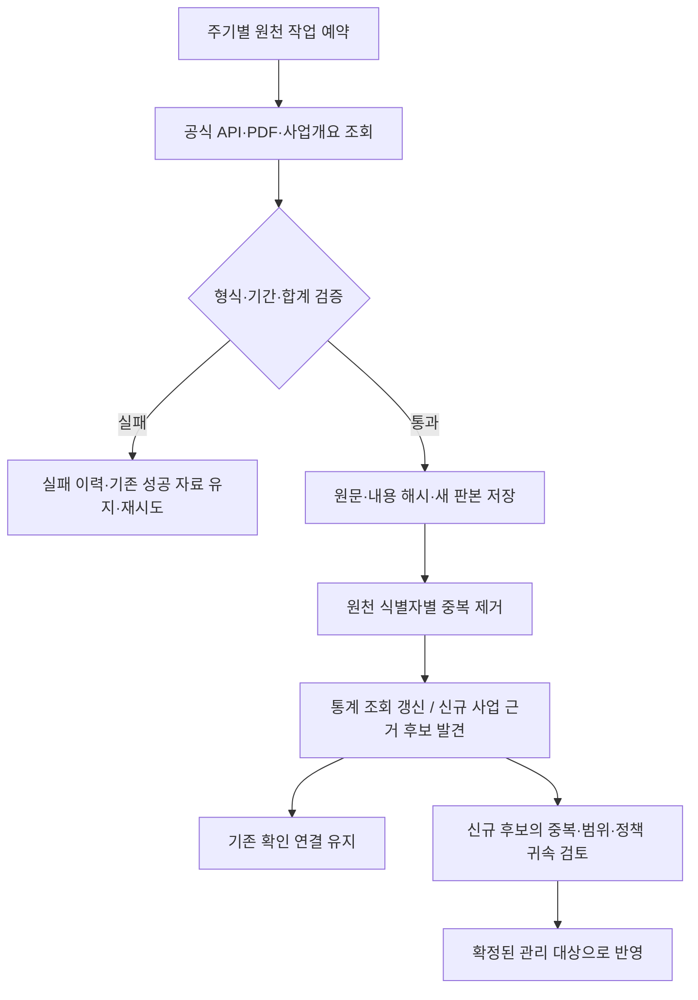

# HOME 수집 누락 정비 및 재진단 결과

작성일: 2026-10-19 · 대상: 수도권 주택 공급 원천·인허가·착공 수집 경로  
재진단 스냅샷: {{CAPTURED}} (UTC, 한국시간은 +9시간)

## 1. 결론과 지금 취할 조치

**확인된 수집 경로와 추출 누락을 보완해 운영에 적용했다. 공식 통계 12개 비교 항목은 모두 일치하며, 개별 사업 원천의 전수 확보는 계속 진행해야 한다.**

이번 정비는 코드를 제안하는 데 그치지 않고 실제 원천 재수집, 검토 후보 등록, 운영 API 반영, 담당자 확정값 보존 검증까지 수행했다. 다만 **관리 화면의 73,991호에 미수집분을 더하면 86,739호가 된다는 결론은 여전히 성립하지 않는다.** 86,739호는 수도권 전체의 2026년 1~8월 공식 착공 통계이며, 화면의 값은 선택한 정책·사업·측정시점을 따르는 관리 실적이다.

| 우선순위 | 지금 할 일 | 이번 처리 결과 | 이후 완료 기준 |
| --- | --- | --- | --- |
| 1 | 이미 발표된 월별 인허가 통계를 대체 경로로 확보 | 공식 PDF 수집기 추가, 수도권 3개 시도 당월·누계 6행 저장, 운영 조회 반영 | 다음 월에도 원문 형식·연월·시도 합계 검증 통과 |
| 2 | 원장에 있으나 연결되지 않았던 주거용 신축 착공을 검토 대상으로 올리기 | 기존 44행과 신규 발견분을 포함해 {{CANDIDATES}}행 모두 원천 식별자·판본 근거 연결 | 기존 사업 중복, 사업 경계, 정책 귀속, 호수 범위를 대조해 관리 대상으로 확정 |
| 3 | 기존 관리 사업 밖의 서울 정비사업 상세자료 확보 | 미등록 착공 단계 41개 사업장 상세 수집 완료 | 신규 사업장·단계 변경을 주기적으로 다시 확인 |
| 4 | 인허가 원장 미조회 지역 축소 | 실제 추가 수집 및 미완료 원천의 15분 간격 후속 작업 설정 | 법정동 조회 완료 뒤에도 정기 재방문 유지 |
| 5 | 부분 표 추출 누락 보완 | 신림2의 임대 면적대별 57·빈칸·126을 그대로 구조화 | 빈칸을 보완할 판본이 확보되면 새 판본으로 저장 |
| 6 | 공식 발표와 관리 실적 차이 정산 | 통계 비교와 사업별 수집 완결성을 분리하여 재진단 | 공식 발표의 사업별 구성·기간·정정 내역을 같은 기준으로 대조 |

**담당자가 승인한 값과 연결은 정확한 확정값으로 사용했다.** 승인 내용을 재평가하거나 변경하지 않았다. 확정 정책 연결 208건의 식별자·정책·프로그램·상태·판본·근거와 사업정보 208건의 내용 해시가 정비 전후 모두 동일하다.

## 2. 누락 원인별 정비 내용

### 2.1 월별 인허가: API 미제공을 자료 미발표로 취급하던 경로 보완

기존 월별 인허가 API는 제공기간 목록이 비어 있었지만, 같은 기간의 공식 PDF에는 수치가 발표되어 있었다. 이에 e-나라지표의 주택통계 첨부 목록에서 최신 연월 PDF를 발견하고 공식 인허가 표를 추출하는 `molit_monthly_release` 원천을 추가했다.

| 처리 | 적용 방식 |
| --- | --- |
| 원문 발견 | 목록 제목의 대상 연월과 첨부 식별자로 최신 월별 PDF 선택 |
| 잘못된 자료 방지 | PDF 형식·크기·페이지 수, 전체주택 인허가 표 단일성, 대상 연월 확인 |
| 수치 검증 | 서울+인천+경기 합계가 수도권 총계와 당월·누계 모두 일치하는지 확인 |
| 정형화 | 지역·지표·대상월·빈도(MONTH/YTD)·호수·기간 시작/끝·원문 URL·PDF 페이지·SHA-256 보존 |
| 중복 합산 방지 | YTD를 당월 값과 합산하지 않음. 같은 연도의 최신 YTD만 사용하고 공식 연간 값이 있으면 연간 값 우선 |
| 화면 반영 | 연도별 공급 통계에서 인허가를 2026년 8월까지의 부분 집계로 조회. 완결된 연간값으로 표시하지 않음 |
| 실적 분리 | 시도 총계는 통계 참고 원천으로 저장. 개별 정책·사업 착공 실적을 생성하지 않음 |
| 갱신 | 일별 자동 확인. 다음 원문 형식이 달라 검증에 실패하면 오류로 남기고 기존 성공 자료 유지 |

실제 저장값은 서울 당월 11,306호·누계 39,940호, 인천 당월 864호·누계 10,056호, 경기 당월 3,300호·누계 46,060호다. 누계 96,056호와 당월 15,470호는 서로 더하는 값이 아니다.

이 보완은 **3개 시도 전체주택 인허가 당월·누계**에 한정한다. 1~7월의 개별 월별 인허가 관측을 모두 복원하거나 PDF 전체의 주택유형·공공/민간 세부 표를 전부 정형화한 것은 아니다.

### 2.2 일반 건축 인허가: 확장 속도와 착공 후보 발견 경로 보완

기존에는 2,907개 법정동 중 8개만 조회했고, 원장에 실제착공일이 있더라도 정책 사업 연결 후보로 드러나지 않는 문제가 있었다.

- 기본 배치를 1동에서 5동으로 확대했다. 기존 운영 상한 안에서 처리한다.
- 미조회 지역이 남은 원천은 마지막 성공 수집 후 15분이 지나면 후속 작업을 예약한다. 15분은 예약 가능 간격이며, 대기열·요청 시간·외부 API 제한에 따라 실제 완료 간격은 더 길 수 있다.
- 운영 설정으로 1동 배치를 선택하더라도 재방문과 신규 동 조회를 번갈아 수행하여 신규 지역이 계속 밀리는 문제를 고쳤다.
- 올해 실제착공일이 있고, 용도가 공동주택/단독주택이며, 건축 구분이 신축인 행을 검토 후보로 보존한다. 발코니 구조변경 등은 이 기준에서 제외한다.
- 원천 고유 식별자에 안정적인 사업 식별 앵커를 부여하고 해당 원천 판본을 근거로 연결한다. 같은 자료를 다시 수집해도 후보를 중복 생성하지 않으며, 기존 담당자 확인 연결을 유지한다.

실제 첫 확대 배치에서 **18,361개 원천 행을 추가**했다. 현재 일반 건축인허가 원장 본문은 33,182행이다. 원천 현황의 33,183건에는 연결 확인 기록 1건이 포함되어 있으므로, 본문 행 수와 차이가 있다. 이 건수는 주택 호수 또는 고유 사업 수가 아니다.

| 착공 후보 점검 | 정비 전 | 정비 후 |
| --- | ---: | ---: |
| 해당 조건의 원천 행 | 44 | {{CANDIDATES}} |
| 원천 식별 앵커·판본 근거 연결 | 0 | {{CANDIDATES}} |
| 양수 호수가 있는 행 | 42 | {{POSITIVE}} |
| 후보 원장의 호수 단순합 | 594 | {{RAW_UNITS}} |
| 후보 발견 기능이 자동으로 추가한 정책 실적 | 0 | 0 |

**{{RAW_UNITS}}호는 검토 후보 원장의 단순합이며, 확인된 신규 공급 또는 누락 착공 물량이 아니다.** 기존 사업과의 중복, 같은 건축물의 자료 범위, 정책 관리 대상 여부를 확인해야 한다. 검토 후보의 식별 근거 연결과 정책 실적 편입을 구분했다.

### 2.3 서울 정비사업: 기존 사업만 상세 조회하던 범위 확장

기존 1,180행 공개 명부 대조에 더해, 관리 사업과 연결되지 않았지만 원천 진행단계가 착공인 사업장을 찾아 10개씩 상세 조회하도록 바꿨다. 이번 실행에서는 대상 **41개 사업장 전부**의 상세 수집을 마쳤다. 기존 연결 사업 상세 21개와 합쳐 최신 상세 근거는 **62개**다.

사업개요, 추진경과, 원문 링크, 실제 사건일이 있는 단계 이력을 저장했다. 기존 사업에 연결되지 않은 자료는 `matched_project_ids=[]` 상태로 보존하여 정책 배정을 지어내지 않는다. 실패한 상세는 완료 목록에 넣지 않아 이후 다시 시도할 수 있다. 한 차례 순환을 마치면 다음 주기에 재확인한다.

현재 확장은 명부의 **착공 단계 미등록 사업**에 한정한다. 서울 정비사업 1,180행 모두의 상세를 전수 수집했다는 뜻은 아니며, 인허가 이전·준공 이후·명부 밖 사업의 발견 경로도 별도로 관리해야 한다.

### 2.4 신림2: 빈칸 때문에 사라지던 부분 수치 보존

| 원문 항목 | 정비 후 저장 | 의미 |
| --- | --- | --- |
| 분양 면적대별 세대수 | 811 / 357 / 84 | 3개 구간 모두 확인 |
| 임대 면적대별 세대수 | 57 / 빈칸 / 126 | 확인한 2개 구간은 저장하고 가운데는 `null` 유지 |
| 임대 총계·전체 합계 | 완결값을 임의 생성하지 않음 | 빈칸을 0으로 바꾸어 합산하지 않음 |
| 담당자 승인 사업 규모 | 기존 1,430세대 유지 | 원문 부분 표로 승인값을 덮어쓰지 않음 |

흑석11 역시 승인 규모를 유지했다. 현재 공개 사업개요와 별도 브리핑 사이의 범위 차이를 이번 수집만으로 해소했다고 판단하지 않는다.

### 2.5 공식 통계 갱신 경로

기존 수도권 통계 원천 `molit_statistics`의 수동 전용 설정을 해제하고, 필요한 API 키가 설정된 경우 일별 자동 갱신 대상으로 포함했다. 이번에는 실제 재수집도 실행하여 640개 통계 레코드의 최신 판본을 저장했다. 새 공식 PDF 원천까지 포함해 원천 목록은 **66개에서 67개**가 됐다.

## 3. 같은 기간 공식 통계와 다시 비교한 결과

비교 기준은 **2026년 1월~8월 · 서울/인천/경기 · 호**다. 착공·준공·분양승인은 기존 월별 관측의 8개월 합산, 인허가는 이번에 수집한 공식 PDF 누계를 사용했다. 같은 시도·지표·월의 중복 여부도 검사했다.

| 지역 | 지표 | 공식 누계 | HOME 확보값 | 차이 | 확보 방법 |
| --- | --- | ---: | ---: | ---: | --- |
{{STAT_TABLE}}

**기존에는 9개 일치·3개 미수집, 현재는 12개 모두 확보·일치한다.** 이는 비교한 12개 집계 셀의 일치 결과다. 전체 사업 원장을 100% 수집했거나 모든 정책 실적이 공식 총계와 일치한다는 정확도 지표로 확대 해석하지 않는다. 인허가는 해당 공식 원문 자체를 대체 경로로 수집했으므로, 독립된 사업별 합산으로 재현한 수치도 아니다.

착공 합계는 **20,679 + 17,515 + 48,545 = 86,739호**다. 후보 {{RAW_UNITS}}호를 이 값이나 관리 화면의 73,991호에 추가하지 않았다. 과거 화면의 73,991호는 사용자 제공 캡처 기준이며, 이번 검증은 같은 역사 시점의 화면 재현을 증거로 사용하지 않는다.

## 4. 지역 원장 조회 범위 재진단

| 원천 | 이전 완료 동/전체 동 | 현재 완료 동/전체 동 | 증가 | 남은 동 |
| --- | ---: | ---: | ---: | ---: |
{{SCOPE_TABLE}}

서울·경기 주택 인허가는 추가 6개 배치까지 실행하여 **2,629개 법정동의 최초 조회를 완료**했다. 인천 주택 인허가는 이번 확대 배치에서 **6,587개 원천 행을 추가**했다.

법정동 조회 완료는 해당 조회가 끝났다는 의미다. 이후 정정, 원천의 지연 등록, 아예 제공되지 않는 항목까지 모두 확보했다는 뜻은 아니다. 원천마다 대상 지역·전체 동 수가 다르므로 행 간 분모를 합산해 하나의 수집률로 만들지 않는다.

일반 건축 인허가·서울경기 주택 인허가·인천 주택 인허가는 미조회 지역이 남은 동안 후속 작업을 15분 간격으로 예약하고, 전 지역 최초 조회가 끝나면 통상 일별 주기로 돌아간다. 법정동별 7일 경과 재방문 로직을 유지한다. 건축물 상세·대장·총괄표제부는 이번 확대 수집 대상으로 실행하지 않았으므로 별도 잔여 범위로 표기했다.

## 5. 자동화가 수행하는 일과 남아 있는 판단

| 상황 | 현재 동작 | 이번 확인 |
| --- | --- | --- |
| 미조회 법정동 존재 | 저장된 완료 목록 다음 범위를 조회 | 일반 인허가·인천 원장의 실제 범위 확대 |
| 이미 조회한 동의 자료 수정 | 7일 경과 재방문과 새 판본 저장 | 기존 재방문 경로 유지, 단일 배치의 신규 확장 차단 문제 보완 |
| 공식 월별 PDF 갱신 | 일별 목록 재확인 후 연월·합계 검증 | 최신 공식 PDF 6행 실제 수집 및 운영 API 반영 |
| 같은 원천 재수집 | 내용 해시가 같으면 unchanged, 바뀌면 새 판본 | 정비사업 후속 수집에서 기존 1,201행 unchanged 확인 |
| 신규 착공 후보 반복 발견 | 동일 원천 식별자로 후보 유지, 새 판본만 근거 추가 | 멱등성·담당자 확인 연결 보존 테스트 통과 |
| 외부 API 장애 | 기존 성공 판본 유지, 실패·재시도 기록 | 원천 상태와 배치 결과를 별도 보존 |
| 작업 중 프로세스 종료 | 기존 작업 임대·중단 배치 복구 경로 사용 | 기존 기능 유지. 이번에 장애 주입 시험을 수행한 것은 아님 |
| 신규 후보 정책 배정 | 확인한 필드와 근거를 대조하여 판단 | 후보 발견만으로 확정 물량을 만들지 않음 |

**수집·변경 감지·동일 원천 중복 처리·후속 작업 예약은 자동으로 수행한다.** 신규 후보가 기존 어떤 사업에 해당하고 어떤 정책 범위에 포함되는지는 현재 확보한 근거로 확정할 수 있는지 별도 판단이 필요하다. 이 판단의 잔여를 수집 성공으로 감추지 않는다.

## 6. 아직 해결되지 않은 항목과 관리 우선순위

| 항목 | 현재 상태 | 필요한 후속 조치 |
| --- | --- | --- |
| 수도권 일반 건축 인허가 최초 전수 조회 | 미조회 법정동 존재 | 자동 배치 완료율·API 상한·실패 동 점검, 재시도 누락 확인 |
| 주택 인허가 착공 기록의 0호 | 이전 진단의 2,189행을 일괄 보정하지 않음 | 같은 관리번호·주소의 건축물 상세·단지 총괄 자료로 세대수 연결. 0을 임의 대체하지 않음 |
| 신축매입·민간 소규모주택 | 이번 변경으로 전체 발견을 보장하지 않음 | 매입약정·사업자·주소·건축 원장 교차 원천 추가 |
| LH·GH 등 기존 사업 중심 상세 조회 | 서울 정비사업에 우선 발견 경로 추가 | 기관별 공고 전체에서 미등록 사업을 발견하는 경로 확장 |
| 공식 PDF 세부 분류 | 전체주택 인허가 당월·누계만 신규 구조화 | 주택유형·공공/민간·지역 세부 표 확장 |
| 기관 API 장애 | iH 공급 API를 실제 재시도했으나 HTTP 504 지속 | 기관 API 복구 확인 및 공식 파일 대체 경로 검토. 수집 실패를 0호로 처리하지 않음 |
| 10월 발표 9.9만호 이상과 8월 86,739호 차이 | 기간 차이는 있으나 전체 차이의 원인은 미정산 | 9~10월 사건, 전월 정정, 사업 유형·범위를 분리할 구성명세 확보 |
| 관리 실적 73,991호와 공식 통계 | 범위·기간이 다른 값 | 같은 정책 범위·측정일의 사업별 구성으로 비교표 작성 |

현재 원천 상태 스냅샷: **{{SOURCE_STATUS}}**. 성공 상태는 수집 요청 성공을 뜻하며, 모집단 완결성을 뜻하지 않는다. 실제 추가 재시도 결과는 아래 실행 증거에도 남긴다.

## 7. 검증과 재현

| 검증 | 결과 |
| --- | --- |
| 전체 백엔드 회귀 검사 | 677개 통과, 별도 subtest 61개 통과. 기존 Starlette/AnyIO 경고 1개 |
| 공식 PDF | 실제 원문 파싱 6행, 잘못된 연월 거부, 시도·수도권 합계 일치 |
| 누계 처리 | 이전 월 누계·당월과 중복 합산 안 함, 연간 공식값 우선 |
| 착공 후보 | 동일 원천 재실행 시 중복 생성 안 함, 기존 확인 연결 유지, 자동 정책 실적 생성 없음 |
| 자동 작업 | 미완료 범위 15분·완료 후 통상 주기, 단일 동 재방문/신규 교대 검사 |
| 부분 표 | 임대 57 / null / 126 보존 |
| 운영 적용 | 9개 변경 모듈의 로컬/컨테이너 해시 일치, API 재시작 후 health 정상 |
| 운영 조회 | 새로운 공식 PDF 원천 표시, 서울 2026 인허가 39,940호·202608 부분 집계 조회 |
| 승인 보존 | 정책 연결 208건과 사업정보 208건 전후 동일 |

증거는 내부 저장소의 [실행 증거 폴더](evidence/HOME_COLLECTION_REMEDIATION_20261019/)에 보관한다. `before.json`, `after.json`, `apply.jsonl`, `followup.jsonl`, `targeted_backfill.jsonl`, `api_*.json`, `runtime_hashes.json`, `tests.xml`을 함께 확인한다. API·원천 목록과 상세 DB 스냅샷은 각각 순차 조회이며 하나의 원자적 운영 시점을 주장하지 않는다. 상세 DB 부분은 읽기 전용 repeatable-read로 확보했다.

- [재진단 결과 JSON](HOME_COLLECTION_REMEDIATION_20261019.json)
- [착공 검토 후보 CSV](HOME_COLLECTION_REMEDIATION_20261019_candidates.csv)
- [파일 해시 명세](HOME_COLLECTION_REMEDIATION_20261019.manifest.json)
- [읽기 전용 운영 스냅샷 스크립트](../scripts/snapshot_collection_remediation.py)
- [동결 증거 비교·보고서 재생성 스크립트](../scripts/audit_collection_remediation.py)
- [이전 누락 진단](HOME_COLLECTION_GAP_REVIEW_20261019.md)

동결 증거에서 보고서를 재생성하려면 HOME 디렉터리에서 `python3 scripts/audit_collection_remediation.py`를 실행한다. 이 명령은 외부 재수집이나 운영 DB 변경 없이 문서·비교 JSON·후보 CSV·해시 명세를 다시 만든다.

## 8. 공식 참조

| 출처 | 용도 |
| --- | --- |
| [국토부 2026년 8월 주택통계 공식 PDF](https://www.index.go.kr/unity/potal/FileDown.do?seq=17704&id=1229&div=1) | 인허가·착공·준공·분양승인 동일 기간 비교. 2026-09-30 공표 |
| [e-나라지표 주택건설실적](https://www.index.go.kr/unity/potal/main/EachDtlPageDetail.do?idx_cd=1229) | 새 월별 공식 첨부 발견 |
| [국토부 착공 통계 메타정보](https://stat.molit.go.kr/portal/cate/statMetaView.do?hRsId=471) | 월별 착공 통계 정의·조회 경로 |
| [국토부 인허가 통계 메타정보](https://stat.molit.go.kr/portal/cate/statMetaView.do?hRsId=31) | 인허가 통계 정의·조회 경로 |
| [서울 정비사업 정보몽땅 공개 명부](https://cleanup.seoul.go.kr/cleanup/bsnssttus/lscrMainIndx.do) | 사업장 전체 명부·사업개요·추진경과 |

일반 건축 인허가 API는 기존 원천의 `getApBasisOulnInfo` 엔드포인트를 사용한다. 세부 호출 위치·기관 원문 URL은 원천 설정과 개별 원문 증거에 보존하며, API 키 등 인증정보는 이 보고서에 넣지 않는다. 보고서와 운영 증거는 공개 정적 웹에 게시하지 않았다.
