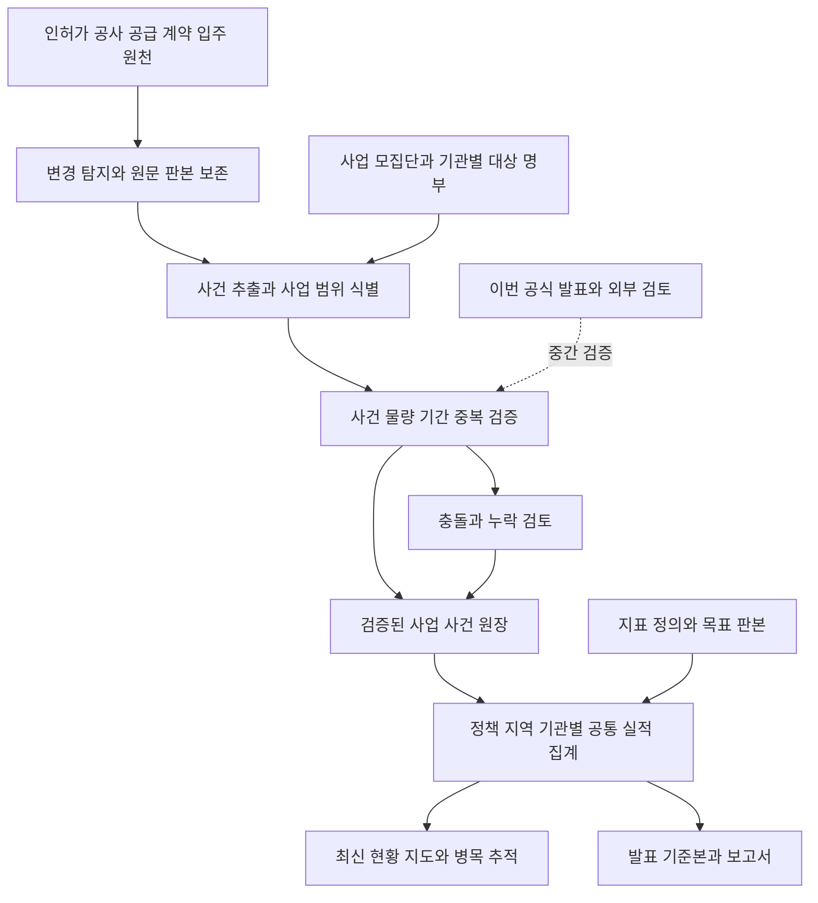

# HOME 신뢰성 있는 실시간 주택공급 데이터 플랫폼 구축 계획

기준일: 2026-10-16 · 대상: PoC 10 HOME · 상태: 1차 보완 적용 및 후속 검수

변경 담당자: **김민** · 변경 사유: **공식 발표 후 도출된 보완 사항 적용**.

**목표는 HOME에서 구축하고 검증한 사업별 데이터를 근거로 정책 현황을 판단하고 공식 발표까지 할 수 있는 플랫폼을 만드는 것이다.** 사업의 승인·착공·모집·준공·계약·입주 변화를 발생 원천에서 포착하고, 검증된 사건을 누적하여 지역·기관·정책별 실적을 직접 산출한다. 발표 전에 최신 현황과 병목을 파악할 수 있어야 한다.

이번 공식 발표와 외부 분석은 바닥부터 구축한 데이터의 누락·오연결·집계 정의를 점검하는 중간 검증 자료로 사용한다. 향후 성과 수치의 생성 경로는 **사업 현장의 원천 사건 → HOME 검증 원장 → 실적 집계 → 발표 자료**로 설계한다.

기관 연계의 목적은 **원천 사건 데이터 확보**다. 기관이 완성한 성과표를 받아 채우는 방향으로 해석하지 않는다. 기관의 공식 발표 승인 절차는 별도 업무이며 HOME의 수집·검증·실시간 산출을 시작하는 선행조건이 아니다.

## 1 개선 방향과 우선순위

| 우선 | 개선 방향 | 사용자가 얻는 결과 |
| --- | --- | --- |
| P0 | 자체 실적의 정의와 근거를 통일하고 기존 전달 누락을 복구 | 어느 화면에서 보든 같은 조건의 수치가 같고, 숫자에서 개별 사업 근거까지 내려갈 수 있다. |
| P0 | 사업 모집단과 식별체계를 확립하고 미등록 사업을 발견 | 이미 등록된 사업뿐 아니라 새로 시작되거나 빠진 사업까지 추적한다. |
| P0 | 원천 변화의 탐지부터 검증·집계까지 이어지는 경로 구축 | 새 착공·공고·일정 변경이 들어오면 관련 사업과 정책 현황이 갱신된다. |
| P1 | 공급유형별 사건·물량·책임기관 관리 | 민간정비·신축매입·전세지원까지 각각의 실제 절차와 성과로 추적한다. |
| P1 | 검증 수준과 자료의 최신성을 관리하고 발표 기준본 생성 | 발표에 사용할 수치의 범위·기준시각·포함 사업·검증 책임이 고정된다. |
| P2 | 선행조건과 변경 이력에 근거한 병목·전망 분석 | 실적이 확정되기 전 위험과 필요한 조치를 파악한다. |

실시간 추적과 신뢰성 확보를 함께 추진한다. 자동 검증 조건을 만족하는 반복 사건은 빠르게 반영하고, 동일성·물량·시점이 충돌하는 사건은 검토 대상으로 분리한다. 모든 갱신을 수작업 승인에 묶으면 추적 속도를 확보하기 어렵다.

## 2 현재 자산과 보완할 지점

2026-10-16 작업 트리의 코드와 날짜별 점검 기록을 기준으로 한 출발점이다. 과거 기록의 미해결 상태는 현재 코드에서 재현한 뒤 확정한다.

| 영역 | 현재 확인한 기반 | 다음 작업 |
| --- | --- | --- |
| 원천 보존 | `home_revision`, `home_batch`, 원문 해시·판본·manifest·감사 이력 | 사건의 실제 효력시각과 시스템이 알게 된 시각을 분리하고, 과거 집계를 재현한다. |
| 사업 식별 | `home_project`, `home_identity_alias`, `home_project_evidence` | 현재 `identity.py`의 사업 앵커 생성은 주로 `kind=project` 기준이다. 정비·허가 등 참고 원천에서 미등록 실사업 후보를 발견하는 경로를 확장한다. |
| 근거 연결 | `stage_evidence.py`, `evidence_bridge.py`, 담당자 확정·해제 보호 | 연결 검토 상태와 사건의 사실 검증 상태를 구분하고, 적용 물량·회차를 명시한다. |
| 공급 집계 | `policy_delivery.py`에 저장 근거를 소비하는 경로가 이미 있다. `supply_dashboard.py`의 `linked_notices`에는 LH 시행사·영문 블록 중심 제한도 남아 있다. | C21·C49의 서울·인천 사례를 재현하고, 남은 누락 구간과 적절한 제외를 구분한다. |
| 수집 실행 | 앱 내부 스레드, 원천별 일·주 단위 설정, 전체 수집 실행 잠금과 순차 처리 | 긴 과거자료 수집과 최신 변경 탐지를 분리하고, 원천별 작업·재시도·연결 갱신을 독립 실행한다. |
| 수집 범위 | `home_coverage`에 조회 범위와 모집단 상태를 별도 저장 | 페이지 수집 완료와 해당 지역·유형의 사업 전수 확보를 각각 측정한다. |
| 화면 갱신 | `projection_cache.py`가 기존 판본·매핑·감사·배치 변경을 검사 | 새 사건·검증·집계 버전도 캐시 무효화에 반영한다. |
| 통계 보조 검증 | 월별 착공·준공, 연간 인허가 수집 | 월별 인허가는 코드에 `5375` API 개방 취소 기록이 있다. 대체 원천의 실제 제공 범위를 검증하며, 연간값을 월별 실적으로 배분하지 않는다. |

기존 FastAPI·PostgreSQL/PostGIS·수집기·승인·지도 구조를 확장한다. `PRO_…` 원천 ID와 `HPR_…` 실사업 후보 ID의 대응표를 유지하고, 현재 승인값과 연결은 자동 이관으로 변경하지 않는다.

## 3 자체 실적을 산출하는 데이터 구조

### 3.1 사업 모집단을 먼저 관리

1차 구축 범위는 **수도권의 주택공급 사업**으로 잡고 공공건설·민간정비·일반 민간건설·신축매입·기존매입·전세지원의 원천과 책임기관을 정한다. 기존 9·7 연결 사업은 이 모집단 안에서 정책 귀속이 설정된 부분으로 관리한다. 전국 확대는 같은 계약을 지역별로 적용하는 후속 단계다.

- `지역 × 공급방식 × 시행·관리기관 × 추적기간`별 대상 명부와 기준 판본을 관리한다. 일반 민간건설도 인허가 원천과 지자체 사업 명부로 포착한다.
- 새 원천이 기존 사업에 연결되지 않으면 미등록 후보를 생성한다. 기관 고유키·구역번호·허가번호·주소·블록·사업주체로 동일성을 판단한다.
- 지구·블록·공급구획·공고 회차의 포함관계와 분할·병합·명칭 변경을 이력으로 저장한다. 한 사업의 복수 원천 레코드는 같은 실사업에 연결한다.
- 모집단 명부가 없거나 기관 범위가 불명확하면 확보율의 분모도 미확정으로 둔다. 등록 레코드 수를 전체 사업 수로 사용하지 않는다.
- 정기 명부 대조로 신규·종료·취소 사업과 미연결 원천을 탐지한다. 발표에 등장한 사업을 찾는 방식으로만 대상을 늘리지 않는다.

### 3.2 사건별 최소 데이터 계약

공급 속성은 `취득방식 × 공급/점유형태 × 대상계층`의 독립 축으로 관리한다. 신축매입약정·기존매입·전세지원은 다른 취득방식이며, 청년·신혼은 대상계층이다. 전세지원·기존매입에 신규 착공 단계를 강제하지 않는다.

| 계약 | 필수 내용 |
| --- | --- |
| 대상 식별 | 실사업 ID, 지구·블록·공급구획 ID, 원천 시스템·고유키, 관계의 확정 상태 |
| 사건 의미 | 승인·실착공·모집·사용검사·계약·실입주 등 사건 종류, 공급방식, 계획·실제·추정 구분 |
| 물량 | 값·단위, 전체/부분 범위, 신규/재공급, 모집 차수, 누적량/기간 증가량 구분 |
| 시각 | 실제 발생일 또는 관측기간, 원천 공개·변경시각, 최초 포착시각, 적재시각, 검증시각, 집계 반영시각 |
| 시각 정밀도 | 일·월·분기·기간·미확정 구분. 발표일·수집일을 실제 착공일로 사용하지 않음 |
| 근거 | 고정된 원천 판본 ID, URL·문서 위치·해시, 추출 규칙 버전, 검증 규칙과 결과 |
| 책임 | 자료 제공기관, 사건 확인 주체, 담당 조직, 검토자·결정시각·사유 |
| 변경 | 이전 사건 판본, 정정·취소·대체 관계, 유효기간과 시스템 기록기간 |

원문이 바뀌면 새 사건 판본을 만들고 기존 판본을 보존한다. 뒤늦게 도착한 착공 신고와 취소·정정은 해당 사건 기간의 집계를 다시 계산하되, 이미 발행한 발표 기준본은 별도 정정판으로 관리한다.

### 3.3 검증과 실적 인정

원천별로 해당 사건을 증명할 수 있는 조건을 정한다. 착공은 착공 사건의 직접 근거, 준공은 해당 단지의 완료·사용검사 근거, 실제 입주는 기관의 입주 집계 근거를 요구한다. 입찰·계약·공고·입주지정 시작만으로 다른 사건의 완료를 생성하지 않는다.

검증은 원천 진위·사업 동일성·사건 의미·기간·물량 범위·중복·취소 여부를 각각 검사한다. 자동 통과 조건은 확인된 원천 계약과 규칙으로 정하고, 담당자 판단이 필요한 예외는 근거와 함께 검토함으로 보낸다. 기존 담당자 확정 사실은 유효한 관리기준으로 유지하며 변경은 새 근거와 변경 결정을 남긴다.

사건 상태는 `수집됨 → 검증 중 → 검증 완료`로 관리하고 충돌·취소를 별도 표현한다. 기존 관계의 `REVIEW/CONFIRMED/RELEASED`, 자료 공개 범위, 사건 검증 상태는 독립 속성이다. 실시간 탐색 화면에는 검증 중 사건도 구분해 표시하고, 발표 수치에는 정의된 인정 조건을 통과한 사건을 사용한다. 승인된 추정값은 추정이라는 성격을 유지한다.

### 3.4 지표와 집계를 하나의 계약으로 통일

각 지표에 사건 종류·지역·기간·공급유형·대상 모집단·단위·정책 기여 규칙·중복 제거 규칙·목표 판본을 부여한다. 지도·사업 상세·정책 차트·CSV·보고서가 같은 집계 결과와 구성 사건 목록을 읽는다.

같은 주택이 착공·모집·입주에 반복 등장해도 단계별 실적으로 각각 관리하며 횡단 합산하지 않는다. 지구 전체와 하위 블록, 단지 전체와 임대·분양 부분도 중복 가산하지 않는다. 여러 정책에 기여하는 사업은 지표별 산입 관계를 저장하고 통합 집계에서 한 번만 센다.

원천의 실제 0, 미수집, 미연결, 검증 중, 수집 실패, 비적용을 구분한다. 분모가 검증된 범위에서만 달성률·커버리지를 산출하고, 전체 실적의 일부만 확보한 경우 확인 물량과 미확보 범위를 함께 반환한다.

## 4 실시간 추적을 위한 수집과 갱신

발표보다 먼저 알기 위해 필요한 원천은 **행정 처리·사업 수행 단계에서 생성되는 자료**다. 기관 공개 API·공고·고시의 변경을 탐지하면서, 공개가 늦는 착공·계약·입주는 기관 업무 원장의 증분 제공이나 담당기관 입력으로 확보한다. 원천 계약에는 고유키, 사건일, 변경·취소, 대상 명부, 제공 주기, 누락 재전송과 확인 책임을 포함한다.

### 4.1 실행 구조

- 현재 전체 수집을 묶는 잠금을 원천·범위별 작업 잠금으로 전환한다. 같은 자료의 중복 실행은 막고, 긴 건축물대장 수집이 새 공고 탐지를 지연시키지 않게 한다.
- PostgreSQL 기반 작업 큐와 별도 worker를 우선 사용한다. 체크포인트·재시도·호출 제한·오류 격리·처리 이력을 저장하고, 외부 큐 도입은 처리량 측정 후 결정한다.
- 최신 변경 탐지와 과거자료 채우기를 별도 작업으로 실행한다. 완료 법정동도 변경 가능성에 따라 재방문하며, 원천이 변경일 조회를 제공하면 해당 기능을 우선 활용한다.
- 수집 성공 후 `원천 변경 → 사업 후보/사건 추출 → 검증 → 영향받은 집계 갱신`을 연결한다. 후속 단계 실패는 별도 실패로 기록하고 재처리한다.
- 사건 키와 판본으로 중복 처리를 방지한다. 순서가 뒤바뀐 자료, 동일 자료 재수신, 정정·취소도 같은 결과로 수렴해야 한다.
- 기존 판본을 다시 읽어 새 규칙으로 재처리할 수 있게 한다. 전체 재수집 없이 오류가 난 원천·기간·사업만 복구한다.

### 4.2 최신성과 지연의 측정

실제 사건 발생부터 원천 공개까지의 지연, 원천 공개부터 HOME 포착까지의 지연, 포착부터 검증·집계까지의 지연을 나누어 측정한다. 원천 시각이 없는 구간은 미측정으로 두고, 시스템 처리 지연만으로 전체 실시간성을 설명하지 않는다.

| 대상 | 초기 설계 목표 | 확인 방법 |
| --- | --- | --- |
| 기관 증분 연계 | 수신 후 검증 후보 생성 P95 5분 이내 | 기관 전달시각과 HOME 사건 생성 로그 대조 |
| 변경이 잦은 공고·고시 | 원천별 허용 범위에서 15~60분 간격 탐지 | 변경 가능한 대표 원천의 공개·첫 포착시각 계측 |
| 검증 완료 사건 | 완료 후 조회·차트 반영 P95 1분 이내 | 검증 트랜잭션부터 API·화면 반영까지 계측 |
| 기관 배치 자료 | 합의한 제공 마감과 도착 후 처리기한 관리 | 원천별 수신 누락·지연·재전송 기록 |
| 정기 통계·고정 파일 | 공표·배포 주기에 맞춘 갱신 | 최신 제공 판본과 저장 판본 대조 |

위 시간은 개발 목표이며 현재 성능 측정값이 아니다. 초기 1주 계측과 기관 제공 조건을 반영해 원천별 운영 기준을 확정한다. 최신성 화면에는 마지막 수집 성공뿐 아니라 **확인된 사건 기준시각, 검증 대기, 제공 지연, 집계 반영 지연**을 표시한다.

## 5 공급방식과 기관 역할의 확대

공통 6단계 지도는 유지하고 하위 사건은 업무별로 구성한다. 공공·민간 건설은 승인→실착공→공사→모집→계약→사용검사→입주개시→실입주를 독립 사건으로 다루며 병행 진행도 허용한다.

| 대상 | 추가로 관리할 사건과 범위 | 우선 확보 경로 |
| --- | --- | --- |
| 민간정비 | 구역·조합·사업시행·관리처분·이주·철거·실착공, 획지별 물량 | 정비사업 원장·지자체 인허가·사업시행자 |
| 일반 민간건설 | 사업계획·허가·착공·분양·사용승인·입주, 승인 대상과 실제 건설 범위 | 건축HUB·지자체·사업주체·해당 청약 원천 |
| 신축매입약정 | 접수 건수·약정 호수·실착공·매입완료·임대모집·계약·입주 | 매입기관 원장과 민간 건축행정 원천 연결 |
| 기존주택 매입 | 매입신청·심의·계약·소유권 확보·임대공급·실입주 | 기관 매입·공급·관리 원장 |
| 전세지원 | 선정·주택물색·권리분석·계약·실입주 | 기관 지원업무 원장과 지자체 연계 |
| 정책 이행과제 | 담당·기한·완료조건·증빙·영향 사업 | 과제별 업무 원장과 소관기관 확인 |

전세지원의 신규 착공처럼 적용되지 않는 단계는 비적용으로 둔다. 매도인 대상 매입공고, 입주자 모집, 정정·취소·추가·예비자 모집도 구분한다. 계약·실입주는 개인 식별정보 없이 집계 수준에서 제공받는다.

정책 주관, 사업 수행, 승인, 공고 발행, 해당 공고 담당부서, 다음 조치기관을 구분하고 유효기간을 저장한다. 이 역할을 지연·충돌·자료 보완 요청의 담당과 연결한다. 정책 이행과제의 단위는 건이며 공급 호수와 별도로 집계한다.

## 6 발표의 근거가 되는 조회와 기준본

최신 화면은 현재 확인된 사건과 검증 대기 변화를 보여준다. 발표 기준본은 선택한 마감시각의 검증된 사건·지표 정의·사업 범위·목표 판본·검증 책임자를 고정한다. 같은 집계 엔진이 두 결과를 산출한다.

발표 숫자를 선택하면 `포함 사업·블록 → 인정 사건·물량 → 근거 판본 → 검증 결정`을 조회할 수 있어야 한다. 제외·보류한 사건과 이유, 미확보 기관·유형·기간도 함께 확인한다. 전체 실적을 발표하는 지표는 대상 모집단과 기관별 자료 마감이 충족됐는지 확인한다.

기준본은 식별자·계산 규칙 버전·구성 사건 판본·해시·기준시각·작성/검토 결정을 저장한다. 발표표·CSV·API·설명자료는 이 기준본에서 생성한다. 이후 지연 신고나 정정이 발생하면 원래 기준본을 보존하고 새 정정판과 증감 사유를 발행한다.

**기준본 동결은 P0에서 시작한다.** 일자만 지정한 조회와 시간대가 있는 인지 기준시각을 구분한다. 외부 발표 전 T0에 알려진 원천 판본·관계·담당자 판단·산식만 사용할 수 있어야 하며, 발표 후 T1에 알게 된 사건을 과거 발표 선행 포착으로 소급 계산하지 않는다. 기관 총량통계·외부 벤치마크·모델 추정과 원천 사건 직접 합산은 입력과 산출 출처를 분리한다.

## 7 구현 순서와 완료 조건

개발 2명과 주택공급 업무 검토자 1명의 정기 참여를 가정한 **약 8~10주 규모의 초기 수도권 구축안**이다. 단계별 기간은 추정이며, 기관 연계 대기기간은 별도로 관리한다. 공개 원천으로 구현할 경로와 기관 자료가 필요한 경로를 함께 추진한다.

| 단계 | 예상 구간 | 핵심 작업 | 완료 조건 |
| --- | --- | --- | --- |
| 1 자체 실적의 정의와 전달 복구 | 1~2주 | 지표·사건·모집단 계약, 정확한 인지 기준시각의 입력·결정·산식 동결, 출처별 산출 분리, 서울·인천 전달 경로 복구, 핵심 원천 지연 계측 | 대표 사업의 원문→사건→지도·차트·CSV 수치가 같고, 확정·해제·부분 범위와 T0 이후 자료 유입 차단을 검증한다. |
| 2 모집단과 사건 원장 | 3~5주 | 수도권 유형별 대상 명부, 실사업 ID 대응, 범위·회차·정책 기여 모델, 사건 판본·검증, 신규 후보 탐지 | 정의한 대상 명부와 관리사업의 누락·중복을 설명할 수 있고, 동일 사건을 한 번만 집계하며 과거 기준시각을 재현한다. |
| 3 변경의 연속 추적 | 6~8주 | 원천별 작업 큐·증분 갱신·후속 처리, 공급방식별 사건, 자동 검증과 예외 처리, 기관 배치/증분 연계 시범 | 연결된 핵심 원천에서 변경→검증→화면 갱신을 계측하고, 실패·재시작·중복 수신 후에도 데이터가 유실·중복되지 않는다. |
| 4 발표 서식과 운영 검수 | 9~10주 | P0부터 보존한 기준본의 발표 서식·정정판 운영, 원천별 최신성·누락 감시, 계약·입주 시범자료, 복구 실증 | HOME 자체 원장으로 기준시각의 발표표를 재생성하고 모든 수치의 구성 사건·근거·검증 책임을 제시한다. |

기관 제공 계약과 검증 책임 지정은 1단계부터 시작한다. 공개자료가 늦는 착공·계약·입주를 선행 추적하려면 이 연계가 필요하다. 일부 기관 시범연계 완료와 수도권 전 기관의 실시간 확보 완료는 서로 다른 완료 범위로 기록한다.

### 7.1 첫 10영업일 작업

| 순서 | 작업과 산출물 | 담당 역할 |
| --- | --- | --- |
| 1 | 수도권 대상·공급유형·핵심 지표와 사건 인정 기준 확정. 원천별 자료 제공·확인 책임 요청 목록 작성 | 업무 검토자·백엔드 |
| 2 | 작업 트리 식별값·DB 읽기 기준선·기존 승인·감사·주요 API 결과 보존. 격리 복원 확인 | 백엔드·운영 |
| 3 | 마곡17·계양 A17 등 C21/C49 대표 사례를 현재 코드에서 재현. 원천·연결·사건·집계 단계별 차이표 작성 | 백엔드 |
| 4 | 저장된 근거의 공통 공급 사건 변환 및 조회 경로 보완. 정정·추가·부분범위·해제 회귀검증 | 백엔드 |
| 5 | 중계본동·흑석11·신림2·광교를 포함한 미등록 사업 후보 탐지 시범. 지역·고유키 기반 오병합 방지 | 데이터·업무 검토자 |
| 6 | 핵심 원천의 공개·첫 포착·검증·화면 반영시각 계측. 긴 수집이 변경 탐지에 주는 지연 측정 | 백엔드·운영 |
| 7 | 사건·범위·지표 계약과 추가 마이그레이션 설계. 기존 ID 및 승인 이관 영향표 작성 | 백엔드 |
| 8 | 화면에서 확인 실적·검증 대기·미확보·최신성을 표시하고 같은 조건의 CSV와 대조 | 프런트엔드 |
| 9 | 이번 공식 발표 53행을 검증 사례로 고정하고, 자체 산출이 가능한 항목과 추가 원천이 필요한 항목 분류 | 데이터·업무 검토자 |
| 10 | 1단계 검수. 남은 자체 산출 공백을 기관·유형·사건별 백로그로 확정 | 개발·업무 검토자 |

첫 단계의 시연은 **원천에서 새 사건을 포착하고, 근거를 검증한 뒤 HOME 수치가 바뀌는 과정**으로 한다. 공식 발표 수치를 입력하여 현황을 채우는 시연으로 대체하지 않는다.

### 7.2 코드와 저장 구조의 변경 범위

| 변경 묶음 | 기존 코드 | 구현 방향 |
| --- | --- | --- |
| 사업·범위 식별 | `db.py`, `identity.py`, `matching_rules.py`, `parcel_identity.py` | 기존 실사업·별칭·근거 재사용. 지구/블록/유형/회차 범위와 후보 결정 이력 추가 |
| 사건·사실 검증 | `stage_evidence.py`, `evidence_bridge.py`, `project_collection.py` | 고정 원천 판본을 참조하는 사건·검증 계약과 공통 변환 모듈 추가 |
| 원천 변경 처리 | `service.py`, `collectors.py`, `sources.py`, `app.py`, `source_coverage.py` | 원천 계약·체크포인트·작업 상태 추가. 별도 worker와 원천별 잠금으로 단계적 전환 |
| 지표·정책 기여 | `policy_delivery.py`, `policy_delivery_comparison.py`, `supply_dashboard.py`, `supply_progress.py` | 같은 사건·범위로 집계. 정책 다대다 기여와 목표 판본을 관리하고 기존 응답 호환 유지 |
| 조회·화면 | `map_progress.py`, `projection_cache.py`, `web/assets` | 공통 집계 판본, 최신성·검증 상태, 구성 사건 조회. 지도 위치 품질도 별도 표시 |
| 발표·운영 | `supply_export.py`, `delivery_operations.py`, 기존 감사·보고서 경로 | 발표 기준본·구성 사건 참조·정정판·누락 및 검토기한 관리 추가 |

물리 저장은 `home_revision`·`home_project`·`home_coverage`·감사를 재사용하고, **사업 범위, 사건 판본, 정책 기여, 발표 기준본과 구성 사건, 수집 작업**을 위한 추가 스키마를 단계별 마이그레이션으로 도입한다. 지표·원천 계약·업무 템플릿은 기존 판본 저장 방식을 우선 활용한다. 원문을 새 원장에 중복 복제하거나 기존 `home_mapping.project_id`를 한 번에 새 ID로 치환하지 않는다.

## 8 이번 공식 발표를 사용하는 중간 검증

이번 37개 지표·16개 사업 발표는 고정된 외부 검증 사례로 보존한다. HOME은 자체 원천에서 사건과 실적을 산출하고, 기간·모집단·단위·정밀도를 맞춘 항목을 외부 발표와 대조한다. 외부값과 차이가 나면 수집·식별·사건·범위·집계의 어느 단계가 원인인지 조사한다. 내부 승인값이나 실제 사건일을 외부 숫자에 맞춰 바꾸지 않는다.

대표 검증은 다음과 같다.

- **기간과 선행성:** 1~8월 착공 86,739호와 10월 둘째 주 99,000호 이상을 같은 기간 실적으로 감산하지 않는다. 같은 기간 원천을 확보해 자체 산출 여부를 확인한다.
- **사업 동일성:** 중계본동/중계1단지, 흑석11/흑석2, 왕숙/왕숙2, 신림2구역/신림2차를 구분한다. 허가·정비 참고 레코드가 실제 착공 근거인지는 별도로 검증한다.
- **실질 충돌:** 흑석11 원천 1,515호와 발표 약 2,500호는 변경승인·획지·실착공 범위를 확인한다. 차이를 채우는 가상 물량을 만들지 않는다.
- **범위와 중복:** 계양 지구 약 2,300호와 관리된 부분 후보 1,289호, A17 전체 463호와 공공분양 309호를 구분한다. 과천주암 1,030/344호, 검단 1,323=991+332호도 포함관계를 검증한다.
- **발생연도와 회차:** 교산 2024·왕숙2 2025 착공을 2026 실적으로 이동하지 않는다. 고덕강일의 기존 8월 계획과 Q4 발표는 변경·공고 회차를 확인한다.
- **표시 정밀도:** 서울 20,679/약 21,000과 창릉 2,306/약 2,300은 원값을 보존한다. 분석자가 정한 반올림 규칙과 공식 원문이 제시한 정밀도를 구분한다.
- **목표와 행정과제:** 269,000/268,000 목표는 판본·변경 근거를 확인한다. 과제 145건·완료 48건 같은 요약만으로 개별 과제 명부를 생성하지 않는다.

기존 **3/47은 당시의 수치 비교 가능 범위**다. 앞으로의 핵심 성과는 자체 원장으로 확인한 사업·사건의 완결성과 최신성, 발표 전에 검증된 사건을 포착하는 능력이다. 공식 발표와의 일치 건수는 이 성과를 확인하는 보조 지표로 사용한다.

## 9 검수 기준과 성과 지표

| 지표 | 측정 기준과 초기 완료 조건 |
| --- | --- |
| 근거 추적 가능성 | 발표 기준본의 모든 수치가 구성 사건·원천 판본·검증 결정으로 연결됨. 근거 없는 산입 0건 |
| 사업 모집단 관리 | 합의한 지역·유형·기관 명부에 대한 연결·미연결·제외 사유 보유. 분모 미확정 영역 별도 표시 |
| 사건 완결성 | 사건별 필요 일자·물량·범위·단위·책임·근거 충족률. 미확보와 비적용 분리 |
| 집계 일관성 | 동일 기준시각·범위·검증 수준에서 지도·차트·상세·CSV·발표표의 수치 일치 |
| 중복·오연결 | 대표 검증 사례의 중복 산입·동명 오병합 0건. 확대 후 유형별 표본검사 결과 별도 관리 |
| 추적 지연 | 원천 공개/전달→포착→검증→집계의 P50·P95 및 미측정 비율. 4장의 원천별 목표로 검수 |
| 발표 선행 포착 | 동일 범위 사건 중 외부 발표 이전에 HOME이 검증 완료한 사건·물량. 외부 발표를 본 뒤 소급 입력한 건은 제외 |
| 변경 대응 | 정정·취소·지연 도착·중복 수신·재시작 후 현재 집계가 재현됨. 기존 발표 기준본도 재생성 가능 |
| 예외 처리 | 미연결·충돌·제공 지연 건별 담당·조치기한·처리시간·장기 미해결 건수 |
| 운영 복구 | 격리 DB와 원문 보관본에서 사건 원장·집계·발표 기준본 복구 및 결과 대조 |

기존 `test_identity.py`, `test_evidence_bridge.py`, `test_supply_progress.py`, `test_policy_delivery_comparison.py`, `test_map_progress.py`, `test_projection_cache.py`, `test_source_coverage.py`를 관련 변경에 맞춰 실행한다. 신규 검증은 사건 중복·정정·시각 역전·원천별 작업 충돌·집계 판본·발표 재현처럼 실제 실패 가능성이 있는 계약을 대상으로 추가한다. SQLite 단위 검증 외에 PostgreSQL 격리 환경에서 잠금·동시 갱신·마이그레이션을 확인한다.

각 단계는 기존 API와 새 결과를 같은 범위에서 병행 비교한 뒤 전환한다. 승인·해제·감사 보존, 대표 사업의 정확한 집계, 캐시 갱신을 통과해야 해당 경로를 운영에 적용한다.

## 10 기관 연계와 후속 확장

기관 협의는 포괄적인 자료 요청보다 **어떤 사업의 어떤 사건을 언제 확정하여 전달할 것인지**를 정하는 데 집중한다.

| 상대 역할 | 요청할 데이터 계약 | 필요한 이유 |
| --- | --- | --- |
| 지자체 인허가·정비 담당 | 대상 사업 명부·고유키, 최초/변경승인, 착공 신고·취소, 사용검사와 변경 시각 | 공공·민간 사업을 지속 발견하고 실제 사건을 빠르게 확인 |
| LH·SH·GH·iH 등 사업·공급기관 | 지구/블록 코드, 실제 착공·공정 관측, 공고 계보, 공급구획·금회 물량 | 같은 사업을 원천 간 연결하고 전체/부분·회차 중복 방지 |
| 매입·전세·입주 관리기관 | 약정·매입완료·계약·인도·실입주 집계와 정정, 제공 마감·재전송 | 모집 이후의 실제 공급 성과를 주기적으로 확인 |
| 정책·업무 책임자 | 사건 인정 기준, 목표 변경 근거, 정책 기여 규칙, 내부 검증 책임 | 원천 사건에서 신뢰할 수 있는 자체 지표를 생성. 기관 공식 발표 승인은 별도 업무로 분리 |

위 기반 이후에는 선행조건·PF·보상·인허가 병목, 기관별 조치와 전망 시나리오를 확장한다. 학습형 예측·3D 확대·전국 일괄 확장은 자체 사건 원장의 신뢰성과 연속 갱신이 검증된 범위부터 추진한다.

## 11 참조 자료

- [외부 상급자 핵심요약](analysis/주택파동_HOME_SW상급자용_핵심요약_독립산출형_20261016.md)
- [외부 독립 검증·실시간 추적 검토보고서](analysis/주택파동_HOME_최종종합검토보고서_독립검증_실시간추적형_20261016.md)
- [외부 공급유형별 절차와 책임 및 원천 참조](analysis/주택파동_공급유형별_추진절차_책임공고체계_수집URL_API_참조_독립산출형_최종_20261016.md)

## 12 이번 1차 보완의 적용 범위

담당자 김민, 사유 ‘공식 발표 후 도출된 보완 사항 적용’으로 원천 후보·근거 연결·집계 기준본·보완 이력과 회차별 성적표를 기록한다. 데이터관리 네 번째 소메뉴 **데이터 정합성 확인**에서 처음과 후속 성적표를 선택하고 40개 항목별 이전/현재/증감·실제 개선·남은 과제를 확인한다.

- `reference_registry.py`: 정비·허가 원천을 검토 명부로 연결하고 대표 사업 후보를 등록한다. 광교 A17의 중복 의심 허가 관리번호는 별개 사업으로 합산하지 않고 보류한다.
- `subject_identity.py`, `evidence_bridge.py`: SH 숫자 단지명과 원문이 직접 특정한 전체/부분 구획을 처리한다. 기존 수동 확정·해제와 원천 판본 고정을 보존한다.
- `independent_metrics.py`: 직접 사건과 기관 총량통계를 분리하고 정확한 `known_at` 기준의 사건·판본·해시·제외·충돌을 동결한다. 등록된 부분 모집단으로 표시하고 전수 실적·실입주를 추정하지 않는다.
- `collection_jobs.py`: 원천별 잠금, 최신/과거 전용 작업자, 영속 수집→연결→기준본 작업, 임대 복구와 단계 재시도를 적용한다. 허가·대장은 완료 법정동에도 7일 재방문을 예약한다.
- `data_integrity.py`: 처음/후속 평가를 덮어쓰지 않고 부모 회차·담당자·사유·HTML·JSON·검증 해시로 보존한다. 후속 항목마다 개선 코멘트를 요구한다.

4대 지표는 원문 20쌍의 동일 고정 정답으로 자동 연결 규칙을 소급 비교한다. 목적 표본 성능과 전체 플랫폼 정확도, 공식 발표 일치도를 구분한다. 수도권 전수 분모·계약·실입주 원천·독립 정답 표본 확대·장기간 지연 P95는 후속 과제로 남기며 점수를 부풀리지 않는다.

### 12.1 iH 직접 수집과 2차 검수

사용자의 iH 홈페이지 수집 보완 요청을 반영했다. `ih_public.py`가 공식 `ih.co.kr`의 주택 사업·분양·임대 공고를 직접 조회하여 고유번호·게시일·본문·첨부·해시를 보존한다. 첫 수집과 재실행에서 주택 사업 후보 7건·모집 문서 39건을 확보했다. 과거 페이지는 체크포인트로 계속 수집하며 최신 2페이지를 매번 재확인한다. 사전·예비·정정·추가 모집과 토지·상가·체육관을 구분하고 미래 착공·준공 반기를 실제 사건일로 생성하지 않는다.

API 주소는 공공데이터포털의 공식 Swagger와 일치하나 실호출 504가 발생한다. 원인을 주소 오류 또는 기관 장애로 단정하지 않고, API 참조 실패와 홈페이지 직접 수집 성공을 별도 표시한다. 홈페이지의 공고·계획으로 API 재고·계약·실입주 값을 채우지 않는다.

참고 후보와 iH 원천 사업이 일반 프로그램의 임시 정책 제안을 따라 특정 정책 분모에 유입되는 경로를 차단했다. 기존 정책 귀속 확정·해제 197건은 보존하고 정책 귀속 전 후보는 미귀속으로 조회한다. 작업 임대 복구 뒤 이전 작업자가 새 상태를 덮지 못하는 보호도 적용했다.

### 12.2 통합 보완 1차 · 최초 평가 대비 재검증

사용자 지시에 따라 기존 보완1·2 성적표는 목록에서 삭제하고 보관본·교체 감사를 남겼다. 현재는 **최초 평가 → 통합 보완1**이며, 같은 40개 항목의 이전 점수·증감과 4대 지표 차이를 모두 최초 기준으로 계산한다. 준비도는 51.6→63.0점이다.

확정된 단계·원천 연결 전수를 점검하여 전체 승인 물량의 부분 사업 전용 12건과 마곡17의 전체577/부분381 관계 3건을 정정했다. 담당자 김민·사유 **‘담당자 매칭 확인 오류 수정’**으로 이전·정정 판본을 보존한다. 사업 동일성과 원문 날짜는 유지하고, 부분 유형의 물량 배분 근거가 없으면 미확정으로 둔다. 일반 수집 보완 이력의 사유는 기존 **‘공식 발표 후 도출된 보완 사항 적용’**을 유지한다.

추가 수집 경로는 iH 임대단지 명부·상세 19항목(17단지·2광역프로그램), 서울 정비사업 공개 명부1,180건과 관리사업 개요·추진경과21건이다. iH 공고는281건으로 확대했고 2018년 이후 수집 창의 과거 이어받기를 마쳤다. 완료 후 과거 목록 순환 재방문, 실패 상세 재시도, 본문·첨부 식별 해시와 HWPX 추출을 적용한다. 건축HUB 일반 건축인허가는 주택인허가와 별개인 추가 후보로 확인했으며 인증·세부 기능·주택 범위 검증 전에는 수집 완료로 평가하지 않는다.

53개 발표 행 재대조 결과 확인율은 2/47=4.26%다. 최초3/47에 포함했던 창릉2,306호는 추정 표식의 담당자 관리 입력이므로 직접 사건 일치에서 제외했다. 목표·공식 통계 참조 확인과 자체 실적 검증을 분리한다. 흑석11 사업개요의 분양1,249+임대266=1,515호는 날짜가 확정되지 않은 계획이며, 발표 약2,500호와의 차이를 메울 실제 착공·변경승인 물량으로 전용하지 않는다. 전체 수도권 모집단, 계약·실입주 원천, 장기 지연 및 발표 선행 포착 실증은 미완료 과제로 유지한다.
- [데이터 수집과 연계 구축 마스터](HOME_COLLECTION_PIPELINE_MASTER_20261016.md)와 [공식 발표 차이 원인분석](OFFICIAL_DIFFERENCE_CAUSE_REPORT_20261016.md)
- [기존 적용 계획](HOME_FINAL_APPLICATION_PLAN.md)의 ID·승인 보존 원칙, [운영 기준](OPERATIONS.md), [중간 검증 동결 근거](evidence/OFFICIAL_ACCURACY_20261016/README.md)
- 구현 기준: [DB](../backend/db.py), [사업 식별](../backend/identity.py), [수집 실행](../backend/service.py), [앱 실행과 갱신](../backend/app.py), [근거 연결](../backend/evidence_bridge.py), [정책 실적](../backend/policy_delivery.py), [공급 집계](../backend/supply_dashboard.py), [통계 수집](../backend/additional_apis.py)

### 12.3 착공 실적 중심 재점검 · 2026-10-17

보완1 이후 점검에서 **원문에 이미 있는 착공 물량을 사건에 전달하지 않는 구현 오류**를 확인했다. LH 건설공사 현황의 동일 행에 착공일과 주택 공사규모(호)가 있으나, 파서가 물량을 계획 필드에만 보존했고 사건 변환은 이를 읽지 않았다. 직접 원문 재수집·재집계 결과 착공은 **309 → 8,755호(9개 단일 범위 사건)**다. 창릉 S3 1,282호·S4 1,024호도 직접 근거로 복원했다. 12.2의 창릉 제외는 당시 집계기의 누락 영향을 받은 판정이며, 직접 원문 자체가 없었던 것은 아니다. 인천계양 A17은 전체463호와 부분309호를 중복 합산하지 않고 전체463호를 한 번 집계한다.

담당자 김민·사유 ‘공식 발표 후 도출된 보완 사항 적용’으로 새 원천 판본·사건 기준본·수정 이력을 저장했다. 정책 매칭323건과 최초/보완1의 고정 성적표 해시는 보존한다. 데이터 정합성 화면에 별도 **착공 추가 점검**을 표시한다. 20쌍의 자동 매칭 분류 성능은 이 수집→사건 전달 오류를 측정하지 못했으므로, 파싱부터 중복 제거 집계까지 연결하는 회귀 검증을 추가했다. 준비도와 4대 지표를 착공 포착률로 해석하지 않는다.

후속 작업의 우선순위를 자료 건수 확대에서 **착공 사건의 날짜·물량·범위 완결성**으로 조정한다.

| 순서 | 미해결 사항과 관측 근거 | 완료 기준 |
| --- | --- | --- |
| 1 | 인허가 원장의 2026 착공일 보유2,152행 전부 `totHhldCnt=0`. 보관 원문도0이며 신규 건설·변경·행위 구분 불충분 | 행위/동별 원천 및 일반 건축인허가에서 최초 착공·주택 수·허가 식별 관계를 확인. 0을 실적0 또는 계획 세대수로 치환하지 않음 |
| 2 | LH 공개 현황은2026-07-01기준. 이후 착공 근거 부재 | LH 신규 현황·개별 공사/착공 원문을 사업별 수집. 원문 공개일과 사건일을 별도 보존 |
| 3 | 점검시점 서울·경기 인허가2,505/2,629법정동, 인천20/278법정동 조회 | 미조회 법정동 수집과 완료 지역 재방문. 인천 인허가·LH 착공을 자동 수집 대상에 포함. 조회 완료와 사업 전수 확인은 별도 검증 |
| 4 | 민간·정비·신축매입 전체 사업 명부·착공 사건 불충분 | 지역·공급유형별 명부→직접 착공 사건 연결, 미연결·중복·변경·취소의 건별 사유 확보 |
| 5 | 자체8,755호와 공식99,000호의 범위·마감시점 불일치 | 같은 기간·대상 범위가 검증된 뒤 일치도 산정. 표시상90,245호 차이를 확정 누락량 또는 정확도 오차로 주장하지 않음 |

원천 전달 오류 수정으로도 수도권 전체 실적 검증은 완료되지 않았다. 이번 점검 산출물은 `data/remediation/construction-gap-20261017/`에 보존하며, 성적표의 동결값을 소급 덮어쓰지 않는다.
