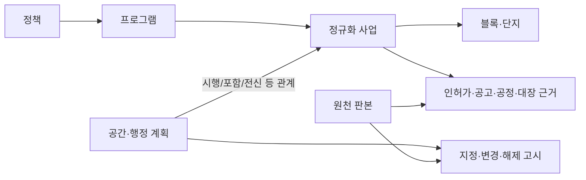

# HOME 수집·계획 원장 재설계 검토

기준: 2026-10-10. `refs/`의 조원 자료 7개를 **HOME 수집 방법의 비교 기준**으로 읽었다. 조원 JSON을 HOME DB에 합치거나 조원의 P-/SB- 식별자를 HOME 식별자로 채택하는 계획이 아니다. 조장님 지도 플랫폼으로 내보내는 일은 HOME 데이터의 식별·연결·품질 체계가 완성된 뒤의 후속 작업으로 둔다. 검토에는 첨부 자료, HOME 코드, 2026-10-07 HOME 공유 스냅샷만 사용했고 외부 원천을 재조회하지 않았다.

## 핵심 판단

HOME의 가장 큰 공백은 이미 받은 자료의 **원천 기록 → 실제 사업 → 계획/구역 → 정책 프로그램** 연결이다. 성북구 조원의 방법은 고시·변경·해제 이력을 하나의 안정적인 `P-` 계획 키로 묶고, 여러 인허가·대장 기록을 하나의 `SB-` 사업 키로 묶어 각각의 연결 근거와 검토 상태를 남긴다. HOME은 원천 객체별 판본과 정책→프로그램→사업 검토 연결은 보유하지만, 별도 **공간·행정 계획 원장**과 **원천 간 정규화 사업 원장**이 없다.

| 확인한 사실 | HOME에 주는 의미 |
|---|---|
| 조원 공유본은 계획 150행·고시 391행·계획–사업 연결 122행, 사업 2,957행(공공 확정 272·확인 필요 31·민간 2,654) | 사업 하나에 고시·허가·건물이 여러 건 붙는 구조를 참고한다. 이 수량을 HOME의 수집 목표나 누락 건수로 옮기지 않는다. |
| HOME의 성북구 주택인허가 기본개요는 4,542건으로 조원과 수량이 같고, 조원이 연결한 고유 주택인허가 관리번호 3,358개가 HOME 원천에 모두 있다 | 기본개요의 반복 수집보다 **사업 식별·결합**을 우선한다. 수량 일치가 원천 판본·전체 지역 범위의 동일성을 보장하지는 않는다. |
| 조원의 대장 연결 관리번호 136개가 HOME 성북구 주거용 표제부 26,336건에 모두 있다 | 대장도 수집 자체보다 허가·사업과의 연결, 사용승인 판정 등급이 부족하다. |
| HOME `current_projects.json`의 성북구 사업 후보는 3건이다 | 정책 문서 등에서 뽑은 후보와 지역의 공공·민간 사업 전체는 **서로 다른 모집단**이다. 303−3을 누락 사업으로 계산하지 않는다. |
| 조원 JSON은 제공 스키마와 외래키 검사를 통과하나 계획 코드 `P-2691`이 `지정`·`종료` 두 행으로 중복된다 | JSON Schema 통과만으로 안정 키와 단일 현재 상태를 보장할 수 없다. HOME에는 고유성·충돌 검사도 필요하다. |

위 교집합은 두 **다른 날짜의 저장본**으로 확인한 것이다. 조원의 구조와 규칙은 검토 사례로만 쓰고, 실제 HOME 값을 바꿀 때는 HOME이 수집한 원천과 고시 원문으로 독립 검증한다.

## HOME의 현재 구조와 정확한 한계

[`backend/db.py`](../backend/db.py)의 `home_revision`은 `kind + source_id + 원천 객체 키`로 논리 `entity_id`를 만들고, 새 판본을 저장한다. `home_batch`에는 수집 시도·건수·manifest가 남는다. 이는 유지할 장점이다. 하지만 `kind=project`는 **원천이 만든 사업 후보**일 뿐, 다른 기관 자료를 하나의 실제 사업으로 모은 공통 ID가 아니다. 현재 `home_mapping.project_id`도 그 원천 후보 ID를 가리킨다. [`backend/service.py`](../backend/service.py)는 후보를 적재할 때 자동으로 프로그램·정책 검토 연결을 만들지만, 동일 사업의 여러 허가·공고·대장을 먼저 하나로 합치는 층은 없다.

정책–프로그램과 프로그램–사업의 `REVIEW/CONFIRMED/RELEASED`, 수정 이력과 담당자 조정은 이미 있다. 이를 유지하면서 **사업의 정체성 결정**을 앞단에 추가해야 한다. 정책도 현재 별도 정규화 테이블 없이 원천 `kind=policy` 판본에 있다. 더구나 [`backend/program_hierarchy.py`](../backend/program_hierarchy.py)의 프로그램 ID는 `프로그램 이름 + 최초 정책 제안(seed_policy_id)`으로 생성되어, 하나의 프로그램 개념과 현재 상위 정책 연결이 분리되지 않는다. 같은 이름이 실제로 같은 프로그램인지도 자동 판단하면 안 된다. 현재 연도별 관리자 목표는 `kind=goal`의 JSON 배열로 사업 후보에 붙고, 공식 일정은 [`backend/roadmap.py`](../backend/roadmap.py)가 여러 payload에서 즉석에 구성한다. 계획 변경·해제 고시, 최초 시행 시점, 승인/착공/준공 근거를 동일 사업의 시간순 사건으로 조회하는 원장은 아직 없다. `policy_event`는 일부 정책 흐름 사건을 저장하지만 법정 구역계획 원장을 대체하지 않는다.

HOME의 과거 공유본은 정책 사업 후보 266건과 광범위한 인허가·대장 원천을 함께 담는다. “원천 행이 있다”, “공공주택 사업으로 식별했다”, “정책에 귀속시켰다”, “실제 공급 실적을 확인했다”는 각각 다른 상태다. 이 네 단계의 커버리지를 분리해야 수집량이 커도 지도 시계열이 빈 이유를 설명할 수 있다.

## `계획`의 뜻과 HOME의 키 구조

HOME에서는 다섯 단위를 분리한다.

| 단위 | 예 | 관리 기준 |
|---|---|---|
| 정책 | 9·7 공급대책 | 발표·개정·목표의 정책 문서와 적용 기간 |
| 프로그램 | 공공재개발, 도심 공공주택 복합사업 | 정책 목표를 실행하는 사업 유형/관리 묶음. 기존 두 단계 검토 관계 유지 |
| **계획/구역** | 장위8 정비구역 지정·변경·해제 | **특정 공간·법적 절차의 생애주기**. 최초 고시부터 후속 고시까지 안정적인 HOME 계획 ID로 묶음 |
| 사업 | 장위8 재개발 시행사업 | 실제 시행 단위. 변경 허가와 SH·LH·청약·대장 기록을 하나의 HOME 사업 ID로 연결 |
| 블록/단지·건물 | A4, S1, 개별 동 | 사업 하위의 공간·공급 세부 단위. 공식 블록/건물 근거가 있을 때만 확정 ID |

`계획`은 정책→프로그램→사업 사슬 사이에 기계적으로 끼워 넣는 중간 계층이 아니다. 정책 발표보다 오래된 정비구역도 있고, 하나의 계획에서 여러 사업이 나올 수 있으며, 한 사업이 폐지된 옛 계획과 신규 계획 모두에 **서로 다른 관계**를 가질 수 있다. 따라서 구조는 다음처럼 둔다.

화면은 선택한 정책 아래에 `프로그램 → 관련 계획/지구 → 사업/블록`을 트리로 보여줄 수 있다. 이는 **조회용 배열**이다. DB는 사업에 계획이 없거나 여러 계획/구역 이력이 있는 경우를 허용해야 하므로, 모든 사업의 상위 계획 ID를 필수 FK 하나로 강제하지 않는다. 공식 공간계획을 확인하지 못한 사업에는 가상의 계획 레코드를 만들지 않는다.

조원 자료의 **장위12**가 이 구분을 보여준다. `P-0511`은 2019년에 **해제된** 장위12 재개발 계획이고, `SB-2985`는 별도 도심 공공주택 복합사업 후보다. 조원도 두 객체의 연결을 `검토필요`로 둔다. 이름이 “장위12”로 같다고 폐지 계획을 현재 사업의 유효 계획으로 확정하거나 해당 사업 물량을 옛 계획의 달성량으로 더하면 오류다. 반면 장위8 `P-1349`↔`SB-2940`은 PNU·구역명·경계라는 복수 근거가 있다. HOME에서도 **관계 유형과 근거**가 코드 한 개보다 중요하다.

### 안정 키 원칙

- `home_revision.entity_id`는 계속 **원천 객체 ID**다. 이것을 계획 또는 정규화 사업의 최종 ID로 재사용하지 않는다.
- `home_plan.id`(`PLN_…`)와 `home_project.id`(`HPR_…`)는 HOME이 한 번 발급한 내부 안정 키로 둔다. 원천이 이름·대표 지번·코드를 바꿔도 ID는 유지한다. 다른 시스템의 `P-`, `SB-`, 향후 지도 플랫폼 ID는 별도 alias/crosswalk다.
- 계획의 공식 구역/고시 관리번호, 사업의 `mgmHsrgstPk`·`mgmPmsrgstPk`, 건물의 `mgmBldrgstPk`, PNU·정비구역명은 **키 후보·연결 근거**다. PNU는 합필/환지로 바뀌고 이름은 중복되며 고시번호는 개별 **사건**의 ID일 수 있으므로 단독 영구 PK로 삼지 않는다.
- 공식 계획 식별자가 있으면 기관+공식 ID를 고유 alias로 등록한다. 없으면 최초 지정 고시·관할·구역을 대조해 검토 후 HOME 계획 ID를 발급한다. 폐지 뒤 새로운 법적 지정이 생기면 법적 연속성이 확인되지 않는 한 **새 계획**으로 만들고 전신·후속 관계를 남긴다.
- 수집과 결합은 멱등이어야 한다. 이미 검토·거절·확정한 연결은 새 수집이 자동으로 덮지 않는다. 중복/충돌은 검토함에 남긴다.

### 최소 추가 원장

기존 `home_revision`/`home_batch`와 정책·프로그램 매핑을 보존하고 다음 **논리 테이블**을 단계적으로 추가한다. 실제 DB 컬럼·제약은 첫 구현 때 마이그레이션으로 확정한다.

| 원장 | 안정 키와 필수 내용 | 관계/제약 |
|---|---|---|
| `home_plan` | 계획 ID, 종류(정비구역/공공주택지구 등), 관할 코드, 현재 법적 상태, 최초 지정·종료일, 대표 명칭 | 현재 상태는 고시 사건에서 계산. 이름·대표 지번을 유일키로 삼지 않음 |
| `home_plan_event` | 사건 ID, 계획 ID, 지정/변경/해제/재지정, **고시일·효력일·수집일**, 고시번호, 원천 `entity_id`, 근거 URL | 같은 고시 재수집 중복 금지, 변경·폐지 이력 보존. 날짜 미확보를 추정일과 구분 |
| `home_identity_alias` | 객체 종류+HOME ID+기관/원천+외부 식별자+유효 기간 | 공식 구역코드, 허가 관리번호, 대장 PK, 원천 사업코드와 과거 이름의 대조표. 동일 외부 키가 두 현재 객체를 가리키면 충돌 |
| `home_project` | 사업 ID, 위치·유형·시행자, 현재 단계, 공공성 판정과 근거 | 한 실제 사업의 대표 상태. 원천 후보가 여러 건이어도 중복 사업/물량 생성 금지 |
| `home_project_evidence` | 사업 ID ↔ 원천 `entity_id`, 시드/변경/분할/공고/대장/참고 역할, 매칭 근거·규칙 버전·상태 | 1:N을 기본으로, 한 허가가 여러 블록을 포괄하는 예외는 범위·물량 배분 확인 전 합산 금지 |
| `home_plan_project_link` | 계획 ID ↔ 사업 ID, 시행/구역 포함/전신/참고 관계, 유효 기간, 근거, `REVIEW/CONFIRMED/REJECTED` | N:M. 해제된 계획의 `참고` 연결은 현재 진행 계획으로 집계하지 않음 |
| `home_milestone` | 사업/블록 ID, 단계, 예정/실제/추정 구분, 날짜 정밀도, 원천 근거·확인 상태 | 계획 승인·착공·모집·준공·입주를 각각 저장. 후보와 확인 실적 분리 |
| `home_supply_measure` | 대상 ID, 목표/공고/준공/입주/기존 재고 구분, 호수·단위·유형, 기간·공간 범위, 출처/기준일 | 공식 목표와 관리자 목표를 별도 출처로 보존. 서로 다른 지표·중복 판본 단순 합산 금지 |
| `home_coverage` | 원천×지역×기간×엔드포인트, 요청/성공/페이지 완결·원천행/사업 연결행/검토행, 미확보 사유 | 조회 성공 0건, 수집 실패, 아직 미조회, 지연 공개를 구분 |

정책·프로그램도 최종적으로는 `home_policy`(정책 정체성·발표/개정 이력), `home_program`(정책 제안과 독립적인 안정 ID), `home_policy_program_link`, `home_program_project_link`로 **객체와 검토 관계를 분리**하는 편이 맞다. 이름이 같은 두 묶음은 공식 프로그램 코드·범위·시행기간·원문으로 동일성을 확인하기 전까지 합치지 않는다. 기존 두 단계 관리자 화면과 `REVIEW/CONFIRMED/RELEASED` 규칙은 그대로 사용하고, 현재 `ProgramMapping/Mapping`은 이관 기간 동안 호환 조회로 유지한다.

위 원장은 조원 JSON의 표를 그대로 복제하자는 뜻이 아니다. HOME의 현재 `goal`·`mapping` 및 API가 참조하는 사업 후보 ID를 한 번에 바꾸면 기존 검토 이력이 깨질 수 있다. 먼저 `원천 후보 ID → HPR 사업 ID` 교차표를 만들고, 충돌 없는 사업부터 새 원장과 기존 화면을 병행 조회한다. 여러 기존 후보가 하나의 사업으로 합쳐질 때 정책·프로그램/관리자 목표가 서로 다르면 **자동 선택하지 않고** 담당자 검토를 만든다.

## 수집 과정에서 놓친 것과 보강 순서

| 우선 | HOME 현 상태 | 조원 사례에서 배운 보강 | 제한·주의 |
|---|---|---|---|
| 1 | 주택인허가 `getHpBasisOulnInfo` 원천 보유 | 같은 허가의 `getHpDongOulnInfo`로 공공/민간 구성, `getHpPlatPlcInfo`로 전체 필지·PNU를 연결. `getHpActOulnInfo`는 변경/행위 해석을 조사하되 공급 물량 우선순위는 낮게 둠 | 법정동별·전 페이지 조회; 0번지/동 이름만 있는 필지는 공간 매칭에서 제외 |
| 2 | 건축물대장 원천 보유, 사업 연결 원장 없음 | 건축법 `getApBasisOulnInfo`의 소규모 공동주택·매입임대 후보와 대장 허가/사용승인 근거를 사업 단위로 연결 | `hhldCnt=0`이면 `hoCnt` 확인; 기숙사 제외; 대장의 기존 재고를 새 공급으로 계산하지 않음 |
| 3 | 서울 정비구역 최초 지정·변경·폐지 원장 없음 | 문서상 `upisRebuild` 고시 이력과 정보몽땅 사업장 단계, OA-22856 분기 추진현황으로 `home_plan`·`home_plan_event` 구축 | 정보몽땅은 첨부 문서상 엑셀 수집이며 과거 API 종료. OA-22856은 진행 중 구역 중심이라 준공·소규모 전체를 대체하지 못함. 외부 재검증 필요 |
| 4 | SH 관리현황·SH 계획, 청약·LH 공고 수집 | 마이홈 공공임대 PNU와 SH 관리 단지로 공공성 교차 확인. 공고는 지번→계획 고시 지번→구역명→단지명 순으로 **기존 사업에** 붙임 | 공고 일반공급 호수≠총계획 호수. 재개발 의무임대와 준공공임대는 이름만으로 공공 확정 금지 |
| 5 | LH 일부 공정률·국토부 지역 통계 등 존재 | 사업별 고시/허가/착공/공고/준공/입주 사건을 연도별로 보이되 원천별 공개 시차를 표시 | 인허가 착공·준공 칸은 비어 있을 수 있음. 공개 시차 때문에 실적 미확보를 지연·0호로 단정하지 않음 |
| 6 | 서울·경기 전역이 목표 | 성북구에서 규칙 검증 후 서울 다른 구, 경기는 기존 GH·LH·경기도 자료의 **동등한 계획/정비 이력 원천**을 별도 선정 | 서울 전용 고시·정보몽땅·OA 자료를 경기 사업에 일반화하지 않음 |

원천 우선순위를 새 API 호출량으로 정하지 않는다. 성북구 기본개요와 대장 교집합 검증은 **있는 데이터를 잘 연결하는 일**이 먼저임을 보여준다. 동시에 주택인허가 동별/필지, 건축인허가, 정비구역 고시는 HOME에 없는 **관계 근거**이므로 수집해야 한다. 조원 문서가 관찰한 인허가·대장 5~6주, 추진현황 수개월 시차는 2026-10-08 기준 관찰값일 뿐이며, HOME에서는 배치마다 원천 기준일과 최종 사건일을 별도로 계산해 갱신한다.

## 서울·경기 전체로 확대할 수 있는 범위

여기서 “전체”는 PoC10 범위인 **서울·경기**를 뜻한다. **계획 키·고시 이력 모델은 지역 공통으로 설계 가능하지만, 성북구 수집기를 그대로 돌려 서울·경기 모든 공급 계획을 확보할 수 있다는 뜻은 아니다.** 첨부 자료에서 확인되는 범위는 다음과 같다.

| 범위/계획 종류 | 첨부 자료로 확인한 상태 | 판단 |
|---|---|---|
| 서울 정비구역 지정·변경·해제 | 조원은 `upisRebuild` 서울 전체 6,612건을 먼저 받았고 성북구 391건만 공유했다. 추진현황 파일도 서울 전체를 받아 구 필터를 적용한다고 설명한다 | **서울 전역 확장 가능성이 높음.** 다만 25개 구의 구역명·고시 연결과 중복/해제 판정은 따로 검증해야 함 |
| 서울 사업·허가 연결 | 현재 성북구 법정동 39개 × 5종; 서울 전체는 467개 동 × 5종. 정보몽땅·마이홈은 구별 조회, 성북구 코드가 조원 코드 16개 파일에 고정 | **구현·호출량 작업이 필요함.** 최소 2,335개 동×엔드포인트 조회 조합에 페이지가 추가되므로 체크포인트, 일일 한도, 구별 QA가 필요 |
| 서울의 정비구역 이외 공급 계획 | SH/LH 계획과 공급 자료는 HOME에 일부 있으나 `upisRebuild`·정보몽땅만으로 공공주택지구, 공공시설 부지, 매입임대 등 모든 계획을 나타낼 수 없음 | 계획 유형별 다른 공식 원천과 공식 식별자 조사 필요. 계획이 없는 사업은 사업 원장에만 둠 |
| 경기도의 계획·구역 이력 | 성북구의 서울시 고시·정보몽땅·OA 원천은 적용되지 않음. HOME에는 GH·LH 사업/공고와 일부 지구 위치 자료가 있지만 동등한 계획 지정·변경·해제 원장이 검증되지 않음 | **전체 수집 가능 여부 미확인.** LH·GH·경기도/시군별 고시·지구 자료의 범위와 안정 키를 별도 확인한 뒤 유형별로 구축 |

따라서 “서울·경기 계획 수집 완료”를 단일 값으로 표시하지 않는다. `지역 × 계획 유형 × 기간 × 원천`별로 **전체 조회·부분 조회·원천 없음·미조회·실패**를 기록한다. 서울 정비구역 수집률이 높아도 다른 공급 방식이나 경기도가 자동으로 채워졌다고 보지 않는다. 이 범위 판단은 첨부본 기준이며 외부 원천의 현재 제공 상태는 아직 재검증하지 않았다.

## 결합·시계열 계산 규칙

1. **원천 저장**: 기관 응답을 원천 객체별 판본으로 적재하고 기준일·사건일·효력일·수집일을 나눠 저장한다. 삭제나 정정도 판본·사건으로 남긴다.
2. **동일성 후보**: 공식 관리번호가 같으면 강한 근거, PNU·구역명 정규화·경계·기간·시행자를 조합하면 보조 근거다. 같은 이름/PNU 한 개만으로 자동 확정하지 않는다. 변경 허가는 최근 값으로, 분할 시행은 별도 하위 범위/호수로 보며 **중복 합계**를 막는다.
3. **확정과 검토**: 복수의 독립 근거가 있는 단일 후보를 자동 `REVIEW`로 제안한다. 모호한 후보, 폐지 구역, 후속 사업, 대장 사용승인 충돌은 담당자 검토로 보낸다. 기존 정책–프로그램–사업의 자동 제안도 `REVIEW` 통계에 포함하되 공식 확정과 분리한다.
4. **공급 수치**: 정책 목표·계획 총호수·인허가 세대수·모집 일반공급·준공 확인·입주 실적·기존 재고를 각각 저장한다. 현재 보급률의 분자는 같은 범위·단계의 **확인 실적**만 사용한다. 공정률은 호수로 환산하지 않는다.
5. **과거 흐름**: `home_plan_event`는 정책 발표 전 최초 지정 연도부터, `home_milestone`은 사업 생애 전체를 보여준다. 정책의 달성 그래프는 **정책 적용 기간의 귀속 실적**만 집계한다. 발표 이전 준공 물량을 후속 정책 성과로 소급하지 않는다. 미공개 연도·일정은 `미확보`/`일정 미정`으로 유지하고 균등 분배선은 명확한 추정 계열로만 표시한다.
6. **3D와 공간**: 계획의 경계, 사업 지구, 블록, 기존 건물 도형을 다른 객체로 둔다. 공식 경계/동 형상이 없으면 대표 좌표나 가상 형태를 실제 건물 형상처럼 저장하지 않는다.

## 실행 단계와 검증 기준

| 단계 | HOME에서 할 일 | 완료 판정 |
|---|---|---|
| A. 구조·키 확정 | 위 원장의 키·상태·사건 유형과 기존 `Revision/Mapping/goal` 호환 마이그레이션 설계 | 동일 원천 재수집 시 계획·사업 ID 불변; 기존 266 후보의 검토·수정 이력 보존 |
| B. 성북구 파일럿 | HOME 자체 원천으로 기본 허가–대장 교집합을 재현하고 동별·필지·건축법 허가·정비계획 원천을 순차 수집 | 39법정동의 페이지/건수와 날짜 커버리지, 고유키 충돌, `P-2691` 같은 상태 모순 사례를 **HOME 규칙**으로 검출 |
| C. 사업·계획 결합 | 안정 계획·사업 원장, 고시 사건, 허가/대장/공고 근거 연결, 담당자 수정·거절 보존 | 하나의 실사업을 중복 세지 않음; 장위8/장위12 같은 비교 사례에서 근거와 법적 상태에 맞는 `REVIEW` 판정 |
| D. 지표·화면 | 출처별 일정과 관리자 목표, 확인 실적, 결측/시차를 사업·구역·정책·지역 관점에서 제공 | 시계열의 과거 기점·단위·분모/분자가 명시되고, 출처·계획/실제·검토 상태를 확인 가능 |
| E. 범위 확대 | 서울 다른 구, 경기 대응 원천을 커버리지 표로 관리하며 확대 | 조회 실패/원천 미공개/미연계가 0호로 보이지 않음; 지역별 원천 완전성 비교 가능 |

조장님 플랫폼 형식으로 변환하는 작업은 **E 단계 이후 별도 어댑터**로 충분하다. 지금 필요한 결정은 HOME 내부에서 무엇을 같은 계획·사업으로 볼지, 어떤 근거로 확정할지다. 조장님 실제 입력 스키마가 첨부되지 않은 점은 당장의 수집·원장 설계를 막지 않는다.

검토 근거: [`refs/architecture.md`](../refs/architecture.md), [`refs/resource.md`](../refs/resource.md), [`refs/README.md`](../refs/README.md), [`refs/schema.json`](../refs/schema.json), [`refs/seongbuk_public_housing.json`](../refs/seongbuk_public_housing.json), [`refs/손창미_architecture.md`](../refs/손창미_architecture.md), [`refs/성북구 상황판 데이터 흐름.html`](../refs/성북구%20상황판%20데이터%20흐름.html), [`docs/DATA_SHARING_20261007.md`](DATA_SHARING_20261007.md).
