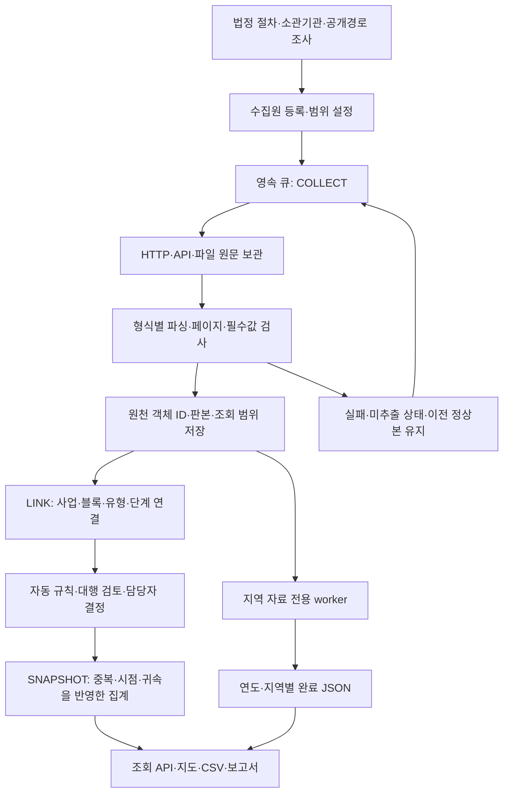

# the주택 데이터 파이프라인 학습서와 데이터 관리 거버넌스 개선안

작성일: **2026-10-23, 한국시간(Asia/Seoul)**\
대상: **PoC 10 · the주택(주택공급 디지털 상황판)**\
목적: 출처 선정, 설계와 구현의 차이, 유형별 수집·전처리, 실제 오류 처리, AI의 역할, 운영의 강점·한계, 기관 간 데이터 관리 개선을 하나의 문서로 공부하기 위한 기록 기반 설명서.

> **the주택의 핵심 성과는 서로 다른 기관의 공개자료를 사업 중심으로 연결하고, 숫자의 출처·시점·범위·변경 이력을 설명할 수 있게 만든 것이다.** 이를 위해 법정 공급 절차와 소관기관의 업무를 기준으로 수집처를 구조화하고, API·웹·문서를 개별 파서로 정형화한 뒤 동일 사업·블록·유형의 근거로 연결했다. 다만 기관 간 공통 식별자, 실계약·실입주 원장, 변경 통보 체계가 충분하지 않아 사후 매칭과 검토가 필요하다. 앞으로는 정책·프로그램·사업의 공통 ID를 원천 업무시스템에서 발급·관리하고, 고시·공고·표준 API에 함께 전달하는 방향으로 전환해야 한다.

## 읽는 순서

1. [먼저 알아야 할 결론과 증거 기준](#s1)
2. [데이터 출처를 선택한 방법](#s2)
3. [설계 목표 → 제약 → 구현 선택의 논리](#s3)
4. [전체 구조와 유형별 파이프라인](#s4)
5. [전처리·동일성·중복·모순 처리](#s5)
6. [실제 사례로 배우는 처리 과정](#s6)
7. [AI가 담당한 부분과 자동화의 경계](#s7)
8. [운영·장애·성능·재현성](#s8)
9. [탁월한 점, 현재 부족한 점, 개선 우선순위](#s9)
10. [근거 문서와 전체 등록 수집원 찾아보기](#s10)
11. [마지막 제언: 정책·프로그램·사업 ID와 표준 API 중심의 데이터 거버넌스](#s11)

<a id="s1"></a>
## 1. 먼저 알아야 할 결론과 증거 기준

### 1.1 네 가지 핵심 결론

**첫째, 수집처는 주택이 만들어지고 공급되는 업무 절차를 따라 선정했다.** 정책 발표만 보는 것으로는 허가·착공·모집·입주를 확인할 수 없으므로, 법정 절차와 책임기관을 기준으로 고시·인가·공고·기관 원장·통계를 나누고 공식 웹사이트와 API를 추적했다. 이 구조는 10월 16일 공급유형별 절차·책임·공고 설계 문서, 10월 17일 수집 관리표, 10월 19일 경로 감사, 실제 `sources.py`를 연결하면 확인된다. 다만 모든 출처가 최초 개발일부터 이 순서로 발견됐다는 검색 이력은 없으므로, 이는 **기록으로 확인되는 수집 설계·확장 방법**이다.

**둘째, 운영 파이프라인은 범용 AI 크롤러보다 기관별 규칙 파서와 증거 보존을 중심으로 구현됐다.** API는 JSON/XML, 웹은 HTML 표·상세 페이지, 파일은 CSV·PDF·DOCX·HWPX를 각각 처리한다. 수집 성공 뒤에도 사업 연결과 집계가 별도로 필요하다. 스캔 PDF 자동 OCR은 미구현이며, 이미지 표의 일부는 에이전트의 시각 검토와 별도 반영으로 보완했다.

**셋째, 가장 어려운 전처리는 글자를 읽는 것보다 ‘같은 사업의 어떤 물량인가’를 판별하는 것이다.** 전체 단지와 임대 부분, 최초와 추가 모집, 지구와 블록, 계획과 실적, 정책 누적과 당해연도 실적이 서로 다르다. 같은 이름을 합치거나 같은 호수를 더하는 것만으로는 해결되지 않는다.

**넷째, 다음 단계는 수집 기술 개선과 원천기관 거버넌스 개선을 함께 추진하는 것이다.** the주택 내부 ID는 이미 있다. 부족한 것은 여러 기관이 공유하는 불변 식별자, 정책 귀속·물량 범위를 명시한 관계, 변경·취소의 기계 판독 가능한 전달, 실제 책임자의 확인 체계다. AI가 사후에 추정·대조하는 비용을 줄이려면 원천 업무 단계에서 이 정보를 생산해야 한다.

### 1.2 무엇을 확인했으며, 어디까지 확인한 것인가

**이 문서는 저장소에 남은 설계·감사·조치 기록과 현행 코드를 대조한 학습서이며, 모든 외부 원천을 다시 수집한 전수 감사는 아니다.**

- `docs`, `refs`, `exports` 아래 기존 Markdown 200개를 목록화하고 관련 내용을 전역 검색했다. 설계서·마스터·후속 감사·최근 정정 보고서의 핵심 본문을 상세 대조했다. 복제본·템플릿·수정 전 보고서도 남아 있어 문서 수를 독립 조사 횟수로 세지 않았다.
- `backend`, `scripts`, `tests`에서 출처 등록, 수집기, 판본 저장, 작업 큐, 문서 파서, 블록 식별, 자동 연결, 집계·캐시, 관련 회귀 사례를 확인했다.
- 10월 22일 발표 근거 패키지의 수집 범위, 원천 현황, 배치 8,376건, 감사 유형 집계, 최근 감사 이벤트 표본 20,000건을 확인했다. 이 표본은 전체 감사 370,243개와 다르다.
- 최신 통계는 10월 23일 00:12:38 KST에 생성된 로컬 수집 통계 캐시를 별도로 확인했다. 실시간 DB 조회 결과와 혼동하지 않는다.
- 법정 절차 및 소관기관 중심의 설명은 10월 23일 국가법령정보센터·토지이음·정부/지자체 공식 검색 결과로 보완했다. 이번 웹 확인은 설명의 근거이며, 과거 개발자의 모든 검색어와 조사 순서를 복원한 것은 아니다.
- 원문 파일 약 18만 개를 전부 새로 열거나, 과거 대화 전체·개별 모델 호출 로그·모든 기관의 비공개 원장을 확인한 것은 아니다. 이번 작업에서 운영 DB·수집 설정·정책 매핑은 변경하지 않았다.

문장에는 다음 구분을 적용한다. **[구현]**은 현행 코드로 확인한 기능, **[기록]**은 특정 시점의 실행·조치 증거, **[해석]**은 설계와 구현을 연결한 분석, **[제안]**은 아직 도입한 것으로 주장하지 않는 개선안이다. 과거 기록의 테스트 통과 수는 그때의 실행 결과이지 이번 작성 중 전부 재실행한 결과가 아니다.

### 1.3 숫자를 읽을 때의 분모

**정책·프로그램·사업·원천 행·판본·호수는 각각 다른 관리 단위다.** 다음 표의 시점도 서로 다르므로 한 시점의 통합 통계로 합산하지 않는다.

| 기준 | 확인값 | 정확한 의미 |
|---|---:|---|
| 현행 레지스트리 코드, 10월 23일 읽기 | 등록 76개, 자동 순회 대상 68개, 수동 전용 8개 | 수집 경로·설정의 수. 기관 수나 성공률이 아님 |
| 10월 22일 08:43:26 KST 고정 증거 | 정책 3개, 전체 프로그램 43개, 9·7 프로그램 31개 | 당시 내부 등록·분류 단위 |
| 같은 고정 증거 | 전체 사업 원천 452건, 9·7 연결 원천 232건 | 원천별 사업 기록과 연결 기록 |
| 같은 고정 증거 | 9·7 관리사업 177개, 집계 기여 원천 ID 221개 | 중복·포함관계를 반영한 관리 묶음과 기여 원천 |
| 같은 고정 증거 | 현재 저장 기록 4,691,469건 | 원천·관계·관리 기록을 포함. 과거 판본 전체 수와도 다름 |
| 10월 23일 00:12:38 KST 수집 통계 캐시 | 자료 보유 출처 75개, 최신 행 4,685,165행 | 수집 통계에 포함한 출처·유형의 최신 원장 범위 |
| 같은 캐시 | 추출 셀 166,113,277개, 연결 원천 4,988건 | 행×컬럼 집계 및 해당 통계의 연결 정의. 주택·독립 사업 수가 아님 |
| 10월 22일 정책 관리 기준본 | 누적 착공 도달 82,968호, 연말 예상 99,885호 | 과거 착공·담당자 채택·추정을 포함한 정책 관리량. 정부의 올해 전체 착공 통계가 아님 |

추출 셀은 `Σ(원천·유형별 최신 행 수 × 해당 표의 최상위 컬럼 수)`다. 빈칸도 컬럼 계산에 포함되고 중첩 객체는 한 컬럼으로 취급한다. 이 수치를 “검증된 사실 1억 6천만 개”로 표현하지 않는다. 서로 다른 집계 범위 때문에 10월 22일 전체 현재 기록이 10월 23일 수집 통계 행보다 클 수 있으며, 그것만으로 데이터 삭제를 뜻하지 않는다.

근거: [발표 근거 패키지 기준본](analysis/THE_JUTAEK_PRESENTATION_EVIDENCE_20261022/00_manifest.md), [누적 산식 정비](analysis/THE_JUTAEK_CUMULATIVE_FORECAST_REVIEW_20261022.md), [통계 정의](SOURCE_SUMMARY.md), [현행 출처 코드](../backend/sources.py).

<a id="s2"></a>
## 2. 데이터 출처를 선택한 방법

### 2.1 설명에 사용할 수 있는 핵심 문장

> **the주택은 법률에 따른 주택 공급 절차와 각 단계의 소관기관·공고부서를 출발점으로, 실제 고시·공고·업무 원장이 어디에 공개되는지 웹 검색과 공식 사이트 확인을 통해 추적하여 데이터 수집처를 구조화했다.** 정책 목표는 정부 발표에서, 사업화·인허가는 고시와 행정 원장에서, 착공·공정은 시행기관 현황에서, 공급은 모집공고에서, 준공·입주는 해당 검사·계획·관리자료에서 확인하도록 경로를 나눴다. 이후 API·웹·파일의 실제 제공 범위를 시험하고, 확인된 경로부터 수집기에 등록했다.

**이 문장은 설계 방향과 기록된 확장 과정을 설명하는 데 적합하다.** 다만 “모든 법정 절차를 실시간 전수 수집한다”, “전국 모든 담당부서와 직접 연계했다”, “관리표의 모든 URL이 자동 수집 중이다”라는 뜻으로 확대하면 안 된다.

### 2.2 법정 절차를 수집 경로로 바꾼 구조

**법률은 어떤 행위가 중요한지를 알려주고, 개별 고시·공고는 그 행위의 생산기관·날짜·대상·원문을 알려준다.** 실제 권한은 사업 유형·규모·위임 관계에 따라 달라지므로 아래 부서는 기능상 분류다. 특정 기관의 현재 조직명 전수표가 아니다.

| 공급 경로·단계 | 확인하는 법정·업무 사건 | 소관 기능·자료 생산 주체 | 확인할 문서·접점 | the주택의 수집 경로 |
|---|---|---|---|---|
| 정책·프로그램 | 정책 발표, 과제 배정, 목표·기한 변경 | 국토부·관계부처·지자체 정책 부서 | 정책브리핑·보도자료·연간 업무계획 | `policy_907`, `policy_129`, `policy_813`, `policy_907_plan`, `lh_department_plans` |
| 공공주택 사업화 | 지구 지정·변경, 지구계획 승인 | 지정·승인권자, 공공택지·공공주택 담당 기능 | 국토부 고시·지자체 공보·토지이음 | `eum_housing_notices`, 개별 고시 파일럿 |
| 개별 주택 인허가 | 주택건설사업계획 승인·변경 | 주택사업 승인권자·주택 담당부서 | 승인 고시, 건축HUB 주택인허가 | `building_hub`, `building_hub_incheon`, 상세 원장 |
| 일반 건축 경로 | 건축허가·착공신고·사용승인 | 허가권자·건축 담당부서 | 일반 건축인허가, 건축물대장 | `building_general_permit`, `building_register`, `building_register_recap` |
| 재개발·재건축 | 정비구역 지정, 사업시행계획인가, 관리처분, 준공인가 | 지자체 정비·주거정비 기능, 사업시행자 | 시보·구보·정보몽땅·추진경과 | `seoul_cleanup`, 정비사업 CSV, 고시 문서 |
| 공사 실행 | 실제 착공·관측 공정률·준공 예정 | 시행기관·현장 관리조직 | LH 건설현황 DOCX·공사진행 상세 | `lh_construction`, `lh_history`, `lh_progress`, 인천 별도 경로 |
| 분양·임대 공급 | 입주자모집·정정·추가 모집 | 공급기관·입주자모집 관련 승인/통보 기관 | LH·SH·GH·iH·청약홈 공고 | `lh_notice`, `lh_notice_detail`, `cheongyak`, `gh_notice`, `ih_notice` 등 |
| 준공·입주 | 사용검사·사용승인, 입주예정·입주개시·실입주 | 검사권자·공급기관·관리주체 | 검사 문서·대장·입주계획·실입주 집계 | `gh_completion_evidence`, 대장·입주계획; 실입주 전수는 미확보 |
| 지역 비교 | 지역·기간별 공급·재고·수요 관련 통계 | 통계 작성기관 | 국토부·KOSIS·SGIS·한국부동산원 | 통계 수집군·지역 사전 계산 |

법률상 연결의 참고 근거는 주택법의 사업계획 승인·이행·사용검사 체계, 공공주택 특별법의 지구 지정 및 사업계획 승인 체계, 건축법의 착공신고·사용승인 체계, 도시정비법의 사업시행계획인가 등이다. 입주자모집은 주택공급에 관한 규칙의 승인·통보 체계와 개별 적용범위를 함께 확인한다. **모든 주택사업에 동일 절차가 적용되거나 모든 사건이 별도 공개 고시로 제공되는 것은 아니다.** [주택법 관련 법제처 해석](https://community.lawmaking.go.kr/nl4li/lsItptEmp/443945?mode=all&pageIndex=24), [공공주택 특별법](https://www.law.go.kr/법령/공공주택특별법), [건축법 착공신고 조문](https://www.law.go.kr/lsLinkCommonInfo.do?chrClsCd=010202&lsJoLnkSeq=1032217731), [도시정비법 사업시행계획인가 설명](https://easylaw.go.kr/CSP/CnpClsMain.laf?ccfNo=2&cciNo=3&cnpClsNo=2&csmSeq=1259&menuType=cnpcls&popMenu=ov), [입주자모집 승인·통보 조문](https://law.go.kr/LSW/lsLinkCommonInfo.do?chrClsCd=010202&lspttninfSeq=123618).

### 2.3 소관부서를 중심으로 추적한다는 것의 실제 의미

**정책 주무부서, 법정 승인권자, 사업 시행자, 공고 발행부서, 데이터를 보유한 기관을 따로 확인한다는 뜻이다.** 국토부 정책과 관련 있다고 해서 LH 모집공고의 발행부서가 국토부가 되는 것은 아니다. 지자체가 인가했다고 해서 지자체가 시공·입주관리 주체가 되는 것도 아니다.

이번 웹 확인의 구체적 예로, 토지이음의 **의왕고천 지구계획 변경(5차)** 페이지는 고시번호 `국토교통부 고시 제2024-331호`, 고시일 2024-06-25, 당시 담당기관 `공공택지관리과`, 열람기관인 의왕시와 LH 사업조직, 고시문과 도면 첨부를 함께 제공한다. 본문은 이전 고시와 변경의 법적 근거도 제시한다. 이런 문서는 “검색 결과의 제목”을 “행정행위·담당기관·이전 문서·첨부”로 구조화할 수 있는 출발점이다. 이는 **이번 설명용 재확인 사례**이며 해당 페이지가 당시 시스템 선정의 최초 계기였다고 단정하지 않는다. [토지이음 해당 고시](https://www.eum.go.kr/web/gs/gv/gvGosiDet.jsp?seq=590526).

실제 프로젝트의 구조화 흐름은 다음과 같다.

1. 공급방식별 필요한 사건을 나눈다. 건설형, 정비형, 신축매입, 기존주택 매입, 전세임대는 확인할 사건이 다르다.
2. 사건을 생산·승인·발표하는 기관과 부서 기능을 찾는다.
3. 공식 사이트의 고시·공고·업무계획·API 안내에서 실제 문서와 식별번호를 확인한다.
4. 자료별로 지역·기간·대상 주택·계획/실적·갱신주기를 적는다.
5. 원문 다운로드, 페이지 완결성, 필수 항목, 인증·호출 제한을 시험한다.
6. 검증된 경로를 `source_id`로 등록하고, 미연결 경로는 확보 과제로 남긴다.
7. 실제 사업 연결에 필요한 블록·허가번호·수량·날짜가 부족하면 다른 공식 경로를 보완한다.

### 2.4 설계 목록과 운영 수집원을 구분해야 하는 이유

**설계의 포괄성과 운영 수집의 완결성은 다르다.** 10월 19일 감사는 수집 관리표 두 개의 공통 후보가 1,174개, 원천 ID가 98개, URL 문자열이 87종임을 확인했다. 이는 받은 자료나 수집된 사업의 수가 아니다. 공공부문 관리표는 민간 전용 후보 11개를 제외한 1,163개를 대상으로 했다. 두 표의 중복 행을 두 번 세지 않았다.

기초지자체 67개 행도 당시에는 모두 실제 게시판 URL이 완성된 것은 아니었다. 이 설계 목록을 당시 운영 수집원 67개와 비교하여 LH 부서별 업무계획과 토지이음 정례 탐색 등을 보완했다. 이후 파일 경로 확장이 더해져 현행 등록 76개가 됐다. 따라서 `98−76=22개 미수집`처럼 계산할 수 없다. 원천 목록과 내부 수집기는 분할·통합 단위가 다르다.

근거: [수집 경로 감사](analysis/HOME_SOURCE_ROUTE_AUDIT_20261019.md), [실제 보완 결과](HOME_SOURCE_ROUTE_REMEDIATION_20261019.md), [공급유형별 절차·책임·공고 설계](analysis/주택파동_공급유형별_추진절차_책임공고체계_수집URL_API_참조_독립산출형_최종_20261016.md).

<a id="s3"></a>
## 3. 설계 목표 → 제약 → 구현 선택의 논리

### 3.1 전체 설계의 방향

**당초 지향점은 정책부터 사업의 단계·물량·위치까지 연결하는 통합 데이터셋이었고, 구현은 공개 원천으로 검증할 수 있는 범위를 점진적으로 확장하는 형태를 택했다.** 이후 설계는 실제 사건 기반 독립 실적 산출, 변경 추적, 고정 기준본을 통한 외부 발표 검증으로 구체화됐다.

초기 `PLAN.md`는 Master First, 정책 귀속의 담당자 확정, 정책과 프로그램의 분리, 변경 이력, 원천과 가공값의 분리, 출처 추적을 원칙으로 둔다. 10월 16일 신뢰성 플랫폼 계획은 정부 총계를 복사하는 것보다 사업·사건 원장을 통해 자체 산출하고 사후 발표와 대조하는 방향을 제시한다. 다만 이 설계서의 `source_event` 등 모든 논리 객체가 같은 이름의 물리 테이블로 구현된 것은 아니다. 현행은 `home_revision.kind/payload`와 관계 테이블·계산 모듈을 함께 사용한다.

### 3.2 왜 이렇게 구현했는가

| 설계 목표 | 실제 한계·발견 사항 | 선택한 구현 | 얻은 효과 | 남은 한계·해석의 경계 |
|---|---|---|---|---|
| 정책–프로그램–사업을 직접 연결 | 기관마다 번호가 다르고 정책 귀속 ID가 없는 자료가 많음 | 원천 자연키 기반 내부 ID, 지역·지구·블록·물량 대조, 승인 관계 | 기관 자료를 보존하며 연결 가능 | 기관이 보증한 공통 동일성은 아님. 사후 매칭 비용 발생 |
| 전 단계 실적 확보 | 모집공고는 있어도 실제 계약·입주 원장은 공개되지 않거나 미확보 | 공급·입주예정·사용승인·실입주를 분리 | 계획을 실제 입주로 잘못 세는 문제 방지 | 실입주·유효계약은 기관 협조 필요 |
| API 중심 자동 수집 | 필요한 사실이 API 밖의 PDF·DOCX·고시에 존재 | API+HTML+파일별 수집기 | 자료 형태와 무관하게 근거 보완 | 기관별 서식 변화에 유지보수 필요 |
| 전 지역 빠른 확보 | 법정동별 많은 페이지, 내부 상한, HTTP 429 | 분할 배치·완료 체크포인트·재방문·재시도 | 중단 뒤 이어받기와 정상본 보존 | 일일 예산 관리·과거 변경 완결성은 별도 |
| 최신 변화 포착 | 기관 공개 자체의 시차, 일부는 고정 게시글·파일 | 주기 재조회, 일부 목록 탐색, 해시 비교 | 확인한 범위의 변경 감지 | 원천이 공개하지 않은 사건을 실시간으로 알 수 없음 |
| 비정형 자료 전량 추출 | 스캔 PDF·도면·구형 HWP·복잡한 표 | 텍스트 추출 가능한 자료 우선, 원문 보관, 미처리 상태, 선별 검토 | 실패를 숨기지 않고 재처리 가능 | 통합 OCR·범용 문서 이해는 미구현 |
| 하나의 사업으로 중복 제거 | 한 계약에 여러 현장, 한 단지에 여러 유형·회차 | 원천은 유지, 관리 묶음·전체/부분 관계에서 중복 제거 | 원문 손실 없이 집계 보정 | 모든 실사업 ID가 전 조회 경로에 완전히 통일된 것은 아님 |
| 승인된 업무 기준 안정성 | 재수집 값과 기존 담당자 채택이 충돌 | 원천 판본과 override·연결 결정을 분리 | 자동 갱신이 확정 관리값을 덮어쓰지 않음 | 채택값의 증거 수준·최신성은 계속 검토해야 함 |
| 지도에 사업 표현 | 정확한 필지·사업경계 부재, 주소가 블록 | 확인 블록점·주소점·행정 대표점의 역할 표시 | 위치를 가진 범위부터 서비스 가능 | 대표점·3D 표식을 실제 설계도·건물 형상으로 해석하면 안 됨 |
| 빠른 화면 조회 | 수집·연결과 API가 CPU를 공유, 큰 응답·반복 계산 | 수집 worker 분리, 선택 범위 조회, 지역 사전 계산 | 수집 중 조회 지연 완화 | 큰 상세 응답과 콜드 조회 지연은 잔존 |
| 유연한 PoC 데이터 모델 | 원천 종류·필드가 빠르게 추가됨 | 공통 revision+JSON payload, 일부 관계·조회 인덱스 | 새 자료 수용과 판본 관리 | 스키마 버전만으로 JSON·계산 계약을 설명할 수 없음 |

마지막 행의 “유연성을 위한 선택”은 현행 구조와 변경 기록을 종합한 **설계 해석**이다. 모든 선택의 의사결정 회의록이 남아 있는 것으로 주장하지 않는다. 나머지 제약과 대응은 관련 감사·수정 보고서와 코드에 직접 근거가 있다.

### 3.3 설계가 구현과 함께 수정된 사례

**범위 확장 과정의 오류는 ‘원천의 한계’와 ‘우리 구현의 누락’을 나눠 설명해야 한다.** 초기 서울·경기 중심 필터 때문에 인천이 일부 수집기에서 빠졌고, LH 유형 05·06 중심 수집에서 신혼희망타운 39가 누락됐다. 이는 공개되지 않은 정보가 아니라 요청 조건·필터의 문제였으며 코드와 수집 범위를 수정했다.

반면 iH 재고 API의 HTTP 504, 원문에 없는 정확한 사건일, 스캔 PDF 자동 판독 부족은 각각 접속·원천내용·파서의 한계다. 모두 같은 이유로 설명할 수 없다. 초기 시험 수집은 수동으로 시작한 뒤 검증된 경로를 정례 수집으로 편입했다. 코드에 남은 `TEST_SAMPLE`이라는 이름만 보고 현재도 소수 샘플만 수집한다고 해석하면 안 되며, 실제 지역·기간·페이지 로직과 coverage를 확인해야 한다.

근거: [초기 구현 계획](PLAN.md), [신뢰성 플랫폼 설계](HOME_TRUSTED_REALTIME_PLATFORM_PLAN_20261016.md), [API 범위 감사](HOME_API_SCOPE_REVIEW_20261019.md), [스키마 이관 설명](analysis/THE_JUTAEK_SCHEMA_HANDOFF_20261022.md).

<a id="s4"></a>
## 4. 전체 구조와 유형별 파이프라인

### 4.1 공통 처리 흐름

**수집·전처리, 사업 연결, 집계·표시는 구분된 처리 단계다.** 원천이 정상 적재되어도 연결·집계가 실패하거나 유보될 수 있다.



표시되지 않는 뷰어에서는 `원천 조사 → 등록 → 수집 → 원문 보존 → 파싱·검증 → 판본 저장 → 사업 연결 → 채택·유보 → 집계 → 화면·반출` 순서로 읽으면 된다.

### 4.2 실행 자동화와 주기

**현재 자동화는 정해진 원천과 조건을 주기적으로 조회하는 방식이다. 모든 웹을 계속 검색하는 방식은 아니다.**

| 대상 | 코드상 정상 재실행 간격 | 의미·경계 |
|---|---|---|
| LH 모집공고 목록 `lh_notice` | 15분 | 작업 큐 `FAST` 우선 경로 |
| LH 상세·GH 공고 | 30분 | 상세 확보·후속 파싱. 모든 신규 자료의 즉시 반영 보장 아님 |
| iH 홈페이지 공고, SH 파생 목록, 서울 정비사업, GH 준공 근거 | 1시간 | SH 파생 목록의 빈번한 실행은 상위 공개 파일 자체가 새로워졌다는 뜻이 아님 |
| 일반 원천 | `refresh_days`, 기본 1일 | 원천별 7일 등 별도 설정 존재 |
| 건축계열 미조회 보충 | 성공 배치 후 15분 기준 | 잔여 동이 있는 동안의 backfill. 기관 제한·대기열 영향 |
| 토지이음 미완료 보충 | 1시간, 통상 1일 | 최신 목록+과거 이어받기+실패 첨부 재확인 |
| 스케줄러 | 60초마다 대상 확인 | 60초마다 모든 원천을 다시 받는다는 뜻이 아님 |
| 지역 내부 가공 | 5분 변경 점검, 변경 없어도 6시간 재생성 | 외부 수집 주기와 별개 |

`LATEST`와 `BACKFILL` 작업을 나누고, 원천별 활성 작업 중복을 막는다. `COLLECT → LINK → SNAPSHOT`은 단계별로 큐에 남는다. 작업 임대는 10분, heartbeat는 30초다. 만료된 작업은 같은 단계부터 재시도한다. 단계 실패는 최대 5회 시도 후 실패 이력으로 남고, 이후 스케줄러가 다시 판단한다. `BUSY` 경합은 실패 횟수를 소진하지 않도록 재대기한다. 이는 장애 복구 구현이며 실제 실행 시각·전수 최신성을 보장하는 SLA는 아니다.

근거: [작업 큐](../backend/collection_jobs.py), [수집 worker](../backend/collection_worker.py), [주기 설명 코드](../backend/source_operations.py).

### 4.3 데이터 유형별 처리 요약

| 유형 | 자동화·발견 | 파싱·검증 | 변경 처리 | 그림 처리·대표 어려움 |
|---|---|---|---|---|
| 정형 API | 지역×기간×엔드포인트×페이지 조회 | JSON/XML, PK·총건수·페이지 검사 | 같은 원천 키의 payload hash·판본, 완료 구간 재방문 | 직접 이미지 해석 없음. 429, 빈 HTTP 200, 지역코드 차이 |
| HTML 표·게시판 | 목록 순회→상세→첨부 | BeautifulSoup, 열·헤더·총건수·단지 탭 | 게시 ID·원문 해시·레코드 판본 | 이미지에만 있는 표는 HTML 텍스트로 해결 불가 |
| DOCX | 등록 공사 게시글 첨부 탐색 | ZIP 내부 `word/document.xml` 표 | 첨부 기준일, 현재·과거 관측 분리 | 주택/비주택 단위, 복수 현장 계약 구분 |
| 텍스트 PDF | 등록 문서 또는 최신 첨부 발견 | pypdf text/layout + 자료별 규칙·합계 검사 | PDF hash, 기준일, 페이지·사건 근거 | 열 배치·표 구조, 스캔은 OCR 대기 |
| HWPX | 첨부 다운로드 | ZIP/XML의 문단·표 | 제목·연도·첨부 키·hash | 병합 셀 의미·그림은 별도 검토 |
| 구형 HWP·이미지 | 다운로드·형식 확인·보존 | 공통 자동 본문 추출 미지원 | 파일 hash·보관 상태 | 수동/에이전트 시각 검토 또는 공식 대체 본문 |
| CSV·공개 Excel | 데이터셋 페이지에서 링크·파일명 기준일 재조회 또는 경로별 공개본 | 인코딩·컬럼·행키·단위·일정 | 파일 교체 감지·공개본별 보존 | 숨은 시트·구형 제목·현재 기준월 불일치 가능 |
| 통계 | 기관 표·기간별 수집, 일부 보관 원문 재처리 | 지역·기간·주택형·단위·합계 검사 | 소급 정정은 재조회한 범위에서만 감지 | 그래프 이미지보다 수치 표·공식 PDF 우선 |
| 공간정보 | 법정동 코드·VWorld·LH 지도 데이터 | 코드·도형·좌표계·범위 검사 | 경계/좌표 판본·관련 캐시 갱신 | 그림에서 필지 자동 복원하지 않음 |
| 외부 비교자료·AI 조사 | 별도 요청·검토 작업 | 공식 원문과 독립 대조 | 원본·검토결과·근거·채택이력 | 외부 결과를 그대로 확정 사실로 가져오지 않음 |

### 4.4 정형 API: 구조화된 응답도 업무 해석이 필요하다

**API는 읽기 쉬운 포맷을 제공할 뿐, 정책 실적을 바로 제공하는 것은 아니다.** 건축HUB의 허가 PK, 건축물대장 관리번호, 청약 공고번호는 각각 다른 객체의 번호다.

건축계열은 법정동별로 전체 페이지를 받고, 검증한 배치만 저장한 뒤 완료 범위를 이어간다. 일반 건축인허가는 큰 동이 1만 행을 넘자 내부 안전 상한을 10만 행으로 확대했고, 화곡동 13,571행·136페이지 수집을 검증했다. 상한은 기관의 호출 할당량과 다르다. 상한 초과를 조용히 잘라 정상 자료로 저장하는 것은 허용하지 않는다.

인천 코드는 원천마다 다르다. 일반 행정코드 계열은 28, SGIS 통계코드는 23, 청약홈은 400을 사용한다. 숫자를 하나로 통일해서 모든 API에 전달하면 누락이 생긴다. SH API는 메타데이터에 나타난 날짜별 공개본 경로를 확인하고 각 공개본을 따로 보존한다. 최근 작업이 성공했어도 공개본 기준일은 오래될 수 있다.

10월 22일 고정 coverage에는 일반 인허가가 **2,907/2,907, `COMPLETE_QUERY`**로 기록되어 있다. 동시에 `population_status=PARTIAL_SCOPE`다. 현존 법정동의 조회는 완료했지만 폐지 코드·원천 누락·모든 변경·정책 연결까지 완료했다는 뜻은 아니기 때문이다. 10월 20~21일의 724·729·1,099개 완료 기록을 현재 미완료 수치로 재사용하지 않는다.

근거: [API 전면 감사](HOME_API_SCOPE_REVIEW_20261019.md), [경로 보완](HOME_SOURCE_ROUTE_REMEDIATION_20261019.md), [최신 고정 coverage](analysis/THE_JUTAEK_PRESENTATION_EVIDENCE_20261022/00_data/coverage_latest.json).

### 4.5 HTML: 표의 열과 상세 페이지의 범위를 함께 읽는다

**LH 공급계획은 전체 페이지와 표의 의미를 검증해야 제대로 수집된다.** 기존 URL의 `sUppAisTpCd`를 유지하면서 `listCo=100`, `prevListCo=100`, `currPage`를 추가한다. 요청 매개변수 처리 때문에 분양·임대 구분이 사라지지 않도록 한다. 분양·임대의 서로 다른 열 순서, 필수 헤더, 기준연도, 전체 건수를 검사한다.

면적별 행에 총세대수가 반복되면 총량은 한 번만, 면적별 공급호수는 해당 범위로 처리한다. 페이지 이동 중 연도나 총건수가 바뀌면 일관된 한 판본으로 보기 어렵기 때문에 실패 대상으로 본다. 현재 해당 공급계획 수집기의 30페이지 상한은 모든 API의 공통 제한이 아니다.

공고 목록에는 입주예정·전체/금회 물량이 부족해 `lh_notice_detail`이 상세 페이지와 단지 탭을 읽는다. 한 문서가 A1·A3를 함께 담거나 분양·행복주택을 나누는 경우 문서 한 건을 사업 한 건으로 처리하지 않는다. 서울 정비사업도 목록과 추진경과를 나누며, 목록에 존재한다는 사실만으로 상세 사건일이 확보됐다고 보지 않는다.

근거: [공통 수집기](../backend/collectors.py), [LH 상세 파서](../backend/lh_notice_detail.py), [기존 마스터 5·8장](HOME_COLLECTION_PIPELINE_MASTER_20261016.md).

### 4.6 DOCX·HWPX: 압축 내부의 문서 구조를 읽는다

**DOCX·HWPX는 그림 파일이 아니라 XML 구조를 이용해 문단·표를 추출한다.** DOCX는 `word/document.xml`, HWPX는 `Contents/section*.xml`을 읽는다. 텍스트를 읽었다고 표의 업무 의미까지 자동 확정된 것은 아니다.

LH 건설현황은 첨부 제목의 기준일로 최신 DOCX를 선택하고, 건축 공종·주택 ‘호’ 단위·검증된 표 구조를 적용한다. 관할 지역본부 명칭을 사업 소재지로 쓰지 않고 사업지구를 대조한다. 공사 시작일이 원천 기준일 이후라면 이미 발생한 착공으로 취급하지 않으며 준공예정일도 실제 준공으로 바꾸지 않는다. 과거 DOCX는 `project_report`로 남겨 현재 사업과 과거 관측을 구별한다.

LH 부서별 업무계획은 등록 게시글의 2025년~현재 연도 첨부를 다시 확인한다. 첨부 순번이 재사용될 수 있어 제목·연도도 키에 포함한다. 추출된 문서에는 원문·표를 저장하되 검증 전 주택 호수나 실제 사건을 자동 생성하지 않는다. 원천 키를 ‘URL 하나’로만 삼지 않은 이유다.

HWPX 처리에는 파일 크기, 압축 해제 크기, section 수, 외부 XML 정의 제한이 있다. 해당 파서는 일반 HWP의 범용 변환기가 아니다.

근거: [문서 경로 수집기](../backend/route_documents.py), [초기 수집 규칙](SOURCE_REGISTRY.md).

### 4.7 PDF·그림·도면: 다운로드와 문자 추출을 나눈다

**PDF의 문자층은 자동 추출하지만, 이미지뿐인 표를 전량 자동 OCR하는 파이프라인은 없다.** pypdf는 저장된 문자를 읽는 도구이며 OCR 모델이 아니다. 월별 주택통계는 layout 추출 후 연월·시도·열을 규칙으로 읽고 수도권 합계를 검산한다.

토지이음은 첨부의 확장자뿐 아니라 파일 시작 바이트를 확인하여 오류 페이지를 PDF로 잘못 저장하는 문제를 구분한다. 예전 다운로드 경로에는 CP949로 인코딩한 쿼리가 필요하다. 고시 목록에서 요청 지역이 실제 선택됐는지, 상세 번호·날짜가 목록과 맞는지도 검사한다.

| 첨부 상태 | 실제 의미 | 처리 완료로 볼 수 있는 범위 |
|---|---|---|
| `TEXT_EXTRACTED` | 텍스트 추출 성공 | 문자 추출. 사업별 사건·물량 확정은 별개 |
| `IMAGE_ARCHIVED` | PNG·JPEG·GIF·TIFF 등 그림 원본 확보 | 파일 보존. 숫자·도형 판독 완료 아님 |
| `OCR_REQUIRED` | PDF 문자 추출 결과가 비어 있음 | 원본 확보, OCR/시각 검토 필요 |
| `LEGACY_HWP_ARCHIVED` | 구형 HWP 원본 보존 | 공통 자동 본문 추출 미완료 |
| `ARCHIVED_TEXT_PENDING` | 원본은 있으나 자원·형식 문제로 문자 처리 미완료 | 원문 재처리 가능 |
| `DOWNLOAD_FAILED` | 첨부 다운로드 실패 | 대체 공식 경로·재시도 필요 |

따라서 `attachment_complete=true`가 `text_extraction_complete=true`를 뜻하지 않는다. 스캔 PDF 안에 일부 문자만 있으면 `TEXT_EXTRACTED`일 수도 있으므로, 문자 추출 성공 표지도 모든 그림 표를 읽었다는 보증이 아니다.

복잡한 도면 PDF 하나가 작업자를 오래 점유하지 않도록 토지이음 PDF 추출은 별도 프로세스에서 메모리 256MiB, CPU 15초, 실행 timeout 20초, 300페이지·텍스트 크기 상한을 둔다. 이는 원문을 버리는 처리라기보다 원본은 보존하고 실패를 후속 처리 대상으로 남기는 선택이다.

**실제 그림 처리 사례:** 10월 20일 후속 조사에서는 공식 8월 PDF의 이미지 표에 담긴 45개 블록을 시각 검토하여 구조화했고 원문 해시를 고정했다. 수원당수 490호의 블록·후속 계획 대조에 사용했다. 이 작업은 에이전트의 담당자 대행 검토를 포함한 개별 보완이며, 운영 OCR이 무인으로 45개를 처리했다는 사례가 아니다. 연남동 8호는 PDF 텍스트와 79쪽 페이지 시각 확인을 함께 사용한 사례다.

근거: [문서 처리 상태 코드](../backend/route_documents.py), [PDF 설명](HOME_SOURCE_OPERATIONS_20261020.md), [이미지 표 검토 기록](analysis/HOME_COLLECTION_CONTINUATION_20261020.md), [사례 표현 한계](analysis/THE_JUTAEK_PRESENTATION_EVIDENCE_20261022/05_case_studies/없는_사례와_표현한계.md).

### 4.8 공개파일·통계·공간정보

**파일 수집은 링크·판본을 관리하고, 통계 수집은 분모·기간을 관리하며, 공간 수집은 위치의 의미를 관리한다.** 세 영역을 같은 ‘데이터 다운로드’로만 설명하면 중요한 오류를 놓친다.

공개 CSV 경로는 데이터셋 상세의 `contentUrl`과 파일명 기준일을 다시 읽어 교체 파일을 발견한다. 인코딩·필수 열·행키·호수·날짜를 검증한다. 같은 데이터셋의 새 파일 감지와 새로운 데이터셋 ID의 발견은 다르다. Excel 관리표는 수집 설계 입력으로 사용됐으며, 목록에 있는 자료가 모두 실수집됐다는 증거는 아니다. 공급계획 파일, 재고 파일, 공사계약 파일은 같은 기관 자료라도 역할이 다르다.

국토부·KOSIS·SGIS는 원천 통계표의 지역 수준, 항목, 연도·월, 주택형·단위를 유지한다. 인허가 월 API가 제공되지 않을 때는 e-나라지표의 공식 PDF를 대체 경로로 추가했다. 미분양은 총 미분양과 준공 후 미분양의 포함관계를 검사한다. 장래가구 33개 값은 수도권 3개 시도×11년의 전망이지 시군구별 실측치가 아니다. 과거 3개월 밖의 정정 등은 실제 재조회 범위 밖에 남을 수 있다.

공간정보는 법정동 코드·VWorld 경계·주소 좌표·LH 공개 지도 라벨점으로 나뉜다. LH 지도는 화면 그림을 OCR하는 대신 공개 페이지의 `HOUSEPLAN_LABEL_INFO` JSON에서 블록 라벨 좌표를 읽고 EPSG:5174를 4326으로 변환한다. 같은 블록의 서로 다른 좌표가 충돌하면 보류한다. 라벨점은 필지 경계나 건물 footprint가 아니다. 지번 PNU는 별도 근거로 구성하며, 지도 3D의 높이·배치는 공급량 표현용일 수 있다.

근거: [파일 수집](../backend/agency_plan_files.py), [통계 대체 경로 보완](HOME_COLLECTION_REMEDIATION_20261019.md), [블록 좌표 코드](../backend/lh_block_location.py), [지도 표현 계약](EXTRUDED_SUPPLY_MAP.md).

<a id="s5"></a>
## 5. 전처리·동일성·중복·모순 처리

### 5.1 전처리의 목적

**전처리는 값을 예쁘게 만드는 작업보다 원문의 의미를 잃지 않으면서 비교 가능한 형태로 바꾸는 작업이다.** 원문과 추출값을 보존하고, 정규화·연결·관리 채택을 구분한다.

| 순서 | 처리 | 예시·검사 |
|---|---|---|
| 1 | 수집 대상과 응답 검증 | 요청한 지역·유형인가, 정상 파일인가, 모든 페이지인가 |
| 2 | 원문 보존 | URL·수집 배치·SHA-256·바이트 수·파서 버전 |
| 3 | 문서 구조 파싱 | HTML 열, PDF 행, XML 표, JSON/XML 응답 |
| 4 | 기초 형식 정규화 | 쉼표 제거, 공백·문자 표기, 날짜·월·분기, 지역 코드 |
| 5 | 의미 정규화 | 계획/실제/추정, 총량/금회/유형별 부분량, 호/세대/실/건 |
| 6 | 원천 객체·판본 저장 | 같은 자연키는 같은 entity, 내용 변경이면 새 revision |
| 7 | 사업 동일성·포함관계 검토 | 시도·지구·블록·유형·수량·허가 PK·필지 |
| 8 | 정책·프로그램·단계 근거 연결 | 귀속 관계와 실제 사건·계획의 근거를 별도 저장 |
| 9 | 집계·표출 검증 | 동일 현장 중복, 기간, 현재/예상, 지도·카드·CSV 일치 |

### 5.2 원문 해시, 원천 ID, 사업 ID는 서로 다르다

**같은 파일인지, 같은 원천 객체인지, 같은 실제 사업인지는 서로 다른 질문이다.**

- **원문 SHA-256:** 내려받아 보관한 바이트의 동일성이다. 인증값이 응답에 포함된 경우 제거한 뒤 보관·해시하므로 그 사실을 manifest에 남긴다. 같은 응답 바이트는 같은 보관 파일을 재사용한다.
- **원천 `entity_id`:** 현행 `entity_id(kind, source_id, key)`는 종류의 앞부분과 `source_id:key` 해시를 이용한다. 같은 수집원·자연키를 재조회했을 때 원천 객체를 안정적으로 찾는다. 서로 다른 기관의 같은 사업을 자동 통합하는 공통 ID는 아니다.
- **판본 `id`, `revision_no`:** 같은 원천 객체의 어느 시점 내용인지 식별한다. `previous_id`, `recorded_at`, `superseded_at`, `payload_hash`를 보존한다.
- **정책·프로그램 ID와 관계:** 정책 귀속, 프로그램 배정, 승인·해제 상태를 관리한다. 이 ID들이 외부 공고·허가 API에 공통으로 들어 있는 것은 아니다.
- **사업 동일성 원장:** `home_project`, `home_identity_alias`, `home_project_evidence`가 있다. 다만 전 조회가 이 대표 ID 하나로 완전히 통일된 것은 아니며 원천 사업 ID와 관리 묶음이 병행된다.

코드상 payload를 키 정렬 JSON으로 직렬화하여 hash가 같으면 `unchanged`, 다르면 이전 판본의 종료시각을 기록하고 새 판본을 만든다. current 판본은 entity당 하나만 허용하는 유일 인덱스로 보호한다. 대량 원시 API 기록의 일괄 적재도 같은 판본 규칙을 유지하며, 행별 부수효과가 있는 사업 레코드는 구분한다.

근거: [DB 모델·판본 저장](../backend/db.py), [현행 조회·적재](../backend/service.py), [스키마 전달 계약](analysis/THE_JUTAEK_SCHEMA_HANDOFF_20261022.md).

### 5.3 결측·0·미조회·미공개를 나누는 이유

**빈칸을 0으로 바꾸면 공급 실적과 수집 품질을 동시에 왜곡한다.** `-`, 공란, 미정은 원천의 상태를 보존한다. API 실패는 0건이 아니고, 조회하지 않은 법정동은 데이터가 없는 지역이 아니다. 아직 착공 전인 조합설립 단계 사업의 착공일 공란은 정상적인 업무 상태일 수 있다.

| 상태 | 해석 | 후속 행동 |
|---|---|---|
| 정상 조회 결과 0건 | 해당 조건에서 반환 없음 | 조건·기간·원천 범위를 함께 표시 |
| 미조회 | 요청 자체가 아직 완료되지 않음 | backfill 또는 수집 범위 추가 |
| 다운로드 실패 | 원문을 못 받음 | 재시도·다른 공식 배포처 확인 |
| 원문 확보·미추출 | 파일은 있으나 항목을 못 읽음 | 파서/OCR/시각 검토 |
| 추출·미연결 | 데이터는 있으나 어느 사업인지 미확정 | 동일성·범위 검토 |
| 해당 단계 미도달 | 현재 절차상 사건이 아직 없음 | 미수집 오류와 분리 |
| 실제 값 0 | 원천이 해당 지표의 0을 명시 | 0으로 유지 |
| 검토한 공개본에서 미확보 | 조사한 범위에서 못 찾음 | 전체 세상에 비공개라고 단정하지 않음 |

특히 건축물대장의 `hoCnt`는 모든 경우에 주택 세대수와 같은 뜻이 아니다. 주거용 여부·세대수 필드·동별/총괄 범위를 확인해야 한다. 건물 행 수나 공고 수를 주택 호수로 바꾸지 않는다.

### 5.4 날짜는 사건·계획·관측·인지로 나눈다

**수집일이 최신이라고 그 자료의 사건도 최신인 것은 아니다.** 최소한 사건 발생일, 계획 시기, 원천 기준일, 공개일, 수집·기록 시각을 구분해야 한다.

월·분기·반기만 있는 자료는 그 정밀도를 유지한다. 저장 편의상 연도의 1월 1일을 사용하더라도 실제 사건일로 해석하지 않는다. “상반기 착공했다”는 기사나 특정 시점의 “공사 중” 상태는 단계 도달 근거가 될 수 있으나 정확한 착공일을 제공하지 않는다. 관측일까지 도달했다는 상한과 실제 사건일을 별도로 둔다.

과거 시점 조회에서는 그때까지 수집·기록된 판본을 이용한다. 나중에 알게 된 과거 사건을 당시 이미 알고 있었던 것처럼 소급해 표시하지 않도록 한다. 다만 모든 원천의 법적 효력 시각·기관 내부 보고 시각까지 완비된 것은 아니다.

### 5.5 중복은 네 층에서 관리한다

**파일 중복 제거만으로 주택 물량 중복은 해결되지 않는다.**

| 층 | 중복의 예 | 처리 |
|---|---|---|
| 보관 파일 | 동일 응답을 반복 다운로드 | SHA-256 파일 재사용 |
| 원천 판본 | 같은 자연키·내용 재조회 | 새 revision을 만들지 않음 |
| 문서·근거 | 같은 사업의 원공고·정정·추가 공고 | 각각 보존하고 회차·대상·판본을 구분 |
| 사업·집계 | 동일 현장의 분양·공사 원장이 둘 다 등장 | 대표 관리 묶음·전체/부분 관계에서 1회 기여 |

전체 1,323호와 국민임대 991호·영구임대 332호를 모두 더하면 2,646호가 된다. 올바른 처리는 `991+332=1,323`이라는 포함관계를 저장하는 것이다. 최초 모집 뒤 잔여 모집이 있다고 단지 총량이 늘어나는 것도 아니다.

같은 예정월이라고 문서를 합치면 고덕강일의 다른 주택형·차수 근거를 잃는다. 같은 이름이라고 사업을 합치면 연남동·연희동, 왕숙·왕숙2, 검단 AA13-1·AA13-2를 오병합할 수 있다. 따라서 **근거는 여러 개 남기고 집계 기여만 통제**하는 방식이 중요하다.

### 5.6 모순은 지우지 않고 종류를 판별한다

**숫자가 다를 때 먼저 범위·시점·정의가 다른지 확인하고, 설명되지 않는 차이는 상충 상태로 보존한다.**

1. 비교 단위를 맞춘다: 지구인가 블록인가, 전체인가 분양 일부인가.
2. 사건을 맞춘다: 계획, 계약, 착공, 모집, 준공 중 무엇인가.
3. 기간·기준일·판본을 맞춘다: 과거 원장과 최신 변경 고시인가.
4. 단위를 맞춘다: 주택 호수인가 오피스텔 실수인가, 신청 건수인가.
5. 변경 근거가 있으면 전후 관계를 저장한다.
6. 근거가 없으면 수치 차이만 기록하고 변경 원인을 만들어내지 않는다.
7. 기존 채택값은 유지하되 상충 원천과 재검토 사유를 노출한다. 관리상 확정은 객관적 무오류를 보장하는 표지가 아니다.

왕숙2 A6·A7의 1,063호와 1,082호는 공식 공모와 계약 공시 사이에 19호 차이가 있었다. 이를 “나중에 19호 증축됐다”라고 단정할 자료는 없었다. 반면 대장 A9의 568→574호는 변경승인 고시를 확보해 전후 관계를 설명했다. 두 사례를 같은 ‘판본 차이’라고 뭉뚱그리지 않는다.

### 5.7 정책 귀속과 통계 계산의 계약

**정책 관련성, 정량 귀속, 실제 사건 확인을 따로 결정해야 한다.** 후속 정책 문서에 관련된 사업이 등장하더라도 원래 목표에 포함된 기계획분인지, 순증인지, 다른 정책에서 옮겨온 것인지 확인해야 한다.

10월 22일에는 공식 후속 근거 63개와 정책 관계 3개를 보강했지만 9·7 착공 물량을 새로 더하지 않았다. 9·30 후보지 선정 11건과 복합지구 지정 5건은 행정 사건으로 남겼고 착공으로 전환하지 않았다. `aggregate_into_parent=false`, `quantity_attribution_status`, `reference_only` 등 관계·집계 조건을 함께 읽어야 한다.

정책 누적은 승인 연결된 과거 착공도 포함한다. 정부의 2026년 착공과 비교할 때만 해당 연도 조건을 별도로 적용한다. 최신 연말 예상 산식은 다음과 같다.

```text
연말 예상 = Σ 사업별 max(기준일까지 누적 도달량, 연말까지 채택된 계획 누계)
```

이미 도달한 물량을 계획에 다시 더하지 않으면서 실적만 있는 사업도 빠뜨리지 않기 위한 산식이다. 전체 실적 합계와 전체 계획 합계 중 큰 값만 고르는 방법과 다르다. 이 예상은 저장된 관리기록 기준이며 통계 모델이 예측한 실현 확률이 아니다. 자료가 없는 값은 0으로 확정하지 않는다.

근거: [후속 정책 관계 보강](analysis/THE_JUTAEK_COLLEAGUE_CANDIDATE_REVIEW_20261022.md), [누적·예상 산식 정비](analysis/THE_JUTAEK_CUMULATIVE_FORECAST_REVIEW_20261022.md).

<a id="s6"></a>
## 6. 실제 사례로 배우는 처리 과정

**아래 사례는 원인·조치·결과·남은 조건을 한 묶음으로 읽어야 한다.** 각 수량은 해당 기록의 기준일 값이며 현재 전체 집계에 서로 더할 수 없다.

### 사례 1. 과천주암 C2 — 1,030호와 344호는 전체와 부분이었다

**전체 허가를 임대 부분에 한정해 연결하는 것이 해결책이었다.** 건축HUB에는 2020-12-29 허가·전체 1,030호가, LH 임대계획에는 행복주택 344호가 있었다. 괄호의 ‘뉴스테이’와 수량 차이 때문에 단순 매칭이 어려웠다.

지역·지구·단일 블록을 정리하고 행복주택 `46㎡ 30호 + 55㎡ 314호 = 344호`를 대조했다. 전체 승인에 포함되는 임대 범위를 연결하면서 전체 원천 1,030호와 적용 344호를 모두 보존했다. 임대 사업에 허가 근거를 보완했지만 1,030호를 임대 실적으로 늘리지 않았다. **향후 표준 API에는 `project_id`뿐 아니라 `scope_id`, 전체–부분 관계가 필요하다는 사례다.** [마스터 사례 8.1](HOME_COLLECTION_PIPELINE_MASTER_20261016.md).

### 사례 2. 인천검단 AA19 — 유형별 합계를 검산했다

**국민임대 991호와 영구임대 332호는 전체 1,323호의 구성이다.** 같은 블록·공식 구성표를 확인한 경우에만 전체 건설·허가 근거를 유형별 적용 호수로 연결했다. 2027-11 입주예정은 계획으로 남겼다. 전체와 두 유형을 모두 합산하거나 공정률에 총호수를 곱해 실제 입주량을 만들지 않았다. [마스터 사례 8.3](HOME_COLLECTION_PIPELINE_MASTER_20261016.md).

### 사례 3. 검단 AA13-1·AA13-2 — 분할 블록을 지우던 파서를 수정했다

**하이픈 뒤 숫자는 장식이 아니라 서로 다른 블록의 식별 요소였다.** 10월 21일 초기 감사에서는 두 블록이 모두 AA13으로 축약되어 원공고·정정 공고 3건의 상세 추출이 실패했다. 재시도만으로 해결될 문제가 아니었다.

후속 코드와 후보대장은 AA13-1 702호, AA13-2 964호를 구분한다. `normalize_block('AA-013－02BL')`은 `AA13-2`가 되고, 단일 블록 공고를 부모 AA13이나 형제 AA13-2에 연결하지 않는 회귀 사례도 있다. 실제 원공고일은 2021-09-16, 입주예정은 2023-12로 확인됐다.

**최신 판정은 ‘파서 분리 보완, 정책 귀속·기존 복수현장 계약 중복 검토는 별도’다.** 오래된 실패 기록을 현재도 해결되지 않은 파서 오류라고 반복하지 않는다. 과거 공고를 2026년 신규 공급으로 바꾸지도 않는다. [초기 감사](analysis/HOME_ADDITIONAL_COLLECTION_AUDIT_20261021.md), [후속 후보대장](analysis/THE_JUTAEK_907_UNLINKED_CANDIDATES_20261021.md), [블록 회귀 사례](../tests/test_split_block_identity.py).

### 사례 4. 왕숙과 왕숙2·월암 A1/A3 — 문서와 사업은 일대일이 아니었다

**숫자 지구명과 단지 탭을 보존해 상세 범위를 분리했다.** 왕숙2 A3의 686호·2030-05는 왕숙 A3 428호와 다르다. 부분 문자열 매칭으로 같은 지구로 보면 누락·오연결이 생긴다.

월암 통합 공고도 A1 공공분양 446호·2027-11과 A3 공공분양 424호·2028-04를 나눴다. 행복주택 A1 228호·A3 218호에 분양 입주일을 일괄 적용하지 않았다. 추가 모집 111호·77호와 전체 674호·642호를 구별했다. 보관 원문 54개 판본을 재처리하고 동일 보정의 재실행에서 변경 0건을 확인한 기록이 있다. [마스터 사례 8.4~8.5](HOME_COLLECTION_PIPELINE_MASTER_20261016.md).

### 사례 5. 인천부평 — 원문은 유지하고 집계만 700→350호로 바로잡았다

**공급계획과 공사 원장의 같은 350호가 전체 지도에서 두 번 더해지는 문제였다.** 동일 현장 식별과 대표 집계 처리를 보완해 부평은 700→350호, 전체 지도는 350호 감소했다. 원천·기존 승인 기록은 그대로 보존했고 정책 비교 지표는 동일했다.

이 사례는 데이터 삭제보다 **중복 기여 차단**이 맞는 수정임을 보여준다. 공공 시행기관 미분류, 정책 대상 여부, 자료 공개 여부도 별도 속성이다. `availability=PUBLIC`을 공공주택으로 해석하면 또 다른 오분류가 된다. [부평 중복 수정 보고서](HOME_BUPYEONG_DEDUP_20261020.md).

### 사례 6. 연남동 8호 — 비슷한 이름의 다른 사업을 분리했다

**SH 공식 보고서 79쪽에서 별도 행을 확인해 연남동 8호를 독립 사업으로 재식별했다.** 인접 명칭인 연희 96호와 자동 통합하지 않고, 시행자·명칭·물량·원문 행을 대조했다. PDF 문자 추출과 페이지 시각 확인의 결합이며 스캔 PDF 자동 OCR 사례가 아니다.

후속 자료에 나오는 다른 연남동 관리 추정 167→공식 82호 보정과도 혼동하면 안 된다. ‘연남’이라는 문자열이 같다는 사실은 사업 동일성의 충분조건이 아니다. **공통 사업 ID가 제공되면 이름 유사성에 의존하는 조사 부담을 크게 줄일 수 있다.** [연남 8호 재식별](HOME_YEONNAM_8_IDENTITY_REVIEW_20261020.md), [후속 후보 검토](analysis/THE_JUTAEK_COLLEAGUE_CANDIDATE_REVIEW_20261022.md).

### 사례 7. 대장 A9 — 568→574호를 변경승인으로 설명했다

**API의 과거 승인값을 변경 고시로 보완했다.** 기존 허가 568호와 후속 공모 574호가 달랐고, 국토부 고시 제2026-364호의 변경승인 원문을 확보해 현재 관리 인허가 근거를 보강했다. 단순 수집일 차이가 아니라 원천 간 변경 반영 시차의 사례다.

이때 574호를 실제 착공으로 자동 생성하지 않았다. 승인 사건과 착공 사건은 다르다. **표준 API에 `revision`, `supersedes`, 변경승인 ID·효력일이 함께 있어야 하는 이유다.** [후속 수집·변경승인 기록](analysis/HOME_COLLECTION_CONTINUATION_20261020.md).

### 사례 8. 왕숙2 A6·A7 — 19호 상충은 해결되지 않은 차이로 남겼다

**공모 1,063호와 계약 공시 1,082호는 둘 다 보존했다.** 2025년 9월 계획과 2026년 4월 계약 공시는 A6 519·A7 563호, 2025년 10월 개별 공모는 510·553호였다. 비공식 상반기 착공 기사도 1,063호를 제시했다.

시간순으로 일관된 증감이 아니므로 증축·승인변경이라고 단정하지 않았다. 계약일 2026-04-21을 실제 착공일로 사용하지 않았다. 담당자 대행 채택분과 정부 발표 구성의 확정 여부도 나눴다. **공식 문서라는 사실만으로 서로 다른 업무 목적의 수치가 자동 정합성을 갖는 것은 아니다.** [3개 신도시 심층 대조](HOME_THREE_NEWTOWN_FINAL_COMPARISON_20261020.md).

### 사례 9. 신림2·흑석11 — 빈칸과 열의 의미 때문에 물량을 놓쳤다

**빈칸 때문에 전체 행을 버리거나 기존 세대를 공급 세대로 읽으면 잘못된 결과가 나온다.** 신림2는 분양 1,246호+임대 184호=1,430호의 부분 수치를 보존했고, 후속 공식 자료에서 실제 착공일 2026-05-06을 확보했다. 흑석11은 기존 세대와 공급 세대 1,515호를 분리하고 실제 착공일 2026-02-06을 대조했다.

흑석11의 서면 발표 약 1,500호와 발언 약 2,500호의 차이는 공식 출처 사이의 상충으로 남겼다. 하나의 숫자에 맞추려고 사업 원장을 바꾸지 않았다. [명시 착공사업 심층 대조](HOME_NAMED_START_DEEP_REVIEW_20261020.md).

### 사례 10. 인천·신혼희망타운 누락 — API 성공과 수집 범위는 달랐다

**빠진 지역·유형을 요청하지 않았던 문제였다.** LH 공고 유형 39와 인천을 보완한 당시 원장은 3,050→4,018건으로 증가했고 신규 968건 중 신혼희망타운 374건이 있었다. 어린이집 239건과 지역 배분이 불명확한 복수지역 2건은 원문을 보존하면서 주택 자동 배분에서 제외했다.

청약홈 인천 400 코드 추가 후 1,340건 중 인천 225건, LH 공정의 수도권 블록 93→110개, 정비사업 CSV 885→952행, LH 준공계획 181→204행 등의 별도 보완 기록도 있다. **이 숫자는 공고·블록·행의 수이며 더해서 공급 호수로 만들 수 없다.** [기존 마스터](HOME_COLLECTION_PIPELINE_MASTER_20261016.md), [경로 보완](HOME_SOURCE_ROUTE_REMEDIATION_20261019.md).

### 사례 11. PNU — 이미 받은 원문을 재처리해 누락 필드를 복원했다

**재수집보다 원문 재처리가 효과적인 경우가 있었다.** 허가 관리번호와 원문 해시를 따라 53건의 필드를 복원했고 해당 점검에서 9건은 PNU 구성 가능 원천이었다.

PNU는 법정동 10자리+일반/산 구분+본번 4자리+부번 4자리로 구성한다. 블록 주소나 본번 0000을 가짜 지번으로 만들지 않는다. 이후 연결 허가 대상 법정동의 상세 조회를 확대했지만, 조회 완료가 유효 지번 제공을 뜻하지는 않는다. **원문 보관이 있어야 새로운 파서로 과거 누락을 복구할 수 있다.** [마스터 사례 8.10](HOME_COLLECTION_PIPELINE_MASTER_20261016.md), [필지 식별 코드](../backend/parcel_identity.py).

### 사례 12. 인허가 월 통계 — API 미제공을 자료 미공표로 오해하지 않았다

**월 인허가 API의 공백을 공식 PDF 경로로 보완했다.** e-나라지표의 최신 주택통계 PDF를 찾아 시도별 당월·누계 6행을 추출하고 기존 비교에 반영했다. 10월 19일 같은 기간·지역·지표의 12개 비교 항목은 일치했다.

이는 통계 대조의 성과다. 개별 사업의 모든 착공을 확보했다는 검증은 아니다. 당시 수도권 1~8월 공식 착공 86,739호와 정책 관리량을 직접 빼서 확정 누락량을 산출할 수 없다. [수집 누락 정비](HOME_COLLECTION_REMEDIATION_20261019.md).

### 사례 13. 연말 예상과 CSV — 수집 이후의 집계 오류도 수정했다

**사업별 현재 도달량이 계획에 빠져 연말 예상이 현재보다 작아지는 문제가 있었다.** 10월 22일 사업화 현재 153,402호보다 기존 연말 151,044호가 작았고, 화면 CSV도 별도 기간 원장 76개를 사용해 정책 누적 177개와 달랐다.

사업별 `max(현재, 연말 계획)` 산식과 같은 관리 묶음을 적용하여 착공 예상은 94,498→99,885호, 공급 예상은 71,331→73,114호로 정비했다. 원천 사건과 원래 계획을 수치 맞추기로 변경하지 않았다. 371개 범위×6단계=2,226개 집계를 검산했고, 과거 착공 101개가 CSV에도 포함되는지 확인했다. **ETL이 성공해도 최종 산식·다운로드까지 검증해야 한다.** [누적 집계 정비](analysis/THE_JUTAEK_CUMULATIVE_FORECAST_REVIEW_20261022.md).

<a id="s7"></a>
## 7. AI가 담당한 부분과 자동화의 경계

### 7.1 AI의 기여를 설명하는 정확한 문장

> **AI 에이전트는 공개 원천 조사, 자료·코드 분석, 수집기와 정제 규칙 구현·보완, 문서 간 동일 사업 대조, 이미지 표의 선별 시각 검토, 오류 원인 추적, 사용자 위임 범위의 연결 검토와 증빙 정리를 수행했다. 운영 중 반복 수집·파싱·판본 저장·규칙 매칭·집계는 구현된 소프트웨어가 실행한다. 모든 문서를 생성형 모델이 매번 판독하거나 정부기관 담당자의 결재를 대신 받은 것은 아니다.**

**AI가 작업을 수행한 과정과 운영 제품 안에 AI 모델이 탑재된 기능을 구분해야 한다.** 현재 PoC10의 백엔드·스크립트·의존성에서 일반 수집 흐름에 연결된 OpenAI/Anthropic/OpenRouter SDK 또는 생성형 추론 API 호출은 확인되지 않았다. 이는 조사한 코드 범위의 결론이며 과거 모든 작업 세션이나 다른 PoC까지 AI 호출이 없었다는 뜻은 아니다.

### 7.2 역할별 기여와 증거

| 업무 | AI·에이전트가 담당한 것으로 확인되는 범위 | 운영 코드의 역할 | 남는 사람·기관의 역할 |
|---|---|---|---|
| 수집처 조사 | 법정 절차·기관·웹 경로 분석, 외부 조사자료 재검증, 누락 경로 발견 | 등록 URL·조건 반복 수집 | 공식 제공 범위·이용권한·소관 확정 |
| 구현·수정 | 수집·파싱·매칭·집계 보완 작업 및 검증 기록. 모든 코드 한 줄의 작성자를 입증하는 것은 아님 | 검증된 규칙을 동일하게 반복 실행 | 업무 정의·허용 범위·운영 책임 결정 |
| 비정형 자료 해석 | PDF 문맥·표·단지 범위 비교, 이미지 표 45개 블록의 선별 검토 | pypdf·BeautifulSoup·XML·CSV 파서 | 법적 효력·수량 상충의 원천기관 확인 |
| 동일성·귀속 판단 | 지구·블록·면적·호수·정책 후속 근거 대조, 사용자 위임 대행 검토 | 후보 생성·연결 저장·중복 통제 | 최종 업무 채택과 공표 책임 |
| 오류 분석 | API 누락, 중복, 날짜·범위 차이, 성능 지연 원인 분해 | 실패 격리·재시도·판본·캐시 | 개선 우선순위·기관 협의 |
| 보고·검증 | 근거 CSV·JSON·MD·비교표·테스트·전후 검산 정리 | 기준본·보고서·다운로드 제공 | 대외 발표 승인과 정확한 표현 선택 |

### 7.3 기록으로 확인되는 AI 대행 사례

**외부 AI 조사 결과는 정답으로 가져오지 않고 조사 단서로 사용했다.** 10월 19일 문서는 사용자가 제공한 Gemini·Claude·GPT 조사 결과를 공식 자료와 교차검증한 작업이라고 명시한다. AI 답변의 8개 블록 5,181호를 그대로 넣지 않고 개별 LH 공모의 5,162호를 대조·채택했다. 19호 차이는 왕숙2 A6·A7에서 발생했고 실제 착공과 관리계획을 분리했다. [AI 조사자료 교차검증](analysis/HOME_POLICY_READMISSION_AI_REVIEW_20261019.md).

**일부 운영 반영은 사용자 위임에 따른 Codex 담당자 대행이었다.** `admit_cumulative_q4_20261020.py`에는 `Codex 담당자 대행`이, `review_external_unlinked_20261020.py`에는 사용자 외부 분석자료 재검증 요청에 따른 대행 검토가 명시된다. 해당 기록은 정부기관 담당자의 별도 회신·인적 결재 증명과 다르다. [누적 반영 스크립트](../scripts/admit_cumulative_q4_20261020.py), [외부 미연결 검토 스크립트](../scripts/review_external_unlinked_20261020.py).

**그림 표의 선별 해석은 AI 보조 검토 사례로 설명할 수 있다.** 8월 공식 PDF의 45개 블록 검토, 수원당수 C5/B4의 면적·용적률·물량 대조는 반복 자동 수집과 분리된 대행 검토였다. 사용한 모델명·버전·프롬프트·비전 호출량은 이 기록만으로 전부 복원되지 않는다. 따라서 “특정 모델 OCR 정확도 100%” 같은 성능 주장은 할 수 없다.

### 7.4 ‘담당자 확인’이라는 표기의 한계

**확인 상태만으로 실제 인간 검토자와 AI·규칙 자동연결을 구분할 수 없는 기록이 있다.** `collection_jobs.py`의 `LINK` 단계는 자동 연결에도 담당자 이름 형식의 actor와 `담당자 확인(자동연결)` 사유를 전달한다. 발표용 이벤트 추출도 검토자 역할을 실제 인적 결재 여부 미확인으로 구분한다.

이것은 승인된 관리값을 임의로 폐기하라는 의미가 아니다. 관리 채택의 효력은 유지하면서 **누가, 어떤 권한으로, 어떤 방식으로 확인했는지**를 더 정확히 관리해야 한다는 뜻이다. 현재 `CONFIRMED` 또는 actor 문자열만 보고 행정기관 책임자의 직접 승인이라고 발표하지 않는다.

앞으로는 `actor_type=HUMAN/AI_AGENT/RULE_ENGINE`, 실제 인증 사용자, 위임자·위임 범위, 모델·규칙 버전, 입력 원문 판본, 결정 사유, 별도의 인간 승인 상태를 저장하는 것이 필요하다. 자동 규칙의 결과와 AI의 제안을 구분하면 오류 원인과 책임도 더 명확해진다.

### 7.5 AI가 하지 않은 것으로 구분할 부분

**확인되지 않은 AI 기능을 제품 성과로 추가하지 않는다.** 스캔 PDF 통합 OCR·비전 전량 처리, 모든 고시의 법적 효력 자동 확정, 실제 입주량 추정의 공식 실적 대체, 기관 승인 없이 정책 귀속을 정부 공인값으로 확정, 전체 정부 착공 원장 재현은 현재 증거로 입증되지 않는다.

AI의 실질적 가치는 **모호한 원문·코드·사업 관계를 조사하고 검증 가능한 규칙과 증빙으로 전환한 것**에 있다. 한 번 AI가 조사해 작성한 파서를 이후 매일 실행한다고 해서 매일 같은 AI 추론이 다시 일어나는 것은 아니다.

근거: [구현·표현 한계](analysis/THE_JUTAEK_PRESENTATION_EVIDENCE_20261022/12_technical/implementation_and_limits.md), [발표 기준본](analysis/THE_JUTAEK_PRESENTATION_EVIDENCE_20261022/00_manifest.md), [작업 큐](../backend/collection_jobs.py), [이벤트 추출의 역할 구분](../scripts/extract_presentation_evidence_20261022.py).

<a id="s8"></a>
## 8. 운영·장애·성능·재현성

### 8.1 장애를 처리하는 기본 원칙

**실패는 기록하고 마지막 정상본을 유지하며, 실패를 0건이나 완료로 바꾸지 않는다.** HTTP·빈 응답·파서·범위·연결·집계 장애를 구별해야 한다. 원천 다운로드 도중 얻은 원문은 남을 수 있지만, 검증되지 않은 배치의 일부 레코드를 정상 완료본으로 채택하지 않는다.

공통 요청기는 기본 35초 timeout, 제한된 재시도, 허용 호스트 검사, 인증 요청의 HTTPS 및 redirect 제약을 적용한다. HTTP 429·503은 `Retry-After`를 존중한다. API가 HTTP 200과 빈 body를 반환할 때도 정상 0건으로 처리하지 않는다. 민감한 인증 query와 응답에 반사된 키는 제거하고 `credentials_removed`를 기록한다.

원천에서 사업이 사라졌다고 취소·준공으로 자동 판단하지 않는다. 마지막 레코드를 보존하고 최신 원천 미발견을 경고한다. 명시적 취소 고시는 별도 행정 사건이며, 제목의 취소 표시만으로 어느 사업의 어떤 물량을 철회할지까지 자동 확정된 것은 아니다.

### 8.2 HTTP 429의 실제 발생과 회복

**일반 건축인허가는 실제 호출 제한으로 정체됐고 자동 재개한 기록이 있다.** 10월 20일 해당 API의 실패 배치 97개 중 68개가 HTTP 429였다. 10월 21일 진단 호출은 정상, 작업은 `COLLECT → LINK → SNAPSHOT`까지 성공했으며 완료 법정동이 724→729개, 원천 기록이 706,917→716,247건으로 늘었다.

다만 당시 429 응답의 세부 코드·잔여량을 보관하지 않아 모두 일일 한도 때문이었다고 소급 확정할 수는 없었다. 날짜 변경 후 정상 예산이 확인돼 일일 소진 가능성이 높다고 판단했을 뿐이다. 예제 환경값의 호출 간격 0.35초가 실제 운영에 적용됐다고 주장하지도 않았다. 당시 점검에서는 간격 설정 미지정으로 코드 기본값 0초였다.

후속 10월 22일 coverage에서는 **2,907개 동 조회 완료**를 확인한다. 따라서 이 사례의 현재 교훈은 “미조회 2,178개가 계속 남아 있다”가 아니라, **제한·복구·최초 조회 완료를 시점별로 추적하고 완료 뒤 재방문·변경 품질을 관리해야 한다**는 것이다. 잔여량·리셋 시각을 활용한 호출 예산 관리가 전부 도입됐다는 증거는 없다.

근거: [API 제한 감사](analysis/HOME_API_LIMIT_AUDIT_20261021.md), [최신 coverage](analysis/THE_JUTAEK_PRESENTATION_EVIDENCE_20261022/00_data/coverage_latest.json).

### 8.3 수집 성공률도 무엇을 센 것인지 밝혀야 한다

**10월 22일 패키지의 96.024%는 실행 상태 비율이다.** 수집 실행 8,376건 중 성공 8,043, 실패 289, 중단 44건이었다. 반복 수집·재시도가 포함돼 고유 문서 파싱률이나 정책 전체 수집률로 바꿀 수 없다.

같은 패키지는 감사 370,243개의 유형별 수와 최근 이벤트 표본 20,000개를 제공한다. 원문마다 다운로드→추출→정규화→연결→승인을 같은 document ID로 잇는 전수 처리율은 미측정이라고 명시한다. 따라서 “모든 문서가 단계별로 완벽히 추적된다”보다 “배치·판본·감사·연결 근거를 결합해 재현 가능한 부분이 있다”가 정확하다. [파이프라인 실행 근거](analysis/THE_JUTAEK_PRESENTATION_EVIDENCE_20261022/03_pipeline/pipeline_overview.md).

### 8.4 성능 문제를 운영 구조로 해결한 과정

**수집과 조회의 경쟁, 필요 이상의 계산·전송을 줄인 것이 주요 개선이었다.** 10월 20일에는 화면 하나를 열어도 정책·프로그램·지역·사업 전체 비교표를 만들어 응답이 약 22.77MB였고 수집 `LINK` 계산이 같은 Python 프로세스의 CPU를 점유했다.

선택 범위별 API, 반복 계산 재사용, 불필요한 지도 요청 제거, 경계 지문 캐시, 별도 `poc10-home-worker`, 위치별 외부 조회 잠금으로 보완했다. 정책 응답은 약 6.74MB로 줄었다. 이는 데이터 삭제가 아니라 화면에 불필요한 비교 행렬을 보내지 않은 결과다.

10월 22일에는 문서 2,065건·약 46.25MB를 반복 복사하던 수집연계 계산을 필요한 메타데이터 중심으로 바꾸고, 무관한 감사·성적표 변경이 캐시를 폐기하지 않도록 했다. 실제 원천·단계·담당자 변경은 갱신 조건으로 유지했다. 수집연계 232개 사업의 결과 해시가 동일함을 비교했다.

지역 여건은 별도 worker가 69개 지역 범위×2018~2026년의 저장본을 만들도록 했다. 갱신 중 원천이 바뀌거나 실패하면 마지막 완료본을 유지하고, 파일을 원자적으로 교체한다. API 재시작 후에도 디스크 완료본을 읽는다. 내부 갱신일을 통계 기준일로 바꾸지 않는다.

**남는 한계도 있다.** 10월 22일 측정에서 정책·사업 첫 화면은 약 6~8초가 남았고 상세 수집연계 응답은 비압축 약 21.08MB였다. 지역 여건의 0.566초 첫 표시나 캐시 API의 수 ms는 특정 조건의 관측값이지 모든 페이지의 항상 1초 이내 보장이 아니다.

근거: [수집·조회 분리](HOME_LOADING_DEEP_REPAIR_20261020.md), [10월 22일 로딩 점검](analysis/THE_JUTAEK_LOADING_REVIEW_20261022.md), [지역 사전 계산](analysis/THE_JUTAEK_AREA_SNAPSHOTS_20261022.md).

### 8.5 백업·이관·재현의 관리 단위

**DB, 외부 원문 파일, 코드·파서 버전, 관리 결정, 계산 기준본을 함께 봐야 결과를 재현할 수 있다.** DB 덤프 복원에 성공해도 외부 raw 파일까지 함께 복구한 것은 아닐 수 있다.

10월 22일 이관 기록은 PostgreSQL 16·PostGIS, Alembic `0017_candidate_lookup`, 이전 덤프와 동일한 물리 DDL을 설명한다. 그러나 JSON 필드·공급유형 분류·정책관계·예상 산식이 달라질 수 있어 DB 스키마 버전만 맞추는 것으로 충분하지 않다. 최신 앱 코드와 계산 계약도 맞춰야 한다.

복원 직후 자동 수집을 멈춘 상태에서 고정 건수·해시·관리사업·지표를 검증하고, 별도 작업자가 표시용 자료를 다시 생성하도록 하는 절차가 필요하다. 현재 내부 평가에서도 DB와 외부 원문을 함께 복구하는 종합 실증은 별도 미완료 항목으로 남아 있다. [이관 계약](analysis/THE_JUTAEK_SCHEMA_HANDOFF_20261022.md), [운영 문서](OPERATIONS.md), [최신 내부 평가](analysis/THE_JUTAEK_INTEGRITY_R02_20261022.md).

<a id="s9"></a>
## 9. 탁월한 점, 현재 부족한 점, 개선 우선순위

### 9.1 탁월한 점

**the주택은 ‘자료가 많다’보다 ‘숫자 차이를 설명하고 재현할 수 있다’는 점에서 강점이 있다.** 다음 평가는 경쟁 제품을 시험해 우위를 입증한 벤치마크가 아니라 구현과 조치 기록에서 확인되는 상대적 설계 강점이다.

| 강점 | 구체적인 근거 | 업무 가치 |
|---|---|---|
| 업무 절차에 따른 다기관 연결 | 정책·공모·허가·공정·모집·준공·통계를 역할별 분리 | 한 기관 자료에 없는 단계 보완 |
| 원문·판본·변경 이유 보존 | URL·hash·parser version·이전 revision·감사 before/after | 원천 수정·오파싱을 다시 확인 가능 |
| 전체·부분 물량 해석 | 주암 1,030/344, 검단 1,323=991+332 | 그럴듯한 중복 합계 방지 |
| 입력 중복과 집계 중복의 분리 | 부평 원문 유지, 700→350 집계 정비 | 증거 손실 없이 수치 수정 |
| 미확보·유보·상충의 표현 | iH 실패, 왕숙2 19호, 실제 입주 미측정 | 빈칸·차이를 숨기지 않고 후속 과제로 연결 |
| 원문 재처리·반복 안정성 | PNU 복원, 공고 부분 범위 재처리, 변경 0 재실행 검사 | 기관 재호출 비용 감소·정비 재현 |
| 사용자 관리 결정 보호 | revision 검사·override·감사·해제 상태 보존 | 재수집 중 업무 기준 안정성 |
| 수집에서 화면·CSV까지 검증 | 2,226개 누적/예상 대조, 177개 동일 범위 | 같은 질문에 화면마다 다른 답을 줄이는 통제 |
| 오류를 구현 개선으로 환류 | 인천 필터·AA13 분할·429·worker 분리 | 수집량뿐 아니라 운영 품질 개선 |

### 9.2 현재 부족한 점과 정확한 상태

**부족한 부분은 원천 미제공, 미수집, 미추출, 미연결, 정의 불일치, 운영 통제 부족으로 나눠야 한다.** 일부 과거 미완료는 이미 보완됐다.

| 분야 | 최신 확인 상태 | 필요한 개선 |
|---|---|---|
| 정책 전체 사업 모집단 | 공식 발표 32행 대응은 확보했으나 전체 135만호의 사업 명부와 분모는 미확정 | 기관별 정책 대상·사업·블록 명부 제공 |
| 공통 ID | 내부 ID·별칭 원장은 있으나 기관 간 공통 ID와 전 조회 통일은 미완결 | 공통 식별자·기관 키 대응표·대표 ID 전환 |
| 일반 인허가 조회 | 10월 22일 2,907/2,907 완료 | 더 이상 과거 잔여 동 수를 현황으로 쓰지 않음. 재방문·폐지 코드·원천 지연·사건 연결 검증 |
| 검단 분할 블록 | AA13-1/2 분리 추출 보완 | 복수현장 계약 포함관계·정책 귀속·기간 검토는 별도 |
| 고시 상세·첨부 | 10월 22일 고정 coverage 1,134 대상 중 1,013, `PARTIAL` | 목록·상세·파일·문자·사건 추출 각각의 완료도 관리 |
| 이미지·구형 HWP | 보관·대기 상태 존재, 통합 OCR 미구현 | 중요 표 선별, OCR/문서 이해 보조와 검수·근거 위치 저장 |
| iH 재고·계약·공가 API | 마지막 성공 자료 미확보, HTTP 504/timeout 기록 | 실제 접근·명세·권한 검증 및 기관 협의 |
| 실계약·실입주 | 전량 집계 미확보 | 기관·관리주체의 비식별 집계 연계 |
| 호출 예산 | 재시도·Retry-After는 구현, 과거 상세 한도 진단 부족 | 잔여·리셋·세부 코드 관측, 한도 기반 유예·재개 |
| 변경·취소 의미 | 바이트·payload 변화는 추적, 법적 변경 계보는 경로별 | 원사건·정정·취소 ID, 효력기간, 단위별 증감 전달 |
| 공식 전체 실적 재현 | 5개 착공 공급유형 전체 명세와 분양·임대 총계 전량 대사 미완료 | 공식 기간·기관·유형·공고 명부와 동일 분모 확보 |
| 추정·채택의 설명 | 누적 도달량에 추정·후속 단계 추론 포함 | 실측·상태확인·추정·관리채택을 독립 필드로 노출 |
| 확인 주체 | 자동연결과 대행 검토가 담당자 표기에 혼재 가능 | 인간·AI·규칙 엔진 및 권한·승인 상태 분리 |
| 처리 관측 | 배치·판본·감사는 있으나 문서별 전수 end-to-end 처리율 미측정 | 공통 document/event ID와 단계별 trace |
| 복구·성능 | DB 복원 증거·성능 개선 있음 | 원문 포함 종합 복구, 큰 응답 분리, 콜드 지연 측정 |

공식 32행·31개 비교단위에서 원수량이 같은 것은 26/31이며, 185개 비교 항목에 판정이 있다는 것이 185개 전부 일치한다는 의미는 아니다. 내부 63.2/100점 및 공식 비교 12.95/20점은 서로 다른 가중 평가이고 정확도·정부 인증 점수가 아니다. [최신 성적표](analysis/THE_JUTAEK_INTEGRITY_R02_20261022.md).

### 9.3 개선의 우선순위

**가장 먼저 할 일은 공통 식별과 수치 정의를 안정화하고, 그 다음 미추출·원천 공백을 줄이는 것이다.**

1. **즉시 운영 정비:** 오래된 미완료 수치와 최신 완료 증거를 구분한 상태표, 원천별 데이터 나이·재방문, 실패·OCR 대기·미연결의 별도 큐, API 호출 예산 관측.
2. **동일성·집계 정비:** 대표 사업 ID와 기관 원천 키 대응표, 분할 블록·전체/부분·복수계약 관계, 모든 화면·CSV의 동일한 관리 묶음 적용.
3. **추출 품질 정비:** 고시의 중요 수량 표와 변경표 우선 처리, 원문 페이지/표/행 위치 저장, 자동 추출 신뢰도와 검토 결과 분리.
4. **실적 정의·기관 연계:** 착공의 실제 사건 정의, 모집과 계약·실입주 구분, 정책 모집단·최초/변경 계획·기관 배정 원장의 제공 협의.
5. **거버넌스 정착:** ID 발급·승계·취소 책임, 표준 API·변경 피드, 인간/AI 결정 감사, 공식 공표 기준본과 정정 체계.

이 목록은 개선 제안이며 이번 문서 작성으로 해당 기능이 배포된 것은 아니다.

<a id="s10"></a>
## 10. 근거 문서와 전체 등록 수집원 찾아보기

**학습 순서는 설계 문서 → 현행 수집 코드 → 실제 조치 기록 → 최신 고정 기준본 순서가 좋다.** 기록의 날짜가 다르면 최신 정정 여부를 먼저 확인한다. 아래 상대 링크는 저장소의 이 Markdown 위치를 기준으로 한다. 다운로드 파일만 단독으로 열면 내부 자료 링크는 연결되지 않을 수 있으며, 문서 본문의 설명과 공개 웹 링크는 그대로 읽을 수 있다.

### 10.1 구현을 읽는 길잡이

| 궁금한 것 | 확인 위치·읽는 방법 |
|---|---|
| 무엇을 수집하는가 | `backend/sources.py`: SOURCES와 파일 끝의 설정 덮어쓰기까지 읽는다. |
| 언제 실행하는가 | `backend/collection_jobs.py`: 빠른 순회, 수집→연결→스냅숏, 백필, lease·재시도·쿨다운을 확인한다. |
| 어떤 bytes를 보존하는가 | `backend/collectors.py`: Fetcher, 안전 URL, 원문 해시, source별 수집 분기를 확인한다. |
| 문서와 그림을 어떻게 처리하는가 | `backend/route_documents.py`: 다운로드·본문 추출·이미지 보관·추출 대기의 상태를 구분한다. |
| 동일 블록을 어떻게 판정하는가 | `backend/block_identity.py`, `tests/test_split_block_identity.py`: AA13-1과 AA13-2가 보존되는지 확인한다. |
| AI 검토가 어떻게 반영됐는가 | `scripts/admit_cumulative_q4_20261020.py`, `scripts/review_external_unlinked_20261020.py`, `scripts/evaluate_integrity_matching.py`: actor·근거·판정·독립 검수 여부를 구분한다. |
| 최신 정책 수치를 어디서 확인하는가 | `docs/analysis/THE_JUTAEK_PRESENTATION_EVIDENCE_20261022/00_manifest.md`와 누적 산식 정비 기록을 함께 본다. |

### 10.2 전체 등록 수집원 76개

**아래는 10월 23일 확인한 등록 코드의 공개 접점 목록이다.** 자동 68개는 스케줄 대상이라는 뜻이며, 키·접근권한·실패·수집 범위와 무관한 성공 보증이 아니다. URL은 대표 공개 접점이며, 실제 요청 endpoint·첨부 URL·파생 원장은 수집기에서 추가 결정된다. 기본 주기는 `refresh_days` 미설정 시 1일이며 빠른 순회 설정을 우선 표기했다. 수동 경로의 갱신은 수동·별도 실행에 따른다.

| # | 출처 ID · 이름 | 기관(등록값) | 수집 방식(등록값) | 실행·주기 | 공개 접점 |
|---:|---|---|---|---|---|
| 1 | `lh_policy_followup`<br>LH 9·7 후속 민간참여 공모 · 블록별 착공계획 | 한국토지주택공사 | `PUBLIC_DOCUMENT` | 자동 1일 | [원천](https://www.lh.or.kr/board.es?act=view&bid=0034&list_no=727339&mid=a10601020000) |
| 2 | `lh_happy_plan_file`<br>LH 행복주택 공급계획 공개파일 | 한국토지주택공사 | `AGENCY_PLAN_FILE` | 자동 1일 | [원천](https://www.data.go.kr/data/15043330/fileData.do) |
| 3 | `sh_national_plan_file`<br>SH 국민임대주택 공급계획 | 서울주택도시개발공사 | `AGENCY_PLAN_FILE` | 자동 1일 | [원천](https://www.data.go.kr/data/15045310/fileData.do) |
| 4 | `sh_jeonse_plan_file`<br>SH 장기전세주택 공급계획 | 서울주택도시개발공사 | `AGENCY_PLAN_FILE` | 자동 1일 | [원천](https://www.data.go.kr/data/15045311/fileData.do) |
| 5 | `sh_happy_plan_file`<br>SH 행복주택·리츠 공급계획 | 서울주택도시개발공사 | `AGENCY_PLAN_FILE` | 자동 1일 | [원천](https://www.data.go.kr/data/15066029/fileData.do) |
| 6 | `reb_movein_plan_file`<br>한국부동산원 입주예정물량 | 한국부동산원 | `AGENCY_PLAN_FILE` | 자동 1일 | [원천](https://www.data.go.kr/data/15111714/fileData.do) |
| 7 | `sh_contract_file`<br>SH 공사계약 공개파일 | 서울주택도시개발공사 | `AGENCY_PLAN_FILE` | 자동 1일 | [원천](https://www.data.go.kr/data/3045249/fileData.do) |
| 8 | `lh_department_plans`<br>LH 부서별 연간 업무계획 · 원문·표 | 한국토지주택공사 | `PUBLIC_DOCUMENT` | 자동 1일 | [원천](https://www.lh.or.kr/board.es?act=view&bid=0007&list_no=654637&mid=a10103050000&nPage=1) |
| 9 | `eum_housing_notices`<br>수도권 주택·정비·택지 고시 목록·변경 이력 | 국토교통부 토지이음·고시기관 | `PUBLIC_DOCUMENT` | 자동 1일 · 백필 60분 | [원천](https://www.eum.go.kr/web/gs/gv/gvGosiList.jsp) |
| 10 | `molit_monthly_release`<br>국토부 월별 주택통계 공식 PDF · 인허가 보완 | 국토교통부 / e-나라지표 | `MONTHLY_RELEASE` | 자동 1일 | [원천](https://www.index.go.kr/unity/potal/main/EachDtlPageDetail.do?idx_cd=1229) |
| 11 | `building_general_permit`<br>건축HUB 일반 건축인허가 | 국토교통부 | `GENERAL_BUILDING_PERMIT` | 자동 1일 · 백필 15분 | [원천](https://www.data.go.kr/data/15136267/openapi.do) |
| 12 | `ih_housing_inventory`<br>iH 공개 임대단지 명부·상세 | 인천도시공사 | `PUBLIC_DOCUMENT` | 자동 1일 | [원천](https://www.ih.co.kr/main/lease/leaseAptList.do) |
| 13 | `reb_apartment_price`<br>한국부동산원 수도권 아파트 매매가격지수 | 한국부동산원 R-ONE | `MARKET_INDICATORS` | 자동 1일 | [원천](https://www.reb.or.kr/r-one/portal/stat/easyStatPage/A_2024_00045.do) |
| 14 | `kosis_age`<br>KOSIS 수도권 시군구 연령별 주민등록인구 | 국가데이터처 KOSIS | `AREA_AGE` | 자동 7일 | [원천](https://kosis.kr/statHtml/statHtml.do?orgId=101&tblId=DT_1B04005N) |
| 15 | `unsold_statistics`<br>수도권 미분양·준공 후 미분양 월별 재고 | 국토교통 통계누리 | `UNSOLD_REFERENCE` | 자동 1일 | [원천](https://stat.molit.go.kr/portal/api/info.do) |
| 16 | `project_locations`<br>사업 대표 주소·지역 근사 좌표 | VWorld·공식 행정구역 | `PROJECT_LOCATION` | 자동 7일 | [원천](https://www.vworld.kr/v4po_openapi_s001.do) |
| 17 | `seoul_cleanup`<br>서울 정비사업 정보몽땅·추진경과 | 서울특별시 | `PUBLIC_DOCUMENT` | 자동 60분 | [원천](https://cleanup.seoul.go.kr/cleanup/bsnssttus/lscrMainIndx.do) |
| 18 | `national_statistics`<br>전국 주택 공급단계 통계 · 보관 원본 확대 추출 | 국토교통부 | `RAW_REPLAY` | 수동 | [원천](https://stat.molit.go.kr/portal/api/info.do) |
| 19 | `ih_notice`<br>iH 공식 주택 사업·분양·임대 모집공고 | 인천도시공사 | `PUBLIC_DOCUMENT` | 자동 60분 | [원천](https://www.ih.co.kr/main/business/house.jsp) |
| 20 | `ih_supply`<br>iH 임대 재고·계약·공가 API · 접근 미확인 | 인천도시공사 | `IH_STOCK` | 수동 | [원천](https://www.data.go.kr/data/15168460/openapi.do) |
| 21 | `incheon_legal_dongs`<br>9·7 인천 전체 법정동 코드 | 행정안전부 | `PUBLIC_FILE` | 수동 | [원천](https://www.code.go.kr/stdcode/regCodeL.do) |
| 22 | `building_hub_incheon`<br>9·7 인천 주택인허가 원천 | 국토교통부 | `INCREMENTAL_INCHEON` | 자동 1일 · 백필 15분 | [원천](https://www.data.go.kr/data/15136560/openapi.do) |
| 23 | `building_register_recap`<br>건축HUB 주거용 총괄표제부 · 사용승인·합필 참조 | 국토교통부 | `REGISTER_RECAP` | 자동 1일 · 백필 15분 | [원천](https://www.data.go.kr/data/15134735/openapi.do) |
| 24 | `policy_907_plan`<br>9·7 전체 연도·유형별 착공 목표 원문 | 국토교통부 / KDI 원문 | `POLICY_DELIVERY` | 자동 7일 | [원천](https://eiec.kdi.re.kr/policy/materialView.do?num=270716) |
| 25 | `policy_907_incheon_geometry`<br>9·7 인천 시군구 경계 | 국토교통부 VWorld | `POLICY_DELIVERY` | 자동 7일 | [원천](https://www.vworld.kr/v4po_openapi_s001.do) |
| 26 | `incheon_statistics`<br>인천 주택 인허가·착공·준공·분양승인 통계 | 국토교통 통계누리 | `POLICY_DELIVERY` | 자동 7일 | [원천](https://stat.molit.go.kr/portal/api/info.do) |
| 27 | `lh_incheon_sale`<br>LH 인천 분양 공급계획 | LH청약플러스 | `POLICY_DELIVERY` | 자동 1일 | [원천](https://apply.lh.or.kr/lhapply/apply/noti/sp/list.do?sUppAisTpCd=05) |
| 28 | `lh_incheon_rent`<br>LH 인천 임대 공급계획 | LH청약플러스 | `POLICY_DELIVERY` | 자동 1일 | [원천](https://apply.lh.or.kr/lhapply/apply/noti/sp/list.do?sUppAisTpCd=06) |
| 29 | `lh_incheon_construction`<br>LH 인천 실제 착공·공정 현황 | 한국토지주택공사 | `POLICY_DELIVERY` | 자동 1일 | [원천](https://www.lh.or.kr/board.es?mid=a10607030000&bid=0007&act=view&list_no=654682) |
| 30 | `molit_demolition`<br>국토부 연도별 주택멸실현황 · 서울·경기 | 국토교통부 / e-나라지표 | `PUBLIC_FILE` | 자동 1일 | [원천](https://www.index.go.kr/unity/potal/main/EachDtlPageDetail.do?idx_cd=2839) |
| 31 | `seoul_plan_notice_pilot`<br>서울 공덕1 정비구역 변경 고시 원문 | 서울특별시 | `LEGAL_PLAN_PILOT` | 수동 | [원천](https://event.seoul.go.kr/seoulsibo/detailview.do?cn_seq=MTc1Mjc%3D&tr_code=snews) |
| 32 | `gyeonggi_plan_notice_pilot`<br>경기 고양창릉 지구지정 변경 고시 원문 | 국토교통부 | `LEGAL_PLAN_PILOT` | 수동 | [원천](https://www.molit.go.kr/USR/I0204/m_45/dtl.jsp?idx=18272) |
| 33 | `building_hub_details`<br>건축HUB 동별·대지위치 파일럿 | 국토교통부 | `PILOT_DETAIL` | 자동 1일 · 백필 15분 | [원천](https://www.data.go.kr/data/15136560/openapi.do) |
| 34 | `molit_renewal_inventory`<br>국토부 전국 정비사업 통합 현황 · 수도권 후보 | 국토교통부 | `PUBLIC_FILE` | 자동 1일 | [원천](https://www.data.go.kr/data/15160169/fileData.do) |
| 35 | `lh_completion_plan`<br>LH 공공주택 블록별 준공예정 | 한국토지주택공사 | `PUBLIC_FILE` | 자동 1일 | [원천](https://www.data.go.kr/data/15141761/fileData.do) |
| 36 | `kosis_housing`<br>KOSIS 서울·경기 일반가구·다가구 반영 주택 재고 | 국가데이터처 / 국토교통부 | `AREA_SERIES` | 자동 1일 | [원천](https://kosis.kr/openapi/devGuide/devGuide_0201List.do) |
| 37 | `kosis_living`<br>KOSIS 소득·인구이동·거주기간·주거형태 | 국가데이터처 / 국토교통부 | `AREA_SERIES` | 자동 1일 | [원천](https://kosis.kr/openapi/devGuide/devGuide_0201List.do) |
| 38 | `kosis_household_size`<br>KOSIS 서울·경기 가구원수별 일반가구 | 국가데이터처 KOSIS | `AREA_SERIES` | 자동 1일 | [원천](https://kosis.kr/statisticsList/mass/mass_list.jsp?org_id=101&process=statHtml&tbl_id=DT_1JC1516&vw_cd=MT_ZTITLE) |
| 39 | `sgis_area`<br>SGIS 서울·경기·인천 인구·가구·사업체·산업 종사자 | 국가데이터처 SGIS | `AREA_SERIES` | 자동 1일 | [원천](https://sgis.mods.go.kr/developer/html/newOpenApi/api/dataApi/census.html) |
| 40 | `kosis_employment`<br>KOSIS 시군구별 반기 고용·취업자 | 국가데이터처 KOSIS | `AREA_SERIES` | 자동 1일 | [원천](https://kosis.kr/openapi/devGuide/devGuide_0201List.do) |
| 41 | `kosis_household_forecast`<br>KOSIS 시도별 장래가구추계 | 국가데이터처 KOSIS | `AREA_FORECAST` | 자동 1일 | [원천](https://kosis.kr/openapi/devGuide/devGuide_0201List.do) |
| 42 | `lh_block_location`<br>LH 공개 지도 블록 라벨 위치 | 한국토지주택공사 | `BLOCK_LABEL` | 자동 1일 | [원천](https://bizmap.lh.or.kr/lhmap.do) |
| 43 | `lh_reit_progress`<br>LH 공공임대리츠 실제 공정률 · 2018 투자보고서 | 한국토지주택공사 / NHF 제6호 | `HISTORY` | 자동 1일 | [원천](https://www.lh.or.kr/boardDownload.es?bid=0028&list_no=651950&seq=1) |
| 44 | `lh_progress`<br>LH 블록별 실제 공정률 · 공개 상세 이력 | LH청약플러스 | `HISTORY` | 자동 1일 | [원천](https://apply.lh.or.kr/lhapply/land/cwsttList.do) |
| 45 | `lh_supply_history`<br>LH 공공분양 공급현황 2020~2025 | 한국토지주택공사 | `PUBLIC_FILE` | 자동 1일 | [원천](https://www.lh.or.kr/board.es?act=view&bid=0007&list_no=727605&mid=a10103040000&nPage=1) |
| 46 | `lh_movein_history`<br>LH 연도별 입주계획 공개본 | 한국토지주택공사 | `PUBLIC_FILE` | 자동 1일 | [원천](https://www.lh.or.kr/board.es?act=view&bid=0007&list_no=654827&mid=a10103010000&nPage=1) |
| 47 | `lh_stock`<br>LH 단지정보 · 과거 준공·입주지정 일정 | 한국토지주택공사 / 공공데이터포털 | `PUBLIC_FILE` | 자동 1일 | [원천](https://www.data.go.kr/data/15080989/fileData.do) |
| 48 | `legal_dongs`<br>서울·경기 전체 법정동 코드 | 행정안전부 행정표준코드관리시스템 | `PUBLIC_FILE` | 자동 1일 | [원천](https://www.code.go.kr/stdcode/regCodeL.do) |
| 49 | `sh_files`<br>SH 주택관리현황 2024~2026 공개본 | 서울 열린데이터광장 / SH | `PUBLIC_FILE` | 자동 1일 | [원천](https://data.seoul.go.kr/dataList/OA-12027/S/1/datasetView.do) |
| 50 | `gh_files`<br>GH 재건축 매입임대 현황 | 경기주택도시공사 / 공공데이터포털 | `PUBLIC_FILE` | 자동 1일 | [원천](https://www.data.go.kr/data/15112600/fileData.do) |
| 51 | `gh_supply_plan`<br>GH 주택 분양·임대 공급계획 | 경기주택도시공사 | `개별 수집기 기본` | 자동 1일 | [원천](https://www.gh.or.kr/gh/housing-stability-in-gyeonggi-do001.do) |
| 52 | `complex_approval_reference`<br>한국부동산원 공동주택 단지·필지 사용승인 참조 | 한국부동산원 / 공공데이터포털 | `PUBLIC_FILE` | 자동 7일 | [원천](https://www.data.go.kr/data/15106861/fileData.do) |
| 53 | `gh_completion_evidence`<br>GH 사용검사·사용승인 원문 증빙 | 경기주택도시공사 | `PUBLIC_DOCUMENT` | 자동 60분 | [원천](https://apply.gh.or.kr/cs/sr/sr7900/selectNoticeList.do) |
| 54 | `gh_notice`<br>GH 주택 공고·과거 목록 | 경기주택도시공사 | `PUBLIC_DOCUMENT` | 자동 30분 | [원천](https://apply.gh.or.kr/sb/sr/sr7150/selectPbancRentHouseList.do) |
| 55 | `policy_907`<br>9·7 주택공급 확대방안 | 관계부처 합동 / 국세청 전재 | `개별 수집기 기본` | 자동 1일 | [원천](https://d.nts.go.kr/cheonan/na/ntt/selectNttInfo.do?mi=4611&nttSn=1353601) |
| 56 | `policy_129`<br>1·29 도심 주택공급 확대 및 신속화 | 국토교통부 / 정책브리핑 | `개별 수집기 기본` | 자동 1일 | [원천](https://www.korea.kr/briefing/policyBriefingView.do?newsId=156742030) |
| 57 | `policy_813`<br>8·13 주택 신속공급 방안 | 관계부처 합동 / 정책브리핑 | `개별 수집기 기본` | 자동 1일 | [원천](https://www.korea.kr/briefing/policyBriefingView.do?newsId=156774369) |
| 58 | `urban_930`<br>서울 도심복합사업 9·30 후속조치 | 국토교통부 / 정책브리핑 | `개별 수집기 기본` | 자동 1일 | [원천](https://www.korea.kr/news/policyNewsView.do?newsId=148972807) |
| 59 | `lh_sale`<br>LH 연간 분양주택 공급계획 | LH청약플러스 | `개별 수집기 기본` | 자동 1일 | [원천](https://apply.lh.or.kr/lhapply/apply/noti/sp/list.do?sUppAisTpCd=05) |
| 60 | `lh_rent`<br>LH 연간 임대주택 공급계획 | LH청약플러스 | `개별 수집기 기본` | 자동 1일 | [원천](https://apply.lh.or.kr/lhapply/apply/noti/sp/list.do?sUppAisTpCd=06) |
| 61 | `lh_construction`<br>LH 건설공사 현황 | LH 주택품질안전처 | `개별 수집기 기본` | 자동 1일 | [원천](https://www.lh.or.kr/board.es?mid=a10607030000&bid=0007&act=view&list_no=654682) |
| 62 | `cheongyak`<br>청약홈 분양정보 | 한국부동산원 | `TEST_SAMPLE` | 자동 1일 | [원천](https://www.data.go.kr/data/15098547/openapi.do) |
| 63 | `building_hub`<br>건축HUB 주택인허가 | 국토교통부 | `TEST_SAMPLE` | 자동 1일 · 백필 15분 | [원천](https://www.data.go.kr/data/15136560/openapi.do) |
| 64 | `building_register`<br>건축HUB 주거용 건축물대장 | 국토교통부 | `TEST_SAMPLE` | 자동 1일 · 백필 15분 | [원천](https://www.data.go.kr/data/15134735/openapi.do) |
| 65 | `lh_notice`<br>LH 분양·임대 공고 | 한국토지주택공사 | `TEST_SAMPLE` | 자동 15분 | [원천](https://www.data.go.kr/data/15058530/openapi.do) |
| 66 | `lh_notice_detail`<br>LH 모집공고 상세 · 입주 예정월 | 한국토지주택공사 | `개별 수집기 기본` | 자동 30분 | [원천](https://apply.lh.or.kr/lhapply/apply/wt/wrtanc/selectWrtancInfo.do) |
| 67 | `molit_statistics`<br>서울·경기 주택건설 공식 통계 | 국토교통 통계누리 | `TEST_SAMPLE` | 자동 1일 | [원천](https://stat.molit.go.kr/portal/api/info.do) |
| 68 | `sh_supply_plan`<br>SH 주택분양 공급계획·과거 공개본 | 서울주택도시공사 | `TEST_SAMPLE` | 자동 7일 | [원천](https://www.data.go.kr/data/15008820/fileData.do) |
| 69 | `sh_redevelopment`<br>SH 공공재개발·재건축 사업현황 | 서울주택도시공사 | `TEST_SAMPLE` | 자동 7일 | [원천](https://www.data.go.kr/data/15124798/fileData.do) |
| 70 | `vworld`<br>행정구역 경계·주소 좌표 | 국토교통부 VWorld | `TEST_SAMPLE` | 수동 | [원천](https://www.vworld.kr/v4po_openapi_s001.do) |
| 71 | `vworld_district`<br>VWorld 공공주택지구 공동주택용지 | 국토교통부 VWorld | `MAP_LAYER` | 수동 | [원천](https://www.vworld.kr/v4po_openapi_s001.do) |
| 72 | `vworld_municipality`<br>VWorld 서울·경기 시군구 경계 | 국토교통부 VWorld | `MUNICIPALITY_LAYER` | 수동 | [원천](https://www.vworld.kr/v4po_openapi_s001.do) |
| 73 | `policy_history`<br>정책 기원·후속조치 이력 | 국토교통부 / 정책브리핑 | `HISTORY` | 자동 1일 | [원천](https://www.korea.kr/news/policyNewsView.do?newsId=148856563) |
| 74 | `lh_history`<br>LH 과거 건설공사 현황 | LH 주택품질안전처 | `HISTORY` | 자동 1일 | [원천](https://www.lh.or.kr/board.es?mid=a10607030000&bid=0007&act=view&list_no=654682) |
| 75 | `sh_inventory`<br>SH 최신 공개본 사업 연결 | 서울주택도시공사 | `DERIVED_INVENTORY` | 자동 60분 | [원천](https://www.data.go.kr/data/15124798/fileData.do) |
| 76 | `area_national_benchmarks`<br>전국 연령·가구원수·산업 종사자 비교 기준 | KOSIS·SGIS | `NATIONAL_BENCHMARK` | 자동 7일 | [원천](https://kosis.kr/openapi/index/index.do) |

기관 명칭은 등록 당시의 문자열이다. 현재 조직명·권한 변경까지 모두 검증한 기관 명부는 아니다. `TEST_SAMPLE`이라는 오래된 모드명만으로 현재 수집량을 샘플로 단정해서도 안 된다. 실제 분기·범위 상태·실행 기록을 함께 읽어야 한다.

### 10.3 기존 Markdown 기록 200개 색인

**다음은 이번 조사 대상 파일 목록이며, 각각을 동일한 깊이로 정독했다는 의미는 아니다.** 관련 내용의 전역 검색과 핵심 기록의 상세 대조에 사용했다. 원문 해시 앞 12자리는 당시 파일 내용을 구별하기 위한 참고값이다. 과거 기록·복제본·템플릿도 포함하며, 보고서 본문은 최신 정정과 현행 코드를 우선했다.

| # | 기존 문서 경로 | SHA-256 앞 12자 |
|---:|---|---|
| 1 | [docs/ADDITIONAL_API_VERIFICATION.md](../docs/ADDITIONAL_API_VERIFICATION.md) | `f0c0940904d8` |
| 2 | [docs/ANNUAL_SUPPLY.md](../docs/ANNUAL_SUPPLY.md) | `0c48e9a0a948` |
| 3 | [docs/API_KEYS.md](../docs/API_KEYS.md) | `d5db8508b6f7` |
| 4 | [docs/API_KEY_VERIFICATION.md](../docs/API_KEY_VERIFICATION.md) | `109160c28986` |
| 5 | [docs/AREA_CONTEXT.md](../docs/AREA_CONTEXT.md) | `f508d48ccb58` |
| 6 | [docs/COLLECTION_COVERAGE.md](../docs/COLLECTION_COVERAGE.md) | `ee43177ec813` |
| 7 | [docs/DATA_ACQUISITION_PRIORITIES.md](../docs/DATA_ACQUISITION_PRIORITIES.md) | `effeee66c570` |
| 8 | [docs/DATA_AUDIT_AND_COLLECTION_MATRIX.md](../docs/DATA_AUDIT_AND_COLLECTION_MATRIX.md) | `e0ba67f8cf02` |
| 9 | [docs/DATA_AVAILABILITY.md](../docs/DATA_AVAILABILITY.md) | `c002197d3bbc` |
| 10 | [docs/DATA_SHARING_20261007.md](../docs/DATA_SHARING_20261007.md) | `2643a0d5cde6` |
| 11 | [docs/DELIVERY_EVIDENCE_REVIEW_20261012.md](../docs/DELIVERY_EVIDENCE_REVIEW_20261012.md) | `9069322ac2bb` |
| 12 | [docs/EXPANDED_ROADMAP.md](../docs/EXPANDED_ROADMAP.md) | `caabe172dd4c` |
| 13 | [docs/EXTRUDED_SUPPLY_MAP.md](../docs/EXTRUDED_SUPPLY_MAP.md) | `9b958b7d2210` |
| 14 | [docs/FACILITY_DETAILS_REVIEW_20261015.md](../docs/FACILITY_DETAILS_REVIEW_20261015.md) | `94e1e8f116a4` |
| 15 | [docs/HISTORICAL_COLLECTION.md](../docs/HISTORICAL_COLLECTION.md) | `21f2d25e9fd1` |
| 16 | [docs/HOME_907_PRESENTATION_MASTER_20261020.md](../docs/HOME_907_PRESENTATION_MASTER_20261020.md) | `ecf9da50aaf4` |
| 17 | [docs/HOME_API_CONNECTIONS_20261010.md](../docs/HOME_API_CONNECTIONS_20261010.md) | `7b0072b23f48` |
| 18 | [docs/HOME_API_SCOPE_REVIEW_20261019.md](../docs/HOME_API_SCOPE_REVIEW_20261019.md) | `4ca2027519f9` |
| 19 | [docs/HOME_BUPYEONG_DEDUP_20261020.md](../docs/HOME_BUPYEONG_DEDUP_20261020.md) | `981aee2004ad` |
| 20 | [docs/HOME_COLLECTION_GAP_REVIEW_20261019.md](../docs/HOME_COLLECTION_GAP_REVIEW_20261019.md) | `a2d03435b14a` |
| 21 | [docs/HOME_COLLECTION_GAP_REVIEW_20261019.template.md](../docs/HOME_COLLECTION_GAP_REVIEW_20261019.template.md) | `2c86b0506f72` |
| 22 | [docs/HOME_COLLECTION_PIPELINE_MASTER_20261016.md](../docs/HOME_COLLECTION_PIPELINE_MASTER_20261016.md) | `3ab630e91c74` |
| 23 | [docs/HOME_COLLECTION_REMEDIATION_20261019.md](../docs/HOME_COLLECTION_REMEDIATION_20261019.md) | `c096244955af` |
| 24 | [docs/HOME_COLLECTION_REMEDIATION_20261019.template.md](../docs/HOME_COLLECTION_REMEDIATION_20261019.template.md) | `0cb97878814f` |
| 25 | [docs/HOME_CUMULATIVE_POLICY_REVIEW_20261020.md](../docs/HOME_CUMULATIVE_POLICY_REVIEW_20261020.md) | `c4e3c8bba358` |
| 26 | [docs/HOME_DATA_QUALITY_AUDIT_20261010.md](../docs/HOME_DATA_QUALITY_AUDIT_20261010.md) | `a089bee64fbb` |
| 27 | [docs/HOME_EXTERNAL_STAGE_EVIDENCE_APPLIED_20261020.md](../docs/HOME_EXTERNAL_STAGE_EVIDENCE_APPLIED_20261020.md) | `ee9ad8481ad4` |
| 28 | [docs/HOME_FINAL_APPLICATION_PLAN.md](../docs/HOME_FINAL_APPLICATION_PLAN.md) | `38160a67f4d7` |
| 29 | [docs/HOME_GPT_REPORT_2P_20261020.md](../docs/HOME_GPT_REPORT_2P_20261020.md) | `2b72ed492a57` |
| 30 | [docs/HOME_GPT_REPORT_MASTER_20261020.md](../docs/HOME_GPT_REPORT_MASTER_20261020.md) | `ecf9da50aaf4` |
| 31 | [docs/HOME_GPT_REVIEW_BRIEF.md](../docs/HOME_GPT_REVIEW_BRIEF.md) | `da5327182d3a` |
| 32 | [docs/HOME_IMPLEMENTATION_STATUS_20261010.md](../docs/HOME_IMPLEMENTATION_STATUS_20261010.md) | `84c30be3cfe8` |
| 33 | [docs/HOME_INTEGRITY_R02_UPDATE_20261020.md](../docs/HOME_INTEGRITY_R02_UPDATE_20261020.md) | `2fa49bc60ef6` |
| 34 | [docs/HOME_LOADING_DEEP_REPAIR_20261020.md](../docs/HOME_LOADING_DEEP_REPAIR_20261020.md) | `229e895491a0` |
| 35 | [docs/HOME_LOADING_REPAIR_20261020.md](../docs/HOME_LOADING_REPAIR_20261020.md) | `69041d2de186` |
| 36 | [docs/HOME_MAP_UI_V2_FEASIBILITY_20261010.md](../docs/HOME_MAP_UI_V2_FEASIBILITY_20261010.md) | `4f477c9c6c93` |
| 37 | [docs/HOME_NAMED_START_DEEP_REVIEW_20261020.md](../docs/HOME_NAMED_START_DEEP_REVIEW_20261020.md) | `c972fcc8ba73` |
| 38 | [docs/HOME_NONOFFICIAL_CONFIRMATION_APPLIED_20261020.md](../docs/HOME_NONOFFICIAL_CONFIRMATION_APPLIED_20261020.md) | `fe343506bb83` |
| 39 | [docs/HOME_NONOFFICIAL_REVIEW_LABELS_20261020.md](../docs/HOME_NONOFFICIAL_REVIEW_LABELS_20261020.md) | `2dc7cf1fa242` |
| 40 | [docs/HOME_OCTOBER_ALIGNMENT_CORRECTION_20261019.md](../docs/HOME_OCTOBER_ALIGNMENT_CORRECTION_20261019.md) | `9849f86cdebf` |
| 41 | [docs/HOME_OFFICER_MAPPING_COMPARISON_20261020.md](../docs/HOME_OFFICER_MAPPING_COMPARISON_20261020.md) | `adb3a21b956a` |
| 42 | [docs/HOME_OFFICIAL_HOME_START_COMPARISON_PRESENTATION_20261020.md](../docs/HOME_OFFICIAL_HOME_START_COMPARISON_PRESENTATION_20261020.md) | `7787d53fcfde` |
| 43 | [docs/HOME_OPERATIONS_NEXT_STEPS_20261010.md](../docs/HOME_OPERATIONS_NEXT_STEPS_20261010.md) | `bde4e54ade52` |
| 44 | [docs/HOME_PLAN_COLLECTION_REVIEW_20261019.md](../docs/HOME_PLAN_COLLECTION_REVIEW_20261019.md) | `0e2718b0bcc7` |
| 45 | [docs/HOME_POLICY_SCOPE_AND_OFFICIAL_GAP_20261019.md](../docs/HOME_POLICY_SCOPE_AND_OFFICIAL_GAP_20261019.md) | `4ddbec169bae` |
| 46 | [docs/HOME_REGION_AND_PREDECESSOR_REPAIR_20261020.md](../docs/HOME_REGION_AND_PREDECESSOR_REPAIR_20261020.md) | `8086c1f62eff` |
| 47 | [docs/HOME_REQUIREMENTS_REVIEW_20261015.md](../docs/HOME_REQUIREMENTS_REVIEW_20261015.md) | `2971a68afbbe` |
| 48 | [docs/HOME_SECTOR_NAMED_RECONCILIATION_20261020.md](../docs/HOME_SECTOR_NAMED_RECONCILIATION_20261020.md) | `40e29ee0d446` |
| 49 | [docs/HOME_SOURCE_OPERATIONS_20261020.md](../docs/HOME_SOURCE_OPERATIONS_20261020.md) | `f71391246a2d` |
| 50 | [docs/HOME_SOURCE_ROUTE_REMEDIATION_20261019.md](../docs/HOME_SOURCE_ROUTE_REMEDIATION_20261019.md) | `2a8cdb0b5f90` |
| 51 | [docs/HOME_THREE_NEWTOWN_FINAL_COMPARISON_20261020.md](../docs/HOME_THREE_NEWTOWN_FINAL_COMPARISON_20261020.md) | `00dc17ccc039` |
| 52 | [docs/HOME_TRUSTED_REALTIME_PLATFORM_PLAN_20261016.md](../docs/HOME_TRUSTED_REALTIME_PLATFORM_PLAN_20261016.md) | `148c80594dd2` |
| 53 | [docs/HOME_YEONNAM_8_IDENTITY_REVIEW_20261020.md](../docs/HOME_YEONNAM_8_IDENTITY_REVIEW_20261020.md) | `85de131c6942` |
| 54 | [docs/HOUSING_INDICATORS.md](../docs/HOUSING_INDICATORS.md) | `66aebca5d78a` |
| 55 | [docs/MAPS_UI_PLAN.md](../docs/MAPS_UI_PLAN.md) | `fd2df949a5c3` |
| 56 | [docs/MAP_INTERFACE.md](../docs/MAP_INTERFACE.md) | `abfbcc31b5f2` |
| 57 | [docs/OFFICIAL_ACCURACY_REVIEW_20261016.md](../docs/OFFICIAL_ACCURACY_REVIEW_20261016.md) | `5bfc3eb916f3` |
| 58 | [docs/OFFICIAL_ACCURACY_REVIEW_20261016.template.md](../docs/OFFICIAL_ACCURACY_REVIEW_20261016.template.md) | `cff6a5d34007` |
| 59 | [docs/OFFICIAL_DIFFERENCE_CAUSE_REPORT_20261016.md](../docs/OFFICIAL_DIFFERENCE_CAUSE_REPORT_20261016.md) | `74d78e2d6cfe` |
| 60 | [docs/OPERATIONS.md](../docs/OPERATIONS.md) | `b96cb2d7f0ed` |
| 61 | [docs/PLAN.md](../docs/PLAN.md) | `e100076db196` |
| 62 | [docs/POLICY_MAP_MONITOR.md](../docs/POLICY_MAP_MONITOR.md) | `8aed5e2fbe1a` |
| 63 | [docs/POLICY_PROGRESS_AND_MATCHING.md](../docs/POLICY_PROGRESS_AND_MATCHING.md) | `68da95488700` |
| 64 | [docs/POLICY_REGION_UI_20261012.md](../docs/POLICY_REGION_UI_20261012.md) | `b5056d00d55a` |
| 65 | [docs/POLICY_REPORT.md](../docs/POLICY_REPORT.md) | `682b8a8b3b96` |
| 66 | [docs/PROGRAM_HIERARCHY.md](../docs/PROGRAM_HIERARCHY.md) | `e431b41356e6` |
| 67 | [docs/REFS_INTEGRATION_REVIEW.md](../docs/REFS_INTEGRATION_REVIEW.md) | `99b82f1855c4` |
| 68 | [docs/REPORT_MARKDOWN.md](../docs/REPORT_MARKDOWN.md) | `fa46fc0d2d13` |
| 69 | [docs/SEONGBUK_COLLECTION_METHOD_AUDIT_20261010.md](../docs/SEONGBUK_COLLECTION_METHOD_AUDIT_20261010.md) | `553b2014b828` |
| 70 | [docs/SH_API_VERIFICATION.md](../docs/SH_API_VERIFICATION.md) | `66902a2464ee` |
| 71 | [docs/SOURCE_REGISTRY.md](../docs/SOURCE_REGISTRY.md) | `ded474e3dc11` |
| 72 | [docs/SOURCE_SUMMARY.md](../docs/SOURCE_SUMMARY.md) | `7b3a1a638f9c` |
| 73 | [docs/SUPPLY_MAP.md](../docs/SUPPLY_MAP.md) | `564a88777e9e` |
| 74 | [docs/TEST_COLLECTION.md](../docs/TEST_COLLECTION.md) | `a38168364e42` |
| 75 | [docs/VERIFICATION.md](../docs/VERIFICATION.md) | `da068761674a` |
| 76 | [docs/analysis/CANDIDATE_REVIEW_20261022/README.md](../docs/analysis/CANDIDATE_REVIEW_20261022/README.md) | `814152c79e29` |
| 77 | [docs/analysis/COLLECTION_STARMAP_20261022/README.md](../docs/analysis/COLLECTION_STARMAP_20261022/README.md) | `9d5d29a64808` |
| 78 | [docs/analysis/COLLECTION_STARMAP_3D_20261022/README.md](../docs/analysis/COLLECTION_STARMAP_3D_20261022/README.md) | `b835765f9fca` |
| 79 | [docs/analysis/FIRST_ASSESSMENT_20261022/report.md](../docs/analysis/FIRST_ASSESSMENT_20261022/report.md) | `3cea9862c7a8` |
| 80 | [docs/analysis/HOME_ADDITIONAL_COLLECTION_AUDIT_20261021.md](../docs/analysis/HOME_ADDITIONAL_COLLECTION_AUDIT_20261021.md) | `98ace321c25e` |
| 81 | [docs/analysis/HOME_ADDITIONAL_MAPPING_REVIEW_20261021.md](../docs/analysis/HOME_ADDITIONAL_MAPPING_REVIEW_20261021.md) | `75be77cbb6dc` |
| 82 | [docs/analysis/HOME_API_LIMIT_AUDIT_20261021.md](../docs/analysis/HOME_API_LIMIT_AUDIT_20261021.md) | `2a738987263e` |
| 83 | [docs/analysis/HOME_COLLECTION_CONTINUATION_20261020.md](../docs/analysis/HOME_COLLECTION_CONTINUATION_20261020.md) | `eff3087625e9` |
| 84 | [docs/analysis/HOME_COLLECTION_OFFICIAL_GAP_CLOSURE_20261019.md](../docs/analysis/HOME_COLLECTION_OFFICIAL_GAP_CLOSURE_20261019.md) | `90ef17a15d68` |
| 85 | [docs/analysis/HOME_DB_SHARE_20261020_232230.md](../docs/analysis/HOME_DB_SHARE_20261020_232230.md) | `52765aa69a7b` |
| 86 | [docs/analysis/HOME_EXTERNAL_DIAGNOSTIC_REVIEW_20261021.md](../docs/analysis/HOME_EXTERNAL_DIAGNOSTIC_REVIEW_20261021.md) | `81fb5deb8204` |
| 87 | [docs/analysis/HOME_EXTERNAL_UNLINKED_REVIEW_20261020.md](../docs/analysis/HOME_EXTERNAL_UNLINKED_REVIEW_20261020.md) | `d0643814dec9` |
| 88 | [docs/analysis/HOME_FINAL_RECONCILIATION_20261019.md](../docs/analysis/HOME_FINAL_RECONCILIATION_20261019.md) | `545e63e1d1cf` |
| 89 | [docs/analysis/HOME_LOADING_DIAGNOSIS_20261020.md](../docs/analysis/HOME_LOADING_DIAGNOSIS_20261020.md) | `3ba9fe31691a` |
| 90 | [docs/analysis/HOME_OFFICIAL_ADDITIONAL_CHECKS_20261021.md](../docs/analysis/HOME_OFFICIAL_ADDITIONAL_CHECKS_20261021.md) | `bffd083d6dbc` |
| 91 | [docs/analysis/HOME_OFFICIAL_FOLLOWUP_COLLECTION_20261021.md](../docs/analysis/HOME_OFFICIAL_FOLLOWUP_COLLECTION_20261021.md) | `76e9b3898515` |
| 92 | [docs/analysis/HOME_OFFICIAL_NAMED_START_VERIFICATION_20261020.md](../docs/analysis/HOME_OFFICIAL_NAMED_START_VERIFICATION_20261020.md) | `70b86c193b36` |
| 93 | [docs/analysis/HOME_OFFICIAL_STATISTICS_VERIFICATION_20261020.md](../docs/analysis/HOME_OFFICIAL_STATISTICS_VERIFICATION_20261020.md) | `8b6f94254eaa` |
| 94 | [docs/analysis/HOME_POLICY907_FULL_DATASET_COMPARISON_20261021.md](../docs/analysis/HOME_POLICY907_FULL_DATASET_COMPARISON_20261021.md) | `31a4b1d66bba` |
| 95 | [docs/analysis/HOME_POLICY907_STARTS_BY_SUPPLY_TYPE_20261021.md](../docs/analysis/HOME_POLICY907_STARTS_BY_SUPPLY_TYPE_20261021.md) | `c5e4ceb1f025` |
| 96 | [docs/analysis/HOME_POLICY_READMISSION_AI_REVIEW_20261019.md](../docs/analysis/HOME_POLICY_READMISSION_AI_REVIEW_20261019.md) | `fb29655cbf84` |
| 97 | [docs/analysis/HOME_PROJECT_LOADING_20261020.md](../docs/analysis/HOME_PROJECT_LOADING_20261020.md) | `a40838473d0a` |
| 98 | [docs/analysis/HOME_REMAINING_WORK_REVIEW_20261020.md](../docs/analysis/HOME_REMAINING_WORK_REVIEW_20261020.md) | `742f45f2b71c` |
| 99 | [docs/analysis/HOME_SECOND_REMEDIATION_SCORECARD_20261020.md](../docs/analysis/HOME_SECOND_REMEDIATION_SCORECARD_20261020.md) | `c6d2da084e33` |
| 100 | [docs/analysis/HOME_SOURCE_ROUTE_AUDIT_20261019.md](../docs/analysis/HOME_SOURCE_ROUTE_AUDIT_20261019.md) | `6b96313b23c6` |
| 101 | [docs/analysis/HOME_SOURCE_ROUTE_AUDIT_20261019_catalogue.md](../docs/analysis/HOME_SOURCE_ROUTE_AUDIT_20261019_catalogue.md) | `feffe35be96a` |
| 102 | [docs/analysis/HOME_SUPPLY_TYPE_VERIFICATION_20261021.md](../docs/analysis/HOME_SUPPLY_TYPE_VERIFICATION_20261021.md) | `fa1c28e10ab3` |
| 103 | [docs/analysis/HOME_TEAM_ROUTE_REVIEW_20261019.md](../docs/analysis/HOME_TEAM_ROUTE_REVIEW_20261019.md) | `29a290d3a163` |
| 104 | [docs/analysis/LOADING_RECHECK_20261022/README.md](../docs/analysis/LOADING_RECHECK_20261022/README.md) | `0565b63548ec` |
| 105 | [docs/analysis/PROGRESS_REPORT_CHARTS_20261022/README.md](../docs/analysis/PROGRESS_REPORT_CHARTS_20261022/README.md) | `84891c2dd306` |
| 106 | [docs/analysis/PROGRESS_REPORT_CHARTS_20261022/policy-progress.md](../docs/analysis/PROGRESS_REPORT_CHARTS_20261022/policy-progress.md) | `690aa254f72b` |
| 107 | [docs/analysis/PROGRESS_REPORT_CHARTS_20261022/program-progress.md](../docs/analysis/PROGRESS_REPORT_CHARTS_20261022/program-progress.md) | `c904e4628f2d` |
| 108 | [docs/analysis/PROGRESS_REPORT_CHARTS_20261022/projects.md](../docs/analysis/PROGRESS_REPORT_CHARTS_20261022/projects.md) | `b7615603ace0` |
| 109 | [docs/analysis/REVIEW_RECORDS_20261022/1차_채점보고서_수정.md](../docs/analysis/REVIEW_RECORDS_20261022/1%EC%B0%A8_%EC%B1%84%EC%A0%90%EB%B3%B4%EA%B3%A0%EC%84%9C_%EC%88%98%EC%A0%95.md) | `d491764f03c3` |
| 110 | [docs/analysis/REVIEW_RECORDS_20261022/README.md](../docs/analysis/REVIEW_RECORDS_20261022/README.md) | `7645061ab35d` |
| 111 | [docs/analysis/REVIEW_WORKSPACE_20261022/README.md](../docs/analysis/REVIEW_WORKSPACE_20261022/README.md) | `ba498764955b` |
| 112 | [docs/analysis/SEOUL_2026_PERIOD_COUNTS_20261020.md](../docs/analysis/SEOUL_2026_PERIOD_COUNTS_20261020.md) | `c76a497817dd` |
| 113 | [docs/analysis/STABLE_SOURCE_CARDS_20261022/README.md](../docs/analysis/STABLE_SOURCE_CARDS_20261022/README.md) | `979e904c8be4` |
| 114 | [docs/analysis/STAGE_FIELD_VIEW_20261022/README.md](../docs/analysis/STAGE_FIELD_VIEW_20261022/README.md) | `8bd210f34b59` |
| 115 | [docs/analysis/THE_JUTAEK_907_UNLINKED_CANDIDATES_20261021.md](../docs/analysis/THE_JUTAEK_907_UNLINKED_CANDIDATES_20261021.md) | `60ac2e8edd24` |
| 116 | [docs/analysis/THE_JUTAEK_AREA_SNAPSHOTS_20261022.md](../docs/analysis/THE_JUTAEK_AREA_SNAPSHOTS_20261022.md) | `00bd43b255f8` |
| 117 | [docs/analysis/THE_JUTAEK_COLLEAGUE_CANDIDATE_REVIEW_20261022.md](../docs/analysis/THE_JUTAEK_COLLEAGUE_CANDIDATE_REVIEW_20261022.md) | `98b8c1951339` |
| 118 | [docs/analysis/THE_JUTAEK_CUMULATIVE_FORECAST_REVIEW_20261022.md](../docs/analysis/THE_JUTAEK_CUMULATIVE_FORECAST_REVIEW_20261022.md) | `420f70437d04` |
| 119 | [docs/analysis/THE_JUTAEK_EXTERNAL_CANDIDATE_REVIEW_20261021.md](../docs/analysis/THE_JUTAEK_EXTERNAL_CANDIDATE_REVIEW_20261021.md) | `5af2ced957b2` |
| 120 | [docs/analysis/THE_JUTAEK_INTEGRITY_R02_20261022.md](../docs/analysis/THE_JUTAEK_INTEGRITY_R02_20261022.md) | `c6d2da084e33` |
| 121 | [docs/analysis/THE_JUTAEK_LOADING_REVIEW_20261022.md](../docs/analysis/THE_JUTAEK_LOADING_REVIEW_20261022.md) | `5bae9c57162e` |
| 122 | [docs/analysis/THE_JUTAEK_PRESENTATION_EVIDENCE_20261022/00_data/README.md](../docs/analysis/THE_JUTAEK_PRESENTATION_EVIDENCE_20261022/00_data/README.md) | `db5cb0a01cde` |
| 123 | [docs/analysis/THE_JUTAEK_PRESENTATION_EVIDENCE_20261022/00_manifest.md](../docs/analysis/THE_JUTAEK_PRESENTATION_EVIDENCE_20261022/00_manifest.md) | `076daf7d0e8b` |
| 124 | [docs/analysis/THE_JUTAEK_PRESENTATION_EVIDENCE_20261022/00_request_response_matrix.md](../docs/analysis/THE_JUTAEK_PRESENTATION_EVIDENCE_20261022/00_request_response_matrix.md) | `a4b1aba25893` |
| 125 | [docs/analysis/THE_JUTAEK_PRESENTATION_EVIDENCE_20261022/00_발표제작자_빠른읽기.md](../docs/analysis/THE_JUTAEK_PRESENTATION_EVIDENCE_20261022/00_%EB%B0%9C%ED%91%9C%EC%A0%9C%EC%9E%91%EC%9E%90_%EB%B9%A0%EB%A5%B8%EC%9D%BD%EA%B8%B0.md) | `56be7fa45d8f` |
| 126 | [docs/analysis/THE_JUTAEK_PRESENTATION_EVIDENCE_20261022/00_파일묶음_읽는법.md](../docs/analysis/THE_JUTAEK_PRESENTATION_EVIDENCE_20261022/00_%ED%8C%8C%EC%9D%BC%EB%AC%B6%EC%9D%8C_%EC%9D%BD%EB%8A%94%EB%B2%95.md) | `2dcb7a68a667` |
| 127 | [docs/analysis/THE_JUTAEK_PRESENTATION_EVIDENCE_20261022/01_process_sources/definitions.md](../docs/analysis/THE_JUTAEK_PRESENTATION_EVIDENCE_20261022/01_process_sources/definitions.md) | `2cdd26d0a841` |
| 128 | [docs/analysis/THE_JUTAEK_PRESENTATION_EVIDENCE_20261022/02_collection_starmap/README.md](../docs/analysis/THE_JUTAEK_PRESENTATION_EVIDENCE_20261022/02_collection_starmap/README.md) | `7051b4e168bf` |
| 129 | [docs/analysis/THE_JUTAEK_PRESENTATION_EVIDENCE_20261022/03_pipeline/pipeline_overview.md](../docs/analysis/THE_JUTAEK_PRESENTATION_EVIDENCE_20261022/03_pipeline/pipeline_overview.md) | `6a339036a830` |
| 130 | [docs/analysis/THE_JUTAEK_PRESENTATION_EVIDENCE_20261022/04_entity_linking/relation_rules.md](../docs/analysis/THE_JUTAEK_PRESENTATION_EVIDENCE_20261022/04_entity_linking/relation_rules.md) | `3f683e04999f` |
| 131 | [docs/analysis/THE_JUTAEK_PRESENTATION_EVIDENCE_20261022/05_case_studies/CASE-001/README.md](../docs/analysis/THE_JUTAEK_PRESENTATION_EVIDENCE_20261022/05_case_studies/CASE-001/README.md) | `0fd6d5438468` |
| 132 | [docs/analysis/THE_JUTAEK_PRESENTATION_EVIDENCE_20261022/05_case_studies/CASE-002/README.md](../docs/analysis/THE_JUTAEK_PRESENTATION_EVIDENCE_20261022/05_case_studies/CASE-002/README.md) | `ef44dfc55173` |
| 133 | [docs/analysis/THE_JUTAEK_PRESENTATION_EVIDENCE_20261022/05_case_studies/CASE-003/README.md](../docs/analysis/THE_JUTAEK_PRESENTATION_EVIDENCE_20261022/05_case_studies/CASE-003/README.md) | `dee0854ed266` |
| 134 | [docs/analysis/THE_JUTAEK_PRESENTATION_EVIDENCE_20261022/05_case_studies/CASE-004/README.md](../docs/analysis/THE_JUTAEK_PRESENTATION_EVIDENCE_20261022/05_case_studies/CASE-004/README.md) | `9975be75ba4e` |
| 135 | [docs/analysis/THE_JUTAEK_PRESENTATION_EVIDENCE_20261022/05_case_studies/CASE-005/README.md](../docs/analysis/THE_JUTAEK_PRESENTATION_EVIDENCE_20261022/05_case_studies/CASE-005/README.md) | `b9f3dc41f258` |
| 136 | [docs/analysis/THE_JUTAEK_PRESENTATION_EVIDENCE_20261022/05_case_studies/CASE-006/README.md](../docs/analysis/THE_JUTAEK_PRESENTATION_EVIDENCE_20261022/05_case_studies/CASE-006/README.md) | `68f45e9f4d20` |
| 137 | [docs/analysis/THE_JUTAEK_PRESENTATION_EVIDENCE_20261022/05_case_studies/없는_사례와_표현한계.md](../docs/analysis/THE_JUTAEK_PRESENTATION_EVIDENCE_20261022/05_case_studies/%EC%97%86%EB%8A%94_%EC%82%AC%EB%A1%80%EC%99%80_%ED%91%9C%ED%98%84%ED%95%9C%EA%B3%84.md) | `7160dbe8d1f7` |
| 138 | [docs/analysis/THE_JUTAEK_PRESENTATION_EVIDENCE_20261022/06_data_quality/scorecard_latest.md](../docs/analysis/THE_JUTAEK_PRESENTATION_EVIDENCE_20261022/06_data_quality/scorecard_latest.md) | `1b9bb58e2afe` |
| 139 | [docs/analysis/THE_JUTAEK_PRESENTATION_EVIDENCE_20261022/06_data_quality/snapshot_notes.md](../docs/analysis/THE_JUTAEK_PRESENTATION_EVIDENCE_20261022/06_data_quality/snapshot_notes.md) | `45ea96660338` |
| 140 | [docs/analysis/THE_JUTAEK_PRESENTATION_EVIDENCE_20261022/07_official_validation/reconciliation_notes.md](../docs/analysis/THE_JUTAEK_PRESENTATION_EVIDENCE_20261022/07_official_validation/reconciliation_notes.md) | `d97bf8f0fd40` |
| 141 | [docs/analysis/THE_JUTAEK_PRESENTATION_EVIDENCE_20261022/08_service/screen_inventory.md](../docs/analysis/THE_JUTAEK_PRESENTATION_EVIDENCE_20261022/08_service/screen_inventory.md) | `f4b6fa3e0d4c` |
| 142 | [docs/analysis/THE_JUTAEK_PRESENTATION_EVIDENCE_20261022/08_service/screenshots/README.md](../docs/analysis/THE_JUTAEK_PRESENTATION_EVIDENCE_20261022/08_service/screenshots/README.md) | `9e529792e075` |
| 143 | [docs/analysis/THE_JUTAEK_PRESENTATION_EVIDENCE_20261022/10_story_assets/character_assets/README.md](../docs/analysis/THE_JUTAEK_PRESENTATION_EVIDENCE_20261022/10_story_assets/character_assets/README.md) | `0a07788a38d1` |
| 144 | [docs/analysis/THE_JUTAEK_PRESENTATION_EVIDENCE_20261022/11_official_mission/README.md](../docs/analysis/THE_JUTAEK_PRESENTATION_EVIDENCE_20261022/11_official_mission/README.md) | `e5f44f61ee32` |
| 145 | [docs/analysis/THE_JUTAEK_PRESENTATION_EVIDENCE_20261022/12_technical/extraction_notes.md](../docs/analysis/THE_JUTAEK_PRESENTATION_EVIDENCE_20261022/12_technical/extraction_notes.md) | `5bf9bed40bfc` |
| 146 | [docs/analysis/THE_JUTAEK_PRESENTATION_EVIDENCE_20261022/12_technical/implementation_and_limits.md](../docs/analysis/THE_JUTAEK_PRESENTATION_EVIDENCE_20261022/12_technical/implementation_and_limits.md) | `e2eef27f855c` |
| 147 | [docs/analysis/THE_JUTAEK_PRESENTATION_EVIDENCE_20261022/12_technical/public_release_notes.md](../docs/analysis/THE_JUTAEK_PRESENTATION_EVIDENCE_20261022/12_technical/public_release_notes.md) | `958c70106a33` |
| 148 | [docs/analysis/THE_JUTAEK_PRESENTATION_EVIDENCE_20261022/12_technical/reproduce.md](../docs/analysis/THE_JUTAEK_PRESENTATION_EVIDENCE_20261022/12_technical/reproduce.md) | `5ef38cac12da` |
| 149 | [docs/analysis/THE_JUTAEK_PRESENTATION_EVIDENCE_20261022/12_technical/source_authority_correction.md](../docs/analysis/THE_JUTAEK_PRESENTATION_EVIDENCE_20261022/12_technical/source_authority_correction.md) | `af754b9a3adf` |
| 150 | [docs/analysis/THE_JUTAEK_PRESENTATION_EXTRACTION_20261022.md](../docs/analysis/THE_JUTAEK_PRESENTATION_EXTRACTION_20261022.md) | `3f3dcb076ce1` |
| 151 | [docs/analysis/THE_JUTAEK_RELIABILITY_PRESENTATION_20261022.md](../docs/analysis/THE_JUTAEK_RELIABILITY_PRESENTATION_20261022.md) | `db5bd41d2728` |
| 152 | [docs/analysis/THE_JUTAEK_RELIABILITY_SLIDES_20261022.md](../docs/analysis/THE_JUTAEK_RELIABILITY_SLIDES_20261022.md) | `2b72ed492a57` |
| 153 | [docs/analysis/THE_JUTAEK_REPORT_COLLECTION_UI_20261022.md](../docs/analysis/THE_JUTAEK_REPORT_COLLECTION_UI_20261022.md) | `a50f821c5b16` |
| 154 | [docs/analysis/THE_JUTAEK_SCHEMA_HANDOFF_20261022.md](../docs/analysis/THE_JUTAEK_SCHEMA_HANDOFF_20261022.md) | `e9bee0d57dbb` |
| 155 | [docs/analysis/candidate_external_review_20261021/external_review_original.md](../docs/analysis/candidate_external_review_20261021/external_review_original.md) | `482a4c5621af` |
| 156 | [docs/analysis/colleague_candidate_review_20261022/external_review.md](../docs/analysis/colleague_candidate_review_20261022/external_review.md) | `784a6503a7b5` |
| 157 | [docs/analysis/evidence/20261019-team-research/README.md](../docs/analysis/evidence/20261019-team-research/README.md) | `6758ed28bc8c` |
| 158 | [docs/analysis/evidence/20261019-team-research/원천주체_단계별.md](../docs/analysis/evidence/20261019-team-research/%EC%9B%90%EC%B2%9C%EC%A3%BC%EC%B2%B4_%EB%8B%A8%EA%B3%84%EB%B3%84.md) | `d57a5d4c8d01` |
| 159 | [docs/analysis/external_match_review_20261020/user_external_handoff.md](../docs/analysis/external_match_review_20261020/user_external_handoff.md) | `63e83b451be5` |
| 160 | [docs/analysis/gpt_report_20261020/GPT_REQUEST.md](../docs/analysis/gpt_report_20261020/GPT_REQUEST.md) | `016adaa9eddc` |
| 161 | [docs/analysis/gpt_report_20261020/HOME_GPT_REPORT_2P_20261020.md](../docs/analysis/gpt_report_20261020/HOME_GPT_REPORT_2P_20261020.md) | `c84491708e18` |
| 162 | [docs/analysis/gpt_report_20261020/HOME_GPT_REPORT_MASTER_20261020.md](../docs/analysis/gpt_report_20261020/HOME_GPT_REPORT_MASTER_20261020.md) | `9f4968447866` |
| 163 | [docs/analysis/gpt_report_20261020/HOME_YEONNAM_8_IDENTITY_REVIEW_20261020.md](../docs/analysis/gpt_report_20261020/HOME_YEONNAM_8_IDENTITY_REVIEW_20261020.md) | `95af65043f10` |
| 164 | [docs/analysis/gpt_report_20261020/README.md](../docs/analysis/gpt_report_20261020/README.md) | `46a4880be1e2` |
| 165 | [docs/analysis/handoff_audit_20261020/HOME_HANDOFF_CHECK_20261020.md](../docs/analysis/handoff_audit_20261020/HOME_HANDOFF_CHECK_20261020.md) | `b2830918dd7d` |
| 166 | [docs/analysis/policy907-full-verification-20261021/DATA_DICTIONARY.md](../docs/analysis/policy907-full-verification-20261021/DATA_DICTIONARY.md) | `e7dd3a3ba18a` |
| 167 | [docs/analysis/policy907-full-verification-20261021/official_185_item_details.md](../docs/analysis/policy907-full-verification-20261021/official_185_item_details.md) | `a26200668f8f` |
| 168 | [docs/analysis/presentation_20261020/HOME_907_HELD_CANDIDATES_20261020.md](../docs/analysis/presentation_20261020/HOME_907_HELD_CANDIDATES_20261020.md) | `6b9b0e9e347c` |
| 169 | [docs/analysis/presentation_20261020/HOME_OFFICIAL_COMPARISON_EVIDENCE_20261020.md](../docs/analysis/presentation_20261020/HOME_OFFICIAL_COMPARISON_EVIDENCE_20261020.md) | `11d9628bc931` |
| 170 | [docs/analysis/presentation_20261020/HOME_OFFICIAL_COMPARISON_SLIDES_20261020.md](../docs/analysis/presentation_20261020/HOME_OFFICIAL_COMPARISON_SLIDES_20261020.md) | `a7a0b908fe06` |
| 171 | [docs/analysis/presentation_final_20261020/HOME_907_PRESENTATION_2P_20261020.md](../docs/analysis/presentation_final_20261020/HOME_907_PRESENTATION_2P_20261020.md) | `12647c322a48` |
| 172 | [docs/analysis/presentation_final_20261020/HOME_907_PRESENTATION_MASTER_20261020.md](../docs/analysis/presentation_final_20261020/HOME_907_PRESENTATION_MASTER_20261020.md) | `99140cc2b970` |
| 173 | [docs/analysis/presentation_final_20261020/HOME_PRESENTATION_SUPPLEMENT_SEOUL_PERMITS_20261020.md](../docs/analysis/presentation_final_20261020/HOME_PRESENTATION_SUPPLEMENT_SEOUL_PERMITS_20261020.md) | `520ce7ddb68b` |
| 174 | [docs/analysis/reliability_update_20261022/report.md](../docs/analysis/reliability_update_20261022/report.md) | `c6d2da084e33` |
| 175 | [docs/analysis/reliability_update_20261022/superseded_presentations/HOME_907_PRESENTATION_MASTER_20261020.md](../docs/analysis/reliability_update_20261022/superseded_presentations/HOME_907_PRESENTATION_MASTER_20261020.md) | `04abe993ea35` |
| 176 | [docs/analysis/reliability_update_20261022/superseded_presentations/HOME_GPT_REPORT_2P_20261020.md](../docs/analysis/reliability_update_20261022/superseded_presentations/HOME_GPT_REPORT_2P_20261020.md) | `c84491708e18` |
| 177 | [docs/analysis/reliability_update_20261022/superseded_presentations/HOME_GPT_REPORT_MASTER_20261020.md](../docs/analysis/reliability_update_20261022/superseded_presentations/HOME_GPT_REPORT_MASTER_20261020.md) | `d1cb323fb0c1` |
| 178 | [docs/analysis/reliability_update_20261022/superseded_presentations/HOME_INTEGRITY_R02_UPDATE_20261020.md](../docs/analysis/reliability_update_20261022/superseded_presentations/HOME_INTEGRITY_R02_UPDATE_20261020.md) | `d930ae55c0d0` |
| 179 | [docs/analysis/reliability_update_20261022/superseded_presentations/HOME_SECOND_REMEDIATION_SCORECARD_20261020.md](../docs/analysis/reliability_update_20261022/superseded_presentations/HOME_SECOND_REMEDIATION_SCORECARD_20261020.md) | `d64ec3d60e61` |
| 180 | [docs/analysis/report_collection_20261022/policy-progress.md](../docs/analysis/report_collection_20261022/policy-progress.md) | `90bb91512b9b` |
| 181 | [docs/analysis/report_collection_20261022/program-progress.md](../docs/analysis/report_collection_20261022/program-progress.md) | `faa9fdc61556` |
| 182 | [docs/analysis/report_collection_20261022/projects.md](../docs/analysis/report_collection_20261022/projects.md) | `d2422e557df7` |
| 183 | [docs/analysis/주택파동_HOME_SW상급자용_핵심요약_독립산출형_20261016.md](../docs/analysis/%EC%A3%BC%ED%83%9D%ED%8C%8C%EB%8F%99_HOME_SW%EC%83%81%EA%B8%89%EC%9E%90%EC%9A%A9_%ED%95%B5%EC%8B%AC%EC%9A%94%EC%95%BD_%EB%8F%85%EB%A6%BD%EC%82%B0%EC%B6%9C%ED%98%95_20261016.md) | `9615e23cfebf` |
| 184 | [docs/analysis/주택파동_HOME_최종종합검토보고서_독립검증_실시간추적형_20261016.md](../docs/analysis/%EC%A3%BC%ED%83%9D%ED%8C%8C%EB%8F%99_HOME_%EC%B5%9C%EC%A2%85%EC%A2%85%ED%95%A9%EA%B2%80%ED%86%A0%EB%B3%B4%EA%B3%A0%EC%84%9C_%EB%8F%85%EB%A6%BD%EA%B2%80%EC%A6%9D_%EC%8B%A4%EC%8B%9C%EA%B0%84%EC%B6%94%EC%A0%81%ED%98%95_20261016.md) | `9cca55edab88` |
| 185 | [docs/analysis/주택파동_공급유형별_추진절차_책임공고체계_수집URL_API_참조_독립산출형_최종_20261016.md](../docs/analysis/%EC%A3%BC%ED%83%9D%ED%8C%8C%EB%8F%99_%EA%B3%B5%EA%B8%89%EC%9C%A0%ED%98%95%EB%B3%84_%EC%B6%94%EC%A7%84%EC%A0%88%EC%B0%A8_%EC%B1%85%EC%9E%84%EA%B3%B5%EA%B3%A0%EC%B2%B4%EA%B3%84_%EC%88%98%EC%A7%91URL_API_%EC%B0%B8%EC%A1%B0_%EB%8F%85%EB%A6%BD%EC%82%B0%EC%B6%9C%ED%98%95_%EC%B5%9C%EC%A2%85_20261016.md) | `bf7c88487ac4` |
| 186 | [docs/common_form/HOME_v1_4_1단계_분석_매핑안.md](../docs/common_form/HOME_v1_4_1%EB%8B%A8%EA%B3%84_%EB%B6%84%EC%84%9D_%EB%A7%A4%ED%95%91%EC%95%88.md) | `555c66ac108a` |
| 187 | [docs/common_form/README_제출안내.md](../docs/common_form/README_%EC%A0%9C%EC%B6%9C%EC%95%88%EB%82%B4.md) | `05bacd28b6f1` |
| 188 | [docs/evidence/HOME_COLLECTION_GAP_REVIEW_20261019/README.md](../docs/evidence/HOME_COLLECTION_GAP_REVIEW_20261019/README.md) | `55d24c600be3` |
| 189 | [docs/evidence/HOME_POLICY_SCOPE_AUDIT_20261019/report-before-scope-restoration.md](../docs/evidence/HOME_POLICY_SCOPE_AUDIT_20261019/report-before-scope-restoration.md) | `d42336d64dc9` |
| 190 | [docs/evidence/OFFICIAL_ACCURACY_20261016/README.md](../docs/evidence/OFFICIAL_ACCURACY_20261016/README.md) | `84c9b1627192` |
| 191 | [exports/POC10_COLLECTION_SOURCES_STARMAP_20261022.md](../exports/POC10_COLLECTION_SOURCES_STARMAP_20261022.md) | `de9d1deee55d` |
| 192 | [exports/housing_wave_common_v1_4/README.md](../exports/housing_wave_common_v1_4/README.md) | `a4cd109ed4bf` |
| 193 | [exports/housing_wave_common_v1_4/conversion_report.md](../exports/housing_wave_common_v1_4/conversion_report.md) | `baf3f7035f47` |
| 194 | [exports/housing_wave_common_v1_4/field_mapping.md](../exports/housing_wave_common_v1_4/field_mapping.md) | `97f98a6621a3` |
| 195 | [refs/HOME_CODEX_실행지시서.md](../refs/HOME_CODEX_%EC%8B%A4%ED%96%89%EC%A7%80%EC%8B%9C%EC%84%9C.md) | `e02da924a2f7` |
| 196 | [refs/HOME_데이터확보_검증보고서.md](../refs/HOME_%EB%8D%B0%EC%9D%B4%ED%84%B0%ED%99%95%EB%B3%B4_%EA%B2%80%EC%A6%9D%EB%B3%B4%EA%B3%A0%EC%84%9C.md) | `cc3cc0c353e4` |
| 197 | [refs/README.md](../refs/README.md) | `cf02e96ce488` |
| 198 | [refs/architecture.md](../refs/architecture.md) | `558bddc4e5ed` |
| 199 | [refs/resource.md](../refs/resource.md) | `ea3c6df67045` |
| 200 | [refs/손창미_architecture.md](../refs/%EC%86%90%EC%B0%BD%EB%AF%B8_architecture.md) | `f33784a05a9a` |

<a id="s11"></a>
## 11. 마지막 제언: 정책·프로그램·사업 ID와 표준 API 중심의 데이터 거버넌스

### 11.1 제안의 핵심: 사후 연결에서 원천 식별·관계 관리로

**정책·프로그램·사업을 기관별 문서와 시스템에 각각 등록하는 방식에서, 공통 ID와 관계를 원천에서 관리하는 방식으로 전환해야 한다.** 현재 the주택은 내부 ID를 만들고 이름·블록·주소·PNU·시점·문서를 대조하여 기관별 자료를 연결한다. 그러나 내부 ID가 원천기관의 고시·업무 원장·API에 함께 전달되지 않으면, 다음 문서가 나왔을 때 같은 사업인지 다시 판별해야 한다.

따라서 주장할 때는 “모든 업무시스템에 ID가 없다”보다 **“기관별 접수번호·고시번호·내부 키는 있으나, 정책→프로그램→사업→공급단위→행정 사건을 공통으로 식별하고 연결하는 식별·관계 체계가 충분히 공유되지 않는다”**고 표현하는 것이 정확하다. 다른 기관의 비공개 업무시스템 전체를 조사하지 않았으므로 내부 식별자의 부재까지 단정할 수 없다.

the주택 자체에도 정책 ID, 프로그램 ID, 원천별 안정 ID, 판본 ID, `home_project`·`home_identity_alias`·`home_project_evidence`가 있다. 이 기반을 활용하되, 대표 ID를 모든 조회·집계에 일관되게 적용하고 기관 ID와의 대응 관계를 명시해야 한다. 새 번호를 붙이는 것만으로 중복·모순이 사라지지 않는다. **번호가 가리키는 관리 단위, 변경 시 유지·분리·승계 규칙, 물량의 범위, 승인 책임을 함께 정해야 한다.**

### 11.2 정책·프로그램·사업을 각각 식별해야 하는 이유

**세 종류의 ID는 서로 대체할 수 없다.** 정책은 목표와 적용 기간, 프로그램은 목표를 실행하는 수단·과제, 사업은 실제 대상과 실행 단위이기 때문이다.

| 객체 | 정의·최소 속성 | ID 유지·변경 원칙 | 지금 해결할 문제 |
|---|---|---|---|
| 정책 `policy_id` | 발표 주체, 정책명, 기준 발표일, 목표 단위·지역·기간, 기준 문서 | 명칭 정정·목표 수정은 같은 ID의 판본. 별도 후속 정책이면 새 ID와 계승·보완 관계 | 9·7·1·29·8·13의 연계·중첩을 문서 제목만으로 해석하지 않음 |
| 프로그램 `program_id` | 정책 집행 과제, 책임 조직, 적용 기준, 목표·기간, 관련 정책 관계 | 조직 이동·이름 변경으로 ID를 바꾸지 않음. 실질 분할·통합에는 새 ID와 승계 관계 | 31개 프로그램 등 내부 분류를 기관 공식 과제와 대응 |
| 사업 `project_id` | 법적·행정적 사업 대상, 시행자, 공간 범위, 사업 유형·관리 단계 | 동일 사업의 명칭·시행자 변경은 이력. 법적 분할·통합은 새 ID와 이전 ID 관계 | LH·SH·건축HUB·고시·모집공고에 등장하는 동일 사업 연결 |
| 공급 범위 `scope_id` | 지구/블록/단지/공구/동/분양·임대 유형, 부모 범위, 포함·중첩 관계 | 전체와 부분을 각각 식별. 물량 판본과 범위의 정체성을 분리 | 주암 C2 전체 1,030과 행복 344, 월암 전체와 유형별 부분 혼동 방지 |
| 행정·공급 사건 `event_id` | 승인·변경·착공·모집·사용검사 등 사건 유형, 발생일·효력일·상태 | 정정·취소는 원사건 ID를 참조. 원사건 삭제 대신 효력 이력 유지 | 계약일을 착공일로 오인하거나 변경 고시를 별도 사업으로 가산하는 문제 |
| 문서 `document_id`·판본 `revision_id` | 발행기관, 공고번호, 발행·수정일, 원문 위치·해시·이전 판본 | 논리 문서와 파일 판본 분리. URL 이동으로 문서 ID 변경하지 않음 | 같은 URL의 교체 파일과 여러 URL의 동일 파일을 구분 |
| 기관·조직 `organization_id` | 기관, 담당부서, 유효기간, 승계기관, 역할 | 조직 개편 시 이전 책임 이력을 보존 | 부서 이름이 바뀌어도 과거 승인권자·현재 관리자를 추적 |

ID는 중앙에서 발급하거나 기관별 네임스페이스로 발급한 뒤 공통 등록부에서 유일성을 보장하는 방식 중 합의할 수 있다. **표시용 이름·고시번호·연도·지역명에만 의존해 ID를 재계산하지 않는 것**이 핵심이다. UUID 등 구체적 형식은 운영 여건에 맞춰 정하되, 기관 변경·사업명 변경 시에도 기존 참조가 깨지지 않아야 한다.

### 11.3 관계와 수량을 함께 표준화해야 한다

**정책과 사업은 단순한 일대다 트리로만 관리하면 안 된다.** 하나의 사업이 여러 정책에 포함될 수 있고, 하나의 사업 안에 분양·임대·기존 추진분·정책 추가분이 함께 있을 수 있다.

1. **정책–프로그램–사업 관계를 별도 원장으로 둔다.** `relationship_id`, 연결 ID, 역할, 적용 시작·종료일, 근거 문서, 검토 상태를 저장한다. 사업이 두 정책에 연결되었다는 사실과 두 정책의 전체 합계에서 두 번 더해도 된다는 판단은 다르다.
2. **기여 물량을 관계·범위·기간에 귀속한다.** `scope_id`, 물량 종류, 호/동 등 단위, 대상 기간, 전체/부분, 계획/실적/추정, 중복 배제 그룹, 산식·근거를 필수화한다. 전체 사업 호수를 모든 프로그램에 자동 복제하지 않는다.
3. **공간 포함과 집계 포함을 구분한다.** 같은 지구에 속한다고 모두 같은 집계 범위는 아니다. 분할 블록 AA13-1과 AA13-2는 서로 다른 범위이고, 계약 한 건이 둘을 포함할 수 있다.
4. **문서의 행과 실제 사업의 관계를 보존한다.** 원천 232건, 관리사업 177개, 기여 원천 ID 221개는 서로 다른 역할의 수다. 이를 하나의 건수로 맞추려고 삭제·병합하지 않는다.
5. **수치의 시간 축을 분리한다.** 사건 발생일, 법적 효력일, 공표일, 관측 기준일, 수집일, 관리 채택일을 별도 저장한다. 연도·월까지만 있는 값을 임의의 날짜로 채우지 않고 정밀도를 함께 표시한다.
6. **누적·당기·전망의 산식을 별도 관리한다.** 누적 착공 도달량, 올해 실제 착공, 연말 전망에 각각 지표 ID와 산식 판본을 붙인다. 기존 추진 사업 62,330호를 올해 신규 착공으로 읽는 일이 없어야 한다.

예컨대 왕숙2 A6·A7의 1,082호와 1,063호는 먼저 동일 사업·동일 범위·비교 가능한 기준인지 확인해야 한다. 같은 범위의 서로 다른 시점 계획이면 판본 차이로, 계약과 계획이 다른 범위라면 별도 주장으로 관리한다. 시스템이 큰 수를 자동 선택하거나 최신 수를 무조건 실적으로 승격하지 않도록 해야 한다.

### 11.4 원천 업무시스템의 구체적인 개선 지점

**개선은 통합 상황판에만 적용해서는 부족하다.** 처음 사업을 접수하고 고시·공고를 발행하는 화면부터 ID와 변경 관계가 이어져야 한다.

| 업무 접점 | 현재 공개자료에서 확인되는 문제 | 개선할 입력·검증·전달 기능 | 완료를 확인할 기준 |
|---|---|---|---|
| 정책 등록 | 발표자료와 과제 목록, 목표·대상 사업 명부가 분리 | 정책 ID·프로그램 ID 발급, 목표 정의·기간·대상 모집단·책임 조직 등록 | 정책별 대상 명부 또는 명부 미확정 상태가 제공됨 |
| 사업 최초 등록 | 기관마다 이름·번호가 달라 사후 매칭 필요 | 공통 사업 ID 조회 후 연결·신규 발급, 기관 내부 키 대응표, 중복 후보 검토 | 대표 ID와 원천 키가 상호 조회됨 |
| 인허가·지구계획 변경 | 변경 전후 수량과 원사건 연결이 문서 본문에만 존재 | 사업·범위·원사건 ID, 변경 사유, 전후 수량, 효력일, 원문 첨부 | 변경 API에서 원사건과 증감 근거를 함께 조회 |
| 블록·유형 관리 | 지구·블록·임대 부분·복수현장 범위 혼재 | 계층·포함·중첩 관계와 유형별 `scope_id`, 미확정 관계 상태 | 전체/부분의 중복 가산을 탐지·보류 |
| 계약·착공 등록 | 계약 체결·착공 예정·실착공이 혼동될 수 있음 | 사건 유형 코드, 실제 발생 여부, 증빙 문서, 날짜 정밀도 분리 | 계약 사건이 자동으로 실착공 지표에 들어가지 않음 |
| 공급공고 발행 | 최초·정정·추가·취소 모집의 연결이 불명확 | 공급회차 ID, 원공고·원사건 참조, 최초/잔여/추가 물량 구분 | 동일 주택을 모집 횟수만큼 더하지 않음 |
| 준공·입주 관리 | 사용승인·입주계획과 실제 입주가 분리 | 준공·입주개시·실계약·실입주 집계 각각의 사건·기간·분모 | 계획을 실입주로 표시하지 않음 |
| 공개 파일 제작 | PDF 그림 표·구형 HWP, 파일 교체·주소 이동 | 사람이 읽는 파일과 같은 기준본의 CSV/JSON 동시 발행, 문서 ID·판본·해시 제공 | 표의 수량을 재OCR하지 않고 원 구조로 수신 |
| 표준 API 제공 | 기관별 필드·범위·누락·변경 전달 방식 상이 | 공통 필수 필드·변경 피드·삭제/취소 표식·범위/커버리지·오류 규약 | 동일 커서에서 누락·중복 없이 재개 가능 |
| 검수·공표 | 자동연결·에이전트 대행·담당자 확인이 혼재 가능 | 수행자 유형, 제안·검토·승인 역할 분리, 승인 권한과 사유 기록 | 공식 채택 건의 승인자와 증거를 추적 가능 |
| 운영·기관 변경 | 담당부서·코드·API 변경 시 수집이 단절될 수 있음 | 기관별 데이터 책임자, 변경 사전 통지, 호환 기간, 장애·정정 연락 체계 | 담당 변경 후에도 동일 ID와 이력이 유지됨 |

필수 입력을 처음부터 모든 기존 자료에 강제하면 업무가 멈출 수 있다. 신규 사건부터 필수화하고, 과거 자료에는 `UNRESOLVED`·검토 큐와 보완 기한을 두는 점진적 도입이 필요하다. 식별 실패를 숨기려고 가짜 ID·임의 날짜·0호를 채우면 품질이 더 나빠진다.

### 11.5 표준 API에 명시해야 하는 데이터 계약

**표준 API는 주소와 응답 형식만 통일하는 것이 아니라, 식별·의미·시간·변경·품질의 약속을 포함해야 한다.** 다음 항목은 도입 제안이며 현행 정부 API나 the주택에 모두 구현됐다는 뜻이 아니다.

| 묶음 | 제안 필수 정보 | 목적 |
|---|---|---|
| 식별 | `policy_id`, `program_id`, `project_id`, `scope_id`, `event_id`, `document_id`, `revision_id`와 기관별 원천 키 | 같은 대상을 기관·문서 간 연결 |
| 관계 | 다대다 관계, 부모/부분/승계/정정/취소 참조, 귀속 유효기간 | 관계가 달라도 원자료 보존 |
| 수량 | 지표 ID, 값·단위, 공급유형, 전체/부분, 대상 기간·지역, 계획/실적/추정 | 같은 숫자처럼 보이는 다른 의미 구분 |
| 시간 | 발생·효력·공표·관측·등록·변경 시각, 시간대, 날짜 정밀도 | 뒤늦은 공표·소급 정정 처리 |
| 증거 | 원문 URL, 파일 해시, 페이지·표·행 위치, 추출 방식·판본 | 수치에서 근거까지 역추적 |
| 상태 | 사건 법적 상태, 추출 상태, 동일성 검토 상태, 정책 귀속 상태, 관리 채택 상태를 각각 분리 | “완료” 한 값으로 여러 미해결 상태를 덮지 않음 |
| 주체 | 생산기관, 업무 책임부서, 실행 actor 유형·ID, 검토·승인 주체와 시각 | AI 제안·규칙 자동화·공식 승인 구분 |
| 변경 | 이전 판본 ID, 변경 유형·사유, 단조 증가 순번 또는 안정 커서, tombstone/취소 | 놓친 변경을 재개·재생하고 삭제를 인지 |
| 범위 | 대상 모집단, 조회 기간·지역, 누락/제외 사유, 마지막 갱신, 페이지 총계·계산 기준 | 0건·미제공·미조회·부분 완료 구분 |
| 운영 | 스키마 버전, 폐기 일정, 한도·리셋·재시도 정보, 상세 오류 코드·요청 추적 ID | 429·일시 장애와 명세 변경을 자동 처리 |

표준 조회는 예를 들어 `/v1/projects/{project_id}`, `/v1/events?project_id=...`, `/v1/documents/{document_id}/revisions`, `/v1/changes?cursor=...`로 제공할 수 있다. 이는 **제안용 경로이며 현재 서비스의 실제 endpoint가 아니다.** 쓰기 API를 제공한다면 권한 검증·중복 요청 방지 키·동시 수정 충돌 검사를 함께 설계해야 한다.

아래는 **실제 사업·실제 ID가 아닌 형식 예시**다. 하나의 사건을 한 정책에만 강제 귀속하지 않고 별도 관계 목록을 둔다. 모델이나 규칙이 추출했다는 이유만으로 승인된 값으로 표시하지 않는다.

```json
{
  "schema_version": "proposal-1",
  "project_id": "EXAMPLE-PRJ-0001",
  "scope_id": "EXAMPLE-SCP-0001-RENTAL",
  "event_id": "EXAMPLE-EVT-0001",
  "event_type": "PLAN_AMENDMENT",
  "revision_id": "EXAMPLE-REV-0002",
  "previous_revision_id": "EXAMPLE-REV-0001",
  "source_identifiers": [
    {"organization_id": "EXAMPLE-ORG-A", "source_system": "permit", "source_key": "sample-123"}
  ],
  "policy_links": [
    {
      "relationship_id": "EXAMPLE-REL-01",
      "policy_id": "EXAMPLE-POL-01",
      "program_id": "EXAMPLE-PGM-01",
      "attribution_status": "PENDING_REVIEW"
    }
  ],
  "quantity": {
    "metric_id": "PLANNED_DWELLING_UNITS",
    "value": 120,
    "unit": "DWELLING",
    "scope_kind": "PARTIAL",
    "value_kind": "PLAN"
  },
  "occurred_on": null,
  "effective_on": "2026-10-01",
  "observed_period": "2026-10",
  "date_precision": {"effective_on": "DAY", "observed_period": "MONTH"},
  "recorded_at": "2026-10-23T09:00:00+09:00",
  "evidence": [{"document_id": "EXAMPLE-DOC-01", "page": 3, "table": "변경계획표", "row": 2}],
  "extraction": {"method": "RULE_PARSER", "parser_version": "example-2", "status": "EXTRACTED"},
  "review": {"identity_status": "MATCHED", "adoption_status": "PENDING", "approved_by": null},
  "actor": {"type": "SERVICE", "id": "EXAMPLE-COLLECTOR"},
  "change": {"sequence": 102, "operation": "UPDATE", "reason": "원천 계획 정정"}
}
```

이 예에서는 `effective_on`의 일 단위와 `observed_period`의 월 단위를 필드별 정밀도로 명시했다. 날짜의 의미와 정밀도가 다르므로 하나의 기준일로 합치지 않는다. `120`은 설계 설명을 위한 임의 수량이며 실제 보고서 사례의 수치가 아니다.

### 11.6 변경·중복·모순에 대한 공통 업무 규칙

**원자료를 지우지 않고, 무엇이 같은지와 무엇을 채택했는지를 분리해서 기록해야 한다.**

- **이름 변경:** 같은 사업의 명칭 변경이면 ID는 유지하고 별칭과 유효기간을 추가한다. 이전 이름으로 검색해도 현재 ID와 과거 판본을 찾게 한다.
- **분할·통합:** AA13-1/2처럼 독립 범위가 생기면 각각 ID를 발급하고 부모·분할 계보를 둔다. 과거 사건은 당시 범위를 유지하고, 새 범위에 배분한 물량과 근거를 별도 기록한다.
- **동일 대상 중복 등록:** 대표 ID를 지정하되 폐기할 ID는 재사용하지 않는다. `merged_into`와 근거·검토자를 남겨 과거 링크를 해석할 수 있게 한다. 유사도 점수만으로 강제 병합하지 않는다.
- **전체·부분:** 주암 1,030호와 행복 344호는 동일 수량 두 판본이 아니다. 포함 관계를 둔다. 물량 합산은 범위의 겹침을 검증한 뒤 수행한다.
- **수량 모순:** 같은 지표·범위·기준일인데 수치가 다르면 충돌 객체를 만들고 두 근거를 보존한다. 자료 권위·효력·정정 관계·범위를 검토해 채택하며, “최신 URL”이나 “큰 값”을 일괄 기준으로 쓰지 않는다.
- **정정·취소:** 원사건을 삭제하지 않는다. 취소 효력일과 영향받는 집계를 연결하고, 이미 공표한 통계에는 정정 판본과 차이를 제공한다.
- **부재·0·미측정:** 자료 없음, 조회 실패, 미공개, 적용 제외, 실제 0을 별도 상태로 유지한다. 실입주 미측정을 0호 입주라고 발표하지 않는다.
- **역사적 재현:** ‘현재 알고 있는 과거 실적’과 ‘당시 공표했던 실적’을 모두 재현할 수 있게 효력 시간과 시스템 기록 시간을 관리한다. 이미 있는 판본·감사 기반을 확장하되 전 경로 구현 완료로 주장하지 않는다.

### 11.7 인간·AI·규칙 엔진의 책임 분리

**AI는 자료 탐색·추출·후보 제안·모순 탐지의 보조자로 활용하되, 공식 채택의 책임과 근거는 명시적으로 남겨야 한다.** 현재 대행 검토 기록을 모두 인간 승인으로 해석하거나 자동연결 actor의 이름을 담당자 확인 증거로 사용하면 안 된다.

| 역할 | 담당 책임 | 권한·감사 통제 |
|---|---|---|
| 원천기관 업무 책임자 | 사업·사건의 사실관계, 원자료 정정, 공식 승인 | 기관별 발급·정정 권한과 승인 범위, 대리 권한의 유효기간 명시 |
| 데이터 관리자(steward) | 기관 키 대응, 중복 후보, 범위·코드·관계 관리 | 대표 ID 병합·분할 시 근거와 영향 목록 검토 |
| 플랫폼 운영자 | 수집·재시도·배포·백업·관측·장애 대응 | 기술적 성공을 업무적 승인으로 바꾸지 않음 |
| 규칙 엔진·서비스 계정 | 사전 정의한 추출·매칭·집계·상태 제안 | 규칙·코드 버전, 입력·출력, 재실행 식별자 저장 |
| AI 에이전트 | 비정형 문서 조사, 시각 검토, 연결·오류 수정 제안 | 모델·도구·실행 버전, 입력 근거, 출력·제안, 승인 대기 상태 저장. 개인정보·비밀값은 감사 로그에서 통제 |
| 독립 검토자·공표 책임자 | 중요 물량·정책 귀속·병합·공식 통계 채택 | 실행자와 승인자를 분리하고 표본 검증·정정 사유를 기록 |

일반적인 사실 추출과 135만호 정책 실적으로의 귀속은 위험도가 다르다. 고액·대량 물량 변경, 사업 병합·분할, 정책 실적 채택, 근거 간 충돌 해소는 별도 검토 대상으로 정하고, 단순 재다운로드·동일 해시 처리까지 모두 수작업 승인을 요구하지 않는다. 목표는 자동화를 막는 것이 아니라 **자동화 결과의 의미와 책임을 명확히 하는 것**이다.

AI 평가도 과업별로 나눈다. 문서의 수량 추출 정확도, 동일 사업 후보 정확도, 정책 귀속 판정 정확도, 독립 검수 전후 수정률을 따로 측정한다. 내부 종합 점수 63.2를 모델 정확도로 전환하지 않고, 독립 검수되지 않은 레이블은 평가 정답과 분리한다.

### 11.8 the주택 내부에서 먼저 바꿀 부분

**기관 간 합의가 오래 걸리더라도 내부에서 식별·검수·변경 추적의 일관성을 먼저 만들 수 있다.** 아래는 구현 대상의 구체적 제안이다.

| 현재 기반 | 개선 작업 | 검증할 실제 사례 |
|---|---|---|
| `home_project`·별칭·증거 원장 | 대표 ID를 목록·지도·정책·CSV 전 경로의 공통 참조로 사용; 원천 키와 이전 ID를 보존 | 232개 원천을 177개 관리사업으로 설명하되 기여 221개 정의 유지 |
| source별 안정 ID·판본 저장 | 원천 ID, 대표 사업 ID, 문서 ID, 사건 ID, 판본 ID의 역할을 스키마·응답에 명시 | 같은 URL 교체·새 URL 동일파일·동일사업 별도문서 구분 |
| `sources.py` 등록부 | 기관·법정 업무·단계·담당 기능·제공 범위·갱신 SLA·실제 endpoint·후속 문서 탐색 범위 추가 | LH 특정 업무계획 게시물·후속 5문서 경로가 전체 게시판으로 표시되지 않음 |
| `collection_jobs.py`·Fetcher | 호출 예산·세부 오류·리셋·데이터 나이·백필/재방문을 관측; 기관별 제한에 맞춰 재개 | 429 때 재시도만 반복하지 않고 유예·부분 완료·재개 지점 보존 |
| `route_documents.py` | 문서→첨부→페이지→표→셀→사건의 추적키, OCR 대기 큐와 우선순위 | 이미지 표를 파일 수집 완료로만 닫지 않고 숫자 검증 단계 표시 |
| 블록 식별·자동 연결 | 이름 후보 점수와 확정 동일성 구분; 분할·전체/부분·복수현장 검토 상태 분리 | AA13-1/2는 추출 보완 완료, 계약 귀속 검토는 별도 대기 |
| 자동 연결·대행 검토 actor | `HUMAN`/`AI_AGENT`/`SERVICE` 분류와 proposed/reviewed/approved 상태 분리 | `담당자 확인(자동연결)`을 실제 승인으로 오인하지 않음 |
| 정책 누적·연말 전망 | 지표 ID·정의·산식 버전·기준본 ID·기여 사업 목록·비기여 사유 제공 | 누적 착공 82,968과 연말 전망 99,885의 각 구성·가정을 조회 |
| 통계·지도·CSV | 동일 기준본으로 산출하고 기준일·범위·분모·정의·추정 여부 표시 | 부평 700→350 보정이 정책값을 임의 변경하지 않은 이유 설명 |
| 배치·감사·공유 패키지 | 문서 단위 end-to-end 지표와 원문 포함 복구 훈련 | 배치 성공률과 문자 추출·사업 연결·공식 검수 완료율을 별도 측정 |

### 11.9 단계별 전환 계획과 완료 기준

**작게 시작하되 기존 원천 키·원문·판본을 보존해야 이행 중에도 재현성이 유지된다.** 다음 일정은 제안이며 확정 일정·예산이 아니다.

| 단계 | 권장 작업 | 책임 | 산출물·완료 조건 |
|---|---|---|---|
| 1단계: 정의 정비(예: 2~4주) | 관리 단위·ID·지표·상태·승인 역할 정의, 현행 출처·키·중복 사례 목록화 | 업무 책임자 + 데이터 관리자 + 개발자 | 용어·필드 사전, 책임표, 현행/목표 대응표; 0·미측정·실패 구분 |
| 2단계: 내부 시범(예: 4~8주) | 고정 기준본 177개 관리사업을 대상으로 대표 ID·원천 키·scope·정책 관계 정비 | 데이터 관리자 + 플랫폼 팀 | 232원천/221기여/177관리의 대응과 제외 사유 설명, 합계 회귀 검증 |
| 3단계: 기관 연계 시범(기관 협의 일정) | 한 공급기관과 한 인허가 경로에서 공통 ID·문서 판본·변경 피드 제공 | 원천기관 책임자 + 연계 담당 | 신규/정정/취소/재전송/누락 후 재개 시나리오 통과 |
| 4단계: 검수·공표 정착 | 위험도별 승인, 공식 기준본·정정 공표, 독립 품질 평가 | 공표 책임자 + 독립 검토자 | 특정 수치에서 원문·추출·관계·산식·승인까지 추적 |
| 5단계: 범위 확장·운영 정착 | 신규 기관·과거 자료 확장, 스키마 변경 관리, 원문·DB·코드 동시 복구 | 기관 협의체 + 운영 팀 | 기관 교체·조직 개편·명세 변경 후에도 ID·이력·대사 유지 |

이행 시 기존 ID를 즉시 폐기하거나 모든 과거 자료를 한 번에 재번호화하지 않는다. 공통 ID 대응표를 추가하고, 새 응답에 기존 ID와 공통 ID를 함께 제공한 뒤 비교 운영한다. 모호한 연결은 보류 상태로 남긴다. 병합·분할 전후 정책 합계·지도·CSV를 동일 기준본에서 대조하고 차이를 설명한 후 전환한다.

### 11.10 성과 지표: 많이 수집했는가에서 설명·정정 가능한가로

**데이터 건수만으로 품질을 평가하지 말고, 연결·범위·변경·승인의 완결성을 측정해야 한다.** 아직 측정하지 않은 항목은 현재 성과처럼 제시하지 않는다.

| 제안 지표 | 분모·측정 방식 | 해석상 주의 |
|---|---|---|
| 공통 ID 부여율 | 대상 모집단 중 대표 ID·기관 키 대응이 확보된 대상 비율 | 모집단 미확정이면 표본/등록분 기준임을 표시 |
| 관계 해소율 | 연결 대상 중 사업·범위·정책 귀속이 각각 확정된 비율 | 사업 일치와 정책 귀속을 하나로 합치지 않음 |
| 출처 추적 가능률 | 공표 수치 중 원문 위치·판본·산식·기여 원천까지 따라갈 수 있는 비율 | 링크 존재만으로 근거 수치 일치가 확인된 것은 아님 |
| 변경 반영 지연 | 원천 공표/효력 시각부터 수집·검토·공표까지 각 단계 소요 | 원천 자체 지연과 내부 처리 지연 분리 |
| 미해결 충돌 | 중요도별 건수·체류시간·영향 물량 | 빠르게 닫기 위한 임의 채택을 보상하지 않음 |
| 단계별 완결률 | 대상→상세→첨부→문자→사건→연결→검수의 단계별 분모 | 96.024% 배치 성공률과 구분 |
| 독립 검수 정확도 | 별도 검토자가 확인한 과업별 표본의 일치·수정·보류 | 독립 표본·표본수·선정법 공개, AI 자체 레이블 제외 |
| 공식 대사 일치 | 동일 기간·지역·유형·모집단의 공식 자료와 비교 | 26/31 사례 일치를 전체 정부 실적 정확도로 확대하지 않음 |
| 재현·복구 성공률 | 원문·DB·코드·설정 판본으로 기준본을 다시 산출한 시험 | DB 테이블 복원만으로 원문 포함 복구 완료로 세지 않음 |

### 11.11 제안서·발표에서 사용할 최종 주장

> **주택 데이터 관리의 다음 과제는 수집량 확대와 함께 원천 업무시스템의 식별·관계·변경 관리 체계를 정비하는 것이다.** 현재 정책, 프로그램, 개별 사업은 여러 기관과 문서에 분산 등록되어 있으며, 기관별 번호가 있더라도 서로 같은 대상을 뜻하는지와 어떤 정책 물량에 기여하는지가 일관되게 전달되지 않는다. the주택은 이 공백을 공식 자료의 수집, 내부 ID, 별칭·블록·주소 대조, 원문 근거와 판본 추적으로 보완했다. 이 접근은 공개자료만으로도 사업 중심의 추적과 설명을 가능하게 했지만, 명칭 변경·분할·부분 물량·정정 공고가 발생할 때 반복적인 매칭과 검수가 필요하다.
>
> **앞으로는 정책 ID, 프로그램 ID, 사업 ID를 공통 기준으로 부여하고, 공급 범위·행정 사건·문서 판본의 ID까지 연결해 고시·공고·공개 파일·표준 API에 명시해야 한다.** ID 발급·승계·병합·정정의 책임기관, 수량의 단위와 집계 범위, 정책 귀속 관계, 변경·취소 통보, 사람과 AI의 검토·승인 책임을 함께 정해야 한다. 그래야 데이터를 다시 모을 때마다 같은 사업을 추정하는 비용을 줄이고, 어느 숫자가 어떤 원문·범위·시점·승인을 거쳐 공표되었는지 설명할 수 있다. AI는 이 체계 위에서 문서 이해와 모순 탐지를 돕고, 원천기관과 업무 책임자는 사실관계와 공식 채택을 책임지는 구조가 되어야 한다.
