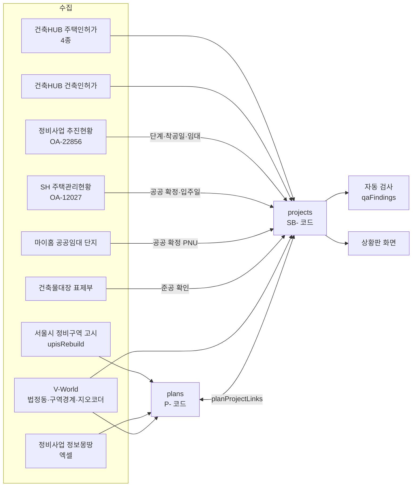
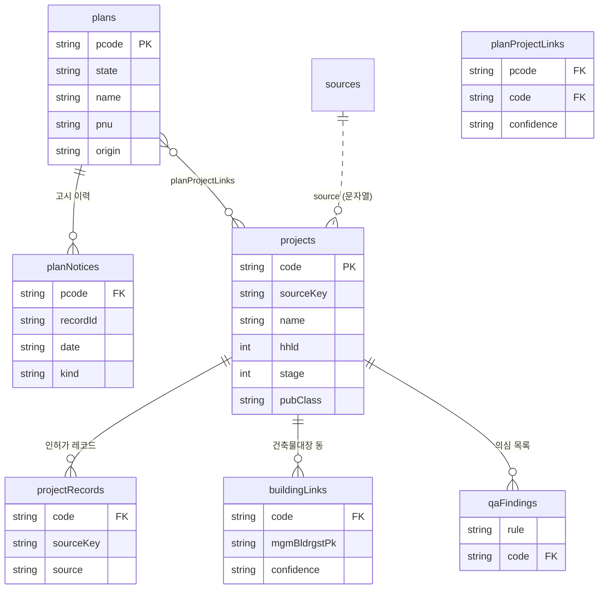

# 성북구 공공주택 공급 데이터 — 수집·가공 명세

- **작성**: 2026-10-07 · **갱신**: 2026-10-08 (청약홈 모집공고·SH 공공재개발 연결, 구역 열쇠 규칙 통일, SH 단지 중복 2건 정리)
- **범위**: 서울특별시 성북구(시군구 코드 11290), 법정동 39개
- **상황판**: https://seongbuk-housing-dashboard.vercel.app
- **목적**: 같은 주제를 따로 개발하는 조원들이 서로의 수집 방법과 결과를 비교하고 보완할 수 있게 합니다.

> 이 문서만 보고도 **같은 데이터를 다시 받아 같은 결과를 만들 수 있게** 썼습니다.
> 각자의 결과와 맞춰 볼 때는 [8. 다른 시스템과 맞춰 보는 방법](#8-다른-시스템과-맞춰-보는-방법)부터 보세요.

---

## 0. 이 폴더에 든 것

| 파일 | 내용 |
|---|---|
| `seongbuk_public_housing.json` | 지금까지 만든 데이터 전체. 표 7개와 메타·원천 목록이 들어 있습니다(약 8MB, UTF-8). |
| `schema.json` | 위 JSON의 스키마(JSON Schema 2020-12). 내보낼 때마다 이 스키마와 외래 키(FK) 무결성으로 검사합니다. |
| `README.md` | 이 문서. 수집 방법, 표 관계, 필드 정의, 판정 규칙을 담았습니다. |

**건수 (2026-10-07 기준)**

| 표 | 건수 | 설명 |
|---|---|---|
| `plans` | 150 | 계획(P- 코드): 정비구역 고시 113 + 정보몽땅 사업장 37 |
| `planNotices` | 391 | 정비구역 고시 이력 |
| `projects` | 2,957 | 사업(SB- 코드): 공공 303(확정 272 · 확인 필요 31) + 민간 2,654 |
| `planProjectLinks` | 122 | 계획 ↔ 사업 연결: 자동 95 · 검토필요 14 · 참고 13 |
| `projectRecords` | 9,792 | 사업 ↔ 인허가 원천 레코드 |
| `buildingLinks` | 156 | 사업 ↔ 건축물대장 동: 자동확정 53 · 검토필요 103 |
| `qaFindings` | 16 | 자동 검사가 뽑은 의심 목록 |

**상황판 화면 기준**: 진행 중·계획 39건 = 지연 3 + 주의 1 + 정상 16 + 계획 19. 이 밖에 준공 256건, 해제·대체·무산 의심 3건이 있습니다. (2026-10-08 지연 판정 규칙 ①~③ 반영 — §6-4)

**읽는 법 (Python)**
```python
import json
d = json.load(open("seongbuk_public_housing.json", encoding="utf-8"))
on_screen = [p for p in d["projects"] if p["screen"] and p["screen"]["status"] in ("red", "amber", "green", "plan")]
```

**검사 (선택)**
```python
import jsonschema
jsonschema.validate(d, json.load(open("schema.json", encoding="utf-8")))
```

---

## 1. 전체 흐름



사업은 공급 단계를 따라 흘러갑니다. `projects.stage`는 아래 번호를 씁니다.

| 단계 | 의미 | 주 원천 |
|---|---|---|
| ① 계획 (`stage`=2) | 구역 지정, 조합 등 인허가 전 단계 | 정비구역 고시, 정보몽땅, 추진현황, 수작업 |
| ② 인허가 (`stage`=3) | 사업계획승인·건축허가가 났고 아직 착공 전 | 건축HUB 주택인허가·건축인허가 |
| ③ 착공 (`stage`=4) | 건설 중 | 건축HUB 착공일, 추진현황, 정보몽땅 "착공·분양" 단계 |
| ④ 모집공고 | `stage` 번호는 없음. 사업에 `notice`로 붙임 (§2-2 #17) | 청약홈 분양정보 |
| ⑤ 준공 (`stage`=6) | 사용검사·사용승인을 받음 | 건축HUB, 건축물대장, SH 입주일 |

> `stage` 번호 2·3·4·6은 상황판 초기 설계의 번호를 그대로 둔 것입니다. 5번(모집)은 단계로 쓰지 않고, 모집공고는 `notice` 칸으로만 표시합니다(착공 중에 분양하므로 단계가 겹침).

---

## 2. 원천 데이터 — 어디서 무엇을 어떻게 받았나

API 키 이름은 `.env`에 둡니다. 실제 키 값은 이 묶음에 넣지 않았습니다.

| 키 이름 | 쓰는 곳 |
|---|---|
| `DATA_GO_KR_KEY` | 공공데이터포털: 건축HUB, 마이홈 |
| `SEOUL_DATA_KEY` | 서울 열린데이터광장 |
| `VWORLD_KEY` | V-World |
| `MOLIT_STAT_KEY` | 통계누리. 시도 단위 통계뿐이라 쓰지 않았습니다 |

### 2-1. 원천 목록

| id | 원천 | 호출 방식 | 받는 범위 | 받은 건수 | 기준 | 쓰임 |
|---|---|---|---|---|---|---|
| `getHpBasisOulnInfo` | 건축HUB 주택인허가 **기본개요** | `GET apis.data.go.kr/1613000/HsPmsHubService/getHpBasisOulnInfo` | 시군구 11290 × 법정동 39개 각각, 전체 페이지 | 4,542 | 레코드 생성일 최신 2026-08-31 | 사업승인일, 착공예정일·착공일, 사용검사예정일·사용검사일, 총세대수 → **주택법 사업(HS-)의 뼈대** |
| `getHpActOulnInfo` | 주택인허가 행위개요 | 같은 서비스의 `getHpActOulnInfo` | 같음 | 4,343 | 같음 | 성북구분은 **전부 세대수 0인 공사 신고**라 공급 사업에는 쓰지 않음 |
| `getHpDongOulnInfo` | 주택인허가 동별개요 | `getHpDongOulnInfo` | 같음 | 2,910 | 2026-08-28 | 공공임대·국민임대·공공분양·민간임대·민간분양 세대수 → **공공 여부의 1차 근거** |
| `getHpPlatPlcInfo` | 주택인허가 대지위치 | `getHpPlatPlcInfo` | 같음 | 12,560 | 2026-08-31 | 사업의 필지 목록 → PNU로 다른 자료와 연결 |
| `getApBasisOulnInfo` | 건축HUB 건축인허가 기본개요 | `GET apis.data.go.kr/1613000/ArchPmsHubService/getApBasisOulnInfo` | 같음 | 21,607 | 2026-08-31 | 건축법 허가 전부. **공동주택 신축은 세대수와 관계없이 모두** 사업으로 만듦(AP-), 2,751건 |
| `getBrTitleInfo` | 건축물대장 표제부 | `GET apis.data.go.kr/1613000/BldRgstHubService/getBrTitleInfo` | 법정동 전체, 사업 지번별 | — | 조회 시점 | 사업이 실제로 지어졌는지(준공) 확인 → `buildingLinks` |
| `upisRebuild` | 서울시 정비사업 현황(정비구역 **고시 이력**) | `GET openapi.seoul.go.kr:8088/{KEY}/json/upisRebuild/{start}/{end}/` | **서울 전체**를 받아 성북구만 사용 | 서울 6,612 (성북 391) | 일간 갱신, 최신 고시 2026-08-31 | **계획(P-)의 뼈대**. 구역명, 고시 종류, 위치, 면적 |
| `cleanup` | 정비사업 정보몽땅 사업장 목록 | **API 없음.** `POST cleanup.seoul.go.kr/cleanup/bsnssttus/lsubBsnsSttusExcel.do`, 폼 `scupBsnsSttus.signguCode=11290`. 엑셀(.xls)이며, 먼저 `lscrMainIndx.do`를 GET해서 세션을 만들어야 함 | 성북구, 전체 사업구분 | 79 | 받은 날의 최신 단계 | 가로주택·소규모재건축·지역주택까지 포함한 **진행 단계**. 계획 보강 |
| `rebuildStatus` | 서울시 정비사업 추진현황 (OA-22856) | **분기 엑셀.** 데이터셋 페이지에서 최신 파일을 찾아 `datafile.seoul.go.kr`에서 받음 | 성북구 | 24구역 | 2026년 6월 말 | 구역지정·조합설립·사업시행·관리처분·착공 날짜, 공공/민간, 건립세대, 임대세대 |
| `shComplex` | SH 주택관리현황 (OA-12027) | **연 엑셀.** 받는 방식은 위와 같음 | 성북구 | 52단지 | 25.12.31 기준 | SH 관리 단지 = **공공 확정**, 입주일 |
| `myhomeRental` | 마이홈 공공임대주택 단지정보 | `GET apis.data.go.kr/1613000/HWSPR04/rentalHouseGwList?brtcCode=11&signguCode=290` | 성북구 전체 페이지 | 2,722줄 (PNU 311개) | 조회 시점 | 공공임대 단지와 매입임대 호 → PNU로 사업에 붙여 **공공 확정** |
| `bjdong` | V-World 법정동 (LT_C_ADEMD_INFO) | `api.vworld.kr/req/data` GetFeature | 서울 467개 동 | 467 | — | 법정동 코드표, PNU 만들기, 고시 위치로 구 추정 |
| `uq161` | V-World 도시계획 구역 경계 (LT_C_UPISUQ161) | `api.vworld.kr/req/data` GetFeature | 성북구 사각 범위 | 121 | — | 정비구역 폴리곤. 지도와 "경계 포함" 연결에 사용 |
| (지오코더) | V-World 주소→좌표, 장소 검색 | `api.vworld.kr/req/address`, `/req/search` | 사업 주소별 | — | — | 사업 좌표(`lat`·`lng`) |
| `cheongyak` | 청약홈 APT 분양정보 | `GET api.odcloud.kr/api/ApplyhomeInfoDetailSvc/v1/getAPTLttotPblancDetail` (`cond[SUBSCRPT_AREA_CODE::EQ]`, `cond[RCRIT_PBLANC_DE::GTE]`) | 서울(100)·경기(410), 2018-01-01~ | 1,113 (성북 8) | 조회 시점 | **④ 모집공고**. 기존 사업에 `notice`로 붙임. 새 사업은 만들지 않음 |
| `sh_redevelopment` | SH 공공재개발·재건축 사업현황 (15124798) | `GET api.odcloud.kr/api/15124798/v1/uddi:…` (공개본 목록은 `infuser.odcloud.kr/oas/docs?namespace=15124798/v1`) | 공개본 전부 | 16 (성북 1: 장위8) | 2023-11-02 공개본 | 공공재개발 전체·임대 세대수, 추진현황 → `shRedev` |
| `manual` | 수작업 입력 | 보도자료, 국토부 지정 고시 | 2건 | 2 | — | 장위12(LH 도심 공공주택 복합사업), 장위14. 공식 API나 정보몽땅에 없는 공공사업 |

`seongbuk_public_housing.json`의 `sources` 배열에도 각 원천의 `endpoint`, `query`, `fetched`(받은 시각), `basis`(제공처 기준일), `count`, **`cycle`(제공처 공식 갱신 주기)**, **`lag`(2026-10-08 직접 조회로 확인한 실제 시차)**가 있습니다. 원천별 갱신 주기·시차 표는 `성북구 상황판 데이터 흐름.html` 하단에 있습니다 (§9 참고).

### 2-2. 수집할 때 걸린 함정

이 목록이 조원들과 비교할 때 가장 쓸모 있는 부분일 겁니다. 각 항목에 원래 증상과 대응을 적었습니다.

| # | 함정 | 대응 |
|---|---|---|
| 1 | 건축HUB API는 **시군구만으로는 결과가 비어 있음** | 법정동 코드(`bjdongCd`)를 하나씩 넣어 호출합니다. 성북구는 39번 × 5종 |
| 2 | 건축인허가 `hhldCnt`(세대수)가 **0인데 실제로는 공동주택** (오피스텔형·도시형생활주택) | 세대수가 0이면 `hoCnt`(호수)를 씁니다. 둘이 다르면 `checks`에 남깁니다 |
| 3 | 30세대 미만을 빼면 **매입임대·청년주택 같은 작은 공공주택이 빠짐** | 세대수 기준을 두지 않고 모두 사업에 넣습니다. 작은 사업은 `small=true` |
| 4 | 동별개요에서 재개발 **의무 임대가 '민간임대'로** 기록됨 | 공공 "확인 필요"로 두고, SH 단지나 마이홈과 맞으면 "확정"으로 올립니다 |
| 5 | **같은 사업이 인허가 레코드 여러 건**으로 나뉨 (변경 승인, 단지별 분할, 중복 등록) | 같은 사업 묶기(§5-2) 결과가 `merged`·`mergeType`에 들어갑니다 |
| 6 | **같은 필지에 몇 년 뒤 다른 허가** (사업계획이 실행되지 않고 다시 허가받음) | 승인 뒤 2년 넘게 지나서 같은 필지에 나온 허가는 별개 사업으로 둡니다. 앞 사업은 `superseded`로 "해제·대체" 처리 |
| 7 | 준공 뒤 **지번이 바뀜** (환지·합필, 예: 894-22 → 1054) | 대장에서 확정된 단지 이름으로 다시 묶습니다. 흔한 빌라 이름이 엉뚱하게 묶이지 않도록 둘 다 30세대 이상이고 승인 차이 5년 안일 때만 묶습니다 |
| 8 | upisRebuild에는 **고시일 칸도, 구 칸도 없음** | 고시일은 결정고시 관리코드(`11000NTC20080403…`) 속 날짜로 추정하고, 구는 위치의 동 이름으로 추정합니다 |
| 9 | 구역 이름 **"장위11의4구역"이 "장위4"로 읽힘** | 이름의 "N의M"을 "N-M"으로 바꾼 뒤 구역 열쇠(`zoneKey`)를 만듭니다 |
| 10 | "**준공공임대**"는 민간 등록임대이고, "역세권 **지역주택조합**"은 민간 | 공공 신호 단어에서 뺍니다. "역세권 청년주택"만 공공으로 봅니다 |
| 11 | 마이홈 **매입임대는 한 줄이 한 호**이고, `hshldCo`는 동 전체 값 | 매입임대는 줄 수를 세대수로 씁니다. 건설형은 단지별 최대값을 씁니다 |
| 12 | 정보몽땅에는 **세대수가 없고**, 조합이 청산된 사업장도 들어 있음 | 세대수는 다른 원천에서 가져옵니다. 운영 중이고 단계가 끝나지 않은 사업장만 새 계획 사업으로 만듭니다 |
| 13 | OA-22856은 **진행 중인 구역만** 있고 준공 구역·소규모 정비는 없음. 서비스가 끝나도 **파일은 분기마다 올라옴** | 데이터셋 페이지에서 가장 최신 파일을 골라 받습니다 |
| 14 | 정비구역이 **폐지·해제**된 뒤에도 그 안의 승인 사업이 "지연"으로 보임 | 구역 해제일이 승인일보다 뒤이고 착공·준공 기록이 없으면 "해제·대체"(`void`)로 봅니다 |
| 15 | 건축인허가 건물명에 **개인 건축주 이름**이 들어 있음 | 공동주택이 아니거나 괄호가 있는 이름은 "동 지번 공동주택"으로 바꾸거나 비웁니다 |
| 16 | 기숙사·장학숙·생활관도 공동주택으로 허가됨 | 공급 주택이 아니므로 뺍니다 |
| 17 | **원천마다 같은 사업의 대표 지번이 다름**. 삼선5구역: 고시·청약 공고는 삼선동2가 296, 주택인허가 대표 지번은 삼선동1가 260-1, 대지위치 471필지에도 296이 없음 | 지번이 안 맞으면 ① 공고 지번 = **정비구역 고시 지번** → 그 구역 열쇠의 사업 ② 조합·사업명 구역 열쇠 ③ 단지명 순으로 찾고, 후보가 1건일 때만 연결 |
| 18 | 사업명에 '구역' 글자가 없음(`삼선제5주택재개발`, `석관1주택재건축`)·구역이 괄호 속에만 있음(`e편한세상(보문4)`) | 구역 열쇠는 `keys.zone_key`·`zone_keys` 한 곳에서만 만듦. 예전엔 단계마다 정규식이 달라 계획 연결이 빠졌음 |
| 19 | SH 단지 주소·이름이 인허가와 다름 → **같은 단지가 SH 사업으로 한 번 더 생김** (래미안장위포레카운티(장위1구역) 장위동 322 ↔ 래미안 포레카운티 144-24) | 괄호 속 구역의 고시 지번이 30세대 이상 주택인허가 사업 1건의 필지와 같으면 그 사업에 붙임(`sh.how` = 구역 고시 지번) |
| 20 | 주택인허가 대지위치에 **번지 없이 동 이름만 적힌 레코드**(번지 0)가 2,748건(35개 사업) | 필지 비교·면적 합·대장 연결에서 뺍니다. 넣으면 같은 동의 '0번지'로 엉뚱한 사업끼리 겹친다고 판단해 묶였습니다(동부센트레빌↔아이파크 종암동, 정릉 e편한세상↔푸른마을 동아). 면적도 부풀었습니다(정릉동00아파트 24,496㎡ → 75,340㎡) |

---

## 3. 코드 체계 (식별자)

| 식별자 | 형식 | 만드는 곳 | 안정성 |
|---|---|---|---|
| **P- 계획 코드** | `P-0001` ~ | 정비구역 고시는 시드 레코드(`11000AGZ…`)마다 하나. 정보몽땅 사업장은 기존 구역과 같으면 그 코드를 쓰고, 아니면 새 코드(P-2664~) | 한번 준 번호는 바꾸지 않습니다. 레지스트리 파일로 고정 |
| **SB- 사업 코드** | `SB-0001` ~ | 사업의 대표 원천 레코드(`sourceKey`)마다 하나 | 같습니다. 묶여서 사라진 사업의 코드도 `merged[].code`에 남습니다 |
| `sourceKey` | `HS-{mgmHsrgstPk}`: 주택인허가<br>`AP-{mgmPmsrgstPk}`: 건축인허가<br>`REB-{추진현황 구역코드}`: 추진현황에만 있는 구역<br>`CU-{법정동5}-{지번}`: 정보몽땅에만 있는 사업장<br>`SH-{동}-{지번}`: SH 단지에만 있는 사업<br>`MANUAL-…`: 수작업 | 원천 | 원천이 주는 값 그대로 |
| **PNU** | 19자리 = 시군구 5 + 법정동 5 + 대지구분 1(1 일반, 2 산) + 본번 4 + 부번 4<br>예: `1129013800100250055` = 성북구 장위동 25-55 | 동 코드와 지번으로 만듭니다 | 국가 표준. **다른 시스템과 맞춰 볼 때 가장 좋은 열쇠** |
| `mgmBldrgstPk` | 건축물대장 관리번호 | 건축HUB | 국가 표준 |
| `noticeId` | 결정고시 관리코드 `11000NTC…` | 서울시 | 서울시 표준 |

---

## 4. 표 관계 (ERD)



- **plans 1 : N planNotices** — 한 구역에 고시가 여러 번 있습니다(신설, 변경, 폐지 등).
- **plans N : M projects** — 한 구역에 사업이 여러 개 있을 수 있고(예: 정릉골 1~8단지), 한 사업이 이웃 구역 경계에 걸칠 수도 있습니다.
- **projects 1 : N projectRecords** — 대표 레코드(`role`=시드)에 같은 필지의 변경 허가와 준공 뒤 행위 허가가 붙습니다.
- **projects 1 : N buildingLinks** — 한 단지는 대장에서 동 여러 개입니다.
- 같은 사업을 묶은 결과는 표로 나누지 않고 `projects[].merged`(묶인 원래 사업들)에 넣었습니다.

---

## 5. 필드 정의

모든 날짜는 `YYYYMMDD` 문자열이고, 값이 없으면 `null`입니다.

### 5-1. `plans` (계획)

| 필드 | 형 | 설명 | 예 |
|---|---|---|---|
| `pcode` | string PK | 계획 코드 | `P-0035` |
| `state` | enum | 고시 구역은 `지정`/`해제`(마지막 고시가 폐지·해제·실효). 정보몽땅 사업장은 `지정`(운영)/`종료`(조합 청산 등) | `지정` |
| `name` | string | 가장 최근 구역명 | `장위6구역` |
| `zoneType` | string | 사업유형 | `주택재개발사업구역` |
| `dong`, `jibun`, `pnu` | string | 대표 위치 | `장위`, `25-55`, `1129013800100250055` |
| `areaM2` | number | 면적(㎡). 정보몽땅은 비어 있음 | `105136.9` |
| `firstNotice`, `lastNotice` | date | 최초·최종 고시일 | `20080403` |
| `lastNoticeType` | string | 최종 고시 종류(신설, 변경, 폐지 …, 정보몽땅은 "정보몽땅 {단계}") | `변경` |
| `noticeCount` | int | 고시 건수 | `4` |
| `prevCode` | string | 해제 뒤 다시 지정된 경우 이전 계획 코드 | |
| `origin` | enum | `정비구역 고시` / `정보몽땅` | |
| `seedRecord` | string | 처음 만든 원천 레코드(고시 레코드 ID 또는 `정보몽땅:{사업장명}`) | |
| `pnus` | string[] | 고시에 나온 PNU 전체 | |
| `cleanup` | object | 연결된 정보몽땅 사업장: `name`, `type`, `stage`(진행단계), `oper`, `linkBasis`, `linkKind` | |

### 5-2. `planNotices` (고시 이력)

| 필드 | 설명 |
|---|---|
| `pcode` FK | 계획 코드 |
| `date` | 고시일. 결정고시 관리코드에서 추정한 값 |
| `kind` | 신설 / 변경 / 폐지 / 정정 / 실효 / 기정 |
| `dong`, `jibun`, `pnu`, `location` | 고시에 적힌 위치 |
| `zoneKey` | 구역 열쇠(이름을 정규화한 값, 예: `장위6`) |
| `zoneName` | 고시에 적힌 구역명 |
| `areaM2` | 변경 후 면적 |
| `recordId` | upisRebuild 레코드 ID (`11000AGZ…`) |
| `noticeId` | 결정고시 관리코드 (`11000NTC…`) |

### 5-3. `projects` (사업)

**기본 정보**

| 필드 | 설명 |
|---|---|
| `code` PK | SB- 사업 코드 |
| `sourceKey` | 대표 원천 레코드 키 (§3) |
| `name` | 사업명 |
| `kind` | 공동주택 / 재개발·재건축 / 가로주택정비 / SH 공공임대 / 지구단위 특별계획 |
| `law` | 근거 법·절차. 예: 주택법 (사업계획승인), 건축법 (건축허가) |
| `source` | 대표 원천 이름 |
| `bjd`, `dongFull`, `jibun`, `addr` | 법정동 코드 5자리, 동 이름, 지번, 도로명 주소(일부만) |

**세대수**

| 필드 | 설명 |
|---|---|
| `hhld` | 세대수. 묶인 사업 중 단지별 분할이면 합계, 변경 승인이면 최근 값 |
| `hhSrc` | 세대수 출처: 세대수 / 호수 / 세대수·호수·가구수 |
| `pub` | 공공 세대수 (동별개요의 공공임대 + 국민임대 + 공공분양, 또는 수작업 값) |
| `cvlRent`, `cvlLotou` | 민간임대·민간분양 세대수 |

**일정**

| 필드 | 설명 |
|---|---|
| `approve`, `approveLast` | 사업 승인일·건축 허가일. 묶인 경우 `approveLast`는 마지막 승인일 |
| `stSched`, `st`, `stSrc` | 착공 예정일, 실제 착공일, 착공일 출처(건축HUB가 아니면 표시) |
| `stDelay` | 착공 연기 기한 |
| `endSched`, `end`, `endLabel` | 준공 예정일, 준공일, 준공 종류: 사용검사 / 사용승인 / 사용승인 (건축물대장) / 입주개시 (SH) |
| `crtn` | 원천 레코드 생성일 |

**단계·공공 여부**

| 필드 | 설명 |
|---|---|
| `stage` | 2 계획 · 3 인허가 · 4 착공 · 6 준공 (§1) |
| `stage2` | 수작업 사업의 계획 단계 설명 |
| `pubClass` | `확정` / `확인 필요` / `민간` (§6-3) |
| `pubBasis` | 공공 여부 판단 근거 문장 목록 |
| `small` | 30세대 미만 |
| `nonApt` | 공동주택이 아닌 공공 허가의 용도(단독주택, 업무시설) |
| `manual` | 수작업 입력 여부 |

**위치**

| 필드 | 설명 |
|---|---|
| `lat`, `lng`, `geo` | 좌표와 좌표의 정확도: 지번 / 도로명 / 본번(근사) / 장소검색(근사) / 좌표 없음 / 표시 안 함(소규모 민간) |

**판정 결과**

| 필드 | 설명 |
|---|---|
| `flags` | 지연 후보 `[{type, months, text}]`. type은 착공 지연 후보 / 준공 지연 후보 / 허가 실효 의심 |
| `checks` | 데이터 확인 메모 (예: 세대수와 호수가 다름) |
| `sinceStart` | 착공 뒤 지난 개월 수 |

**다른 원천에서 붙은 정보** (해당 원천과 연결된 사업에만 값이 있음)

| 필드 | 설명 |
|---|---|
| `reb` | 정비사업 추진현황: `zone`, `stage`, `public`, `type`, `units`, `rent`, `steps[[단계, 날짜]]`, `basis` |
| `sh` | SH 단지: `name`, `type`, `units`, `movein`, `basis`, `how`(지번 / 구역 / 구역 고시 지번 / 단지명 / 단지명 일부) |
| `notice` | 청약홈 모집공고 목록 `[{no(공고번호), houseNo(주택관리번호), name, kind(민영·국민), date(모집공고일), rcpt[시작, 끝], win(당첨자 발표), units(일반공급 세대수), movein(입주예정 YYYYMM), url, how}]`. `how` = 지번 / 고시 지번(+구역)(P-) / 구역 / 단지명. **units는 일반공급분이라 `hhld`와 다름** |
| `shRedev` | SH 공공재개발 사업현황: `zone`, `type`, `units`(전체), `rent`(임대), `stage`(추진현황 원문), `basis`(공개본 기준일), `how` |
| `myhome` | 마이홈: `inst`(LH / SH), `types`, `units`, `name`, `done`, `pnu` |
| `cleanup` | 정보몽땅 사업장: `name`, `type`, `stage`, `oper`, `basis` |
| `endBr` | 건축물대장으로 **확정된** 준공 단지: `name`, `grade`, `why`, `how`, `n`(동 수), `hh` |
| `brCand` | 건축물대장 준공 **후보**(검토필요). 형식은 `endBr`과 같음 |

**묶기·대체·화면**

| 필드 | 설명 |
|---|---|
| `superseded` | 같은 필지에 나중에 나온 다른 허가 `[{name, jibun, approve, end, hhld}]` |
| `merged`, `mergeType` | 같은 사업으로 묶인 원래 사업들 `[{sourceKey, code, name, approve, hhld, st, end}]`, 묶은 방식 |
| `screen` | 상황판에 나오는 사업만 값이 있음: `status`(§6-4), `voidText`, `pcode`(대표 계획), `planLink` |

### 5-4. `planProjectLinks` (계획 ↔ 사업)

| 필드 | 설명 |
|---|---|
| `pcode` FK, `code` FK | 계획 코드, 사업 코드 |
| `step` | `③ 인허가`: 사업 승인과 연결 / `참고(기존 건물)`: 구역 안에 있던 기존 건물 |
| `basis` | 연결 근거. 지번(PNU) 일치 / 구역명 일치 / 경계 포함의 조합 |
| `confidence` | `자동`: 근거 2개 이상이거나 단일 근거 규칙 통과 / `검토필요` / `참고` (§6-5) |
| `planName`, `projectName` | 계획 이름, 사업 이름 |

### 5-5. `projectRecords` (사업 ↔ 인허가 레코드)

| 필드 | 설명 |
|---|---|
| `code` FK, `sourceKey` | 사업 코드, 레코드 키 |
| `source` | 주택인허가 / 건축인허가 / 수동 |
| `recordName`, `permitType`, `mainUse`, `hhld`, `approve` | 레코드의 이름, 허가구분, 주용도, 세대수, 허가일 |
| `role` | 시드 / 관련 주택인허가(변경·분할) / 같은 필지 건축인허가 / 준공 후 행위·변경허가 / 기존 건축물(철거 추정) 등 |
| `method` | 시드 / 필지 / 이름 |
| `overlap`, `sharedLots` | 필지 겹침 점수(0~1), 공유 필지 수 |
| `confidence` | 확정 / 자동 / 검토필요 / 참고 |
| `basis` | 근거 문장 |

### 5-6. `buildingLinks` (사업 ↔ 건축물대장)

| 필드 | 설명 |
|---|---|
| `code` FK | 사업 코드 |
| `sourceKey`, `projectName`, `projectHhld`, `projectApprove` | 사업 쪽 정보 |
| `mgmBldrgstPk` | 대장 관리번호 |
| `bldName`, `dongName`, `platPlc` | 대장 건물명, 동 명칭, 대지 위치 |
| `brPermit`, `permitType`, `useApr`, `brHhld` | 대장의 허가일, 허가구분, 사용승인일, 세대수(0이면 호수) |
| `lots` | 단지 필지 |
| `basis`, `grade` | 매칭 근거, 등급(강 / 중 / 약 / 지번) |
| `confidence` | `자동확정` / `검토필요` |
| `memo` | 메모 |

### 5-7. `qaFindings` (자동 검사 의심 목록)

| 규칙 | 뜻 |
|---|---|
| R1 오래된 지연 | 예정일이 5년 넘게 지났는데 실적이 없음. 기록 누락, 대체, 중단을 확인해야 함 |
| R2 세대수 불일치 | 사업 세대수와 연결된 대장·추진현황 세대수가 1.5배 넘게 다름. 다른 사업이 붙었을 수 있음 |
| R3 대체 사업 | 같은 필지에 나중 허가가 나서 "해제·대체"로 처리된 사업 |
| R4 위치 불확실 | 화면에 나오는 사업인데 좌표가 근사치이거나 없음 |
| R5 세대수 미공개 | 계획 사업인데 세대수가 없음 |
| R6 단지 공유 | 이름이 다른 여러 사업이 한 SH 단지·마이홈 필지·대장 단지를 함께 씀 |

---

## 6. 가공 규칙

### 6-1. 사업 만들기

- **주택법 사업(HS-)**: 주택인허가 기본개요 중 총세대수가 0보다 큰 레코드.
- **건축법 사업(AP-)**: 건축인허가 중 주용도가 공동주택인 신축. 세대수가 0이면 호수를 쓰고, 기숙사는 뺍니다. 같은 필지에 주택인허가가 있으면 이렇게 처리합니다.
  - 승인 2년 안의 허가 → 같은 사업으로 보고 별도 사업을 만들지 않음
  - 승인 뒤 2년 넘게 지난 허가 → 별개 사업으로 만듦
- **공공 비주택 허가**: 단독주택(다가구)·업무시설(오피스텔)이라도 이름에 LH, 공공임대, 사회주택 같은 신호가 있으면 사업으로 만듭니다.
- **추진현황(REB-)·정보몽땅(CU-)**: 지번이나 구역 열쇠로 기존 사업에 먼저 붙입니다. 맞는 사업이 없을 때만 새 계획 사업을 만듭니다. 정보몽땅은 여기에 더해 운영 중이고, 단계가 끝나지 않았고, SH 단지 구역이 아닌 경우에만 새로 만듭니다.
- **수작업(MANUAL-)**: 장위12, 장위14.

### 6-2. 같은 사업 묶기

다음 중 하나를 만족하면 같은 사업으로 묶습니다.
- 필지가 겹치고, 승인일이 같음
- 필지가 겹치고, 승인 차이가 2년 이내이면서 세대수가 ±10% 이내이거나 이름이 같음
- 대장으로 확정된 준공 단지 이름이 다른 사업의 이름과 같음. 단, 둘 다 30세대 이상이고 승인 차이가 5년 이내여야 함

묶은 뒤 세대수는 이렇게 정합니다.
- 승인일이 같고 세대수가 10% 넘게 다르면 **단지별 분할**로 보고 세대수를 합칩니다.
- 그 밖에는 **변경·중복 인허가**로 보고 최근 승인의 세대수를 씁니다.

현재 19묶음입니다.

### 6-3. 공공 여부 (`pubClass`)

위에서부터 먼저 맞는 조건을 따릅니다.

| 분류 | 조건 |
|---|---|
| **확정** | SH 관리 단지와 연결됨 · 추진현황상 공공 정비사업 · 마이홈 공공임대 PNU와 일치 · 동별개요 공공 세대수 > 0 · 수작업 |
| **확인 필요** | 이름(또는 대장 단지명)에 공공 신호 단어(공공, 행복주택, 청년주택, 역세권 청년, LH, SH, 국민임대, 매입임대, 장기전세, 사회주택, 빈집 …)가 있음 · 가로주택이나 특별계획의 민간임대 · 재개발 임대가 민간임대로 기록됨 |
| **민간** | 위에 해당하지 않음. 화면에는 띄우지 않고 데이터에만 남깁니다 |

### 6-4. 화면 상태 (`screen.status`)

기준일은 `meta.today`이고, 지연 기준은 `meta.redMonths` = 6개월입니다.

| status | 이름 | 조건 |
|---|---|---|
| `void` | 해제·대체·무산 의심 | 다음 중 하나: ① 정비구역이 승인 뒤 해제됐고 착공·준공 기록이 없음 ② 같은 필지에 나중 허가가 나서 대체됨 ③ 주택법 사업계획승인 뒤 **5년 넘게 착공 기록이 없고** 진행 단서(정보몽땅·추진현황·청약 공고·착공연기 기한·건축물대장 준공 후보)도 없음 → `lapse` (주택법상 승인 취소 대상 기간 경과) |
| `plan` | 계획 | 인허가 전(`stage`=2) 또는 수작업 사업 |
| `done` | 준공 | `stage`=6 |
| `red` | 지연 | 착공·준공 예정일이 6개월 이상 지났는데 실적이 없음 |
| `amber` | 주의 | 예정일이 지났고, 지난 기간이 6개월 미만 |
| `green` | 정상 | 진행 중이고 지난 예정일이 없음. 착공 전 행정 절차 중(`preStart`)인 사업 포함 |

**지연 판정 보정 (2026-10-08)** — 건축HUB 착공일·사용검사일 칸은 재개발·대형 사업에서 비어 있는 경우가 많고(장위6구역은 2024.03 착공·2026.03 골조 완료인데 착공일 칸이 빔), 예정일은 첫 승인 때 값이 남아 있습니다. 그래서:

| 규칙 | 내용 | 필드 |
|---|---|---|
| ① 입주예정 우선 | 청약 공고에 입주예정(YYYYMM)이 있으면 그 달을 준공 예정으로 씁니다. 그 달이 끝나야 '경과'로 봅니다 | `endSched`(바뀐 값), `endSchedSrc`=청약홈 입주예정, `endSchedPermit`(원래 서류 값) |
| ② 착공 전 절차 | 정보몽땅 단계(우선)나 추진현황 단계가 **관리처분 이전**(조합원 모집·조합규약·추진위·조합설립·사업시행인가 / 구역지정·추진위·조합설립·건축심의·사업시행)이면 서류상 착공·준공 예정일로 지연 판정하지 않습니다 | `preStart` |
| ③ 무산 의심 | 위 `void` ③ | `lapse` |

### 6-5. 계획 ↔ 사업 연결의 확인 여부

- 근거(지번, 구역명, 경계, 면적)가 **2개 이상**이면 `자동`입니다.
- **면적 일치**: 같은 시군구·법정동에서 주택인허가 대지위치 면적 합이 고시 이력의 구역 면적 중 하나와 **0.5% 안**이면 근거로 셉니다. 맞게 이어진 사업은 0~0.3% 차이(장위4·돈암6·보문3 등은 0.00%)였지만, 같은 동의 다른 구역도 0.1%대로 우연히 맞는 경우가 있어 **면적 하나뿐이면 `검토필요`**입니다. 지번·구역명이 어긋나도 같은 사업인지 판단하는 보조 근거입니다(삼선5: 고시 63,884㎡ ≈ 사업 필지 63,781㎡, 0.16%).
- 근거가 **1개**뿐이면(면적만 있는 경우 제외) 아래 순서로 판단합니다.

| 조건 | 결과 |
|---|---|
| 승인 기록이 없는 추진현황·정보몽땅 사업 | 자동 |
| 구역 해제일 뒤에 승인됨 | 참고 |
| 구역 최초 지정보다 5년 넘게 먼저 승인됨 | 참고 |
| 30세대 미만 | 검토필요 |
| 구역 최종 고시보다 10년 넘게 뒤에 승인됨 | 검토필요 |
| 그 밖 | 자동 |

### 6-6. 준공 확인 (건축물대장)

- 사업 필지의 대장을 받아 허가일과 세대수로 등급을 매깁니다(강, 중, 약).
- 세대수 비교는 30세대 이상 사업에만 씁니다.
- 대장 사용승인일이 사업 승인일보다 1년 넘게 뒤여야 합니다.
- 자동확정된 것만 `endBr`과 준공일로 씁니다. 나머지는 `brCand`(후보)로 남깁니다.

---

## 7. 예시: 장위6구역을 따라가 보기

| 표 | 내용 |
|---|---|
| `plans` P-0035 | 장위6구역(주택재개발). 2008-04-03 신설, 고시 4건, 지정 상태. 정보몽땅 "착공" 단계 |
| `planNotices` | P-0035의 고시 4건: 2008 신설, 2013 변경 … |
| `planProjectLinks` | P-0035 ↔ SB-0001, 자동. 근거: 지번(PNU) 25-55 · 구역명(장위6) · 경계 포함 |
| `projects` SB-0001 | 1,637세대(민간임대 285, 민간분양 1,352). 2015-05-01 승인, 2024-03-20 착공(출처 추진현황). 인허가 서류의 준공 예정은 2026-06-30이지만 청약 공고(푸르지오 라디우스 파크, 2024-07-05)의 입주예정 2027-03을 준공 예정으로 써서(`endSchedSrc`) → **정상(green)**. 2026.03 모든 동 기준층 골조 완료(보도). 공공 "확인 필요": 재개발 임대 285세대가 민간임대로 기록됨 |
| `buildingLinks` | 꿈의숲 아이파크(약 등급, 검토필요). 이웃 단지라서 준공 확정에 쓰지 않음 |

---

## 8. 다른 시스템과 맞춰 보는 방법

P-·SB- 코드는 이 시스템 안에서만 쓰는 번호입니다. 조원 데이터와 맞춰 볼 때는 **국가 표준 키**를 쓰세요.

| 맞춰 볼 대상 | 추천 열쇠 | 이 데이터에서 찾는 곳 |
|---|---|---|
| 같은 인허가 레코드 | 주택인허가 `mgmHsrgstPk`, 건축인허가 `mgmPmsrgstPk` | `projects.sourceKey`(HS-·AP- 뒤), `projectRecords.sourceKey`, `projects.merged[].sourceKey` |
| 같은 땅 | PNU 19자리 | `plans.pnu`/`pnus`, `planNotices.pnu`, `projects.myhome.pnu`. 그 밖의 사업은 `bjd`+`jibun`으로 만들면 됩니다(`11290`+`bjd`+`1`+본번 4자리+부번 4자리) |
| 같은 건물 | 건축물대장 `mgmBldrgstPk` | `buildingLinks.mgmBldrgstPk` |
| 같은 정비구역 | 결정고시 관리코드 `noticeId`, 또는 구역 열쇠(`장위6`) | `planNotices.noticeId`, `planNotices.zoneKey` |

**서로 비교해 보면 좋을 점**
1. **사업 수**: 공공 판정 기준(§6-3)이나 30세대 미만 포함 여부(§2-2 #3)에 따라 크게 달라집니다.
2. **같은 사업 세기**: 변경 승인이나 단지 분할을 몇 건으로 셌는지(§6-2).
3. **공공 판정**: 재개발 의무 임대(§2-2 #4), 사회주택, 준공공임대를 어떻게 처리했는지.
4. **계획 단계 출처**: 정비구역 고시와 정보몽땅 말고 다른 원천(LH·SH 공급계획, 지구단위계획 고시 등)을 쓰고 있다면 공유해 주세요.
5. **모집공고(④) 연결 방법**: 청약홈 공고를 공급위치 지번 → 고시 지번 → 조합 구역명 → 단지명으로 붙였습니다(§2-2 #17). 청약홈 `HOUSE_MANAGE_NO`·`PBLANC_NO`가 맞춰 볼 열쇠입니다. LH·SH 임대 모집공고는 구 단위 묶음 공고라 사업에 붙이지 않았습니다.

---

## 9. 알려진 한계

- **모집공고(④)는 청약홈 분양만**: 성북구 청약홈 공고 8건은 모두 기존 사업에 붙었습니다. LH 분양·임대 공고(서울 183건)는 성북구 사업 단위로 특정할 수 없어 붙이지 않았고, 마이홈 모집공고는 아직 없습니다.
- **고시 목록에 없는 구역**: SH 단지 돈암풍림(돈암3-3), 정릉라온유(길음10)는 구역 열쇠는 읽히지만 정비구역 고시에 같은 구역이 없어 계획과 연결되지 않습니다.
- **사람이 확인할 연결이 남음**: 계획↔사업 검토필요 14건(면적만 일치한 새 후보 4건 — 그중 브라운스톤 돈암↔돈암6은 확인 결과 별개 사업(1992 승인·2004 준공 vs 2025 승인, 필지 겹침 없음)으로 우연한 면적 일치, 꿈의숲 푸르지오의 지번·면적 근거가 서로 다른 구역을 가리키는 1건 포함), 대장 검토필요 103건(사업 기준 15건), 자동 검사 의심 16건.
- **판단을 정하지 않은 것**: 사회주택을 공공으로 볼지 정하지 않았습니다. 지금은 "확인 필요"입니다.
- **같은 필지의 두 허가**: 보문동5가 146-1에 2021년 청년주택 허가와 2025년 LH 오피스텔 허가가 함께 있습니다.
- **구역 경계 밖 지구단위계획 사업**: 석관 특별계획구역 같은 사업은 정비구역 고시 대상이 아니라서 계획 코드가 없을 수 있습니다.
- **성북구 고정값**: 구 코드 11290, 마이홈 290, 정보몽땅 11290이 코드 안에 있습니다. 서울 전체로 넓히려면 설정으로 바꿔야 합니다.
- **기준일이 다름·실시간성 한계** (2026-10-08 직접 조회): 건축HUB 인허가·대장은 공식 '월간'이지만 성북구 전체를 다시 조회해도 최신 레코드가 2026-08-31(인허가)·08-28(대장) 생성분으로 9월 이후 기록이 없고(약 5~6주 시차) 재개발은 착공일 칸이 비어 있습니다. 정비구역 고시(upisRebuild, 공식 일간)는 최신 고시 2026-09-07. 추진현황(OA-22856, 분기)은 '6월 기준' 파일이 9월 10일에 올라와 최대 약 5개월, SH 주택관리현황(연간)은 2025-12-31 기준이 2026-02-20에 올라와 최대 1년 2개월, SH 공공재개발 현황은 2023-11-02 공개본이 최신입니다. 청약홈·LH 공고는 실시간(최신 10-02·09-28). 정보몽땅은 API(OA-2253)가 2025.12 종료되어 엑셀 내려받기로 받습니다. 원천별 표는 데이터 흐름 HTML 하단에 있습니다.

---

## 10. 다시 만들기

스크립트는 `test/` 폴더에 있습니다.

```bash
python fetch_seongbuk.py          # 건축HUB 주택인허가 4종 + 건축인허가 (법정동별)
python plan_registry.py           # 서울시 정비구역 고시(upisRebuild) → P- 코드
python fetch_uq161.py             # V-World 정비구역 경계
python run_all.py --fetch --share # 엑셀 3종·마이홈·청약홈·SH API를 새로 받음 → 정리 → 검사 → 공유 파일
```

`run_all.py`는 아래 순서로 실행합니다. **회귀 검사(51개 사례)가 하나라도 틀리면 멈추고 공유 파일을 만들지 않습니다.**

```
build_projects → crosswalk → br_link → build_projects → crosswalk → plan_cleanup → plan_link → make_html → qa → export_share
```

수작업으로 고정한 연결은 두 파일에 있습니다: `test/crosswalk_manual.csv`(사업↔인허가 레코드 확정·해제), `test/br_crosswalk_manual.csv`(사업↔건축물대장). 계획↔사업 연결은 규칙으로만 정합니다(§6-5).
