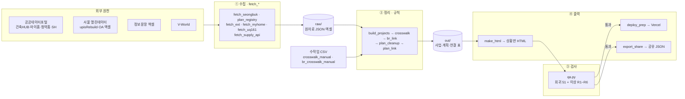
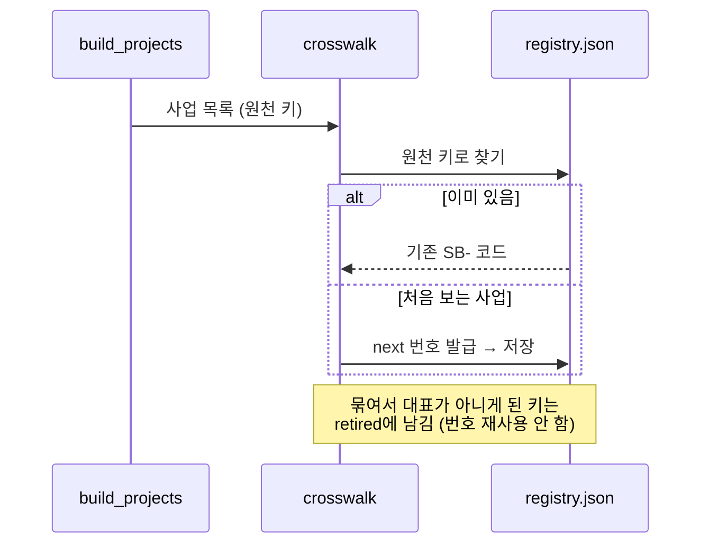
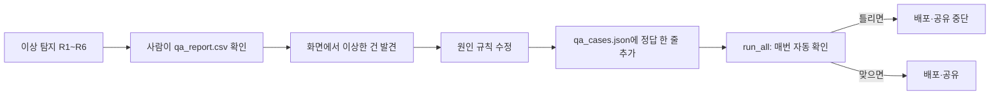
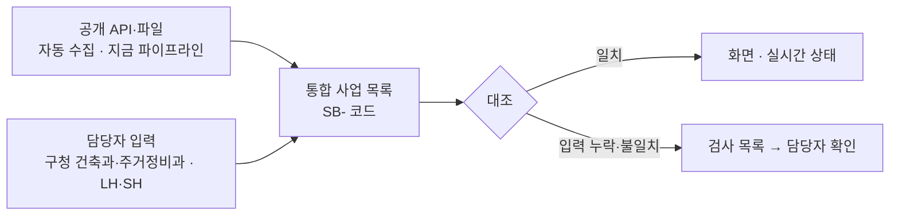

# 성북구 공공주택 공급 상황판 — 시스템 구조 (Architecture)

작성 2026-10-07 · 갱신 2026-10-08 · 같은 폴더의 `README.md`(데이터 명세)와 짝을 이루는 문서입니다.

- 데이터가 **무엇인지**(필드, 규칙)는 `README.md`에 있습니다.
- 이 문서는 시스템이 **어떻게 짜여 돌아가는지** 설명합니다. 어떤 스크립트가 무엇을 읽고 무엇을 쓰는지, 어떤 순서로 도는지, 왜 이렇게 설계했는지를 다룹니다.

---

## 1. 한눈에 보기



**특징 다섯 가지**
1. **서버와 DB가 없습니다.** 파이썬 스크립트가 파일을 읽고 파일을 씁니다. 결과는 데이터가 박힌 HTML 파일 하나입니다.
2. **층이 나뉘어 있습니다.** 수집(네트워크) → 정리(규칙) → 검사 → 출력 순서입니다. 정리 단계는 API를 거의 부르지 않아서, 원자료만 있으면 몇 분 안에 다시 돌릴 수 있습니다(좌표·경계는 캐시를 씁니다).
3. **코드가 바뀌지 않습니다.** P-·SB- 번호는 레지스트리 파일로 고정합니다. 다시 돌려도 같은 사업은 같은 번호를 받습니다.
4. **규칙과 수작업 확정을 함께 씁니다.** 자동 규칙으로 판정하고, 사람이 확인한 결과는 CSV에 남깁니다. 그 판정은 다음 실행에도 유지됩니다.
5. **검사를 통과해야 내보냅니다.** 회귀 사례가 하나라도 틀리면 배포 파일과 공유 파일을 만들지 않습니다.

---

## 2. 폴더 구조

```
공공주택/
├─ .env                          API 키 4개 (공유·배포 금지)
├─ 성북구_주택공급상황판_계획서.md  계획과 진행 기록(§11 단계별)
├─ 시안/성북구_상황판_시안.html     완성된 상황판 (데이터 포함, 키 포함 → 내부용)
├─ deploy/index.html              배포본 (V-World 키 제거)
├─ 공유데이터/                     조원 공유용: JSON · schema · README · 이 문서
├─ 회의자료/                       회의 설명 자료
└─ test/                          ← 모든 스크립트
   ├─ raw/                        원자료 (수집 결과 그대로)
   │  ├─ sb/                      건축HUB 법정동별 조각 {법정동}_{기능}.json
   │  ├─ br/ · br_dong/           건축물대장 (지번별 · 법정동 전체)
   │  ├─ ext/                     엑셀 3종 + latest.json(받은 파일·시각)
   │  ├─ seongbuk_*.json          건축HUB 5종 합본
   │  ├─ seoul_upisRebuild.json   정비구역 고시 (서울 전체)
   │  ├─ seoul_bjdong.json        법정동 코드표
   │  ├─ seongbuk_dong_geo.json   법정동 경계
   │  ├─ seongbuk_uq161.json      정비구역 경계
   │  ├─ myhome_rental.json       마이홈 공공임대
   │  ├─ api/                     청약홈 분양정보 · LH 분양임대 공고 · SH 공급계획 · SH 공공재개발 (fetch_supply_api.py)
   │  └─ kim/                     조원(김민) 스냅샷에서 뽑은 LH·GH·SH 자료 — 대조용 참고, 정리 단계에서는 안 씀
   ├─ out/                        정리 결과 (아래 §4)
   ├─ lib/                        Leaflet (지도, HTML에 인라인으로 넣음)
   ├─ dashboard_template.html     화면 틀 (HTML·CSS·JS)
   ├─ qa_cases.json               회귀 검사 사례
   ├─ crosswalk_manual.csv        사업↔인허가 레코드 수작업 확정·해제 (지금은 헤더만)
   ├─ br_crosswalk_manual.csv     사업↔건축물대장 수작업 판정 (지금은 헤더만)
   └─ _보관/                      지금 안 쓰는 옛 코드·자료 (장위동 시범판 · 상황판 v1 · 탐색 스크립트 · 백업) — _보관/README.md
```

---

## 3. 구성 요소 (스크립트)

### 3-1. 공통 모듈

| 모듈 | 역할 |
|---|---|
| `envkeys.py` | `.env`에서 API 키 읽기 |
| `hub.py` | 건축HUB 호출. 페이지를 끝까지 넘겨 전체를 받음 |
| `vworld.py` | V-World 주소→좌표, 장소 검색 |
| `ext.py` | 엑셀 3종(추진현황, SH, 정보몽땅) 읽기, 지번 나누기 |
| `keys.py` | **이름 해석 규칙 한 곳**: 구역 열쇠(`zone_key`, 괄호 속 구역까지 읽는 `zone_keys`), "N의M" 정규화, 공공 신호 단어. `crosswalk`·`plan_link`·`build_projects`가 모두 이것만 씀 (단계마다 정규식이 달라 연결이 빠지던 문제) |
| `plan_registry.name_key` | 고시 구역명 → 구역 열쇠 |

### 3-2. ① 수집 (네트워크를 쓰는 유일한 층)

| 스크립트 | 원천 | 쓰는 파일 | 주기 |
|---|---|---|---|
| `fetch_seongbuk.py` | 건축HUB 주택인허가 4종 + 건축인허가 (법정동 39 × 5) | `raw/sb/*` → `raw/seongbuk_*.json` | 월 1회 정도. 이미 받은 동은 건너뛰고, `--force`면 다시 받음 |
| `plan_registry.py` | 서울시 upisRebuild (서울 전체), V-World 법정동 | `raw/seoul_*.json`, `out/plan_registry.json`, `plan_zones.csv`, `plan_gosi.csv` | 수집과 **P- 코드 부여**를 함께 함 |
| `fetch_uq161.py` | V-World 정비구역 경계 | `raw/seongbuk_uq161.json` | 가끔 |
| `fetch_ext.py` | OA-22856, OA-12027(데이터셋 페이지에서 최신 파일을 골라 받음), 정보몽땅 엑셀 POST | `raw/ext/*`, `latest.json` | `run_all --fetch` |
| `fetch_myhome.py` | 마이홈 공공임대 단지 | `raw/myhome_rental.json` | `run_all --fetch` |
| `fetch_supply_api.py` | 청약홈 분양정보, LH 분양·임대 공고, SH 공급계획·공공재개발 (공공데이터포털 키 하나) | `raw/api/*.json` | `run_all --fetch` |
| `br_link.py`(일부) | 건축물대장 표제부 | `raw/br/`, `raw/br_dong/` | 처음 쓰는 지번만 호출하고 나머지는 캐시 |

### 3-3. ② 정리 (규칙)

| 순서 | 스크립트 | 읽음 | 씀 | 하는 일 |
|---|---|---|---|---|
| 1 | `build_projects.py` | raw 건축HUB, 엑셀 3종, 마이홈, `raw/api/`, `out/br_status.json`, `registry.json`, `plan_gosi.csv` | `out/projects.json`, `supply_links.csv` | 사업 만들기, 원천 붙이기(추진현황, 정보몽땅, SH, 마이홈, 대장, **청약 공고·SH 공공재개발**), 같은 사업 묶기, 단계·지연·공공 판정, 좌표 |
| 2 | `crosswalk.py` | `projects.json`, `crosswalk_manual.csv` | `out/registry.json`(SB-), `sb_projects.json`, `crosswalk.csv`, `project_overlaps.csv` | **SB- 코드 부여**, 사업↔인허가 레코드 연결 |
| 3 | `br_link.py` | `projects.json`, `registry.json`, 대장 | `out/br_crosswalk.csv`, `br_status.json` | 사업↔건축물대장 연결, 준공 확정 |
| 4 | `build_projects.py` (2회차) | 위 + `br_status.json` | `projects.json` | 대장 준공을 반영하고 묶기를 다시 함 |
| 5 | `crosswalk.py` (2회차) | | | 묶기 결과를 SB- 코드와 연결 표에 반영 |
| 6 | `plan_cleanup.py` | 정보몽땅, `plan_zones.csv`, `plan_gosi.csv` | `plan_zones.csv`(행 추가), `plan_cleanup_registry.json`, `plan_cleanup_links.csv` | 정보몽땅 사업장에 P- 코드 부여 |
| 7 | `plan_link.py` | `plan_zones`, `plan_gosi`, `sb_projects`, `projects`, 대지위치, V-World 경계 | `out/plan_crosswalk.csv`, `plan_reverse_check.csv` | 계획↔사업 연결: 지번·이름·경계·면적(보조), 확인 여부 판정 |

> **새 원천을 붙이는 원칙** (청약 공고·SH 공공재개발): 새 사업은 만들지 않고 기존 사업에 붙입니다. 지번 → 정비구역 고시 지번 → 구역 열쇠 → 단지명 순으로 찾고, 후보가 1건일 때만 연결합니다. 나머지는 `supply_links.csv`에 '미연결'·'검토필요'로 남겨 중복 사업이 생기지 않게 합니다.
>
> **필지 비교에서 빼는 것**: 대지위치의 번지 0 레코드(동 이름만 있는 2,748건). 넣으면 같은 동의 '0번지'로 다른 단지끼리 묶입니다.

> **왜 두 번 돌리나**: 대장 연결(3)은 사업 목록(1)이 있어야 할 수 있습니다. 그런데 대장으로 확정된 준공일과 단지 이름이 다시 사업 판정과 묶기(1)에 쓰입니다. 그래서 1→3→1 순서로 한 바퀴 더 돕니다.

### 3-4. ③ 검사, ④ 출력

| 스크립트 | 역할 |
|---|---|
| `make_html.py` + `sources.py` | 공공 사업만 골라 화면 상태(void, plan, done, red, amber, green)를 정합니다. 지연은 서류 기준이되 보정 3가지(청약 입주예정 우선 · 관리처분 이전은 착공 전 절차 · 주택법 승인 5년 무착공은 무산 의심)를 거칩니다. 원천 데이터 화면(사용 여부와 제외 사유)을 만들고, 템플릿과 Leaflet을 인라인으로 넣어 `시안/성북구_상황판_시안.html` 한 파일을 만듭니다 |
| `qa.py` | A. 회귀 검사 (`qa_cases.json`, 실패하면 종료 코드 1) · B. 이상 탐지 R1~R6 → `out/qa_report.csv` · C. 지역 고정값 위치 목록 |
| `deploy_prep.py` | V-World 키를 빼고 `deploy/index.html`을 만듭니다 |
| `export_share.py` | 공유 JSON과 스키마를 만듭니다. 스키마 검사와 FK 검사를 통과해야 씁니다 (공유데이터의 README와 데이터 흐름 HTML은 손으로 고침) |
| `eda.py` | 탐색 분석 엑셀(별도 실행) |

### 3-5. 오케스트레이션

```bash
python run_all.py                    # 정리 → 화면 → 검사
python run_all.py --fetch            # 엑셀·정보몽땅·마이홈·청약홈·SH API를 새로 받은 뒤 실행
python run_all.py --deploy --share   # 검사를 통과하면 배포본과 공유 파일까지
```

`run_all.py`는 각 단계를 하위 프로세스로 실행합니다. 한 단계라도 실패하면 거기서 멈춥니다. 건축HUB 원자료와 고시 수집(`fetch_seongbuk`, `plan_registry`)은 오래 걸려서 따로 실행합니다.

---

## 4. 데이터 저장소 (`out/`)

| 파일 | 형식 | 내용 | 공유 JSON의 표 |
|---|---|---|---|
| `projects.json` | JSON | 사업 전체(공공·민간) | `projects` |
| `registry.json` | JSON | 원천 키 → SB- 코드 (+ 은퇴 코드) | `projects.code` |
| `plan_registry.json`, `plan_cleanup_registry.json` | JSON | 고시 시드·정보몽땅 → P- 코드 | `plans.pcode` |
| `plan_zones.csv` | CSV | 계획(서울 전체, 공유본은 성북구만) | `plans` |
| `plan_gosi.csv` | CSV | 고시 이력 | `planNotices` |
| `plan_crosswalk.csv` | CSV | 계획↔고시 레코드, 계획↔사업 | `planProjectLinks` |
| `crosswalk.csv` | CSV | 사업↔인허가 레코드 | `projectRecords` |
| `br_crosswalk.csv`, `br_status.json` | CSV·JSON | 사업↔대장 후보, 사업별 대표 판정 | `buildingLinks`, `projects.endBr` |
| `qa_report.csv` | CSV | 이상 탐지 결과 | `qaFindings` |
| `geocode_cache.json`, `zone_boundary_cache.json` | JSON | V-World 응답 캐시 | — |

**코드 레지스트리 동작**



---

## 5. 화면 (상황판)

- **단일 HTML 파일**입니다. 데이터(`const DATA = {...}`), Leaflet 지도, 템플릿 JS가 모두 한 파일에 들어 있습니다. 서버 없이 파일을 열기만 하면 동작합니다(약 6.6MB).
- `DATA`는 네 부분으로 이뤄집니다.
  - `items`: 화면 사업 298건(공공만, 준공·해제 포함)
  - `dongs`: 법정동 경계 GeoJSON
  - `sources`: 원천 데이터 화면
  - `meta`
- 지도의 V-World 배경은 키가 필요합니다. 배포본에서는 키를 빼서 OSM 배경으로 대신합니다.
- **배포**: Vercel 정적 호스팅입니다. `deploy/` 폴더에서 `npx vercel deploy --prod --yes --name seongbuk-housing-dashboard`를 실행하면 https://seongbuk-housing-dashboard.vercel.app 에 올라갑니다. 가끔 첫 시도에 "Not authorized"가 나는데, 다시 실행하면 올라갑니다. 올린 뒤에는 라이브 페이지를 받아 `deploy/index.html`과 같은지 비교합니다.

---

## 6. 품질 관리



- **회귀 검사**: 사람이 확인한 정답 51개입니다. 예: 정릉풍림 3건이 한 사업으로 묶임, 창조인빌A가 35세대, 장위4 중복 없음, 삼선5가 계획 P-0530과 자동 연결, 동부센트레빌과 아이파크 종암동이 따로, 장위6은 정상(입주 2027.03), 정릉동 226-5는 무산 의심. 함수 결과만이 아니라 **실제 연결 결과**(계획 연결 상태, 청약 공고·SH 단지가 붙은 사업)도 검사합니다 — 규칙 함수는 맞는데 한 단계가 그 함수를 안 써서 연결이 빠진 일이 있었기 때문입니다.
- **이상 탐지**: 처음 보는 지역에도 적용되는 일반 규칙입니다. 결과는 사람이 볼 목록일 뿐이고, 화면을 막지는 않습니다.
- **수작업 확정**: 사람이 판정한 연결은 manual CSV에 넣습니다. 규칙을 다시 돌려도 덮어쓰지 않습니다.

---

## 7. 설계 결정과 이유

| 결정 | 이유 | 대가 |
|---|---|---|
| 서버·DB 없이 파일 파이프라인 | 팀플 규모에 맞고, 무료 정적 호스팅이면 충분합니다. 결과물 하나로 공유할 수 있습니다 | 데이터가 늘면 HTML이 커집니다. 서울 전체는 구별로 파일을 나눠야 합니다 |
| 원자료(raw)와 정리 결과(out)를 분리 | 규칙만 바꿔 빠르게 다시 돌릴 수 있습니다. API 호출 한도를 아낄 수 있습니다 | 원자료가 오래되면 결과도 오래됩니다. `sources.fetched`로 기준일을 표시합니다 |
| 자체 코드(P-, SB-)와 레지스트리 | 원천마다 키가 달라서 묶음 단위의 안정된 번호가 필요합니다 | 다른 시스템과는 PNU 같은 표준 키로 맞춰야 합니다 |
| 기계학습 대신 명시 규칙 | 행정 데이터는 근거를 설명할 수 있어야 합니다. 그래서 모든 판정에 근거 문장(`pubBasis`, `basis`, `why`)을 남깁니다 | 예외마다 규칙을 손봐야 합니다. 회귀 검사로 이를 보완합니다 |
| 민간 사업도 데이터에 남김 | 공공 판정이 틀렸을 때 되돌릴 수 있게 하기 위해서입니다 | 데이터가 큽니다. 화면에는 공공만 넣습니다 |
| 공공 여부를 3단계로 (확정 / 확인 필요 / 민간) | 원천마다 확실성이 다릅니다. 예를 들어 동별개요에서는 재개발 임대가 민간임대로 기록됩니다 | "확인 필요"는 사람이 봐야 합니다 |
| 키는 `.env`에만 두고, 배포본에서는 뺌 | 보안 | 배포본은 V-World 배경 지도를 못 씁니다 |

---

## 8. 실시간성의 한계와 담당자 통합 대시보드

이 시스템은 공개 데이터만 씁니다. 그래서 화면이 보여 주는 사업 상태는 **각 원천이 갱신된 시점까지만** 최신입니다. 2026-10-08에 원천별 공식 갱신 주기를 확인하고 API를 직접 다시 조회해 실제 시차를 쟀습니다. 원천별 표는 `성북구 상황판 데이터 흐름.html` 하단에, 기계가 읽을 값은 공유 JSON `sources[].cycle`·`sources[].lag`에 있습니다.

| 구분 | 원천 | 공식 주기 | 실제 시차 |
|---|---|---|---|
| 착공·준공 실적 | 건축HUB 인허가·건축물대장 | 월간 | 10-08 성북구 전체 재조회 최신 레코드 08-31(인허가)·08-28(대장), 9월 이후 없음 → 약 5~6주 · 재개발은 착공일 칸이 비어 있음 |
| 정비사업 단계 | 정비사업 추진현황 (OA-22856) | 분기 | 최대 약 5개월 (6월 기준 파일이 9월 10일 등록) |
| 정비사업 단계 | 정보몽땅 | 원본 매일 | 정비사업 현황 API(OA-2253)는 2025.12 종료 → 엑셀 내려받기 |
| 공공 확정 | SH 주택관리현황 | 연간 | 최대 1년 2개월 |
| 공공 확정 | SH 공공재개발 현황 | 수시(1회성) | 2023-11 공개본 이후 갱신 없음 |
| 모집 | 청약홈 · LH 공고 | 실시간 | 거의 없음 |

**설계상 의미**
- 지연 판정은 "실적이 없음"에 기대는데, 가장 늦게 들어오는 값이 바로 그 실적(착공·사용검사)입니다. 그래서 판정을 서류 기준으로 두고, 보정 규칙 3가지(청약 입주예정 우선 · 관리처분 이전은 착공 전 절차 · 주택법 승인 5년 무착공은 무산 의심)로 오탐을 줄였습니다. 그래도 남는 지연·주의 4건은 공개 데이터로는 착공 여부를 확인할 수 없었습니다.
- 그래서 제안하는 **담당자 통합 대시보드**는 이 파이프라인을 대체하지 않고 **위에 한 층을 더하는** 구조입니다.



| 담당자 입력 | 입력 주체 | 채우는 공백 |
|---|---|---|
| 착공신고·사용검사 일자 | 구청 건축과·주택과 | 건축HUB 시차와 착공일 빈칸 |
| 관리처분·이주·철거·착공 인가 | 구청 주거정비과 | 추진현황 분기 시차, 정보몽땅 API 종료 |
| 매입약정·인수 공공 세대 | LH·SH | 재개발 임대가 '민간임대'로 남는 문제 |
| 지연 사유·조치·확인일 | 사업 담당자 | 서류 기준 자동 판정의 해석 |

- 키는 지금과 같이 **SB- 사업 코드**를 쓰고, 외부와는 인허가 관리번호·PNU로 맞춥니다(README §8). 담당자 입력도 사업 코드에 붙이면 기존 화면·검사·공유 구조를 그대로 쓸 수 있습니다.
- 공개 데이터 자동 수집은 계속 돌립니다. 담당자 입력과 다르면 검사 목록(`qa_report`)에 올라가게 해서 입력 누락을 잡습니다.

---

## 9. 확장 (서울 전체)

| 항목 | 지금 | 서울 전체 | 할 일 |
|---|---|---|---|
| 지역 고정값 | 16개 파일에 성북구 코드가 있음 (`qa.py` C에서 목록 확인) | 25개 구 | 구 코드를 설정 하나로 모으고 인자로 받기 |
| 건축HUB 호출 | 39동 × 5종 | 467동 × 5종 (약 12배) | 일일 호출 한도 확인, 동별 조각 저장(이미 지원)으로 이어 받기 |
| 고시·추진현황 | 이미 서울 전체를 받음 | 그대로 | 구 필터만 해제 |
| 정보몽땅·마이홈 | 성북구 1회 호출 | 구별 25회 | 반복 호출 |
| 화면 | HTML 하나 6.6MB | 수천 건 | 구별 화면 또는 데이터를 별도 JSON으로 분리 |
| 검사 | 성북 사례 51개 | — | 새 구를 넣을 때 R6(단지 공유)와 R2(세대수 불일치)부터 확인하고 사례 추가 |

---

## 10. 기술 스택

- **Python 3.11**: requests, openpyxl, xlrd(정보몽땅 .xls), jsonschema · 화면 확인용 playwright
- **화면**: 바닐라 JS, Leaflet (인라인)
- **배포**: Vercel CLI
- **문서**: Markdown + Mermaid (GitHub와 VS Code에서 그림으로 보입니다)
