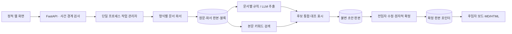

# 업무바통 구현 구조

## 실제 실행 경계

FastAPI, SQLite WAL, 최대 2개 백그라운드 작업 스레드, 단일 Uvicorn 프로세스입니다. 검색은 자료 본문에서 문자열·한글 2글자 조합 점수를 계산합니다. MCP subprocess나 임베딩 모델 다운로드는 없습니다. 검색엔진을 바꾸더라도 증빙 식별자는 원문 DB에 남습니다.

## 코드 위치

| 파일 | 역할 |
|---|---|
| `app/main.py` | API·역할 시연 경계·판본 수정/확정·출력·접속 보호 |
| `app/store.py` | SQLite 스키마·트랜잭션·불변 판본·감사 기록 |
| `app/parsers.py` | ZIP 검사·형식 확인·본문/표/셀 위치 추출 |
| `app/engine.py` | 문서별 후보·LLM 인용 검증·그룹화·경고·검색 |
| `app/jobs.py` | 지속 작업 상태·문서 단계 캐시·중단 복구 |
| `app/demo.py` | 합성 혼합 자료 생성 |
| `app/web/` | 실제 API를 사용하는 반응형 웹 UI |

## 불변성과 사건 경계

- `documents.id`는 원문 판본 ID입니다. 같은 상대 경로의 다른 해시는 새 판본입니다. 같은 경로·해시를 다시 올리면 기존 판본을 반환하고 중복 사실을 표시합니다.
- 원문 바이트는 SHA-256 경로에 보존합니다. 다른 사건에서 같은 내용이 등록되더라도 DB의 문서·블록 ID는 사건별로 구분합니다.
- `parses.id = hash(document_id, PARSER_VERSION)`. 파서 버전은 의존 패키지와 정규화 규칙을 포함하며 변경 시 상수를 올려야 합니다. 과거 블록은 삭제·수정하지 않습니다.
- `blocks.id = hash(parse_id, ordinal, text)`. 검색 결과는 이 ID를 반환합니다. 순번·문단/표행·PDF 페이지·시트/셀 위치와 원문 해시가 함께 기록됩니다.
- 모든 문서·블록·판본·작업 조회는 부모 사건 ID를 함께 검사합니다. 이는 관계 격리이며 사용자별 ACL을 의미하지 않습니다.
- 초안은 `corpus`에 파서 판본 목록과 `document_ids`를 고정합니다. 새 자료가 추가된 뒤 과거 초안을 조용히 확정할 수 없습니다.

## 필드 단위 사실

`title/status/due_date/owner/next_action/notes/completed_work/remaining_work/issues/collaborators/contacts` 각각에 `value`, `provenance`, `review_status`, `evidence`, `observations`를 둡니다. 업무 상태(`business_status`)는 별도 메타데이터입니다. 정확한 `YYYY-MM-DD`만 날짜로 정규화하고 `11월 말`, `매월 5일`은 원문과 정밀도를 보존합니다. ‘사전 점검 완료’를 전체 업무 완료로 변환하지 않습니다.

모델은 strict JSON Schema에 따라 각 필드의 `{block_id, quote}` 또는 `null`을 반환합니다. 서버가 블록 별칭을 실제 불변 ID로 복원하고 인용이 원문에 그대로 있는지 검사한 뒤 인용 자체를 필드 값으로 사용합니다. 초기 실호출에서 발견된 원문 요약·의역에 따른 계약 위반을 해결하기 위해 원문 구절 선택 방식으로 바꿨습니다. 인용의 문자 일치는 의미 정확성을 증명하지 않으므로 사람의 검토는 필요합니다.

전임자가 입력하면 `HUMAN_ENTERED`로 구분하고 기존 값과 근거를 `previous`에 보존합니다. 수정값의 `evidence`는 비워 과거 원문을 새 값의 증거로 위장하지 않습니다. 값이 비면 미확인으로 남습니다.

## 생성·수정·확정 상태

1. ZIP 등록은 한 DB 트랜잭션으로 처리합니다. 원문 파일이 먼저 쓰였다가 DB 롤백되면 참조되지 않는 바이트 파일이 남을 수 있지만 노출되지 않습니다.
2. 작업은 입력 자료·모드·모델·파서·부모 판본으로 식별합니다. `request_id`를 보내면 완료 후 재전송도 같은 작업을 반환합니다. UI는 명시적 생성 클릭마다 새 요청 ID를 사용합니다.
3. 문서별 파싱과 후보 결과를 저장합니다. 장애 재시도는 저장된 단계부터 이어 갑니다. 병합 실패는 병합부터 다시 실행합니다. 모델의 잘못된 JSON은 정상 초안으로 저장하지 않습니다.
4. 수정은 `BEGIN IMMEDIATE` 안에서 현재 판본과 예상 해시를 비교한 후 새 판본을 만듭니다. 동시 수정 중 하나만 성공합니다.
5. 확정은 같은 트랜잭션에서 현재 판본·해시·자료 목록·모든 현재/과거 인용을 검사하고 `confirmations`와 확정 포인터를 함께 기록합니다.
6. 확정은 문서 전달 행위입니다. 미확인·충돌 필드 상태는 그대로 남고 확인 필요 사항을 기록합니다.
7. 후임자는 최신 확정 포인터를 조회합니다. 새 초안 생성이나 수정은 이전 확정본을 대체하지 않습니다. 후임자 인수 확인도 해당 내용 해시를 검사합니다.

## 문서별 처리 범위

- 로컬 규칙은 모든 추출 블록을 스캔합니다. 라벨에 연결한 블록만 검토 수에 포함하고 나머지는 `PARTIALLY_REVIEWED`와 블록 ID로 남깁니다. 비정형 자료를 읽고 업무가 없다고 단정하지 않습니다.
- LLM은 문서별 최대 60,000문자를 전달합니다. 넘는 블록은 미검토로 명시합니다. JSON/인용 오류와 일시적인 네트워크·429/5xx 오류는 문서별 총 2회 이내로 시도하며, 계속 실패하면 작업 실패로 남깁니다. 인증 실패는 재시도하지 않습니다. 규칙 모드 성공으로 바꾸지 않으며 시도별 사용량·검증 결과와 실제 응답 모델 이름을 기록합니다. 실패한 호출에서 제공자가 사용량을 반환하지 않으면 토큰 수를 추정하지 않습니다.
- 모든 문서의 후보를 만든 후 통합합니다. Top-K 검색만으로 전체 초안을 만들지 않습니다. 검색 보강 결과는 `related_blocks`에 배경 자료로만 넣고 새로운 사실로 승격하지 않습니다.
- 동일 업무명과 명시적 동일 담당의 후보를 그룹화하지만, 같은 범위·대상인지 검토하라는 표시를 유지합니다. 일반적인 개체 식별·기간별 사업 분리를 완전히 해결한 방식은 아닙니다.

## 모델 설정

`.env`는 이 프로젝트에서만 읽습니다. 화면에서 연결한 키는 메모리에만 저장하고 API·로그·판본에 반환하지 않습니다. 연결 시험에는 합성 문장만 사용합니다. 문서 전송은 별도 동의를 요구합니다. 외부 서비스의 현재 API는 `docs/THIRD_PARTY_NOTICES.md`의 공식 출처를 참고하세요.

## 확정 보고서

`app/reports.py`가 확정 판본에서 공통 보고서 데이터를 만들고 HTML/MD를 렌더링합니다. `/api/cases/{case_id}/reports/{revision_id}`는 확정 여부·사건 경계를 검사하고, 같은 자료를 인계자와 인수자에게 보여 줍니다. `confirmed`는 양측 공통 확정 포인터입니다. 별도 모델 호출 없이 확정 필드로 보고서를 구성하므로 열람 때 새로운 사실을 생성하지 않습니다. 기한 분류의 기준일은 확정 시각의 한국 날짜입니다. 미기재와 전임자 입력·원문 기록·시스템 확인 권고를 구분합니다.

## 확정본 활용 · 0.4.0

`workflow.py`는 미기재 보완 목록과 현재 한국 날짜 기준 일정·담당·연락망을 계산합니다. 보고서 자체의 확정일 기준 분류는 유지합니다. `questions.py`는 확정본과 참고자료를 바탕으로 모델이 결론·이유·행동을 짧은 문단으로 작성하게 합니다. 서버는 각 문단의 인용 ID가 해당 판본에 존재하는지 검증하고 근거 목록을 인용에서 구성합니다. 생성 문장의 의미적 정확성은 ID 검증만으로 보증하지 않습니다. 원문 후보는 확정 판본 corpus로 제한하고 미확정 배경으로 분리합니다. 답변 생성 전후 확정 포인터를 검사하고 변경되면 409로 폐기합니다. 외부 전송 동의 없는 AI 조회는 차단합니다.

`POST /api/cases/{id}/documents/batch`는 여러 파일·폴더 경로를 전부 검증한 뒤 한 DB 트랜잭션으로 등록합니다. 중복 입력 경로·압축 해제 총량·파일 수를 함께 검사합니다. 기존 단일 업로드 경로는 호환성을 위해 유지합니다.

`billing.py`는 키와 API 주소의 해시별로 호출·토큰·정가 추정 비용을 SQLite에 기록합니다. 내용 검증 실패도 과금 집계하며 네트워크·사용량 미확인 호출은 미확인으로 남깁니다. API가 반환하는 날짜 포함 Solar 모델명을 같은 모델 계열로 정규화합니다. 집계 이전 및 외부 사용·할인·세금은 제외되며 실제 계정 잔액과 구분합니다.

`POST /api/cases/{case_id}/questions/stream`은 인증·동의·판본 검사 후 SSE start/delta/done/error 이벤트를 보낸다. Solar SSE의 content만 증분 해석하며 reasoning과 인용 ID는 미리 표시하지 않는다. 완료 시 기존 근거 및 확정 포인터 검증을 통과해야 done을 전송한다. X-Accel-Buffering: no와 10초 heartbeat로 전달하며 클라이언트 연결 취소는 상류 읽기를 중단한다. 최종 사용량 프레임은 내용 검증 전에 키별 장부에 반영한다.
